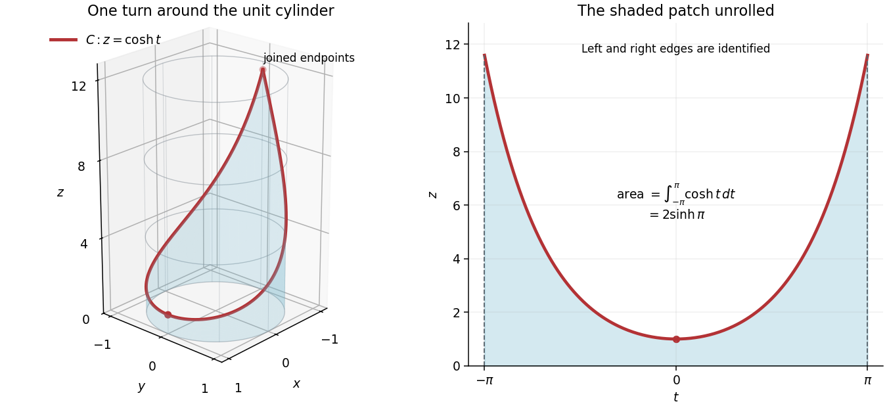
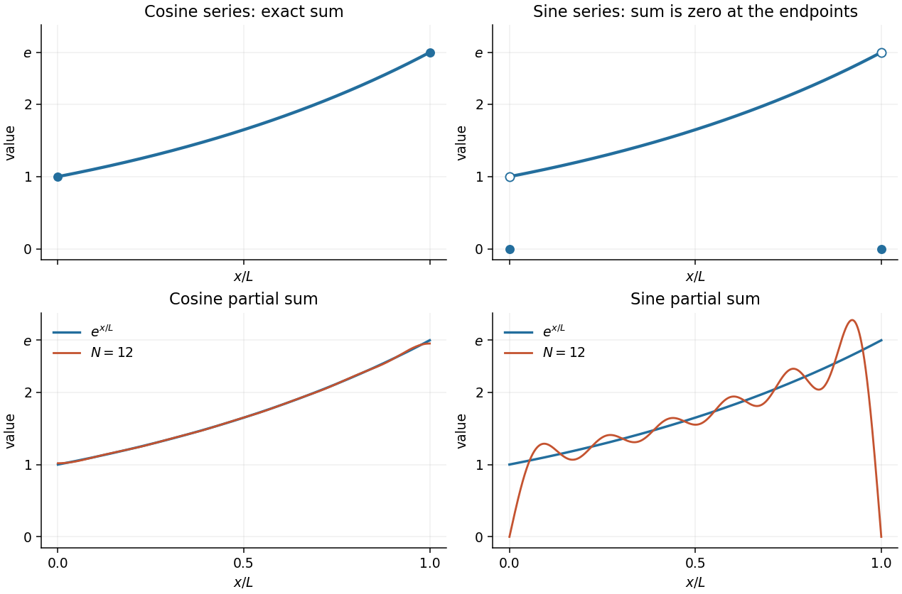

# Mathematics V

↑ **Parent:** [Prelims](../prelims.md)

Source: [released examination PDF, bundle pages 230–233](https://www.whatdotheyknow.com/request/bsc_mathematics_prelims_and_part/response/2784209/attach/3/202409%20817%20annex.pdf#page=230).

Solutions to all seven questions, including every optional question and Section C. In Question 6(b), the printed [transcendental equation](../../../mathematics.md#transcendental-equation) excludes valid [separated solutions](../../../partial-differential-equation.md#separated-solution) at common poles of the [tangents](../../../geometry-and-topology.md#tangent); the complete [characteristic equation](../../../linear-ordinary-differential-equation.md#characteristic-equation-of-a-constant-coefficient-differential-equation) and an explicit counterexample are given below.

**Table of contents**

- [1](#1)
  - [a](#1/a)
    - [Solution](#1/a/solution)
  - [b](#1/b)
    - [Solution](#1/b/solution)
  - [c](#1/c)
    - [Solution](#1/c/solution)
- [2](#2)
  - [a](#2/a)
    - [i](#2/a/i)
      - [Solution](#2/a/i/solution)
    - [ii](#2/a/ii)
      - [Solution](#2/a/ii/solution)
    - [iii](#2/a/iii)
      - [Solution](#2/a/iii/solution)
  - [b](#2/b)
    - [i](#2/b/i)
      - [Solution](#2/b/i/solution)
    - [ii](#2/b/ii)
      - [Solution](#2/b/ii/solution)
    - [iii](#2/b/iii)
      - [Solution](#2/b/iii/solution)
    - [iv](#2/b/iv)
      - [Solution](#2/b/iv/solution)
- [3](#3)
  - [a](#3/a)
    - [i](#3/a/i)
      - [Solution](#3/a/i/solution)
    - [ii](#3/a/ii)
      - [Solution](#3/a/ii/solution)
    - [iii](#3/a/iii)
      - [Solution](#3/a/iii/solution)
  - [b](#3/b)
    - [Solution](#3/b/solution)
  - [c](#3/c)
    - [Solution](#3/c/solution)
- [4](#4)
  - [a](#4/a)
    - [i](#4/a/i)
      - [Solution](#4/a/i/solution)
    - [ii](#4/a/ii)
      - [Solution](#4/a/ii/solution)
  - [b](#4/b)
    - [i](#4/b/i)
      - [Solution](#4/b/i/solution)
    - [ii](#4/b/ii)
      - [Solution](#4/b/ii/solution)
  - [c](#4/c)
    - [Solution](#4/c/solution)
- [5](#5)
  - [a](#5/a)
    - [i](#5/a/i)
      - [Solution](#5/a/i/solution)
    - [ii](#5/a/ii)
      - [Solution](#5/a/ii/solution)
  - [b](#5/b)
    - [i](#5/b/i)
      - [Solution](#5/b/i/solution)
    - [ii](#5/b/ii)
      - [Solution](#5/b/ii/solution)
    - [iii](#5/b/iii)
      - [Solution](#5/b/iii/solution)
  - [c](#5/c)
    - [Solution](#5/c/solution)
- [6](#6)
  - [a](#6/a)
    - [Solution](#6/a/solution)
  - [b](#6/b)
    - [Solution](#6/b/solution)
  - [c](#6/c)
    - [Solution](#6/c/solution)
- [7](#7)
  - [a](#7/a)
    - [i](#7/a/i)
      - [Solution](#7/a/i/solution)
    - [ii](#7/a/ii)
      - [Solution](#7/a/ii/solution)
  - [b](#7/b)
    - [i](#7/b/i)
      - [Solution](#7/b/i/solution)
    - [ii](#7/b/ii)
      - [Solution](#7/b/ii/solution)
    - [iii](#7/b/iii)
      - [Solution](#7/b/iii/solution)

## 1

↑ **Parent:** [Mathematics V](mathematics-v.md)

<h3 id="1/a">a</h3>

↑ **Parent:** [1](#1)

<h4 id="1/a/solution">Solution</h4>

↑ **Parent:** [A](#1/a)

For an [oriented surface](../../../differential-geometry.md#oriented-surface) $\Sigma$ with piecewise smooth closed [boundary](../../../topology.md#boundary-of-a-set) $\partial\Sigma$, and a [vector field](../../../multivariable-calculus.md#vector-field) $\mathbf F$ that is [continuously differentiable](../../../multivariable-calculus.md#continuously-differentiable-function) on an open neighborhood of $\Sigma$, [Stokes theorem](../../../multivariable-calculus.md#stokes-theorem) states

$$
\boxed{\iint_\Sigma(\nabla\times\mathbf F)\cdot\mathbf n\,dS
=\oint_{\partial\Sigma}\mathbf F\cdot d\mathbf r.}
$$

Here $\mathbf n$ is the chosen [unit normal vector](../../../differential-geometry.md#unit-normal). The [orientation](../../../algebraic-topology.md#orientation-of-a-simplex) of $\partial\Sigma$ follows the [right-hand rule](../../../electromagnetism.md#right-hand-rule): with the right thumb pointing along $\mathbf n$, the fingers curl in the positive direction. Equivalently, walking along the [boundary](../../../topology.md#boundary-of-a-set) with one's head along $\mathbf n$ leaves the [surface](../../../topological-surface.md) on the left. Each [boundary component](../../../topology.md#boundary-component) receives this induced [orientation](../../../algebraic-topology.md#orientation-of-a-simplex).

<h3 id="1/b">b</h3>

↑ **Parent:** [1](#1)

<h4 id="1/b/solution">Solution</h4>

↑ **Parent:** [B](#1/b)

Write $r=\sqrt{x^2+y^2}>0$. The [cylindrical coordinates](../../../multivariable-calculus.md#cylindrical-coordinate-system) give $\mathbf e_\theta=(-y/r,x/r,0)$ and $\mathbf e_r=(x/r,y/r,0)$, so the [vector components](../../../vector-space.md#coordinate-linear-algebra) of the [vector field](../../../multivariable-calculus.md#vector-field) are

$$
F_x=-\frac{yf(z)}r,\qquad F_y=\frac{xf(z)}r,\qquad F_z=0.
$$

The first two components of the [curl](../../../multivariable-calculus.md#curl), calculated in [Cartesian coordinates](../../../linear-algebra.md#cartesian-coordinate-system), are $-xf'(z)/r$ and $-yf'(z)/r$. For the third component, the [chain rule](../../../calculus.md#chain-rule) gives

$$
\partial_x(x/r)=\frac1r-\frac{x^2}{r^3},\qquad
\partial_y(y/r)=\frac1r-\frac{y^2}{r^3},
$$

and hence

$$
(\nabla\times\mathbf F)_z=f(z)\left(\frac2r-\frac{x^2+y^2}{r^3}\right)=\frac{f(z)}r.
$$

Combining these [vector components](../../../vector-space.md#coordinate-linear-algebra) in the [cylindrical basis](../../../multivariable-calculus.md#cylindrical-basis) yields

$$
\boxed{\nabla\times\mathbf F=\frac{f(z)}r\mathbf e_z-f'(z)\mathbf e_r,\qquad r>0.}
$$

The restriction $r>0$ matters because the [cylindrical basis](../../../multivariable-calculus.md#cylindrical-basis) is undefined on the axis.

<h3 id="1/c">c</h3>

↑ **Parent:** [1](#1)

<h4 id="1/c/solution">Solution</h4>

↑ **Parent:** [C](#1/c)

Use the [spherical coordinates](../../../multivariable-calculus.md#spherical-coordinate-system) parametrization

$$
\mathbf R(\phi,\theta)=(\sin\phi\cos\theta,\sin\phi\sin\theta,\cos\phi),
\qquad \alpha\leq\phi\leq\beta,\quad0\leq\theta\leq2\pi.
$$

Then $\mathbf R_\phi\times\mathbf R_\theta=\sin\phi\,\mathbf R$, so the outward [unit normal vector](../../../differential-geometry.md#unit-normal) is $\mathbf n=\mathbf R=\sin\phi\,\mathbf e_r+\cos\phi\,\mathbf e_z$ and the [surface area element](../../../multivariable-calculus.md#surface-area-element) is $\sin\phi\,d\phi\,d\theta$. Since $\sin\phi>0$ throughout this band, the [vector field](../../../multivariable-calculus.md#vector-field) is smooth near it. The [surface integral](../../../multivariable-calculus.md#surface-integral) of the [curl](../../../multivariable-calculus.md#curl) is

$$
\begin{aligned}
\iint_\Sigma(\nabla\times\mathbf F)\cdot\mathbf n\,dS
&=2\pi\int_\alpha^\beta\bigl[f(\cos\phi)\cos\phi-f'(\cos\phi)\sin^2\phi\bigr],d\phi\\
&=2\pi\int_\alpha^\beta\frac{d}{d\phi}\bigl[\sin\phi f(\cos\phi)\bigr],d\phi\\
&=\boxed{2\pi\bigl[\sin\beta f(\cos\beta)-\sin\alpha f(\cos\alpha)\bigr].}
\end{aligned}
$$

For the induced [boundary orientation](../../../differential-geometry.md#boundary-orientation), the lower circle $\phi=\beta$ is traversed with increasing $\theta$, and the upper circle $\phi=\alpha$ with decreasing $\theta$. One way to check the signs is that the outward [conormal](../../../differential-geometry.md#conormal) is $\mathbf e_\phi$ at the lower circle and $-\mathbf e_\phi$ at the upper circle; the positive [unit tangent vector](../../../tangent-vector.md#unit-tangent-vector) is $\mathbf n\times\text{conormal}$.

Along a circle of fixed $\phi$, $d\mathbf r=\sin\phi\,\mathbf e_\theta\,d\theta$. Therefore the [circulation](../../../vorticity.md#circulation-physics) is

$$
\oint_{\partial\Sigma}\mathbf F\cdot d\mathbf r
=\int_0^{2\pi} f(\cos\beta)\sin\beta\,d\theta
-\int_0^{2\pi}f(\cos\alpha)\sin\alpha\,d\theta,
$$

which equals the boxed [surface integral](../../../multivariable-calculus.md#surface-integral) and verifies [Stokes theorem](../../../multivariable-calculus.md#stokes-theorem) with the required [orientation](../../../algebraic-topology.md#orientation-of-a-simplex).

## 2

↑ **Parent:** [Mathematics V](mathematics-v.md)

<h3 id="2/a">a</h3>

↑ **Parent:** [2](#2)

<h4 id="2/a/i">i</h4>

↑ **Parent:** [A](#2/a)

<h5 id="2/a/i/solution">Solution</h5>

↑ **Parent:** [I](#2/a/i)

For a [continuously differentiable vector field](../../../multivariable-calculus.md#continuously-differentiable-vector-field) $\mathbf F$ on a neighborhood of the closure of $V$, the [divergence theorem](../../../multivariable-calculus.md#divergence-theorem) states

$$
\boxed{\iiint_V\nabla\cdot\mathbf F\,dV=\iint_{\partial V}\mathbf F\cdot\mathbf n\,dS.}
$$

Here $\mathbf n$ is the outward [unit normal vector](../../../differential-geometry.md#unit-normal); the right side is the outward [flux](../../../mathematical-physics.md#flux) through the [boundary](../../../topology.md#boundary-of-a-set).

<h4 id="2/a/ii">ii</h4>

↑ **Parent:** [A](#2/a)

<h5 id="2/a/ii/solution">Solution</h5>

↑ **Parent:** [Ii](#2/a/ii)

Apply the [product rule](../../../calculus.md#product-rule) to each [vector component](../../../vector-space.md#coordinate-linear-algebra) and sum:

$$
\begin{aligned}
\nabla\cdot(\phi\mathbf F)
&=\sum_{j=1}^3\partial_{x_j}(\phi F_j)\\
&=\phi\sum_{j=1}^3\partial_{x_j}F_j+\sum_{j=1}^3(\partial_{x_j}\phi)F_j\\
&=\boxed{\phi\nabla\cdot\mathbf F+\nabla\phi\cdot\mathbf F.}
\end{aligned}
$$

Thus the [divergence](../../../multivariable-calculus.md#divergence) of a [scalar field](../../../classical-field-theory.md#scalar-field) times a [vector field](../../../multivariable-calculus.md#vector-field) contains a [divergence](../../../multivariable-calculus.md#divergence) term and a [dot product](../../../inner-product.md#dot-product) with the [gradient](../../../multivariable-calculus.md#gradient) of the [scalar field](../../../classical-field-theory.md#scalar-field).

<h4 id="2/a/iii">iii</h4>

↑ **Parent:** [A](#2/a)

<h5 id="2/a/iii/solution">Solution</h5>

↑ **Parent:** [Iii](#2/a/iii)

Choose $\mathbf F=\nabla\psi$ in the preceding [product rule](../../../calculus.md#product-rule) and apply the [divergence theorem](../../../multivariable-calculus.md#divergence-theorem). Since $\nabla\cdot\nabla\psi=\Delta\psi$, this gives the first of [Green's identities](../../../partial-differential-equation.md#green-s-identities):

$$
\boxed{\iiint_V\bigl(\phi\Delta\psi+\nabla\phi\cdot\nabla\psi\bigr),dV
=\iint_{\partial V}\phi\,\partial_n\psi\,dS.}
$$

Here $\partial_n\psi=\mathbf n\cdot\nabla\psi$ is the outward [normal derivative](../../../differential-geometry.md#normal-derivative). Interchange $\phi$ and $\psi$, then subtract. The [gradient](../../../multivariable-calculus.md#gradient) [dot products](../../../inner-product.md#dot-product) cancel, yielding the second of [Green's identities](../../../partial-differential-equation.md#green-s-identities):

$$
\boxed{\iiint_V(\phi\Delta\psi-\psi\Delta\phi)\,dV
=\iint_{\partial V}(\phi\partial_n\psi-\psi\partial_n\phi)\,dS.}
$$

For example, $\phi,\psi\in C^2(\overline V)$ with the needed extensions suffice for these applications of the [divergence theorem](../../../multivariable-calculus.md#divergence-theorem).

<h3 id="2/b">b</h3>

↑ **Parent:** [2](#2)

<h4 id="2/b/i">i</h4>

↑ **Parent:** [B](#2/b)

<h5 id="2/b/i/solution">Solution</h5>

↑ **Parent:** [I](#2/b/i)

**False.** The [constant function](../../../function.md#constant-function) $u=1$ is a [harmonic function](../../../partial-differential-equation.md#harmonic-function) and has zero [normal derivative](../../../differential-geometry.md#normal-derivative) on every smooth [boundary](../../../topology.md#boundary-of-a-set), but it is nonzero in $V$.

In fact, the first of [Green's identities](../../../partial-differential-equation.md#green-s-identities) gives

$$
\iiint_V|\nabla u|^2\,dV=\iint_{\partial V}u\partial_nu\,dS-\iiint_Vu\Delta u\,dV=0.
$$

Hence $\nabla u=0$; [path connectedness](../../../geometry-and-topology.md#path-connected-space) makes $u$ constant throughout $V$. Thus this homogeneous [Neumann boundary condition](../../../differential-equation.md#neumann-boundary-condition) determines a [harmonic function](../../../partial-differential-equation.md#harmonic-function) only up to an additive constant.

<h4 id="2/b/ii">ii</h4>

↑ **Parent:** [B](#2/b)

<h5 id="2/b/ii/solution">Solution</h5>

↑ **Parent:** [Ii](#2/b/ii)

**True.** The first of [Green's identities](../../../partial-differential-equation.md#green-s-identities) and the [Robin boundary condition](../../../differential-equation.md#robin-boundary-condition) $\partial_nu=-u$ give

$$
\iiint_V|\nabla u|^2\,dV=-\iint_{\partial V}u^2\,dS,
\qquad
\boxed{\iiint_V|\nabla u|^2\,dV+\iint_{\partial V}u^2\,dS=0.}
$$

Both [integrands](../../../integral.md#integrand) are nonnegative, so $\nabla u=0$ in $V$ and $u=0$ on the [boundary](../../../topology.md#boundary-of-a-set). By [path connectedness](../../../geometry-and-topology.md#path-connected-space), $u$ is a [constant function](../../../function.md#constant-function), and its [boundary value](../../../differential-equation.md#boundary-value) makes that constant zero. Therefore $\boxed{u=0}$.

<h4 id="2/b/iii">iii</h4>

↑ **Parent:** [B](#2/b)

<h5 id="2/b/iii/solution">Solution</h5>

↑ **Parent:** [Iii](#2/b/iii)

**False.** Take $V=\{x^2+y^2+z^2<1\}$, the open [unit ball](../../../normed-vector-space.md#unit-ball), and $u(x,y,z)=x$. This is a nonzero [harmonic function](../../../partial-differential-equation.md#harmonic-function). On the [unit sphere](../../../topology.md#unit-sphere), the outward [unit normal vector](../../../differential-geometry.md#unit-normal) is $\mathbf n=(x,y,z)$, so

$$
\partial_nu=\mathbf n\cdot(1,0,0)=x=u.
$$

Thus the prescribed [Robin boundary condition](../../../differential-equation.md#robin-boundary-condition) holds. Unlike the preceding case, [Green's identities](../../../partial-differential-equation.md#green-s-identities) now give $\int_V|\nabla u|^2=\int_{\partial V}u^2$, which permits nonzero solutions of the [differential equation](../../../differential-equation.md).

<h4 id="2/b/iv">iv</h4>

↑ **Parent:** [B](#2/b)

<h5 id="2/b/iv/solution">Solution</h5>

↑ **Parent:** [Iv](#2/b/iv)

**True.** Two applications of [Green's identities](../../../partial-differential-equation.md#green-s-identities), or two [integrations by parts](../../../calculus.md#integration-by-parts), give

$$
\iiint_Vu\Delta^2u\,dV
=\iiint_V(\Delta u)^2\,dV
+\iint_{\partial V}\bigl(u\partial_n\Delta u-\Delta u\partial_nu\bigr)\,dS.
$$

The [biharmonic equation](../../../multivariable-calculus.md#biharmonic-equation) makes the left side zero, while the two [clamped boundary conditions](../../../differential-equation.md#clamped-boundary-condition) $u=\partial_nu=0$ annihilate the [boundary integral](../../../integral.md#boundary-integral). Consequently

$$
\iiint_V(\Delta u)^2\,dV=0,
$$

so $\Delta u=0$. Apply the first of [Green's identities](../../../partial-differential-equation.md#green-s-identities) once more with $\phi=\psi=u$: because $u=0$ on the [boundary](../../../topology.md#boundary-of-a-set), it gives $\int_V|\nabla u|^2=0$. By [path connectedness](../../../geometry-and-topology.md#path-connected-space), $u$ is constant, and the zero [boundary value](../../../differential-equation.md#boundary-value) implies $\boxed{u=0}$. This argument assumes the classical differentiability needed for the displayed [integrations by parts](../../../calculus.md#integration-by-parts).

## 3

↑ **Parent:** [Mathematics V](mathematics-v.md)

<h3 id="3/a">a</h3>

↑ **Parent:** [3](#3)

<h4 id="3/a/i">i</h4>

↑ **Parent:** [A](#3/a)

<h5 id="3/a/i/solution">Solution</h5>

↑ **Parent:** [I](#3/a/i)

For the given [wrapped hyperbolic cosine curve](../../../differential-geometry.md#wrapped-hyperbolic-cosine-curve),

$$
x^2+y^2=\cos^2t+\sin^2t=1,\qquad z=\cosh t\geq1>0,
$$

so $\boxed{C\subset S}$. The [curve](../../../topology.md#curve) makes one full turn around the [circular cylinder](../../../differential-geometry.md#circular-cylinder), descending from $(-1,0,\cosh\pi)$ to $(1,0,1)$ and ascending to its initial point. Its two parameter endpoints coincide; their [tangent vectors](../../../tangent-vector.md) $(0,-1,-\sinh\pi)$ and $(0,-1,\sinh\pi)$ do not agree, so the resulting closed [curve](../../../topology.md#curve) has a corner there.

**[Figure 1](#3/a/i/image-the-hyperbolic-cosine-curve-wrapped-around-a-unit-circular-cylinder-and-the-same-surface-unrolled). The hyperbolic cosine curve wrapped around a unit circular cylinder, and the same surface unrolled**. The shaded finite patch extends from $z=0$ to $z=\cosh t$. On the unrolled [cylinder](../../../geometry-and-topology.md#cylinder-geometry), its horizontal coordinate is $t\in[-\pi,\pi]$; the two vertical edges are identified.

<h4 id="3/a/ii">ii</h4>

↑ **Parent:** [A](#3/a)

<h5 id="3/a/ii/solution">Solution</h5>

↑ **Parent:** [Ii](#3/a/ii)

The [velocity vector](../../../tangent-vector.md#velocity-vector) of the [parametric curve](../../../topology.md#parametric-curve) is

$$
\mathbf r'(t)=(-\sin t,\cos t,\sinh t).
$$

Its [speed](../../../classical-mechanics.md#speed) is

$$
|\mathbf r'(t)|=\sqrt{1+\sinh^2t}=\cosh t,
$$

where $\cosh t>0$ fixes the sign of the square root. Hence the [arc length](../../../riemannian-geometry.md#arc-length) is

$$
\boxed{\ell(C)=\int_{-\pi}^{\pi}\cosh t\,dt=2\sinh\pi.}
$$

The coincidence of the endpoints does not duplicate any positive [arc length](../../../riemannian-geometry.md#arc-length).

<h4 id="3/a/iii">iii</h4>

↑ **Parent:** [A](#3/a)

<h5 id="3/a/iii/solution">Solution</h5>

↑ **Parent:** [Iii](#3/a/iii)

Parametrize the finite [cylindrical surface](../../../differential-geometry.md#cylindrical-surface) patch by

$$
\mathbf R(t,z)=(\cos t,\sin t,z),\qquad-\pi\leq t\leq\pi,\quad0\leq z\leq\cosh t.
$$

The [surface area element](../../../multivariable-calculus.md#surface-area-element) is $|\mathbf R_t\times\mathbf R_z|\,dt\,dz=dt\,dz$. The seam $t=\pm\pi$ has zero [surface area](../../../differential-geometry.md#surface-area), so it causes no overcounting. Therefore

$$
\boxed{A=\int_{-\pi}^{\pi}\int_0^{\cosh t}dz\,dt=2\sinh\pi.}
$$

Unrolling the unit [circular cylinder](../../../differential-geometry.md#circular-cylinder) preserves [surface area](../../../differential-geometry.md#surface-area), which explains the equality with the [area](../../../differential-geometry.md#surface-area) under the [hyperbolic cosine](../../../calculus.md#hyperbolic-cosine) in the figure. The patch consists of the [cylindrical surface](../../../differential-geometry.md#cylindrical-surface) alone; no flat base is included.

<h3 id="3/b">b</h3>

↑ **Parent:** [3](#3)

<h4 id="3/b/solution">Solution</h4>

↑ **Parent:** [B](#3/b)

At a fixed $z\in[-1,1]$, both [cylinder](../../../geometry-and-topology.md#cylinder-geometry) inequalities become

$$
|x|\leq\sqrt{1-z^2},\qquad |y|\leq\sqrt{1-z^2}.
$$

Thus the [cross section](../../../physics.md#cross-section-physics) is a [square](../../../euclidean-geometry.md#square) of side $2\sqrt{1-z^2}$ and [area](../../../differential-geometry.md#surface-area) $4(1-z^2)$. Integrating these [cross-sectional areas](../../../euclidean-geometry.md#cross-sectional-area) gives the [volume](../../../geometry-and-topology.md#volume) of this [bicylinder](../../../euclidean-geometry.md#bicylinder):

$$
\boxed{\operatorname{Vol}(R_1)=\int_{-1}^{1}4(1-z^2)\,dz
=4\left[z-\frac{z^3}{3}\right]_{-1}^{1}=\frac{16}{3}.}
$$

<h3 id="3/c">c</h3>

↑ **Parent:** [3](#3)

<h4 id="3/c/solution">Solution</h4>

↑ **Parent:** [C](#3/c)

For the [surface area of a tricylinder](../../../euclidean-geometry.md#surface-area-of-a-tricylinder), permutation [symmetry](../../../physics.md#symmetry-physics) shows that each of the three [cylindrical surfaces](../../../differential-geometry.md#cylindrical-surface) contributes the same [surface area](../../../differential-geometry.md#surface-area) to the [boundary](../../../topology.md#boundary-of-a-set). On the face $x^2+y^2=1$, put $x=\cos\theta$, $y=\sin\theta$. The remaining two inequalities require

$$
z^2\leq1-y^2=\cos^2\theta,\qquad
z^2\leq1-x^2=\sin^2\theta,
$$

so $|z|\leq\min(|\sin\theta|,|\cos\theta|)$. The [surface area element](../../../multivariable-calculus.md#surface-area-element) on this unit [circular cylinder](../../../differential-geometry.md#circular-cylinder) is $d\theta\,dz$. There are eight congruent angular sectors, with the minimum equal to $\sin\theta$ for $0\leq\theta\leq\pi/4$. Thus the [area](../../../differential-geometry.md#surface-area) of this face is

$$
A_1=\int_0^{2\pi}2\min(|\sin\theta|,|\cos\theta|)\,d\theta
=16\int_0^{\pi/4}\sin\theta\,d\theta
=8(2-\sqrt2).
$$

Every [boundary point](../../../topology.md#boundary-point) lies on at least one of these three [cylindrical surfaces](../../../differential-geometry.md#cylindrical-surface); their pairwise intersections are [curves](../../../topology.md#curve) of zero [surface area](../../../differential-geometry.md#surface-area). Adding the three faces therefore gives

$$
\boxed{\operatorname{Area}(\partial R_2)=24(2-\sqrt2).}
$$

## 4

↑ **Parent:** [Mathematics V](mathematics-v.md)

<h3 id="4/a">a</h3>

↑ **Parent:** [4](#4)

<h4 id="4/a/i">i</h4>

↑ **Parent:** [A](#4/a)

<h5 id="4/a/i/solution">Solution</h5>

↑ **Parent:** [I](#4/a/i)

The [Fourier cosine series](../../../fourier-series.md#fourier-cosine-series) on $[0,L]$ is

$$
f(x)\sim\frac{a_0}{2}+\sum_{n=1}^\infty a_n\cos\frac{n\pi x}{L},
\qquad
\boxed{a_n=\frac2L\int_0^Lf(x)\cos\frac{n\pi x}{L}\,dx\quad(n\geq0).}
$$

It is the [Fourier series](../../../fourier-series.md) of the [even extension](../../../fourier-series.md#even-extension) to $[-L,L]$, repeated with [period](../../../mathematics.md#period-of-a-function) $2L$. The [Fourier sine series](../../../fourier-series.md#fourier-sine-series) is

$$
f(x)\sim\sum_{n=1}^\infty b_n\sin\frac{n\pi x}{L},
\qquad
\boxed{b_n=\frac2L\int_0^Lf(x)\sin\frac{n\pi x}{L}\,dx\quad(n\geq1).}
$$

It comes from the [odd extension](../../../calculus.md#odd-extension) and its $2L$-[periodic extension](../../../function.md#periodic-extension). These [Fourier coefficient](../../../fourier-series.md#fourier-coefficient) formulas follow by [Fourier orthogonality](../../../fourier-series.md#fourier-orthogonality), since every nonconstant [sine](../../../geometry-and-topology.md#sine) or [cosine](../../../geometry-and-topology.md#cosine) has squared [integral](../../../integral.md) $L/2$ on $[0,L]$, while the [constant function](../../../function.md#constant-function) has squared [integral](../../../integral.md) $L$.

<h4 id="4/a/ii">ii</h4>

↑ **Parent:** [A](#4/a)

<h5 id="4/a/ii/solution">Solution</h5>

↑ **Parent:** [Ii](#4/a/ii)

Under the stated piecewise smooth hypotheses, the [Dirichlet convergence theorem for Fourier series](../../../fourier-series.md#dirichlet-s-theorem-on-fourier-series) gives the average of the two one-sided limits of the corresponding [periodic extension](../../../function.md#periodic-extension). The [even extension](../../../fourier-series.md#even-extension) is continuous at both endpoints, so the [Fourier cosine series](../../../fourier-series.md#fourier-cosine-series) converges to

$$
\boxed{f(x)\quad\text{for every }x\in[0,L].}
$$

The [odd extension](../../../calculus.md#odd-extension) agrees with $f$ on $(0,L)$, but its left and right limits are $-f(0),f(0)$ at zero and $f(L),-f(L)$ at the join $L$. Therefore the [Fourier sine series](../../../fourier-series.md#fourier-sine-series) converges to

$$
\boxed{\begin{cases}f(x),&0<x<L,\\0,&x=0\text{ or }x=L.\end{cases}}
$$

Indeed every [partial sum](../../../sequence-and-series.md#partial-sum) of the [Fourier sine series](../../../fourier-series.md#fourier-sine-series) is already zero at both endpoints. The endpoint values agree with $f$ only when the corresponding [boundary values](../../../differential-equation.md#boundary-value) vanish.

<h3 id="4/b">b</h3>

↑ **Parent:** [4](#4)

<h4 id="4/b/i">i</h4>

↑ **Parent:** [B](#4/b)

<h5 id="4/b/i/solution">Solution</h5>

↑ **Parent:** [I](#4/b/i)

Set $u=x/L$ and $q=n\pi$. The required [integrals](../../../integral.md) follow from

$$
\int e^u\cos(qu)\,du=\frac{e^u(\cos(qu)+q\sin(qu))}{1+q^2},\qquad
\int e^u\sin(qu)\,du=\frac{e^u(\sin(qu)-q\cos(qu))}{1+q^2}.
$$

Consequently the [Fourier coefficients](../../../fourier-series.md#fourier-coefficient) are

$$
\boxed{a_0=2(e-1),\qquad
 a_n=\frac{2[(-1)^ne-1]}{1+n^2\pi^2},\qquad
 b_n=\frac{2n\pi[1-(-1)^ne]}{1+n^2\pi^2}\quad(n\geq1).}
$$

Thus the [Fourier cosine series](../../../fourier-series.md#fourier-cosine-series) is

$$
\boxed{e-1+2\sum_{n=1}^\infty\frac{(-1)^ne-1}{1+n^2\pi^2}\cos\frac{n\pi x}{L},}
$$

and its sum is $e^{x/L}$ everywhere on $[0,L]$. The [Fourier sine series](../../../fourier-series.md#fourier-sine-series) is

$$
\boxed{2\sum_{n=1}^\infty\frac{n\pi[1-(-1)^ne]}{1+n^2\pi^2}\sin\frac{n\pi x}{L},}
$$

and its sum is $e^{x/L}$ on $(0,L)$ and zero at the two endpoints. The open and filled circles in the sketches distinguish these endpoint limits from the actual values of the sum.

**[Figure 2](#4/b/i/image-the-sums-and-finite-partial-sums-of-the-fourier-cosine-series-and-fourier-sine-series-for-e-x-l). The sums and finite partial sums of the Fourier cosine series and Fourier sine series for $e^{x/L}$**. The upper panels show the exact sums on $[0,L]$. The lower panels compare twelve-term [partial sums](../../../sequence-and-series.md#partial-sum) with the [exponential function](../../../calculus.md#exponential-function): the [Fourier sine series](../../../fourier-series.md#fourier-sine-series) has zero endpoints and oscillations near its [periodic extension](../../../function.md#periodic-extension)'s jumps.

<h4 id="4/b/ii">ii</h4>

↑ **Parent:** [B](#4/b)

<h5 id="4/b/ii/solution">Solution</h5>

↑ **Parent:** [Ii](#4/b/ii)

First, the [Fourier coefficients](../../../fourier-series.md#fourier-coefficient) of the [Fourier cosine series](../../../fourier-series.md#fourier-cosine-series) decay as $O(n^{-2})$, whereas those of the [Fourier sine series](../../../fourier-series.md#fourier-sine-series) are of order $n^{-1}$. In particular, the [absolute convergence](../../../sequence-and-series.md#absolute-convergence) bound for the [Fourier cosine series](../../../fourier-series.md#fourier-cosine-series) gives a uniform tail estimate

$$
\sup_{0\leq x\leq L}|g(x)-C_N(x)|
\leq2(e+1)\sum_{n>N}\frac1{1+n^2\pi^2}=O(N^{-1}).
$$

Thus its tail is absolutely controlled using fewer [Fourier harmonics](../../../fourier-series.md#fourier-harmonic). The [Fourier sine series](../../../fourier-series.md#fourier-sine-series) does not have an absolutely summable sequence of [Fourier coefficients](../../../fourier-series.md#fourier-coefficient).

Second, the [even extension](../../../fourier-series.md#even-extension) is continuous, so its [Fourier cosine series](../../../fourier-series.md#fourier-cosine-series) converges uniformly on the closed interval and approximates the nonzero endpoint limits correctly. The [odd periodic extension](../../../calculus.md#odd-periodic-extension) has jumps, producing the [Gibbs phenomenon](../../../fourier-series.md#gibbs-phenomenon) in its [Fourier sine series](../../../fourier-series.md#fourier-sine-series) near zero and $L$. Every [Fourier sine series](../../../fourier-series.md#fourier-sine-series) [partial sum](../../../sequence-and-series.md#partial-sum) is zero at both endpoints, so by approaching $L$ from inside $(0,L)$ one obtains

$$
\sup_{0<x<L}|g(x)-S_N(x)|\geq e.
$$

Hence the [Fourier sine series](../../../fourier-series.md#fourier-sine-series) approximation cannot converge uniformly even on the whole open interval, despite [pointwise convergence](../../../sequence-and-series.md#pointwise-convergence) at each interior point. **The [Fourier cosine series](../../../fourier-series.md#fourier-cosine-series) approximation has faster [coefficient decay](../../../fourier-series.md#fourier-coefficient-decay) and avoids the persistent errors near the endpoints.**

<h3 id="4/c">c</h3>

↑ **Parent:** [4](#4)

<h4 id="4/c/solution">Solution</h4>

↑ **Parent:** [C](#4/c)

Take $\boxed{p(x)=x(L-x)}$. It vanishes at both endpoints. Its [odd periodic extension](../../../calculus.md#odd-periodic-extension) is continuously differentiable across the joins, whereas its [even extension](../../../fourier-series.md#even-extension) has corners because $p'(0)=L$ and $p'(L)=-L$ are nonzero.

Two [integrations by parts](../../../calculus.md#integration-by-parts), with $q=n\pi/L$, give

$$
\int_0^Lp(x)\sin(qx)\,dx=\frac{2[1-(-1)^n]}{q^3},\qquad
\int_0^Lp(x)\cos(qx)\,dx=-\frac{L[1+(-1)^n]}{q^2}.
$$

The [Fourier coefficients](../../../fourier-series.md#fourier-coefficient) are therefore

$$
\boxed{b_n=\frac{4L^2[1-(-1)^n]}{n^3\pi^3},\qquad
 a_0=\frac{L^2}{3},\qquad
 a_n=-\frac{2L^2[1+(-1)^n]}{n^2\pi^2}.}
$$

The [Fourier sine series](../../../fourier-series.md#fourier-sine-series) has a uniform absolute tail $O(N^{-2})$, and each of its [partial sums](../../../sequence-and-series.md#partial-sum) satisfies both zero [boundary values](../../../differential-equation.md#boundary-value) exactly. The [Fourier cosine series](../../../fourier-series.md#fourier-cosine-series) has an absolute tail bound $O(N^{-1})$; at $x=0$ its omitted even-index [Fourier coefficients](../../../fourier-series.md#fourier-coefficient) have the same sign and yield an error of order $N^{-1}$. This verifies a strictly faster uniform error bound for the sine approximation in this example.

## 5

↑ **Parent:** [Mathematics V](mathematics-v.md)

<h3 id="5/a">a</h3>

↑ **Parent:** [5](#5)

<h4 id="5/a/i">i</h4>

↑ **Parent:** [A](#5/a)

<h5 id="5/a/i/solution">Solution</h5>

↑ **Parent:** [I](#5/a/i)

Let $w$ be the difference of two sufficiently regular solutions of the [wave equation](../../../wave-equation.md) with the prescribed data. By [linearity](../../../vector-space.md#linearity), $w$ has zero [initial displacement](../../../differential-equation.md#initial-displacement), zero [initial velocity](../../../differential-equation.md#initial-velocity), and homogeneous [Dirichlet boundary conditions](../../../differential-equation.md#dirichlet-boundary-condition). Define its [wave energy](../../../wave-equation.md#wave-energy) by

$$
E(t)=\frac12\int_0^\pi(w_t^2+w_x^2)\,dx\geq0.
$$

For $\alpha=0$, [differentiation under the integral sign](../../../analysis.md#differentiation-under-the-integral-sign) and [integration by parts](../../../calculus.md#integration-by-parts) yield

$$
E'(t)=\int_0^\pi w_t(w_{tt}-w_{xx})\,dx+[w_tw_x]_0^\pi=0.
$$

The [boundary term](../../../calculus.md#boundary-term) vanishes because $w=0$ at both fixed endpoints implies $w_t=0$ there. The zero [initial data](../../../general-relativity.md#initial-data-in-general-relativity) give $E(0)=0$, so $w_t=w_x=0$ for all times. Thus $w$ is spatially constant, and its zero [boundary values](../../../differential-equation.md#boundary-value) give $\boxed{w=0}$. This proves [uniqueness](../../../mathematical-logic.md#uniqueness) for the undamped [wave equation](../../../wave-equation.md).

<h4 id="5/a/ii">ii</h4>

↑ **Parent:** [A](#5/a)

<h5 id="5/a/ii/solution">Solution</h5>

↑ **Parent:** [Ii](#5/a/ii)

Use the same difference $w$ and [wave energy](../../../wave-equation.md#wave-energy) as in part (i). The [damped wave equation](../../../wave-equation.md#damped-wave-equation) now gives the [energy dissipation identity for a linearly damped string](../../../wave-equation.md#energy-dissipation-identity-for-a-linearly-damped-string)

$$
\boxed{E'(t)=\int_0^\pi w_t(w_{tt}-w_{xx})\,dx
=-2\alpha\int_0^\pi w_t^2\,dx\leq0.}
$$

Because $E(0)=0$ and $E(t)\geq0$, the [energy](../../../energy.md) remains zero. Hence $w_t=w_x=0$, and the homogeneous [Dirichlet boundary conditions](../../../differential-equation.md#dirichlet-boundary-condition) force $w=0$. Therefore the [solution of a differential equation](../../../differential-equation.md#solution-of-a-differential-equation) is unique also for $\boxed{\alpha>0}$; positive [damping](../../../wave-equation.md#damping) can only decrease this [energy](../../../energy.md).

<h3 id="5/b">b</h3>

↑ **Parent:** [5](#5)

<h4 id="5/b/i">i</h4>

↑ **Parent:** [B](#5/b)

<h5 id="5/b/i/solution">Solution</h5>

↑ **Parent:** [I](#5/b/i)

Substitute the [separated solution](../../../partial-differential-equation.md#separated-solution) $y=e^{-\alpha t}F(t)\sin(nx)$ into the [damped wave equation](../../../wave-equation.md#damped-wave-equation). Its [time derivatives](../../../multivariable-calculus.md#time-derivative) give

$$
y_{tt}+2\alpha y_t=e^{-\alpha t}(F''-\alpha^2F)\sin(nx),
$$

whereas $y_{xx}=-n^2e^{-\alpha t}F\sin(nx)$. Thus

$$
F''+(n^2-\alpha^2)F=0,\qquad F(0)=0,\quad F'(0)=1.
$$

The last two conditions follow from $y(x,0)=0$ and $y_t(x,0)=\sin(nx)$. For $0<\alpha<n$, let $\nu=\sqrt{n^2-\alpha^2}>0$. The [simple harmonic motion](../../../classical-mechanics.md#simple-harmonic-motion) equation has [solution of a differential equation](../../../differential-equation.md#solution-of-a-differential-equation)

$$
\boxed{F(t)=\frac{\sin(\nu t)}\nu,\qquad \nu=\sqrt{n^2-\alpha^2}.}
$$

This is an [underdamped](../../../wave-equation.md#underdamping) [normal mode](../../../wave-equation.md#normal-mode): its oscillations have the decaying factor $e^{-\alpha t}$.

<h4 id="5/b/ii">ii</h4>

↑ **Parent:** [B](#5/b)

<h5 id="5/b/ii/solution">Solution</h5>

↑ **Parent:** [Ii](#5/b/ii)

When $\alpha=n$, the reduced [ordinary differential equation](../../../differential-equation.md#ordinary-differential-equation) is $F''=0$. The [initial conditions](../../../differential-equation.md#initial-condition) $F(0)=0$, $F'(0)=1$ give

$$
\boxed{F(t)=t,\qquad y(x,t)=te^{-nt}\sin(nx).}
$$

This is the [critically damped](../../../wave-equation.md#critical-damping) [normal mode](../../../wave-equation.md#normal-mode), also obtained by taking $\nu\to0$ in $\sin(\nu t)/\nu$.

<h4 id="5/b/iii">iii</h4>

↑ **Parent:** [B](#5/b)

<h5 id="5/b/iii/solution">Solution</h5>

↑ **Parent:** [Iii](#5/b/iii)

When $\alpha>n$, set $\mu=\sqrt{\alpha^2-n^2}>0$. The reduced [ordinary differential equation](../../../differential-equation.md#ordinary-differential-equation) is $F''-\mu^2F=0$. Enforcing the same [initial conditions](../../../differential-equation.md#initial-condition) gives

$$
\boxed{F(t)=\frac{\sinh(\mu t)}\mu,\qquad\mu=\sqrt{\alpha^2-n^2}.}
$$

The corresponding [overdamped](../../../wave-equation.md#overdamping) [normal mode](../../../wave-equation.md#normal-mode) can also be written

$$
y(x,t)=\frac{e^{(-\alpha+\mu)t}-e^{(-\alpha-\mu)t}}{2\mu}\sin(nx).
$$

Both rates in the [exponential functions](../../../calculus.md#exponential-function) are negative because $0<\mu<\alpha$, so the [hyperbolic sine](../../../calculus.md#hyperbolic-sine) factor does not prevent decay.

<h3 id="5/c">c</h3>

↑ **Parent:** [5](#5)

<h4 id="5/c/solution">Solution</h4>

↑ **Parent:** [C](#5/c)

For $\alpha=3$, let $F_n$ denote the time factor normalized by $F_n(0)=0$, $F_n'(0)=1$. By [superposition](../../../vector-space.md#superposition-principle) the [Fourier sine series](../../../fourier-series.md#fourier-sine-series) solution is

$$
y(x,t)=e^{-3t}\sum_{n=1}^\infty b_nF_n(t)\sin(nx),\qquad
F_n(t)=\begin{cases}
\dfrac{\sinh(\sqrt{9-n^2}\,t)}{\sqrt{9-n^2}},&n<3,\\
t,&n=3,\\
\dfrac{\sin(\sqrt{n^2-9}\,t)}{\sqrt{n^2-9}},&n>3.
\end{cases}
$$

At $t=0$, its [initial velocity](../../../differential-equation.md#initial-velocity) is $\sum_{n\geq1}b_n\sin(nx)=\sin^2x$. Multiply by $\sin(mx)$, integrate on $[0,\pi]$, and use the permitted interchange and [Fourier orthogonality](../../../fourier-series.md#fourier-orthogonality). This yields the requested [integral](../../../integral.md) expression

$$
\boxed{b_n=\frac2\pi\int_0^\pi\sin^2x\sin(nx)\,dx.}
$$

Under $x\mapsto\pi-x$, $\sin^2x$ is unchanged and $\sin(n(\pi-x))=(-1)^{n+1}\sin(nx)$. Hence every even-index [Fourier coefficient](../../../fourier-series.md#fourier-coefficient) is zero, including $b_2$.

For odd $n$, use $\sin^2x=(1-\cos2x)/2$ and the [product-to-sum formula](../../../geometry-and-topology.md#product-to-sum-formula):

$$
\begin{aligned}
\int_0^\pi\sin^2x\sin(nx)\,dx
&=\frac1n-\frac12\left(\frac1{n+2}+\frac1{n-2}\right)\\
&=-\frac4{n(n^2-4)}.
\end{aligned}
$$

Thus

$$
\boxed{b_n=\begin{cases}-\dfrac8{\pi n(n^2-4)},&n\text{ odd},\\0,&n\text{ even}.\end{cases}}
$$

In particular $b_1=8/(3\pi)$ and $b_3=-8/(15\pi)$. An explicit version of the [solution of a differential equation](../../../differential-equation.md#solution-of-a-differential-equation) is

$$
\boxed{y(x,t)=e^{-3t}\left[
\frac8{3\pi}\frac{\sinh(\sqrt8\,t)}{\sqrt8}\sin x
-\frac8{15\pi}t\sin3x
-\frac8\pi\sum_{\substack{n\geq5\\n\text{ odd}}}
\frac{\sin(\sqrt{n^2-9}\,t)\sin(nx)}{n(n^2-4)\sqrt{n^2-9}}
\right].}
$$

Only the first, [overdamped](../../../wave-equation.md#overdamping) [normal mode](../../../wave-equation.md#normal-mode), the third, [critically damped](../../../wave-equation.md#critical-damping) [normal mode](../../../wave-equation.md#normal-mode), and the odd [underdamped](../../../wave-equation.md#underdamping) [normal modes](../../../wave-equation.md#normal-mode) of index at least five occur. No odd-index [Fourier coefficient](../../../fourier-series.md#fourier-coefficient) vanishes.

## 6

↑ **Parent:** [Mathematics V](mathematics-v.md)

<h3 id="6/a">a</h3>

↑ **Parent:** [6](#6)

<h4 id="6/a/solution">Solution</h4>

↑ **Parent:** [A](#6/a)

Conservation of [thermal energy](../../../thermodynamics.md#thermal-energy) and [Fourier's law](../../../heat.md#fourier-s-law) give the [heat equations](../../../diffusion-equation.md#heat-equation)

$$
\boxed{\rho_1c_1\,T_{1t}=k_1T_{1xx}\quad(-L<x<0),\qquad
\rho_2c_2\,T_{2t}=k_2T_{2xx}\quad(0<x<L).}
$$

The [density](../../../fluid-mechanics.md#density) times the [specific heat capacity](../../../heat.md#specific-heat-capacity), $\rho_i c_i$, is the [volumetric heat capacity](../../../heat.md#volumetric-heat-capacity), and $k_i$ is the [thermal conductivity](../../../heat.md#thermal-conductivity).

The condition $T_1(-L,t)=0$ holds the left exterior face at a fixed zero reference [temperature](../../../temperature.md); $T_2(L,t)=0$ does the same for the right exterior face. The condition $T_1(0_-,t)=T_2(0_+,t)$ expresses perfect [thermal contact](../../../thermodynamics.md#thermal-contact), with no [temperature](../../../temperature.md) jump at the interface. Finally,

$$
-k_1T_{1x}(0_-,t)=-k_2T_{2x}(0_+,t)
$$

expresses continuity of the signed [heat flux](../../../heat.md#heat-flux-density) in the positive $x$ direction: the interface neither stores nor produces [heat](../../../heat.md).

<h3 id="6/b">b</h3>

↑ **Parent:** [6](#6)

<h4 id="6/b/solution">Solution</h4>

↑ **Parent:** [B](#6/b)

For $\omega\ne0$, substitution of the [separated solutions](../../../partial-differential-equation.md#separated-solution) into the [heat equations](../../../diffusion-equation.md#heat-equation) gives

$$
G_i''+\omega^2\alpha_i^2G_i=0,\qquad
\alpha_i=\sqrt{\frac{\rho_ic_i}{k_i}}.
$$

The zero exterior [boundary values](../../../differential-equation.md#boundary-value) are incorporated by

$$
G_1(x)=A\sin[\omega\alpha_1(x+L)],\qquad
G_2(x)=B\sin[\omega\alpha_2(L-x)].
$$

To obtain a [eigenvalue equation for heat conduction in two joined slabs](../../../diffusion-equation.md#eigenvalue-equation-for-heat-conduction-in-two-joined-slabs), write $u=\omega\alpha_1L$ and $v=\omega\alpha_2L$. Continuity of [temperature](../../../temperature.md) and [heat flux](../../../heat.md#heat-flux-density) at zero gives the homogeneous [linear system](../../../linear-algebra.md#system-of-linear-equations)

$$
A\sin u-B\sin v=0,\qquad
k_1\alpha_1A\cos u+k_2\alpha_2B\cos v=0.
$$

A nonzero amplitude pair exists precisely when its [determinant](../../../multilinear-algebra.md#determinant) vanishes, equivalently

$$
\boxed{D(\omega):=k_1\alpha_1\cos u\sin v+k_2\alpha_2\sin u\cos v=0,\qquad\omega\ne0.}
$$

If $\cos u\cos v\ne0$, division by $k_1k_2\alpha_1\alpha_2\cos u\cos v$ gives the printed [transcendental equation](../../../mathematics.md#transcendental-equation)

$$
\boxed{\frac{\tan(\omega\alpha_1L)}{\alpha_1k_1}
+\frac{\tan(\omega\alpha_2L)}{\alpha_2k_2}=0.}
$$

**The printed necessity claim needs the qualification that both [tangents](../../../geometry-and-topology.md#tangent) are defined.** If just one of $\cos u,\cos v$ vanishes, $D(\omega)\ne0$. If both [cosines](../../../geometry-and-topology.md#cosine) vanish, however, $D(\omega)=0$ and legitimate [normal modes](../../../wave-equation.md#normal-mode) remain. Their [temperature](../../../temperature.md) at the [thermal interface](../../../thermodynamics.md#thermal-interface) need not be zero; the [temperature](../../../temperature.md) condition fixes the amplitude ratio, while each [heat flux](../../../heat.md#heat-flux-density) is zero there.

For a concrete counterexample, take identical slabs: $\rho_1=\rho_2=\rho$, $c_1=c_2=c$, $k_1=k_2=k$, and $\alpha=\sqrt{\rho c/k}$. Then

$$
\boxed{T_1(x,t)=T_2(x,t)=e^{-\omega^2t}\cos\frac{\pi x}{2L},\qquad
\omega=\frac{\pi}{2\alpha L},}
$$

with each formula restricted to its own slab, satisfies both [heat equations](../../../diffusion-equation.md#heat-equation) and all four [boundary conditions](../../../differential-equation.md#boundary-condition). But $\omega\alpha L=\pi/2$, so neither [tangent](../../../geometry-and-topology.md#tangent) is defined. This directly disproves the unqualified printed assertion. The [determinant](../../../multilinear-algebra.md#determinant) condition retains these missing [normal modes](../../../wave-equation.md#normal-mode).

Finally, $\omega=0$ must be checked before dividing by it. Then $G_1=A(x+L)$, $G_2=B(L-x)$, and interface continuity gives $A=B$, while [heat flux](../../../heat.md#heat-flux-density) continuity gives $k_1A=-k_2B$. Positivity of the [thermal conductivities](../../../heat.md#thermal-conductivity) forces $A=B=0$. Thus $\boxed{\omega=0\text{ gives only the trivial solution}.}$ In the [determinant](../../../multilinear-algebra.md#determinant) formula, its apparent zero at $\omega=0$ is spurious because the chosen sine basis degenerates there.

<h3 id="6/c">c</h3>

↑ **Parent:** [6](#6)

<h4 id="6/c/solution">Solution</h4>

↑ **Parent:** [C](#6/c)

Choose the positive weights

$$
\boxed{a=\rho_1c_1,\qquad b=\rho_2c_2.}
$$

These are the [volumetric heat capacities](../../../heat.md#volumetric-heat-capacity). The [heat equations](../../../diffusion-equation.md#heat-equation) and [integration by parts](../../../calculus.md#integration-by-parts) give

$$
\begin{aligned}
I'(t)
&=2k_1\int_{-L}^0T_1T_{1xx}\,dx+2k_2\int_0^LT_2T_{2xx}\,dx\\
&=2k_1[T_1T_{1x}]_{-L}^{0}+2k_2[T_2T_{2x}]_0^L
-2k_1\int_{-L}^0T_{1x}^2\,dx-2k_2\int_0^LT_{2x}^2\,dx.
\end{aligned}
$$

The exterior [boundary terms](../../../calculus.md#boundary-term) vanish because the [temperatures](../../../temperature.md) there are zero. At the [thermal interface](../../../thermodynamics.md#thermal-interface), the remaining term is

$$
2T(0,t)\,[k_1T_{1x}(0_-,t)-k_2T_{2x}(0_+,t)]=0
$$

by continuity of [temperature](../../../temperature.md) and [heat flux](../../../heat.md#heat-flux-density). Hence the weighted [energy estimate](../../../partial-differential-equation.md#energy-estimate) is

$$
\boxed{I'(t)=-2k_1\int_{-L}^0T_{1x}^2\,dx-2k_2\int_0^LT_{2x}^2\,dx\leq0.}
$$

Both weights are positive, so $I\geq0$. Zero initial [temperatures](../../../temperature.md) give $I(0)=0$, forcing $I(t)=0$ for all $t>0$. Each [temperature](../../../temperature.md) therefore vanishes throughout its slab. Applying this argument to a difference also proves [uniqueness](../../../mathematical-logic.md#uniqueness) for arbitrary common [initial data](../../../general-relativity.md#initial-data-in-general-relativity) in this [thermal interface problem](../../../diffusion-equation.md#thermal-interface-problem).

## 7

↑ **Parent:** [Mathematics V](mathematics-v.md)

<h3 id="7/a">a</h3>

↑ **Parent:** [7](#7)

<h4 id="7/a/i">i</h4>

↑ **Parent:** [A](#7/a)

<h5 id="7/a/i/solution">Solution</h5>

↑ **Parent:** [I](#7/a/i)

For any bounded [volume](../../../geometry-and-topology.md#volume) $V$ with piecewise smooth closed [boundary](../../../topology.md#boundary-of-a-set) and outward [unit normal vector](../../../differential-geometry.md#unit-normal) $\mathbf n$, [Gauss's law](../../../maxwell-equations.md#gauss-s-law) in integral form is

$$
\boxed{\iint_{\partial V}\mathbf E\cdot\mathbf n\,dS
=\frac{Q_V}{\epsilon_0},\qquad Q_V=\iiint_V\rho\,dV.}
$$

Thus the outward [electric flux](../../../electric-field.md#electric-flux) equals the enclosed [electric charge](../../../electric-charge.md) divided by the [vacuum permittivity](../../../permittivity.md#vacuum-permittivity). To prove it, apply the [divergence theorem](../../../multivariable-calculus.md#divergence-theorem) to the [electric field](../../../electric-field.md) and use its given [divergence](../../../multivariable-calculus.md#divergence):

$$
\iint_{\partial V}\mathbf E\cdot\mathbf n\,dS
=\iiint_V\nabla\cdot\mathbf E\,dV
=\frac1{\epsilon_0}\iiint_V\rho\,dV.
$$

The classical proof assumes the requisite differentiability of the [electric field](../../../electric-field.md). For piecewise smooth [charge densities](../../../electric-charge.md#charge-density), one may apply the [divergence theorem](../../../multivariable-calculus.md#divergence-theorem) piece by piece and cancel the internal [fluxes](../../../mathematical-physics.md#flux).

<h4 id="7/a/ii">ii</h4>

↑ **Parent:** [A](#7/a)

<h5 id="7/a/ii/solution">Solution</h5>

↑ **Parent:** [Ii](#7/a/ii)

The space $\mathbb R^3$ is [simply connected](../../../algebraic-topology.md#simply-connected-space), and the [electric field](../../../electric-field.md) has zero [curl](../../../multivariable-calculus.md#curl). Hence it is a [conservative vector field](../../../multivariable-calculus.md#conservative-vector-field). More explicitly, [Stokes theorem](../../../multivariable-calculus.md#stokes-theorem) gives zero [circulation](../../../vorticity.md#circulation-physics) around any closed loop, since such a loop bounds a spanning [surface](../../../topological-surface.md) in $\mathbb R^3$. Therefore the [line integral](../../../multivariable-calculus.md#line-integral) between two fixed endpoints is independent of the chosen path.

Fix a reference point $\mathbf r_0$ and define the [electric potential](../../../electric-field.md#electric-potential)

$$
\varphi(\mathbf r)=-\int_{\mathbf r_0}^{\mathbf r}\mathbf E\cdot d\boldsymbol\ell+C.
$$

Taking a short straight terminal segment in each coordinate direction shows $\partial_j\varphi=-E_j$. Consequently

$$
\boxed{\mathbf E=-\nabla\varphi.}
$$

The [electric potential](../../../electric-field.md#electric-potential) is determined up to an additive constant; the later condition at infinity fixes that constant for the finite [charge distribution](../../../electric-charge.md#charge-distribution) in part (b).

<h3 id="7/b">b</h3>

↑ **Parent:** [7](#7)

<h4 id="7/b/i">i</h4>

↑ **Parent:** [B](#7/b)

<h5 id="7/b/i/solution">Solution</h5>

↑ **Parent:** [I](#7/b/i)

By the assumed [spherical symmetry](../../../geometry-and-topology.md#spherical-symmetry) of the [electric potential](../../../electric-field.md#electric-potential), the [electric field](../../../electric-field.md) is radial: $\mathbf E=E_r(r)\mathbf e_r$ for $r>0$. On a [sphere](../../../euclidean-geometry.md#sphere) of radius $r$, [Gauss's law](../../../maxwell-equations.md#gauss-s-law) therefore reads

$$
4\pi r^2E_r(r)=\frac{Q(r)}{\epsilon_0},\qquad
Q(r)=4\pi\int_0^r\rho(s)s^2\,ds.
$$

Put $R=a(1+\delta)$. For $r<a$, the enclosed [electric charge](../../../electric-charge.md) is $4\pi\rho_0r^3/3$. In the [spherical shell](../../../euclidean-geometry.md#spherical-shell), the factor $s^2$ in the [volume element](../../../integral.md#volume-element) cancels $s^{-2}$ in the [charge density](../../../electric-charge.md#charge-density), so

$$
\begin{aligned}
Q(r)&=\frac{4\pi\rho_0a^3}{3}
+\frac{4\pi\rho_0a^2}{\delta}\int_a^rh'(s/a)\,ds\\
&=4\pi\rho_0a^3\left[\frac13+\frac{h(r/a)-h(1)}{\delta}\right].
\end{aligned}
$$

It follows that

$$
\boxed{\mathbf E(\mathbf r)=\begin{cases}
\dfrac{\rho_0}{3\epsilon_0}\mathbf r,&0\leq r<a,\\
\dfrac{\rho_0a^3}{\epsilon_0r^2}\left[\dfrac13+\dfrac{h(r/a)-h(1)}{\delta}\right]\mathbf e_r,&a\leq r<R,\\
\dfrac{\rho_0a^3}{\epsilon_0r^2}\left[\dfrac13+\dfrac{h(1+\delta)-h(1)}{\delta}\right]\mathbf e_r,&r\geq R.
\end{cases}}
$$

At the origin the first formula gives $\mathbf E=\mathbf0$ without needing a radial [unit vector](../../../vector-space.md#unit-vector). At both shell interfaces the adjacent formulas agree: for every fixed $\delta>0$, there is no [surface charge](../../../electric-charge.md#surface-charge) concentrated on either [sphere](../../../euclidean-geometry.md#sphere), and the [electric field](../../../electric-field.md) is continuous there. No sign restriction on $h'$ has been assumed, so the shell [charge density](../../../electric-charge.md#charge-density) and the radial [electric field](../../../electric-field.md) can be negative.

<h4 id="7/b/ii">ii</h4>

↑ **Parent:** [B](#7/b)

<h5 id="7/b/ii/solution">Solution</h5>

↑ **Parent:** [Ii](#7/b/ii)

Set $r=R$ in the enclosed [electric charge](../../../electric-charge.md) formula:

$$
\boxed{Q=4\pi\rho_0a^3\left[\frac13+\frac{h(1+\delta)-h(1)}{\delta}\right].}
$$

Outside the entire [charge distribution](../../../electric-charge.md#charge-distribution), [Gauss's law](../../../maxwell-equations.md#gauss-s-law) gives $E_r(r)=Q/(4\pi\epsilon_0r^2)$. Integrating $E_r=-\varphi'$ with $\varphi(\infty)=0$ gives

$$
\boxed{\varphi(r)=\int_r^\infty\frac{Q}{4\pi\epsilon_0s^2}\,ds
=\frac{Q}{4\pi\epsilon_0r},\qquad r>R.}
$$

Thus the exterior [electric potential](../../../electric-field.md#electric-potential) and [electric field](../../../electric-field.md) are exactly those of a [point charge](../../../electric-field.md#point-charge) $Q$ placed at the center. This is the [electrostatic shell theorem](../../../maxwell-equations.md#electrostatic-shell-theorem): outside a [spherically symmetric charge distribution](../../../electrostatics.md#spherically-symmetric-charge-distribution), only its total [electric charge](../../../electric-charge.md) affects the [electric field](../../../electric-field.md), not how that [electric charge](../../../electric-charge.md) is distributed radially. If positive and negative [electric charges](../../../electric-charge.md) cancel to give $Q=0$, both exterior quantities vanish.

<h4 id="7/b/iii">iii</h4>

↑ **Parent:** [B](#7/b)

<h5 id="7/b/iii/solution">Solution</h5>

↑ **Parent:** [Iii](#7/b/iii)

For the [thin spherical charge layer limit](../../../electrostatics.md#thin-spherical-charge-layer-limit), smoothness of $h$ gives

$$
\frac{h(1+\delta)-h(1)}\delta\longrightarrow h'(1).
$$

Thus the shell's total [electric charge](../../../electric-charge.md) tends to $4\pi\rho_0a^3h'(1)$ while its thickness tends to zero. At each fixed $r>a$, the observation point eventually lies outside the shell, whereas at each fixed $r<a$ the interior [electric field](../../../electric-field.md) is unchanged. The limiting [electric field](../../../electric-field.md) away from the [sphere](../../../euclidean-geometry.md#sphere) is therefore

$$
\mathbf E_0(\mathbf r)=\begin{cases}
\dfrac{\rho_0}{3\epsilon_0}\mathbf r,&r<a,\\
\dfrac{\rho_0a^3}{\epsilon_0r^2}\left[\dfrac13+h'(1)\right]\mathbf e_r,&r>a.
\end{cases}
$$

Its outward-minus-inward jump is

$$
\boxed{\mathbf E_0(a^+)-\mathbf E_0(a^-)=\frac{\rho_0a h'(1)}{\epsilon_0}\mathbf e_r.}
$$

Physically, the limit is a uniformly charged [ball](../../../topological-analysis.md#ball-mathematics) of [charge density](../../../electric-charge.md#charge-density) $\rho_0$, together with an infinitesimally thin [spherical shell](../../../euclidean-geometry.md#spherical-shell) of uniform [surface charge density](../../../electrostatics.md#surface-charge-density)

$$
\boxed{\sigma=\rho_0a h'(1).}
$$

Indeed its [electric charge](../../../electric-charge.md) is $4\pi a^2\sigma$, and the standard normal [electric field](../../../electric-field.md) jump is $\sigma/\epsilon_0$. The [surface charge density](../../../electrostatics.md#surface-charge-density) can have either sign, or vanish, according to $h'(1)$.

**The order of limits matters.** For every finite $\delta>0$, taking the two one-sided limits at $r=a$ first gives zero jump. The displayed nonzero jump is obtained by first taking $\delta\to0$ at fixed points on either side, then approaching $a$. The value at the [surface](../../../topological-surface.md) itself need not coincide with either trace of the limiting [electric field](../../../electric-field.md).

## ↑ Ancestors (9)

1. [Prelims](../prelims.md)
2. [2015](../../2015.md)
3. [Past exam of the mathematics course of the University of Oxford](../../../past-exam-of-the-mathematics-course-of-the-university-of-oxford.md)
4. [Mathematics course of the University of Oxford](../../../university-of-oxford.md#mathematics-course-of-the-university-of-oxford)
5. [Undergraduate course of the University of Oxford](../../../university-of-oxford.md#undergraduate-course-of-the-university-of-oxford)
6. [Course of the University of Oxford](../../../university-of-oxford.md#course-of-the-university-of-oxford)
7. [University of Oxford](../../../university-of-oxford.md)
8. [List of universities](../../../README.md#list-of-universities)
9. [Codex Wiki](../../../README.md)
