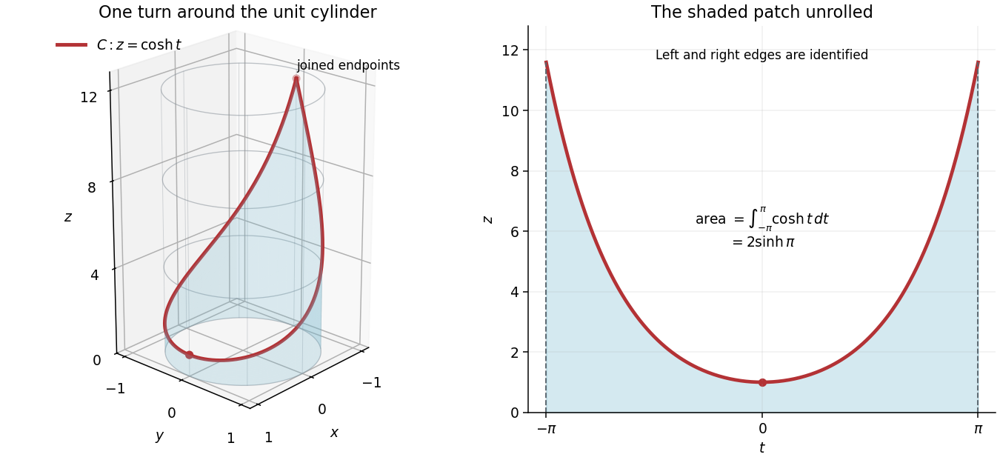

<h1 id="3/a/i/solution">Solution</h1>

↑ **Parent:** [I](../i.md)

For the given [wrapped hyperbolic cosine curve](../../../../../../../wrapped-hyperbolic-cosine-curve.md),

$$
x^2+y^2=\cos^2t+\sin^2t=1,\qquad z=\cosh t\geq1>0,
$$

so $\boxed{C\subset S}$. The [curve](../../../../../../../curve.md) makes one full turn around the [circular cylinder](../../../../../../../circular-cylinder.md), descending from $(-1,0,\cosh\pi)$ to $(1,0,1)$ and ascending to its initial point. Its two parameter endpoints coincide; their [tangent vectors](../../../../../../../tangent-vector-split.md) $(0,-1,-\sinh\pi)$ and $(0,-1,\sinh\pi)$ do not agree, so the resulting closed [curve](../../../../../../../curve.md) has a corner there.

**[Figure 1](#3/a/i/image-the-hyperbolic-cosine-curve-wrapped-around-a-unit-circular-cylinder-and-the-same-surface-unrolled). The hyperbolic cosine curve wrapped around a unit circular cylinder, and the same surface unrolled**. The shaded finite patch extends from $z=0$ to $z=\cosh t$. On the unrolled [cylinder](../../../../../../../cylinder-geometry.md), its horizontal coordinate is $t\in[-\pi,\pi]$; the two vertical edges are identified.

## ↑ Ancestors (13)

1. [I](../i.md)
2. [A](../../a.md)
3. [3](../../../3.md)
4. [Mathematics V](../../../../mathematics-v-split.md)
5. [Prelims](../../../../split.md)
6. [2015](../../../../../split.md)
7. [Past exam of the mathematics course of the University of Oxford](../../../../../../split.md)
8. [Mathematics course of the University of Oxford](../../../../../../../mathematics-course-of-the-university-of-oxford.md)
9. [Undergraduate course of the University of Oxford](../../../../../../../undergraduate-course-of-the-university-of-oxford.md)
10. [Course of the University of Oxford](../../../../../../../course-of-the-university-of-oxford.md)
11. [University of Oxford](../../../../../../../university-of-oxford-split.md)
12. [List of universities](../../../../../../../list-of-universities.md)
13. [Codex Wiki](../../../../../../../split.md)
