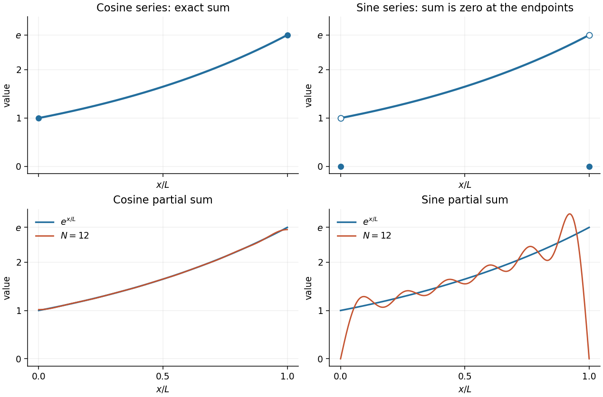

<h1 id="4/b/i/solution">Solution</h1>

↑ **Parent:** [I](../i.md)

Set $u=x/L$ and $q=n\pi$. The required [integrals](../../../../../../../integral-split.md) follow from

$$
\int e^u\cos(qu)\,du=\frac{e^u(\cos(qu)+q\sin(qu))}{1+q^2},\qquad
\int e^u\sin(qu)\,du=\frac{e^u(\sin(qu)-q\cos(qu))}{1+q^2}.
$$

Consequently the [Fourier coefficients](../../../../../../../fourier-coefficient.md) are

$$
\boxed{a_0=2(e-1),\qquad
 a_n=\frac{2[(-1)^ne-1]}{1+n^2\pi^2},\qquad
 b_n=\frac{2n\pi[1-(-1)^ne]}{1+n^2\pi^2}\quad(n\geq1).}
$$

Thus the [Fourier cosine series](../../../../../../../fourier-cosine-series.md) is

$$
\boxed{e-1+2\sum_{n=1}^\infty\frac{(-1)^ne-1}{1+n^2\pi^2}\cos\frac{n\pi x}{L},}
$$

and its sum is $e^{x/L}$ everywhere on $[0,L]$. The [Fourier sine series](../../../../../../../fourier-sine-series.md) is

$$
\boxed{2\sum_{n=1}^\infty\frac{n\pi[1-(-1)^ne]}{1+n^2\pi^2}\sin\frac{n\pi x}{L},}
$$

and its sum is $e^{x/L}$ on $(0,L)$ and zero at the two endpoints. The open and filled circles in the sketches distinguish these endpoint limits from the actual values of the sum.

**[Figure 2](#4/b/i/image-the-sums-and-finite-partial-sums-of-the-fourier-cosine-series-and-fourier-sine-series-for-e-x-l). The sums and finite partial sums of the Fourier cosine series and Fourier sine series for $e^{x/L}$**. The upper panels show the exact sums on $[0,L]$. The lower panels compare twelve-term [partial sums](../../../../../../../partial-sum.md) with the [exponential function](../../../../../../../exponential-function.md): the [Fourier sine series](../../../../../../../fourier-sine-series.md) has zero endpoints and oscillations near its [periodic extension](../../../../../../../periodic-extension.md)'s jumps.

## ↑ Ancestors (13)

1. [I](../i.md)
2. [B](../../b.md)
3. [4](../../../4.md)
4. [Mathematics V](../../../../mathematics-v-split.md)
5. [Prelims](../../../../split.md)
6. [2015](../../../../../split.md)
7. [Past exam of the mathematics course of the University of Oxford](../../../../../../split.md)
8. [Mathematics course of the University of Oxford](../../../../../../../mathematics-course-of-the-university-of-oxford.md)
9. [Undergraduate course of the University of Oxford](../../../../../../../undergraduate-course-of-the-university-of-oxford.md)
10. [Course of the University of Oxford](../../../../../../../course-of-the-university-of-oxford.md)
11. [University of Oxford](../../../../../../../university-of-oxford-split.md)
12. [List of universities](../../../../../../../list-of-universities.md)
13. [Codex Wiki](../../../../../../../split.md)
