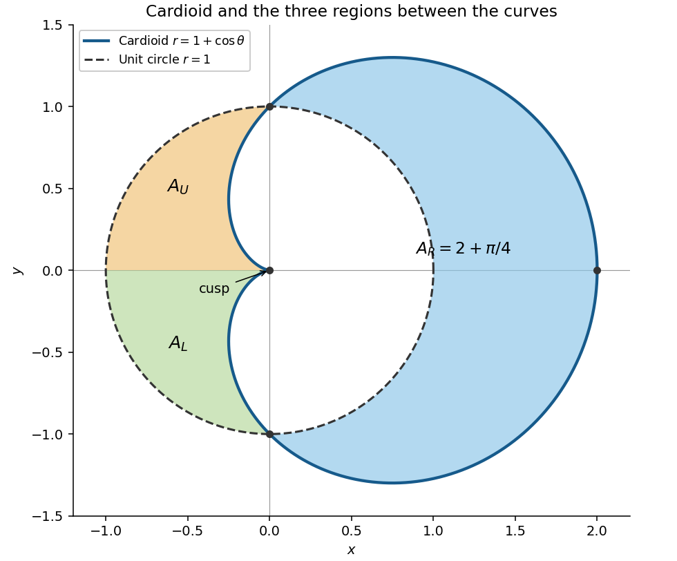

# Mathematics III

↑ **Parent:** [Prelims](../prelims.md)

Source: [released examination PDF, bundle pages 105–110](https://www.whatdotheyknow.com/request/bsc_mathematics_prelims_and_part/response/2784209/attach/3/202409%20817%20annex.pdf#page=105).

**Table of contents**

- [1](#1)
  - [a](#1/a)
    - [Solution](#1/a/solution)
  - [b](#1/b)
    - [Solution](#1/b/solution)
  - [c](#1/c)
    - [Solution](#1/c/solution)
- [2](#2)
  - [a](#2/a)
    - [Solution](#2/a/solution)
  - [b](#2/b)
    - [Solution](#2/b/solution)
  - [c](#2/c)
    - [Solution](#2/c/solution)
- [3](#3)
  - [a](#3/a)
    - [Solution](#3/a/solution)
  - [b](#3/b)
    - [Solution](#3/b/solution)
  - [c](#3/c)
    - [Solution](#3/c/solution)
- [4](#4)
  - [a](#4/a)
    - [i](#4/a/i)
      - [Solution](#4/a/i/solution)
    - [ii](#4/a/ii)
      - [Solution](#4/a/ii/solution)
    - [iii](#4/a/iii)
      - [Solution](#4/a/iii/solution)
    - [iv](#4/a/iv)
      - [Solution](#4/a/iv/solution)
  - [b](#4/b)
    - [i](#4/b/i)
      - [Solution](#4/b/i/solution)
    - [ii](#4/b/ii)
      - [Solution](#4/b/ii/solution)
    - [iii](#4/b/iii)
      - [Solution](#4/b/iii/solution)
- [5](#5)
  - [a](#5/a)
    - [i](#5/a/i)
      - [Solution](#5/a/i/solution)
    - [ii](#5/a/ii)
      - [Solution](#5/a/ii/solution)
  - [b](#5/b)
    - [i](#5/b/i)
      - [Solution](#5/b/i/solution)
    - [ii](#5/b/ii)
      - [Solution](#5/b/ii/solution)
    - [iii](#5/b/iii)
      - [Solution](#5/b/iii/solution)
    - [iv](#5/b/iv)
      - [Solution](#5/b/iv/solution)
- [6](#6)
  - [a](#6/a)
    - [i](#6/a/i)
      - [Solution](#6/a/i/solution)
    - [ii](#6/a/ii)
      - [Solution](#6/a/ii/solution)
    - [iii](#6/a/iii)
      - [Solution](#6/a/iii/solution)
  - [b](#6/b)
    - [i](#6/b/i)
      - [Solution](#6/b/i/solution)
    - [ii](#6/b/ii)
      - [Solution](#6/b/ii/solution)
  - [c](#6/c)
    - [i](#6/c/i)
      - [Solution](#6/c/i/solution)
    - [ii](#6/c/ii)
      - [Solution](#6/c/ii/solution)
- [7](#7)
  - [a](#7/a)
    - [i](#7/a/i)
      - [Solution](#7/a/i/solution)
    - [ii](#7/a/ii)
      - [Solution](#7/a/ii/solution)
    - [iii](#7/a/iii)
      - [Solution](#7/a/iii/solution)
    - [iv](#7/a/iv)
      - [Solution](#7/a/iv/solution)
    - [v](#7/a/v)
      - [Solution](#7/a/v/solution)
  - [b](#7/b)
    - [Solution](#7/b/solution)
- [8](#8)
  - [a](#8/a)
    - [i](#8/a/i)
      - [Solution](#8/a/i/solution)
    - [ii](#8/a/ii)
      - [Solution](#8/a/ii/solution)
  - [b](#8/b)
    - [i](#8/b/i)
      - [Solution](#8/b/i/solution)
    - [ii](#8/b/ii)
      - [Solution](#8/b/ii/solution)
    - [iii](#8/b/iii)
      - [Solution](#8/b/iii/solution)
- [9](#9)
  - [a](#9/a)
    - [Solution](#9/a/solution)
  - [b](#9/b)
    - [Solution](#9/b/solution)
  - [c](#9/c)
    - [Solution](#9/c/solution)

## 1

↑ **Parent:** [Mathematics III](mathematics-iii.md)

<h3 id="1/a">a</h3>

↑ **Parent:** [1](#1)

<h4 id="1/a/solution">Solution</h4>

↑ **Parent:** [A](#1/a)

After division by $x^2$, the [linear ordinary differential equation](../../../linear-ordinary-differential-equation.md) becomes

$$
y'-\frac{y}{x^2}=\frac{e^{-1/x}}{x^2}.
$$

The [integrating factor](../../../linear-ordinary-differential-equation.md#integrating-factor) is $e^{1/x}$. Thus

$$
\frac{d}{dx}\left(e^{1/x}y\right)=\frac1{x^2},\qquad e^{1/x}y=-\frac1x+C.
$$

The [initial condition](../../../differential-equation.md#initial-condition) $y(1)=1$ gives $C=e+1$, so

$$
\boxed{y(x)=\left(e+1-\frac1x\right)e^{-1/x},\qquad x>0.}
$$

<h3 id="1/b">b</h3>

↑ **Parent:** [1](#1)

<h4 id="1/b/solution">Solution</h4>

↑ **Parent:** [B](#1/b)

For $y=x$, the [derivatives](../../../calculus.md#derivative) are $y'=1$ and $y''=0$, and substitution gives $2(x-1)-2(x-1)=0$.

Use [reduction of order](../../../linear-ordinary-differential-equation.md#reduction-of-order): set $y=xv$, so $y'=v+xv'$ and $y''=2v'+xv''$. Substitution and cancellation give

$$
x^2v''+2x^2v'=0.
$$

Since $x>0$, this reduces to $v''+2v'=0$, hence $v'=Ae^{-2x}$ and $v=C_1+C_2e^{-2x}$. The [general solution](../../../linear-ordinary-differential-equation.md#general-solution) is

$$
\boxed{y(x)=C_1x+C_2xe^{-2x},\qquad x>0.}
$$

The two solutions are [linearly independent](../../../vector-space.md#linear-independence), since their ratio $e^{-2x}$ is nonconstant; equivalently, their [Wronskian](../../../linear-ordinary-differential-equation.md#wronskian) is $-2x^2e^{-2x}\ne0$.

<h3 id="1/c">c</h3>

↑ **Parent:** [1](#1)

<h4 id="1/c/solution">Solution</h4>

↑ **Parent:** [C](#1/c)

The [homogeneous linear differential equation](../../../differential-equation.md#homogeneous-linear-differential-equation) $y''+y=0$ has [general solution](../../../linear-ordinary-differential-equation.md#general-solution) $C_1\cos x+C_2\sin x$. For a [particular solution](../../../linear-ordinary-differential-equation.md#particular-solution), use [variation of parameters](../../../linear-ordinary-differential-equation.md#variation-of-parameters) with $y_1=\cos x$, $y_2=\sin x$ and [Wronskian](../../../linear-ordinary-differential-equation.md#wronskian) one:

$$
y_p=-\cos x\int x\sin^2x\,dx+\sin x\int x\sin x\cos x\,dx.
$$

The [double-angle formulas](../../../geometry-and-topology.md#double-angle-formula) and [integration by parts](../../../calculus.md#integration-by-parts) give

$$
\int x\sin^2x\,dx=\frac{x^2}{4}-\frac{x\sin2x}{4}-\frac{\cos2x}{8},\qquad
\int x\sin x\cos x\,dx=-\frac{x\cos2x}{4}+\frac{\sin2x}{8}.
$$

Substitution simplifies to $-x^2\cos x/4+x\sin x/4+\cos x/8$. Absorb the last term into the [homogeneous linear differential equation](../../../differential-equation.md#homogeneous-linear-differential-equation) solution. Therefore

$$
\boxed{y(x)=C_1\cos x+C_2\sin x+\frac{x\sin x-x^2\cos x}{4}.}
$$

Indeed, applying $d^2/dx^2+1$ to $x\sin x$ gives $2\cos x$, and applying it to $x^2\cos x$ gives $2\cos x-4x\sin x$; their difference divided by four is the required $x\sin x$.

## 2

↑ **Parent:** [Mathematics III](mathematics-iii.md)

<h3 id="2/a">a</h3>

↑ **Parent:** [2](#2)

<h4 id="2/a/solution">Solution</h4>

↑ **Parent:** [A](#2/a)

In [Cartesian coordinates](../../../linear-algebra.md#cartesian-coordinate-system), a [parametrization](../../../geometry-and-topology.md#parametric-equation) of the [curve](../../../topology.md#curve) is

$$
x(\theta)=f(\theta)\cos\theta,\qquad y(\theta)=f(\theta)\sin\theta.
$$

Differentiate using the [product rule](../../../calculus.md#product-rule):

$$
x'=f'\cos\theta-f\sin\theta,\qquad y'=f'\sin\theta+f\cos\theta.
$$

Squaring and adding cancels the mixed terms, giving $(x')^2+(y')^2=(f')^2+f^2$. The [arc length](../../../riemannian-geometry.md#arc-length) is the integral of the speed, so

$$
\boxed{L=\int_0^{2\pi}\sqrt{f(\theta)^2+f'(\theta)^2}\,d\theta.}
$$

This assumes the [parametrization](../../../geometry-and-topology.md#parametric-equation) is piecewise continuously differentiable and counts length with multiplicity if the [curve](../../../topology.md#curve) is retraced.

<h3 id="2/b">b</h3>

↑ **Parent:** [2](#2)

<h4 id="2/b/solution">Solution</h4>

↑ **Parent:** [B](#2/b)

The [cardioid](../../../multivariable-calculus.md#cardioid) has [reflection symmetry](../../../physics.md#reflection-symmetry) about the $x$ axis because $1+\cos(-\theta)=1+\cos\theta$. It passes through $(2,0)$ at $\theta=0$, through $(0,\pm1)$ at $\theta=\pm\pi/2$, and has a [cusp](../../../algebraic-geometry.md#cusp-algebraic-geometry) at the origin when $\theta=\pi$. These points and the following sketch show its orientation.

**[Figure 1](#2/b/image-the-cardioid-and-unit-circle-with-the-three-regions-between-them-shaded). The cardioid and unit circle, with the three regions between them shaded**.

Using the [polar coordinates](../../../multivariable-calculus.md#polar-coordinates) formula for [arc length](../../../riemannian-geometry.md#arc-length),

$$
L=\int_0^{2\pi}\sqrt{(1+\cos\theta)^2+\sin^2\theta}\,d\theta
=\int_0^{2\pi}2\left|\cos\frac\theta2\right|\,d\theta.
$$

The [absolute value](../../../real-analysis.md#absolute-value) changes sign at $\theta=\pi$, so

$$
\boxed{L=4\int_0^\pi\cos\frac\theta2\,d\theta=8.}
$$

<h3 id="2/c">c</h3>

↑ **Parent:** [2](#2)

<h4 id="2/c/solution">Solution</h4>

↑ **Parent:** [C](#2/c)

The [cardioid](../../../multivariable-calculus.md#cardioid) meets the [unit circle](../../../complex-analysis.md#complex-unit-circle) where $1+\cos\theta=1$, namely at $\theta=\pi/2,3\pi/2$. The [polar area formula](../../../multivariable-calculus.md#polar-area-formula) gives the [area](../../../differential-geometry.md#surface-area) between radii $r_1\le r_2$ as $\frac12\int(r_2^2-r_1^2)\,d\theta$.

For $-\pi/2\le\theta\le\pi/2$, the [cardioid](../../../multivariable-calculus.md#cardioid) lies outside the [unit circle](../../../complex-analysis.md#complex-unit-circle). The right-hand region therefore has [area](../../../differential-geometry.md#surface-area)

$$
A_R=\frac12\int_{-\pi/2}^{\pi/2}\left((1+\cos\theta)^2-1\right)\,d\theta
=\int_{-\pi/2}^{\pi/2}\cos\theta\,d\theta+\frac12\int_{-\pi/2}^{\pi/2}\cos^2\theta\,d\theta
=2+\frac\pi4.
$$

On $\pi/2\le\theta\le\pi$, the [unit circle](../../../complex-analysis.md#complex-unit-circle) lies outside the [cardioid](../../../multivariable-calculus.md#cardioid). The upper left region has [area](../../../differential-geometry.md#surface-area)

$$
A_U=\frac12\int_{\pi/2}^{\pi}\left(1-(1+\cos\theta)^2\right)\,d\theta
=-\int_{\pi/2}^{\pi}\cos\theta\,d\theta-\frac12\int_{\pi/2}^{\pi}\cos^2\theta\,d\theta
=1-\frac\pi8.
$$

By [reflection symmetry](../../../physics.md#reflection-symmetry) the lower left region has the same [area](../../../differential-geometry.md#surface-area). Thus

$$
\boxed{A_R=2+\frac\pi4,\qquad A_U=A_L=1-\frac\pi8.}
$$

The two left regions touch only at the [cusp](../../../algebraic-geometry.md#cusp-algebraic-geometry); their interiors are disconnected. As a check, the difference between the [cardioid](../../../multivariable-calculus.md#cardioid)'s total [area](../../../differential-geometry.md#surface-area) $3\pi/2$ and the [unit circle](../../../complex-analysis.md#complex-unit-circle)'s [area](../../../differential-geometry.md#surface-area) $\pi$ is $A_R-A_U-A_L=\pi/2$.

## 3

↑ **Parent:** [Mathematics III](mathematics-iii.md)

<h3 id="3/a">a</h3>

↑ **Parent:** [3](#3)

<h4 id="3/a/solution">Solution</h4>

↑ **Parent:** [A](#3/a)

Write $h=x-x_0$, $k=y-y_0$, and let $a=f_{xx}$, $b=f_{xy}$ and $c=f_{yy}$ be evaluated at the [critical point](../../../analysis.md#critical-point). Assuming $f$ is twice continuously differentiable nearby, the [Taylor expansion](../../../calculus.md#taylor-expansion) is

$$
f(x_0+h,y_0+k)-f(x_0,y_0)
=\frac12(ah^2+2bhk+ck^2)+o(h^2+k^2).
$$

The linear terms vanish because the [gradient](../../../multivariable-calculus.md#gradient) is zero. For $a>0$, [completing the square](../../../polynomial.md#completing-the-square) gives

$$
\frac12(ah^2+2bhk+ck^2)=\frac1{2a}\left((ah+bk)^2+(ac-b^2)k^2\right).
$$

Consequently the requested constant is the [Hessian determinant](../../../multivariable-calculus.md#hessian-determinant)

$$
\boxed{D=f_{xx}f_{yy}-f_{xy}^2.}
$$

The displayed identity in the question is an identity for the quadratic part; for a general $f$, its right-hand side needs the remainder $o(h^2+k^2)$.

If $D>0$, the [quadratic form](../../../quadratic-form.md) is positive for every nonzero $(h,k)$. On the [unit circle](../../../complex-analysis.md#complex-unit-circle) it has a positive minimum, so it dominates the remainder sufficiently near the [critical point](../../../analysis.md#critical-point). Hence the point is a **strict [local minimum](../../../analysis.md#local-minimum)**.

If $D<0$, along $k=0$ the quadratic term is $ah^2/2>0$, whereas along $h=-bk/a$ it is $Dk^2/(2a)<0$. Along each line the remainder is of smaller order. Thus values both above and below $f(x_0,y_0)$ occur arbitrarily nearby, giving a **[saddle point](../../../analysis.md#saddle-point)**.

<h3 id="3/b">b</h3>

↑ **Parent:** [3](#3)

<h4 id="3/b/solution">Solution</h4>

↑ **Parent:** [B](#3/b)

The [critical points](../../../analysis.md#critical-point) satisfy

$$
f_x=2x+y=0,\qquad f_y=3y^2+x=0.
$$

Substitute $x=-y/2$ to obtain $y(3y-1/2)=0$. Thus the only [critical points](../../../analysis.md#critical-point) are $(0,0)$ and $(-1/12,1/6)$.

The [Hessian matrix](../../../multivariable-calculus.md#hessian-matrix) and [Hessian determinant](../../../multivariable-calculus.md#hessian-determinant) are

$$
H=\begin{pmatrix}2&1\\1&6y\end{pmatrix},\qquad D=12y-1.
$$

At $(0,0)$, $D=-1$, so this is a [saddle point](../../../analysis.md#saddle-point). At $(-1/12,1/6)$, $D=1$ and $f_{xx}=2>0$, so this is a strict [local minimum](../../../analysis.md#local-minimum). Therefore

$$
\boxed{(0,0):\text{ saddle};\qquad(-1/12,1/6):\text{ strict local minimum}.}
$$

The value at the [local minimum](../../../analysis.md#local-minimum) is $-1/432$; there is no [local maximum](../../../analysis.md#local-maximum).

<h3 id="3/c">c</h3>

↑ **Parent:** [3](#3)

<h4 id="3/c/solution">Solution</h4>

↑ **Parent:** [C](#3/c)

Let $F=x+y+z^2$ and $g=x^2+y^2+z^2$. The [unit sphere](../../../topology.md#unit-sphere) is [compact](../../../topology.md#compact-space), so the [continuous function](../../../calculus.md#continuous-function) $F$ has a [global maximum](../../../function.md#global-maximum) and [global minimum](../../../analysis.md#global-minimum). Since $\nabla g\ne0$ on the [unit sphere](../../../topology.md#unit-sphere), all such points satisfy the [Lagrange multiplier](../../../mathematical-optimization.md#lagrange-multiplier) equations

$$
1=2\lambda x,\qquad1=2\lambda y,\qquad2z=2\lambda z,\qquad x^2+y^2+z^2=1.
$$

Thus $x=y$ and either $z=0$ or $\lambda=1$.

If $z=0$, then $x=y=\pm1/\sqrt2$, giving $F=\pm\sqrt2$. If $\lambda=1$, then $x=y=1/2$ and $z=\pm1/\sqrt2$, giving $F=3/2$. These exhaust the candidates, so

$$
\boxed{\min F=-\sqrt2\text{ at }(-1/\sqrt2,-1/\sqrt2,0),\qquad
\max F=\frac32\text{ at }(1/2,1/2,\pm1/\sqrt2).}
$$

## 4

↑ **Parent:** [Mathematics III](mathematics-iii.md)

<h3 id="4/a">a</h3>

↑ **Parent:** [4](#4)

<h4 id="4/a/i">i</h4>

↑ **Parent:** [A](#4/a)

<h5 id="4/a/i/solution">Solution</h5>

↑ **Parent:** [I](#4/a/i)

Put $q=1-p$. Since $X$ takes positive integer values, $\mathbb P(X>0)=1=q^0$. Taking differences of the given tail [probabilities](../../../probability-theory.md#probability) therefore yields, also for $k=1$,

$$
\boxed{\mathbb P(X=k)=\mathbb P(X>k-1)-\mathbb P(X>k)=pq^{k-1},\qquad k\ge1.}
$$

This is the [probability mass function](../../../probability-distribution.md#probability-mass-function) of the [geometric distribution](../../../discrete-probability-distribution.md#geometric-distribution) on $\{1,2,\ldots\}$.

<h4 id="4/a/ii">ii</h4>

↑ **Parent:** [A](#4/a)

<h5 id="4/a/ii/solution">Solution</h5>

↑ **Parent:** [Ii](#4/a/ii)

Using the [geometric series](../../../sequence-and-series.md#geometric-series), the [probability generating function](../../../probability-distribution.md#probability-generating-function) is

$$
G_X(s)=\mathbb E(s^X)=\sum_{k\ge1}pq^{k-1}s^k
=\boxed{\frac{ps}{1-qs}},\qquad |qs|<1.
$$

Differentiation gives

$$
\boxed{G'_X(s)=\frac{p(1-qs)+pqs}{(1-qs)^2}=\frac{p}{(1-s+ps)^2}.}
$$

<h4 id="4/a/iii">iii</h4>

↑ **Parent:** [A](#4/a)

<h5 id="4/a/iii/solution">Solution</h5>

↑ **Parent:** [Iii](#4/a/iii)

The [mean](../../../expected-value.md) is the [derivative](../../../calculus.md#derivative) at one of the [probability generating function](../../../probability-distribution.md#probability-generating-function). Therefore

$$
\boxed{\mathbb E X=G'_X(1)=\frac{p}{p^2}=\frac1p.}
$$

Evaluation at one is valid here because the [probability generating function](../../../probability-distribution.md#probability-generating-function) has radius of convergence $1/(1-p)>1$.

<h4 id="4/a/iv">iv</h4>

↑ **Parent:** [A](#4/a)

<h5 id="4/a/iv/solution">Solution</h5>

↑ **Parent:** [Iv](#4/a/iv)

The event $W>k$ occurs exactly when both $X_1>k$ and $X_2>k$. By [independence](../../../random-variable.md#independent-random-variables),

$$
\mathbb P(W>k)=q^kq^k=q^{2k}=\left(1-(2p-p^2)\right)^k.
$$

Thus

$$
\boxed{W\sim\operatorname{Geom}(2p-p^2).}
$$

The new success [probability](../../../probability-theory.md#probability) $2p-p^2$ is the chance that at least one of the two trials succeeds.

<h3 id="4/b">b</h3>

↑ **Parent:** [4](#4)

<h4 id="4/b/i">i</h4>

↑ **Parent:** [B](#4/b)

<h5 id="4/b/i/solution">Solution</h5>

↑ **Parent:** [I](#4/b/i)

Since $Y\ge1$, its finite [mean](../../../expected-value.md) satisfies $1\le\mu<\infty$. Every $q_k=kp_k/\mu$ is nonnegative, and

$$
\sum_{k\ge1}q_k=\frac1\mu\sum_{k\ge1}kp_k=\frac{\mathbb E Y}{\mu}=1.
$$

Thus $(q_k)$ is a **[probability mass function](../../../probability-distribution.md#probability-mass-function)**. It defines the [size-biased distribution](../../../probability-theory.md#size-biased-distribution) of $Y$: an outcome of size $k$ receives $k$ times its original relative weight.

<h4 id="4/b/ii">ii</h4>

↑ **Parent:** [B](#4/b)

<h5 id="4/b/ii/solution">Solution</h5>

↑ **Parent:** [Ii](#4/b/ii)

By the definition of a [probability generating function](../../../probability-distribution.md#probability-generating-function),

$$
G_{\widetilde Y}(s)=\sum_{k\ge1}\frac{kp_k}{\mu}s^k
=\boxed{\frac{s}{\mu}G'_Y(s)}.
$$

Termwise differentiation of the [power series](../../../sequence-and-series.md#power-series) is valid for $|s|<1$. At $s=1$, the equality extends by the finite [mean](../../../expected-value.md) assumption, and both sides equal one.

<h4 id="4/b/iii">iii</h4>

↑ **Parent:** [B](#4/b)

<h5 id="4/b/iii/solution">Solution</h5>

↑ **Parent:** [Iii](#4/b/iii)

For the [geometric distribution](../../../discrete-probability-distribution.md#geometric-distribution), $\mu=1/p$, so the [probability generating function](../../../probability-distribution.md#probability-generating-function) of the [size-biased distribution](../../../probability-theory.md#size-biased-distribution) is

$$
G_{\widetilde Y}(s)=\frac{p^2s}{(1-qs)^2}.
$$

If $X_1,X_2$ are [independent and identically distributed](../../../random-variable.md#independent-and-identically-distributed-random-variables) with [geometric distribution](../../../discrete-probability-distribution.md#geometric-distribution) of parameter $p$, the [probability generating function of an independent sum](../../../probability-distribution.md#probability-generating-function-of-an-independent-sum) gives

$$
G_{X_1+X_2-1}(s)=s^{-1}\left(\frac{ps}{1-qs}\right)^2
=\frac{p^2s}{(1-qs)^2}.
$$

At zero, interpret the expression by its continuous extension. The [probability generating functions](../../../probability-distribution.md#probability-generating-function) agree, hence

$$
\boxed{\widetilde Y\overset d=X_1+X_2-1,\qquad X_1,X_2\sim\operatorname{Geom}(p)\text{ independently}.}
$$

One can also check the [probability mass functions](../../../probability-distribution.md#probability-mass-function) directly: for $k\ge1$, there are $k$ positive integer pairs with sum $k+1$, each having [probability](../../../probability-theory.md#probability) $p^2q^{k-1}$. Thus both sides assign [probability](../../../probability-theory.md#probability) $kp^2q^{k-1}$ to $k$.

## 5

↑ **Parent:** [Mathematics III](mathematics-iii.md)

<h3 id="5/a">a</h3>

↑ **Parent:** [5](#5)

<h4 id="5/a/i">i</h4>

↑ **Parent:** [A](#5/a)

<h5 id="5/a/i/solution">Solution</h5>

↑ **Parent:** [I](#5/a/i)

A [partition of a set](../../../set.md#partition-of-a-set) $\Omega$ is a collection of nonempty [subsets](../../../set.md#subset) whose union is $\Omega$ and which are pairwise disjoint:

$$
\bigcup_{i\in I}B_i=\Omega,\qquad B_i\cap B_j=\varnothing\quad(i\ne j).
$$

For use with [probabilities](../../../probability-theory.md#probability), the $B_i$ must also be [events](../../../probability-space.md#event) in the [sample space](../../../probability-space.md#sample-space).

<h4 id="5/a/ii">ii</h4>

↑ **Parent:** [A](#5/a)

<h5 id="5/a/ii/solution">Solution</h5>

↑ **Parent:** [Ii](#5/a/ii)

For a finite or countable [partition of a set](../../../set.md#partition-of-a-set) into [events](../../../probability-space.md#event) $B_i$, the [law of total probability](../../../probability-space.md#law-of-total-probability) states

$$
\boxed{\mathbb P(A)=\sum_{i:\,\mathbb P(B_i)>0}\mathbb P(A\mid B_i)\mathbb P(B_i).}
$$

The [events](../../../probability-space.md#event) $A\cap B_i$ are pairwise disjoint and have union $A$, so countable additivity proves the formula. Terms with $\mathbb P(B_i)=0$ contribute zero and are omitted to avoid undefined [conditional probabilities](../../../probability-theory.md#conditional-probability).

<h3 id="5/b">b</h3>

↑ **Parent:** [5](#5)

<h4 id="5/b/i">i</h4>

↑ **Parent:** [B](#5/b)

<h5 id="5/b/i/solution">Solution</h5>

↑ **Parent:** [I](#5/b/i)

There are two paths from $X$ back to $X$ in two steps: $X\to X\to X$ and $X\to Y\to X$. By the [markov property](../../../markov-chain.md#markov-property), their [probabilities](../../../probability-theory.md#probability) multiply along each path. Therefore

$$
\boxed{p_2=\frac12\cdot\frac12+\frac12\cdot\frac38=\frac14+\frac3{16}=\frac7{16}.}
$$

<h4 id="5/b/ii">ii</h4>

↑ **Parent:** [B](#5/b)

<h5 id="5/b/ii/solution">Solution</h5>

↑ **Parent:** [Ii](#5/b/ii)

Let $q_n=\mathbb P(M_n=Y)$. The [law of total probability](../../../probability-space.md#law-of-total-probability) applied to the current [markov chain state](../../../markov-chain.md#markov-chain-state) gives

$$
p_n=\frac12p_{n-1}+\frac38q_{n-1},\qquad q_{n-1}=\frac12p_{n-2}\quad(n\ge2).
$$

The second equality holds because $Y$ can only be reached from $X$. Eliminating $q_{n-1}$ gives the [linear recurrence relation](../../../algebra.md#linear-recurrence-relation)

$$
\boxed{16p_n=8p_{n-1}+3p_{n-2},\qquad n\ge2.}
$$

<h4 id="5/b/iii">iii</h4>

↑ **Parent:** [B](#5/b)

<h5 id="5/b/iii/solution">Solution</h5>

↑ **Parent:** [Iii](#5/b/iii)

The [characteristic equation of a linear recurrence](../../../algebra.md#characteristic-equation-of-a-linear-recurrence) is

$$
16r^2-8r-3=(4r-3)(4r+1)=0.
$$

Its distinct roots are $3/4$ and $-1/4$, so $p_n=A(3/4)^n+B(-1/4)^n$. The [initial conditions](../../../differential-equation.md#initial-condition) are $p_0=1$ and $p_1=1/2$, giving $A+B=1$ and $3A-B=2$. Hence $A=3/4$, $B=1/4$, and

$$
\boxed{p_n=\frac34\left(\frac34\right)^n+\frac14\left(-\frac14\right)^n
=\frac{3^{n+1}+(-1)^n}{4^{n+1}},\qquad n\ge0.}
$$

<h4 id="5/b/iv">iv</h4>

↑ **Parent:** [B](#5/b)

<h5 id="5/b/iv/solution">Solution</h5>

↑ **Parent:** [Iv](#5/b/iv)

Starting from $X$ at time $n$, the [markov property](../../../markov-chain.md#markov-property) and the time-independent transition rules give $\mathbb P(M_{2n}=X\mid M_n=X)=p_n$. Therefore

$$
\boxed{\mathbb P(M_n=X\mid M_{2n}=X)=\frac{\mathbb P(M_n=X,M_{2n}=X)}{p_{2n}}=\frac{p_n^2}{p_{2n}}.}
$$

Write $p_n=\frac34(\frac34)^n\left(1+\frac13(-\frac13)^n\right)$. The [conditional probability](../../../probability-theory.md#conditional-probability) becomes

$$
\frac34\frac{\left(1+\frac13(-\frac13)^n\right)^2}{1+\frac13(\frac19)^n}
\longrightarrow\boxed{\frac34}.
$$

The conditioning selects paths which have avoided the [absorbing state](../../../markov-chain.md#absorbing-state) up to time $2n$; it is therefore quite different from the unconditioned [probability](../../../probability-theory.md#probability) $p_n$, which tends to zero.

## 6

↑ **Parent:** [Mathematics III](mathematics-iii.md)

<h3 id="6/a">a</h3>

↑ **Parent:** [6](#6)

<h4 id="6/a/i">i</h4>

↑ **Parent:** [A](#6/a)

<h5 id="6/a/i/solution">Solution</h5>

↑ **Parent:** [I](#6/a/i)

For the rate-one [exponential distribution](../../../continuous-probability-distribution.md#exponential-distribution), the [probability density function](../../../continuous-probability-distribution.md#probability-density-function) is $e^{-t}$ for $t\ge0$. By [integration by parts](../../../calculus.md#integration-by-parts),

$$
\mathbb E T=\int_0^\infty te^{-t}\,dt=1,\qquad
\mathbb E(T^2)=\int_0^\infty t^2e^{-t}\,dt=2.
$$

Thus

$$
\boxed{\mathbb E T=1,\qquad\operatorname{Var}(T)=2-1^2=1.}
$$

<h4 id="6/a/ii">ii</h4>

↑ **Parent:** [A](#6/a)

<h5 id="6/a/ii/solution">Solution</h5>

↑ **Parent:** [Ii](#6/a/ii)

By [independence](../../../random-variable.md#independent-random-variables), the [expected value](../../../expected-value.md) of the product factors:

$$
\boxed{\mathbb E(TU)=\mathbb E T\,\mathbb E U=1.}
$$

<h4 id="6/a/iii">iii</h4>

↑ **Parent:** [A](#6/a)

<h5 id="6/a/iii/solution">Solution</h5>

↑ **Parent:** [Iii](#6/a/iii)

The products $TU$ and $UV$ share $U$, so they are not [independent](../../../random-variable.md#independent-random-variables). Using the definition of [covariance](../../../variance.md#covariance) and the [independence](../../../random-variable.md#independent-random-variables) of $T,U,V$,

$$
\operatorname{Cov}(TU,UV)=\mathbb E(TU^2V)-\mathbb E(TU)\mathbb E(UV)
=(\mathbb E T)(\mathbb E U^2)(\mathbb E V)-1=2-1=1.
$$

By contrast, $TU$ and $VW$ depend on disjoint sets of [independent random variables](../../../random-variable.md#independent-random-variables), so they are [independent](../../../random-variable.md#independent-random-variables) and have zero [covariance](../../../variance.md#covariance). Hence

$$
\boxed{\operatorname{Cov}(TU,UV)=1,\qquad\operatorname{Cov}(TU,VW)=0.}
$$

<h3 id="6/b">b</h3>

↑ **Parent:** [6](#6)

<h4 id="6/b/i">i</h4>

↑ **Parent:** [B](#6/b)

<h5 id="6/b/i/solution">Solution</h5>

↑ **Parent:** [I](#6/b/i)

Assume finite second moments and write $Z_i=X_i-\mathbb E X_i$. Expanding the square in the definition of [variance](../../../variance.md) gives

$$
\operatorname{Var}(X_1+X_2)=\mathbb E[(Z_1+Z_2)^2]
=\mathbb E Z_1^2+\mathbb E Z_2^2+2\mathbb E(Z_1Z_2).
$$

Recognizing the two [variances](../../../variance.md) and the [covariance](../../../variance.md#covariance), we obtain

$$
\boxed{\operatorname{Var}(X_1+X_2)=\operatorname{Var}(X_1)+\operatorname{Var}(X_2)+2\operatorname{Cov}(X_1,X_2).}
$$

<h4 id="6/b/ii">ii</h4>

↑ **Parent:** [B](#6/b)

<h5 id="6/b/ii/solution">Solution</h5>

↑ **Parent:** [Ii](#6/b/ii)

For [random variables](../../../random-variable.md) with finite second moments, the [variance of a sum](../../../variance.md#variance-of-a-sum) is

$$
\boxed{\operatorname{Var}\left(\sum_{i=1}^nX_i\right)=\sum_{i=1}^n\operatorname{Var}(X_i)+2\sum_{1\le i<j\le n}\operatorname{Cov}(X_i,X_j).}
$$

No [independence](../../../random-variable.md#independent-random-variables) assumption is needed.

<h3 id="6/c">c</h3>

↑ **Parent:** [6](#6)

<h4 id="6/c/i">i</h4>

↑ **Parent:** [C](#6/c)

<h5 id="6/c/i/solution">Solution</h5>

↑ **Parent:** [I](#6/c/i)

Write $A_i=Y_{i-1}Y_i$, so $S_n=\sum_{i=1}^nA_i$. Each product has [mean](../../../expected-value.md) one, and its [variance](../../../variance.md) is

$$
\operatorname{Var}(A_i)=\mathbb E(Y_{i-1}^2)\mathbb E(Y_i^2)-1=2\cdot2-1=3.
$$

Adjacent products share one factor, giving [covariance](../../../variance.md#covariance) one by part (a)(iii). Products whose indices differ by at least two involve disjoint [independent random variables](../../../random-variable.md#independent-random-variables), so their [covariance](../../../variance.md#covariance) is zero. There are $n-1$ adjacent pairs. By the [variance of a sum](../../../variance.md#variance-of-a-sum),

$$
\boxed{\mathbb E S_n=n,\qquad\operatorname{Var}(S_n)=3n+2(n-1)=5n-2,\qquad n\ge1.}
$$

<h4 id="6/c/ii">ii</h4>

↑ **Parent:** [C](#6/c)

<h5 id="6/c/ii/solution">Solution</h5>

↑ **Parent:** [Ii](#6/c/ii)

By [Chebyshev's inequality](../../../probability-inequality.md#chebyshev-s-inequality) and part (i),

$$
0\le\mathbb P\left(\frac{S_n}{n}>1+\epsilon\right)
\le\mathbb P\left(\left|\frac{S_n}{n}-1\right|\ge\epsilon\right)
\le\frac{\operatorname{Var}(S_n)}{n^2\epsilon^2}
=\frac{5n-2}{n^2\epsilon^2}\longrightarrow0.
$$

This actually proves the stronger statement $\boxed{S_n/n\xrightarrow{\mathbb P}1}$, namely [convergence in probability](../../../convergence-of-random-variables.md#convergence-in-probability), despite the [statistical dependence](../../../random-variable.md#statistical-dependence) between adjacent products.

## 7

↑ **Parent:** [Mathematics III](mathematics-iii.md)

<h3 id="7/a">a</h3>

↑ **Parent:** [7](#7)

<h4 id="7/a/i">i</h4>

↑ **Parent:** [A](#7/a)

<h5 id="7/a/i/solution">Solution</h5>

↑ **Parent:** [I](#7/a/i)

Let $M=\max_iX_i$. For an observed sample in the nonnegative orthant, the [likelihood function](../../../maximum-likelihood-estimation.md#likelihood-function) under the [uniform distribution](../../../continuous-probability-distribution.md#continuous-uniform-distribution) is

$$
L(\theta)=\theta^{-n}\mathbf1_{\{\theta\ge M\}},\qquad\theta>0.
$$

It is zero for $\theta<M$, and decreases with $\theta$ on $[M,\infty)$. Thus the [maximum likelihood estimation](../../../maximum-likelihood-estimation.md) problem is solved at the smallest admissible value:

$$
\boxed{\widehat\theta=M=\max_{1\le i\le n}X_i.}
$$

Under the model $M>0$ with [probability](../../../probability-theory.md#probability) one. The all-zero sample is a null event on which the [likelihood function](../../../maximum-likelihood-estimation.md#likelihood-function) has no finite maximizer in the parameter space $\theta>0$.

<h4 id="7/a/ii">ii</h4>

↑ **Parent:** [A](#7/a)

<h5 id="7/a/ii/solution">Solution</h5>

↑ **Parent:** [Ii](#7/a/ii)

For $0\le t\le1$, [independence](../../../random-variable.md#independent-random-variables) and the [uniform distribution](../../../continuous-probability-distribution.md#continuous-uniform-distribution) give

$$
\mathbb P\left(\frac M\theta\le t\right)=\mathbb P(X_1\le\theta t,\ldots,X_n\le\theta t)=t^n.
$$

Therefore the [cumulative distribution function](../../../probability-distribution.md#cumulative-distribution-function) is

$$
\boxed{F_{M/\theta}(t)=\begin{cases}0,&t<0,\\t^n,&0\le t\le1,\\1,&t>1.\end{cases}}
$$

It contains no $\theta$, so $M/\theta$ is a [pivotal quantity](../../../probability-and-statistics.md#pivotal-quantity).

<h4 id="7/a/iii">iii</h4>

↑ **Parent:** [A](#7/a)

<h5 id="7/a/iii/solution">Solution</h5>

↑ **Parent:** [Iii](#7/a/iii)

Differentiating the [cumulative distribution function](../../../probability-distribution.md#cumulative-distribution-function) in part (ii) gives the [probability density function](../../../continuous-probability-distribution.md#probability-density-function) $nt^{n-1}$ on $(0,1)$. Hence

$$
\mathbb E\left(\frac M\theta\right)=\int_0^1t\,nt^{n-1}\,dt=\frac n{n+1},\qquad
\mathbb E M=\frac n{n+1}\theta.
$$

Thus an [unbiased estimator](../../../statistical-modelling.md#unbiased-estimator) based on the sample maximum is

$$
\boxed{\widetilde\theta=\frac{n+1}{n}\widehat\theta.}
$$

<h4 id="7/a/iv">iv</h4>

↑ **Parent:** [A](#7/a)

<h5 id="7/a/iv/solution">Solution</h5>

↑ **Parent:** [Iv](#7/a/iv)

Each observation from the [uniform distribution](../../../continuous-probability-distribution.md#continuous-uniform-distribution) has [mean](../../../expected-value.md) $\theta/2$. By [linearity of expectation](../../../expected-value.md#linearity-of-expectation), $\mathbb E\sum_iX_i=n\theta/2$, so another [unbiased estimator](../../../statistical-modelling.md#unbiased-estimator) is

$$
\boxed{\theta^*=\frac2n\sum_{i=1}^nX_i=2\overline X.}
$$

<h4 id="7/a/v">v</h4>

↑ **Parent:** [A](#7/a)

<h5 id="7/a/v/solution">Solution</h5>

↑ **Parent:** [V](#7/a/v)

The [pivotal quantity](../../../probability-and-statistics.md#pivotal-quantity) $U=M/\theta$ lies in $[0,1]$ and satisfies $\mathbb P(U\le t)=t^n$. Thus

$$
\mathbb P\left(\alpha^{1/n}\le\frac M\theta\le1\right)=1-\alpha.
$$

Rearranging these inequalities yields the exact [confidence interval](../../../statistical-inference.md#confidence-interval)

$$
\boxed{\left[\widehat\theta,\frac{\widehat\theta}{\alpha^{1/n}}\right].}
$$

For every $\theta>0$, its coverage [probability](../../../probability-theory.md#probability) is exactly $1-\alpha$; the result uses the finite-sample [probability distribution](../../../probability-distribution.md), with no [normal approximation](../../../convergence-of-random-variables.md#normal-approximation).

<h3 id="7/b">b</h3>

↑ **Parent:** [7](#7)

<h4 id="7/b/solution">Solution</h4>

↑ **Parent:** [B](#7/b)

The [log-likelihood function](../../../maximum-likelihood-estimation.md#log-likelihood) for the [Laplace distribution](../../../continuous-probability-distribution.md#laplace-distribution) is

$$
\ell(\kappa)=-n\log2-\sum_{i=1}^n|Y_i-\kappa|.
$$

Thus [maximum likelihood estimation](../../../maximum-likelihood-estimation.md) is equivalent to minimizing the sum of [absolute values](../../../real-analysis.md#absolute-value). Write $n=2m+1$ and sort the data as $Y_{(1)}\le\cdots\le Y_{(n)}$. Between observations, if $r$ values lie to the left of $\kappa$, the [derivative](../../../calculus.md#derivative) of $\sum_i|Y_i-\kappa|$ is $r-(n-r)=2r-n$. It is negative before the middle observation and positive after it. The minimum occurs at the [sample median](../../../probability-distribution.md#sample-median):

$$
\boxed{\widehat\kappa=Y_{(m+1)}=Y_{((n+1)/2)}.}
$$

This minimizer remains unique for odd $n$ even when some observations coincide, since fewer than half the observations can lie strictly on either side of the middle value.

## 8

↑ **Parent:** [Mathematics III](mathematics-iii.md)

<h3 id="8/a">a</h3>

↑ **Parent:** [8](#8)

<h4 id="8/a/i">i</h4>

↑ **Parent:** [A](#8/a)

<h5 id="8/a/i/solution">Solution</h5>

↑ **Parent:** [I](#8/a/i)

Treat the explanatory variables as fixed and put $S_{xx}=\sum_i x_i^2$, $S_{zz}=\sum_i z_i^2$. To identify both slopes, assume $S_{xx}>0$ and $S_{zz}>0$. The given centring and [orthogonality](../../../inner-product.md#orthogonal-vectors) conditions make the three columns $1,x,z$ pairwise [orthogonal](../../../inner-product.md#orthogonal-vectors).

The [log-likelihood function](../../../maximum-likelihood-estimation.md#log-likelihood) in the [normal linear model](../../../normal-linear-model.md), up to a constant independent of the coefficients, is

$$
\ell(\beta_0,\beta_1,\beta_2)=-\frac1{2\sigma^2}\sum_i(Y_i-\beta_0-\beta_1x_i-\beta_2z_i)^2.
$$

Thus [maximum likelihood estimation](../../../maximum-likelihood-estimation.md) minimizes the [residual sum of squares](../../../linear-regression.md#residual-sum-of-squares). Setting its [partial derivatives](../../../multivariable-calculus.md#partial-derivative) to zero gives

$$
\sum_i(Y_i-\beta_0-\beta_1x_i-\beta_2z_i)=0,\quad
\sum_i x_i(Y_i-\beta_0-\beta_1x_i-\beta_2z_i)=0,\quad
\sum_i z_i(Y_i-\beta_0-\beta_1x_i-\beta_2z_i)=0.
$$

Using $\sum x_i=\sum z_i=\sum x_iz_i=0$ decouples these equations:

$$
\boxed{\widehat\beta_0=\overline Y,\qquad
\widehat\beta_1=\frac{\sum_i x_iY_i}{S_{xx}},\qquad
\widehat\beta_2=\frac{\sum_i z_iY_i}{S_{zz}}.}
$$

The [Hessian matrix](../../../multivariable-calculus.md#hessian-matrix) of the [residual sum of squares](../../../linear-regression.md#residual-sum-of-squares) is $2\operatorname{diag}(n,S_{xx},S_{zz})$, which is positive definite. These are therefore the unique minimizers. If either squared sum is zero, the associated explanatory variable vanishes identically and its coefficient cannot be identified.

<h4 id="8/a/ii">ii</h4>

↑ **Parent:** [A](#8/a)

<h5 id="8/a/ii/solution">Solution</h5>

↑ **Parent:** [Ii](#8/a/ii)

Substitute the [linear regression model](../../../linear-regression.md#linear-regression-model) into the estimators and use the centring and [orthogonality](../../../inner-product.md#orthogonal-vectors) conditions:

$$
\widehat\beta_0=\beta_0+\frac1n\sum_i\epsilon_i,\qquad
\widehat\beta_1=\beta_1+\frac{\sum_i x_i\epsilon_i}{S_{xx}}.
$$

A linear combination of [independent](../../../random-variable.md#independent-random-variables) [normal random variables](../../../probability-distribution.md#gaussian-random-variable) is normal. Their [means](../../../expected-value.md) are $\beta_0$ and $\beta_1$, while [variance additivity for independent random variables](../../../variance.md#variance-additivity-for-independent-random-variables) gives

$$
\operatorname{Var}(\widehat\beta_0)=\frac{n\sigma^2}{n^2}=\frac{\sigma^2}{n},\qquad
\operatorname{Var}(\widehat\beta_1)=\frac{\sigma^2\sum_i x_i^2}{S_{xx}^2}=\frac{\sigma^2}{S_{xx}}.
$$

Consequently

$$
\boxed{\widehat\beta_0\sim N(\beta_0,\sigma^2/n),\qquad
\widehat\beta_1\sim N(\beta_1,\sigma^2/S_{xx}).}
$$

<h3 id="8/b">b</h3>

↑ **Parent:** [8](#8)

<h4 id="8/b/i">i</h4>

↑ **Parent:** [B](#8/b)

<h5 id="8/b/i/solution">Solution</h5>

↑ **Parent:** [I](#8/b/i)

The [central limit theorem](../../../convergence-of-random-variables.md#central-limit-theorem) states that if $W_1,W_2,\ldots$ are [independent and identically distributed](../../../random-variable.md#independent-and-identically-distributed-random-variables) with finite [mean](../../../expected-value.md) $\mu$ and [variance](../../../variance.md) $0<\tau^2<\infty$, then

$$
\boxed{\frac{\sum_{i=1}^nW_i-n\mu}{\tau\sqrt n}\xrightarrow{d}N(0,1).}
$$

Here $\xrightarrow d$ denotes [convergence in distribution](../../../convergence-of-random-variables.md#convergence-in-distribution).

<h4 id="8/b/ii">ii</h4>

↑ **Parent:** [B](#8/b)

<h5 id="8/b/ii/solution">Solution</h5>

↑ **Parent:** [Ii](#8/b/ii)

The algebraic identity $\widehat\beta_0-\beta_0=n^{-1}\sum_i\epsilon_i$ does not require a [normal distribution](../../../probability-distribution.md#normal-distribution) for the errors. Applying the [central limit theorem](../../../convergence-of-random-variables.md#central-limit-theorem) to their [sample mean](../../../variance.md#sample-mean) gives

$$
\frac{\sqrt n(\widehat\beta_0-\beta_0)}{\sigma}\xrightarrow d N(0,1).
$$

Thus, for large $n$,

$$
\boxed{\widehat\beta_0\ \text{is approximately }N(\beta_0,\sigma^2/n).}
$$

Its [mean](../../../expected-value.md) $\beta_0$ and [variance](../../../variance.md) $\sigma^2/n$ remain exact, even though its [normal distribution](../../../probability-distribution.md#normal-distribution) is now only an approximation. With the error [probability distribution](../../../probability-distribution.md) unspecified, the formula is retained as an estimator; it is not being asserted to remain a [maximum likelihood estimation](../../../maximum-likelihood-estimation.md) formula.

<h4 id="8/b/iii">iii</h4>

↑ **Parent:** [B](#8/b)

<h5 id="8/b/iii/solution">Solution</h5>

↑ **Parent:** [Iii](#8/b/iii)

**No, not from the stated assumptions alone.** The centered slope is a weighted sum,

$$
\widehat\beta_1-\beta_1=\frac{\sum_i x_i\epsilon_i}{S_{xx}},
$$

and the weighted errors need not be identically distributed. The ordinary [central limit theorem](../../../convergence-of-random-variables.md#central-limit-theorem) therefore does not apply directly.

For a concrete counterexample, for every $n\ge3$ choose

$$
x=(1,-1,0,\ldots,0),\qquad z=(1,1,-2,0,\ldots,0).
$$

These satisfy all three centring and [orthogonality](../../../inner-product.md#orthogonal-vectors) assumptions, and both explanatory columns are nonzero. Let the errors be [independent](../../../random-variable.md#independent-random-variables) with [Rademacher distribution](../../../probability-distribution.md#rademacher-distribution), taking values $\pm1$ with equal [probability](../../../probability-theory.md#probability). Then

$$
\widehat\beta_1-\beta_1=\frac{\epsilon_1-\epsilon_2}{2},
$$

which takes values $-1,0,1$ with [probabilities](../../../probability-theory.md#probability) $1/4,1/2,1/4$ for every $n$. Increasing the sample size adds no information about this slope, and the standardized estimator does not approach a [normal distribution](../../../probability-distribution.md#normal-distribution).

A useful additional assumption for [asymptotic normality of a weighted regression slope](../../../linear-regression.md#asymptotic-normality-of-a-weighted-regression-slope) is that no single design value dominates:

$$
\frac{\max_i x_i^2}{\sum_i x_i^2}\longrightarrow0.
$$

Under this condition and the given finite error [variance](../../../variance.md), the [Lindeberg-Feller central limit theorem](../../../convergence-of-random-variables.md#lindeberg-feller-central-limit-theorem) yields

$$
\frac{\sqrt{S_{xx}}(\widehat\beta_1-\beta_1)}{\sigma}\xrightarrow d N(0,1),
$$

justifying the approximation $N(\beta_1,\sigma^2/S_{xx})$ for the slope as well.

## 9

↑ **Parent:** [Mathematics III](mathematics-iii.md)

<h3 id="9/a">a</h3>

↑ **Parent:** [9](#9)

<h4 id="9/a/solution">Solution</h4>

↑ **Parent:** [A](#9/a)

Use the corrected decomposition

$$
y_{ij}-w_j=(y_{ij}-\mu_j)+(\mu_j-w_j).
$$

The hint's minus sign before $(\mu_j-w_j)$ is a typographical error. Squaring, summing, and using $\sum_i(y_{ij}-\mu_j)=0$ for each coordinate gives the [centroid sum-of-squares identity](../../../statistical-learning.md#centroid-sum-of-squares-identity)

$$
\sum_{i,j}(y_{ij}-w_j)^2
=\sum_{i,j}(y_{ij}-\mu_j)^2
+2\sum_j(\mu_j-w_j)\underbrace{\sum_i(y_{ij}-\mu_j)}_{0}
+m\sum_j(\mu_j-w_j)^2.
$$

Since $m>0$ and $w\ne\mu$, the final term is strictly positive. Hence

$$
\boxed{\sum_{i,j}(y_{ij}-\mu_j)^2<\sum_{i,j}(y_{ij}-w_j)^2.}
$$

Thus the [centroid](../../../euclidean-geometry.md#centroid) uniquely minimizes the sum of squared [Euclidean distances](../../../topological-analysis.md#euclidean-distance) to the observations.

<h3 id="9/b">b</h3>

↑ **Parent:** [9](#9)

<h4 id="9/b/solution">Solution</h4>

↑ **Parent:** [B](#9/b)

Write $x_i\in\mathbb R^p$ for row $i$ of the [data matrix](../../../vector-space.md#data-matrix). The [k-means clustering](../../../statistical-learning.md#k-means-clustering) objective is the within-cluster sum of squared [Euclidean distances](../../../topological-analysis.md#euclidean-distance):

$$
\boxed{J(C_1,\ldots,C_K;m_1,\ldots,m_K)=\sum_{k=1}^K\sum_{i\in C_k}\|x_i-m_k\|^2.}
$$

The nonempty $C_k$ form a [partition of a set](../../../set.md#partition-of-a-set) of observation indices. For fixed clusters, part (a) shows that the best $m_k$ is their [centroid](../../../euclidean-geometry.md#centroid).

Initialize distinct centres, for example by choosing $K\le n$ distinct observations. Then repeat the following steps:

- Assign each observation to a nearest centre in [Euclidean distance](../../../topological-analysis.md#euclidean-distance). Keep its current assignment on an exact tie; for a previously unassigned observation use a fixed ordering to resolve ties.
- If a cluster is empty, choose an observation from a cluster with at least two members and make it the empty cluster's sole member, placing its centre at that observation. A definite rule is to choose an eligible observation farthest from its currently assigned centre, breaking ties by observation index. Repeat until all clusters are nonempty.
- Replace each centre by the [arithmetic mean](../../../arithmetic.md#arithmetic-mean) of its assigned observations.
- After updating, check whether every observation is still assigned to a nearest updated centre, retaining its assignment on ties. If so, stop; otherwise repeat.

The empty-cluster repair is possible for $K\le n$ and cannot increase $J$: the transferred observation now has squared distance zero, while all other squared distances stay unchanged before the centre update.

Assignment cannot increase $J$, and any changed assignment strictly decreases it under the tie rule. Updating centres cannot increase $J$ by the [centroid sum-of-squares identity](../../../statistical-learning.md#centroid-sum-of-squares-identity). After an update, the centres are determined by the [partition of a set](../../../set.md#partition-of-a-set). There are only finitely many possible assignments. Unless this is the initial round, any nonterminal round starts with an assignment that strictly reduces $J$; repairing empty clusters and updating cannot undo that decrease. Thus a partition cannot recur, proving [finite termination of K-means clustering](../../../statistical-learning.md#finite-termination-of-k-means-clustering). The final result need not be a [global minimum](../../../analysis.md#global-minimum); different initial centres can lead to different final clusterings.

<h3 id="9/c">c</h3>

↑ **Parent:** [9](#9)

<h4 id="9/c/solution">Solution</h4>

↑ **Parent:** [C](#9/c)

Sort the distinct observations as $x_{(1)}<\cdots<x_{(n)}$. For ordered centres $m_1<\cdots<m_r$, a point is closer to $m_j$ than to $m_{j+1}$ precisely when it lies to the left of their midpoint. Thus each [Voronoi cell](../../../euclidean-geometry.md#voronoi-cell) is an [interval](../../../real-analysis.md#interval-mathematics), with either choice allowed for an endpoint tie. Consequently, after assignment, each nonempty cluster is a contiguous block of the sorted observations.

The [arithmetic means](../../../arithmetic.md#arithmetic-mean) of disjoint ordered blocks are strictly ordered, so updating centres preserves this order. The empty-cluster repair in part (b) preserves contiguous blocks too: an observation farthest from its assigned centre lies at an endpoint of its block, and removing that endpoint makes a new singleton block. In one dimension with distinct observations, choosing $K$ distinct observations as initial centres makes the first assignment nonempty.

The [one-dimensional K-means iteration bound](../../../statistical-learning.md#one-dimensional-k-means-iteration-bound) now follows by counting block partitions. Choosing the $K-1$ gaps between consecutive nonempty blocks gives

$$
\binom{n-1}{K-1}\le n^{K-1}
$$

possibilities. By the strict-decrease argument in part (b), no such partition can recur before [algorithm termination](../../../algorithm.md#algorithm-termination). Counting a step as an assignment, any empty-cluster repairs, and a centre update, with the stability check performed after that update, gives

$$
\boxed{\text{number of steps}\le\binom{n-1}{K-1}\le n^{K-1}.}
$$

For $K=1$, one update to the overall [arithmetic mean](../../../arithmetic.md#arithmetic-mean) suffices. Arbitrary changes between tied centres would invalidate the strict-decrease argument, which is why the stable tie convention in part (b) matters.

## ↑ Ancestors (9)

1. [Prelims](../prelims.md)
2. [2017](../../2017.md)
3. [Past exam of the mathematics course of the University of Oxford](../../../past-exam-of-the-mathematics-course-of-the-university-of-oxford.md)
4. [Mathematics course of the University of Oxford](../../../university-of-oxford.md#mathematics-course-of-the-university-of-oxford)
5. [Undergraduate course of the University of Oxford](../../../university-of-oxford.md#undergraduate-course-of-the-university-of-oxford)
6. [Course of the University of Oxford](../../../university-of-oxford.md#course-of-the-university-of-oxford)
7. [University of Oxford](../../../university-of-oxford.md)
8. [List of universities](../../../README.md#list-of-universities)
9. [Codex Wiki](../../../README.md)
