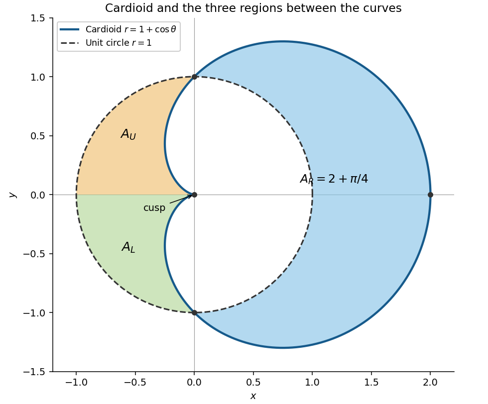

<h1 id="2/b/solution">Solution</h1>

↑ **Parent:** [B](../b.md)

The [cardioid](../../../../../../cardioid.md) has [reflection symmetry](../../../../../../reflection-symmetry.md) about the $x$ axis because $1+\cos(-\theta)=1+\cos\theta$. It passes through $(2,0)$ at $\theta=0$, through $(0,\pm1)$ at $\theta=\pm\pi/2$, and has a [cusp](../../../../../../cusp-algebraic-geometry.md) at the origin when $\theta=\pi$. These points and the following sketch show its orientation.

**[Figure 1](#2/b/image-the-cardioid-and-unit-circle-with-the-three-regions-between-them-shaded). The cardioid and unit circle, with the three regions between them shaded**.

Using the [polar coordinates](../../../../../../polar-coordinates.md) formula for [arc length](../../../../../../arc-length.md),

$$
L=\int_0^{2\pi}\sqrt{(1+\cos\theta)^2+\sin^2\theta}\,d\theta
=\int_0^{2\pi}2\left|\cos\frac\theta2\right|\,d\theta.
$$

The [absolute value](../../../../../../absolute-value.md) changes sign at $\theta=\pi$, so

$$
\boxed{L=4\int_0^\pi\cos\frac\theta2\,d\theta=8.}
$$

## ↑ Ancestors (12)

1. [B](../b.md)
2. [2](../../2.md)
3. [Mathematics III](../../../mathematics-iii-split.md)
4. [Prelims](../../../split.md)
5. [2017](../../../../split.md)
6. [Past exam of the mathematics course of the University of Oxford](../../../../../split.md)
7. [Mathematics course of the University of Oxford](../../../../../../mathematics-course-of-the-university-of-oxford.md)
8. [Undergraduate course of the University of Oxford](../../../../../../undergraduate-course-of-the-university-of-oxford.md)
9. [Course of the University of Oxford](../../../../../../course-of-the-university-of-oxford.md)
10. [University of Oxford](../../../../../../university-of-oxford-split.md)
11. [List of universities](../../../../../../list-of-universities.md)
12. [Codex Wiki](../../../../../../split.md)
