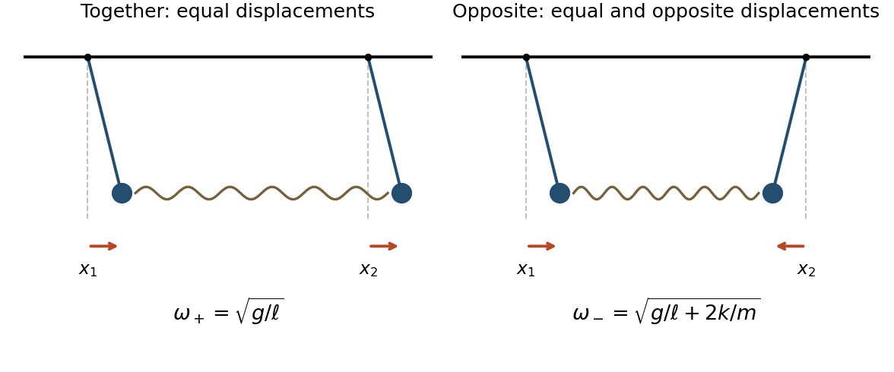

# Mathematics IV resit

↑ **Parent:** [Prelims](../prelims.md)

Source: [released examination PDF, bundle pages 176–179](https://www.whatdotheyknow.com/request/bsc_mathematics_prelims_and_part/response/2784209/attach/3/202409%20817%20annex.pdf#page=176).

**Table of contents**

- [1](#1)
  - [a](#1/a)
    - [Solution](#1/a/solution)
  - [b](#1/b)
    - [Solution](#1/b/solution)
  - [c](#1/c)
    - [Solution](#1/c/solution)
- [2](#2)
  - [a](#2/a)
    - [Solution](#2/a/solution)
  - [b](#2/b)
    - [Solution](#2/b/solution)
- [3](#3)
  - [a](#3/a)
    - [i](#3/a/i)
      - [Solution](#3/a/i/solution)
    - [ii](#3/a/ii)
      - [Solution](#3/a/ii/solution)
  - [b](#3/b)
    - [Solution](#3/b/solution)
  - [c](#3/c)
    - [Solution](#3/c/solution)
- [4](#4)
  - [a](#4/a)
    - [Solution](#4/a/solution)
  - [b](#4/b)
    - [Solution](#4/b/solution)
- [5](#5)
  - [a](#5/a)
    - [Solution](#5/a/solution)
  - [b](#5/b)
    - [Solution](#5/b/solution)
- [6](#6)
  - [a](#6/a)
    - [Solution](#6/a/solution)
  - [b](#6/b)
    - [Solution](#6/b/solution)
  - [c](#6/c)
    - [Solution](#6/c/solution)
- [7](#7)
  - [a](#7/a)
    - [Solution](#7/a/solution)
  - [b](#7/b)
    - [i](#7/b/i)
      - [Solution](#7/b/i/solution)
    - [ii](#7/b/ii)
      - [Solution](#7/b/ii/solution)

## 1

↑ **Parent:** [Mathematics IV resit](mathematics-iv-resit.md)

<h3 id="1/a">a</h3>

↑ **Parent:** [1](#1)

<h4 id="1/a/solution">Solution</h4>

↑ **Parent:** [A](#1/a)

The [scalar product](../../../inner-product.md#dot-product), also called the [dot product](../../../inner-product.md#dot-product), and the [vector product](../../../vector-space.md#cross-product), also called the [cross product](../../../vector-space.md#cross-product), are

$$
\boxed{\mathbf a\cdot\mathbf b=a_1b_1+a_2b_2+a_3b_3,\qquad
\mathbf a\wedge\mathbf b=\begin{pmatrix}a_2b_3-a_3b_2\\a_3b_1-a_1b_3\\a_1b_2-a_2b_1\end{pmatrix}.}
$$

For nonzero [vectors](../../../vector-space.md#vector), let $\vartheta\in[0,\pi]$ be their [angle](../../../geometry-and-topology.md#angle). Their [Euclidean norms](../../../normed-vector-space.md#euclidean-norm) satisfy

$$
\boxed{\mathbf a\cdot\mathbf b=|\mathbf a||\mathbf b|\cos\vartheta,\qquad
|\mathbf a\wedge\mathbf b|=|\mathbf a||\mathbf b|\sin\vartheta.}
$$

The [cross product](../../../vector-space.md#cross-product) is [orthogonal](../../../inner-product.md#orthogonal-vectors) to both [vectors](../../../vector-space.md#vector), with its orientation determined by the [right-hand rule](../../../electromagnetism.md#right-hand-rule). If either [vector](../../../vector-space.md#vector) is zero, both products vanish, although the [angle](../../../geometry-and-topology.md#angle) is undefined.

<h3 id="1/b">b</h3>

↑ **Parent:** [1](#1)

<h4 id="1/b/solution">Solution</h4>

↑ **Parent:** [B](#1/b)

A real square [matrix](../../../vector-space.md#matrix) $A$ is an [orthogonal matrix](../../../linear-algebra.md#orthogonal-matrix) when

$$
\boxed{A^TA=I.}
$$

Here $A^T$ is the [transpose](../../../vector-space.md#transpose) and $I$ the [identity matrix](../../../vector-space.md#identity-matrix); equivalently, its columns form an [orthonormal basis](../../../inner-product.md#orthonormal-basis). If this holds, the squared [Euclidean norm](../../../normed-vector-space.md#euclidean-norm) obeys

$$
|A\mathbf v|^2=\mathbf v^TA^TA\mathbf v=\mathbf v^T\mathbf v=|\mathbf v|^2,
$$

so the [linear transformation](../../../vector-space.md#linear-map) preserves length.

Conversely, suppose $|A\mathbf v|=|\mathbf v|$ for every [vector](../../../vector-space.md#vector) $\mathbf v$. Put $B=A^TA-I$, a [symmetric matrix](../../../linear-algebra.md#symmetric-matrix). Then $\mathbf v^TB\mathbf v=0$ for every [vector](../../../vector-space.md#vector). Taking $\mathbf v=\mathbf e_i$, the standard [basis vectors](../../../vector-space.md#basis-vector), gives $B_{ii}=0$. Taking $\mathbf v=\mathbf e_i+\mathbf e_j$ for $i\ne j$ gives $2B_{ij}=0$. Thus $B=0$, proving that **the [linear transformation](../../../vector-space.md#linear-map) preserves length if and only if $A$ is an [orthogonal matrix](../../../linear-algebra.md#orthogonal-matrix).**

<h3 id="1/c">c</h3>

↑ **Parent:** [1](#1)

<h4 id="1/c/solution">Solution</h4>

↑ **Parent:** [C](#1/c)

Choose the first [orthonormal basis](../../../inner-product.md#orthonormal-basis) [vector](../../../vector-space.md#vector) to be $\mathbf e_1=\mathbf a$. If $\mathbf b$ is not parallel to $\mathbf a$, choose $\mathbf e_2$ along $\mathbf b-(\mathbf a\cdot\mathbf b)\mathbf a$; otherwise choose any [unit vector](../../../vector-space.md#unit-vector) [orthogonal](../../../inner-product.md#orthogonal-vectors) to $\mathbf a$. Complete to an [orthonormal basis](../../../inner-product.md#orthonormal-basis) with $\mathbf e_3$. The [matrix](../../../vector-space.md#matrix) with rows $\mathbf e_i^T$ is an [orthogonal matrix](../../../linear-algebra.md#orthogonal-matrix), and expressing the three [unit vectors](../../../vector-space.md#unit-vector) in this [basis](../../../vector-space.md#basis) gives

$$
\mathbf a'=(1,0,0)^T,\qquad \mathbf b'=(x,y,0)^T,\qquad
\mathbf c'=(z,w\cos\theta,w\sin\theta)^T.
$$

The last two components of $\mathbf c'$ have [polar coordinates](../../../multivariable-calculus.md#polar-coordinates) of the displayed form; we may choose $w\geq0$. If they vanish, $\theta$ is arbitrary.

An [orthogonal transformation](../../../linear-algebra.md#orthogonal-transformation) preserves [dot products](../../../inner-product.md#dot-product). Taking [dot products](../../../inner-product.md#dot-product) with $\mathbf a'$, and then using the unit [Euclidean norms](../../../normed-vector-space.md#euclidean-norm), gives

$$
\boxed{x=\cos\gamma,\qquad z=\cos\beta,\qquad |y|=\sin\gamma,\qquad |w|=\sin\beta.}
$$

The remaining [dot product](../../../inner-product.md#dot-product) gives

$$
\cos\alpha=xz+yw\cos\theta.
$$

An [orthogonal matrix](../../../linear-algebra.md#orthogonal-matrix) has [determinant](../../../multilinear-algebra.md#determinant) $\pm1$, so it preserves the absolute [scalar triple product](../../../multilinear-algebra.md#scalar-triple-product). In the new [coordinates](../../../vector-space.md#coordinate-linear-algebra) this [scalar triple product](../../../multilinear-algebra.md#scalar-triple-product) is $yw\sin\theta$. Consequently

$$
\begin{aligned}
| (\mathbf a\wedge\mathbf b)\cdot\mathbf c|^2
&=y^2w^2-(yw\cos\theta)^2\\
&=(1-x^2)(1-z^2)-(\cos\alpha-xz)^2\\
&=1-\cos^2\alpha-\cos^2\beta-\cos^2\gamma
+2\cos\alpha\cos\beta\cos\gamma.
\end{aligned}
$$

Taking the nonnegative [square root](../../../algebra.md#square-root) proves

$$
\boxed{|(\mathbf a\wedge\mathbf b)\cdot\mathbf c|
=\sqrt{1-(\mathbf a\cdot\mathbf b)^2-(\mathbf b\cdot\mathbf c)^2-(\mathbf c\cdot\mathbf a)^2+2(\mathbf a\cdot\mathbf b)(\mathbf b\cdot\mathbf c)(\mathbf c\cdot\mathbf a)}.}
$$

No division by $y$ or $w$ was used, so the proof includes parallel [vectors](../../../vector-space.md#vector). Equivalently, the expression under the [square root](../../../algebra.md#square-root) is the [Gram determinant](../../../inner-product.md#gram-determinant) of the three [unit vectors](../../../vector-space.md#unit-vector).

## 2

↑ **Parent:** [Mathematics IV resit](mathematics-iv-resit.md)

<h3 id="2/a">a</h3>

↑ **Parent:** [2](#2)

<h4 id="2/a/solution">Solution</h4>

↑ **Parent:** [A](#2/a)

A [hyperbola](../../../euclidean-geometry.md#hyperbola) with [focus of a conic](../../../euclidean-geometry.md#focus-of-a-conic) $F$, [directrix of a conic](../../../euclidean-geometry.md#directrix-of-a-conic) $D$ not containing $F$, and [eccentricity](../../../euclidean-geometry.md#eccentricity-of-a-conic) $e>1$ is the [locus](../../../euclidean-geometry.md#locus-mathematics)

$$
\{P:\operatorname{dist}(P,F)=e\operatorname{dist}(P,D)\}.
$$

Put $c=\sqrt{a^2+b^2}$ and $e=c/a>1$. For $F=(c,0)$ and $D=\{x=a^2/c\}$, the defining equality becomes

$$
\sqrt{(x-c)^2+y^2}=\frac ca\left|x-\frac{a^2}{c}\right|.
$$

Both sides are nonnegative, so squaring is reversible. Expanding and cancelling the linear terms gives

$$
x^2-2cx+c^2+y^2=\frac{c^2}{a^2}x^2-2cx+a^2
\quad\Longleftrightarrow\quad
\frac{x^2}{a^2}-\frac{y^2}{b^2}=1.
$$

Thus the two matched [focus of a conic](../../../euclidean-geometry.md#focus-of-a-conic) and [directrix of a conic](../../../euclidean-geometry.md#directrix-of-a-conic) choices, related by reflection, are

$$
\boxed{F_\pm=(\pm\sqrt{a^2+b^2},0),\qquad
D_\pm:\ x=\pm\frac{a^2}{\sqrt{a^2+b^2}},\qquad
e=\sqrt{1+\frac{b^2}{a^2}}.}
$$

The signs in each pair must agree.

On the [hyperbola](../../../euclidean-geometry.md#hyperbola), $y=\pm(b/a)\sqrt{x^2-a^2}$. As $|x|\to\infty$,

$$
|x|-\sqrt{x^2-a^2}=\frac{a^2}{|x|+\sqrt{x^2-a^2}}\longrightarrow0.
$$

Hence the perpendicular [distance](../../../geometry-and-topology.md#distance) to one of the two [straight lines](../../../euclidean-geometry.md#straight-line) tends to zero on each end of a branch. The [asymptotes](../../../topology.md#asymptote) are therefore

$$
\boxed{y=\frac ba x\quad\text{and}\quad y=-\frac ba x.}
$$

<h3 id="2/b">b</h3>

↑ **Parent:** [2](#2)

<h4 id="2/b/solution">Solution</h4>

↑ **Parent:** [B](#2/b)

A nondegenerate [hyperbola](../../../euclidean-geometry.md#hyperbola) centred at the origin has a [quadratic equation](../../../polynomial.md#quadratic-equation)

$$
Ax^2+2Bxy+Cy^2+F=0.
$$

There are no linear terms because the origin is its centre. Its [asymptotes](../../../topology.md#asymptote) are the zero set of the homogeneous [quadratic form](../../../quadratic-form.md) $Ax^2+2Bxy+Cy^2$. Requiring the directions $y=x$ and $y=-x$ gives $A+2B+C=A-2B+C=0$, hence $B=0$ and $C=-A$. Since the [conic section](../../../euclidean-geometry.md#conic-section) is nondegenerate, $A$ and $F$ are nonzero. Thus all such [hyperbolas with prescribed asymptotes](../../../euclidean-geometry.md#hyperbolas-with-prescribed-asymptotes) are exactly

$$
\boxed{H_c:\ x^2-y^2=c,\qquad c\in\mathbb R\setminus\{0\}.}
$$

For $c>0$ these [rectangular hyperbolas](../../../euclidean-geometry.md#rectangular-hyperbola) open along the $x$-axis, and for $c<0$ along the $y$-axis. Conversely, each displayed [hyperbola](../../../euclidean-geometry.md#hyperbola) has the required centre and [asymptotes](../../../topology.md#asymptote). Two distinct members have different values of $x^2-y^2$, so **they cannot intersect**.

For the second pair of [asymptotes](../../../topology.md#asymptote), the same argument gives $H_2:4x^2-y^2=d$, $d\ne0$. The [intersections of concentric hyperbolas](../../../euclidean-geometry.md#intersections-of-concentric-hyperbolas) therefore satisfy

$$
x^2=\frac{d-c}{3},\qquad y^2=\frac{d-4c}{3}.
$$

If both right sides are positive, there are four independent sign choices. If precisely one is zero and the other is positive, there are two points. If either is negative there are none; both cannot vanish because $c\ne0$. Each possibility occurs: take $(c,d)=(1,5)$ for four, $(1,4)$ for two, and $(1,1)$ for none. Hence

$$
\boxed{|H_1\cap H_2|\in\{0,2,4\}.}
$$

## 3

↑ **Parent:** [Mathematics IV resit](mathematics-iv-resit.md)

<h3 id="3/a">a</h3>

↑ **Parent:** [3](#3)

<h4 id="3/a/i">i</h4>

↑ **Parent:** [A](#3/a)

<h5 id="3/a/i/solution">Solution</h5>

↑ **Parent:** [I](#3/a/i)

At a regular point of the [parametrized surface](../../../multivariable-calculus.md#parametrized-surface), the [partial derivatives](../../../multivariable-calculus.md#partial-derivative) $\mathbf r_s$ and $\mathbf r_t$ are [linearly independent](../../../vector-space.md#linear-independence) [tangent vectors](../../../tangent-vector.md). Their [cross product](../../../vector-space.md#cross-product) gives a nonzero [normal vector](../../../differential-geometry.md#normal-vector):

$$
\boxed{\mathbf n=\mathbf r_s\times\mathbf r_t.}
$$

Dividing by its [Euclidean norm](../../../normed-vector-space.md#euclidean-norm) gives a [unit normal](../../../differential-geometry.md#unit-normal); changing the sign chooses the opposite orientation. If the [cross product](../../../vector-space.md#cross-product) vanishes, this [parametrization](../../../geometry-and-topology.md#parametric-equation) is singular there and cannot determine a [normal vector](../../../differential-geometry.md#normal-vector) by this formula.

<h4 id="3/a/ii">ii</h4>

↑ **Parent:** [A](#3/a)

<h5 id="3/a/ii/solution">Solution</h5>

↑ **Parent:** [Ii](#3/a/ii)

An infinitesimal parameter rectangle becomes a [parallelogram](../../../euclidean-geometry.md#parallelogram) with edges $\mathbf r_s\,ds$ and $\mathbf r_t\,dt$. Its area is the [Euclidean norm](../../../normed-vector-space.md#euclidean-norm) of their [cross product](../../../vector-space.md#cross-product), giving the [surface area element](../../../multivariable-calculus.md#surface-area-element)

$$
dS=|\mathbf r_s\times\mathbf r_t|\,ds\,dt.
$$

Thus, for a regular [parametrization](../../../geometry-and-topology.md#parametric-equation) covering the [surface](../../../topological-surface.md) once except possibly on sets of area zero,

$$
\boxed{\operatorname{area}(S)=\iint_U|\mathbf r_s\times\mathbf r_t|\,ds\,dt.}
$$

For several patches, add their [surface integrals](../../../multivariable-calculus.md#surface-integral) while avoiding overlap; repeated coverage would otherwise count area with multiplicity.

<h3 id="3/b">b</h3>

↑ **Parent:** [3](#3)

<h4 id="3/b/solution">Solution</h4>

↑ **Parent:** [B](#3/b)

The [partial derivatives](../../../multivariable-calculus.md#partial-derivative) of this [parametrized surface](../../../multivariable-calculus.md#parametrized-surface) are

$$
\mathbf r_s=(t\cos t,t\sin t,2),\qquad
\mathbf r_t=s(\cos t-t\sin t,\sin t+t\cos t,0).
$$

Their [cross product](../../../vector-space.md#cross-product) is

$$
\mathbf r_s\times\mathbf r_t
=s\bigl(-2(\sin t+t\cos t),\ 2(\cos t-t\sin t),\ t^2\bigr).
$$

The mixed terms cancel in its squared [Euclidean norm](../../../normed-vector-space.md#euclidean-norm):

$$
|\mathbf r_s\times\mathbf r_t|^2
=s^2\bigl(4(1+t^2)+t^4\bigr)=s^2(t^2+2)^2.
$$

Since $s>0$, the [surface area element](../../../multivariable-calculus.md#surface-area-element) is $s(t^2+2)\,ds\,dt$. There is no repeated coverage: $z=2s$ recovers $s$, and $\sqrt{x^2+y^2}=st$ then recovers $t$. Therefore the [surface area](../../../differential-geometry.md#surface-area) is

$$
\begin{aligned}
\operatorname{area}(S)
&=\int_0^{2\pi}\int_0^1s(t^2+2)\,ds\,dt\\
&=\frac12\left[\frac{t^3}{3}+2t\right]_0^{2\pi}
=\boxed{\frac{4\pi^3}{3}+2\pi}.
\end{aligned}
$$

<h3 id="3/c">c</h3>

↑ **Parent:** [3](#3)

<h4 id="3/c/solution">Solution</h4>

↑ **Parent:** [C](#3/c)

Use the [polar radius](../../../multivariable-calculus.md#polar-radius) $r=at\in[0,1]$ as the parameter of the [Archimedean spiral](../../../topology.md#archimedean-spiral). Its [angle](../../../geometry-and-topology.md#angle) in [polar coordinates](../../../multivariable-calculus.md#polar-coordinates) is $r/a$. The radial and angular contributions to its [arc length](../../../riemannian-geometry.md#arc-length) are [orthogonal](../../../inner-product.md#orthogonal-vectors), so

$$
aL_a=\int_0^1\sqrt{a^2+r^2}\,dr.
$$

There is no need to evaluate this [integral](../../../integral.md). The simple bounds $r\leq\sqrt{a^2+r^2}\leq r+a$ imply

$$
\frac12\leq aL_a\leq\frac12+a.
$$

The [squeeze theorem](../../../calculus.md#squeeze-theorem) therefore gives the [scaled length of an Archimedean spiral](../../../topology.md#scaled-length-of-an-archimedean-spiral):

$$
\boxed{\ell=\lim_{a\to0^+}aL_a=\frac12.}
$$

Geometrically, the radial contribution becomes negligible after multiplying the [arc length](../../../riemannian-geometry.md#arc-length) by $a$; the remaining contribution is the area under the [function graph](../../../function.md#graph-of-a-function) $r\mapsto r$ on $[0,1]$.

## 4

↑ **Parent:** [Mathematics IV resit](mathematics-iv-resit.md)

<h3 id="4/a">a</h3>

↑ **Parent:** [4](#4)

<h4 id="4/a/solution">Solution</h4>

↑ **Parent:** [A](#4/a)

Take the pivot as origin, with $x$ horizontal and $y$ vertically upward. For the [simple pendulum](../../../simple-pendulum.md), put

$$
\mathbf r=\ell(\sin\theta,-\cos\theta),\qquad
\mathbf e_r=(\sin\theta,-\cos\theta),\qquad
\mathbf e_\theta=(\cos\theta,\sin\theta).
$$

The [velocity](../../../classical-mechanics.md#velocity) and [acceleration](../../../classical-mechanics.md#acceleration) are

$$
\dot{\mathbf r}=\ell\dot\theta\mathbf e_\theta,\qquad
\ddot{\mathbf r}=\ell\ddot\theta\mathbf e_\theta-\ell\dot\theta^2\mathbf e_r.
$$

The [forces](../../../force.md) are the [tension](../../../force.md#tension) $-T\mathbf e_r$ and [gravity](../../../physics.md#gravity) $(0,-mg)$. Taking the [dot product](../../../inner-product.md#dot-product) of [Newton's second law](../../../force.md#newton-s-second-law) with $\mathbf e_\theta$ eliminates the [tension](../../../force.md#tension) and gives

$$
m\ell\ddot\theta=-mg\sin\theta,
\qquad\boxed{\ell\ddot\theta=-g\sin\theta.}
$$

Near the downward [stable equilibrium](../../../dynamical-systems.md#stable-equilibrium) $\theta=0$, the [small-angle approximation](../../../geometry-and-topology.md#small-angle-approximation) $\sin\theta\simeq\theta$ gives $\ddot\theta=-(g/\ell)\theta$ to first order. Since $x=\ell\sin\theta\simeq\ell\theta$, its [linearization](../../../algebra.md#linearization) is

$$
\boxed{\ddot x=-\frac g\ell x.}
$$

This is [simple harmonic motion](../../../classical-mechanics.md#simple-harmonic-motion) with [angular frequency](../../../lagrangian-mechanics.md#angular-frequency) $\sqrt{g/\ell}$; the restoring sign confirms the [stable equilibrium](../../../dynamical-systems.md#stable-equilibrium).

<h3 id="4/b">b</h3>

↑ **Parent:** [4](#4)

<h4 id="4/b/solution">Solution</h4>

↑ **Parent:** [B](#4/b)

Measure $x_1,x_2$ as horizontal [displacements](../../../classical-mechanics.md#displacement) from the respective downward [equilibrium](../../../dynamical-systems.md#equilibrium-point-of-a-dynamical-system) positions; the absolute horizontal [coordinates](../../../vector-space.md#coordinate-linear-algebra) are $x_1$ and $L+x_2$. Each vertical [displacement](../../../classical-mechanics.md#displacement) is of second order in its small [angle](../../../geometry-and-topology.md#angle). Thus the [spring](../../../elasticity-physics.md#spring) is horizontal to first order, its extension is $x_2-x_1$, and [Hooke's law](../../../elasticity-physics.md#hooke-s-law) gives horizontal [forces](../../../force.md) $k(x_2-x_1)$ and $-k(x_2-x_1)$. Combining these with the linearized [simple pendulum](../../../simple-pendulum.md) restoring [force](../../../force.md) yields

$$
\boxed{\ddot x_1=-\frac g\ell x_1+\frac km(x_2-x_1),\qquad
\ddot x_2=-\frac g\ell x_2-\frac km(x_2-x_1).}
$$

For the [normal modes of two spring-coupled equal pendulums](../../../wave.md#normal-modes-of-two-spring-coupled-equal-pendulums), add and subtract these [ordinary differential equations](../../../differential-equation.md#ordinary-differential-equation). The [normal mode coordinates](../../../classical-mechanics.md#normal-coordinate) $q_+=x_1+x_2$ and $q_-=x_1-x_2$ satisfy

$$
\ddot q_++\frac g\ell q_+=0,\qquad
\ddot q_-+\left(\frac g\ell+\frac{2k}{m}\right)q_-=0.
$$

Hence the two natural [angular frequencies](../../../lagrangian-mechanics.md#angular-frequency) and displacement patterns are

$$
\boxed{\omega_+=\sqrt{\frac g\ell},\quad(x_1,x_2)\propto(1,1);\qquad
\omega_-=\sqrt{\frac g\ell+\frac{2k}{m}},\quad(x_1,x_2)\propto(1,-1).}
$$

Ordinary [frequencies](../../../wave.md#frequency) are $\omega_+/(2\pi)$ and $\omega_-/(2\pi)$. In the first [normal mode](../../../wave-equation.md#normal-mode), both particles swing together with equal [amplitudes](../../../wave.md#wave-amplitude) and the [spring](../../../elasticity-physics.md#spring) is unextended to first order. In the second [normal mode](../../../wave-equation.md#normal-mode), the particles swing in opposite directions with equal [amplitudes](../../../wave.md#wave-amplitude), so the [spring](../../../elasticity-physics.md#spring) adds a restoring [force](../../../force.md) and increases the [angular frequency](../../../lagrangian-mechanics.md#angular-frequency).

**[Figure 1](#4/b/image-the-two-normal-modes-equal-displacements-together-and-equal-displacements-in-opposite-directions). The two normal modes: equal displacements together and equal displacements in opposite directions**.

## 5

↑ **Parent:** [Mathematics IV resit](mathematics-iv-resit.md)

<h3 id="5/a">a</h3>

↑ **Parent:** [5](#5)

<h4 id="5/a/solution">Solution</h4>

↑ **Parent:** [A](#5/a)

Use $g$ as the [gravitational acceleration](../../../newton-s-law-of-universal-gravitation.md#gravitational-acceleration), so the weights are $mg$ and $\sqrt2mg$, consistently with the requested equations. The printed introductory phrase calling $g$ a [force](../../../force.md) magnitude omits the factor $m$.

For the [particle on a cone coupled to a hanging mass](../../../classical-mechanics.md#particle-on-a-cone-coupled-to-a-hanging-mass), write $z=-r$ and use the [cylindrical coordinates](../../../multivariable-calculus.md#cylindrical-coordinate-system) [unit vectors](../../../vector-space.md#unit-vector) $\mathbf e_r,\mathbf e_\theta,\mathbf e_z$. The [ideal string](../../../force.md#massless-inextensible-string) segment from the cone particle to the hole has length $\sqrt2r$ and direction $(-\mathbf e_r+\mathbf e_z)/\sqrt2$. If $h$ is the downward length of the hanging segment and $s_0$ the fixed total length, then

$$
h=s_0-\sqrt2r=s_0+\sqrt2z,\qquad z_2=-h=-s_0-\sqrt2z.
$$

The light [ideal string](../../../force.md#massless-inextensible-string) and smooth hole give the same [tension](../../../force.md#tension) $T$ on both sides. Applying the vertical component of [Newton's second law](../../../force.md#newton-s-second-law) to the hanging particle gives

$$
\sqrt2m\ddot z_2=T-\sqrt2mg,
\qquad\boxed{T=\sqrt2mg-2m\ddot z.}
$$

Write the [normal reaction](../../../force.md#normal-force) on the cone particle as $N(\mathbf e_r+\mathbf e_z)/\sqrt2$, allowing $N$ to be signed according to the side of the ideal constraining [surface](../../../topological-surface.md). The [acceleration in cylindrical coordinates](../../../multivariable-calculus.md#acceleration-in-cylindrical-coordinates) and [Newton's second law](../../../force.md#newton-s-second-law) give

$$
\begin{aligned}
m(\ddot r-r\dot\theta^2)&=\frac{N-T}{\sqrt2},\\
m(r\ddot\theta+2\dot r\dot\theta)&=0,\\
m\ddot z&=\frac{N+T}{\sqrt2}-mg.
\end{aligned}
$$

There is no azimuthal [force](../../../force.md). Multiplying the middle equation by $r/m$ proves

$$
\frac{d}{dt}(r^2\dot\theta)=0,\qquad
\boxed{r^2\dot\theta=av,}
$$

where the positive angular direction is chosen along the initial [velocity](../../../classical-mechanics.md#velocity). This is [conservation of angular momentum](../../../momentum.md#conservation-of-angular-momentum) about the vertical axis.

Subtract the radial equation from the vertical equation to eliminate the [normal reaction](../../../force.md#normal-force). Since $\ddot r=-\ddot z$, this gives

$$
m(2\ddot z+r\dot\theta^2)=\sqrt2T-mg.
$$

Substitute the [tension](../../../force.md#tension) and the conserved [angular momentum](../../../momentum.md#angular-momentum), using $r=-z$:

$$
2(1+\sqrt2)\ddot z=g-r\dot\theta^2
=g+\frac{a^2v^2}{z^3}.
$$

Multiplication by $\dot z$ now gives an exact time [derivative](../../../calculus.md#derivative):

$$
\frac{d}{dt}\left((1+\sqrt2)\dot z^2+\frac{a^2v^2}{2z^2}-gz\right)=0.
$$

Initially $z=-a$ and $\dot z=0$, because the initial [velocity](../../../classical-mechanics.md#velocity) is horizontal. Therefore

$$
\boxed{(1+\sqrt2)\dot z^2+\frac{a^2v^2}{2z^2}-gz=\frac{v^2}{2}+ga.}
$$

This is also total [mechanical energy](../../../energy.md#mechanical-energy) divided by $m$, with an irrelevant constant removed: the two particles contribute $(1+\sqrt2)m\dot z^2$ to the radial and vertical [kinetic energy](../../../energy.md#kinetic-energy), while their combined [gravitational potential energy](../../../energy.md#gravitational-energy) is $-mgz$ plus a constant.

<h3 id="5/b">b</h3>

↑ **Parent:** [5](#5)

<h4 id="5/b/solution">Solution</h4>

↑ **Parent:** [B](#5/b)

In terms of the positive [cylindrical radius](../../../multivariable-calculus.md#cylindrical-radius) $r=-z$, the conserved [mechanical energy](../../../energy.md#mechanical-energy) becomes

$$
(1+\sqrt2)\dot r^2+U(r)=E,\qquad
U(r)=gr+\frac{a^2v^2}{2r^2},\qquad E=ga+\frac{v^2}{2}.
$$

The [effective potential](../../../mathematical-physics.md#effective-potential) $U$ tends to infinity at both ends of $(0,\infty)$ for $v>0$, and $U''(r)=3a^2v^2/r^4>0$. Thus its two [turning points](../../../energy.md#turning-point) enclose the allowed radial motion. At a [turning point](../../../energy.md#turning-point), $\dot r=0$, so

$$
2gr^3-(v^2+2ga)r^2+a^2v^2
=(r-a)(2gr^2-v^2r-av^2)=0.
$$

Besides $r=a$, the positive [root of a polynomial](../../../polynomial.md#root-of-a-polynomial) is

$$
r_*=\frac{v^2+\sqrt{v^4+8gav^2}}{4g};
$$

the other [root of a polynomial](../../../polynomial.md#root-of-a-polynomial) is negative. The [quadratic polynomial](../../../polynomial.md#quadratic-polynomial) $Q(r)=2gr^2-v^2r-av^2$ is negative at zero and has just one positive [root of a polynomial](../../../polynomial.md#root-of-a-polynomial). Since $Q(a)=2a(ga-v^2)$, we have $r_*<a$ when $v^2<ga$, and $r_*>a$ when $v^2>ga$.

Height is $z=-r$, so its [maximum](../../../set.md#maximum-of-a-subset-of-a-total-order) occurs at the smaller positive [turning point](../../../energy.md#turning-point). Hence

$$
\boxed{z_{\max}=\begin{cases}
-\dfrac{v^2+\sqrt{v^4+8gav^2}}{4g},&0<v<\sqrt{ga},\\[6pt]
-a,&v>\sqrt{ga}.
\end{cases}}
$$

Indeed, the initial vertical [acceleration](../../../classical-mechanics.md#acceleration) is

$$
\ddot z(0)=\frac{g-v^2/a}{2(1+\sqrt2)}.
$$

Below the critical speed the particle first rises to $z=-r_*$; above it the particle initially descends, and its initial height is already its greatest height. At $v=\sqrt{ga}$ the [turning points](../../../energy.md#turning-point) merge and the particle follows a horizontal [circular orbit](../../../classical-mechanics.md#circular-orbit) at $z=-a$. For zero initial speed the radial [conservation of energy](../../../mathematical-physics.md#conservation-of-energy) gives motion to the apex level $z=0$; if the hole excludes the apex itself, zero is the supremum of the heights before arrival at the hole.

These are the heights under the maintained [mechanical constraint](../../../classical-mechanics.md#constraint-mechanics) used in part (a). A unilateral contact with only one side of a cone would additionally require checking the sign of the [normal reaction](../../../force.md#normal-force); the ideal constrained equations alone do not impose that condition.

## 6

↑ **Parent:** [Mathematics IV resit](mathematics-iv-resit.md)

<h3 id="6/a">a</h3>

↑ **Parent:** [6](#6)

<h4 id="6/a/solution">Solution</h4>

↑ **Parent:** [A](#6/a)

By symmetry, the [centre of mass](../../../classical-mechanics.md#center-of-mass) is $G=(0,0,\ell/2)$. Choose horizontal axes through $G$ and the vertical symmetry axis as the third axis, writing $Z=z-\ell/2$. With uniform [mass density](../../../fluid-mechanics.md#density) $\rho$, the [inertia tensor](../../../rigid-body-dynamics.md#inertia-tensor) has entries

$$
I_{ij}=\int\bigl(|\mathbf R|^2\delta_{ij}-R_iR_j\bigr)\,dm,
\qquad \mathbf R=(x,y,Z),\qquad dm=\rho r\,dr\,d\theta\,dz.
$$

Reflection in each coordinate [plane](../../../geometry-and-topology.md#plane) makes all the mixed [integrals](../../../integral.md) $\int xy\,dm$, $\int xZ\,dm$, and $\int yZ\,dm$ vanish. Rotational symmetry about the vertical axis gives $I_{11}=I_{22}=A$. Thus these are [principal axes](../../../rigid-body-dynamics.md#principal-axis) and

$$
\mathbf I_G=\begin{pmatrix}A&0&0\\0&A&0\\0&0&C\end{pmatrix}.
$$

The [axial moment of inertia of a hollow cylinder](../../../rigid-body-dynamics.md#axial-moment-of-inertia-of-a-hollow-cylinder) is

$$
C=\int(x^2+y^2)\,dm
=2\pi\rho\ell\int_a^b r^3\,dr
=\frac{\pi\rho\ell}{2}(b^4-a^4).
$$

Its [mass](../../../classical-mechanics.md#mass) is $M=\pi\rho\ell(b^2-a^2)$. Dividing and factoring the difference of squares gives

$$
\boxed{\mathbf I_G=\operatorname{diag}(A,A,C),\qquad C=\frac12M(a^2+b^2).}
$$

<h3 id="6/b">b</h3>

↑ **Parent:** [6](#6)

<h4 id="6/b/solution">Solution</h4>

↑ **Parent:** [B](#6/b)

Choose positive $x$ downhill and positive $\theta$ in the corresponding rolling direction, with $x=\theta=0$ initially. For [rolling without slipping](../../../rigid-body-dynamics.md#rolling-without-slipping), the contact point has zero [velocity](../../../classical-mechanics.md#velocity), so $\dot x-b\dot\theta=0$. Integrating the [rolling constraint](../../../rigid-body-dynamics.md#rolling-constraint) gives

$$
\boxed{x=b\theta,\qquad \ddot x=b\ddot\theta.}
$$

Let $F$ be the uphill [static friction](../../../force.md#static-friction). Along the inclined [plane](../../../geometry-and-topology.md#plane), [Newton's second law](../../../force.md#newton-s-second-law) for the [centre of mass](../../../classical-mechanics.md#center-of-mass) gives

$$
M\ddot x=Mg\sin\varphi-F.
$$

The weight passes through the [centre of mass](../../../classical-mechanics.md#center-of-mass), and the [normal reaction](../../../force.md#normal-force) has its line of action through it. Thus only [static friction](../../../force.md#static-friction) supplies [torque](../../../momentum.md#torque) about $G$. The [angular velocity](../../../rigid-body-dynamics.md#angular-velocity) is along the cylinder's symmetry axis, so the [inertia tensor](../../../rigid-body-dynamics.md#inertia-tensor) gives [angular momentum](../../../momentum.md#angular-momentum) $C\dot\theta$ in that direction. The [torque](../../../momentum.md#torque) equation is therefore

$$
C\ddot\theta=bF,\qquad F=\frac{C}{b^2}\ddot x.
$$

Eliminating [static friction](../../../force.md#static-friction) and inserting $C$ gives

$$
\left(M+\frac{C}{b^2}\right)\ddot x=Mg\sin\varphi,
\qquad
\boxed{\left(1+\frac{a^2+b^2}{2b^2}\right)\ddot x=g\sin\varphi.}
$$

The extra term represents the rotational [inertia](../../../classical-mechanics.md#inertia) that must be accelerated along with the translational [mass](../../../classical-mechanics.md#mass).

<h3 id="6/c">c</h3>

↑ **Parent:** [6](#6)

<h4 id="6/c/solution">Solution</h4>

↑ **Parent:** [C](#6/c)

For a uniform solid [cylinder](../../../geometry-and-topology.md#cylinder-geometry), set $a=0$ in the [moment of inertia](../../../rigid-body-dynamics.md#moment-of-inertia) formula, giving

$$
\ddot x_{\mathrm{solid}}=\frac23g\sin\varphi.
$$

For the hollow [cylinder](../../../geometry-and-topology.md#cylinder-geometry), $a>0$ makes the denominator larger:

$$
\ddot x_{\mathrm{hollow}}=\frac{2b^2}{3b^2+a^2}g\sin\varphi
<\frac23g\sin\varphi
$$

on a downward incline with $\sin\varphi>0$. Thus **the solid [cylinder](../../../geometry-and-topology.md#cylinder-geometry) accelerates faster**, assuming [rolling without slipping](../../../rigid-body-dynamics.md#rolling-without-slipping) for both. More of the hollow [cylinder](../../../geometry-and-topology.md#cylinder-geometry)'s [mass](../../../classical-mechanics.md#mass) lies far from the rotation axis, increasing its [moment of inertia](../../../rigid-body-dynamics.md#moment-of-inertia) relative to $Mb^2$.

## 7

↑ **Parent:** [Mathematics IV resit](mathematics-iv-resit.md)

<h3 id="7/a">a</h3>

↑ **Parent:** [7](#7)

<h4 id="7/a/solution">Solution</h4>

↑ **Parent:** [A](#7/a)

Start with $[a_0,b_0]=[a,b]$. At stage $n$, form the [midpoint](../../../convex-set.md#midpoint) $c_n=(a_n+b_n)/2$. If $f(c_n)=0$, stop; for a [sequence](../../../sequence-and-series.md#sequence) defined for all later indices, repeat $c_n$ forever. Otherwise retain the half-[interval](../../../real-analysis.md#interval-mathematics) with opposite endpoint signs: set $[a_{n+1},b_{n+1}]=[a_n,c_n]$ if $f(a_n)f(c_n)<0$, and $[a_{n+1},b_{n+1}]=[c_n,b_n]$ otherwise. This is the [bisection method](../../../numerical-analysis.md#bisection-method).

If it never stops, the [closed intervals](../../../real-analysis.md#closed-real-interval) are nested, retain $f(a_n)f(b_n)<0$, and have lengths

$$
b_n-a_n=\frac{b-a}{2^n}\longrightarrow0.
$$

By the [nested interval theorem](../../../real-analysis.md#nested-interval-theorem), there is a unique real $\xi$ in their intersection. In particular, $a_n\to\xi$, $b_n\to\xi$, and the [sequence](../../../sequence-and-series.md#sequence) of [midpoints](../../../convex-set.md#midpoint) satisfies

$$
|c_n-\xi|\leq\frac{b-a}{2^{n+1}}\longrightarrow0.
$$

Since $f$ is [continuous](../../../calculus.md#continuous-function), $f(a_n)f(b_n)\to f(\xi)^2$. All these products are negative, so their [limit of a sequence](../../../sequence-and-series.md#limit-of-a-sequence) is nonpositive. Therefore $f(\xi)^2\leq0$, forcing $f(\xi)=0$. We have proved that the [sequence](../../../sequence-and-series.md#sequence) is a [convergent sequence](../../../sequence-and-series.md#convergent-sequence) whose [limit of a sequence](../../../sequence-and-series.md#limit-of-a-sequence) is a [zero of a function](../../../polynomial.md#zero-of-a-function):

$$
\boxed{c_n\longrightarrow\xi,\qquad f(\xi)=0,\qquad |c_n-\xi|\leq\frac{b-a}{2^{n+1}}.}
$$

The [error bound](../../../numerical-analysis.md#error-bound) applies at every stage before exact termination; after termination the error is zero. The [intermediate value theorem](../../../calculus.md#intermediate-value-theorem) also guarantees a [zero of a function](../../../polynomial.md#zero-of-a-function) in each retained [interval](../../../real-analysis.md#interval-mathematics), but the nested-[interval](../../../real-analysis.md#interval-mathematics) argument identifies the particular one to which the [sequence](../../../sequence-and-series.md#sequence) of [midpoints](../../../convex-set.md#midpoint) converges.

<h3 id="7/b">b</h3>

↑ **Parent:** [7](#7)

<h4 id="7/b/i">i</h4>

↑ **Parent:** [B](#7/b)

<h5 id="7/b/i/solution">Solution</h5>

↑ **Parent:** [I](#7/b/i)

For an unconstrained differentiable [function](../../../function.md) of two real variables, an interior [local minimum](../../../analysis.md#local-minimum) must solve the simultaneous [stationary point](../../../calculus-of-variations.md#stationary-point) equations

$$
f_x(x,y)=0,\qquad f_y(x,y)=0,
\quad\text{or}\quad \nabla f(x,y)=0.
$$

Apply [Newton's method in optimization](../../../mathematical-optimization.md#newton-s-method-in-optimization) to this [gradient](../../../multivariable-calculus.md#gradient) equation. The [Jacobian matrix](../../../multivariable-calculus.md#jacobian-matrix) of the [gradient](../../../multivariable-calculus.md#gradient) is the [Hessian matrix](../../../multivariable-calculus.md#hessian-matrix)

$$
H(x,y)=\begin{pmatrix}f_{xx}&f_{xy}\\f_{yx}&f_{yy}\end{pmatrix}.
$$

At $p_n=(x_n,y_n)^T$, solve the [linear system](../../../linear-algebra.md#system-of-linear-equations) $H(p_n)s_n=-\nabla f(p_n)$, then set $p_{n+1}=p_n+s_n$. When the [Hessian matrix](../../../multivariable-calculus.md#hessian-matrix) is invertible, this is

$$
\boxed{p_{n+1}=p_n-H(p_n)^{-1}\nabla f(p_n).}
$$

This follows by setting the first order [Taylor expansion](../../../calculus.md#taylor-expansion) $\nabla f(p_n+s_n)\simeq\nabla f(p_n)+H(p_n)s_n$ equal to zero. Solving the [linear system](../../../linear-algebra.md#system-of-linear-equations) avoids explicitly computing a [matrix inverse](../../../matrix-inverse.md). A [stationary point](../../../calculus-of-variations.md#stationary-point) need not be a [local minimum](../../../analysis.md#local-minimum): for example, a [positive-definite matrix](../../../quadratic-form.md#positive-definite-matrix) $H(p)$ suffices to classify a [stationary point](../../../calculus-of-variations.md#stationary-point) as a strict [local minimum](../../../analysis.md#local-minimum), whereas an indefinite [Hessian matrix](../../../multivariable-calculus.md#hessian-matrix) identifies a [saddle point of a scalar function](../../../analysis.md#saddle-point-of-a-scalar-function).

<h4 id="7/b/ii">ii</h4>

↑ **Parent:** [B](#7/b)

<h5 id="7/b/ii/solution">Solution</h5>

↑ **Parent:** [Ii](#7/b/ii)

Expanding and taking [partial derivatives](../../../multivariable-calculus.md#partial-derivative) gives the [gradient](../../../multivariable-calculus.md#gradient) and [Hessian matrix](../../../multivariable-calculus.md#hessian-matrix)

$$
\nabla f=\begin{pmatrix}2x+2y^2+4x^3+4xy\\4xy+4y^3+2x^2+2y\end{pmatrix},
\qquad
H=\begin{pmatrix}2+12x^2+4y&4x+4y\\4x+4y&2+12y^2+4x\end{pmatrix}.
$$

At $p_0=(-1,0)^T$, these are $\nabla f(p_0)=(-6,2)^T$ and

$$
H(p_0)=\begin{pmatrix}14&-4\\-4&-2\end{pmatrix},\qquad \det H(p_0)=-44\ne0.
$$

Thus the [Newton step](../../../mathematical-optimization.md#newton-step) solves

$$
\begin{pmatrix}14&-4\\-4&-2\end{pmatrix}
\begin{pmatrix}s_x\\s_y\end{pmatrix}
=\begin{pmatrix}6\\-2\end{pmatrix}.
$$

The second equation gives $s_y=1-2s_x$; substituting into the first gives $22s_x=10$. Hence

$$
s_x=\frac5{11},\qquad s_y=\frac1{11},\qquad
\boxed{(x_1,y_1)=\left(-\frac6{11},\frac1{11}\right).}
$$

At $p_*=(-1/2,-1/2)^T$, however,

$$
\nabla f(p_*)=0,\qquad
H(p_*)=\begin{pmatrix}3&-4\\-4&3\end{pmatrix}.
$$

The [eigenvalues](../../../linear-operator-theory.md#eigenvalue) of this [Hessian matrix](../../../multivariable-calculus.md#hessian-matrix) are $-1$ in direction $(1,1)$ and $7$ in direction $(1,-1)$. It is invertible but indefinite. Thus the [Newton step](../../../mathematical-optimization.md#newton-step) is zero, and

$$
\boxed{(x_n,y_n)=\left(-\frac12,-\frac12\right)\quad\text{for every }n.}
$$

This illustrates that [stationary points are fixed points of Newton's method](../../../mathematical-optimization.md#stationary-points-are-fixed-points-of-newton-s-method). Here the fixed point is a **[saddle point of a scalar function](../../../analysis.md#saddle-point-of-a-scalar-function)**, not a [local minimum](../../../analysis.md#local-minimum). Indeed, direct substitution along the two [eigenvector](../../../linear-operator-theory.md#eigenvector) directions gives

$$
\begin{aligned}
f(-\tfrac12+t,-\tfrac12+t)&=\frac18-t^2+2t^4,\\
f(-\tfrac12+t,-\tfrac12-t)&=\frac18+7t^2+2t^4.
\end{aligned}
$$

For sufficiently small nonzero $t$, one direction decreases $f$ and the other increases it. The [global minimum](../../../analysis.md#global-minimum) is instead zero: the sum of squares vanishes at $(0,0)$ and $(-1,-1)$. These are the only real zeros, since $x=-y^2$ and $y=-x^2$ imply $y(y^3+1)=0$. Thus a zero [gradient](../../../multivariable-calculus.md#gradient) is an insufficient stopping certificate for [minimization problem](../../../mathematical-optimization.md#minimization-problem) without classifying the [stationary point](../../../calculus-of-variations.md#stationary-point).

## ↑ Ancestors (9)

1. [Prelims](../prelims.md)
2. [2017](../../2017.md)
3. [Past exam of the mathematics course of the University of Oxford](../../../past-exam-of-the-mathematics-course-of-the-university-of-oxford.md)
4. [Mathematics course of the University of Oxford](../../../university-of-oxford.md#mathematics-course-of-the-university-of-oxford)
5. [Undergraduate course of the University of Oxford](../../../university-of-oxford.md#undergraduate-course-of-the-university-of-oxford)
6. [Course of the University of Oxford](../../../university-of-oxford.md#course-of-the-university-of-oxford)
7. [University of Oxford](../../../university-of-oxford.md)
8. [List of universities](../../../README.md#list-of-universities)
9. [Codex Wiki](../../../README.md)
