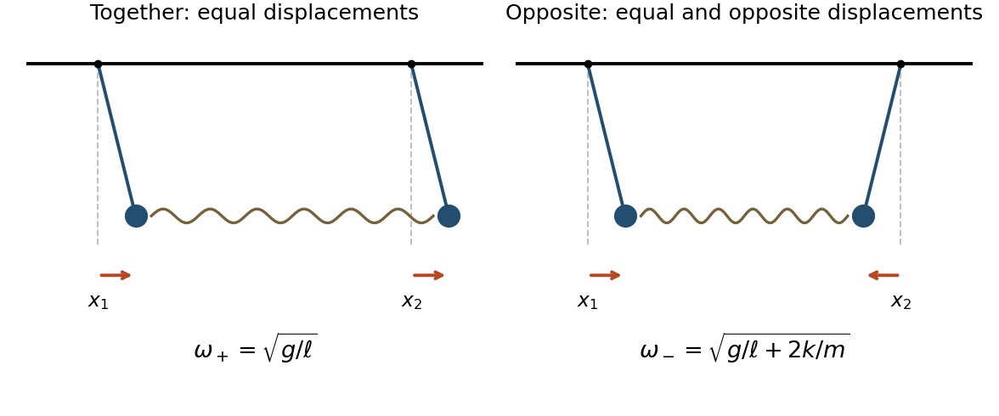

<h1 id="4/b/solution">Solution</h1>

↑ **Parent:** [B](../b.md)

Measure $x_1,x_2$ as horizontal [displacements](../../../../../../displacement.md) from the respective downward [equilibrium](../../../../../../equilibrium-point-of-a-dynamical-system.md) positions; the absolute horizontal [coordinates](../../../../../../coordinate-linear-algebra.md) are $x_1$ and $L+x_2$. Each vertical [displacement](../../../../../../displacement.md) is of second order in its small [angle](../../../../../../angle.md). Thus the [spring](../../../../../../spring.md) is horizontal to first order, its extension is $x_2-x_1$, and [Hooke's law](../../../../../../hooke-s-law.md) gives horizontal [forces](../../../../../../force-split.md) $k(x_2-x_1)$ and $-k(x_2-x_1)$. Combining these with the linearized [simple pendulum](../../../../../../simple-pendulum-split.md) restoring [force](../../../../../../force-split.md) yields

$$
\boxed{\ddot x_1=-\frac g\ell x_1+\frac km(x_2-x_1),\qquad
\ddot x_2=-\frac g\ell x_2-\frac km(x_2-x_1).}
$$

For the [normal modes of two spring-coupled equal pendulums](../../../../../../normal-modes-of-two-spring-coupled-equal-pendulums.md), add and subtract these [ordinary differential equations](../../../../../../ordinary-differential-equation.md). The [normal mode coordinates](../../../../../../normal-coordinate.md) $q_+=x_1+x_2$ and $q_-=x_1-x_2$ satisfy

$$
\ddot q_++\frac g\ell q_+=0,\qquad
\ddot q_-+\left(\frac g\ell+\frac{2k}{m}\right)q_-=0.
$$

Hence the two natural [angular frequencies](../../../../../../angular-frequency.md) and displacement patterns are

$$
\boxed{\omega_+=\sqrt{\frac g\ell},\quad(x_1,x_2)\propto(1,1);\qquad
\omega_-=\sqrt{\frac g\ell+\frac{2k}{m}},\quad(x_1,x_2)\propto(1,-1).}
$$

Ordinary [frequencies](../../../../../../frequency.md) are $\omega_+/(2\pi)$ and $\omega_-/(2\pi)$. In the first [normal mode](../../../../../../normal-mode.md), both particles swing together with equal [amplitudes](../../../../../../wave-amplitude.md) and the [spring](../../../../../../spring.md) is unextended to first order. In the second [normal mode](../../../../../../normal-mode.md), the particles swing in opposite directions with equal [amplitudes](../../../../../../wave-amplitude.md), so the [spring](../../../../../../spring.md) adds a restoring [force](../../../../../../force-split.md) and increases the [angular frequency](../../../../../../angular-frequency.md).

**[Figure 1](#4/b/image-the-two-normal-modes-equal-displacements-together-and-equal-displacements-in-opposite-directions). The two normal modes: equal displacements together and equal displacements in opposite directions**.

## ↑ Ancestors (12)

1. [B](../b.md)
2. [4](../../4.md)
3. [Mathematics IV resit](../../../mathematics-iv-resit-split.md)
4. [Prelims](../../../split.md)
5. [2017](../../../../split.md)
6. [Past exam of the mathematics course of the University of Oxford](../../../../../split.md)
7. [Mathematics course of the University of Oxford](../../../../../../mathematics-course-of-the-university-of-oxford.md)
8. [Undergraduate course of the University of Oxford](../../../../../../undergraduate-course-of-the-university-of-oxford.md)
9. [Course of the University of Oxford](../../../../../../course-of-the-university-of-oxford.md)
10. [University of Oxford](../../../../../../university-of-oxford-split.md)
11. [List of universities](../../../../../../list-of-universities.md)
12. [Codex Wiki](../../../../../../split.md)
