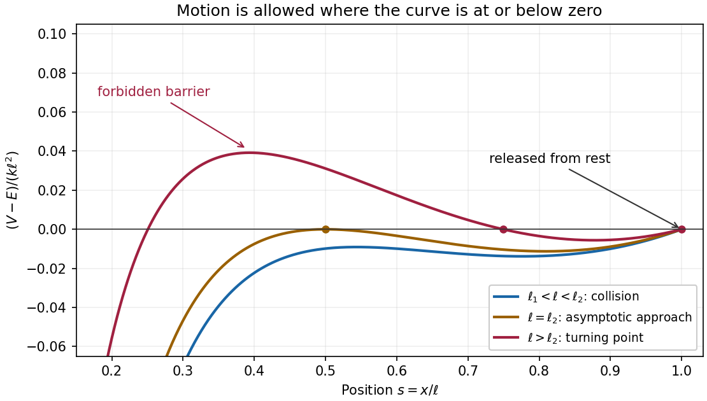

# Mathematics IV

↑ **Parent:** [Prelims](../prelims.md)

Source: [released examination PDF, bundle pages 172–175](https://www.whatdotheyknow.com/request/bsc_mathematics_prelims_and_part/response/2784209/attach/3/202409%20817%20annex.pdf#page=172).

**Table of contents**

- [1](#1)
  - [a](#1/a)
    - [Solution](#1/a/solution)
  - [b](#1/b)
    - [Solution](#1/b/solution)
  - [c](#1/c)
    - [Solution](#1/c/solution)
- [2](#2)
  - [a](#2/a)
    - [Solution](#2/a/solution)
  - [b](#2/b)
    - [Solution](#2/b/solution)
- [3](#3)
  - [a](#3/a)
    - [i](#3/a/i)
      - [Solution](#3/a/i/solution)
    - [ii](#3/a/ii)
      - [Solution](#3/a/ii/solution)
  - [b](#3/b)
    - [Solution](#3/b/solution)
  - [c](#3/c)
    - [Solution](#3/c/solution)
- [4](#4)
  - [a](#4/a)
    - [Solution](#4/a/solution)
  - [b](#4/b)
    - [Solution](#4/b/solution)
- [5](#5)
  - [a](#5/a)
    - [Solution](#5/a/solution)
  - [b](#5/b)
    - [Solution](#5/b/solution)
- [6](#6)
  - [a](#6/a)
    - [Solution](#6/a/solution)
  - [b](#6/b)
    - [Solution](#6/b/solution)
  - [c](#6/c)
    - [Solution](#6/c/solution)
- [7](#7)
  - [a](#7/a)
    - [i](#7/a/i)
      - [Solution](#7/a/i/solution)
    - [ii](#7/a/ii)
      - [Solution](#7/a/ii/solution)
  - [b](#7/b)
    - [Solution](#7/b/solution)

## 1

↑ **Parent:** [Mathematics IV](mathematics-iv.md)

<h3 id="1/a">a</h3>

↑ **Parent:** [1](#1)

<h4 id="1/a/solution">Solution</h4>

↑ **Parent:** [a](#1/a)

For [vectors](../../../vector-space.md#vector) $\mathbf a,\mathbf b,\mathbf c\in\mathbb R^3$, the [scalar product](../../../inner-product.md#dot-product), [cross product](../../../vector-space.md#cross-product) and [scalar triple product](../../../multilinear-algebra.md#scalar-triple-product) are respectively

$$
\begin{aligned}
\mathbf a\cdot\mathbf b&=a_1b_1+a_2b_2+a_3b_3,\\
\mathbf a\wedge\mathbf b&=(a_2b_3-a_3b_2,\ a_3b_1-a_1b_3,\ a_1b_2-a_2b_1),\\
(\mathbf a\wedge\mathbf b)\cdot\mathbf c&=\det\begin{pmatrix}a_1&a_2&a_3\\b_1&b_2&b_3\\c_1&c_2&c_3\end{pmatrix}.
\end{aligned}
$$

Expanding the [dot product](../../../inner-product.md#dot-product) gives

$$
(\mathbf a\wedge\mathbf b)\cdot\mathbf a
=a_1a_2b_3-a_1a_3b_2+a_2a_3b_1-a_1a_2b_3+a_1a_3b_2-a_2a_3b_1=0.
$$

Interchanging $\mathbf a$ and $\mathbf b$ changes the sign of their [cross product](../../../vector-space.md#cross-product), so its [dot product](../../../inner-product.md#dot-product) with $\mathbf b$ is also zero. Thus the [cross product](../../../vector-space.md#cross-product) is [orthogonal](../../../inner-product.md#orthogonal-vectors) to both [vectors](../../../vector-space.md#vector), including when it is the [zero vector](../../../vector-space.md#zero-vector).

The displayed [scalar triple product](../../../multilinear-algebra.md#scalar-triple-product) is a [determinant](../../../multilinear-algebra.md#determinant). A square [matrix](../../../vector-space.md#matrix) has nonzero [determinant](../../../multilinear-algebra.md#determinant) exactly when its rows are [linearly independent](../../../vector-space.md#linear-independence). Hence

$$
\boxed{(\mathbf a\wedge\mathbf b)\cdot\mathbf c\ne0\iff\mathbf a,\mathbf b,\mathbf c\text{ are linearly independent}.}
$$

<h3 id="1/b">b</h3>

↑ **Parent:** [1](#1)

<h4 id="1/b/solution">Solution</h4>

↑ **Parent:** [b](#1/b)

Subtracting the first row from the other two in the [determinant](../../../multilinear-algebra.md#determinant) gives

$$
f(\mathbf a,\mathbf b,\mathbf c)
=\det\begin{pmatrix}b_1-a_1&b_2-a_2\\c_1-a_1&c_2-a_2\end{pmatrix}.
$$

This vanishes exactly when the two [displacements](../../../classical-mechanics.md#displacement) $\mathbf b-\mathbf a$ and $\mathbf c-\mathbf a$ are [linearly dependent](../../../vector-space.md#linear-dependence). If $\mathbf a\ne\mathbf b$, that means $\mathbf c-\mathbf a=t(\mathbf b-\mathbf a)$ for some [real number](../../../arithmetic.md#real-number) $t$. Thus all three [points](../../../geometry-and-topology.md#point-geometry) lie on the [line](../../../euclidean-geometry.md#straight-line)

$$
\mathbf x=\mathbf a+s(\mathbf b-\mathbf a),\qquad s\in\mathbb R.
$$

Conversely, putting three [points](../../../geometry-and-topology.md#point-geometry) on any one [line](../../../euclidean-geometry.md#straight-line) makes their [displacements](../../../classical-mechanics.md#displacement) [linearly dependent](../../../vector-space.md#linear-dependence), so the [determinant](../../../multilinear-algebra.md#determinant) vanishes.

**The equivalence remains true without distinctness.** If exactly two [points](../../../geometry-and-topology.md#point-geometry) coincide, the two distinct locations determine a [line](../../../euclidean-geometry.md#straight-line) containing all three, and two rows of the original [determinant](../../../multilinear-algebra.md#determinant) coincide. If all three [points](../../../geometry-and-topology.md#point-geometry) coincide, any [line](../../../euclidean-geometry.md#straight-line) through that [point](../../../geometry-and-topology.md#point-geometry) works and the [determinant](../../../multilinear-algebra.md#determinant) is again zero. Existence persists, although uniqueness of the [line](../../../euclidean-geometry.md#straight-line) can fail.

<h3 id="1/c">c</h3>

↑ **Parent:** [1](#1)

<h4 id="1/c/solution">Solution</h4>

↑ **Parent:** [c](#1/c)

The value $f(\mathbf a,\mathbf b,\mathbf c)$ is twice the [signed area](../../../differential-geometry.md#signed-area) of the [triangle](../../../euclidean-geometry.md#triangle) traversed in that order; it is positive for counterclockwise [orientation](../../../algebraic-topology.md#orientation-of-a-simplex). Choose [points](../../../geometry-and-topology.md#point-geometry) on the [parabola](../../../euclidean-geometry.md#parabola)

$$
\boxed{\mathbf p_i=(i,i^2),\qquad 1\le i\le n.}
$$

For $i<j<k$, subtracting the first row in the [determinant](../../../multilinear-algebra.md#determinant) and factoring gives

$$
\begin{aligned}
f(\mathbf p_i,\mathbf p_j,\mathbf p_k)
&=(j-i)(k^2-i^2)-(k-i)(j^2-i^2)\\
&=(j-i)(k-i)(k-j)>0.
\end{aligned}
$$

Each of the three factors is positive, proving the required property for every [integer](../../../integer.md) $n\ge3$.

## 2

↑ **Parent:** [Mathematics IV](mathematics-iv.md)

<h3 id="2/a">a</h3>

↑ **Parent:** [2](#2)

<h4 id="2/a/solution">Solution</h4>

↑ **Parent:** [a](#2/a)

For a fixed [point](../../../geometry-and-topology.md#point-geometry) $F$ not on a fixed [line](../../../euclidean-geometry.md#straight-line) $D$, the [ellipse](../../../euclidean-geometry.md#ellipse) with [focus of a conic](../../../euclidean-geometry.md#focus-of-a-conic) $F$, [directrix of a conic](../../../euclidean-geometry.md#directrix-of-a-conic) $D$ and [eccentricity](../../../euclidean-geometry.md#eccentricity-of-a-conic) $0<e<1$ is the [locus](../../../euclidean-geometry.md#locus-mathematics) of [points](../../../geometry-and-topology.md#point-geometry) $P$ satisfying

$$
\boxed{\operatorname{dist}(P,F)=e\operatorname{dist}(P,D).}
$$

Set $c=\sqrt{a^2-b^2}$ and $e=c/a$. One matched [focus of a conic](../../../euclidean-geometry.md#focus-of-a-conic) and [directrix of a conic](../../../euclidean-geometry.md#directrix-of-a-conic) pair is

$$
\boxed{F=(c,0),\qquad D:\ x=\frac{a^2}{c},\qquad e=\sqrt{1-\frac{b^2}{a^2}}.}
$$

Indeed the squared [distance](../../../geometry-and-topology.md#distance) condition is

$$
(x-c)^2+y^2=\frac{c^2}{a^2}\left(x-\frac{a^2}{c}\right)^2.
$$

Expanding and cancelling the terms linear in $x$ gives

$$
\left(1-\frac{c^2}{a^2}\right)x^2+y^2=a^2-c^2=b^2,
$$

which is exactly $x^2/a^2+y^2/b^2=1$. Both sides of the unsquared [distance](../../../geometry-and-topology.md#distance) condition are nonnegative, so squaring introduces no extra [points](../../../geometry-and-topology.md#point-geometry). Reflecting across the $y$-axis gives the other matched pair: $F=(-c,0)$ and $D:x=-a^2/c$, with the same [eccentricity](../../../euclidean-geometry.md#eccentricity-of-a-conic).

<h3 id="2/b">b</h3>

↑ **Parent:** [2](#2)

<h4 id="2/b/solution">Solution</h4>

↑ **Parent:** [b](#2/b)

Use the [point](../../../geometry-and-topology.md#point-geometry) $\mathbf p_0=(-2,-2,4)$ and the [orthonormal basis](../../../inner-product.md#orthonormal-basis) of directions in the cutting [plane](../../../geometry-and-topology.md#plane)

$$
\mathbf e_1=\frac{(1,-1,0)}{\sqrt2},\qquad
\mathbf e_2=\frac{(1,1,-1)}{\sqrt3}.
$$

Both [vectors](../../../vector-space.md#vector) are [orthogonal](../../../inner-product.md#orthogonal-vectors) to the [normal vector](../../../differential-geometry.md#normal-vector) $(1,1,2)$, so every [point](../../../geometry-and-topology.md#point-geometry) of the [plane](../../../geometry-and-topology.md#plane) has unique [coordinates](../../../vector-space.md#coordinate-linear-algebra)

$$
(x,y,z)=\mathbf p_0+s\mathbf e_1+t\mathbf e_2.
$$

Substituting into the [cone](../../../euclidean-geometry.md#cone-geometry) [equation](../../../algebra.md#equation) gives

$$
x^2+y^2-z^2=-8+s^2+\frac{t^2}{3}.
$$

Consequently the intersection has [equation](../../../algebra.md#equation)

$$
\boxed{\frac{t^2}{24}+\frac{s^2}{8}=1.}
$$

Because these are [orthonormal coordinates](../../../inner-product.md#orthonormal-coordinates), their lengths are the actual lengths in the [plane](../../../geometry-and-topology.md#plane). Thus this is an [ellipse](../../../euclidean-geometry.md#ellipse) with [semi-major axis](../../../celestial-mechanics.md#semi-major-axis) $\sqrt{24}$ and [semi-minor axis](../../../celestial-mechanics.md#semi-minor-axis) $\sqrt8$, not merely a projected [ellipse](../../../euclidean-geometry.md#ellipse). By [a](#2/a), its [eccentricity](../../../euclidean-geometry.md#eccentricity-of-a-conic) is

$$
\boxed{e=\sqrt{1-\frac8{24}}=\sqrt{\frac23}.}
$$

## 3

↑ **Parent:** [Mathematics IV](mathematics-iv.md)

<h3 id="3/a">a</h3>

↑ **Parent:** [3](#3)

<h4 id="3/a/i">i</h4>

↑ **Parent:** [a](#3/a)

<h5 id="3/a/i/solution">Solution</h5>

↑ **Parent:** [i](#3/a/i)

The [ellipsoid](../../../euclidean-geometry.md#ellipsoid) is the [level set](../../../topology.md#level-set) $F(x,y,z)=2x^2+y^2+z^2=1$. Its [gradient](../../../multivariable-calculus.md#gradient) is $(4x,2y,2z)$, which never vanishes on the [ellipsoid](../../../euclidean-geometry.md#ellipsoid). Half this [gradient](../../../multivariable-calculus.md#gradient) gives the outward [normal vector](../../../differential-geometry.md#normal-vector)

$$
\boxed{\mathbf n(\theta,\phi)=(\sqrt2\cos\theta,\sin\theta\cos\phi,\sin\theta\sin\phi).}
$$

This [normal vector](../../../differential-geometry.md#normal-vector) remains valid at $\theta=0,\pi$, where the given [parametrization](../../../geometry-and-topology.md#parametric-equation) is singular.

<h4 id="3/a/ii">ii</h4>

↑ **Parent:** [a](#3/a)

<h5 id="3/a/ii/solution">Solution</h5>

↑ **Parent:** [ii](#3/a/ii)

The [partial derivatives](../../../multivariable-calculus.md#partial-derivative) of the [parametrization](../../../geometry-and-topology.md#parametric-equation) are

$$
\begin{aligned}
\mathbf r_\theta&=(-\sin\theta/\sqrt2,\cos\theta\cos\phi,\cos\theta\sin\phi),\\
\mathbf r_\phi&=(0,-\sin\theta\sin\phi,\sin\theta\cos\phi).
\end{aligned}
$$

Their [cross product](../../../vector-space.md#cross-product) is

$$
\mathbf r_\theta\wedge\mathbf r_\phi
=\left(\sin\theta\cos\theta,\frac{\sin^2\theta\cos\phi}{\sqrt2},\frac{\sin^2\theta\sin\phi}{\sqrt2}\right).
$$

Taking its [euclidean norm](../../../normed-vector-space.md#euclidean-norm) gives the [surface area element](../../../multivariable-calculus.md#surface-area-element)

$$
dA=\frac{\sin\theta}{\sqrt2}\sqrt{1+\cos^2\theta}\,d\theta\,d\phi.
$$

The two poles and duplicated seam have zero [surface area](../../../differential-geometry.md#surface-area), so integrating over the stated [parameter domain](../../../geometry-and-topology.md#parameter-domain) counts the [surface area](../../../differential-geometry.md#surface-area) once. With the [change of variables](../../../multivariable-calculus.md#change-of-variables-formula) $u=\cos\theta$ and the supplied [definite integral](../../../integral.md#definite-integral),

$$
\begin{aligned}
\operatorname{area}(S)
&=\frac{2\pi}{\sqrt2}\int_0^\pi\sin\theta\sqrt{1+\cos^2\theta}\,d\theta\\
&=\sqrt2\pi\int_{-1}^1\sqrt{1+u^2}\,du\\
&=\boxed{2\pi+\sqrt2\pi\ln(1+\sqrt2).}
\end{aligned}
$$

Here $-\ln(\sqrt2-1)=\ln(\sqrt2+1)$ because $(\sqrt2-1)(\sqrt2+1)=1$.

<h3 id="3/b">b</h3>

↑ **Parent:** [3](#3)

<h4 id="3/b/solution">Solution</h4>

↑ **Parent:** [b](#3/b)

Using the [normal vector](../../../differential-geometry.md#normal-vector) from [i](#3/a/i), the [normal line](../../../differential-geometry.md#normal-line) is

$$
\boxed{L:\ \mathbf x=\mathbf r(\theta,\phi)+\lambda(\sqrt2\cos\theta,\sin\theta\cos\phi,\sin\theta\sin\phi),\quad\lambda\in\mathbb R.}
$$

For $0<\theta<\pi$, the $y$- and $z$-[coordinates](../../../vector-space.md#coordinate-linear-algebra) vanish together exactly when $\lambda=-1$. At that [point](../../../geometry-and-topology.md#point-geometry), the $x$-[coordinate](../../../vector-space.md#coordinate-linear-algebra) is

$$
\frac{\cos\theta}{\sqrt2}-\sqrt2\cos\theta=-\frac{\cos\theta}{\sqrt2}.
$$

Thus

$$
\boxed{a=-\frac1{\sqrt2}.}
$$

At $\theta=0$ or $\theta=\pi$, both the [position vector](../../../classical-mechanics.md#position-vector) and [normal vector](../../../differential-geometry.md#normal-vector) lie along the $x$-axis, so **$L$ is the whole $x$-axis in either case**.

<h3 id="3/c">c</h3>

↑ **Parent:** [3](#3)

<h4 id="3/c/solution">Solution</h4>

↑ **Parent:** [c](#3/c)

**The required [lines](../../../euclidean-geometry.md#straight-line) are the $x$-axis and every [line](../../../euclidean-geometry.md#straight-line) through the origin in the [plane](../../../geometry-and-topology.md#plane) $x=0$.** Explicitly,

$$
\boxed{L=\{(t,0,0):t\in\mathbb R\}\quad\text{or}\quad L=\{(0,t\cos\phi,t\sin\phi):t\in\mathbb R\},\quad0\le\phi<\pi.}
$$

The $x$-axis meets the [ellipsoid](../../../euclidean-geometry.md#ellipsoid) at its two poles and is a [normal line](../../../differential-geometry.md#normal-line) at each. A [line](../../../euclidean-geometry.md#straight-line) of the second kind meets it at the antipodal [points](../../../geometry-and-topology.md#point-geometry) $(0,\pm\cos\phi,\pm\sin\phi)$, whose [normal vectors](../../../differential-geometry.md#normal-vector) are parallel to that [line](../../../euclidean-geometry.md#straight-line).

To prove completeness, suppose a common [normal line](../../../differential-geometry.md#normal-line) passes through distinct [points](../../../geometry-and-topology.md#point-geometry) $P=\mathbf r(\theta,\phi)$ and $Q=\mathbf r(\theta',\phi')$. If either is a pole, [b](#3/b) forces the [line](../../../euclidean-geometry.md#straight-line) to be the $x$-axis. Otherwise [b](#3/b) says that the [line](../../../euclidean-geometry.md#straight-line) meets the $x$-axis at $(-\cos\theta/\sqrt2,0,0)$ and at $(-\cos\theta'/\sqrt2,0,0)$. A [line](../../../euclidean-geometry.md#straight-line) other than the $x$-axis has at most one such intersection, so $\cos\theta=\cos\theta'$.

The [points](../../../geometry-and-topology.md#point-geometry) $P,Q$ consequently have equal $x$-[coordinates](../../../vector-space.md#coordinate-linear-algebra). Since they are distinct, their joining [line](../../../euclidean-geometry.md#straight-line) has zero $x$-component in its direction. Its [normal vector](../../../differential-geometry.md#normal-vector) at $P$ therefore has $\sqrt2\cos\theta=0$. Hence $P,Q$ lie in $x=0$, and the [normal line](../../../differential-geometry.md#normal-line) there passes through the origin. This gives exactly the listed family.

## 4

↑ **Parent:** [Mathematics IV](mathematics-iv.md)

<h3 id="4/a">a</h3>

↑ **Parent:** [4](#4)

<h4 id="4/a/solution">Solution</h4>

↑ **Parent:** [a](#4/a)

Put $C=q^2/(4\pi\epsilon_0)>0$. The [spring](../../../elasticity-physics.md#spring) exerts the [force](../../../force.md) $k(\ell-x)$ by [Hooke's law](../../../elasticity-physics.md#hooke-s-law), while [Coulomb's law](../../../electrostatics.md#coulomb-s-law) gives the attractive [force](../../../force.md) $-C/x^2$. [Newton's second law](../../../force.md#newton-s-second-law) therefore gives the [equation of motion](../../../classical-mechanics.md#equation-of-motion)

$$
\boxed{m\ddot x=f(x)=k(\ell-x)-\frac C{x^2}.}
$$

For $x>0$, the [derivative](../../../calculus.md#derivative) is $f'(x)=-k+2C/x^3$. Thus $f$ increases up to $x_*=(2C/k)^{1/3}$ and decreases thereafter. Also $f(x)\to-\infty$ at both ends of the positive half-axis. Its unique [maximum](../../../set.md#maximum-of-a-subset-of-a-total-order) is

$$
f(x_*)=k\left(\ell-\frac32x_*\right).
$$

There are therefore two [equilibrium points](../../../dynamical-systems.md#equilibrium-point-of-a-dynamical-system) precisely when

$$
\boxed{\ell>\ell_1=\frac32\left(\frac{q^2}{2\pi\epsilon_0k}\right)^{1/3}.}
$$

Writing them $x_-<x_*<x_+$, the [linearization](../../../algebra.md#linearization) $m\ddot\eta=f'(x_\pm)\eta$ has exponentially growing solutions at $x_-$ and oscillatory solutions at $x_+$. Equivalently, the [potential energy](../../../energy.md#potential-energy) has a strict [local maximum](../../../analysis.md#local-maximum) at $x_-$ and a strict [local minimum](../../../analysis.md#local-minimum) at $x_+$. Hence **the smaller [equilibrium point](../../../dynamical-systems.md#equilibrium-point-of-a-dynamical-system) is an [unstable equilibrium](../../../dynamical-systems.md#unstable-equilibrium); the larger is a [stable equilibrium](../../../dynamical-systems.md#stable-equilibrium)**, with no [damping](../../../wave-equation.md#damping) to make it attracting.

At equality $\ell=\ell_1$ there is one degenerate [equilibrium point](../../../dynamical-systems.md#equilibrium-point-of-a-dynamical-system) $x_*$; it is unstable, since a displacement to its left gives a leftward [force](../../../force.md). For $\ell<\ell_1$ there are no [equilibrium points](../../../dynamical-systems.md#equilibrium-point-of-a-dynamical-system).

<h3 id="4/b">b</h3>

↑ **Parent:** [4](#4)

<h4 id="4/b/solution">Solution</h4>

↑ **Parent:** [b](#4/b)

Multiply the [equation of motion](../../../classical-mechanics.md#equation-of-motion) by $\dot x$ and integrate. The conserved [mechanical energy](../../../energy.md#mechanical-energy) is

$$
\frac12m\dot x^2+V(x)=E,\qquad V(x)=\frac k2(\ell-x)^2-\frac Cx.
$$

The [initial conditions](../../../differential-equation.md#initial-condition) $x=\ell$, $\dot x=0$ give $E=-C/\ell$, so

$$
\boxed{\frac12m\dot x^2=-\frac k2(\ell-x)^2+C\left(\frac1x-\frac1\ell\right).}
$$

Initially $\ddot x=-C/(m\ell^2)<0$, so the [particle](../../../physics.md#particle-physics) starts moving towards the origin. For $0<x<\ell$, factor its [kinetic energy](../../../energy.md#kinetic-energy) as

$$
E-V(x)=\frac{\ell-x}{2\ell x}\left[2C-k\ell x(\ell-x)\right].
$$

The [quadratic function](../../../polynomial.md#quadratic-function) $x(\ell-x)$ has [maximum](../../../set.md#maximum-of-a-subset-of-a-total-order) $\ell^2/4$ at $x=\ell/2$. Consequently [kinetic energy](../../../energy.md#kinetic-energy) is strictly positive throughout $0<x<\ell$ exactly when $k\ell^3<8C$. Thus the collision threshold is

$$
\boxed{\ell_2=\left(\frac{8C}{k}\right)^{1/3}=\left(\frac{2q^2}{\pi\epsilon_0k}\right)^{1/3}.}
$$

For $\ell_1<\ell<\ell_2$ there is no intervening [turning point](../../../energy.md#turning-point), and the [particle](../../../physics.md#particle-physics) collides with the fixed [particle](../../../physics.md#particle-physics). The collision takes finite time: near zero, $|\dot x|\sim\sqrt{2C/(mx)}$, so the remaining time is bounded by a constant times $\int_0^\delta\sqrt{x}\,dx$.

For $\ell>\ell_2$, the first [turning point](../../../energy.md#turning-point) encountered is

$$
\boxed{x_T=\frac{\ell+\sqrt{\ell^2-8C/(k\ell)}}2.}
$$

The [particle](../../../physics.md#particle-physics) **oscillates periodically between $x_T$ and $\ell$**, around the larger [stable equilibrium](../../../dynamical-systems.md#stable-equilibrium), without collision. The zeros of $E-V$ at the two endpoints of this allowed region are simple, so travel to each [turning point](../../../energy.md#turning-point) takes finite time. At the boundary $\ell=\ell_2$, $x=\ell/2$ is a double zero of $E-V$ and an [unstable equilibrium](../../../dynamical-systems.md#unstable-equilibrium); the inward [trajectory](../../../classical-mechanics.md#trajectory) approaches it only as $t\to\infty$.

**[Figure 1](#4/b/image-the-energy-barrier-distinguishes-collision-asymptotic-approach-and-bounded-oscillation). The energy barrier distinguishes collision, asymptotic approach, and bounded oscillation**.

## 5

↑ **Parent:** [Mathematics IV](mathematics-iv.md)

<h3 id="5/a">a</h3>

↑ **Parent:** [5](#5)

<h4 id="5/a/solution">Solution</h4>

↑ **Parent:** [a](#5/a)

Write $\mu=GM$. In [polar coordinates](../../../multivariable-calculus.md#polar-coordinates), [Newton's second law](../../../force.md#newton-s-second-law) per unit [mass](../../../classical-mechanics.md#mass) gives the radial and transverse [equations of motion](../../../classical-mechanics.md#equation-of-motion)

$$
\ddot r-r\dot\theta^2=-\frac\mu{r^2},\qquad
r\ddot\theta+2\dot r\dot\theta=0.
$$

The transverse [equation](../../../algebra.md#equation) implies

$$
\frac d{dt}(r^2\dot\theta)=r(r\ddot\theta+2\dot r\dot\theta)=0,
\qquad\boxed{h=r^2\dot\theta\text{ is constant}.}
$$

This is [conservation of angular momentum](../../../momentum.md#conservation-of-angular-momentum) per unit [mass](../../../classical-mechanics.md#mass). For the nonradial [trajectory](../../../classical-mechanics.md#trajectory) in the next part, choose [orientation](../../../algebraic-topology.md#orientation-of-a-simplex) so $h>0$. With $u=1/r$ and primes denoting [derivatives](../../../calculus.md#derivative) with respect to $\theta$, the [chain rule](../../../calculus.md#chain-rule) gives

$$
\dot\theta=hu^2,\qquad \dot r=-hu',\qquad \ddot r=-h^2u^2u''.
$$

Substituting into the radial [equation](../../../algebra.md#equation) yields $-h^2u^2(u''+u)=-\mu u^2$, hence

$$
\boxed{u''+u=\frac{GM}{h^2}.}
$$

The change of independent variable requires $h\ne0$; a purely radial [trajectory](../../../classical-mechanics.md#trajectory) instead has constant $\theta$.

<h3 id="5/b">b</h3>

↑ **Parent:** [5](#5)

<h4 id="5/b/solution">Solution</h4>

↑ **Parent:** [b](#5/b)

Far from the planet, the magnitude of [angular momentum](../../../momentum.md#angular-momentum) per unit [mass](../../../classical-mechanics.md#mass) is the magnitude of the [cross product](../../../vector-space.md#cross-product) of [position vector](../../../classical-mechanics.md#position-vector) and [velocity](../../../classical-mechanics.md#velocity). The perpendicular distance from the incoming [asymptote](../../../topology.md#asymptote) is the [impact parameter](../../../classical-mechanics.md#impact-parameter) $d$, so

$$
\boxed{h=dv.}
$$

Choose $\theta=0$ at closest approach. The general solution of the [differential equation](../../../differential-equation.md) in [a](#5/a), with $u'(0)=0$, is

$$
u=\frac\mu{h^2}(1+e\cos\theta).
$$

The [specific orbital energy](../../../celestial-mechanics.md#specific-orbital-energy) is

$$
\varepsilon=\frac12(\dot r^2+r^2\dot\theta^2)-\frac\mu r
=\frac{h^2}2(u'^2+u^2)-\mu u
=\frac{\mu^2}{2h^2}(e^2-1).
$$

At infinity $\varepsilon=v^2/2$, giving $e=\sqrt{1+h^2v^2/\mu^2}>1$. Thus the [hyperbolic orbit](../../../celestial-mechanics.md#hyperbolic-orbit) has

$$
\boxed{u(\theta)=\frac{GM}{d^2v^2}\left[1+\sqrt{1+\frac{d^2v^4}{G^2M^2}}\cos\theta\right].}
$$

A different zero of [polar angle](../../../multivariable-calculus.md#polar-angle) simply replaces $\theta$ by $\theta-\theta_0$.

The incoming and outgoing [asymptotes](../../../topology.md#asymptote) have radial directions $-\theta_\infty$ and $\theta_\infty$, where $\cos\theta_\infty=-1/e$ and $\pi/2<\theta_\infty<\pi$. The incoming [velocity](../../../classical-mechanics.md#velocity) points opposite its radial direction, so the [deflection angle](../../../classical-mechanics.md#deflection-angle) between incoming and outgoing [velocities](../../../classical-mechanics.md#velocity) is $\delta=2\theta_\infty-\pi$. Hence

$$
\sin\frac\delta2=\frac1e,\qquad
\tan\frac\delta2=\frac{GM}{dv^2}.
$$

Putting $\delta=\pi/2$ gives

$$
\boxed{d=\frac{GM}{v^2}.}
$$

## 6

↑ **Parent:** [Mathematics IV](mathematics-iv.md)

<h3 id="6/a">a</h3>

↑ **Parent:** [6](#6)

<h4 id="6/a/solution">Solution</h4>

↑ **Parent:** [a](#6/a)

In [cylindrical coordinates](../../../multivariable-calculus.md#cylindrical-coordinate-system), $\theta=\omega t$ and $z=r^2/(2a)$. Thus

$$
\dot z=\frac ra\dot r,\qquad \ddot z=\frac{r\ddot r+\dot r^2}{a}.
$$

The [acceleration](../../../classical-mechanics.md#acceleration) is

$$
\mathbf A=(\ddot r-r\omega^2)\mathbf e_r+2\omega\dot r\mathbf e_\theta+\frac{r\ddot r+\dot r^2}{a}\mathbf e_z.
$$

A [tangent vector](../../../tangent-vector.md) along the wire is $\mathbf t=\mathbf e_r+(r/a)\mathbf e_z$. Because the wire is smooth, its [constraint force](../../../force.md#constraint-force) is [orthogonal](../../../inner-product.md#orthogonal-vectors) to $\mathbf t$. Taking the [dot product](../../../inner-product.md#dot-product) of [Newton's second law](../../../force.md#newton-s-second-law) with $\mathbf t$ eliminates that [force](../../../force.md); [gravitational weight](../../../force.md#weight-physics) contributes $-mgr/a$. Hence

$$
m\left[\ddot r-r\omega^2+\frac r{a^2}(r\ddot r+\dot r^2)\right]=-\frac{mgr}{a}.
$$

Multiplying by $a^2/m$ gives

$$
\boxed{(a^2+r^2)\ddot r+r\dot r^2-a^2\omega^2r=-agr.}
$$

<h3 id="6/b">b</h3>

↑ **Parent:** [6](#6)

<h4 id="6/b/solution">Solution</h4>

↑ **Parent:** [b](#6/b)

The [linearization](../../../algebra.md#linearization) at rest at $r=0$ is

$$
\ddot r=\left(\omega^2-\frac ga\right)r.
$$

For $\omega^2<g/a$, small disturbances oscillate. To verify nonlinear [stability](../../../numerical-analysis.md#stability-of-a-numerical-method), multiply the full [equation of motion](../../../classical-mechanics.md#equation-of-motion) by $\dot r/a^2$ and integrate to obtain the [first integral](../../../differential-equation.md#first-integral)

$$
J=\frac12\left(1+\frac{r^2}{a^2}\right)\dot r^2+\frac12\left(\frac ga-\omega^2\right)r^2.
$$

For $\omega^2<g/a$, $J$ is positive away from the [equilibrium point](../../../dynamical-systems.md#equilibrium-point-of-a-dynamical-system) in a sufficiently small [neighborhood](../../../topology.md#neighbourhood-mathematics) of $(r,\dot r)=(0,0)$; its small [level sets](../../../topology.md#level-set) confine the motion. Thus

$$
\boxed{r=0\text{ is stable if }\omega^2<g/a,\text{ and unstable if }\omega^2>g/a.}
$$

At equality, every resting location on the wire is an [equilibrium point](../../../dynamical-systems.md#equilibrium-point-of-a-dynamical-system), so a displacement at zero relative [velocity](../../../classical-mechanics.md#velocity) simply remains there: the equilibrium is **neutral with respect to resting displacements**. It is **unstable with respect to general perturbations in [phase space](../../../hamiltonian-mechanics.md#phase-space)**, however. An arbitrarily small outward initial [velocity](../../../classical-mechanics.md#velocity) $v_0>0$ gives $\dot r=v_0/\sqrt{1+r^2/a^2}>0$ from the [first integral](../../../differential-equation.md#first-integral), eventually taking the bead outside any prescribed small [neighborhood](../../../topology.md#neighbourhood-mathematics). Thus strict [phase space](../../../hamiltonian-mechanics.md#phase-space) [stability](../../../numerical-analysis.md#stability-of-a-numerical-method) holds only for $\omega^2<g/a$.

<h3 id="6/c">c</h3>

↑ **Parent:** [6](#6)

<h4 id="6/c/solution">Solution</h4>

↑ **Parent:** [c](#6/c)

Put $\lambda=\omega^2-g/a>0$. The zero value of the [first integral](../../../differential-equation.md#first-integral) in [b](#6/b) gives

$$
\boxed{\left(1+\frac{r^2}{a^2}\right)\dot r^2=\lambda r^2.}
$$

At the endpoint $r=a$, this gives $\dot r^2=\lambda a^2/2$. The absolute [speed](../../../classical-mechanics.md#speed) includes radial, azimuthal and vertical components. Since $\dot z=\dot r$ there,

$$
|\mathbf v|^2=\dot r^2+(a\omega)^2+\dot z^2
=2\dot r^2+a^2\omega^2=a^2\left(2\omega^2-\frac ga\right).
$$

Hence the limiting exit [speed](../../../classical-mechanics.md#speed) is

$$
\boxed{|\mathbf v|=a\sqrt{2\omega^2-\frac ga}.}
$$

There is a small [initial condition](../../../differential-equation.md#initial-condition) qualification in the wording. The exact [initial conditions](../../../differential-equation.md#initial-condition) $r=\dot r=0$ give the stationary solution forever, by [Picard-Lindelöf theorem](../../../differential-equation.md#picard-lindelof-theorem). The displayed zero-[first integral](../../../differential-equation.md#first-integral) moving branch instead approaches that [unstable equilibrium](../../../dynamical-systems.md#unstable-equilibrium) as $t\to-\infty$.

For a precise small disturbance, release the bead with zero relative [velocity](../../../classical-mechanics.md#velocity) at $r=\epsilon>0$. Its [first integral](../../../differential-equation.md#first-integral) is $J=-\lambda\epsilon^2/2$, giving

$$
\left(1+\frac{r^2}{a^2}\right)\dot r^2=\lambda(r^2-\epsilon^2),\qquad
|\mathbf v_{\rm exit}|^2=a^2\left(2\omega^2-\frac ga\right)-\lambda\epsilon^2.
$$

The bead initially accelerates outward and reaches the end. Letting $\epsilon\to0^+$ recovers exactly the stated exit [speed](../../../classical-mechanics.md#speed). The conserved $J$ is a [Jacobi integral](../../../lagrangian-mechanics.md#jacobi-integral) associated with the imposed rotation; ordinary [mechanical energy](../../../energy.md#mechanical-energy) need not be conserved because the apparatus driving the wire can do [work](../../../energy.md#work).

## 7

↑ **Parent:** [Mathematics IV](mathematics-iv.md)

<h3 id="7/a">a</h3>

↑ **Parent:** [7](#7)

<h4 id="7/a/i">i</h4>

↑ **Parent:** [a](#7/a)

<h5 id="7/a/i/solution">Solution</h5>

↑ **Parent:** [i](#7/a/i)

The [euclidean algorithm](../../../number-theory.md#euclidean-algorithm) computes the [greatest common divisor](../../../divisibility.md#greatest-common-divisor) of two [integers](../../../integer.md) by repeated [division with remainder](../../../integer.md#euclidean-division). Start with $r_0=|A|$, $r_1=|B|$, interchanging them if necessary, and repeatedly write

$$
r_{j-1}=q_jr_j+r_{j+1},\qquad 0\le r_{j+1}<r_j,
$$

until a zero remainder occurs. The positive remainders strictly decrease, so the process terminates. At each step the common [divisors](../../../divisibility.md#divisor) of $r_{j-1},r_j$ are exactly the common [divisors](../../../divisibility.md#divisor) of $r_j,r_{j+1}$, because $r_{j+1}=r_{j-1}-q_jr_j$. Hence

$$
\boxed{\gcd(A,B)=\text{the last nonzero remainder}.}
$$

If one input is zero, the answer is the [absolute value](../../../real-analysis.md#absolute-value) of the other; the usual convention sets $\gcd(0,0)=0$. Back-substitution also expresses the [greatest common divisor](../../../divisibility.md#greatest-common-divisor) as an [integer linear combination](../../../vector-space.md#integer-linear-combination) of the inputs, as in [Bézout's identity](../../../algebra.md#bezout-s-identity).

<h4 id="7/a/ii">ii</h4>

↑ **Parent:** [a](#7/a)

<h5 id="7/a/ii/solution">Solution</h5>

↑ **Parent:** [ii](#7/a/ii)

Let $P=3x^4-5x^3+2x^2-3x+2$ and $Q=3x^3+x^2+x-2$. Applying [polynomial long division](../../../polynomial.md#polynomial-long-division) gives the [euclidean algorithm](../../../number-theory.md#euclidean-algorithm)

$$
\begin{aligned}
P&=(x-2)Q+(3x^2+x-2),\\
Q&=x(3x^2+x-2)+(3x-2),\\
3x^2+x-2&=(x+1)(3x-2).
\end{aligned}
$$

Thus their [polynomial greatest common divisor](../../../polynomial.md#polynomial-greatest-common-divisor) is $3x-2$, up to a nonzero constant factor. Their unique common [root of a polynomial](../../../polynomial.md#root-of-a-polynomial) is therefore

$$
\boxed{\alpha=\frac23.}
$$

<h3 id="7/b">b</h3>

↑ **Parent:** [7](#7)

<h4 id="7/b/solution">Solution</h4>

↑ **Parent:** [b](#7/b)

The [polynomial](../../../polynomial.md) factors as $p(x)=(3x-2)^2(3x+1)$, so $\alpha=2/3$ is a [multiple root](../../../polynomial.md#multiple-root) of multiplicity two. The [Newton root-finding iteration](../../../numerical-analysis.md#newton-root-finding-iteration) is

$$
x_{k+1}=x_k-\frac{p(x_k)}{p'(x_k)},\qquad p'(x)=81x^2-54x.
$$

For $x\ne0,2/3$, cancelling a factor gives

$$
\boxed{g(x)=\frac{2x}{3}+\frac19+\frac{2}{27x}.}
$$

This expression extends continuously to $g(2/3)=2/3$. Let $I=[1/3,1]$. On this [closed interval](../../../real-analysis.md#closed-real-interval),

$$
g'(x)=\frac23-\frac{2}{27x^2},\qquad 0\le g'(x)\le\frac{16}{27}<1.
$$

Thus $g$ is increasing, and

$$
g(I)=[g(1/3),g(1)]=[5/9,23/27]\subset I.
$$

By the [mean value theorem](../../../calculus.md#mean-value-theorem), $|g(x)-g(y)|\le(16/27)|x-y|$ for all $x,y\in I$. The [contraction mapping theorem](../../../analysis.md#contraction-mapping-theorem) states that a [contraction mapping](../../../analysis.md#contraction-mapping) from a nonempty [complete metric space](../../../topological-analysis.md#complete-metric-space) into itself has a unique [fixed point](../../../function.md#fixed-point), and every [fixed-point iteration](../../../numerical-analysis.md#fixed-point-iteration) converges to it. The [closed interval](../../../real-analysis.md#closed-real-interval) $I$ with ordinary [Euclidean distance](../../../topological-analysis.md#euclidean-distance) is complete, and $g(2/3)=2/3$, so

$$
\boxed{x_k\longrightarrow\frac23\quad\text{for every }x_0\in[1/3,1].}
$$

In fact $|x_k-2/3|\le(16/27)^k|x_0-2/3|$. The [Newton iteration at a multiple root](../../../numerical-analysis.md#newton-iteration-at-a-multiple-root) here has [linear convergence](../../../numerical-analysis.md#linear-convergence), since $g'(2/3)=1/2$. Thus **the convergence assertion is true for the simplified [fixed-point iteration](../../../numerical-analysis.md#fixed-point-iteration)**, and for the usual [Newton root-finding iteration](../../../numerical-analysis.md#newton-root-finding-iteration) that stops upon reaching an exact [root of a polynomial](../../../polynomial.md#root-of-a-polynomial). If one insists on applying the unsimplified quotient at every step, it is undefined for the allowed starting value $x_0=2/3$, since both $p$ and $p'$ vanish there; that literal version of an infinite [sequence](../../../sequence-and-series.md#sequence) requires the stated stopping convention or continuous extension.

## ↑ Ancestors (9)

1. [Prelims](../prelims.md)
2. [2017](../../2017.md)
3. [Past exam of the mathematics course of the University of Oxford](../../../past-exam-of-the-mathematics-course-of-the-university-of-oxford.md)
4. [Mathematics course of the University of Oxford](../../../university-of-oxford.md#mathematics-course-of-the-university-of-oxford)
5. [Undergraduate course of the University of Oxford](../../../university-of-oxford.md#undergraduate-course-of-the-university-of-oxford)
6. [Course of the University of Oxford](../../../university-of-oxford.md#course-of-the-university-of-oxford)
7. [University of Oxford](../../../university-of-oxford.md)
8. [List of universities](../../../README.md#list-of-universities)
9. [Codex Wiki](../../../README.md)
