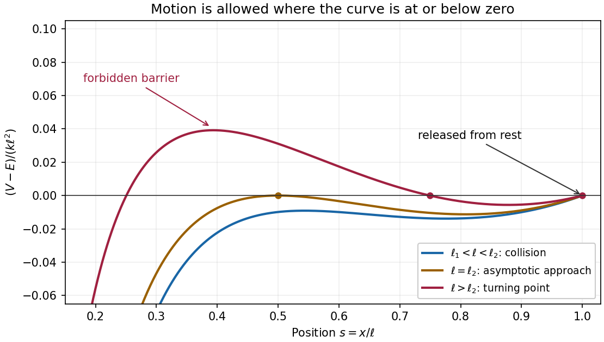

<h1 id="4/b/solution">Solution</h1>

↑ **Parent:** [b](../b.md)

Multiply the [equation of motion](../../../../../../equation-of-motion.md) by $\dot x$ and integrate. The conserved [mechanical energy](../../../../../../mechanical-energy.md) is

$$
\frac12m\dot x^2+V(x)=E,\qquad V(x)=\frac k2(\ell-x)^2-\frac Cx.
$$

The [initial conditions](../../../../../../initial-condition.md) $x=\ell$, $\dot x=0$ give $E=-C/\ell$, so

$$
\boxed{\frac12m\dot x^2=-\frac k2(\ell-x)^2+C\left(\frac1x-\frac1\ell\right).}
$$

Initially $\ddot x=-C/(m\ell^2)<0$, so the [particle](../../../../../../particle-physics.md) starts moving towards the origin. For $0<x<\ell$, factor its [kinetic energy](../../../../../../kinetic-energy.md) as

$$
E-V(x)=\frac{\ell-x}{2\ell x}\left[2C-k\ell x(\ell-x)\right].
$$

The [quadratic function](../../../../../../quadratic-function.md) $x(\ell-x)$ has [maximum](../../../../../../maximum-of-a-subset-of-a-total-order.md) $\ell^2/4$ at $x=\ell/2$. Consequently [kinetic energy](../../../../../../kinetic-energy.md) is strictly positive throughout $0<x<\ell$ exactly when $k\ell^3<8C$. Thus the collision threshold is

$$
\boxed{\ell_2=\left(\frac{8C}{k}\right)^{1/3}=\left(\frac{2q^2}{\pi\epsilon_0k}\right)^{1/3}.}
$$

For $\ell_1<\ell<\ell_2$ there is no intervening [turning point](../../../../../../turning-point.md), and the [particle](../../../../../../particle-physics.md) collides with the fixed [particle](../../../../../../particle-physics.md). The collision takes finite time: near zero, $|\dot x|\sim\sqrt{2C/(mx)}$, so the remaining time is bounded by a constant times $\int_0^\delta\sqrt{x}\,dx$.

For $\ell>\ell_2$, the first [turning point](../../../../../../turning-point.md) encountered is

$$
\boxed{x_T=\frac{\ell+\sqrt{\ell^2-8C/(k\ell)}}2.}
$$

The [particle](../../../../../../particle-physics.md) **oscillates periodically between $x_T$ and $\ell$**, around the larger [stable equilibrium](../../../../../../stable-equilibrium.md), without collision. The zeros of $E-V$ at the two endpoints of this allowed region are simple, so travel to each [turning point](../../../../../../turning-point.md) takes finite time. At the boundary $\ell=\ell_2$, $x=\ell/2$ is a double zero of $E-V$ and an [unstable equilibrium](../../../../../../unstable-equilibrium.md); the inward [trajectory](../../../../../../trajectory.md) approaches it only as $t\to\infty$.

**[Figure 1](#4/b/image-the-energy-barrier-distinguishes-collision-asymptotic-approach-and-bounded-oscillation). The energy barrier distinguishes collision, asymptotic approach, and bounded oscillation**.

## ↑ Ancestors (12)

1. [b](../b.md)
2. [4](../../4.md)
3. [Mathematics IV](../../../mathematics-iv-split.md)
4. [Prelims](../../../split.md)
5. [2017](../../../../split.md)
6. [Past exam of the mathematics course of the University of Oxford](../../../../../split.md)
7. [Mathematics course of the University of Oxford](../../../../../../mathematics-course-of-the-university-of-oxford.md)
8. [Undergraduate course of the University of Oxford](../../../../../../undergraduate-course-of-the-university-of-oxford.md)
9. [Course of the University of Oxford](../../../../../../course-of-the-university-of-oxford.md)
10. [University of Oxford](../../../../../../university-of-oxford-split.md)
11. [List of universities](../../../../../../list-of-universities.md)
12. [Codex Wiki](../../../../../../split.md)
