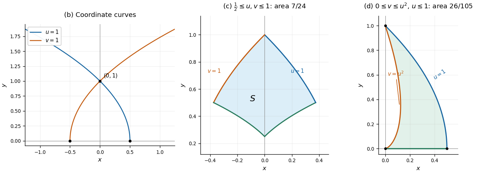

# Mathematics V resit

↑ **Parent:** [Prelims](../prelims.md)

Source: [released examination PDF, bundle pages 248–251](https://www.whatdotheyknow.com/request/bsc_mathematics_prelims_and_part/response/2784209/attach/3/202409%20817%20annex.pdf#page=248).

**Table of contents**

- [Question 1](#question-1)
  - [a](#question-1/a)
    - [Solution](#question-1/a/solution)
  - [b](#question-1/b)
    - [Solution](#question-1/b/solution)
  - [c](#question-1/c)
    - [Solution](#question-1/c/solution)
  - [d](#question-1/d)
    - [Solution](#question-1/d/solution)
- [Question 2](#question-2)
  - [a](#question-2/a)
    - [i](#question-2/a/i)
      - [Solution](#question-2/a/i/solution)
    - [ii](#question-2/a/ii)
      - [Solution](#question-2/a/ii/solution)
    - [iii](#question-2/a/iii)
      - [Solution](#question-2/a/iii/solution)
    - [iv](#question-2/a/iv)
      - [Solution](#question-2/a/iv/solution)
  - [b](#question-2/b)
    - [Solution](#question-2/b/solution)
- [Question 3](#question-3)
  - [a](#question-3/a)
    - [Solution](#question-3/a/solution)
  - [b](#question-3/b)
    - [Solution](#question-3/b/solution)
  - [c](#question-3/c)
    - [Solution](#question-3/c/solution)
  - [d](#question-3/d)
    - [i](#question-3/d/i)
      - [Solution](#question-3/d/i/solution)
    - [ii](#question-3/d/ii)
      - [Solution](#question-3/d/ii/solution)
- [Question 4](#question-4)
  - [a](#question-4/a)
    - [Solution](#question-4/a/solution)
  - [b](#question-4/b)
    - [Solution](#question-4/b/solution)
  - [c](#question-4/c)
    - [Solution](#question-4/c/solution)
- [Question 5](#question-5)
  - [a](#question-5/a)
    - [Solution](#question-5/a/solution)
  - [b](#question-5/b)
    - [Solution](#question-5/b/solution)
  - [c](#question-5/c)
    - [Solution](#question-5/c/solution)
- [Question 6](#question-6)
  - [a](#question-6/a)
    - [Solution](#question-6/a/solution)
  - [b](#question-6/b)
    - [Solution](#question-6/b/solution)
  - [c](#question-6/c)
    - [i](#question-6/c/i)
      - [Solution](#question-6/c/i/solution)
    - [ii](#question-6/c/ii)
      - [Solution](#question-6/c/ii/solution)
    - [iii](#question-6/c/iii)
      - [Solution](#question-6/c/iii/solution)

## Question 1

↑ **Parent:** [Mathematics V resit](mathematics-v-resit.md)

<h3 id="question-1/a">a</h3>

↑ **Parent:** [Question 1](#question-1)

<h4 id="question-1/a/solution">Solution</h4>

↑ **Parent:** [a](#question-1/a)

Put $r=\sqrt{x^2+y^2}$. The definitions of the [parabolic polar coordinates](../../../multivariable-calculus.md#parabolic-polar-coordinates) give $u^2=x+r$ and $v^2=-x+r$. Subtracting and multiplying these equations yields

$$
u^2-v^2=2x,\qquad u^2v^2=r^2-x^2=y^2.
$$

Since $u,v,y\geq0$, taking the nonnegative [square root](../../../algebra.md#square-root) gives

$$
\boxed{x=\frac{u^2-v^2}{2},\qquad y=uv}.
$$

The [Jacobian matrix](../../../multivariable-calculus.md#jacobian-matrix) has columns $(u,v)$ and $(-v,u)$. Its [Jacobian determinant](../../../multivariable-calculus.md#jacobian-determinant) is therefore

$$
\frac{\partial(x,y)}{\partial(u,v)}
=\det\begin{pmatrix}u&-v\\v&u\end{pmatrix}
=\boxed{u^2+v^2}.
$$

Here the displayed fraction denotes the [Jacobian determinant](../../../multivariable-calculus.md#jacobian-determinant), as in the paper. The [change of variables formula](../../../multivariable-calculus.md#change-of-variables-formula) consequently gives $dx\,dy=(u^2+v^2)\,du\,dv$. The [Jacobian determinant](../../../multivariable-calculus.md#jacobian-determinant) is positive except at the origin, and the definitions supply the unique nonnegative inverse throughout the region $y\geq0$.

<h3 id="question-1/b">b</h3>

↑ **Parent:** [Question 1](#question-1)

<h4 id="question-1/b/solution">Solution</h4>

↑ **Parent:** [b](#question-1/b)

For $u=1$, the inverse [parabolic polar coordinates](../../../multivariable-calculus.md#parabolic-polar-coordinates) give $y=v$ and $x=(1-v^2)/2$. For $v=1$, they give $y=u$ and $x=(u^2-1)/2$. Thus the requested [curves](../../../topology.md#curve) are the upper halves of the [parabolas](../../../euclidean-geometry.md#parabola)

$$
\boxed{u=1:\ x=\frac{1-y^2}{2},\ y\geq0},\qquad
\boxed{v=1:\ x=\frac{y^2-1}{2},\ y\geq0}.
$$

The first [parabola](../../../euclidean-geometry.md#parabola) has vertex $(1/2,0)$ and opens to the left; the second [parabola](../../../euclidean-geometry.md#parabola) has vertex $(-1/2,0)$ and opens to the right. Both pass through $(0,1)$ and are reflections of one another across the $y$-axis.

**[Figure 1](#question-1/b/image-parabolic-coordinate-curves-and-the-two-regions-used-in-question-1). Parabolic coordinate curves and the two regions used in Question 1**.

<h3 id="question-1/c">c</h3>

↑ **Parent:** [Question 1](#question-1)

<h4 id="question-1/c/solution">Solution</h4>

↑ **Parent:** [c](#question-1/c)

The inequalities become the [rectangle](../../../euclidean-geometry.md#rectangle) $1/2\leq u\leq1$, $1/2\leq v\leq1$ in [parabolic polar coordinates](../../../multivariable-calculus.md#parabolic-polar-coordinates). The [change of variables formula](../../../multivariable-calculus.md#change-of-variables-formula) and the [Jacobian determinant](../../../multivariable-calculus.md#jacobian-determinant) from [a](#question-1/a) give the [area](../../../differential-geometry.md#surface-area)

$$
\begin{aligned}
A&=\int_{1/2}^1\int_{1/2}^1(u^2+v^2)\,dv\,du\\
&=\frac12\int_{1/2}^1u^2\,du+\frac12\int_{1/2}^1v^2\,dv
=\left[\frac{s^3}{3}\right]_{1/2}^1
=\boxed{\frac7{24}}.
\end{aligned}
$$

The middle panel in [b](#question-1/b) shows the curved region in [Cartesian coordinates](../../../linear-algebra.md#cartesian-coordinate-system); its straight edges in [parabolic polar coordinates](../../../multivariable-calculus.md#parabolic-polar-coordinates) explain the simple [integration limits](../../../integral.md#integration-limit).

<h3 id="question-1/d">d</h3>

↑ **Parent:** [Question 1](#question-1)

<h4 id="question-1/d/solution">Solution</h4>

↑ **Parent:** [d](#question-1/d)

The first boundary is $u=1$. On $y=0$ in the first [quadrant](../../../linear-algebra.md#quadrant-plane-geometry), the inverse [parabolic polar coordinates](../../../multivariable-calculus.md#parabolic-polar-coordinates) give $v=0$. To identify the remaining [curve](../../../topology.md#curve), put $t=y^{1/3}\geq0$. Its [Cartesian coordinates](../../../linear-algebra.md#cartesian-coordinate-system) satisfy

$$
x=\frac{t^2-t^4}{2},\qquad y=t^3,\qquad
\sqrt{x^2+y^2}=\frac{t^2+t^4}{2}.
$$

Hence $u=t$ and $v=t^2$, so this boundary is $v=u^2$. The condition $x\geq0$ on this [curve](../../../topology.md#curve) requires $0\leq t\leq1$. Its endpoints are $(0,0)$ and $(0,1)$, while $u=1$ meets $v=0$ at $(1/2,0)$. These three arcs enclose exactly

$$
0\leq u\leq1,\qquad0\leq v\leq u^2.
$$

Every point in this region has $v\leq u$, and therefore $x=(u^2-v^2)/2\geq0$, as required. Using the [Jacobian determinant](../../../multivariable-calculus.md#jacobian-determinant), the [area](../../../differential-geometry.md#surface-area) is

$$
\begin{aligned}
A&=\int_0^1\int_0^{u^2}(u^2+v^2)\,dv\,du\\
&=\int_0^1\left(u^4+\frac{u^6}{3}\right)\,du
=\frac15+\frac1{21}
=\boxed{\frac{26}{105}}.
\end{aligned}
$$

## Question 2

↑ **Parent:** [Mathematics V resit](mathematics-v-resit.md)

<h3 id="question-2/a">a</h3>

↑ **Parent:** [Question 2](#question-2)

<h4 id="question-2/a/i">i</h4>

↑ **Parent:** [a](#question-2/a)

<h5 id="question-2/a/i/solution">Solution</h5>

↑ **Parent:** [i](#question-2/a/i)

Let $V$ be a bounded region with piecewise smooth closed boundary $\partial V$, and let $\mathbf F$ be a [continuously differentiable vector field](../../../multivariable-calculus.md#continuously-differentiable-vector-field) on an open neighbourhood of its [closure](../../../topology.md#closure-topology). The [divergence theorem](../../../multivariable-calculus.md#divergence-theorem) states

$$
\boxed{\iiint_V\nabla\cdot\mathbf F\,dV
=\iint_{\partial V}\mathbf F\cdot\mathbf n\,dS},
$$

where $\mathbf n$ is the outward [unit normal vector](../../../differential-geometry.md#unit-normal). Thus the [volume integral](../../../multivariable-calculus.md#volume-integral) of the [divergence](../../../multivariable-calculus.md#divergence) equals the outward boundary [flux integral](../../../multivariable-calculus.md#flux-integral). For a region containing a hole, the outward [unit normal vector](../../../differential-geometry.md#unit-normal) on its inner boundary points into that hole.

<h4 id="question-2/a/ii">ii</h4>

↑ **Parent:** [a](#question-2/a)

<h5 id="question-2/a/ii/solution">Solution</h5>

↑ **Parent:** [ii](#question-2/a/ii)

For $r>0$, the [chain rule](../../../calculus.md#chain-rule) gives $\partial r/\partial x_i=x_i/r$. Applying the [product rule](../../../calculus.md#product-rule) to the components of the [vector field](../../../multivariable-calculus.md#vector-field) yields

$$
\begin{aligned}
\nabla\cdot\mathbf u
&=\sum_{i=1}^3\frac{\partial}{\partial x_i}(x_i r^{-\alpha})\\
&=\sum_{i=1}^3\left(r^{-\alpha}-\alpha x_i^2r^{-\alpha-2}\right)\\
&=3r^{-\alpha}-\alpha r^{-\alpha-2}\sum_{i=1}^3x_i^2
=\boxed{\frac{3-\alpha}{r^\alpha}}.
\end{aligned}
$$

The calculation is pointwise away from the origin; any extension of the [vector field](../../../multivariable-calculus.md#vector-field) to the origin must be considered separately.

<h4 id="question-2/a/iii">iii</h4>

↑ **Parent:** [a](#question-2/a)

<h5 id="question-2/a/iii/solution">Solution</h5>

↑ **Parent:** [iii](#question-2/a/iii)

On the unit [sphere](../../../euclidean-geometry.md#sphere), the outward [unit normal vector](../../../differential-geometry.md#unit-normal) is $\mathbf n=\mathbf r$ and $\mathbf u=\mathbf r$. Hence the outward [flux integral](../../../multivariable-calculus.md#flux-integral) is

$$
\iint_{r=1}\mathbf u\cdot\mathbf n\,dS
=\iint_{r=1}1\,dS=4\pi.
$$

Using [spherical polar coordinates](../../../multivariable-calculus.md#spherical-coordinate-system) and the [divergence](../../../multivariable-calculus.md#divergence) from [ii](#question-2/a/ii), the [volume integral](../../../multivariable-calculus.md#volume-integral) over the unit [ball](../../../topological-analysis.md#ball-mathematics) is

$$
\begin{aligned}
\iiint_{r\leq1}\nabla\cdot\mathbf u\,dV
&=4\pi(3-\alpha)\int_0^1r^{2-\alpha}\,dr\\
&=4\pi(3-\alpha)\left[\frac{r^{3-\alpha}}{3-\alpha}\right]_0^1
=\boxed{4\pi}\qquad(\alpha<3).
\end{aligned}
$$

This [improper integral](../../../real-analysis.md#improper-integral) converges precisely because $2-\alpha>-1$. When the [vector field](../../../multivariable-calculus.md#vector-field) is singular or fails to be continuously differentiable at the origin, justify the equality by applying the [divergence theorem](../../../multivariable-calculus.md#divergence-theorem) on $\varepsilon<r<1$. The outward [flux](../../../mathematical-physics.md#flux) through its inner [sphere](../../../euclidean-geometry.md#sphere) is $-4\pi\varepsilon^{3-\alpha}$, so

$$
\iiint_{\varepsilon<r<1}\nabla\cdot\mathbf u\,dV
=4\pi\bigl(1-\varepsilon^{3-\alpha}\bigr)\longrightarrow4\pi.
$$

Thus **the two integrals agree for every $\alpha<3$**, with the limiting interpretation where needed; the classical smoothness hypothesis does not hold for every such $\alpha$.

<h4 id="question-2/a/iv">iv</h4>

↑ **Parent:** [a](#question-2/a)

<h5 id="question-2/a/iv/solution">Solution</h5>

↑ **Parent:** [iv](#question-2/a/iv)

For $\alpha=3$, the [divergence](../../../multivariable-calculus.md#divergence) vanishes at every point with $r>0$, so its ordinary [volume integral](../../../multivariable-calculus.md#volume-integral), ignoring the undefined single point, is zero. Nevertheless, the outward [flux integral](../../../multivariable-calculus.md#flux-integral) through the unit [sphere](../../../euclidean-geometry.md#sphere) is still $4\pi$:

$$
\boxed{\iiint_{0<r\leq1}\nabla\cdot\mathbf u\,dV=0,
\qquad\iint_{r=1}\mathbf u\cdot\mathbf n\,dS=4\pi}.
$$

**The hypotheses of the divergence theorem fail at the origin.** Indeed $|\mathbf u|=r^{-2}$ there, so no continuous extension is possible. On the punctured region $\varepsilon<r<1$, the [divergence theorem](../../../multivariable-calculus.md#divergence-theorem) remains valid: the outer [flux](../../../mathematical-physics.md#flux) is $4\pi$ and the inner [flux](../../../mathematical-physics.md#flux) is $-4\pi$. Unlike [iii](#question-2/a/iii), this inner contribution does not tend to zero. The discrepancy therefore comes from the persistent [flux](../../../mathematical-physics.md#flux) at the singular point, rather than a failure of the [divergence theorem](../../../multivariable-calculus.md#divergence-theorem) under its hypotheses.

<h3 id="question-2/b">b</h3>

↑ **Parent:** [Question 2](#question-2)

<h4 id="question-2/b/solution">Solution</h4>

↑ **Parent:** [b](#question-2/b)

Write $\partial_i=\partial/\partial x_i$ and use $\times$ for the paper's wedge notation, which denotes the [cross product](../../../vector-space.md#cross-product). The given expression for the [curl](../../../multivariable-calculus.md#curl) and the [product rule](../../../calculus.md#product-rule) give

$$
\nabla\times(\mathbf v\times\mathbf w)
=\sum_i\mathbf e_i\times\bigl((\partial_i\mathbf v)\times\mathbf w
+\mathbf v\times(\partial_i\mathbf w)\bigr).
$$

Apply the [vector triple product identity](../../../multivariable-calculus.md#vector-triple-product) $\mathbf a\times(\mathbf b\times\mathbf c)=\mathbf b(\mathbf a\cdot\mathbf c)-\mathbf c(\mathbf a\cdot\mathbf b)$ separately to the two terms:

$$
\begin{aligned}
\mathbf e_i\times((\partial_i\mathbf v)\times\mathbf w)
&=w_i\partial_i\mathbf v-\mathbf w\,\partial_i v_i,\\
\mathbf e_i\times(\mathbf v\times\partial_i\mathbf w)
&=\mathbf v\,\partial_i w_i-v_i\partial_i\mathbf w.
\end{aligned}
$$

Summing over the Cartesian [basis vectors](../../../vector-space.md#basis-vector) identifies the two [directional derivatives](../../../multivariable-calculus.md#directional-derivative) and the two [divergences](../../../multivariable-calculus.md#divergence):

$$
\boxed{\nabla\times(\mathbf v\times\mathbf w)
=(\mathbf w\cdot\nabla)\mathbf v+\mathbf v(\nabla\cdot\mathbf w)
-(\mathbf v\cdot\nabla)\mathbf w-\mathbf w(\nabla\cdot\mathbf v)}.
$$

Here, for example, $((\mathbf w\cdot\nabla)\mathbf v)_j=\sum_iw_i\partial_i v_j$. This proves the [curl of a cross product](../../../multivariable-calculus.md#curl-of-a-cross-product) directly from the formula supplied.

## Question 3

↑ **Parent:** [Mathematics V resit](mathematics-v-resit.md)

<h3 id="question-3/a">a</h3>

↑ **Parent:** [Question 3](#question-3)

<h4 id="question-3/a/solution">Solution</h4>

↑ **Parent:** [a](#question-3/a)

For the [vector field](../../../multivariable-calculus.md#vector-field) $\mathbf u=(-y,x,0)$, the Cartesian formula for the [curl](../../../multivariable-calculus.md#curl) gives

$$
\nabla\times\mathbf u
=(\partial_y0-\partial_zx,\partial_z(-y)-\partial_x0,
\partial_xx-\partial_y(-y))
=\boxed{(0,0,2)=2\mathbf e_3}.
$$

<h3 id="question-3/b">b</h3>

↑ **Parent:** [Question 3](#question-3)

<h4 id="question-3/b/solution">Solution</h4>

↑ **Parent:** [b](#question-3/b)

Apply the [product rule](../../../calculus.md#product-rule) inside the Cartesian expression for the [curl](../../../multivariable-calculus.md#curl):

$$
\begin{aligned}
\nabla\times(\zeta\mathbf v)
&=\sum_i\mathbf e_i\times\partial_i(\zeta\mathbf v)\\
&=\sum_i\mathbf e_i\times\bigl((\partial_i\zeta)\mathbf v
+\zeta\partial_i\mathbf v\bigr)\\
&=\left(\sum_i(\partial_i\zeta)\mathbf e_i\right)\times\mathbf v
+\zeta\sum_i\mathbf e_i\times\partial_i\mathbf v.
\end{aligned}
$$

The first sum is the [gradient](../../../multivariable-calculus.md#gradient) of the [scalar field](../../../classical-field-theory.md#scalar-field) and the second is the [curl](../../../multivariable-calculus.md#curl) of the [vector field](../../../multivariable-calculus.md#vector-field). Thus the [curl product rule for a scalar field](../../../multivariable-calculus.md#curl-product-rule-for-a-scalar-field) is

$$
\boxed{\nabla\times(\zeta\mathbf v)
=\zeta\nabla\times\mathbf v+\nabla\zeta\times\mathbf v}.
$$

<h3 id="question-3/c">c</h3>

↑ **Parent:** [Question 3](#question-3)

<h4 id="question-3/c/solution">Solution</h4>

↑ **Parent:** [c](#question-3/c)

Let $S$ be a piecewise smooth [oriented surface](../../../differential-geometry.md#oriented-surface) with piecewise smooth boundary $\partial S$, and let $\mathbf F$ be a [continuously differentiable vector field](../../../multivariable-calculus.md#continuously-differentiable-vector-field) on a neighbourhood of $S$. The [Stokes theorem](../../../multivariable-calculus.md#stokes-theorem) states

$$
\boxed{\oint_{\partial S}\mathbf F\cdot d\mathbf r
=\iint_S(\nabla\times\mathbf F)\cdot\mathbf n\,dS}.
$$

The [boundary orientation](../../../differential-geometry.md#boundary-orientation) is induced by the chosen [unit normal vector](../../../differential-geometry.md#unit-normal) $\mathbf n$ through the [right-hand rule](../../../electromagnetism.md#right-hand-rule): with the right thumb along $\mathbf n$, the curled fingers indicate positive boundary traversal. Equivalently, when walking along the boundary with one's head pointing along $\mathbf n$, the [surface](../../../topological-surface.md) lies to the left. An upward oriented [disk](../../../topology.md#disk-mathematics) therefore has counterclockwise boundary traversal when viewed from above. Reversing the [orientation](../../../algebraic-topology.md#orientation-of-a-simplex) reverses both the [line integral](../../../multivariable-calculus.md#line-integral) and the [surface integral](../../../multivariable-calculus.md#surface-integral).

<h3 id="question-3/d">d</h3>

↑ **Parent:** [Question 3](#question-3)

<h4 id="question-3/d/i">i</h4>

↑ **Parent:** [d](#question-3/d)

<h5 id="question-3/d/i/solution">Solution</h5>

↑ **Parent:** [i](#question-3/d/i)

Choose the outward [orientation](../../../algebraic-topology.md#orientation-of-a-simplex) on the upper half of the [ellipsoid](../../../euclidean-geometry.md#ellipsoid), giving counterclockwise [boundary orientation](../../../differential-geometry.md#boundary-orientation) on $C$ as viewed from $z>0$. Parametrize the boundary [circle](../../../topology.md#circle) by

$$
\mathbf c(t)=(\cos t,\sin t,0),\qquad0\leq t\leq2\pi.
$$

Then $\mathbf u(\mathbf c(t))=(-\sin t,\cos t,0)=\mathbf c'(t)$, so the [line integral](../../../multivariable-calculus.md#line-integral) is

$$
\oint_C\mathbf u\cdot d\mathbf r
=\int_0^{2\pi}(\sin^2t+\cos^2t)\,dt=2\pi.
$$

For a direct [surface integral](../../../multivariable-calculus.md#surface-integral), use the [parametrized surface](../../../multivariable-calculus.md#parametrized-surface)

$$
\mathbf s(\varphi,t)=(\sin\varphi\cos t,\sin\varphi\sin t,\alpha\cos\varphi),
\qquad0\leq\varphi\leq\frac\pi2,\quad0\leq t\leq2\pi.
$$

Its outward [vector surface element](../../../differential-geometry.md#vector-area-element) is supplied by the [cross product](../../../vector-space.md#cross-product)

$$
\mathbf s_\varphi\times\mathbf s_t
=(\alpha\sin^2\varphi\cos t,\alpha\sin^2\varphi\sin t,
\sin\varphi\cos\varphi).
$$

Using the [curl](../../../multivariable-calculus.md#curl) from [a](#question-3/a),

$$
\iint_{S_\alpha}(\nabla\times\mathbf u)\cdot\mathbf n\,dS
=\int_0^{2\pi}\int_0^{\pi/2}2\sin\varphi\cos\varphi\,d\varphi\,dt
=\boxed{2\pi}.
$$

The two integrals agree for every $\alpha>0$, verifying the [Stokes theorem](../../../multivariable-calculus.md#stokes-theorem). Only the vertical component of the [vector surface element](../../../differential-geometry.md#vector-area-element) enters, which explains the absence of $\alpha$ in the answer.

<h4 id="question-3/d/ii">ii</h4>

↑ **Parent:** [d](#question-3/d)

<h5 id="question-3/d/ii/solution">Solution</h5>

↑ **Parent:** [ii](#question-3/d/ii)

On the unit [circle](../../../topology.md#circle), the positively oriented unit [tangent vector](../../../tangent-vector.md) is $\mathbf u=(-y,x,0)$, and $|\mathbf u|=1$. Hence $d\mathbf r=\mathbf u\,ds$ and

$$
\oint_C(\psi\mathbf u)\cdot d\mathbf r=\oint_C\psi\,ds.
$$

Since the [scalar field](../../../classical-field-theory.md#scalar-field) $\psi$ has no $z$ dependence, the [curl product rule for a scalar field](../../../multivariable-calculus.md#curl-product-rule-for-a-scalar-field) gives

$$
\begin{aligned}
\nabla\times(\psi\mathbf u)
&=\psi(0,0,2)+(\psi_x,\psi_y,0)\times(-y,x,0)\\
&=(0,0,2\psi+x\psi_x+y\psi_y).
\end{aligned}
$$

On the unit upper [hemisphere](../../../euclidean-geometry.md#hemisphere) $S_1$, the outward [unit normal vector](../../../differential-geometry.md#unit-normal) is $(x,y,z)$, so its vertical component is $z=\cos\theta$. Applying the [Stokes theorem](../../../multivariable-calculus.md#stokes-theorem) to the [vector field](../../../multivariable-calculus.md#vector-field) $\psi\mathbf u$ therefore proves

$$
\boxed{\oint_C\psi\,ds
=\iint_{S_1}\left(2\psi+x\frac{\partial\psi}{\partial x}
+y\frac{\partial\psi}{\partial y}\right)\cos\theta\,dS}.
$$

The smoothness needed here is that $\psi$ extend as a continuously differentiable [scalar field](../../../classical-field-theory.md#scalar-field) to a neighbourhood of the projected unit [disk](../../../topology.md#disk-mathematics). The left side is a scalar [line integral](../../../multivariable-calculus.md#line-integral) with respect to [arc length](../../../riemannian-geometry.md#arc-length); the positive [boundary orientation](../../../differential-geometry.md#boundary-orientation) is used when identifying it with the vector [line integral](../../../multivariable-calculus.md#line-integral).

## Question 4

↑ **Parent:** [Mathematics V resit](mathematics-v-resit.md)

<h3 id="question-4/a">a</h3>

↑ **Parent:** [Question 4](#question-4)

<h4 id="question-4/a/solution">Solution</h4>

↑ **Parent:** [a](#question-4/a)

For a nonzero integer $k$, direct [integration](../../../integral.md) gives

$$
\int_{-\pi}^{\pi}\cos(kx)\,dx=0,\qquad
\int_{-\pi}^{\pi}\sin(kx)\,dx=0,
$$

whereas $\int_{-\pi}^{\pi}1\,dx=2\pi$. The [product-to-sum formulas](../../../geometry-and-topology.md#product-to-sum-formula)

$$
\begin{aligned}
2\cos(mx)\cos(nx)&=\cos((m-n)x)+\cos((m+n)x),\\
2\sin(mx)\sin(nx)&=\cos((m-n)x)-\cos((m+n)x),\\
2\sin(mx)\cos(nx)&=\sin((m+n)x)+\sin((m-n)x)
\end{aligned}
$$

therefore establish [Fourier orthogonality](../../../fourier-series.md#fourier-orthogonality): for positive integers $m,n$,

$$
\begin{aligned}
\int_{-\pi}^{\pi}\cos(mx)\cos(nx)\,dx&=\pi\delta_{mn},\\
\int_{-\pi}^{\pi}\sin(mx)\sin(nx)\,dx&=\pi\delta_{mn},\\
\int_{-\pi}^{\pi}\sin(mx)\cos(nx)\,dx&=0.
\end{aligned}
$$

Here $\delta_{mn}$ is the [Kronecker delta](../../../multilinear-algebra.md#kronecker-delta). In particular the [constant function](../../../function.md#constant-function) is orthogonal to every nonconstant [sine](../../../geometry-and-topology.md#sine) and [cosine](../../../geometry-and-topology.md#cosine) in this system. Integrating the given [Fourier series](../../../fourier-series.md), then multiplying it by $\cos(mx)$ or $\sin(mx)$ and integrating, isolates its [Fourier coefficients](../../../fourier-series.md#fourier-coefficient). Using the permitted interchange of the [sum](../../../arithmetic.md#sum) and [integral](../../../integral.md) gives

$$
\boxed{a_0=\frac1\pi\int_{-\pi}^{\pi}f(x)\,dx},\qquad
\boxed{a_n=\frac1\pi\int_{-\pi}^{\pi}f(x)\cos(nx)\,dx},\qquad
\boxed{b_n=\frac1\pi\int_{-\pi}^{\pi}f(x)\sin(nx)\,dx}\quad(n\geq1).
$$

If $f$ is an [even function](../../../calculus.md#even-function), then $f(x)\sin(nx)$ is an [odd function](../../../calculus.md#odd-function), while $f(x)\cos(nx)$ is an [even function](../../../calculus.md#even-function). Thus

$$
\boxed{b_n=0,\qquad a_n=\frac2\pi\int_0^\pi f(x)\cos(nx)\,dx\quad(n\geq0)}.
$$

The [Fourier series](../../../fourier-series.md) consequently reduces to a [Fourier cosine series](../../../fourier-series.md#fourier-cosine-series).

<h3 id="question-4/b">b</h3>

↑ **Parent:** [Question 4](#question-4)

<h4 id="question-4/b/solution">Solution</h4>

↑ **Parent:** [b](#question-4/b)

The [function](../../../function.md) $x\sin(px)$ is an [even function](../../../calculus.md#even-function), so every [Fourier sine coefficient](../../../fourier-series.md#fourier-sine-coefficient) is zero. Introduce the auxiliary [integral](../../../integral.md)

$$
I_k=\int_0^\pi x\sin(kx)\,dx.
$$

For a nonzero integer $k$, [integration by parts](../../../calculus.md#integration-by-parts) gives

$$
I_k=\left[-\frac{x\cos(kx)}k+\frac{\sin(kx)}{k^2}\right]_0^\pi
=-\frac{\pi(-1)^k}{k},\qquad I_0=0.
$$

Consequently

$$
a_0=\frac2\pi I_p=\frac{2(-1)^{p+1}}p.
$$

For $n\geq1$, a [product-to-sum formula](../../../geometry-and-topology.md#product-to-sum-formula) yields

$$
a_n=\frac1\pi(I_{p+n}+I_{p-n}).
$$

If $n\ne p$, this becomes

$$
a_n=-(-1)^{p+n}\left(\frac1{p+n}+\frac1{p-n}\right)
=\frac{2p(-1)^{p+n}}{n^2-p^2}.
$$

The exceptional [Fourier coefficient](../../../fourier-series.md#fourier-coefficient) at $n=p$ must be evaluated before dividing by $p-n$:

$$
a_p=\frac1\pi(I_{2p}+I_0)=-\frac1{2p}.
$$

Thus the full [Fourier series](../../../fourier-series.md) is

$$
\boxed{x\sin(px)=\frac{(-1)^{p+1}}p-\frac{\cos(px)}{2p}
+2p\!\sum_{\substack{n\geq1\\n\ne p}}
\frac{(-1)^{p+n}\cos(nx)}{n^2-p^2}}.
$$

This equality holds on $[-\pi,\pi]$ and by [periodicity](../../../function.md#periodicity) everywhere. Indeed the [periodic extension](../../../function.md#periodic-extension) is continuous at the joined endpoints, since both endpoint values are zero, and is piecewise smooth. The theorem on [pointwise convergence of a piecewise smooth Fourier series](../../../fourier-series.md#pointwise-convergence-of-a-piecewise-smooth-fourier-series) therefore applies, including at the endpoints. The [Fourier coefficients](../../../fourier-series.md#fourier-coefficient) also decay as $n^{-2}$, making the resulting [series](../../../sequence-and-series.md#series-mathematics) absolutely and uniformly convergent.

<h3 id="question-4/c">c</h3>

↑ **Parent:** [Question 4](#question-4)

<h4 id="question-4/c/solution">Solution</h4>

↑ **Parent:** [c](#question-4/c)

Set $p=3$ and $x=0$ in the [Fourier series](../../../fourier-series.md) from [b](#question-4/b). Since the [function](../../../function.md) is continuous there, [pointwise convergence of a piecewise smooth Fourier series](../../../fourier-series.md#pointwise-convergence-of-a-piecewise-smooth-fourier-series) gives

$$
0=\frac13-\frac16-6\!\sum_{\substack{n\geq1\\n\ne3}}
\frac{(-1)^n}{n^2-9}.
$$

It follows that

$$
\sum_{\substack{n\geq1\\n\ne3}}\frac{(-1)^n}{n^2-9}=\frac1{36}.
$$

The $n=1$ and $n=2$ terms are $1/8$ and $-1/5$, respectively. Subtracting them gives the required absolutely convergent [series](../../../sequence-and-series.md#series-mathematics):

$$
\boxed{\sum_{n=4}^\infty\frac{(-1)^n}{n^2-9}
=\frac1{36}-\frac18+\frac15=\frac{37}{360}}.
$$

## Question 5

↑ **Parent:** [Mathematics V resit](mathematics-v-resit.md)

<h3 id="question-5/a">a</h3>

↑ **Parent:** [Question 5](#question-5)

<h4 id="question-5/a/solution">Solution</h4>

↑ **Parent:** [a](#question-5/a)

Let the uniform string have constant [tension](../../../force.md#tension) $\tau>0$ and [linear mass density](../../../fluid-mechanics.md#linear-mass-density) $\mu>0$. Assume small transverse motion with $|u_x|\ll1$, negligible longitudinal motion, and no external transverse force. If the string makes angle $\beta$ with the horizontal, then $\tan\beta=u_x$, and the [small-angle approximation](../../../geometry-and-topology.md#small-angle-approximation) gives $\sin\beta\simeq u_x$ and $ds\simeq dx$ to first order.

The net upward force on the segment from $x$ to $x+\Delta x$ is therefore

$$
\tau\bigl(u_x(x+\Delta x,t)-u_x(x,t)\bigr).
$$

By [Newton's second law](../../../force.md#newton-s-second-law), its mass $\mu\Delta x$ times its transverse [acceleration](../../../classical-mechanics.md#acceleration) equals this force, to the order retained in the small displacement model. Divide by $\Delta x$ and let $\Delta x\to0$ to obtain

$$
\mu u_{tt}=\tau u_{xx}.
$$

Thus the [wave equation on a string](../../../wave-equation.md#wave-equation-on-a-string) is

$$
\boxed{u_{tt}=c^2u_{xx},\qquad c=\sqrt{\frac\tau\mu}},
$$

where $c$ is the [wave speed](../../../wave-equation.md#wave-speed). The horizontal force balance makes the horizontal component of [tension](../../../force.md#tension) constant; to first order it equals $\tau$.

<h3 id="question-5/b">b</h3>

↑ **Parent:** [Question 5](#question-5)

<h4 id="question-5/b/solution">Solution</h4>

↑ **Parent:** [b](#question-5/b)

**The printed arguments $x-t$ and $x+t$ assume unit wave speed.** For the stated [wave equation](../../../wave-equation.md) with general $c>0$, the correct arguments are $x-ct$ and $x+ct$, as in the paper's subsequent formula. Equivalently, use rescaled time $\widetilde t=ct$ to obtain the printed unit-speed form.

Introduce coordinates $\xi=x-ct$, $\eta=x+ct$ along the [characteristic lines for the one-dimensional wave equation](../../../wave-equation.md#characteristic-line-for-the-one-dimensional-wave-equation), and write $u(x,t)=U(\xi,\eta)$. The [chain rule](../../../calculus.md#chain-rule) gives

$$
\partial_x=\partial_\xi+\partial_\eta,\qquad
\partial_t=-c\partial_\xi+c\partial_\eta,
$$

so the [wave equation](../../../wave-equation.md) becomes

$$
u_{tt}-c^2u_{xx}=-4c^2U_{\xi\eta}=0.
$$

Thus $U_\xi$ is independent of $\eta$, and [integration](../../../integral.md) gives the [countertravelling decomposition of the one-dimensional wave equation](../../../wave-equation.md#countertravelling-decomposition-of-the-one-dimensional-wave-equation)

$$
\boxed{u(x,t)=F(x-ct)+G(x+ct)}.
$$

Conversely, differentiating this expression twice verifies the [wave equation](../../../wave-equation.md) for any sufficiently differentiable $F,G$.

The two [initial conditions](../../../differential-equation.md#initial-condition) give

$$
F(x)+G(x)=f(x),\qquad -cF'(x)+cG'(x)=g(x).
$$

Differentiating the first and solving these two equations for the [derivatives](../../../calculus.md#derivative) gives

$$
F'(x)=\frac12f'(x)-\frac1{2c}g(x),\qquad
G'(x)=\frac12f'(x)+\frac1{2c}g(x).
$$

For a fixed reference point $x_0$, their [antiderivatives](../../../integral.md#antiderivative) can be written

$$
F(s)=\frac12f(s)-\frac1{2c}\int_{x_0}^s g(q)\,dq+C,\qquad
G(s)=\frac12f(s)+\frac1{2c}\int_{x_0}^s g(q)\,dq-C.
$$

Substituting the two travelling arguments cancels the constants and combines the [integrals](../../../integral.md). This proves [D'Alembert's formula](../../../wave-equation.md#d-alembert-s-formula) with initial velocity:

$$
\boxed{u(x,t)=\frac12\bigl[f(x-ct)+f(x+ct)\bigr]
+\frac1{2c}\int_{x-ct}^{x+ct}g(s)\,ds}.
$$

At $t=0$ the [integral](../../../integral.md) vanishes, giving $u=f$; differentiating by the [fundamental theorem of calculus](../../../calculus.md#fundamental-theorem-of-calculus) gives $u_t=g$ there. These checks also fix the sign and the factor $1/(2c)$.

<h3 id="question-5/c">c</h3>

↑ **Parent:** [Question 5](#question-5)

<h4 id="question-5/c/solution">Solution</h4>

↑ **Parent:** [c](#question-5/c)

Here $f=0$ and $ct=1$, so [D'Alembert's formula](../../../wave-equation.md#d-alembert-s-formula) gives

$$
u\left(\frac32,\frac1c\right)
=\frac1{2c}\int_{1/2}^{5/2}g(s)\,ds.
$$

Only the overlap $[1/2,1]$ with the [support](../../../function.md#support) of the initial velocity contributes. Therefore

$$
\begin{aligned}
u\left(\frac32,\frac1c\right)
&=\frac1{2c}\int_{1/2}^{1}(1-s^2)\,ds\\
&=\frac1{2c}\left[s-\frac{s^3}{3}\right]_{1/2}^{1}
=\frac1{2c}\left(\frac23-\frac{11}{24}\right)
=\boxed{\frac5{48c}}.
\end{aligned}
$$

The relevant interval is determined by the two [characteristic lines for the one-dimensional wave equation](../../../wave-equation.md#characteristic-line-for-the-one-dimensional-wave-equation) through the observation point.

## Question 6

↑ **Parent:** [Mathematics V resit](mathematics-v-resit.md)

<h3 id="question-6/a">a</h3>

↑ **Parent:** [Question 6](#question-6)

<h4 id="question-6/a/solution">Solution</h4>

↑ **Parent:** [a](#question-6/a)

For a nonzero separable solution of the [Laplace equation in polar coordinates](../../../partial-differential-equation.md#laplace-equation-in-polar-coordinates), write $T(r,\theta)=R(r)\Theta(\theta)$ with $r>0$. Multiplying the [partial differential equation](../../../partial-differential-equation.md) by $r^2$ and dividing where $R\Theta\ne0$ gives

$$
\frac{r^2R''+rR'}R=-\frac{\Theta''}{\Theta}=\lambda,
$$

where $\lambda$ is a real [separation constant](../../../partial-differential-equation.md#separation-constant). The resulting [ordinary differential equations](../../../differential-equation.md#ordinary-differential-equation) are

$$
r^2R''+rR'-\lambda R=0,\qquad\Theta''+\lambda\Theta=0.
$$

The equations continue across zeros of the factors by continuity. The radial equation is a [Cauchy-Euler equation](../../../linear-ordinary-differential-equation.md#cauchy-euler-equation); putting $s=\log r$ changes it to $d^2R/ds^2-\lambda R=0$.

For **positive separation constant**, write $\lambda=k^2$ with $k>0$. The radial factors are powers, while the angular factors are [sine](../../../geometry-and-topology.md#sine) and [cosine](../../../geometry-and-topology.md#cosine):

$$
\boxed{T=(A r^k+B r^{-k})(C\cos(k\theta)+D\sin(k\theta))}.
$$

For **zero separation constant**, each transformed equation has zero second [derivative](../../../calculus.md#derivative), giving

$$
\boxed{T=(A+B\log r)(C+D\theta)}.
$$

For **negative separation constant**, write $\lambda=-k^2$ with $k>0$. The radial factors oscillate in $\log r$, and the angular factors are [exponential functions](../../../calculus.md#exponential-function):

$$
\boxed{T=(A\cos(k\log r)+B\sin(k\log r))(C e^{k\theta}+D e^{-k\theta})}.
$$

These exhaust the nonzero real separated solutions before imposing angular [periodicity](../../../function.md#periodicity) or regularity at the origin. The zero solution is also allowed. Since [Laplace's equation](../../../partial-differential-equation.md#laplace-equation) is linear, sums of these separated solutions are solutions wherever the sums and required [derivatives](../../../calculus.md#derivative) converge appropriately.

<h3 id="question-6/b">b</h3>

↑ **Parent:** [Question 6](#question-6)

<h4 id="question-6/b/solution">Solution</h4>

↑ **Parent:** [b](#question-6/b)

A temperature on the full unit [disk](../../../topology.md#disk-mathematics) must be single valued, so its angular factor and angular [derivative](../../../calculus.md#derivative) are $2\pi$-periodic. For positive [separation constant](../../../partial-differential-equation.md#separation-constant) $\lambda=k^2$, this requires $k=n$ to be a positive integer. For $\lambda=0$, [periodicity](../../../function.md#periodicity) removes $D\theta$. For $\lambda<0$, no nonzero linear combination of $e^{k\theta}$ and $e^{-k\theta}$ is $2\pi$-periodic, so that case disappears.

The origin belongs to the [disk](../../../topology.md#disk-mathematics), so a classical [harmonic function](../../../partial-differential-equation.md#harmonic-function) must remain bounded and extend smoothly there. This excludes $r^{-n}$ and $\log r$. The remaining individual separated solutions are constants and $r^n(A_n\cos(n\theta)+B_n\sin(n\theta))$. By [superposition](../../../vector-space.md#superposition-principle), the regular [harmonic expansion on a disk](../../../partial-differential-equation.md#harmonic-expansion-on-a-disk) is

$$
\boxed{T(r,\theta)=A_0+\sum_{n=1}^{\infty}r^n
\bigl(A_n\cos(n\theta)+B_n\sin(n\theta)\bigr)}.
$$

The admissible [Fourier coefficients](../../../fourier-series.md#fourier-coefficient) are fixed by the [boundary conditions](../../../differential-equation.md#boundary-condition). Smoothness at the origin can also be seen from $r^n\cos(n\theta)$ and $r^n\sin(n\theta)$ being the real and imaginary parts of $(x+iy)^n$, hence [harmonic polynomials](../../../partial-differential-equation.md#harmonic-polynomial).

<h3 id="question-6/c">c</h3>

↑ **Parent:** [Question 6](#question-6)

<h4 id="question-6/c/i">i</h4>

↑ **Parent:** [c](#question-6/c)

<h5 id="question-6/c/i/solution">Solution</h5>

↑ **Parent:** [i](#question-6/c/i)

The constant [function](../../../function.md) satisfies [Laplace's equation](../../../partial-differential-equation.md#laplace-equation) and the prescribed [Dirichlet boundary condition](../../../differential-equation.md#dirichlet-boundary-condition). In the [harmonic expansion on a disk](../../../partial-differential-equation.md#harmonic-expansion-on-a-disk), its only nonzero coefficient is $A_0=1$. By the allowed uniqueness for the [Dirichlet problem](../../../analysis.md#dirichlet-problem),

$$
\boxed{T(r,\theta)=1}.
$$

<h4 id="question-6/c/ii">ii</h4>

↑ **Parent:** [c](#question-6/c)

<h5 id="question-6/c/ii/solution">Solution</h5>

↑ **Parent:** [ii](#question-6/c/ii)

The boundary data consist of the third angular [Fourier mode](../../../fourier-analysis.md#fourier-mode). Its regular radial factor in the [harmonic expansion on a disk](../../../partial-differential-equation.md#harmonic-expansion-on-a-disk) is $r^3$, so

$$
\boxed{T(r,\theta)=r^3\sin(3\theta)}.
$$

For a direct check of [Laplace's equation](../../../partial-differential-equation.md#laplace-equation),

$$
T_{rr}+\frac1rT_r+\frac1{r^2}T_{\theta\theta}
=6r\sin(3\theta)+3r\sin(3\theta)-9r\sin(3\theta)=0.
$$

Also $T(1,\theta)=\sin(3\theta)$. At the origin the apparent coordinate singularity is harmless: this is the [harmonic polynomial](../../../partial-differential-equation.md#harmonic-polynomial) $3x^2y-y^3$. The allowed uniqueness for the [Dirichlet problem](../../../analysis.md#dirichlet-problem) completes the identification.

<h4 id="question-6/c/iii">iii</h4>

↑ **Parent:** [c](#question-6/c)

<h5 id="question-6/c/iii/solution">Solution</h5>

↑ **Parent:** [iii](#question-6/c/iii)

The [trigonometric identity](../../../geometry-and-topology.md#trigonometric-identity)

$$
\sin^3\theta=\frac34\sin\theta-\frac14\sin(3\theta)
$$

shows that only angular [Fourier modes](../../../fourier-analysis.md#fourier-mode) $1$ and $3$ are required. Differentiating the [harmonic expansion on a disk](../../../partial-differential-equation.md#harmonic-expansion-on-a-disk) at $r=1$ multiplies the coefficient of each nonconstant [Fourier mode](../../../fourier-analysis.md#fourier-mode) by $n$. Thus $B_1=3/4$ and $3B_3=-1/4$, giving

$$
\boxed{T(r,\theta)=C+\frac34r\sin\theta-\frac1{12}r^3\sin(3\theta),\qquad C\in\mathbb R}.
$$

Each term is a regular [harmonic function](../../../partial-differential-equation.md#harmonic-function), and the radial [derivative](../../../calculus.md#derivative) is

$$
T_r(1,\theta)=\frac34\sin\theta-\frac14\sin(3\theta)=\sin^3\theta.
$$

The [Neumann compatibility condition for Laplace's equation](../../../boundary-value-problem.md#neumann-compatibility-condition-for-laplace-s-equation) holds because

$$
\int_0^{2\pi}\sin^3\theta\,d\theta=0,
$$

as is necessary by the [divergence theorem](../../../multivariable-calculus.md#divergence-theorem) applied to the [gradient](../../../multivariable-calculus.md#gradient) of a [harmonic function](../../../partial-differential-equation.md#harmonic-function).

**The additive constant is undetermined.** This [Neumann boundary condition](../../../differential-equation.md#neumann-boundary-condition) is unchanged by $T\mapsto T+C$, so the paper's blanket uniqueness assertion requires a normalization in this case. The [uniqueness of the Neumann problem](../../../boundary-value-problem.md#uniqueness-of-the-neumann-problem) gives uniqueness up to a constant; prescribing $T(0)=0$, or zero mean temperature, selects the displayed answer with $C=0$.

## ↑ Ancestors (9)

1. [Prelims](../prelims.md)
2. [2017](../../2017.md)
3. [Past exam of the mathematics course of the University of Oxford](../../../past-exam-of-the-mathematics-course-of-the-university-of-oxford.md)
4. [Mathematics course of the University of Oxford](../../../university-of-oxford.md#mathematics-course-of-the-university-of-oxford)
5. [Undergraduate course of the University of Oxford](../../../university-of-oxford.md#undergraduate-course-of-the-university-of-oxford)
6. [Course of the University of Oxford](../../../university-of-oxford.md#course-of-the-university-of-oxford)
7. [University of Oxford](../../../university-of-oxford.md)
8. [List of universities](../../../README.md#list-of-universities)
9. [Codex Wiki](../../../README.md)
