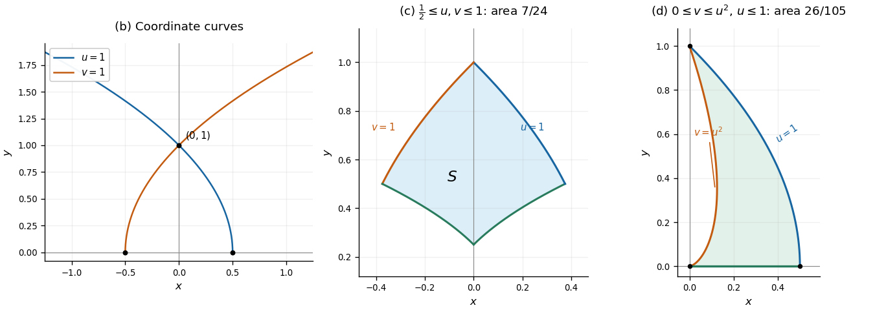

<h1 id="question-1/b/solution">Solution</h1>

↑ **Parent:** [b](../b.md)

For $u=1$, the inverse [parabolic polar coordinates](../../../../../../parabolic-polar-coordinates.md) give $y=v$ and $x=(1-v^2)/2$. For $v=1$, they give $y=u$ and $x=(u^2-1)/2$. Thus the requested [curves](../../../../../../curve.md) are the upper halves of the [parabolas](../../../../../../parabola.md)

$$
\boxed{u=1:\ x=\frac{1-y^2}{2},\ y\geq0},\qquad
\boxed{v=1:\ x=\frac{y^2-1}{2},\ y\geq0}.
$$

The first [parabola](../../../../../../parabola.md) has vertex $(1/2,0)$ and opens to the left; the second [parabola](../../../../../../parabola.md) has vertex $(-1/2,0)$ and opens to the right. Both pass through $(0,1)$ and are reflections of one another across the $y$-axis.

**[Figure 1](#question-1/b/image-parabolic-coordinate-curves-and-the-two-regions-used-in-question-1). Parabolic coordinate curves and the two regions used in Question 1**.

## ↑ Ancestors (12)

1. [b](../b.md)
2. [Question 1](../../question-1.md)
3. [Mathematics V resit](../../../mathematics-v-resit-split.md)
4. [Prelims](../../../split.md)
5. [2017](../../../../split.md)
6. [Past exam of the mathematics course of the University of Oxford](../../../../../split.md)
7. [Mathematics course of the University of Oxford](../../../../../../mathematics-course-of-the-university-of-oxford.md)
8. [Undergraduate course of the University of Oxford](../../../../../../undergraduate-course-of-the-university-of-oxford.md)
9. [Course of the University of Oxford](../../../../../../course-of-the-university-of-oxford.md)
10. [University of Oxford](../../../../../../university-of-oxford-split.md)
11. [List of universities](../../../../../../list-of-universities.md)
12. [Codex Wiki](../../../../../../split.md)
