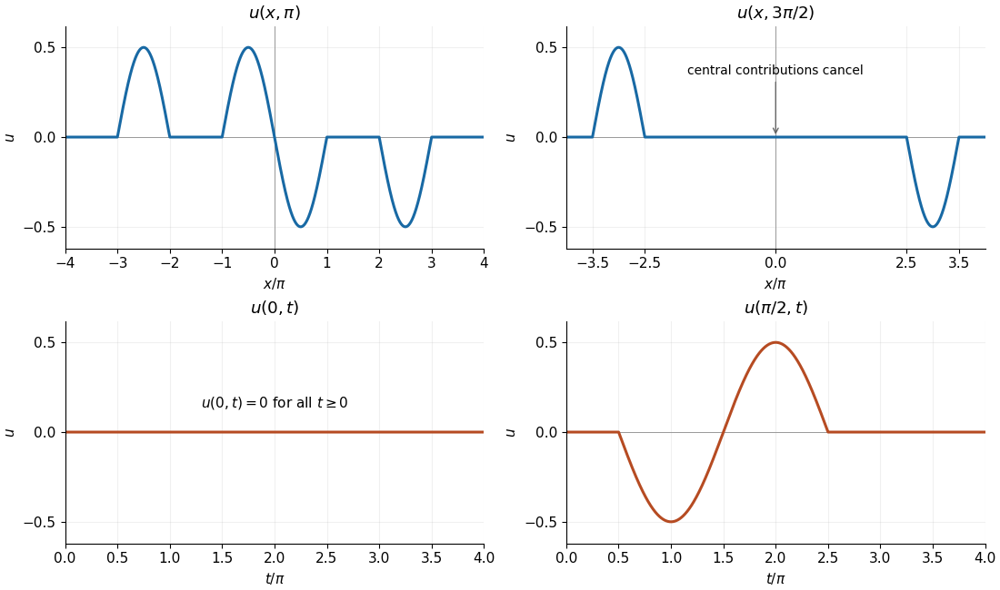

# Mathematics V

↑ **Parent:** [Prelims](../prelims.md)

Source: [released examination PDF, bundle pages 252–256](https://www.whatdotheyknow.com/request/bsc_mathematics_prelims_and_part/response/2784209/attach/3/202409%20817%20annex.pdf#page=252).

**Table of contents**

- [1](#1)
  - [a](#1/a)
    - [Solution](#1/a/solution)
  - [b](#1/b)
    - [Solution](#1/b/solution)
  - [c](#1/c)
    - [Solution](#1/c/solution)
- [2](#2)
  - [a](#2/a)
    - [Solution](#2/a/solution)
  - [b](#2/b)
    - [Solution](#2/b/solution)
  - [c](#2/c)
    - [Solution](#2/c/solution)
  - [d](#2/d)
    - [i](#2/d/i)
      - [Solution](#2/d/i/solution)
    - [ii](#2/d/ii)
      - [Solution](#2/d/ii/solution)
- [3](#3)
  - [a](#3/a)
    - [Solution](#3/a/solution)
  - [b](#3/b)
    - [i](#3/b/i)
      - [Solution](#3/b/i/solution)
    - [ii](#3/b/ii)
      - [Solution](#3/b/ii/solution)
    - [iii](#3/b/iii)
      - [Solution](#3/b/iii/solution)
- [4](#4)
  - [a](#4/a)
    - [i](#4/a/i)
      - [Solution](#4/a/i/solution)
    - [ii](#4/a/ii)
      - [Solution](#4/a/ii/solution)
  - [b](#4/b)
    - [Solution](#4/b/solution)
  - [c](#4/c)
    - [Solution](#4/c/solution)
  - [d](#4/d)
    - [Solution](#4/d/solution)
- [5](#5)
  - [a](#5/a)
    - [Solution](#5/a/solution)
  - [b](#5/b)
    - [Solution](#5/b/solution)
- [6](#6)
  - [a](#6/a)
    - [Solution](#6/a/solution)
  - [b](#6/b)
    - [Solution](#6/b/solution)

## 1

↑ **Parent:** [Mathematics V](mathematics-v.md)

<h3 id="1/a">a</h3>

↑ **Parent:** [1](#1)

<h4 id="1/a/solution">Solution</h4>

↑ **Parent:** [A](#1/a)

For $r>0$, the [partial derivatives](../../../multivariable-calculus.md#partial-derivative) $r_x=x/r$ and $r_y=y/r$ give

$$
\frac{\partial}{\partial x}\frac{x^2}{r}=\frac{2x}{r}-\frac{x^3}{r^3},\qquad
\frac{\partial}{\partial y}\frac{xy}{r}=\frac{x}{r}-\frac{xy^2}{r^3}.
$$

Adding these [partial derivatives](../../../multivariable-calculus.md#partial-derivative) yields the [divergence](../../../multivariable-calculus.md#divergence):

$$
\boxed{\nabla\cdot\mathbf f=\frac{3x}{r}-\frac{x(x^2+y^2)}{r^3}=\frac{2x}{\sqrt{x^2+y^2}},\qquad (x,y)\ne(0,0).}
$$

The original [vector field](../../../multivariable-calculus.md#vector-field) is undefined at the origin. Since $\|\mathbf f\|=|x|\leq r$, it has the [continuous extension](../../../calculus.md#continuous-extension) $\mathbf f(0,0)=\mathbf0$. This extension is not [differentiable](../../../analysis.md#differentiable-function): on $y=0$ its first component is $|x|$, whose [derivative](../../../calculus.md#derivative) at zero does not exist. Thus the displayed [divergence](../../../multivariable-calculus.md#divergence) has no classical value at the origin.

<h3 id="1/b">b</h3>

↑ **Parent:** [1](#1)

<h4 id="1/b/solution">Solution</h4>

↑ **Parent:** [B](#1/b)

The [triangle](../../../euclidean-geometry.md#triangle) is $0\leq y\leq x\leq1$. In [polar coordinates](../../../multivariable-calculus.md#polar-coordinates) this becomes

$$
0\leq\theta\leq\frac\pi4,\qquad 0\leq r\leq\sec\theta,
$$

because the outer side is $x=r\cos\theta=1$. The [vector field](../../../multivariable-calculus.md#vector-field) and the [Jacobian determinant](../../../multivariable-calculus.md#jacobian-determinant) give

$$
\mathbf f=r\cos^2\theta\,\mathbf e_1+r\cos\theta\sin\theta\,\mathbf e_2,\qquad dx\,dy=r\,dr\,d\theta.
$$

Evaluate the [double integral](../../../integral.md#double-integral) component by component:

$$
\begin{aligned}
\iint_R\mathbf f\,dx\,dy
&=\frac13\int_0^{\pi/4}\bigl(\sec\theta\,\mathbf e_1+\sec\theta\tan\theta\,\mathbf e_2\bigr)d\theta\\
&=\frac13\left[\log(\sec\theta+\tan\theta)\,\mathbf e_1+\sec\theta\,\mathbf e_2\right]_0^{\pi/4}.
\end{aligned}
$$

Consequently,

$$
\boxed{\iint_R\mathbf f\,dx\,dy=\frac{\log(1+\sqrt2)}3\,\mathbf e_1+\frac{\sqrt2-1}3\,\mathbf e_2.}
$$

The origin causes no ambiguity in this [double integral](../../../integral.md#double-integral): the [continuous extension](../../../calculus.md#continuous-extension) from part (a) is bounded there, and changing a value at a single point does not change the [integral](../../../integral.md).

<h3 id="1/c">c</h3>

↑ **Parent:** [1](#1)

<h4 id="1/c/solution">Solution</h4>

↑ **Parent:** [C](#1/c)

Pair each point $\mathbf x$ of the [square](../../../euclidean-geometry.md#square)'s boundary with $-\mathbf x$. The [vector field](../../../multivariable-calculus.md#vector-field) obeys $\mathbf f(-\mathbf x)=\mathbf f(\mathbf x)$, whereas the outward [unit normal vector](../../../differential-geometry.md#unit-normal) changes sign: $\mathbf n(-\mathbf x)=-\mathbf n(\mathbf x)$. Corresponding [arc length](../../../riemannian-geometry.md#arc-length) elements are equal. Thus the two contributions to the [flux](../../../mathematical-physics.md#flux) cancel, proving without evaluating any boundary [integral](../../../integral.md) that

$$
\boxed{\int_C\mathbf f\cdot\mathbf n\,ds=0.}
$$

The same cancellation appears in the [divergence](../../../multivariable-calculus.md#divergence), which is an [odd function](../../../calculus.md#odd-function) of $x$ over a region symmetric under $x\mapsto-x$. To justify using the planar [divergence theorem](../../../multivariable-calculus.md#divergence-theorem) despite the lack of [differentiability](../../../analysis.md#differentiability) at the origin, remove a disk of radius $\varepsilon<1$. The [vector field](../../../multivariable-calculus.md#vector-field) is continuously differentiable on the remaining region, its [divergence](../../../multivariable-calculus.md#divergence) has zero [double integral](../../../integral.md#double-integral) by this symmetry, and the magnitude of the inner [flux](../../../mathematical-physics.md#flux) is at most $2\pi\varepsilon^2$, since $\|\mathbf f\|\leq\varepsilon$ there. Letting $\varepsilon\to0$ recovers the result. This is [flux around a removable point singularity](../../../multivariable-calculus.md#flux-around-a-removable-point-singularity).

## 2

↑ **Parent:** [Mathematics V](mathematics-v.md)

<h3 id="2/a">a</h3>

↑ **Parent:** [2](#2)

<h4 id="2/a/solution">Solution</h4>

↑ **Parent:** [A](#2/a)

Let $\Omega\subset\mathbb R^3$ be a bounded region with a piecewise smooth closed boundary, and let $\mathbf F$ be a continuously differentiable [vector field](../../../multivariable-calculus.md#vector-field) on an open neighbourhood of its closure. With $\mathbf n$ the outward [unit normal vector](../../../differential-geometry.md#unit-normal), the [divergence theorem](../../../multivariable-calculus.md#divergence-theorem) states

$$
\boxed{\iiint_\Omega\nabla\cdot\mathbf F\,dV=\iint_{\partial\Omega}\mathbf F\cdot\mathbf n\,dA.}
$$

The boundary [surface integral](../../../multivariable-calculus.md#surface-integral) is the total outward [flux](../../../mathematical-physics.md#flux). All boundary components are included; on the boundary of a cavity, the outward [unit normal vector](../../../differential-geometry.md#unit-normal) points into the cavity.

<h3 id="2/b">b</h3>

↑ **Parent:** [2](#2)

<h4 id="2/b/solution">Solution</h4>

↑ **Parent:** [B](#2/b)

The [specific heat capacity](../../../heat.md#specific-heat-capacity) $c$ is the [energy](../../../energy.md) needed per unit [mass](../../../classical-mechanics.md#mass) per unit increase in [temperature](../../../temperature.md). With $c$ constant, a small element of [volume](../../../geometry-and-topology.md#volume) $dV$ has [mass](../../../classical-mechanics.md#mass) $\rho\,dV$ and thermal [energy](../../../energy.md) $\rho cT\,dV$, measured relative to the reference at which $T=0$. Summing over $\Omega$ gives

$$
\boxed{E_\Omega(t)=\iiint_\Omega\rho cT(\mathbf x,t)\,dV.}
$$

Choosing a different reference [temperature](../../../temperature.md) only adds a time-independent constant to this [energy](../../../energy.md), so it does not affect the [heat balance with volumetric heat generation](../../../diffusion-equation.md#heat-balance-with-volumetric-heat-generation).

<h3 id="2/c">c</h3>

↑ **Parent:** [2](#2)

<h4 id="2/c/solution">Solution</h4>

↑ **Parent:** [C](#2/c)

For any fixed subregion $\Omega$, with no internal [heat](../../../heat.md) generation, [conservation of energy](../../../mathematical-physics.md#conservation-of-energy) says that the rate of stored thermal [energy](../../../energy.md) equals the incoming [heat flux](../../../heat.md#heat-flux-density):

$$
\frac{d}{dt}\iiint_\Omega\rho cT\,dV=-\iint_{\partial\Omega}\mathbf q\cdot\mathbf n\,dA.
$$

The minus sign is needed because $\mathbf q\cdot\mathbf n>0$ denotes outgoing [heat flux](../../../heat.md#heat-flux-density). Substitute [Fourier's law](../../../heat.md#fourier-s-law) $\mathbf q=-k\nabla T$ and apply the [divergence theorem](../../../multivariable-calculus.md#divergence-theorem):

$$
\iiint_\Omega\rho cT_t\,dV
=\iint_{\partial\Omega}k\nabla T\cdot\mathbf n\,dA
=\iiint_\Omega\nabla\cdot(k\nabla T)\,dV.
$$

Here differentiation under the [integral](../../../integral.md) uses a fixed region and sufficient regularity of $T$. Since the identity holds for every $\Omega$, continuity of the integrands gives the local [heat equation](../../../diffusion-equation.md#heat-equation)

$$
\boxed{\rho cT_t=\nabla\cdot\bigl(k(\mathbf x)\nabla T\bigr).}
$$

For spatially varying [thermal conductivity](../../../heat.md#thermal-conductivity), the [product rule](../../../calculus.md#product-rule) gives $\nabla\cdot(k\nabla T)=k\nabla^2T+\nabla k\cdot\nabla T$; the second term cannot generally be discarded.

<h3 id="2/d">d</h3>

↑ **Parent:** [2](#2)

<h4 id="2/d/i">i</h4>

↑ **Parent:** [D](#2/d)

<h5 id="2/d/i/solution">Solution</h5>

↑ **Parent:** [I](#2/d/i)

Suppose $T^{(1)}$ and $T^{(2)}$ are two sufficiently regular [steady state](../../../dynamical-systems.md#steady-state) solutions with the same prescribed [temperature](../../../temperature.md) on the boundary. Their difference $w=T^{(1)}-T^{(2)}$ satisfies

$$
\nabla\cdot(k\nabla w)=0\quad\hbox{in }R,\qquad w=0\quad\hbox{on }\partial R.
$$

The identical [PDE source terms](../../../partial-differential-equation.md#source-term-in-a-partial-differential-equation) cancel. Apply the [product rule](../../../calculus.md#product-rule) and the [divergence theorem](../../../multivariable-calculus.md#divergence-theorem) to $wk\nabla w$; this is the weighted form of [Green's first identity](../../../partial-differential-equation.md#green-s-first-identity):

$$
\begin{aligned}
0&=\iiint_R w\nabla\cdot(k\nabla w)\,dV\\
&=\iint_{\partial R}wk\nabla w\cdot\mathbf n\,dA-\iiint_Rk\|\nabla w\|^2\,dV
=-\iiint_Rk\|\nabla w\|^2\,dV.
\end{aligned}
$$

Since $k>0$, the nonnegative integrand must vanish, so $\nabla w=0$. Hence $w$ is constant on each connected component of $R$, and its zero [Dirichlet boundary condition](../../../differential-equation.md#dirichlet-boundary-condition) makes each constant zero. Therefore $\boxed{T^{(1)}=T^{(2)}}$: **the solution, if it exists, is unique**. This proves [Dirichlet uniqueness for variable-conductivity heat conduction](../../../diffusion-equation.md#dirichlet-uniqueness-for-variable-conductivity-heat-conduction); it does not require a constant [thermal conductivity](../../../heat.md#thermal-conductivity).

<h4 id="2/d/ii">ii</h4>

↑ **Parent:** [D](#2/d)

<h5 id="2/d/ii/solution">Solution</h5>

↑ **Parent:** [Ii](#2/d/ii)

Integrate the [steady state](../../../dynamical-systems.md#steady-state) equation over $R$ and use the [divergence theorem](../../../multivariable-calculus.md#divergence-theorem):

$$
0=\iint_{\partial R}k\nabla T\cdot\mathbf n\,dA+\rho\iiint_R S(\mathbf x)\,dV.
$$

The zero [heat flux](../../../heat.md#heat-flux-density) condition makes the boundary term vanish. But $\rho>0$ and $S>0$ throughout a region of positive [volume](../../../geometry-and-topology.md#volume), so

$$
\rho\iiint_R S\,dV>0,
$$

a contradiction. Thus **no steady-state solution exists**. This is the [insulated steady heat balance](../../../diffusion-equation.md#insulated-steady-heat-balance): positive internal [heat](../../../heat.md) generation continually increases the stored thermal [energy](../../../energy.md) when no [heat](../../../heat.md) can escape.

## 3

↑ **Parent:** [Mathematics V](mathematics-v.md)

<h3 id="3/a">a</h3>

↑ **Parent:** [3](#3)

<h4 id="3/a/solution">Solution</h4>

↑ **Parent:** [A](#3/a)

For any closed surface enclosing a region $V$, [Gauss's law for gravity](../../../newton-s-law-of-universal-gravitation.md#gauss-s-law-for-gravity) states that the outward [flux](../../../mathematical-physics.md#flux) of the [gravitational field](../../../physics.md#gravitational-field) is

$$
\boxed{\iint_{\partial V}\mathbf g\cdot\mathbf n\,dA=-4\pi G\iiint_V\rho\,dV=-4\pi GM_V.}
$$

Here $G$ is the [gravitational constant](../../../newton-s-law-of-universal-gravitation.md#gravitational-constant) and $M_V$ is the enclosed [mass](../../../classical-mechanics.md#mass); the negative sign expresses attractive [gravity](../../../physics.md#gravity).

Use the [gravitational potential sign conventions](../../../newton-s-law-of-universal-gravitation.md#gravitational-potential-sign-conventions) specified by this paper: $\mathbf g=\nabla\varphi$. Thus $\varphi$ is the negative of the usual [Newtonian gravitational potential](../../../newton-s-law-of-universal-gravitation.md#newtonian-gravitational-potential) $\Phi$ defined by $\mathbf g=-\nabla\Phi$. For example, setting the value at infinity to zero gives $\varphi=GM/r$ for a [point mass](../../../classical-mechanics.md#point-mass). The [divergence theorem](../../../multivariable-calculus.md#divergence-theorem) now gives

$$
\iiint_V\nabla^2\varphi\,dV=-4\pi G\iiint_V\rho\,dV.
$$

Since $V$ is arbitrary, continuity of the integrands implies the local [Poisson's equation](../../../partial-differential-equation.md#poisson-s-equation)

$$
\boxed{\nabla^2\varphi=-4\pi G\rho.}
$$

Conversely, integrating this [Poisson's equation](../../../partial-differential-equation.md#poisson-s-equation) over any $V$ and applying the [divergence theorem](../../../multivariable-calculus.md#divergence-theorem) recovers [Gauss's law for gravity](../../../newton-s-law-of-universal-gravitation.md#gauss-s-law-for-gravity). At a discontinuity of the [mass density](../../../fluid-mechanics.md#density), the local equation is interpreted piecewise, or globally in the sense of [distributions](../../../distribution-theory.md#distribution-mathematical-analysis).

<h3 id="3/b">b</h3>

↑ **Parent:** [3](#3)

<h4 id="3/b/i">i</h4>

↑ **Parent:** [B](#3/b)

<h5 id="3/b/i/solution">Solution</h5>

↑ **Parent:** [I](#3/b/i)

The [mass density](../../../fluid-mechanics.md#density) depends only on $r$, so it has [spherical symmetry](../../../geometry-and-topology.md#spherical-symmetry). For this isolated planet, choose the [Newtonian gravitational potential](../../../newton-s-law-of-universal-gravitation.md#newtonian-gravitational-potential) to vanish at infinity, or equivalently choose $\varphi=-\Phi$ to do so. There is no imposed external [gravitational field](../../../physics.md#gravitational-field). Rotating the [mass distribution](../../../classical-mechanics.md#mass-distribution) therefore leaves $\varphi$ unchanged: $\varphi=\varphi(r)$.

The [gradient](../../../multivariable-calculus.md#gradient) in [spherical coordinates](../../../multivariable-calculus.md#spherical-coordinate-system) consequently has no angular components, and the paper's [gravitational potential sign conventions](../../../newton-s-law-of-universal-gravitation.md#gravitational-potential-sign-conventions) give

$$
\boxed{\mathbf g=\nabla\varphi=\frac{d\varphi}{dr}\mathbf e_r,\qquad r>0.}
$$

At the centre there is no distinguished radial direction, and [spherical symmetry](../../../geometry-and-topology.md#spherical-symmetry) makes $\mathbf g(0)=\mathbf0$.

<h4 id="3/b/ii">ii</h4>

↑ **Parent:** [B](#3/b)

<h5 id="3/b/ii/solution">Solution</h5>

↑ **Parent:** [Ii](#3/b/ii)

On a [sphere](../../../euclidean-geometry.md#sphere) of radius $r$, the radial [gravitational field](../../../physics.md#gravitational-field) has constant magnitude. Thus [Gauss's law for gravity](../../../newton-s-law-of-universal-gravitation.md#gauss-s-law-for-gravity) becomes

$$
4\pi r^2\varphi'(r)=-4\pi GM(r),\qquad
\varphi'(r)=-\frac{GM(r)}{r^2},
$$

where $M(r)$ is the enclosed [mass](../../../classical-mechanics.md#mass). In the hollow core $M(r)=0$. In the material shell, put $u=r/r_0$ and use the [spherical coordinates](../../../multivariable-calculus.md#spherical-coordinate-system) volume element:

$$
\begin{aligned}
M(r)&=4\pi\rho_0r_0\int_{r_0}^r s e^{-s/r_0}\,ds\\
&=4\pi\rho_0r_0^3\int_1^u v e^{-v}\,dv
=4\pi\rho_0r_0^3\left[\frac2e-(u+1)e^{-u}\right],\qquad 1\leq u\leq2.
\end{aligned}
$$

Outside the shell the enclosed [mass](../../../classical-mechanics.md#mass) is the total

$$
M_*=4\pi\rho_0r_0^3\left(\frac2e-\frac3{e^2}\right).
$$

Consequently,

$$
\boxed{\varphi'(r)=
\begin{cases}
0,&0\leq r<r_0,\\
-\dfrac{4\pi G\rho_0r_0^3}{r^2}\left[\dfrac2e-\left(1+\dfrac r{r_0}\right)e^{-r/r_0}\right],&r_0\leq r\leq2r_0,\\
-\dfrac{4\pi G\rho_0r_0^3}{r^2}\left(\dfrac2e-\dfrac3{e^2}\right),&r>2r_0.
\end{cases}}
$$

At $r=0$ the displayed value refers to the radial [derivative](../../../calculus.md#derivative) of the constant core value. The expressions match at both shell boundaries. There is no surface sheet of [mass](../../../classical-mechanics.md#mass), so a jump in the volume [mass density](../../../fluid-mechanics.md#density) does not produce a jump in the [gravitational field](../../../physics.md#gravitational-field). The core has zero [gravitational field](../../../physics.md#gravitational-field), and the exterior [gravitational field](../../../physics.md#gravitational-field) equals that of a central [point mass](../../../classical-mechanics.md#point-mass) $M_*$, as in the [shell theorem](../../../mathematical-physics.md#spherical-shell-theorem).

<h4 id="3/b/iii">iii</h4>

↑ **Parent:** [B](#3/b)

<h5 id="3/b/iii/solution">Solution</h5>

↑ **Parent:** [Iii](#3/b/iii)

The core contributes no change in $\varphi$, since $\varphi'=0$ there. Integrating the radial [gravitational field](../../../physics.md#gravitational-field) across the shell, with $u=r/r_0$, gives

$$
\varphi(2r_0)-\varphi(0)
=-4\pi G\rho_0r_0^2\int_1^2\frac{2/e-(u+1)e^{-u}}{u^2}\,du.
$$

Using the supplied [antiderivative](../../../integral.md#antiderivative),

$$
\begin{aligned}
\int_1^2\frac{2/e-(u+1)e^{-u}}{u^2}\,du
&=\left[-\frac2{eu}+\frac{e^{-u}}u\right]_1^2\\
&=\left(-\frac1e+\frac1{2e^2}\right)-\left(-\frac2e+\frac1e\right)
=\frac1{2e^2}.
\end{aligned}
$$

Hence

$$
\boxed{\varphi(2r_0)-\varphi(0)=-\frac{2\pi}{e^2}G\rho_0r_0^2,\qquad\alpha=-\frac{2\pi}{e^2}.}
$$

The negative sign agrees with $\varphi'(r)<0$ in the material shell under the paper's [gravitational potential sign conventions](../../../newton-s-law-of-universal-gravitation.md#gravitational-potential-sign-conventions).

## 4

↑ **Parent:** [Mathematics V](mathematics-v.md)

<h3 id="4/a">a</h3>

↑ **Parent:** [4](#4)

<h4 id="4/a/i">i</h4>

↑ **Parent:** [A](#4/a)

<h5 id="4/a/i/solution">Solution</h5>

↑ **Parent:** [I](#4/a/i)

Write $a=2\pi m+r$, where $m$ is an [integer](../../../integer.md) and $0\leq r<2\pi$. The [change of variables](../../../multivariable-calculus.md#change-of-variables-formula) $x=y+2\pi m$ and the fact that $f$ is a [periodic function](../../../function.md#periodic-function) give

$$
\int_a^{a+2\pi}f(x)\,dx=\int_r^{r+2\pi}f(y)\,dy.
$$

Split at $2\pi$, then substitute $y=z+2\pi$ in the second piece:

$$
\begin{aligned}
\int_r^{r+2\pi}f(y)\,dy
&=\int_r^{2\pi}f(y)\,dy+\int_{2\pi}^{2\pi+r}f(y)\,dy\\
&=\int_r^{2\pi}f(y)\,dy+\int_0^r f(z+2\pi)\,dz\\
&=\int_r^{2\pi}f(y)\,dy+\int_0^r f(z)\,dz.
\end{aligned}
$$

Therefore

$$
\boxed{\int_a^{a+2\pi}f(x)\,dx=\int_0^{2\pi}f(x)\,dx\quad\text{for every }a\in\mathbb R.}
$$

This proves [translation invariance of an integral over one period](../../../function.md#translation-invariance-of-an-integral-over-one-period) without assuming that $f$ is [differentiable](../../../analysis.md#differentiable-function).

<h4 id="4/a/ii">ii</h4>

↑ **Parent:** [A](#4/a)

<h5 id="4/a/ii/solution">Solution</h5>

↑ **Parent:** [Ii](#4/a/ii)

First let $b>0$. Substitute $x=-y$ in the negative half of the [integral](../../../integral.md). Since $g$ is an [odd function](../../../calculus.md#odd-function),

$$
\int_{-b}^0g(x)\,dx=\int_0^b g(-y)\,dy=-\int_0^b g(y)\,dy.
$$

The two halves cancel, so

$$
\boxed{\int_{-b}^b g(x)\,dx=0.}
$$

For $b=0$ both limits coincide. For $b<0$, reverse the limits and apply the result with $-b>0$. Thus the identity holds for every real $b$.

<h3 id="4/b">b</h3>

↑ **Parent:** [4](#4)

<h4 id="4/b/solution">Solution</h4>

↑ **Parent:** [B](#4/b)

The real [Fourier series](../../../fourier-series.md) of $f$ is written

$$
\boxed{f(x)\sim\frac{a_0}{2}+\sum_{n=1}^{\infty}\bigl(a_n\cos nx+b_n\sin nx\bigr),}
$$

where the [Fourier coefficients](../../../fourier-series.md#fourier-coefficient) are

$$
\boxed{
\begin{aligned}
a_0&=\frac1\pi\int_{-\pi}^{\pi}f(x)\,dx,\\
a_n&=\frac1\pi\int_{-\pi}^{\pi}f(x)\cos nx\,dx,\qquad n\geq1,\\
b_n&=\frac1\pi\int_{-\pi}^{\pi}f(x)\sin nx\,dx,\qquad n\geq1.
\end{aligned}}
$$

By part (a)(i), any other interval of length $2\pi$ gives the same [Fourier coefficients](../../../fourier-series.md#fourier-coefficient), because each integrand is a [periodic function](../../../function.md#periodic-function) with period $2\pi$. The notation $\sim$ associates $f$ with its [Fourier series](../../../fourier-series.md); existence of the [integrals](../../../integral.md) alone does not assert [pointwise convergence](../../../sequence-and-series.md#pointwise-convergence).

<h3 id="4/c">c</h3>

↑ **Parent:** [4](#4)

<h4 id="4/c/solution">Solution</h4>

↑ **Parent:** [C](#4/c)

On $(-\pi,\pi)$ the [function](../../../function.md) is [odd](../../../calculus.md#odd-function), so its mean and all its [cosine](../../../geometry-and-topology.md#cosine) [Fourier coefficients](../../../fourier-series.md#fourier-coefficient) vanish:

$$
a_0=0,\qquad a_n=0\quad(n\geq1).
$$

The assigned endpoint value does not affect these [integrals](../../../integral.md). The product of the two [odd functions](../../../calculus.md#odd-function) $x|x|$ and $\sin nx$ is [even](../../../calculus.md#even-function), hence the [sine](../../../geometry-and-topology.md#sine) [Fourier coefficients](../../../fourier-series.md#fourier-coefficient) are

$$
b_n=\frac2\pi\int_0^\pi x^2\sin nx\,dx.
$$

Two applications of [integration by parts](../../../calculus.md#integration-by-parts) give

$$
\begin{aligned}
\int_0^\pi x^2\sin nx\,dx
&=\left[-\frac{x^2\cos nx}{n}\right]_0^\pi+\frac2n\int_0^\pi x\cos nx\,dx\\
&=-\frac{\pi^2(-1)^n}{n}+\frac2n\left[\frac{x\sin nx}{n}+\frac{\cos nx}{n^2}\right]_0^\pi\\
&=-\frac{\pi^2(-1)^n}{n}+\frac{2[(-1)^n-1]}{n^3}.
\end{aligned}
$$

Therefore

$$
\boxed{f(x)\sim\sum_{n=1}^{\infty}\left[\frac{2\pi(-1)^{n+1}}n+\frac{4[(-1)^n-1]}{\pi n^3}\right]\sin nx.}
$$

The [periodic extension](../../../function.md#periodic-extension) has a [jump discontinuity](../../../calculus.md#jump-discontinuity) at every odd multiple of $\pi$: its left and right limits are $\pi^2$ and $-\pi^2$. Its assigned value at each such point is $-\pi^2$. Thus it is [odd](../../../calculus.md#odd-function) away from these points, but it is not a globally [odd function](../../../calculus.md#odd-function) pointwise. The [Fourier series](../../../fourier-series.md) will take the midpoint value zero at these jumps.

<h3 id="4/d">d</h3>

↑ **Parent:** [4](#4)

<h4 id="4/d/solution">Solution</h4>

↑ **Parent:** [D](#4/d)

By [Dirichlet's theorem on Fourier series](../../../fourier-series.md#dirichlet-s-theorem-on-fourier-series), a piecewise continuously differentiable [periodic function](../../../function.md#periodic-function) has a [Fourier series](../../../fourier-series.md) converging at each point to the average of its one-sided limits. In particular it converges to the [function](../../../function.md) at every point of [continuity](../../../calculus.md#continuous-function). Our [periodic extension](../../../function.md#periodic-extension) satisfies these hypotheses, and $x=\pi/2$ is a point of [continuity](../../../calculus.md#continuous-function) with $f(\pi/2)=\pi^2/4$.

At this point $\sin(n\pi/2)=0$ for even $n$. For $n=2j-1$,

$$
\sin\frac{(2j-1)\pi}{2}=(-1)^{j+1},\qquad
b_{2j-1}=\frac{2\pi}{2j-1}-\frac8{\pi(2j-1)^3}.
$$

Substituting in the [Fourier series](../../../fourier-series.md) from part (c) proves

$$
\boxed{\frac{\pi^2}{4}=\sum_{j=1}^{\infty}(-1)^{j+1}\left[\frac{2\pi}{2j-1}-\frac8{\pi(2j-1)^3}\right].}
$$

The sum is taken in its displayed order. Discarding its zero even-indexed terms is valid and does not rearrange the remaining terms.

## 5

↑ **Parent:** [Mathematics V](mathematics-v.md)

<h3 id="5/a">a</h3>

↑ **Parent:** [5](#5)

<h4 id="5/a/solution">Solution</h4>

↑ **Parent:** [A](#5/a)

Write $u(x,t)=U(\xi,\eta)$, where $\xi=x-t$ and $\eta=x+t$. The [chain rule](../../../calculus.md#chain-rule) gives

$$
\partial_x=\partial_\xi+\partial_\eta,\qquad
\partial_t=-\partial_\xi+\partial_\eta.
$$

For a twice continuously differentiable [classical solution](../../../partial-differential-equation.md#classical-solution), mixed [partial derivatives](../../../multivariable-calculus.md#partial-derivative) commute, so the [wave equation](../../../wave-equation.md) becomes

$$
0=u_{tt}-u_{xx}=-4U_{\xi\eta}.
$$

Hence $U_\xi$ depends only on $\xi$. Integrating first in $\xi$ yields the [countertravelling decomposition of the one-dimensional wave equation](../../../wave-equation.md#countertravelling-decomposition-of-the-one-dimensional-wave-equation):

$$
\boxed{u(x,t)=F(x-t)+G(x+t).}
$$

On a rectangular domain in $(\xi,\eta)$ this follows immediately; on the full line for $t\geq0$, the connected characteristic slices give the same representation. The two terms travel at [wave speed](../../../wave-equation.md#wave-speed) one in opposite directions.

Impose the [initial conditions](../../../differential-equation.md#initial-condition). At $t=0$,

$$
F(x)+G(x)=f(x),\qquad -F'(x)+G'(x)=g(x).
$$

Differentiate the first identity and combine:

$$
F'(x)=\frac{f'(x)-g(x)}2,\qquad G'(x)=\frac{f'(x)+g(x)}2.
$$

If $H(x)=\int_{x_*}^xg(s)\,ds$, then $F=(f-H)/2+C$ and $G=(f+H)/2-C$. Substitution cancels $C$ and the arbitrary base point $x_*$, giving [D'Alembert's formula](../../../wave-equation.md#d-alembert-s-formula):

$$
\boxed{u(x,t)=\frac{f(x-t)+f(x+t)}2+\frac12\int_{x-t}^{x+t}g(s)\,ds.}
$$

For example, $f\in C^2$ and $g\in C^1$ make this a [classical solution](../../../partial-differential-equation.md#classical-solution) of the [wave equation](../../../wave-equation.md) satisfying both [initial conditions](../../../differential-equation.md#initial-condition). The same formula defines a [weak solution](../../../partial-differential-equation.md#weak-solution) for less regular data, including the continuous piecewise smooth data of part (b).

<h3 id="5/b">b</h3>

↑ **Parent:** [5](#5)

<h4 id="5/b/solution">Solution</h4>

↑ **Parent:** [B](#5/b)

Since the initial [velocity](../../../classical-mechanics.md#velocity) vanishes, [D'Alembert's formula](../../../wave-equation.md#d-alembert-s-formula) reduces to

$$
u(x,t)=\frac12\bigl[f(x-t)+f(x+t)\bigr].
$$

Each translated copy has half the original [amplitude](../../../wave.md#wave-amplitude). To identify each requested cross-section, track the translated support intervals and add the values where they overlap.

At $t=\pi$, $f(x-\pi)$ is supported on $[-\pi,0]\cup[2\pi,3\pi]$ and $f(x+\pi)$ on $[-3\pi,-2\pi]\cup[0,\pi]$. On these intervals $\sin(x\pm\pi)=-\sin x$, so

$$
\boxed{u(x,\pi)=
\begin{cases}
-\tfrac12\sin x,&x\in[-3\pi,-2\pi]\cup[-\pi,\pi]\cup[2\pi,3\pi],\\
0,&\text{otherwise}.
\end{cases}}
$$

The pieces meet continuously at zero, where both contributions vanish.

At $t=3\pi/2$, the support of $f(x-3\pi/2)$ is $[-\pi/2,\pi/2]\cup[5\pi/2,7\pi/2]$; that of $f(x+3\pi/2)$ is $[-7\pi/2,-5\pi/2]\cup[-\pi/2,\pi/2]$. In the central overlap,

$$
\sin(x-3\pi/2)=\cos x,\qquad\sin(x+3\pi/2)=-\cos x,
$$

so the two contributions cancel. The remaining [wave](../../../wave.md) profile is

$$
\boxed{u(x,3\pi/2)=
\begin{cases}
-\tfrac12\cos x,&-7\pi/2\leq x\leq-5\pi/2,\\
\tfrac12\cos x,&5\pi/2\leq x\leq7\pi/2,\\
0,&\text{otherwise}.
\end{cases}}
$$

For the time cross-section at the origin, the initial profile is an [odd function](../../../calculus.md#odd-function), so

$$
\boxed{u(0,t)=\tfrac12[f(-t)+f(t)]=0\qquad(t\geq0).}
$$

For the time cross-section at $x=\pi/2$, the left-travelling contribution is nonzero for $\pi/2\leq t\leq3\pi/2$ and equals $\cos t/2$. The right-travelling contribution is nonzero for $3\pi/2\leq t\leq5\pi/2$ and also equals $\cos t/2$. At the common endpoint both vanish. Hence

$$
\boxed{u(\pi/2,t)=
\begin{cases}
\tfrac12\cos t,&\pi/2\leq t\leq5\pi/2,\\
0,&0\leq t<\pi/2\ \text{or }t>5\pi/2.
\end{cases}}
$$

The following graphs show all four cross-sections. In particular, the last trace reaches $-1/2$ at $t=\pi$ and $1/2$ at $t=2\pi$.

**[Figure 1](#5/b/image-the-four-requested-cross-sections-of-the-wave-equation-solution). The four requested cross-sections of the wave equation solution**. The upper panels show the spatial profiles at $t=\pi$ and $t=3\pi/2$. The lower panels show the time traces at $x=0$ and $x=\pi/2$ for $t\geq0$. Horizontal axes are labelled in multiples of $\pi$.

Because $u(0,t)=0$, restriction to the half-line solves the following [initial-boundary value problem](../../../partial-differential-equation.md#initial-boundary-value-problem) with a homogeneous [Dirichlet boundary condition](../../../differential-equation.md#dirichlet-boundary-condition):

$$
\boxed{
\begin{aligned}
u_{tt}&=u_{xx},&&x>0,\ t>0,\\
u(0,t)&=0,&&t>0,\\
u(x,0)&=
\begin{cases}\sin x,&\pi\leq x\leq2\pi,\\0,&\text{otherwise},\end{cases}&&x\geq0,\\
u_t(x,0)&=0,&&x\geq0.
\end{aligned}}
$$

This is [wave reflection by odd extension](../../../wave-equation.md#wave-reflection-by-odd-extension). If a condition at infinity is desired, take the solution with finite [wave energy](../../../wave-equation.md#wave-energy); here the profile has bounded support at every finite time.

The initial profile is [continuous](../../../calculus.md#continuous-function) and piecewise continuously differentiable, but its first [derivative](../../../calculus.md#derivative) jumps at the support endpoints. Thus the formula gives a [weak solution](../../../partial-differential-equation.md#weak-solution) globally and a piecewise [classical solution](../../../partial-differential-equation.md#classical-solution) away from the [characteristic lines for the one-dimensional wave equation](../../../wave-equation.md#characteristic-line-for-the-one-dimensional-wave-equation) issuing from those endpoints. The initial [velocity](../../../classical-mechanics.md#velocity) is zero in the [square-integrable function](../../../measure-theory.md#square-integrable-function) sense and pointwise wherever the initial profile is [differentiable](../../../analysis.md#differentiable-function); at the kink points a pointwise right time [derivative](../../../calculus.md#derivative) need not equal zero. This regularity qualification is needed for the given data.

## 6

↑ **Parent:** [Mathematics V](mathematics-v.md)

<h3 id="6/a">a</h3>

↑ **Parent:** [6](#6)

<h4 id="6/a/solution">Solution</h4>

↑ **Parent:** [A](#6/a)

Let $A$ be the constant cross-sectional [area](../../../differential-geometry.md#surface-area), and suppose that the [temperature](../../../temperature.md) is uniform on each cross-section. Consider a slice $[a,b]$. Its stored thermal [energy](../../../energy.md) is $\rho cA\int_a^bT(x,t)\,dx$. Since the lateral surface is insulated and there is no internal [heat](../../../heat.md) generation, [conservation of energy](../../../mathematical-physics.md#conservation-of-energy) gives

$$
\rho cA\frac{d}{dt}\int_a^bT(x,t)\,dx=Aq(a,t)-Aq(b,t),
$$

where $q$ is the [heat flux](../../../heat.md#heat-flux-density) in the positive $x$ direction. By [Fourier's law](../../../heat.md#fourier-s-law), $q=-kT_x$, so

$$
\rho c\int_a^bT_t\,dx=kT_x(b,t)-kT_x(a,t)=k\int_a^bT_{xx}\,dx.
$$

The slice is arbitrary; therefore the local [heat equation](../../../diffusion-equation.md#heat-equation) is

$$
\boxed{T_t=\kappa T_{xx},\qquad\kappa=\frac{k}{\rho c}>0.}
$$

The constant $\kappa$ is the [thermal diffusivity](../../../heat.md#thermal-diffusivity). The cancellation of $A$ uses a rod of uniform cross-section; the one-dimensional model assumes no transverse [temperature](../../../temperature.md) variation.

<h3 id="6/b">b</h3>

↑ **Parent:** [6](#6)

<h4 id="6/b/solution">Solution</h4>

↑ **Parent:** [B](#6/b)

Subtract the constant [steady state](../../../dynamical-systems.md#steady-state) profile: set $v=T-T_0$. Then

$$
v_t=\kappa v_{xx},\qquad v(0,t)=0,\qquad v_x(L,t)=0.
$$

The last equation follows from [Fourier's law](../../../heat.md#fourier-s-law) and zero [heat flux](../../../heat.md#heat-flux-density) at the insulated end. For a nonzero separated solution $v=X(x)H(t)$, [separation of variables](../../../partial-differential-equation.md#separation-of-variables) gives

$$
\frac{H'}{\kappa H}=\frac{X''}{X}=-\mu,\qquad
-X''=\mu X,\qquad X(0)=0,\quad X'(L)=0.
$$

To see that $\mu>0$ for a nonzero [eigenfunction](../../../linear-operator-theory.md#eigenfunction), multiply the spatial equation by $X$ and use [integration by parts](../../../calculus.md#integration-by-parts):

$$
\mu\int_0^L X^2\,dx=\int_0^L(X')^2\,dx.
$$

Both boundary terms vanish. If the right side were zero, $X$ would be constant and $X(0)=0$ would make it zero. Thus write $\mu=\lambda^2$ with $\lambda>0$. Solving gives $X=A\sin(\lambda x)$, and $X'(L)=0$ requires $\cos(\lambda L)=0$. The [mixed Dirichlet-Neumann modes on an interval](../../../diffusion-equation.md#mixed-dirichlet-neumann-modes-on-an-interval) therefore have

$$
\lambda_n=\frac{(2n-1)\pi}{2L},\qquad X_n(x)=\sin(\lambda_nx),\qquad
H_n(t)=e^{-\kappa\lambda_n^2t},\qquad n=1,2,\ldots.
$$

The [eigenvalues](../../../linear-operator-theory.md#eigenvalue) of $-d^2/dx^2$ are $\mu_n=\lambda_n^2$; $\lambda_n$ are their positive square roots. By [superposition](../../../vector-space.md#superposition-principle), with coefficients for which the resulting [series](../../../sequence-and-series.md#series-mathematics) and its required [derivatives](../../../calculus.md#derivative) converge at positive times,

$$
\boxed{T(x,t)=T_0+\sum_{n=1}^{\infty}b_n\sin\left(\frac{(2n-1)\pi x}{2L}\right)\exp\left[-\frac{\kappa(2n-1)^2\pi^2t}{4L^2}\right].}
$$

The [eigenfunctions](../../../linear-operator-theory.md#eigenfunction) are [orthogonal](../../../inner-product.md#orthogonal-vectors) on $[0,L]$ and have squared norm $L/2$. Expanding the initial excess [temperature](../../../temperature.md) $v(x,0)=T_0x/L$ gives

$$
\begin{aligned}
b_n&=\frac2L\int_0^L\frac{T_0x}{L}\sin(\lambda_nx)\,dx\\
&=\frac{2T_0}{L^2}\left[-\frac{x\cos(\lambda_nx)}{\lambda_n}+\frac{\sin(\lambda_nx)}{\lambda_n^2}\right]_0^L\\
&=\frac{2T_0(-1)^{n-1}}{L^2\lambda_n^2}
=\boxed{\frac{8T_0(-1)^{n-1}}{(2n-1)^2\pi^2}}.
\end{aligned}
$$

Thus the requested [temperature](../../../temperature.md) is

$$
\boxed{T(x,t)=T_0+\frac{8T_0}{\pi^2}\sum_{n=1}^{\infty}\frac{(-1)^{n-1}}{(2n-1)^2}\sin\left(\frac{(2n-1)\pi x}{2L}\right)e^{-\kappa(2n-1)^2\pi^2t/(4L^2)}.}
$$

At the insulated endpoint $\sin(\lambda_nL)=(-1)^{n-1}$ cancels the alternating coefficient sign, leaving

$$
\boxed{T(L,t)=T_0+\frac{8T_0}{\pi^2}\sum_{n=1}^{\infty}\frac{e^{-\kappa(2n-1)^2\pi^2t/(4L^2)}}{(2n-1)^2}>T_0\quad\text{for every finite }t\geq0.}
$$

Every summand is positive. **The endpoint temperature never drops below $T_0$**; it decreases towards $T_0$ as $t\to\infty$ and starts at $T(L,0)=2T_0$.

For completeness, the [Sturm-Liouville eigenfunction expansion](../../../sturm-liouville-theory.md#sturm-liouville-eigenfunction-expansion) gives the initial profile in the $L^2$ sense. Here the coefficients are absolutely summable, so the [Weierstrass M-test](../../../probability-and-statistics.md#weierstrass-m-test) also gives [uniform convergence](../../../sequence-and-series.md#uniform-convergence) on $[0,L]\times[0,\infty)$, and the initial values are recovered everywhere. For positive times the exponential factors justify all required termwise [derivatives](../../../calculus.md#derivative), giving a [classical solution](../../../partial-differential-equation.md#classical-solution). There is, however, an [initial incompatibility with a Neumann boundary condition](../../../differential-equation.md#initial-incompatibility-with-a-neumann-boundary-condition) at $(L,0)$: the initial slope is $T_0/L$, while the insulated [Neumann boundary condition](../../../differential-equation.md#neumann-boundary-condition) requires zero slope for $t>0$. The [temperature](../../../temperature.md) is continuous to the initial edge, but $T_x$ cannot extend continuously to that corner. One must not differentiate the initial [series](../../../sequence-and-series.md#series-mathematics) term by term at $x=L$.

## ↑ Ancestors (9)

1. [Prelims](../prelims.md)
2. [2017](../../2017.md)
3. [Past exam of the mathematics course of the University of Oxford](../../../past-exam-of-the-mathematics-course-of-the-university-of-oxford.md)
4. [Mathematics course of the University of Oxford](../../../university-of-oxford.md#mathematics-course-of-the-university-of-oxford)
5. [Undergraduate course of the University of Oxford](../../../university-of-oxford.md#undergraduate-course-of-the-university-of-oxford)
6. [Course of the University of Oxford](../../../university-of-oxford.md#course-of-the-university-of-oxford)
7. [University of Oxford](../../../university-of-oxford.md)
8. [List of universities](../../../README.md#list-of-universities)
9. [Codex Wiki](../../../README.md)
