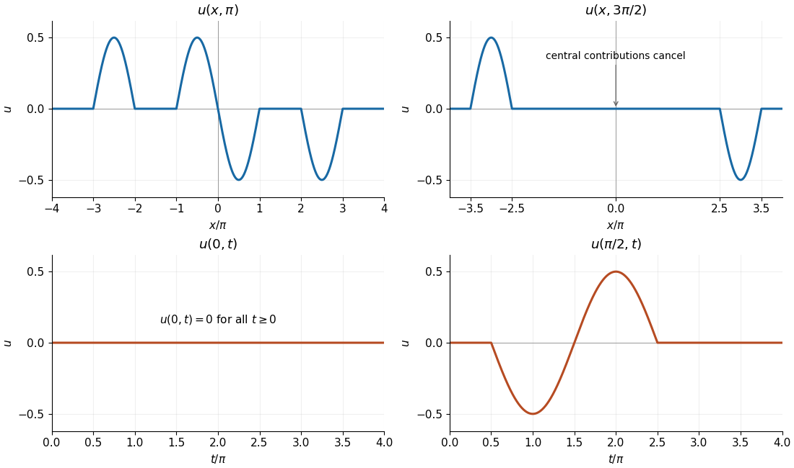

<h1 id="5/b/solution">Solution</h1>

↑ **Parent:** [B](../b.md)

Since the initial [velocity](../../../../../../velocity.md) vanishes, [D'Alembert's formula](../../../../../../d-alembert-s-formula.md) reduces to

$$
u(x,t)=\frac12\bigl[f(x-t)+f(x+t)\bigr].
$$

Each translated copy has half the original [amplitude](../../../../../../wave-amplitude.md). To identify each requested cross-section, track the translated support intervals and add the values where they overlap.

At $t=\pi$, $f(x-\pi)$ is supported on $[-\pi,0]\cup[2\pi,3\pi]$ and $f(x+\pi)$ on $[-3\pi,-2\pi]\cup[0,\pi]$. On these intervals $\sin(x\pm\pi)=-\sin x$, so

$$
\boxed{u(x,\pi)=
\begin{cases}
-\tfrac12\sin x,&x\in[-3\pi,-2\pi]\cup[-\pi,\pi]\cup[2\pi,3\pi],\\
0,&\text{otherwise}.
\end{cases}}
$$

The pieces meet continuously at zero, where both contributions vanish.

At $t=3\pi/2$, the support of $f(x-3\pi/2)$ is $[-\pi/2,\pi/2]\cup[5\pi/2,7\pi/2]$; that of $f(x+3\pi/2)$ is $[-7\pi/2,-5\pi/2]\cup[-\pi/2,\pi/2]$. In the central overlap,

$$
\sin(x-3\pi/2)=\cos x,\qquad\sin(x+3\pi/2)=-\cos x,
$$

so the two contributions cancel. The remaining [wave](../../../../../../wave-split.md) profile is

$$
\boxed{u(x,3\pi/2)=
\begin{cases}
-\tfrac12\cos x,&-7\pi/2\leq x\leq-5\pi/2,\\
\tfrac12\cos x,&5\pi/2\leq x\leq7\pi/2,\\
0,&\text{otherwise}.
\end{cases}}
$$

For the time cross-section at the origin, the initial profile is an [odd function](../../../../../../odd-function.md), so

$$
\boxed{u(0,t)=\tfrac12[f(-t)+f(t)]=0\qquad(t\geq0).}
$$

For the time cross-section at $x=\pi/2$, the left-travelling contribution is nonzero for $\pi/2\leq t\leq3\pi/2$ and equals $\cos t/2$. The right-travelling contribution is nonzero for $3\pi/2\leq t\leq5\pi/2$ and also equals $\cos t/2$. At the common endpoint both vanish. Hence

$$
\boxed{u(\pi/2,t)=
\begin{cases}
\tfrac12\cos t,&\pi/2\leq t\leq5\pi/2,\\
0,&0\leq t<\pi/2\ \text{or }t>5\pi/2.
\end{cases}}
$$

The following graphs show all four cross-sections. In particular, the last trace reaches $-1/2$ at $t=\pi$ and $1/2$ at $t=2\pi$.

**[Figure 1](#5/b/image-the-four-requested-cross-sections-of-the-wave-equation-solution). The four requested cross-sections of the wave equation solution**. The upper panels show the spatial profiles at $t=\pi$ and $t=3\pi/2$. The lower panels show the time traces at $x=0$ and $x=\pi/2$ for $t\geq0$. Horizontal axes are labelled in multiples of $\pi$.

Because $u(0,t)=0$, restriction to the half-line solves the following [initial-boundary value problem](../../../../../../initial-boundary-value-problem.md) with a homogeneous [Dirichlet boundary condition](../../../../../../dirichlet-boundary-condition.md):

$$
\boxed{
\begin{aligned}
u_{tt}&=u_{xx},&&x>0,\ t>0,\\
u(0,t)&=0,&&t>0,\\
u(x,0)&=
\begin{cases}\sin x,&\pi\leq x\leq2\pi,\\0,&\text{otherwise},\end{cases}&&x\geq0,\\
u_t(x,0)&=0,&&x\geq0.
\end{aligned}}
$$

This is [wave reflection by odd extension](../../../../../../wave-reflection-by-odd-extension.md). If a condition at infinity is desired, take the solution with finite [wave energy](../../../../../../wave-energy.md); here the profile has bounded support at every finite time.

The initial profile is [continuous](../../../../../../continuous-function.md) and piecewise continuously differentiable, but its first [derivative](../../../../../../derivative.md) jumps at the support endpoints. Thus the formula gives a [weak solution](../../../../../../weak-solution.md) globally and a piecewise [classical solution](../../../../../../classical-solution.md) away from the [characteristic lines for the one-dimensional wave equation](../../../../../../characteristic-line-for-the-one-dimensional-wave-equation.md) issuing from those endpoints. The initial [velocity](../../../../../../velocity.md) is zero in the [square-integrable function](../../../../../../square-integrable-function.md) sense and pointwise wherever the initial profile is [differentiable](../../../../../../differentiable-function.md); at the kink points a pointwise right time [derivative](../../../../../../derivative.md) need not equal zero. This regularity qualification is needed for the given data.

## ↑ Ancestors (12)

1. [B](../b.md)
2. [5](../../5.md)
3. [Mathematics V](../../../mathematics-v-split.md)
4. [Prelims](../../../split.md)
5. [2017](../../../../split.md)
6. [Past exam of the mathematics course of the University of Oxford](../../../../../split.md)
7. [Mathematics course of the University of Oxford](../../../../../../mathematics-course-of-the-university-of-oxford.md)
8. [Undergraduate course of the University of Oxford](../../../../../../undergraduate-course-of-the-university-of-oxford.md)
9. [Course of the University of Oxford](../../../../../../course-of-the-university-of-oxford.md)
10. [University of Oxford](../../../../../../university-of-oxford-split.md)
11. [List of universities](../../../../../../list-of-universities.md)
12. [Codex Wiki](../../../../../../split.md)
