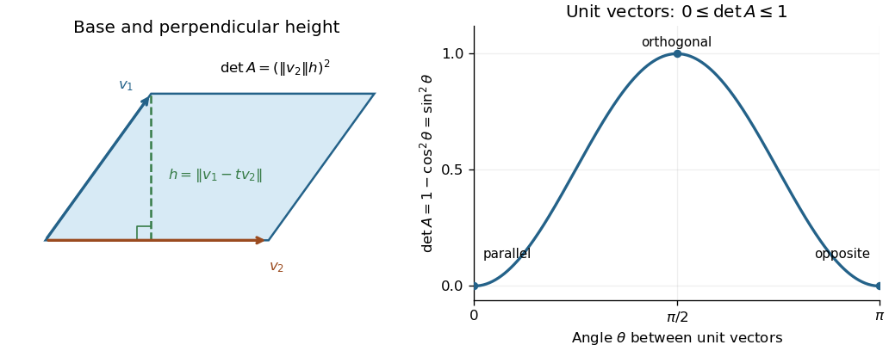

# Mathematics I

↑ **Parent:** [Prelims](../prelims.md)

Source: [released examination PDF, bundle pages 25–32](https://www.whatdotheyknow.com/request/bsc_mathematics_prelims_and_part/response/2784209/attach/3/202409%20817%20annex.pdf#page=25).

Solutions cover all seven questions: Section A, Questions 1–4, and Section B, Questions 5–7, including every optional question. The module label is I for Mathematics and Mathematics and Philosophy, and M1 for Mathematics and Computer Science; the formal paper code is A10138W1. In Question 2(b), $n\geq1$ is understood, as required by $V_{n-1}$.

**Table of contents**

- [1](#1)
  - [a](#1/a)
    - [i](#1/a/i)
      - [Solution](#1/a/i/solution)
    - [ii](#1/a/ii)
      - [Solution](#1/a/ii/solution)
    - [iii](#1/a/iii)
      - [Solution](#1/a/iii/solution)
  - [b](#1/b)
    - [i](#1/b/i)
      - [Solution](#1/b/i/solution)
    - [ii](#1/b/ii)
      - [Solution](#1/b/ii/solution)
    - [iii](#1/b/iii)
      - [Solution](#1/b/iii/solution)
- [2](#2)
  - [a](#2/a)
    - [i](#2/a/i)
      - [Solution](#2/a/i/solution)
    - [ii](#2/a/ii)
      - [Solution](#2/a/ii/solution)
    - [iii](#2/a/iii)
      - [Solution](#2/a/iii/solution)
    - [iv](#2/a/iv)
      - [Solution](#2/a/iv/solution)
  - [b](#2/b)
    - [i](#2/b/i)
      - [Solution](#2/b/i/solution)
    - [ii](#2/b/ii)
      - [Solution](#2/b/ii/solution)
    - [iii](#2/b/iii)
      - [Solution](#2/b/iii/solution)
- [3](#3)
  - [a](#3/a)
    - [i](#3/a/i)
      - [Solution](#3/a/i/solution)
    - [ii](#3/a/ii)
      - [Solution](#3/a/ii/solution)
    - [iii](#3/a/iii)
      - [Solution](#3/a/iii/solution)
  - [b](#3/b)
    - [Solution](#3/b/solution)
  - [c](#3/c)
    - [i](#3/c/i)
      - [Solution](#3/c/i/solution)
    - [ii](#3/c/ii)
      - [Solution](#3/c/ii/solution)
- [4](#4)
  - [a](#4/a)
    - [i](#4/a/i)
      - [Solution](#4/a/i/solution)
    - [ii](#4/a/ii)
      - [Solution](#4/a/ii/solution)
  - [b](#4/b)
    - [i](#4/b/i)
      - [Solution](#4/b/i/solution)
    - [ii](#4/b/ii)
      - [Solution](#4/b/ii/solution)
    - [iii](#4/b/iii)
      - [Solution](#4/b/iii/solution)
    - [iv](#4/b/iv)
      - [Solution](#4/b/iv/solution)
- [5](#5)
  - [a](#5/a)
    - [i](#5/a/i)
      - [Solution](#5/a/i/solution)
    - [ii](#5/a/ii)
      - [Solution](#5/a/ii/solution)
    - [iii](#5/a/iii)
      - [Solution](#5/a/iii/solution)
  - [b](#5/b)
    - [i](#5/b/i)
      - [Solution](#5/b/i/solution)
    - [ii](#5/b/ii)
      - [Solution](#5/b/ii/solution)
    - [iii](#5/b/iii)
      - [Solution](#5/b/iii/solution)
  - [c](#5/c)
    - [i](#5/c/i)
      - [Solution](#5/c/i/solution)
    - [ii](#5/c/ii)
      - [Solution](#5/c/ii/solution)
- [6](#6)
  - [a](#6/a)
    - [i](#6/a/i)
      - [Solution](#6/a/i/solution)
    - [ii](#6/a/ii)
      - [Solution](#6/a/ii/solution)
    - [iii](#6/a/iii)
      - [Solution](#6/a/iii/solution)
  - [b](#6/b)
    - [i](#6/b/i)
      - [Solution](#6/b/i/solution)
    - [ii](#6/b/ii)
      - [Solution](#6/b/ii/solution)
    - [iii](#6/b/iii)
      - [Solution](#6/b/iii/solution)
  - [c](#6/c)
    - [i](#6/c/i)
      - [Solution](#6/c/i/solution)
    - [ii](#6/c/ii)
      - [Solution](#6/c/ii/solution)
    - [iii](#6/c/iii)
      - [Solution](#6/c/iii/solution)
- [7](#7)
  - [a](#7/a)
    - [i](#7/a/i)
      - [Solution](#7/a/i/solution)
    - [ii](#7/a/ii)
      - [Solution](#7/a/ii/solution)
  - [b](#7/b)
    - [i](#7/b/i)
      - [Solution](#7/b/i/solution)
    - [ii](#7/b/ii)
      - [Solution](#7/b/ii/solution)
    - [iii](#7/b/iii)
      - [Solution](#7/b/iii/solution)
    - [iv](#7/b/iv)
      - [Solution](#7/b/iv/solution)
  - [c](#7/c)
    - [i](#7/c/i)
      - [Solution](#7/c/i/solution)
    - [ii](#7/c/ii)
      - [Solution](#7/c/ii/solution)

## 1

↑ **Parent:** [Mathematics I](mathematics-i.md)

<h3 id="1/a">a</h3>

↑ **Parent:** [1](#1)

<h4 id="1/a/i">i</h4>

↑ **Parent:** [a](#1/a)

<h5 id="1/a/i/solution">Solution</h5>

↑ **Parent:** [i](#1/a/i)

Write $A=(a_{ij})$ as an $m\times r$ [matrix](../../../vector-space.md#matrix) and $B$ as an $r\times n$ [matrix](../../../vector-space.md#matrix), with rows $b_1,\ldots,b_r$. The rule for [matrix multiplication](../../../vector-space.md#matrix-multiplication) gives

$$
\operatorname{row}_i(AB)=\sum_{j=1}^r a_{ij}b_j.
$$

Every row of $AB$ is therefore a [linear combination](../../../vector-space.md#linear-combination) of rows of $B$. Taking [linear spans](../../../vector-space.md#linear-span) gives

$$
\boxed{\operatorname{rowspace}(AB)\subseteq\operatorname{rowspace}(B).}
$$

<h4 id="1/a/ii">ii</h4>

↑ **Parent:** [a](#1/a)

<h5 id="1/a/ii/solution">Solution</h5>

↑ **Parent:** [ii](#1/a/ii)

When $A$ is an [invertible matrix](../../../linear-algebra.md#invertible-matrix), $B=A^{-1}(AB)$. Apply [i](#1/a/i) first to $AB$ and then to $A^{-1}(AB)$:

$$
\operatorname{rowspace}(AB)\subseteq\operatorname{rowspace}(B)
=\operatorname{rowspace}(A^{-1}AB)\subseteq\operatorname{rowspace}(AB).
$$

Thus **the two [row spaces](../../../vector-space.md#row-space) are equal**. In particular, invertible left [matrix multiplication](../../../vector-space.md#matrix-multiplication) preserves [row rank](../../../vector-space.md#row-rank).

<h4 id="1/a/iii">iii</h4>

↑ **Parent:** [a](#1/a)

<h5 id="1/a/iii/solution">Solution</h5>

↑ **Parent:** [iii](#1/a/iii)

For any [matrix](../../../vector-space.md#matrix) $Y$ and compatible [invertible matrix](../../../linear-algebra.md#invertible-matrix) $P$, the [linear map](../../../vector-space.md#linear-map) $r\mapsto rP$ maps $\operatorname{rowspace}(Y)$ onto $\operatorname{rowspace}(YP)$: a [linear combination](../../../vector-space.md#linear-combination) of rows of $Y$ is sent to the same [linear combination](../../../vector-space.md#linear-combination) of rows of $YP$. Its [inverse function](../../../function.md#inverse-function) is $s\mapsto sP^{-1}$, so these [row spaces](../../../vector-space.md#row-space) have equal [dimensions](../../../vector-space.md#dimension-vector-space). Hence right [matrix multiplication](../../../vector-space.md#matrix-multiplication) by $P$ also preserves [row rank](../../../vector-space.md#row-rank).

If $X=P^{-1}YP$, [ii](#1/a/ii) now gives

$$
\boxed{\operatorname{rowrank}X=\operatorname{rowrank}(YP)=\operatorname{rowrank}Y.}
$$

This proves the required [matrix similarity](../../../linear-algebra.md#matrix-similarity) invariant without needing to assume equality of [row rank](../../../vector-space.md#row-rank) and [column rank](../../../vector-space.md#column-rank).

<h3 id="1/b">b</h3>

↑ **Parent:** [1](#1)

<h4 id="1/b/i">i</h4>

↑ **Parent:** [b](#1/b)

<h5 id="1/b/i/solution">Solution</h5>

↑ **Parent:** [i](#1/b/i)

For the given [real matrix](../../../vector-space.md#real-matrix) $M$, direct [matrix multiplication](../../../vector-space.md#matrix-multiplication) gives the [eigenvectors](../../../linear-operator-theory.md#eigenvector)

$$
M\begin{pmatrix}1\\0\\1\end{pmatrix}=0,\qquad
M\begin{pmatrix}0\\1\\1\end{pmatrix}=2\begin{pmatrix}0\\1\\1\end{pmatrix},\qquad
M\begin{pmatrix}1\\1\\0\end{pmatrix}=4\begin{pmatrix}1\\1\\0\end{pmatrix}.
$$

Put these [eigenvectors](../../../linear-operator-theory.md#eigenvector) into the columns of

$$
P=\begin{pmatrix}1&0&1\\0&1&1\\1&1&0\end{pmatrix},\qquad
P^{-1}=\frac12\begin{pmatrix}1&-1&1\\-1&1&1\\1&1&-1\end{pmatrix}.
$$

Since $\det P=-2\ne0$, $P$ is an [invertible matrix](../../../linear-algebra.md#invertible-matrix). The three column identities give $MP=PD$, so

$$
\boxed{D=P^{-1}MP=\operatorname{diag}(0,2,4),\qquad M=PDP^{-1}.}
$$

In particular, the [matrix similarity](../../../linear-algebra.md#matrix-similarity) is established by an explicit [change-of-basis matrix](../../../linear-algebra.md#change-of-basis-matrix).

<h4 id="1/b/ii">ii</h4>

↑ **Parent:** [b](#1/b)

<h5 id="1/b/ii/solution">Solution</h5>

↑ **Parent:** [ii](#1/b/ii)

Write $C=(c_{ij})$ and $(d_1,d_2,d_3)=(0,2,4)$. Because $D$ is a [diagonal matrix](../../../linear-algebra.md#diagonal-matrix),

$$
(CD)_{ij}=c_{ij}d_j,\qquad (DC)_{ij}=d_ic_{ij}.
$$

Thus $CD=DC$ exactly when $(d_j-d_i)c_{ij}=0$ for every $i,j$. The three [eigenvalues](../../../linear-operator-theory.md#eigenvalue) are distinct, so every off-diagonal entry of $C$ must be zero; diagonal entries are unrestricted. Consequently the [centralizer of a diagonal matrix](../../../linear-algebra.md#centralizer-of-a-diagonal-matrix) here is

$$
\boxed{\{C:CD=DC\}=\{\operatorname{diag}(a,b,c):a,b,c\in\mathbb R\}.}
$$

Every displayed [matrix](../../../vector-space.md#matrix) indeed [commutes](../../../algebraic-operation.md#commuting-elements) with $D$, since [diagonal matrices](../../../linear-algebra.md#diagonal-matrix) multiply entry by entry on the diagonal.

<h4 id="1/b/iii">iii</h4>

↑ **Parent:** [b](#1/b)

<h5 id="1/b/iii/solution">Solution</h5>

↑ **Parent:** [iii](#1/b/iii)

[Matrix similarity](../../../linear-algebra.md#matrix-similarity) transports [commuting operators](../../../vector-space.md#commuting-operators): with $M=PDP^{-1}$,

$$
CM=MC\quad\Longleftrightarrow\quad
(P^{-1}CP)D=D(P^{-1}CP).
$$

By [ii](#1/b/ii), all such [matrices](../../../vector-space.md#matrix) are therefore

$$
\boxed{C=P\operatorname{diag}(a,b,c)P^{-1}\quad(a,b,c\in\mathbb R).}
$$

For completeness, [matrix multiplication](../../../vector-space.md#matrix-multiplication) gives

$$
C=\frac12\begin{pmatrix}
a+c&-a+c&a-c\\
-b+c&b+c&b-c\\
a-b&-a+b&a+b
\end{pmatrix}.
$$

The parameterization is [injective](../../../algebra.md#injective-function), since [matrix multiplication](../../../vector-space.md#matrix-multiplication) by $P^{-1}$ and $P$ recovers the parameter [diagonal matrix](../../../linear-algebra.md#diagonal-matrix). Thus there are **infinitely many** choices. Already the distinct [scalar matrices](../../../linear-algebra.md#scalar-matrix) $tI_3$, $t\in\mathbb R$, give an infinite family.

## 2

↑ **Parent:** [Mathematics I](mathematics-i.md)

<h3 id="2/a">a</h3>

↑ **Parent:** [2](#2)

<h4 id="2/a/i">i</h4>

↑ **Parent:** [a](#2/a)

<h5 id="2/a/i/solution">Solution</h5>

↑ **Parent:** [i](#2/a/i)

The [rank-nullity theorem](../../../kernel-of-a-linear-map.md#rank-nullity-theorem) for a [linear map](../../../vector-space.md#linear-map) $T:V\to W$, with $V$ a [finite-dimensional vector space](../../../vector-space.md#finite-dimensional-vector-space) over a [field](../../../algebra.md#field) $F$, is

$$
\boxed{\dim_F V=\dim_F\ker T+\dim_F\operatorname{im}T.}
$$

Here the [nullity](../../../kernel-of-a-linear-map.md#nullity-of-a-linear-map) is the [dimension](../../../vector-space.md#dimension-vector-space) of the [kernel of a linear map](../../../kernel-of-a-linear-map.md), and the [rank of a linear map](../../../vector-space.md#rank-of-a-linear-map) is the [dimension](../../../vector-space.md#dimension-vector-space) of its [image of a linear map](../../../vector-space.md#image-of-a-linear-map).

<h4 id="2/a/ii">ii</h4>

↑ **Parent:** [a](#2/a)

<h5 id="2/a/ii/solution">Solution</h5>

↑ **Parent:** [ii](#2/a/ii)

Define the [linear functional](../../../dual-space.md#linear-functional) $L:F^n\to F$ by $L(x)=\sum_{i=1}^n a_ix_i$. The given [hyperplane](../../../vector-space.md#hyperplane) is $H=\ker L$. Choose $j$ with $a_j\ne0$. For any $t\in F$, the [vector](../../../vector-space.md#vector) whose only nonzero coordinate is $x_j=t/a_j$ satisfies $L(x)=t$. Hence $L$ is [surjective](../../../algebra.md#surjective-function) and has [rank of a linear map](../../../vector-space.md#rank-of-a-linear-map) equal to $\dim_F F=1$.

Applying the [rank-nullity theorem](../../../kernel-of-a-linear-map.md#rank-nullity-theorem) to this particular [linear map](../../../vector-space.md#linear-map) gives

$$
\boxed{\dim_F H=n-1.}
$$

The nonzero-[coefficient](../../../vector-space.md#coefficient) hypothesis is essential: if all $a_i$ were zero, the [kernel of a linear map](../../../kernel-of-a-linear-map.md) would instead be all of $F^n$.

<h4 id="2/a/iii">iii</h4>

↑ **Parent:** [a](#2/a)

<h5 id="2/a/iii/solution">Solution</h5>

↑ **Parent:** [iii](#2/a/iii)

Over the [finite field](../../../algebra.md#finite-field) $F=\mathbb Z_p$, a [basis](../../../vector-space.md#basis) of the [hyperplane](../../../vector-space.md#hyperplane) has $n-1$ [vectors](../../../vector-space.md#vector) by [ii](#2/a/ii). Each [vector](../../../vector-space.md#vector) on the [hyperplane](../../../vector-space.md#hyperplane) has a unique expression as a [linear combination](../../../vector-space.md#linear-combination) of that [basis](../../../vector-space.md#basis), and each [coefficient](../../../vector-space.md#coefficient) has $p$ possibilities. Thus

$$
\boxed{|H|=p^{\,n-1}.}
$$

Equivalently, choose freely all coordinates except $x_j$, where $a_j\ne0$, and solve uniquely for $x_j$. For $n=1$ this counts just the [zero vector](../../../vector-space.md#zero-vector), consistently with $p^0=1$.

<h4 id="2/a/iv">iv</h4>

↑ **Parent:** [a](#2/a)

<h5 id="2/a/iv/solution">Solution</h5>

↑ **Parent:** [iv](#2/a/iv)

The [transpose](../../../vector-space.md#transpose) is a [linear map](../../../vector-space.md#linear-map), so $T(A)=A+A^T$ is a [linear map](../../../vector-space.md#linear-map) on the $n^2$-dimensional [vector space](../../../vector-space.md) $M_{n\times n}(F)$. Let $E_{ij}$ denote a [matrix unit](../../../vector-space.md#matrix-unit). The answer depends on the [characteristic of a field](../../../algebra.md#characteristic-of-a-field).

If $\operatorname{char}F\ne2$, then $T(A)=0$ means $A^T=-A$. Such [skew-symmetric matrices](../../../linear-algebra.md#skew-symmetric-matrix) have zero diagonal, and their entries above the diagonal can be chosen freely. A [basis](../../../vector-space.md#basis) of the [kernel of a linear map](../../../kernel-of-a-linear-map.md) is $E_{ij}-E_{ji}$ for $i<j$, giving [nullity](../../../kernel-of-a-linear-map.md#nullity-of-a-linear-map) $n(n-1)/2$. The [image of a linear map](../../../vector-space.md#image-of-a-linear-map) consists of all [symmetric matrices](../../../linear-algebra.md#symmetric-matrix): $T(A)$ is symmetric, and every [symmetric matrix](../../../linear-algebra.md#symmetric-matrix) $S$ is $T(S/2)$. Its [basis](../../../vector-space.md#basis) comprises $E_{ii}$ and $E_{ij}+E_{ji}$ for $i<j$, giving [rank of a linear map](../../../vector-space.md#rank-of-a-linear-map) $n(n+1)/2$.

If $\operatorname{char}F=2$, then $-A=A$, so $\ker T$ consists of all [symmetric matrices](../../../linear-algebra.md#symmetric-matrix), with [dimension](../../../vector-space.md#dimension-vector-space) $n(n+1)/2$. Every $T(A)$ is symmetric with zero diagonal, and every symmetric zero-diagonal [matrix](../../../vector-space.md#matrix) $S$ arises by taking $A_{ij}=S_{ij}$ for $i<j$ and all other entries zero. The [image of a linear map](../../../vector-space.md#image-of-a-linear-map) therefore has [basis](../../../vector-space.md#basis) $E_{ij}+E_{ji}$ for $i<j$, and [dimension](../../../vector-space.md#dimension-vector-space) $n(n-1)/2$. This is the [symmetrization map in characteristic two](../../../vector-space.md#symmetrization-map-in-characteristic-two).

In both cases the [rank-nullity theorem](../../../kernel-of-a-linear-map.md#rank-nullity-theorem) is verified explicitly:

$$
\boxed{\begin{array}{c|cc}
&\dim\ker T&\dim\operatorname{im}T\\\hline
\operatorname{char}F\ne2&\dfrac{n(n-1)}2&\dfrac{n(n+1)}2\\
\operatorname{char}F=2&\dfrac{n(n+1)}2&\dfrac{n(n-1)}2
\end{array}\qquad
\dim\ker T+\dim\operatorname{im}T=n^2.}
$$

<h3 id="2/b">b</h3>

↑ **Parent:** [2](#2)

<h4 id="2/b/i">i</h4>

↑ **Parent:** [b](#2/b)

<h5 id="2/b/i/solution">Solution</h5>

↑ **Parent:** [i](#2/b/i)

The [monomials](../../../polynomial.md#monomial) $1,x,\ldots,x^n$ form a [basis](../../../vector-space.md#basis) of $V_n$: they [span](../../../vector-space.md#linear-span) every [polynomial](../../../polynomial.md) of [degree of a polynomial](../../../polynomial.md#degree-of-a-polynomial) at most $n$, and equality of [polynomials](../../../polynomial.md) forces equality of every coefficient, proving [linear independence](../../../vector-space.md#linear-independence). Therefore

$$
\boxed{\dim_{\mathbb C}V_n=n+1.}
$$

The [zero polynomial](../../../polynomial.md#zero-polynomial) is included in $V_n$ even though its [degree of a polynomial](../../../polynomial.md#degree-of-a-polynomial) need not be assigned an ordinary nonnegative value.

<h4 id="2/b/ii">ii</h4>

↑ **Parent:** [b](#2/b)

<h5 id="2/b/ii/solution">Solution</h5>

↑ **Parent:** [ii](#2/b/ii)

Suppose, for a contradiction, that $p$ and $q$ have no common [root of a polynomial](../../../polynomial.md#root-of-a-polynomial). Since the [polynomial ring](../../../commutative-algebra.md#polynomial-ring) $\mathbb C[x]$ has no [zero divisors](../../../mathematics.md#zero-divisor) and $p,q\ne0$, the relation $ap+bq=0$ with $a,b$ not both zero forces both $a$ and $b$ to be nonzero.

By the [fundamental theorem of algebra](../../../algebra.md#fundamental-theorem-of-algebra), write

$$
p(x)=c\prod_{j=1}^r(x-\alpha_j)^{m_j},\qquad c\ne0,\quad \sum_{j=1}^r m_j=n,
$$

where the $\alpha_j$ are distinct. For each $j$, $q(\alpha_j)\ne0$. The equality $bq=-ap$ implies that $(x-\alpha_j)^{m_j}$ divides $bq$. The [multiplicity of a root](../../../polynomial.md#multiplicity-of-a-root) in [polynomial multiplication](../../../polynomial.md#polynomial-multiplication) is the sum of its multiplicities in the factors: factor out the largest powers of $x-\alpha_j$ and note that the two remaining factors have nonzero values at $\alpha_j$. Since $q(\alpha_j)\ne0$, $b$ must contain $(x-\alpha_j)^{m_j}$.

Thus $b$ has at least $\sum_jm_j=n$ [roots of a polynomial](../../../polynomial.md#root-of-a-polynomial) counted with [multiplicity of a root](../../../polynomial.md#multiplicity-of-a-root), so $\deg b\geq n$. This contradicts $b\in V_{n-1}$. Consequently

$$
\boxed{\text{there is }\alpha\in\mathbb C\text{ with }p(\alpha)=q(\alpha)=0.}
$$

Counting [multiplicity of a root](../../../polynomial.md#multiplicity-of-a-root) is necessary: counting only distinct [roots of a polynomial](../../../polynomial.md#root-of-a-polynomial) would miss repeated factors.

<h4 id="2/b/iii">iii</h4>

↑ **Parent:** [b](#2/b)

<h5 id="2/b/iii/solution">Solution</h5>

↑ **Parent:** [iii](#2/b/iii)

Use the [linear map](../../../vector-space.md#linear-map)

$$
\Phi:V_{n-1}\times V_{n-1}\longrightarrow V_{2n-1},\qquad
\Phi(a,b)=ap+bq.
$$

It is well defined because $\deg(ap),\deg(bq)\leq2n-1$, and it is a [linear map](../../../vector-space.md#linear-map) by [distributivity](../../../algebraic-operation.md#distributive-property) of [polynomial multiplication](../../../polynomial.md#polynomial-multiplication). If $\Phi(a,b)=0$ for a nonzero pair, [ii](#2/b/ii) would give a common [root of a polynomial](../../../polynomial.md#root-of-a-polynomial) of $p$ and $q$. The hypothesis therefore implies $\ker\Phi=\{(0,0)\}$, so $\Phi$ is [injective](../../../algebra.md#injective-function).

By [i](#2/b/i), the domain and codomain both have [dimension](../../../vector-space.md#dimension-vector-space) $2n$: a [basis](../../../vector-space.md#basis) of the domain is $(x^j,0),(0,x^j)$ for $0\leq j<n$, and a [basis](../../../vector-space.md#basis) of the codomain is $1,x,\ldots,x^{2n-1}$. The stated finite-dimensional result makes $\Phi$ [surjective](../../../algebra.md#surjective-function). In particular $1$ has a preimage, proving the [degree bound in polynomial Bézout's identity](../../../polynomial.md#degree-bound-in-polynomial-bezout-s-identity):

$$
\boxed{\exists\,u,v\in V_{n-1}\quad up+vq=1.}
$$

Indeed, [injectivity](../../../algebra.md#injective-function) also proves uniqueness of this pair under the stated [degree of a polynomial](../../../polynomial.md#degree-of-a-polynomial) bounds.

## 3

↑ **Parent:** [Mathematics I](mathematics-i.md)

<h3 id="3/a">a</h3>

↑ **Parent:** [3](#3)

<h4 id="3/a/i">i</h4>

↑ **Parent:** [a](#3/a)

<h5 id="3/a/i/solution">Solution</h5>

↑ **Parent:** [i](#3/a/i)

Put $U=\langle u_1,\ldots,u_k\rangle$. Taking all [coefficients](../../../vector-space.md#coefficient) zero puts the [zero vector](../../../vector-space.md#zero-vector) in $U$. If $s=\sum_i\alpha_i u_i$, $t=\sum_i\beta_i u_i$ lie in $U$ and $a,b\in\mathbb R$, then

$$
as+bt=\sum_{i=1}^k(a\alpha_i+b\beta_i)u_i\in U.
$$

Thus $U$ is closed under [vector addition](../../../vector-space.md#vector-addition) and [scalar multiplication](../../../vector-space.md#scalar-multiplication), contains the [zero vector](../../../vector-space.md#zero-vector), and is therefore **a [linear subspace](../../../vector-space.md#vector-subspace) of $V$**. This is precisely why the [linear span](../../../vector-space.md#linear-span) is a [linear subspace](../../../vector-space.md#vector-subspace).

<h4 id="3/a/ii">ii</h4>

↑ **Parent:** [a](#3/a)

<h5 id="3/a/ii/solution">Solution</h5>

↑ **Parent:** [ii](#3/a/ii)

Suppose $\sum_{i=1}^{k+1}\alpha_i u_i=0$. If $\alpha_{k+1}\ne0$, then

$$
u_{k+1}=-\sum_{i=1}^k\frac{\alpha_i}{\alpha_{k+1}}u_i\in\langle u_1,\ldots,u_k\rangle,
$$

contrary to the hypothesis. Hence $\alpha_{k+1}=0$. The assumed [linear independence](../../../vector-space.md#linear-independence) of $u_1,\ldots,u_k$ then gives $\alpha_1=\cdots=\alpha_k=0$. Therefore **$u_1,\ldots,u_{k+1}$ are [linearly independent](../../../vector-space.md#linear-independence)**. Adding a [vector](../../../vector-space.md#vector) outside the previous [linear span](../../../vector-space.md#linear-span) creates no nontrivial relation.

<h4 id="3/a/iii">iii</h4>

↑ **Parent:** [a](#3/a)

<h5 id="3/a/iii/solution">Solution</h5>

↑ **Parent:** [iii](#3/a/iii)

Write $v=\sum_{i=1}^{k+1}\alpha_i u_i$. Since $v\notin\langle u_1,\ldots,u_k\rangle$, necessarily $\alpha_{k+1}\ne0$. Rearranging gives

$$
u_{k+1}=\frac1{\alpha_{k+1}}v-\sum_{i=1}^k\frac{\alpha_i}{\alpha_{k+1}}u_i
\in\langle u_1,\ldots,u_k,v\rangle.
$$

All generators of $\langle u_1,\ldots,u_{k+1}\rangle$ therefore belong to $\langle u_1,\ldots,u_k,v\rangle$, proving one [set inclusion](../../../set.md#set-inclusion). Conversely, $u_1,\ldots,u_k,v$ all belong to the [linear subspace](../../../vector-space.md#vector-subspace) $\langle u_1,\ldots,u_{k+1}\rangle$, proving the other [set inclusion](../../../set.md#set-inclusion). Thus

$$
\boxed{\langle u_1,\ldots,u_k,v\rangle=\langle u_1,\ldots,u_{k+1}\rangle.}
$$

This [linear span](../../../vector-space.md#linear-span) exchange does not require [linear independence](../../../vector-space.md#linear-independence) of the original [vectors](../../../vector-space.md#vector).

<h3 id="3/b">b</h3>

↑ **Parent:** [3](#3)

<h4 id="3/b/solution">Solution</h4>

↑ **Parent:** [b](#3/b)

For $\phi(\alpha)=\sum_{i=1}^k\alpha_i u_i$, its [image of a linear map](../../../vector-space.md#image-of-a-linear-map) is exactly $\langle u_1,\ldots,u_k\rangle$. Consequently $\phi$ is [surjective](../../../algebra.md#surjective-function) if and only if $u_1,\ldots,u_k$ are a [spanning set](../../../vector-space.md#spanning-set) for $V$.

If the [vectors](../../../vector-space.md#vector) are [linearly independent](../../../vector-space.md#linear-independence) and $\phi(\alpha)=\phi(\beta)$, then $\sum_i(\alpha_i-\beta_i)u_i=0$, so $\alpha_i=\beta_i$ for all $i$. Hence $\phi$ is [injective](../../../algebra.md#injective-function). Conversely, if $\phi$ is [injective](../../../algebra.md#injective-function), any relation $\sum_i\alpha_i u_i=0$ says $\phi(\alpha)=\phi(0)$ and thus $\alpha=0$, proving [linear independence](../../../vector-space.md#linear-independence).

Combining both equivalences gives

$$
\boxed{(u_1,\ldots,u_k)\text{ is a basis of }V\quad\Longleftrightarrow\quad\phi\text{ is a bijection}.}
$$

A [basis](../../../vector-space.md#basis) is therefore exactly a choice of [vectors](../../../vector-space.md#vector) giving existence and uniqueness of coordinates, expressed by a [bijection](../../../function.md#bijection).

<h3 id="3/c">c</h3>

↑ **Parent:** [3](#3)

<h4 id="3/c/i">i</h4>

↑ **Parent:** [c](#3/c)

<h5 id="3/c/i/solution">Solution</h5>

↑ **Parent:** [i](#3/c/i)

Take any finite selection of distinct indices $i_1,\ldots,i_r$ and a relation

$$
\alpha_1e^{(i_1)}+\cdots+\alpha_re^{(i_r)}=0.
$$

The coordinate at $i_j$ on the left is exactly $\alpha_j$, while the [zero vector](../../../vector-space.md#zero-vector) has coordinate zero. Hence $\alpha_j=0$ for each $j$. Every finite [subset](../../../set.md#subset) of $E$ is therefore [linearly independent](../../../vector-space.md#linear-independence), which is the definition of [linear independence](../../../vector-space.md#linear-independence) for an infinite [set](../../../set.md). Thus **$E$ is [linearly independent](../../../vector-space.md#linear-independence)** in the [vector space](../../../vector-space.md) of [finitely supported sequences](../../../banach-space.md#finitely-supported-sequence).

<h4 id="3/c/ii">ii</h4>

↑ **Parent:** [c](#3/c)

<h5 id="3/c/ii/solution">Solution</h5>

↑ **Parent:** [ii](#3/c/ii)

Every $v\in V$ is a [finitely supported sequence](../../../banach-space.md#finitely-supported-sequence), so for a finite [set](../../../set.md) of indices $S$,

$$
v=\sum_{i\in S}v_i e^{(i)}.
$$

Thus $E$ is a [spanning set](../../../vector-space.md#spanning-set). If $F$ contained $v\notin E$, the displayed expression would give a nontrivial relation

$$
v-\sum_{i\in S}v_i e^{(i)}=0
$$

among the distinct [vectors](../../../vector-space.md#vector) of the finite [subset](../../../set.md#subset) $\{v\}\cup\{e^{(i)}:i\in S\}$ of $F$: the [coefficient](../../../vector-space.md#coefficient) of $v$ is $1$. This contradicts the [linear independence](../../../vector-space.md#linear-independence) of $F$. It also covers $v=0$, whose singleton is not [linearly independent](../../../vector-space.md#linear-independence). Hence **$F=E$**. In particular, $E$ is both a [basis](../../../vector-space.md#basis) and a maximal [linearly independent](../../../vector-space.md#linear-independence) [subset](../../../set.md#subset) of $V$.

## 4

↑ **Parent:** [Mathematics I](mathematics-i.md)

<h3 id="4/a">a</h3>

↑ **Parent:** [4](#4)

<h4 id="4/a/i">i</h4>

↑ **Parent:** [a](#4/a)

<h5 id="4/a/i/solution">Solution</h5>

↑ **Parent:** [i](#4/a/i)

The hypothesis implies $v_1,v_2\ne0$, since the [zero vector](../../../vector-space.md#zero-vector) is a [scalar multiple](../../../vector-space.md#scalar-multiple) of every [vector](../../../vector-space.md#vector). Set

$$
t=\frac{\langle v_1,v_2\rangle}{\|v_2\|^2},\qquad w=v_1-tv_2.
$$

Since $v_1$ is not a [scalar multiple](../../../vector-space.md#scalar-multiple) of $v_2$, $w\ne0$. [Positive definiteness](../../../bilinear-form.md#positive-definiteness) and [bilinearity](../../../multilinear-algebra.md#bilinearity) of the real [inner product](../../../inner-product.md) give

$$
0<\langle w,w\rangle
=\|v_1\|^2-2t\langle v_1,v_2\rangle+t^2\|v_2\|^2
=\|v_1\|^2-\frac{\langle v_1,v_2\rangle^2}{\|v_2\|^2}.
$$

Multiplying by $\|v_2\|^2>0$ and taking [square roots](../../../algebra.md#square-root) proves the strict [Cauchy-Schwarz inequality](../../../probability-and-statistics.md#cauchy-schwarz-inequality)

$$
|\langle v_1,v_2\rangle|<\|v_1\|\,\|v_2\|.
$$

Since every [real number](../../../arithmetic.md#real-number) $s$ satisfies $s\leq|s|$, this proves, in particular,

$$
\boxed{\langle v_1,v_2\rangle<\|v_1\|\,\|v_2\|.}
$$

The argument derives the required [inequality](../../../arithmetic.md#inequality-mathematics) directly from the [inner product](../../../inner-product.md) axioms.

<h4 id="4/a/ii">ii</h4>

↑ **Parent:** [a](#4/a)

<h5 id="4/a/ii/solution">Solution</h5>

↑ **Parent:** [ii](#4/a/ii)

The two-vector [Gram matrix](../../../inner-product.md#gram-matrix) is

$$
A=\begin{pmatrix}\|v_1\|^2&\langle v_1,v_2\rangle\\
\langle v_1,v_2\rangle&\|v_2\|^2\end{pmatrix},
\qquad
\det A=\|v_1\|^2\|v_2\|^2-\langle v_1,v_2\rangle^2.
$$

The upper bound follows because the subtracted square is nonnegative. If either [vector](../../../vector-space.md#vector) is zero, the [determinant](../../../multilinear-algebra.md#determinant) is zero. Otherwise apply the non-strict version of the calculation in [i](#4/a/i): $\|v_1-tv_2\|^2\geq0$ with $t=\langle v_1,v_2\rangle/\|v_2\|^2$ gives $\langle v_1,v_2\rangle^2\leq\|v_1\|^2\|v_2\|^2$. Therefore

$$
\boxed{0\leq\det A\leq\|v_1\|^2\|v_2\|^2.}
$$

Equality on the left holds exactly when the two [vectors](../../../vector-space.md#vector) are [linearly dependent](../../../vector-space.md#linear-dependence); equality on the right holds exactly when they are [orthogonal](../../../inner-product.md#orthogonal-vectors). The [Gram determinant](../../../inner-product.md#gram-determinant) measures the squared [area](../../../differential-geometry.md#surface-area) of their [parallelogram](../../../euclidean-geometry.md#parallelogram): in the nonzero case, $\det A=\|v_2\|^2\|v_1-tv_2\|^2$, the square of base times perpendicular height.

**[Figure 1](#4/a/ii/image-the-gram-determinant-as-squared-parallelogram-area-and-its-dependence-on-the-angle-between-unit-vectors). The Gram determinant as squared parallelogram area, and its dependence on the angle between unit vectors**.

<h3 id="4/b">b</h3>

↑ **Parent:** [4](#4)

<h4 id="4/b/i">i</h4>

↑ **Parent:** [b](#4/b)

<h5 id="4/b/i/solution">Solution</h5>

↑ **Parent:** [i](#4/b/i)

[Bilinearity](../../../multilinear-algebra.md#bilinearity) of the real [inner product](../../../inner-product.md) gives, for the specified [linear combinations](../../../vector-space.md#linear-combination),

$$
\begin{aligned}
\langle u,v\rangle
&=\left\langle\sum_{i=1}^n x_iv_i,\sum_{j=1}^n y_jv_j\right\rangle\\
&=\sum_{i=1}^n\sum_{j=1}^n x_i y_j\langle v_i,v_j\rangle
=\sum_{i=1}^n\sum_{j=1}^n x_iA_{ij}y_j
=\boxed{x^TAy}.
\end{aligned}
$$

The last equality is the entrywise rule for [matrix multiplication](../../../vector-space.md#matrix-multiplication), with $x^T$ the [transpose](../../../vector-space.md#transpose) of the column [vector](../../../vector-space.md#vector) $x$.

<h4 id="4/b/ii">ii</h4>

↑ **Parent:** [b](#4/b)

<h5 id="4/b/ii/solution">Solution</h5>

↑ **Parent:** [ii](#4/b/ii)

Symmetry of the real [inner product](../../../inner-product.md) gives $A^T=A$. Moreover, [i](#4/b/i) with $y=x$ shows that

$$
x^TAx=\left\|\sum_{i=1}^n x_iv_i\right\|^2\geq0
\qquad(x\in\mathbb R^n),
$$

so the [Gram matrix](../../../inner-product.md#gram-matrix) is a [positive semidefinite matrix](../../../quadratic-form.md#positive-semidefinite-matrix). To also check reality of every [eigenvalue](../../../linear-operator-theory.md#eigenvalue), allow a nonzero [vector](../../../vector-space.md#vector) $z=a+ib\in\mathbb C^n$ with $Az=\lambda z$. Since $A$ is a real [symmetric matrix](../../../linear-algebra.md#symmetric-matrix),

$$
z^*Az=a^TAa+b^TAb+i(a^TAb-b^TAa)=a^TAa+b^TAb\geq0.
$$

Here $z^*$ is the [conjugate transpose](../../../linear-operator-theory.md#conjugate-transpose), and $a^TAb=b^TAa$ cancels the imaginary part. Thus

$$
\boxed{\lambda=\frac{z^*Az}{z^*z}\in[0,\infty),}
$$

because $z^*z>0$. This proves both that every [eigenvalue](../../../linear-operator-theory.md#eigenvalue) is real and that it is nonnegative.

<h4 id="4/b/iii">iii</h4>

↑ **Parent:** [b](#4/b)

<h5 id="4/b/iii/solution">Solution</h5>

↑ **Parent:** [iii](#4/b/iii)

By the [spectral theorem for real symmetric matrices](../../../linear-algebra.md#spectral-theorem-for-real-symmetric-matrices), there is an [orthogonal matrix](../../../linear-algebra.md#orthogonal-matrix) $Q$ such that

$$
Q^TAQ=\operatorname{diag}(\lambda_1,\ldots,\lambda_n).
$$

For clarity, the diagonalization can also be justified recursively. The [characteristic polynomial](../../../linear-operator-theory.md#characteristic-polynomial) has a complex [root of a polynomial](../../../polynomial.md#root-of-a-polynomial) by the [fundamental theorem of algebra](../../../algebra.md#fundamental-theorem-of-algebra). By [ii](#4/b/ii) its [eigenvalue](../../../linear-operator-theory.md#eigenvalue) is real; taking a nonzero real or imaginary part of an associated [eigenvector](../../../linear-operator-theory.md#eigenvector) in $\mathbb C^n$ gives a real [eigenvector](../../../linear-operator-theory.md#eigenvector), which can be normalized. Its [orthogonal complement](../../../hilbert-space.md#orthogonal-complement) is invariant, because $\langle Ax,z\rangle=\langle x,Az\rangle=\lambda\langle x,z\rangle=0$. Restriction to this [linear subspace](../../../vector-space.md#vector-subspace) is again symmetric, and induction on [dimension](../../../vector-space.md#dimension-vector-space) gives an [orthonormal basis](../../../inner-product.md#orthonormal-basis) of [eigenvectors](../../../linear-operator-theory.md#eigenvector).

All $\lambda_i\geq0$ by [ii](#4/b/ii). The permitted invariance of [determinant](../../../multilinear-algebra.md#determinant) and [matrix trace](../../../linear-algebra.md#matrix-trace) under [change of basis](../../../linear-algebra.md#change-of-basis), applied to the [diagonal matrix](../../../linear-algebra.md#diagonal-matrix), yields

$$
\boxed{\det A=\prod_{i=1}^n\lambda_i,\qquad
\operatorname{tr}A=\sum_{i=1}^n\lambda_i,\qquad\lambda_i\geq0.}
$$

<h4 id="4/b/iv">iv</h4>

↑ **Parent:** [b](#4/b)

<h5 id="4/b/iv/solution">Solution</h5>

↑ **Parent:** [iv](#4/b/iv)

If every $\|v_i\|=1$, then each diagonal entry of the [Gram matrix](../../../inner-product.md#gram-matrix) is $A_{ii}=\langle v_i,v_i\rangle=1$, so its [matrix trace](../../../linear-algebra.md#matrix-trace) is $n$. Using [iii](#4/b/iii) and the permitted [arithmetic-geometric mean inequality](../../../mathematical-optimization.md#arithmetic-geometric-mean-inequality),

$$
0\leq\det A=\prod_{i=1}^n\lambda_i
\leq\left(\frac{\sum_{i=1}^n\lambda_i}{n}\right)^n
=\left(\frac{\operatorname{tr}A}{n}\right)^n
=\boxed{1}.
$$

The bound is attained by any [orthonormal](../../../inner-product.md#orthonormal-set) family, whose [Gram matrix](../../../inner-product.md#gram-matrix) is the [identity matrix](../../../vector-space.md#identity-matrix).

## 5

↑ **Parent:** [Mathematics I](mathematics-i.md)

<h3 id="5/a">a</h3>

↑ **Parent:** [5](#5)

<h4 id="5/a/i">i</h4>

↑ **Parent:** [a](#5/a)

<h5 id="5/a/i/solution">Solution</h5>

↑ **Parent:** [i](#5/a/i)

The [function composition](../../../function.md#function-composition) of two [bijections](../../../function.md#bijection) $f,g:X\to X$ is a [bijection](../../../function.md#bijection), with [inverse function](../../../function.md#inverse-function) $(f\circ g)^{-1}=g^{-1}\circ f^{-1}$. Thus [function composition](../../../function.md#function-composition) is a [binary operation](../../../algebraic-operation.md#binary-operation) on $\operatorname{Sym}(X)$. It is [associative](../../../algebraic-operation.md#associative-property), since both $(f\circ g)\circ h$ and $f\circ(g\circ h)$ send $x$ to $f(g(h(x)))$.

The [identity function](../../../function.md#identity-function) $\operatorname{id}_X$ is a [bijection](../../../function.md#bijection) and satisfies $f\circ\operatorname{id}_X=\operatorname{id}_X\circ f=f$. Every [bijection](../../../function.md#bijection) $f$ has an [inverse function](../../../function.md#inverse-function) $f^{-1}:X\to X$, itself a [bijection](../../../function.md#bijection), satisfying $f\circ f^{-1}=f^{-1}\circ f=\operatorname{id}_X$. These verify all [group axioms](../../../group.md#group-axioms), so **$\operatorname{Sym}(X)$ is a [group](../../../group.md)**, the [symmetric group](../../../finite-group-theory.md#symmetric-group) of $X$.

<h4 id="5/a/ii">ii</h4>

↑ **Parent:** [a](#5/a)

<h5 id="5/a/ii/solution">Solution</h5>

↑ **Parent:** [ii](#5/a/ii)

For a [singleton](../../../set.md#singleton-mathematics) $X$, the [symmetric group](../../../finite-group-theory.md#symmetric-group) contains only the [identity function](../../../function.md#identity-function). For a two-element [set](../../../set.md), it contains the [identity function](../../../function.md#identity-function) and the [transposition](../../../combinatorics.md#transposition-permutation) exchanging the two elements; the latter squares to the [identity function](../../../function.md#identity-function). In both cases all elements [commute](../../../algebraic-operation.md#commuting-elements), so the [group](../../../group.md) is [Abelian](../../../group.md#abelian-group).

If $X$ contains three distinct elements $a,b,c$, define the [transpositions](../../../combinatorics.md#transposition-permutation) $\sigma=(a\ b)$ and $\tau=(b\ c)$, fixing every other element of $X$. They are [bijections](../../../function.md#bijection), even when $X$ is infinite. With [function composition](../../../function.md#function-composition) read from right to left,

$$
(\sigma\circ\tau)(a)=b,\qquad (\tau\circ\sigma)(a)=c.
$$

Thus they do not [commute](../../../algebraic-operation.md#commuting-elements), so the [symmetric group](../../../finite-group-theory.md#symmetric-group) is not [Abelian](../../../group.md#abelian-group). Since $X$ is nonempty, this proves

$$
\boxed{\operatorname{Sym}(X)\text{ is abelian}\quad\Longleftrightarrow\quad X\text{ is finite and }|X|\leq2.}
$$

<h4 id="5/a/iii">iii</h4>

↑ **Parent:** [a](#5/a)

<h5 id="5/a/iii/solution">Solution</h5>

↑ **Parent:** [iii](#5/a/iii)

For each $g\in G$, left [translation in a group](../../../group.md#translation-in-a-group) $L_g:x\mapsto gx$ is a [bijection](../../../function.md#bijection), with [inverse function](../../../function.md#inverse-function) $L_{g^{-1}}$. Thus $\theta(g)=L_g$ belongs to $\operatorname{Sym}(G)$. For $g,h,x\in G$, [associativity](../../../algebraic-operation.md#associative-property) of the [group operation](../../../group.md#group-operation) gives

$$
\theta(gh)(x)=(gh)x=g(hx)=(\theta(g)\circ\theta(h))(x).
$$

Hence $\theta$ is a [group homomorphism](../../../group-theory.md#group-homomorphism). If $\theta(g)=\theta(h)$, evaluation at the [identity element](../../../algebraic-operation.md#identity-element) $e$ gives $g=ge=he=h$. Therefore

$$
\boxed{\theta:G\hookrightarrow\operatorname{Sym}(G)\text{ is an injective group homomorphism}.}
$$

This is the left regular representation used in [Cayley's theorem](../../../group-theory.md#cayley-s-theorem).

<h3 id="5/b">b</h3>

↑ **Parent:** [5](#5)

<h4 id="5/b/i">i</h4>

↑ **Parent:** [b](#5/b)

<h5 id="5/b/i/solution">Solution</h5>

↑ **Parent:** [i](#5/b/i)

Suppose $y*y=y$. Choose $z$ with $y*z=e$, using the given right [inverse element](../../../algebraic-operation.md#inverse-element) property. Multiply the idempotent relation on the right by $z$. By [associativity](../../../algebraic-operation.md#associative-property) and the given right [identity element](../../../algebraic-operation.md#identity-element) property,

$$
e=y*z=(y*y)*z=y*(y*z)=y*e=y.
$$

Thus **the only [idempotent element of a semigroup](../../../algebraic-operation.md#idempotent-element-of-a-semigroup) is $e$**. This argument uses no cancellation and does not assume a left [identity element](../../../algebraic-operation.md#identity-element).

<h4 id="5/b/ii">ii</h4>

↑ **Parent:** [b](#5/b)

<h5 id="5/b/ii/solution">Solution</h5>

↑ **Parent:** [ii](#5/b/ii)

Suppose $x*z=e$. Using only [associativity](../../../algebraic-operation.md#associative-property) and the given right [identity element](../../../algebraic-operation.md#identity-element) property,

$$
(z*x)*(z*x)=(z*(x*z))*x=(z*e)*x=z*x.
$$

Thus $z*x$ is an [idempotent element of a semigroup](../../../algebraic-operation.md#idempotent-element-of-a-semigroup). By [i](#5/b/i) it equals $e$, proving

$$
\boxed{z*x=e.}
$$

No left [identity element](../../../algebraic-operation.md#identity-element) or cancellation law is needed for this deduction.

<h4 id="5/b/iii">iii</h4>

↑ **Parent:** [b](#5/b)

<h5 id="5/b/iii/solution">Solution</h5>

↑ **Parent:** [iii](#5/b/iii)

For any $x$, choose $z$ with $x*z=e$. By [ii](#5/b/ii), $z*x=e$ as well. [Associativity](../../../algebraic-operation.md#associative-property) and the right [identity element](../../../algebraic-operation.md#identity-element) property now give

$$
e*x=(x*z)*x=x*(z*x)=x*e=x.
$$

Thus $e$ is also a left [identity element](../../../algebraic-operation.md#identity-element). The given [binary operation](../../../algebraic-operation.md#binary-operation) is closed on $X$ and [associative](../../../algebraic-operation.md#associative-property), $e$ is a two-sided [identity element](../../../algebraic-operation.md#identity-element), and each $x$ has the two-sided [inverse element](../../../algebraic-operation.md#inverse-element) $z$. All [group axioms](../../../group.md#group-axioms) hold, so **$(X,*)$ is a [group](../../../group.md)**. This is the [one-sided group axioms criterion](../../../group.md#one-sided-group-axioms-criterion).

<h3 id="5/c">c</h3>

↑ **Parent:** [5](#5)

<h4 id="5/c/i">i</h4>

↑ **Parent:** [c](#5/c)

<h5 id="5/c/i/solution">Solution</h5>

↑ **Parent:** [i](#5/c/i)

An [injective](../../../algebra.md#injective-function) [function](../../../function.md) from a [finite set](../../../set.md#finite-set) to itself is [surjective](../../../algebra.md#surjective-function): its [image of a function](../../../set-theory.md#image-of-a-function) contains as many distinct elements as the entire [set](../../../set.md), so it cannot omit one. Thus every element of $I(X)$ is a [bijection](../../../function.md#bijection), and conversely every [bijection](../../../function.md#bijection) is [injective](../../../algebra.md#injective-function). Hence

$$
\boxed{I(X)=\operatorname{Sym}(X)\quad\text{for finite }X.}
$$

It is a [group](../../../group.md) under [function composition](../../../function.md#function-composition) by [i](#5/a/i).

<h4 id="5/c/ii">ii</h4>

↑ **Parent:** [c](#5/c)

<h5 id="5/c/ii/solution">Solution</h5>

↑ **Parent:** [ii](#5/c/ii)

The shift $s:\mathbb N\to\mathbb N$, $s(n)=n+1$, is [injective](../../../algebra.md#injective-function), so $s\in I(\mathbb N)$. It is not [surjective](../../../algebra.md#surjective-function): the least [natural number](../../../arithmetic.md#natural-number) is missing from its [image of a function](../../../set-theory.md#image-of-a-function), whether $\mathbb N$ starts at zero or one. For every $t:\mathbb N\to\mathbb N$, the [image of a function](../../../set-theory.md#image-of-a-function) of $s\circ t$ is contained in the [image of a function](../../../set-theory.md#image-of-a-function) of $s$, so $s\circ t\ne\operatorname{id}_{\mathbb N}$.

The [identity function](../../../function.md#identity-function) belongs to $I(\mathbb N)$ and is its [identity element](../../../algebraic-operation.md#identity-element) under [function composition](../../../function.md#function-composition); any [group](../../../group.md) structure using that operation would have this same [identity element](../../../algebraic-operation.md#identity-element). Since $s$ has no right [inverse element](../../../algebraic-operation.md#inverse-element), **$I(\mathbb N)$ is not a [group](../../../group.md) under [function composition](../../../function.md#function-composition)**. It is a [monoid](../../../algebraic-operation.md#monoid), since [injectivity](../../../algebra.md#injective-function) is preserved by [function composition](../../../function.md#function-composition).

## 6

↑ **Parent:** [Mathematics I](mathematics-i.md)

<h3 id="6/a">a</h3>

↑ **Parent:** [6](#6)

<h4 id="6/a/i">i</h4>

↑ **Parent:** [a](#6/a)

<h5 id="6/a/i/solution">Solution</h5>

↑ **Parent:** [i](#6/a/i)

Each left [coset](../../../group-theory.md#coset) $gH$ is nonempty, since it contains $g=ge$, and every $g\in G$ lies in its own left [coset](../../../group-theory.md#coset). Suppose $aH$ and $bH$ intersect, say $ah_1=bh_2$ with $h_1,h_2\in H$. Then

$$
a=bh_2h_1^{-1}.
$$

Since $H$ is a [subgroup](../../../group.md#subgroup), $h_2h_1^{-1}\in H$, and $aH\subseteq bH$. The reversed relation $b=ah_1h_2^{-1}$ gives $bH\subseteq aH$. Thus any two left [cosets](../../../group-theory.md#coset) are either equal or disjoint, and together they cover $G$. Therefore **$G/H$ is a [partition of a set](../../../set.md#partition-of-a-set) $G$**. No finiteness or [normal subgroup](../../../group-theory.md#normal-subgroup) assumption is needed.

<h4 id="6/a/ii">ii</h4>

↑ **Parent:** [a](#6/a)

<h5 id="6/a/ii/solution">Solution</h5>

↑ **Parent:** [ii](#6/a/ii)

For $W=aH$ and $W'=bH$, define

$$
f:W\to W',\qquad f(w)=ba^{-1}w.
$$

If $w=ah$ then $f(w)=bh\in bH$, so this [function](../../../function.md) is well defined. Its [inverse function](../../../function.md#inverse-function) is $w'\mapsto ab^{-1}w'$, since successive left [translation in a group](../../../group.md#translation-in-a-group) by $ba^{-1}$ and $ab^{-1}$ cancels. Thus

$$
\boxed{f:aH\xrightarrow{\sim}bH\text{ is a bijection}.}
$$

In particular every left [coset](../../../group-theory.md#coset) has the same [cardinality](../../../cardinal-number.md#cardinality) as $H$.

<h4 id="6/a/iii">iii</h4>

↑ **Parent:** [a](#6/a)

<h5 id="6/a/iii/solution">Solution</h5>

↑ **Parent:** [iii](#6/a/iii)

Let the [finite set](../../../set.md#finite-set) $G/H$ contain $r$ distinct left [cosets](../../../group-theory.md#coset). By [i](#6/a/i), they form a disjoint [partition of a set](../../../set.md#partition-of-a-set) $G$, and by [ii](#6/a/ii) each has $|H|$ elements. If $H$ is also finite, counting this finite disjoint [set union](../../../set.md#set-union) gives

$$
\boxed{|G|=\sum_{W\in G/H}|W|=r|H|=|G/H|\,|H|.}
$$

Thus $G$ is a [finite group](../../../group.md#finite-group). This is the counting argument behind [Lagrange's theorem](../../../group-theory.md#lagrange-s-theorem).

<h3 id="6/b">b</h3>

↑ **Parent:** [6](#6)

<h4 id="6/b/i">i</h4>

↑ **Parent:** [b](#6/b)

<h5 id="6/b/i/solution">Solution</h5>

↑ **Parent:** [i](#6/b/i)

Fix $x\in G$. The [integer powers of a group element](../../../group.md#integer-power-of-a-group-element) satisfy

$$
x^{z+w}=x^zx^w,\qquad (x^w)^z=x^{wz}=x^{zw}\qquad(z,w\in\mathbb Z).
$$

For [nonnegative integers](../../../arithmetic.md#natural-number) these rules follow by [associativity](../../../algebraic-operation.md#associative-property) and counting factors; negative [integers](../../../integer.md) are handled by $x^{-r}=(x^{-1})^r$, and opposite signs by cancellation of adjacent [inverse elements](../../../algebraic-operation.md#inverse-element). All factors are powers of the same element, so no [abelian group](../../../group.md#abelian-group) assumption is involved.

It follows that $z\mapsto\rho(z,x)=x^z$ is a [group homomorphism](../../../group-theory.md#group-homomorphism) from the [additive group of integers](../../../group.md#additive-group-of-integers) to $G$, and

$$
\boxed{\rho(z,\rho(w,x))=\rho(zw,x).}
$$

The homomorphism uses ordinary [addition](../../../arithmetic.md#addition) on $\mathbb Z$; composition of the power [functions](../../../function.md) corresponds to ordinary [multiplication](../../../arithmetic.md#multiplication) of exponents.

<h4 id="6/b/ii">ii</h4>

↑ **Parent:** [b](#6/b)

<h5 id="6/b/ii/solution">Solution</h5>

↑ **Parent:** [ii](#6/b/ii)

Suppose an arbitrary [binary operation](../../../algebraic-operation.md#binary-operation) $\star$ makes $\mathbb Z$ a [group](../../../group.md) and makes $\rho$ a left [group action](../../../group-action.md) on $G$. For any [group action](../../../group-action.md), each acting element induces a [bijection](../../../function.md#bijection): the [function](../../../function.md) induced by its [inverse element](../../../algebraic-operation.md#inverse-element) is its [inverse function](../../../function.md#inverse-function).

In particular, the acting element whose underlying integer is $0$ must induce a [bijection](../../../function.md#bijection) $G\to G$. But its power [function](../../../function.md) is

$$
x\longmapsto\rho(0,x)=x^0=e,
$$

a constant [function](../../../function.md). This is [injective](../../../algebra.md#injective-function) only when all elements of $G$ equal $e$. Therefore

$$
\boxed{G=\{e\}.}
$$

This proves the [power-map group action obstruction](../../../group-action.md#power-map-group-action-obstruction) for every possible $\star$; it never assumes that $\star$ is ordinary integer [multiplication](../../../arithmetic.md#multiplication), or that the integer $0$ is the acting [identity element](../../../algebraic-operation.md#identity-element).

<h4 id="6/b/iii">iii</h4>

↑ **Parent:** [b](#6/b)

<h5 id="6/b/iii/solution">Solution</h5>

↑ **Parent:** [iii](#6/b/iii)

If $G=\{e\}$, choose ordinary [addition](../../../arithmetic.md#addition) on $\mathbb Z$, giving the [additive group of integers](../../../group.md#additive-group-of-integers). Every power [function](../../../function.md) is the unique [identity function](../../../function.md#identity-function) on the [singleton](../../../set.md#singleton-mathematics) $G$, so the [group action](../../../group-action.md) axioms hold:

$$
\rho(0,e)=e,\qquad
\rho(z+w,e)=e=\rho(z,\rho(w,e)).
$$

Thus **ordinary [addition](../../../arithmetic.md#addition) supplies the required [group](../../../group.md) operation on $\mathbb Z$**. Together with [ii](#6/b/ii), existence is equivalent to $G$ being the [trivial group](../../../group.md#trivial-group).

<h3 id="6/c">c</h3>

↑ **Parent:** [6](#6)

<h4 id="6/c/i">i</h4>

↑ **Parent:** [c](#6/c)

<h5 id="6/c/i/solution">Solution</h5>

↑ **Parent:** [i](#6/c/i)

If the [prime number](../../../prime-number.md) $p$ divides $2^q-1$, then $p\ne2$, because $2^q-1$ is odd. Thus the residue of $2$ is an element of the [multiplicative group of a finite field](../../../algebra.md#multiplicative-group-of-a-finite-field) $\mathbb Z_p$, and $2^q\equiv1\pmod p$.

Let $d$ be its [order of a group element](../../../group-theory.md#order-of-a-group-element). The [integer division](../../../arithmetic.md#integer-division) writes $q=ad+r$ with $0\leq r<d$. Then $1\equiv2^q\equiv(2^d)^a2^r\equiv2^r\pmod p$, so minimality of $d$ gives $r=0$. Hence $d$ divides $q$. Since $q$ is a [prime number](../../../prime-number.md), $d=1$ or $d=q$. The former would give $2\equiv1\pmod p$, which would mean $p$ divides $1$, an impossibility. Consequently

$$
\boxed{\operatorname{ord}_p(2)=q.}
$$

<h4 id="6/c/ii">ii</h4>

↑ **Parent:** [c](#6/c)

<h5 id="6/c/ii/solution">Solution</h5>

↑ **Parent:** [ii](#6/c/ii)

The [multiplicative group of a finite field](../../../algebra.md#multiplicative-group-of-a-finite-field) $p$ has [group order](../../../group.md#order-of-a-finite-group) $p-1$: its elements are exactly the nonzero residue classes. For any [prime factor](../../../prime-number.md#prime-factor) $p$ of $2^q-1$, [i](#6/c/i) and [Lagrange's theorem](../../../group-theory.md#lagrange-s-theorem) therefore imply

$$
q=\operatorname{ord}_p(2)\mid p-1.
$$

Since $q$ and $p-1$ are positive [integers](../../../integer.md), $q\leq p-1$, and hence

$$
\boxed{p>q.}
$$

This applies to every [prime factor](../../../prime-number.md#prime-factor), including repeated [prime factors](../../../prime-number.md#prime-factor) viewed as the same [prime number](../../../prime-number.md).

<h4 id="6/c/iii">iii</h4>

↑ **Parent:** [c](#6/c)

<h5 id="6/c/iii/solution">Solution</h5>

↑ **Parent:** [iii](#6/c/iii)

Suppose there were only finitely many [prime numbers](../../../prime-number.md). There is at least one, namely $2$, so this finite [set](../../../set.md) would have a largest element $q$. The [integer](../../../integer.md) $2^q-1$ is greater than $1$ and therefore has a [prime factor](../../../prime-number.md#prime-factor) $p$: for example, its least divisor greater than $1$ must be a [prime number](../../../prime-number.md), since any proper factor of that divisor would contradict minimality.

By [ii](#6/c/ii), $p>q$, contradicting the choice of $q$. Therefore **there are infinitely many [prime numbers](../../../prime-number.md)**, proving [Euclid's theorem](../../../prime-number.md#euclid-s-theorem) by [orders of group elements](../../../group-theory.md#order-of-a-group-element) in finite multiplicative [groups](../../../group.md).

## 7

↑ **Parent:** [Mathematics I](mathematics-i.md)

<h3 id="7/a">a</h3>

↑ **Parent:** [7](#7)

<h4 id="7/a/i">i</h4>

↑ **Parent:** [a](#7/a)

<h5 id="7/a/i/solution">Solution</h5>

↑ **Parent:** [i](#7/a/i)

Write $g\cdot x=gxg^{-1}$. If $e$ is the [identity element](../../../algebraic-operation.md#identity-element) of $G$, then $e\cdot x=exe^{-1}=x$. Also, for $g,h,x\in G$,

$$
g\cdot(h\cdot x)=g(hxh^{-1})g^{-1}
=(gh)x(h^{-1}g^{-1})=(gh)x(gh)^{-1}
=(gh)\cdot x.
$$

The middle equality uses [associativity](../../../algebraic-operation.md#associative-property) and the [inverse element](../../../algebraic-operation.md#inverse-element) rule $(gh)^{-1}=h^{-1}g^{-1}$. Thus **this is a left [group action](../../../group-action.md)**, the [conjugation action](../../../group-action.md#conjugation-action) of $G$ on itself.

<h4 id="7/a/ii">ii</h4>

↑ **Parent:** [a](#7/a)

<h5 id="7/a/ii/solution">Solution</h5>

↑ **Parent:** [ii](#7/a/ii)

The [orbit](../../../dynamical-systems.md#orbit-dynamical-system) of $x$ under [conjugation](../../../group-action.md#conjugation) is its [conjugacy class](../../../group-action.md#conjugacy-class)

$$
C(x)=\{gxg^{-1}:g\in G\}.
$$

It contains $x$ by using $g=e$, so the [conjugacy classes](../../../group-action.md#conjugacy-class) cover $G$. If $z=gxg^{-1}$, then $x=g^{-1}zg$, and the [group action](../../../group-action.md) identity shows that conjugating either element further gives the same [orbit](../../../dynamical-systems.md#orbit-dynamical-system); hence $C(z)=C(x)$. If $C(x)$ and $C(y)$ intersect at $z$, this gives $C(x)=C(z)=C(y)$. Thus distinct [conjugacy classes](../../../group-action.md#conjugacy-class) are disjoint and **the [conjugacy classes](../../../group-action.md#conjugacy-class) form a [partition of a set](../../../set.md#partition-of-a-set) $G$**.

<h3 id="7/b">b</h3>

↑ **Parent:** [7](#7)

<h4 id="7/b/i">i</h4>

↑ **Parent:** [b](#7/b)

<h5 id="7/b/i/solution">Solution</h5>

↑ **Parent:** [i](#7/b/i)

The specified [set](../../../set.md) $A$ is the [center of a group](../../../group-theory.md#center-of-a-group) $Z(G)$. It contains $e$. If $a,b\in A$ and $y\in G$, then

$$
(ab)y=a(by)=a(yb)=(ay)b=y(ab),
$$

so $ab\in A$. From $ay=ya$, multiplying on the left and right by $a^{-1}$ gives $ya^{-1}=a^{-1}y$, so $a^{-1}\in A$. Hence $A$ is a [subgroup](../../../group.md#subgroup).

For $g\in G$ and $a\in A$, the defining [commutativity](../../../algebraic-operation.md#commutativity) gives $gag^{-1}=agg^{-1}=a$. Thus the image of each element of $A$ under [conjugation](../../../group-action.md#conjugation) is in $A$, and indeed $gAg^{-1}=A$. Consequently **$A=Z(G)$ is a [normal subgroup](../../../group-theory.md#normal-subgroup) of $G$**.

<h4 id="7/b/ii">ii</h4>

↑ **Parent:** [b](#7/b)

<h5 id="7/b/ii/solution">Solution</h5>

↑ **Parent:** [ii](#7/b/ii)

Suppose the [quotient group](../../../group-theory.md#quotient-group) $G/A$ is a [cyclic group](../../../group.md#cyclic-group), generated by $gA$. For any $x,y\in G$, there are [integers](../../../integer.md) $r,s$ and $a,b\in A$ such that

$$
x=g^ra,\qquad y=g^sb.
$$

Since $a,b$ lie in the [center of a group](../../../group-theory.md#center-of-a-group), they [commute](../../../algebraic-operation.md#commuting-elements) with every element, in particular with each other and with the [integer powers of a group element](../../../group.md#integer-power-of-a-group-element) $g$. Therefore

$$
xy=g^rag^sb=g^{r+s}ab=g^{s+r}ba=g^sbg^ra=yx.
$$

As $x,y$ were arbitrary, **$G$ is an [abelian group](../../../group.md#abelian-group)**. This is the [cyclic quotient by the center](../../../group-theory.md#cyclic-quotient-by-the-center).

<h4 id="7/b/iii">iii</h4>

↑ **Parent:** [b](#7/b)

<h5 id="7/b/iii/solution">Solution</h5>

↑ **Parent:** [iii](#7/b/iii)

A smallest example is the [Klein four-group](../../../finite-group-theory.md#klein-four-group)

$$
\boxed{C_2\times C_2=\{(0,0),(1,0),(0,1),(1,1)\},}
$$

with coordinatewise [addition](../../../arithmetic.md#addition) modulo $2$. Every nonidentity element has [order of a group element](../../../group-theory.md#order-of-a-group-element) $2$, so none generates all four elements; hence this [group](../../../group.md) is not a [cyclic group](../../../group.md#cyclic-group).

A [group](../../../group.md) of [group order](../../../group.md#order-of-a-finite-group) $1$ is a [cyclic group](../../../group.md#cyclic-group). A [group](../../../group.md) of [group order](../../../group.md#order-of-a-finite-group) $2$ or $3$ is also a [cyclic group](../../../group.md#cyclic-group): choose a nonidentity element; by [Lagrange's theorem](../../../group-theory.md#lagrange-s-theorem), its [order of a group element](../../../group-theory.md#order-of-a-group-element) is a nontrivial divisor of that [prime number](../../../prime-number.md), so equals the whole [group order](../../../group.md#order-of-a-finite-group). Thus no smaller example exists, and **the smallest possible [group order](../../../group.md#order-of-a-finite-group) is $4$**.

<h4 id="7/b/iv">iv</h4>

↑ **Parent:** [b](#7/b)

<h5 id="7/b/iv/solution">Solution</h5>

↑ **Parent:** [iv](#7/b/iv)

If $G$ is not [Abelian](../../../group.md#abelian-group), the contrapositive of [ii](#7/b/ii) says that $G/A$ is not a [cyclic group](../../../group.md#cyclic-group). The [quotient group](../../../group-theory.md#quotient-group) is finite because $G$ is finite. By [iii](#7/b/iii), every [group](../../../group.md) with fewer than four elements is a [cyclic group](../../../group.md#cyclic-group). Hence

$$
\boxed{|G/A|\geq4.}
$$

Equivalently, the [center of a group](../../../group-theory.md#center-of-a-group) satisfies $|A|\leq|G|/4$, by the [coset](../../../group-theory.md#coset) count in [iii](#6/a/iii).

<h3 id="7/c">c</h3>

↑ **Parent:** [7](#7)

<h4 id="7/c/i">i</h4>

↑ **Parent:** [c](#7/c)

<h5 id="7/c/i/solution">Solution</h5>

↑ **Parent:** [i](#7/c/i)

A [conjugacy class](../../../group-action.md#conjugacy-class) $C(x)$ is a [singleton](../../../set.md#singleton-mathematics) exactly when $gxg^{-1}=x$ for every $g\in G$, equivalently when $gx=xg$ for every $g$. Thus the [singleton](../../../set.md#singleton-mathematics) [conjugacy classes](../../../group-action.md#conjugacy-class) correspond exactly to elements of the [center of a group](../../../group-theory.md#center-of-a-group) $A$, and there are $|A|$ of them.

Every other [conjugacy class](../../../group-action.md#conjugacy-class) has at least two elements. Since the [conjugacy classes](../../../group-action.md#conjugacy-class) form a [partition of a set](../../../set.md#partition-of-a-set) $G$, if $r$ is the number of these remaining classes then $2r\leq|G|-|A|$. Consequently

$$
\boxed{m(G)=|A|+r\leq|A|+\frac{|G|-|A|}{2}
=\frac{|G|+|A|}{2}.}
$$

This [conjugacy class count bound from the center](../../../group-action.md#conjugacy-class-count-bound-from-the-center) needs no classification of the [finite group](../../../group.md#finite-group).

<h4 id="7/c/ii">ii</h4>

↑ **Parent:** [c](#7/c)

<h5 id="7/c/ii/solution">Solution</h5>

↑ **Parent:** [ii](#7/c/ii)

For a [nonabelian group](../../../group.md#non-abelian-group), [iv](#7/b/iv) and [iii](#6/a/iii) imply $|G|=|G/A|\,|A|\geq4|A|$. Substituting $|A|\leq|G|/4$ into [i](#7/c/i) yields

$$
\boxed{m(G)\leq\frac12\left(|G|+\frac{|G|}{4}\right)=\frac58|G|.}
$$

The constant is sharp: the [quaternion group](../../../finite-group-theory.md#quaternion-group) has eight elements and the five [conjugacy classes](../../../group-action.md#conjugacy-class) $\{1\}$, $\{-1\}$, $\{i,-i\}$, $\{j,-j\}$, $\{k,-k\}$. To verify this directly, $\pm1$ are [central elements](../../../group-theory.md#central-element-of-a-group), [conjugation](../../../group-action.md#conjugation) by $j$ sends $i$ to $-i$, and similarly for $j,k$; its relations $i^2=j^2=k^2=-1$ and $ij=k=-ji$, $jk=i=-kj$, $ki=j=-ik$ show that conjugating $i,j,k$ by any of $\pm1,\pm i,\pm j,\pm k$ changes only its sign. Hence $m(G)=5=(5/8)|G|$.

## ↑ Ancestors (9)

1. [Prelims](../prelims.md)
2. [2021](../../2021.md)
3. [Past exam of the mathematics course of the University of Oxford](../../../past-exam-of-the-mathematics-course-of-the-university-of-oxford.md)
4. [Mathematics course of the University of Oxford](../../../university-of-oxford.md#mathematics-course-of-the-university-of-oxford)
5. [Undergraduate course of the University of Oxford](../../../university-of-oxford.md#undergraduate-course-of-the-university-of-oxford)
6. [Course of the University of Oxford](../../../university-of-oxford.md#course-of-the-university-of-oxford)
7. [University of Oxford](../../../university-of-oxford.md)
8. [List of universities](../../../README.md#list-of-universities)
9. [Codex Wiki](../../../README.md)
