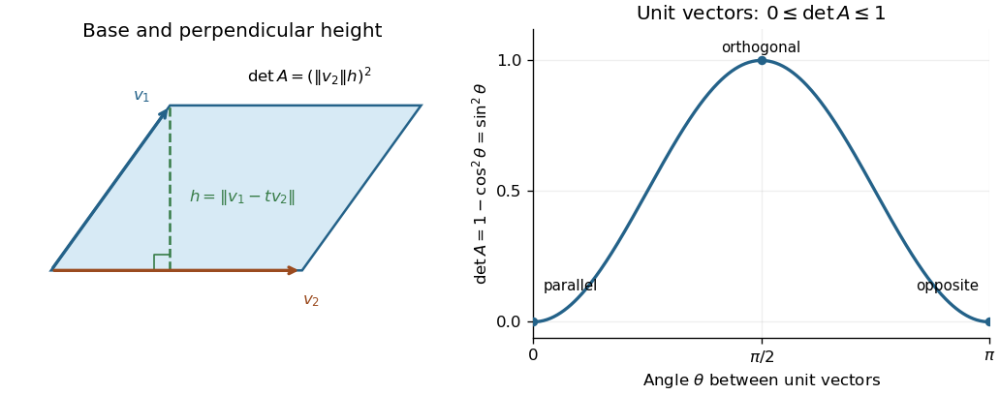

<h1 id="4/a/ii/solution">Solution</h1>

↑ **Parent:** [ii](../ii.md)

The two-vector [Gram matrix](../../../../../../../gram-matrix.md) is

$$
A=\begin{pmatrix}\|v_1\|^2&\langle v_1,v_2\rangle\\
\langle v_1,v_2\rangle&\|v_2\|^2\end{pmatrix},
\qquad
\det A=\|v_1\|^2\|v_2\|^2-\langle v_1,v_2\rangle^2.
$$

The upper bound follows because the subtracted square is nonnegative. If either [vector](../../../../../../../vector.md) is zero, the [determinant](../../../../../../../determinant.md) is zero. Otherwise apply the non-strict version of the calculation in [i](../i.md): $\|v_1-tv_2\|^2\geq0$ with $t=\langle v_1,v_2\rangle/\|v_2\|^2$ gives $\langle v_1,v_2\rangle^2\leq\|v_1\|^2\|v_2\|^2$. Therefore

$$
\boxed{0\leq\det A\leq\|v_1\|^2\|v_2\|^2.}
$$

Equality on the left holds exactly when the two [vectors](../../../../../../../vector.md) are [linearly dependent](../../../../../../../linear-dependence.md); equality on the right holds exactly when they are [orthogonal](../../../../../../../orthogonal-vectors.md). The [Gram determinant](../../../../../../../gram-determinant.md) measures the squared [area](../../../../../../../surface-area.md) of their [parallelogram](../../../../../../../parallelogram.md): in the nonzero case, $\det A=\|v_2\|^2\|v_1-tv_2\|^2$, the square of base times perpendicular height.

**[Figure 1](#4/a/ii/image-the-gram-determinant-as-squared-parallelogram-area-and-its-dependence-on-the-angle-between-unit-vectors). The Gram determinant as squared parallelogram area, and its dependence on the angle between unit vectors**.

## ↑ Ancestors (13)

1. [ii](../ii.md)
2. [a](../../a.md)
3. [4](../../../4.md)
4. [Mathematics I](../../../../mathematics-i-split.md)
5. [Prelims](../../../../split.md)
6. [2021](../../../../../split.md)
7. [Past exam of the mathematics course of the University of Oxford](../../../../../../split.md)
8. [Mathematics course of the University of Oxford](../../../../../../../mathematics-course-of-the-university-of-oxford.md)
9. [Undergraduate course of the University of Oxford](../../../../../../../undergraduate-course-of-the-university-of-oxford.md)
10. [Course of the University of Oxford](../../../../../../../course-of-the-university-of-oxford.md)
11. [University of Oxford](../../../../../../../university-of-oxford-split.md)
12. [List of universities](../../../../../../../list-of-universities.md)
13. [Codex Wiki](../../../../../../../split.md)
