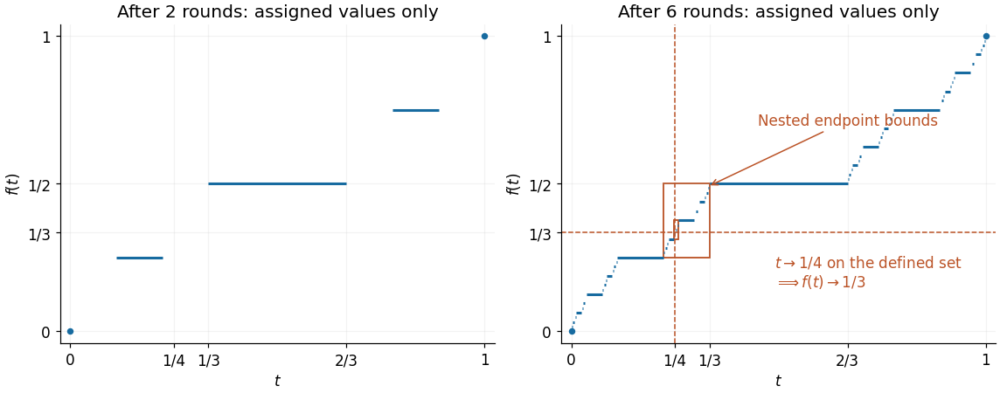

# Mathematics II

↑ **Parent:** [Prelims](../prelims.md)

Source: [released examination PDF, bundle pages 73–77](https://www.whatdotheyknow.com/request/bsc_mathematics_prelims_and_part/response/2784209/attach/3/202409%20817%20annex.pdf#page=73).

Solutions to all seven questions, including every optional question and all lettered and Roman subparts, of the examination sat on 22 June 2021.

**Table of contents**

- [1](#1)
  - [a](#1/a)
    - [i](#1/a/i)
      - [Solution](#1/a/i/solution)
    - [ii](#1/a/ii)
      - [Solution](#1/a/ii/solution)
    - [iii](#1/a/iii)
      - [Solution](#1/a/iii/solution)
  - [b](#1/b)
    - [Solution](#1/b/solution)
  - [c](#1/c)
    - [Solution](#1/c/solution)
- [2](#2)
  - [a](#2/a)
    - [i](#2/a/i)
      - [Solution](#2/a/i/solution)
    - [ii](#2/a/ii)
      - [Solution](#2/a/ii/solution)
  - [b](#2/b)
    - [Solution](#2/b/solution)
  - [c](#2/c)
    - [Solution](#2/c/solution)
- [3](#3)
  - [a](#3/a)
    - [Solution](#3/a/solution)
  - [b](#3/b)
    - [Solution](#3/b/solution)
  - [c](#3/c)
    - [i](#3/c/i)
      - [Solution](#3/c/i/solution)
    - [ii](#3/c/ii)
      - [Solution](#3/c/ii/solution)
    - [iii](#3/c/iii)
      - [Solution](#3/c/iii/solution)
- [4](#4)
  - [a](#4/a)
    - [i](#4/a/i)
      - [Solution](#4/a/i/solution)
    - [ii](#4/a/ii)
      - [Solution](#4/a/ii/solution)
    - [iii](#4/a/iii)
      - [Solution](#4/a/iii/solution)
    - [iv](#4/a/iv)
      - [Solution](#4/a/iv/solution)
  - [b](#4/b)
    - [i](#4/b/i)
      - [Solution](#4/b/i/solution)
    - [ii](#4/b/ii)
      - [Solution](#4/b/ii/solution)
    - [iii](#4/b/iii)
      - [Solution](#4/b/iii/solution)
- [5](#5)
  - [a](#5/a)
    - [i](#5/a/i)
      - [Solution](#5/a/i/solution)
    - [ii](#5/a/ii)
      - [Solution](#5/a/ii/solution)
    - [iii](#5/a/iii)
      - [Solution](#5/a/iii/solution)
  - [b](#5/b)
    - [i](#5/b/i)
      - [Solution](#5/b/i/solution)
    - [ii](#5/b/ii)
      - [Solution](#5/b/ii/solution)
- [6](#6)
  - [a](#6/a)
    - [Solution](#6/a/solution)
  - [b](#6/b)
    - [Solution](#6/b/solution)
  - [c](#6/c)
    - [Solution](#6/c/solution)
  - [d](#6/d)
    - [i](#6/d/i)
      - [Solution](#6/d/i/solution)
    - [ii](#6/d/ii)
      - [Solution](#6/d/ii/solution)
- [7](#7)
  - [a](#7/a)
    - [Solution](#7/a/solution)
  - [b](#7/b)
    - [i](#7/b/i)
      - [Solution](#7/b/i/solution)
    - [ii](#7/b/ii)
      - [Solution](#7/b/ii/solution)
  - [c](#7/c)
    - [i](#7/c/i)
      - [Solution](#7/c/i/solution)
    - [ii](#7/c/ii)
      - [Solution](#7/c/ii/solution)

## 1

↑ **Parent:** [Mathematics II](mathematics-ii.md)

<h3 id="1/a">a</h3>

↑ **Parent:** [1](#1)

<h4 id="1/a/i">i</h4>

↑ **Parent:** [A](#1/a)

<h5 id="1/a/i/solution">Solution</h5>

↑ **Parent:** [I](#1/a/i)

**True.** Put $\alpha=\sup A$, $\beta=\sup B$ and $u=\max\{\alpha,\beta\}$. These [suprema](../../../real-analysis.md#supremum) exist by [completeness of the real numbers](../../../sequence-and-series.md#completeness-of-the-real-numbers), since the [sets](../../../set.md) are nonempty and bounded. Every [set element](../../../set.md#element-of-a-set) of the [union](../../../set.md#set-union) $A\cup B$ is at most $u$, so $u$ is an [upper bound](../../../set.md#upper-bound-in-a-partially-ordered-set). Conversely, every [upper bound](../../../set.md#upper-bound-in-a-partially-ordered-set) of $A\cup B$ bounds both $A$ and $B$, and is therefore at least both [suprema](../../../real-analysis.md#supremum). Thus

$$
\boxed{\sup(A\cup B)=\max\{\sup A,\sup B\}.}
$$

<h4 id="1/a/ii">ii</h4>

↑ **Parent:** [A](#1/a)

<h5 id="1/a/ii/solution">Solution</h5>

↑ **Parent:** [Ii](#1/a/ii)

**True.** Write $\alpha=\sup A$ and $\beta=\inf B$. Every $a\in A$, $b\in B$ satisfies $a-b\leq\alpha-\beta$, giving an [upper bound](../../../set.md#upper-bound-in-a-partially-ordered-set) for the [set](../../../set.md) $A-B$ of pairwise differences. For every $\varepsilon>0$, the definitions of [supremum](../../../real-analysis.md#supremum) and [infimum](../../../real-analysis.md#infimum) give $a\in A$ and $b\in B$ with

$$
a>\alpha-\varepsilon/2,\qquad b<\beta+\varepsilon/2.
$$

Then $a-b>\alpha-\beta-\varepsilon$. Hence no smaller [upper bound](../../../set.md#upper-bound-in-a-partially-ordered-set) works, and

$$
\boxed{\sup(A-B)=\sup A-\inf B.}
$$

Here $A-B$ means pairwise subtraction, rather than [set difference](../../../set.md#set-difference).

<h4 id="1/a/iii">iii</h4>

↑ **Parent:** [A](#1/a)

<h5 id="1/a/iii/solution">Solution</h5>

↑ **Parent:** [Iii](#1/a/iii)

**False.** Take the finite [sets](../../../set.md) $A=B=\{-2,-1\}$. Their [suprema](../../../real-analysis.md#supremum) are both $-1$, whereas the [set](../../../set.md) of pairwise products is $A\cdot B=\{1,2,4\}$. Consequently

$$
\boxed{\sup(A\cdot B)=4\ne1=(\sup A)(\sup B).}
$$

Negative factors can reverse an [inequality](../../../arithmetic.md#inequality-mathematics), which prevents the proposed argument with separate [suprema](../../../real-analysis.md#supremum).

<h3 id="1/b">b</h3>

↑ **Parent:** [1](#1)

<h4 id="1/b/solution">Solution</h4>

↑ **Parent:** [B](#1/b)

For the first [sequence](../../../sequence-and-series.md#sequence), $|a_n|=n^{-3}\to0$. The [squeeze theorem](../../../calculus.md#squeeze-theorem) gives $a_n\to0$, and every [subsequence](../../../sequence-and-series.md#subsequence) of a [convergent sequence](../../../sequence-and-series.md#convergent-sequence) has the same [limit of a sequence](../../../sequence-and-series.md#limit-of-a-sequence). Thus its [set](../../../set.md) of [subsequential limits](../../../sequence-and-series.md#subsequential-limit) is $\boxed{\{0\}}$.

For the second [sequence](../../../sequence-and-series.md#sequence), the four possible [sine](../../../geometry-and-topology.md#sine) values give

$$
b_n=\begin{cases}
1,&n\equiv0,2\pmod4,\\
n,&n\equiv1\pmod4,\\
1/n,&n\equiv3\pmod4.
\end{cases}
$$

The even-indexed [subsequence](../../../sequence-and-series.md#subsequence) is constantly one, and $b_{4k+3}\to0$, so both zero and one occur as [subsequential limits](../../../sequence-and-series.md#subsequential-limit). A [convergent subsequence](../../../real-analysis.md#convergent-subsequence) is bounded, so it contains only finitely many terms with $n\equiv1\pmod4$. Of the remaining three residue classes, at least one occurs infinitely often. The corresponding further [subsequence](../../../sequence-and-series.md#subsequence) has [limit of a sequence](../../../sequence-and-series.md#limit-of-a-sequence) zero or one; the [subsequence](../../../sequence-and-series.md#subsequence) rule forces the original [convergent subsequence](../../../real-analysis.md#convergent-subsequence) to have that same [limit of a sequence](../../../sequence-and-series.md#limit-of-a-sequence). Therefore the exact answer is $\boxed{\{0,1\}}$. Divergence to $+\infty$ along $n\equiv1\pmod4$ is not a finite [subsequential limit](../../../sequence-and-series.md#subsequential-limit).

<h3 id="1/c">c</h3>

↑ **Parent:** [1](#1)

<h4 id="1/c/solution">Solution</h4>

↑ **Parent:** [C](#1/c)

The [Bolzano-Weierstrass theorem](../../../sequence-and-series.md#bolzano-weierstrass-theorem) states that every [bounded sequence](../../../sequence-and-series.md#bounded-sequence) of [real numbers](../../../arithmetic.md#real-number) has a [convergent subsequence](../../../real-analysis.md#convergent-subsequence). It is enough to select infinitely many terms of the [tangent](../../../geometry-and-topology.md#tangent) [sequence](../../../sequence-and-series.md#sequence) that stay uniformly bounded.

For each positive [integer](../../../integer.md) $k$, choose $n_k=\lfloor k\pi+1/2\rfloor$, using the [floor function](../../../calculus.md#floor-function). Then $|n_k-k\pi|\leq1/2$. Moreover $n_{k+1}-n_k\geq\pi-1>0$, so these are strictly increasing indices. By the period and [monotonicity](../../../calculus.md#monotonic-function) of the [tangent](../../../geometry-and-topology.md#tangent) on $(-\pi/2,\pi/2)$,

$$
|\tan n_k|=|\tan(n_k-k\pi)|\leq\tan(1/2).
$$

Thus $(\tan n_k)$ is a [bounded subsequence](../../../sequence-and-series.md#bounded-subsequence). Applying the [Bolzano-Weierstrass theorem](../../../sequence-and-series.md#bolzano-weierstrass-theorem) to it gives a [convergent subsequence](../../../real-analysis.md#convergent-subsequence), which is also a [subsequence](../../../sequence-and-series.md#subsequence) of the original [sequence](../../../sequence-and-series.md#sequence). **Such a [convergent subsequence](../../../real-analysis.md#convergent-subsequence) therefore exists.**

## 2

↑ **Parent:** [Mathematics II](mathematics-ii.md)

<h3 id="2/a">a</h3>

↑ **Parent:** [2](#2)

<h4 id="2/a/i">i</h4>

↑ **Parent:** [A](#2/a)

<h5 id="2/a/i/solution">Solution</h5>

↑ **Parent:** [I](#2/a/i)

If $L<1$, set $\varepsilon=(1-L)/2>0$. The definition of [limit of a sequence](../../../sequence-and-series.md#limit-of-a-sequence) gives $a_n<L+\varepsilon=(1+L)/2<1$ for all sufficiently large $n$, contradicting $a_n\geq1$. Hence $\boxed{L\geq1}$.

Factor the difference of cubes. Since both [cube roots](../../../arithmetic.md#cube-root) are at least one,

$$
\left|a_n^{1/3}-L^{1/3}\right|
=\frac{|a_n-L|}{a_n^{2/3}+a_n^{1/3}L^{1/3}+L^{2/3}}
\leq\frac{|a_n-L|}{3}.
$$

Given $\varepsilon>0$, the definition of [limit of a sequence](../../../sequence-and-series.md#limit-of-a-sequence) supplies $N$ with $|a_n-L|<3\varepsilon$ for $n\geq N$. The displayed [inequality](../../../arithmetic.md#inequality-mathematics) then gives $|a_n^{1/3}-L^{1/3}|<\varepsilon$, proving directly that $\boxed{a_n^{1/3}\to L^{1/3}}$.

<h4 id="2/a/ii">ii</h4>

↑ **Parent:** [A](#2/a)

<h5 id="2/a/ii/solution">Solution</h5>

↑ **Parent:** [Ii](#2/a/ii)

Let $\varepsilon>0$. By the definition of [Cauchy sequence](../../../sequence-and-series.md#cauchy-sequence), choose an [integer](../../../integer.md) $K\geq1$ such that $|x_j-x_k|<\varepsilon/2$ whenever $j,k\geq K$. Apply the given [inequality](../../../arithmetic.md#inequality-mathematics) with $N=K+1$. It supplies $n>K+1$ for which

$$
0<x_n\leq\frac12\min_{k<K+1}x_k\leq\frac{x_K}{2}.
$$

Both $n$ and $K$ are in the [Cauchy sequence](../../../sequence-and-series.md#cauchy-sequence) estimate, so

$$
\frac{x_K}{2}\leq x_K-x_n<\frac\varepsilon2,
\qquad\text{hence}\qquad x_n<\frac\varepsilon2.
$$

For every $m\geq K$ the [triangle inequality](../../../topological-analysis.md#triangle-inequality) gives

$$
0<x_m\leq|x_m-x_n|+x_n<\varepsilon.
$$

This is the definition of [convergence](../../../calculus.md#convergence) to zero: $\boxed{x_m\to0}$. The proof uses only the [Cauchy sequence](../../../sequence-and-series.md#cauchy-sequence) estimate, positivity, and the stipulated [inequality](../../../arithmetic.md#inequality-mathematics); it does not assume the general [completeness of the real numbers](../../../sequence-and-series.md#completeness-of-the-real-numbers) theorem for [Cauchy sequences](../../../sequence-and-series.md#cauchy-sequence). Taking $N=K+1\geq2$ also avoids the empty initial [set](../../../set.md) in a literal reading of the condition for very small $N$.

<h3 id="2/b">b</h3>

↑ **Parent:** [2](#2)

<h4 id="2/b/solution">Solution</h4>

↑ **Parent:** [B](#2/b)

Put $u_n=11^n\log n/(2^{2n+1}n!)$ for $n\geq2$. The [factorial](../../../combinatorics.md#factorial) gives

$$
\frac{u_{n+1}}{u_n}=\frac{11}{4(n+1)}\frac{\log(n+1)}{\log n}.
$$

The [logarithm](../../../calculus.md#logarithm) identity

$$
\frac{\log(n+1)}{\log n}=1+\frac{\log(1+1/n)}{\log n}\longrightarrow1
$$

follows from [continuity](../../../calculus.md#continuous-function) of the [logarithm](../../../calculus.md#logarithm) at one and $\log n\to+\infty$. The product rule for [limits of sequences](../../../sequence-and-series.md#limit-of-a-sequence) therefore makes the displayed ratio tend to zero. In particular, some $N$ satisfies $0<u_{n+1}\leq u_n/2$ for all $n\geq N$. By [mathematical induction](../../../foundations-of-mathematics.md#mathematical-induction), $0<u_{N+j}\leq u_N2^{-j}$. A [geometric sequence](../../../sequence-and-series.md#geometric-progression) with ratio in $(0,1)$ tends to zero, so the [squeeze theorem](../../../calculus.md#squeeze-theorem) proves

$$
\boxed{\lim_{n\to\infty}\frac{11^n\log n}{2^{2n+1}n!}=0.}
$$

<h3 id="2/c">c</h3>

↑ **Parent:** [2](#2)

<h4 id="2/c/solution">Solution</h4>

↑ **Parent:** [C](#2/c)

**The [sequence](../../../sequence-and-series.md#sequence) does not converge.** For $n=2^k$, the [largest prime factor](../../../number-theory.md#largest-prime-factor) is $p(n)=2$, while the [sum of prime factors with multiplicity](../../../prime-number.md#sum-of-prime-factors-with-multiplicity) is $s(n)=2k$. This [subsequence](../../../sequence-and-series.md#subsequence) therefore has ratio $1/k\to0$.

There are infinitely many [prime numbers](../../../prime-number.md): if there were only $q_1,\ldots,q_r$, a [prime factor](../../../prime-number.md#prime-factor) of $q_1\cdots q_r+1$ would be absent from the list. Listing the [prime numbers](../../../prime-number.md) in increasing order gives a [subsequence](../../../sequence-and-series.md#subsequence) of indices $n=q_j$ for which $p(n)=s(n)=q_j$, so the ratio is constantly one. Every [subsequence](../../../sequence-and-series.md#subsequence) of a [convergent sequence](../../../sequence-and-series.md#convergent-sequence) has the same [limit of a sequence](../../../sequence-and-series.md#limit-of-a-sequence). The two distinct [subsequential limits](../../../sequence-and-series.md#subsequential-limit) $\boxed{0\text{ and }1}$ rule out [convergence](../../../calculus.md#convergence).

## 3

↑ **Parent:** [Mathematics II](mathematics-ii.md)

<h3 id="3/a">a</h3>

↑ **Parent:** [3](#3)

<h4 id="3/a/solution">Solution</h4>

↑ **Parent:** [A](#3/a)

A [series](../../../sequence-and-series.md#series-mathematics) $\sum_{n=1}^{\infty}a_n$ **converges** if its [partial sums](../../../sequence-and-series.md#partial-sum) $s_N=\sum_{n=1}^{N}a_n$ have a finite [limit of a sequence](../../../sequence-and-series.md#limit-of-a-sequence) $S$ as $N\to\infty$; its sum is then $S$. It has **[absolute convergence](../../../sequence-and-series.md#absolute-convergence)** if the [series](../../../sequence-and-series.md#series-mathematics) $\sum_{n=1}^{\infty}|a_n|$ converges, where $|a_n|$ is the [absolute value](../../../real-analysis.md#absolute-value) of the term.

<h3 id="3/b">b</h3>

↑ **Parent:** [3](#3)

<h4 id="3/b/solution">Solution</h4>

↑ **Parent:** [B](#3/b)

Assume first that the original nonnegative [series](../../../sequence-and-series.md#series-mathematics) converges to $S$. Its [partial sums](../../../sequence-and-series.md#partial-sum) $s_m$ increase to $S$. Write $t_N=\sum_{n=1}^{N}a_{g(n)}$ for the [partial sums](../../../sequence-and-series.md#partial-sum) of the [rearrangement of a series](../../../sequence-and-series.md#rearrangement-of-a-series). Since $g$ is an [injection](../../../algebra.md#injective-function), the indices $g(1),\ldots,g(N)$ are distinct, so

$$
0\leq t_N\leq s_{\max\{g(1),\ldots,g(N)\}}\leq S.
$$

Thus $(t_N)$ is an increasing [bounded sequence](../../../sequence-and-series.md#bounded-sequence), and the [bounded monotone sequence theorem](../../../sequence-and-series.md#bounded-monotone-sequence-theorem) gives $t_N\to T\leq S$.

For any fixed $m$, [surjectivity](../../../algebra.md#surjective-function) of $g$ gives

$$
N_m=\max\{g^{-1}(1),\ldots,g^{-1}(m)\}.
$$

For $N\geq N_m$, nonnegativity implies $t_N\geq s_m$. Taking [limits of sequences](../../../sequence-and-series.md#limit-of-a-sequence) first in $N$ and then in $m$ gives $T\geq S$. Hence $T=S$.

Conversely, $g^{-1}$ is a [bijection](../../../function.md#bijection), and the original [series](../../../sequence-and-series.md#series-mathematics) is the [rearrangement of a series](../../../sequence-and-series.md#rearrangement-of-a-series) of $\sum b_n$ defined by $g^{-1}$. The same argument proves its [convergence](../../../calculus.md#convergence) whenever $\sum b_n$ converges. **Both [series](../../../sequence-and-series.md#series-mathematics) converge together, and their sums are equal.**

<h3 id="3/c">c</h3>

↑ **Parent:** [3](#3)

<h4 id="3/c/i">i</h4>

↑ **Parent:** [C](#3/c)

<h5 id="3/c/i/solution">Solution</h5>

↑ **Parent:** [I](#3/c/i)

In level $n$, each group is

$$
2^{-(n+1)}+2^{-(n+1)}-2^{-n}=0,
$$

and there are $2^n$ such groups. The [partial sums](../../../sequence-and-series.md#partial-sum) at completed groups are therefore zero. Inside a group of level $n$, the only other [partial sums](../../../sequence-and-series.md#partial-sum) are $2^{-(n+1)}$ and $2^{-n}$. Every level contains finitely many terms, so the level containing the $N$th term tends to infinity with $N$. Thus all [partial sums](../../../sequence-and-series.md#partial-sum) lie between zero and a bound tending to zero. By the [squeeze theorem](../../../calculus.md#squeeze-theorem), the [series](../../../sequence-and-series.md#series-mathematics) has sum $\boxed{0}$.

For the next two parts, label the positive occurrences of size $2^{-(n+1)}$ by $P_n$ and the negative occurrences of size $-2^{-n}$ by $N_n$. There are exactly $2^{n+1}$ occurrences in $P_n$ and $2^n$ in $N_n$. Occurrences with equal value retain separate labels, so checking their counts verifies a [bijection](../../../function.md#bijection) of terms.

<h4 id="3/c/ii">ii</h4>

↑ **Parent:** [C](#3/c)

<h5 id="3/c/ii/solution">Solution</h5>

↑ **Parent:** [Ii](#3/c/ii)

Place the single term in $N_0$ first. For $n=0,1,2,\ldots$ in order, append $2^{n+1}$ copies of the pair

$$
\left(2^{-(n+1)},\ -2^{-(n+1)}\right).
$$

This uses all of $P_n$ and all of $N_{n+1}$ exactly once, so it is an explicit [rearrangement of a series](../../../sequence-and-series.md#rearrangement-of-a-series). Its beginning is

$$
-1,\quad \frac12,-\frac12,\frac12,-\frac12,\quad
\frac14,-\frac14,\frac14,-\frac14,\frac14,-\frac14,\frac14,-\frac14,\quad\ldots.
$$

Every completed pair leaves the [partial sum](../../../sequence-and-series.md#partial-sum) at $-1$. Within a level-$n$ pair the [partial sum](../../../sequence-and-series.md#partial-sum) differs from $-1$ by at most $2^{-(n+1)}$. As $n\to\infty$ this tends to zero, proving that the rearranged [series](../../../sequence-and-series.md#series-mathematics) has sum $\boxed{-1}$.

<h4 id="3/c/iii">iii</h4>

↑ **Parent:** [C](#3/c)

<h5 id="3/c/iii/solution">Solution</h5>

↑ **Parent:** [Iii](#3/c/iii)

Start with all of $N_0$ and $N_1$, namely $-1,-1/2,-1/2$, whose sum is $-2$. For $n=0,1,2,\ldots$ in order, append $2^{n+1}$ copies of the triple

$$
\left(2^{-(n+1)},\ -2^{-(n+2)},\ -2^{-(n+2)}\right).
$$

This uses all $2^{n+1}$ occurrences of $P_n$ and all $2^{n+2}$ occurrences of $N_{n+2}$, exactly once. Together with the initial terms, every original occurrence is used, establishing a [rearrangement of a series](../../../sequence-and-series.md#rearrangement-of-a-series). Its beginning is

$$
-1,-\frac12,-\frac12,\quad
\frac12,-\frac14,-\frac14,\frac12,-\frac14,-\frac14,\quad\ldots.
$$

Each triple has sum zero. At its intermediate terms the [partial sum](../../../sequence-and-series.md#partial-sum) is at most $2^{-(n+1)}$ above $-2$. This bound tends to zero, so the whole [series](../../../sequence-and-series.md#series-mathematics), rather than just the [subsequence](../../../sequence-and-series.md#subsequence) of sums at completed triples, has sum $\boxed{-2}$.

## 4

↑ **Parent:** [Mathematics II](mathematics-ii.md)

<h3 id="4/a">a</h3>

↑ **Parent:** [4](#4)

<h4 id="4/a/i">i</h4>

↑ **Parent:** [A](#4/a)

<h5 id="4/a/i/solution">Solution</h5>

↑ **Parent:** [I](#4/a/i)

A [function](../../../function.md) $f:(a,b)\to\mathbb R$ is **[differentiable](../../../analysis.md#differentiable-function) on $(a,b)$** if, for every $x\in(a,b)$, the finite [limit of a function](../../../calculus.md#limit-of-a-function)

$$
\boxed{f'(x)=\lim_{h\to0}\frac{f(x+h)-f(x)}h}
$$

exists. Here $h\ne0$ and is sufficiently small that $x+h\in(a,b)$. This [limit of a function](../../../calculus.md#limit-of-a-function) is the [derivative](../../../calculus.md#derivative) of $f$ at $x$.

<h4 id="4/a/ii">ii</h4>

↑ **Parent:** [A](#4/a)

<h5 id="4/a/ii/solution">Solution</h5>

↑ **Parent:** [Ii](#4/a/ii)

The **[mean value theorem](../../../calculus.md#mean-value-theorem)** states: if a real-valued [function](../../../function.md) $f$ is [continuous](../../../calculus.md#continuous-function) on a closed [interval](../../../real-analysis.md#interval-mathematics) $[u,v]$, where $u<v$, and [differentiable](../../../analysis.md#differentiable-function) on $(u,v)$, then there is $c\in(u,v)$ with

$$
\boxed{f(v)-f(u)=f'(c)(v-u).}
$$

<h4 id="4/a/iii">iii</h4>

↑ **Parent:** [A](#4/a)

<h5 id="4/a/iii/solution">Solution</h5>

↑ **Parent:** [Iii](#4/a/iii)

Take any $a<u<v<b$. By [differentiability implies continuity](../../../analysis.md#differentiability-implies-continuity), $f$ is [continuous](../../../calculus.md#continuous-function) on $[u,v]$, and it is [differentiable](../../../analysis.md#differentiable-function) on $(u,v)$. The [mean value theorem](../../../calculus.md#mean-value-theorem) gives $c\in(u,v)$ for which

$$
f(v)-f(u)=f'(c)(v-u)\geq0.
$$

Therefore $\boxed{f(u)\leq f(v)\text{ whenever }u<v}$: $f$ is a [nondecreasing function](../../../calculus.md#nondecreasing-function), which is the non-strict meaning of increasing here.

<h4 id="4/a/iv">iv</h4>

↑ **Parent:** [A](#4/a)

<h5 id="4/a/iv/solution">Solution</h5>

↑ **Parent:** [Iv](#4/a/iv)

For any $u<v$ in the [interval](../../../real-analysis.md#interval-mathematics), the [mean value theorem](../../../calculus.md#mean-value-theorem), applicable by [differentiability implies continuity](../../../analysis.md#differentiability-implies-continuity), gives

$$
f(v)-f(u)=f'(c)(v-u)=0.
$$

All pairs of values are equal. Thus $\boxed{f\text{ is a constant function}}$, the [constancy theorem](../../../calculus.md#constancy-theorem).

<h3 id="4/b">b</h3>

↑ **Parent:** [4](#4)

<h4 id="4/b/i">i</h4>

↑ **Parent:** [B](#4/b)

<h5 id="4/b/i/solution">Solution</h5>

↑ **Parent:** [I](#4/b/i)

Write the symmetric [difference quotient](../../../calculus.md#difference-quotient) as the average of two ordinary [difference quotients](../../../calculus.md#difference-quotient):

$$
\frac{f(x+h)-f(x-h)}{2h}
=\frac12\left(\frac{f(x+h)-f(x)}h+\frac{f(x-h)-f(x)}{-h}\right).
$$

If $f$ is [differentiable](../../../analysis.md#differentiable-function) at $x$, both terms tend to the [derivative](../../../calculus.md#derivative) $f'(x)$. Hence the [symmetric derivative](../../../calculus.md#symmetric-derivative) satisfies $\boxed{f^s(x)=f'(x)}$.

The [absolute value function](../../../real-analysis.md#absolute-value) $f(x)=|x|$ is [continuous](../../../calculus.md#continuous-function), and $f^s(0)=0$ because $|h|=|-h|$. Its right [one-sided derivative](../../../calculus.md#one-sided-derivative) at zero is $1$ and its left [one-sided derivative](../../../calculus.md#one-sided-derivative) is $-1$, so it is not [differentiable](../../../analysis.md#differentiable-function) at zero. Away from zero it is [differentiable](../../../analysis.md#differentiable-function), hence has a [symmetric derivative](../../../calculus.md#symmetric-derivative) there as well. This supplies an example meeting the hypotheses on, for example, $(-1,1)$.

<h4 id="4/b/ii">ii</h4>

↑ **Parent:** [B](#4/b)

<h5 id="4/b/ii/solution">Solution</h5>

↑ **Parent:** [Ii](#4/b/ii)

We prove the [symmetric derivative criterion for monotonicity](../../../calculus.md#symmetric-derivative-criterion-for-monotonicity) using an [antiderivative](../../../integral.md#antiderivative). Fix $a<u<v<b$ and define

$$
F(t)=\int_u^t f(s)\,ds.
$$

The [fundamental theorem of calculus](../../../calculus.md#fundamental-theorem-of-calculus) gives $F'=f$ because $f$ is [continuous](../../../calculus.md#continuous-function). For each interior $x$,

$$
F(x+h)-2F(x)+F(x-h)=\int_0^h\bigl(f(x+t)-f(x-t)\bigr)\,dt.
$$

Since $f^s(x)>0$, the definition of [symmetric derivative](../../../calculus.md#symmetric-derivative) gives $\delta>0$ such that $f(x+t)-f(x-t)>t f^s(x)$ for $0<t<\delta$. Therefore, for $0<h<\delta$,

$$
F(x+h)-2F(x)+F(x-h)>\frac12 f^s(x)h^2>0.
$$

We next show that $F$ is a [convex function](../../../real-analysis.md#convex-function). On any closed [interval](../../../real-analysis.md#interval-mathematics) $[r,s]\subset(a,b)$ let $\ell$ be the [affine function](../../../vector-space.md#affine-function) joining $(r,F(r))$ to $(s,F(s))$. If $F-\ell$ were positive anywhere, the [extreme value theorem](../../../real-analysis.md#extreme-value-theorem) would give a positive [maximum](../../../set.md#maximum-of-a-subset-of-a-total-order) at an interior point $x$. For every sufficiently small $h>0$, that [maximum](../../../set.md#maximum-of-a-subset-of-a-total-order) would imply

$$
(F-\ell)(x+h)-2(F-\ell)(x)+(F-\ell)(x-h)\leq0.
$$

The [affine function](../../../vector-space.md#affine-function) contributes zero to this symmetric difference, contradicting the strict positive [inequality](../../../arithmetic.md#inequality-mathematics) above. Thus $F\leq\ell$ on every such [interval](../../../real-analysis.md#interval-mathematics), exactly [convexity](../../../real-analysis.md#convex-function).

For a [differentiable](../../../analysis.md#differentiable-function) [convex function](../../../real-analysis.md#convex-function), secant slopes bound endpoint [derivatives](../../../calculus.md#derivative). Explicitly, the chord [inequality](../../../arithmetic.md#inequality-mathematics) at $u+h$ and at $v-h$, followed by $h\downarrow0$, gives

$$
f(u)=F'(u)\leq\frac{F(v)-F(u)}{v-u}\leq F'(v)=f(v).
$$

So $f$ is [nondecreasing](../../../calculus.md#nondecreasing-function). If $f(u)=f(v)$ for some $u<v$, [monotonicity](../../../calculus.md#monotonic-function) would make $f$ constant on $[u,v]$, forcing $f^s(x)=0$ for $u<x<v$, a contradiction. Consequently $\boxed{f(u)<f(v)\text{ for every }u<v}$: $f$ is [strictly increasing](../../../calculus.md#strictly-increasing-function). This proof requires no [continuity](../../../calculus.md#continuous-function) of $f^s$ and never applies the ordinary [mean value theorem](../../../calculus.md#mean-value-theorem) to a merely symmetrically [differentiable](../../../analysis.md#differentiable-function) [function](../../../function.md).

<h4 id="4/b/iii">iii</h4>

↑ **Parent:** [B](#4/b)

<h5 id="4/b/iii/solution">Solution</h5>

↑ **Parent:** [Iii](#4/b/iii)

If there were no interior $x_2$ with $f^s(x_2)\leq0$, the [symmetric derivative](../../../calculus.md#symmetric-derivative) would be positive everywhere in $(a,b)$. Part [ii](#4/b/ii) would make $f$ [strictly increasing](../../../calculus.md#strictly-increasing-function) there. Choose $a<u<v<b$. [Continuity](../../../calculus.md#continuous-function) at the endpoints and [monotonicity](../../../calculus.md#monotonic-function) on the interior imply

$$
f(a)\leq f(u)<f(v)\leq f(b),
$$

contradicting $f(a)=f(b)$. Hence such an $x_2$ exists.

If there were no interior $x_1$ with $f^s(x_1)\geq0$, then $(-f)^s=-f^s>0$ everywhere. Apply the same argument to the [continuous function](../../../calculus.md#continuous-function) $-f$, whose endpoint values are equal. This is again impossible. Thus

$$
\boxed{\exists x_1,x_2\in(a,b):\quad f^s(x_1)\geq0,\quad f^s(x_2)\leq0.}
$$

The two points need not be distinct.

## 5

↑ **Parent:** [Mathematics II](mathematics-ii.md)

<h3 id="5/a">a</h3>

↑ **Parent:** [5](#5)

<h4 id="5/a/i">i</h4>

↑ **Parent:** [A](#5/a)

<h5 id="5/a/i/solution">Solution</h5>

↑ **Parent:** [I](#5/a/i)

The **[intermediate value theorem](../../../calculus.md#intermediate-value-theorem)** states that if $f:[u,v]\to\mathbb R$ is [continuous](../../../calculus.md#continuous-function) and $y$ lies between $f(u)$ and $f(v)$, inclusive, then some $c\in[u,v]$ satisfies $f(c)=y$. If $y$ lies strictly between the endpoint values, then $c$ lies in $(u,v)$.

<h4 id="5/a/ii">ii</h4>

↑ **Parent:** [A](#5/a)

<h5 id="5/a/ii/solution">Solution</h5>

↑ **Parent:** [Ii](#5/a/ii)

For $n=1$, choose $x=0$, $y=1$. For $n\geq2$, define the [continuous function](../../../calculus.md#continuous-function)

$$
g(t)=f(t+1/n)-f(t),\qquad 0\leq t\leq1-1/n.
$$

Its values at the grid points have the [telescoping sum](../../../arithmetic.md#telescoping-sum)

$$
\sum_{k=0}^{n-1}g(k/n)=\sum_{k=0}^{n-1}\bigl(f((k+1)/n)-f(k/n)\bigr)=f(1)-f(0)=0.
$$

If one summand is zero, we already have a zero of $g$. Otherwise the summands cannot all have the same sign, so two of these values have opposite signs. The [intermediate value theorem](../../../calculus.md#intermediate-value-theorem) between their arguments gives $t\in[0,1-1/n]$ with $g(t)=0$. Set $x=t$, $y=t+1/n$. Then

$$
\boxed{|x-y|=1/n,\qquad f(x)=f(y).}
$$

This is the [horizontal chord of reciprocal-integer length](../../../calculus.md#horizontal-chord-of-reciprocal-integer-length) property; the [telescoping sum](../../../arithmetic.md#telescoping-sum) explains why reciprocal [integers](../../../integer.md) appear.

<h4 id="5/a/iii">iii</h4>

↑ **Parent:** [A](#5/a)

<h5 id="5/a/iii/solution">Solution</h5>

↑ **Parent:** [Iii](#5/a/iii)

An explicit [piecewise linear function](../../../function.md#piecewise-linear-function) is

$$
\boxed{f(t)=\begin{cases}
-3t,&0\leq t\leq1/3,\\
6t-3,&1/3\leq t\leq2/3,\\
3-3t,&2/3\leq t\leq1.
\end{cases}}
$$

The adjacent formulas agree at $1/3$ and $2/3$, so the [function](../../../function.md) is [continuous](../../../calculus.md#continuous-function), and $f(0)=f(1)=0$. Any pair of points at distance $2/3$ can be written $t,t+2/3$ with $0\leq t\leq1/3$. For every such $t$,

$$
f(t+2/3)-f(t)=\bigl(1-3t\bigr)-(-3t)=1.
$$

Thus their values are never equal. The [horizontal chord of reciprocal-integer length](../../../calculus.md#horizontal-chord-of-reciprocal-integer-length) conclusion does not extend to this distance.

<h3 id="5/b">b</h3>

↑ **Parent:** [5](#5)

<h4 id="5/b/i">i</h4>

↑ **Parent:** [B](#5/b)

<h5 id="5/b/i/solution">Solution</h5>

↑ **Parent:** [I](#5/b/i)

The construction is the partial middle-third construction of the [Cantor function](../../../mathematics.md#cantor-function). After $n$ rounds of assigning middle thirds, every remaining open [interval](../../../real-analysis.md#interval-mathematics) has endpoint values

$$
\frac{k}{2^n},\quad\frac{k+1}{2^n}
$$

for some $k=0,\ldots,2^n-1$, and every such consecutive pair occurs. This follows by [mathematical induction](../../../foundations-of-mathematics.md#mathematical-induction). Initially the endpoint values are $0,1$. An [interval](../../../real-analysis.md#interval-mathematics) with those consecutive endpoint values receives the value

$$
\frac12\left(\frac{k}{2^n}+\frac{k+1}{2^n}\right)=\frac{2k+1}{2^{n+1}}
$$

on its closed middle third. Its two remaining open [intervals](../../../real-analysis.md#interval-mathematics) therefore have consecutive endpoint values at denominator $2^{n+1}$. All previously assigned endpoint values persist. Hence all even numerators at the next denominator were already present, and all odd numerators have just been assigned. Including the initial values zero and one proves

$$
\boxed{\{k/2^n:0\leq k\leq2^n\}\subseteq f(\mathbb R\setminus C)\quad(n\geq0).}
$$

These are precisely the [dyadic rational](../../../arithmetic.md#dyadic-rational) values between zero and one.

<h4 id="5/b/ii">ii</h4>

↑ **Parent:** [B](#5/b)

<h5 id="5/b/ii/solution">Solution</h5>

↑ **Parent:** [Ii](#5/b/ii)

We give the explicit point $\boxed{x=1/4}$. Repeatedly choose the left remaining third and then the right remaining third. After $2m$ choices, the resulting closed [interval](../../../real-analysis.md#interval-mathematics) is $[L_m,R_m]$, where

$$
L_m=\sum_{j=1}^m\frac2{3^{2j}}=\frac14(1-9^{-m}),\qquad
R_m=L_m+9^{-m}=\frac14+\frac34\,9^{-m}.
$$

These formulas follow from a finite [geometric series](../../../sequence-and-series.md#geometric-series). They show $L_m<1/4<R_m$, and that both endpoints tend to $1/4$. The point $1/4$ is also strictly inside each intermediate left third: its distance from $L_m$ is one quarter of the current length. It therefore never enters any assigned closed middle third or its endpoints, so $1/4\in C$.

Endpoint values in the [Cantor function](../../../mathematics.md#cantor-function) construction obey the same left/right choices, with halving in place of thirding. Thus

$$
f(L_m)=\sum_{j=1}^m\frac1{2^{2j}}=\frac13(1-4^{-m}),\qquad
f(R_m)=f(L_m)+4^{-m}=\frac13+\frac23\,4^{-m}.
$$

All these endpoints are in the domain of the partial [function](../../../function.md): $L_m$ is the right endpoint of a middle third assigned at round $2m$, and $R_m$ is the left endpoint of a middle third assigned at round $2m-1$.

Given $\varepsilon>0$, choose $m$ so that $(2/3)4^{-m}<\varepsilon$, and put $\delta=9^{-m}/4$. If $t\notin C$ and $|t-1/4|<\delta$, then $L_m<t<R_m$. The assumed [monotonicity](../../../calculus.md#monotonic-function) gives

$$
\frac13-\frac13\,4^{-m}\leq f(L_m)\leq f(t)\leq f(R_m)\leq\frac13+\frac23\,4^{-m}.
$$

Consequently $|f(t)-1/3|<\varepsilon$. This proves directly, on the stated partial domain,

$$
\boxed{\lim_{\substack{t\to1/4\\t\notin C}}f(t)=\frac13.}
$$

There are defined points arbitrarily close to $1/4$, for example $L_m$ and $R_m$, so the [limit of a function](../../../calculus.md#limit-of-a-function) is not vacuous. No [continuous extension](../../../calculus.md#continuous-extension) has been assumed. The residual $C$ here omits the endpoints that the question assigns values to; it is the usual [Cantor set](../../../geometry-and-topology.md#cantor-set) with those assigned endpoints removed.

**[Figure 1](#5/b/ii/image-assigned-middle-thirds-and-the-nested-intervals-around-x-1-4-that-force-the-value-1-3). Assigned middle thirds and the nested intervals around $x=1/4$ that force the value $1/3$**.

## 6

↑ **Parent:** [Mathematics II](mathematics-ii.md)

<h3 id="6/a">a</h3>

↑ **Parent:** [6](#6)

<h4 id="6/a/solution">Solution</h4>

↑ **Parent:** [A](#6/a)

**[Rolle's theorem](../../../calculus.md#rolle-theorem)** states that a [continuous function](../../../calculus.md#continuous-function) $g:[u,v]\to\mathbb R$ with $u<v$, [differentiable](../../../analysis.md#differentiable-function) on $(u,v)$, and satisfying $g(u)=g(v)$ has $g'(c)=0$ for some $c\in(u,v)$.

Fix $x>0$ and set $r=(\sqrt{1+x}-1)/x$. The [function](../../../function.md)

$$
g(t)=\sqrt{1+t}-1-rt,\qquad0\leq t\leq x,
$$

is [continuous](../../../calculus.md#continuous-function) and [differentiable](../../../analysis.md#differentiable-function) as required, and $g(0)=g(x)=0$. By [Rolle's theorem](../../../calculus.md#rolle-theorem), some $c\in(0,x)$ satisfies

$$
0=g'(c)=\frac1{2\sqrt{1+c}}-r.
$$

Since $c>0$, this gives $r<1/2$. Multiplying by $x>0$ and adding one proves the strict [square root](../../../algebra.md#square-root) bound

$$
\boxed{\sqrt{1+x}<1+x/2\qquad(x>0).}
$$

<h3 id="6/b">b</h3>

↑ **Parent:** [6](#6)

<h4 id="6/b/solution">Solution</h4>

↑ **Parent:** [B](#6/b)

Apply [Rolle's theorem](../../../calculus.md#rolle-theorem) on each $[x_i,x_{i+1}]$. This gives $n$ ordered zeros of the [derivative](../../../calculus.md#derivative) $f'$ strictly between the original $n+1$ zeros of $f$. Apply [Rolle's theorem](../../../calculus.md#rolle-theorem) to $f'$ between each consecutive pair of its zeros to obtain $n-1$ ordered zeros of $f''$. Continue in this way.

To justify the iteration, for $j<n$, the [derivative](../../../calculus.md#derivative) $f^{(j)}$ is [differentiable](../../../analysis.md#differentiable-function) throughout $(a,b)$ and hence [continuous](../../../calculus.md#continuous-function) there by [differentiability implies continuity](../../../analysis.md#differentiability-implies-continuity). Every new closed [interval](../../../real-analysis.md#interval-mathematics) lies strictly inside $(a,b)$, so [Rolle's theorem](../../../calculus.md#rolle-theorem) applies at each step. After $j$ steps there are $n+1-j$ zeros of $f^{(j)}$. At $j=n$ this gives

$$
\boxed{\exists c\in(a,b):\quad f^{(n)}(c)=0.}
$$

This is the distinct-zero case of the [Rolle root count with multiplicities](../../../calculus.md#rolle-root-count-with-multiplicities).

<h3 id="6/c">c</h3>

↑ **Parent:** [6](#6)

<h4 id="6/c/solution">Solution</h4>

↑ **Parent:** [C](#6/c)

Use the endpoint [continuity](../../../calculus.md#continuous-function) of $f$ from part [b](#6/b), and interpret the displayed endpoint [derivatives](../../../calculus.md#derivative) as one-sided endpoint values. Starting with $f(a)=f(b)=0$, [Rolle's theorem](../../../calculus.md#rolle-theorem) gives $c_1\in(a,b)$ with $f'(c_1)=0$. Since also $f'(b)=0$, apply [Rolle's theorem](../../../calculus.md#rolle-theorem) to $f'$ on $[c_1,b]$ to obtain $c_2\in(c_1,b)$ with $f''(c_2)=0$. Repeating gives

$$
a<c_1<\cdots<c_{n+1}<b,\qquad f^{(j)}(c_j)=0\quad(1\leq j\leq n+1).
$$

For $j<n$, the lower [derivative](../../../calculus.md#derivative) $f^{(j)}$ is [continuous](../../../calculus.md#continuous-function) in the interior by [differentiability implies continuity](../../../analysis.md#differentiability-implies-continuity), and at $b$ by the existence of its next one-sided [derivative](../../../calculus.md#derivative). At the final step, the stipulated [continuity](../../../calculus.md#continuous-function) of $f^{(n)}$ on $[a,b]$ and its [differentiability](../../../analysis.md#differentiability) on $(a,b)$ give exactly the hypotheses of [Rolle's theorem](../../../calculus.md#rolle-theorem) on $[c_n,b]$. Therefore

$$
\boxed{f^{(n+1)}(c_{n+1})=0.}
$$

The endpoint regularity matters: merely assigning arbitrary values to $f$ at $a,b$ while prescribing only the interior [derivatives](../../../calculus.md#derivative) would not justify the first application of [Rolle's theorem](../../../calculus.md#rolle-theorem).

<h3 id="6/d">d</h3>

↑ **Parent:** [6](#6)

<h4 id="6/d/i">i</h4>

↑ **Parent:** [D](#6/d)

<h5 id="6/d/i/solution">Solution</h5>

↑ **Parent:** [I](#6/d/i)

The [extreme value theorem](../../../real-analysis.md#extreme-value-theorem) gives finite [real numbers](../../../arithmetic.md#real-number)

$$
\alpha=\min_{x\in[a,b]}f(x),\qquad\beta=\max_{x\in[a,b]}f(x),\qquad\alpha\leq\beta.
$$

Since these values are attained, the [set](../../../set.md) of strict [upper bounds](../../../set.md#upper-bound-in-a-partially-ordered-set) in the definition of $M$ is precisely $(\beta,\infty)$, and the [set](../../../set.md) of strict [lower bounds](../../../set.md#lower-bound-in-a-partially-ordered-set) in the definition of $m$ is precisely $(-\infty,\alpha)$. They are nonempty and bounded on the required sides. By the definitions of [infimum](../../../real-analysis.md#infimum) and [supremum](../../../real-analysis.md#supremum),

$$
\boxed{M=\inf(\beta,\infty)=\beta,\qquad m=\sup(-\infty,\alpha)=\alpha,\qquad m\leq M.}
$$

<h4 id="6/d/ii">ii</h4>

↑ **Parent:** [D](#6/d)

<h5 id="6/d/ii/solution">Solution</h5>

↑ **Parent:** [Ii](#6/d/ii)

**A [maximum](../../../set.md#maximum-of-a-subset-of-a-total-order) or [minimum](../../../set.md#minimum-of-a-subset-of-a-total-order) can occur at an endpoint.** The rule that a [derivative](../../../calculus.md#derivative) vanishes at an extremum requires an interior extremum and [differentiability](../../../analysis.md#differentiability) there. The hypotheses give no two-sided [derivative](../../../calculus.md#derivative) at the endpoints, and even an existing one-sided [derivative](../../../calculus.md#derivative) need not vanish there.

For example, $f(x)=x$ on $[0,1]$ has $m=0$ at $x_m=0$ and $M=1$ at $x_M=1$, but $f'(x)=1$ at every interior point; its endpoint one-sided [derivatives](../../../calculus.md#derivative) are also one. Its graph meets both horizontal bounding lines without being tangent to either. Thus the claimed conclusion about two zeros of the [derivative](../../../calculus.md#derivative) fails.

There is a second logical issue: the argument never establishes two distinct extremizing points. For a [constant function](../../../function.md#constant-function), the [maximum](../../../set.md#maximum-of-a-subset-of-a-total-order) and [minimum](../../../set.md#minimum-of-a-subset-of-a-total-order) coincide and may be represented by the same point. The [constant function](../../../function.md#constant-function) does have many [stationary points](../../../calculus-of-variations.md#stationary-point), but that needs its own argument; it does not follow from counting the same selected point twice. In [Rolle's theorem](../../../calculus.md#rolle-theorem), equal endpoint values ensure an interior extremum when the [function](../../../function.md) is nonconstant, which is the missing mechanism here.

## 7

↑ **Parent:** [Mathematics II](mathematics-ii.md)

<h3 id="7/a">a</h3>

↑ **Parent:** [7](#7)

<h4 id="7/a/solution">Solution</h4>

↑ **Parent:** [A](#7/a)

Let $f:[a,b]\to\mathbb R$ be a bounded [function](../../../function.md), with $a<b$. A [partition of an interval](../../../real-analysis.md#partition-of-an-interval) is $\mathcal P=(a=x_0<x_1<\cdots<x_N=b)$; its [mesh of a partition](../../../real-analysis.md#mesh-of-a-partition) is $\|\mathcal P\|=\max_i(x_i-x_{i-1})$. Choose arbitrary tags $\xi_i\in[x_{i-1},x_i]$. The corresponding [Riemann sum](../../../real-analysis.md#riemann-sum) is

$$
\sum(f;\mathcal P,\vec\xi)=\sum_{i=1}^N f(\xi_i)(x_i-x_{i-1}).
$$

The [Riemann sum convergence theorem](../../../real-analysis.md#riemann-sum-convergence-theorem) says that $f$ is [Riemann integrable](../../../real-analysis.md#riemann-integrable-function) with [Riemann integral](../../../real-analysis.md#riemann-integral) $I$ if and only if, for every $\varepsilon>0$, some $\delta>0$ satisfies

$$
\boxed{\left|\sum(f;\mathcal P,\vec\xi)-I\right|<\varepsilon}
$$

for every [partition of an interval](../../../real-analysis.md#partition-of-an-interval) with $\|\mathcal P\|<\delta$ and every permitted choice of tags. Equivalently, along every [sequence](../../../sequence-and-series.md#sequence) of such tagged [partitions of an interval](../../../real-analysis.md#partition-of-an-interval) with [mesh of a partition](../../../real-analysis.md#mesh-of-a-partition) tending to zero, the [Riemann sums](../../../real-analysis.md#riemann-sum) tend to $I$. Both the shrinking [mesh of a partition](../../../real-analysis.md#mesh-of-a-partition) and freedom of tags are essential.

<h3 id="7/b">b</h3>

↑ **Parent:** [7](#7)

<h4 id="7/b/i">i</h4>

↑ **Parent:** [B](#7/b)

<h5 id="7/b/i/solution">Solution</h5>

↑ **Parent:** [I](#7/b/i)

Set

$$
x_{k,n}=\frac{k^2}{k^2+n}\quad(0\leq k\leq n),\qquad
\xi_{k,n}=\frac{x_{k,n}+x_{k+1,n}}2\quad(0\leq k<n).
$$

The points strictly increase from zero to $x_{n,n}=n/(n+1)$. With $f(t)=\sin t$, the given expression is exactly the midpoint [Riemann sum](../../../real-analysis.md#riemann-sum)

$$
\boxed{S_n=\sum_{k=0}^{n-1}(x_{k+1,n}-x_{k,n})f(\xi_{k,n})}
$$

for the [partition of an interval](../../../real-analysis.md#partition-of-an-interval) $\mathcal P_n=(x_{0,n},\ldots,x_{n,n})$ of $[0,n/(n+1)]$. The [sine](../../../geometry-and-topology.md#sine) argument is precisely the midpoint tag, since it is half the sum of the consecutive endpoints.

For a fixed integration [interval](../../../real-analysis.md#interval-mathematics) $[0,1]$, append $x_{n+1,n}=1$ and choose the final tag $\xi_{n,n}=1$. The resulting [Riemann sum](../../../real-analysis.md#riemann-sum) $T_n$ satisfies

$$
\boxed{T_n=S_n+\frac{\sin1}{n+1}.}
$$

This makes explicit the small final [interval](../../../real-analysis.md#interval-mathematics) that the original sum omits.

<h4 id="7/b/ii">ii</h4>

↑ **Parent:** [B](#7/b)

<h5 id="7/b/ii/solution">Solution</h5>

↑ **Parent:** [Ii](#7/b/ii)

We verify that the augmented [partition of an interval](../../../real-analysis.md#partition-of-an-interval) in part [i](#7/b/i) has vanishing [mesh of a partition](../../../real-analysis.md#mesh-of-a-partition). Define $\phi_n(t)=t^2/(t^2+n)$ for $t\geq0$. Its [derivative](../../../calculus.md#derivative) is

$$
\phi_n'(t)=\frac{2tn}{(t^2+n)^2}
=\frac1{\sqrt n}\frac{2u}{(1+u^2)^2},\qquad u=t/\sqrt n.
$$

Since $2u\leq1+u^2$ for $u\geq0$, we have $0\leq\phi_n'(t)\leq1/\sqrt n$. The [mean value theorem](../../../calculus.md#mean-value-theorem) therefore gives

$$
0<x_{k+1,n}-x_{k,n}\leq\frac1{\sqrt n}.
$$

The appended [interval](../../../real-analysis.md#interval-mathematics) has length $1/(n+1)$, so $\|\mathcal P_n\|\leq\max\{n^{-1/2},(n+1)^{-1}\}\to0$ for the augmented [partition of an interval](../../../real-analysis.md#partition-of-an-interval).

The [sine](../../../geometry-and-topology.md#sine) is [continuous](../../../calculus.md#continuous-function), hence [Riemann integrable](../../../real-analysis.md#riemann-integrable-function) on $[0,1]$. By the [Riemann sum convergence theorem](../../../real-analysis.md#riemann-sum-convergence-theorem), $T_n\to\int_0^1\sin t\,dt=1-\cos1$, using the [fundamental theorem of calculus](../../../calculus.md#fundamental-theorem-of-calculus) and the [cosine](../../../geometry-and-topology.md#cosine) [antiderivative](../../../integral.md#antiderivative). As $T_n-S_n=\sin1/(n+1)\to0$, the answer is

$$
\boxed{\lim_{n\to\infty}S_n=1-\cos1.}
$$

<h3 id="7/c">c</h3>

↑ **Parent:** [7](#7)

<h4 id="7/c/i">i</h4>

↑ **Parent:** [C](#7/c)

<h5 id="7/c/i/solution">Solution</h5>

↑ **Parent:** [I](#7/c/i)

The stated weighted [inequality](../../../arithmetic.md#inequality-mathematics) is the [Jensen inequality](../../../real-analysis.md#jensen-s-inequality) for a [concave function](../../../real-analysis.md#concave-function). Assume $a<b$; if $a=b$, both sides of the required [inequality](../../../arithmetic.md#inequality-mathematics) are zero. Write $x=\lambda a+(1-\lambda)b$ with $\lambda=(b-x)/(b-a)$. Applying the weighted [inequality](../../../arithmetic.md#inequality-mathematics) at the two endpoints gives

$$
f(x)\geq\ell(x)=\frac{b-x}{b-a}f(a)+\frac{x-a}{b-a}f(b).
$$

Thus the [affine function](../../../vector-space.md#affine-function) $\ell$ joining the endpoint values lies below $f$. By [monotonicity of the Riemann integral](../../../real-analysis.md#monotonicity-of-the-riemann-integral),

$$
\int_a^b f(x)\,dx\geq\int_a^b\ell(x)\,dx
=\boxed{\frac{b-a}{2}\bigl(f(a)+f(b)\bigr).}
$$

This is the lower bound in the [Hermite-Hadamard inequality](../../../real-analysis.md#hermite-hadamard-inequality) for a [concave function](../../../real-analysis.md#concave-function).

<h4 id="7/c/ii">ii</h4>

↑ **Parent:** [C](#7/c)

<h5 id="7/c/ii/solution">Solution</h5>

↑ **Parent:** [Ii](#7/c/ii)

For $a<b$, choose the uniform [partition of an interval](../../../real-analysis.md#partition-of-an-interval) into $n$ pieces and its midpoint tags

$$
\xi_i=a+\left(i-\frac12\right)\frac{b-a}{n},\qquad1\leq i\leq n.
$$

Their [arithmetic mean](../../../arithmetic.md#arithmetic-mean) is exactly $(a+b)/2$. Apply the given [Jensen inequality](../../../real-analysis.md#jensen-s-inequality) with equal weights $\lambda_i=1/n$:

$$
\frac1n\sum_{i=1}^n f(\xi_i)\leq f\left(\frac1n\sum_{i=1}^n\xi_i\right)=f\left(\frac{a+b}2\right).
$$

Multiplying by $b-a$ gives a midpoint [Riemann sum](../../../real-analysis.md#riemann-sum) on the left. Its [mesh of a partition](../../../real-analysis.md#mesh-of-a-partition) is $(b-a)/n\to0$, so the [Riemann sum convergence theorem](../../../real-analysis.md#riemann-sum-convergence-theorem) gives

$$
\boxed{\int_a^b f(x)\,dx\leq(b-a)f\left(\frac{a+b}2\right).}
$$

For $a=b$ the equality is immediate. Together with part [i](#7/c/i), this is the [Hermite-Hadamard inequality](../../../real-analysis.md#hermite-hadamard-inequality) with the directions appropriate to a [concave function](../../../real-analysis.md#concave-function).

## ↑ Ancestors (9)

1. [Prelims](../prelims.md)
2. [2021](../../2021.md)
3. [Past exam of the mathematics course of the University of Oxford](../../../past-exam-of-the-mathematics-course-of-the-university-of-oxford.md)
4. [Mathematics course of the University of Oxford](../../../university-of-oxford.md#mathematics-course-of-the-university-of-oxford)
5. [Undergraduate course of the University of Oxford](../../../university-of-oxford.md#undergraduate-course-of-the-university-of-oxford)
6. [Course of the University of Oxford](../../../university-of-oxford.md#course-of-the-university-of-oxford)
7. [University of Oxford](../../../university-of-oxford.md)
8. [List of universities](../../../README.md#list-of-universities)
9. [Codex Wiki](../../../README.md)
