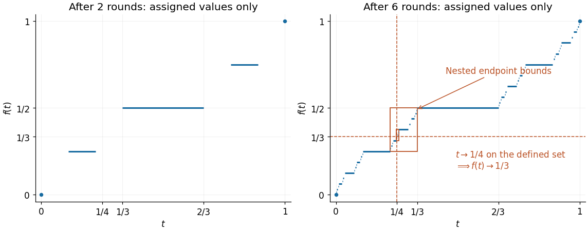

<h1 id="5/b/ii/solution">Solution</h1>

↑ **Parent:** [Ii](../ii.md)

We give the explicit point $\boxed{x=1/4}$. Repeatedly choose the left remaining third and then the right remaining third. After $2m$ choices, the resulting closed [interval](../../../../../../../interval-mathematics.md) is $[L_m,R_m]$, where

$$
L_m=\sum_{j=1}^m\frac2{3^{2j}}=\frac14(1-9^{-m}),\qquad
R_m=L_m+9^{-m}=\frac14+\frac34\,9^{-m}.
$$

These formulas follow from a finite [geometric series](../../../../../../../geometric-series.md). They show $L_m<1/4<R_m$, and that both endpoints tend to $1/4$. The point $1/4$ is also strictly inside each intermediate left third: its distance from $L_m$ is one quarter of the current length. It therefore never enters any assigned closed middle third or its endpoints, so $1/4\in C$.

Endpoint values in the [Cantor function](../../../../../../../cantor-function.md) construction obey the same left/right choices, with halving in place of thirding. Thus

$$
f(L_m)=\sum_{j=1}^m\frac1{2^{2j}}=\frac13(1-4^{-m}),\qquad
f(R_m)=f(L_m)+4^{-m}=\frac13+\frac23\,4^{-m}.
$$

All these endpoints are in the domain of the partial [function](../../../../../../../function-split.md): $L_m$ is the right endpoint of a middle third assigned at round $2m$, and $R_m$ is the left endpoint of a middle third assigned at round $2m-1$.

Given $\varepsilon>0$, choose $m$ so that $(2/3)4^{-m}<\varepsilon$, and put $\delta=9^{-m}/4$. If $t\notin C$ and $|t-1/4|<\delta$, then $L_m<t<R_m$. The assumed [monotonicity](../../../../../../../monotonic-function.md) gives

$$
\frac13-\frac13\,4^{-m}\leq f(L_m)\leq f(t)\leq f(R_m)\leq\frac13+\frac23\,4^{-m}.
$$

Consequently $|f(t)-1/3|<\varepsilon$. This proves directly, on the stated partial domain,

$$
\boxed{\lim_{\substack{t\to1/4\\t\notin C}}f(t)=\frac13.}
$$

There are defined points arbitrarily close to $1/4$, for example $L_m$ and $R_m$, so the [limit of a function](../../../../../../../limit-of-a-function.md) is not vacuous. No [continuous extension](../../../../../../../continuous-extension.md) has been assumed. The residual $C$ here omits the endpoints that the question assigns values to; it is the usual [Cantor set](../../../../../../../cantor-set.md) with those assigned endpoints removed.

**[Figure 1](#5/b/ii/image-assigned-middle-thirds-and-the-nested-intervals-around-x-1-4-that-force-the-value-1-3). Assigned middle thirds and the nested intervals around $x=1/4$ that force the value $1/3$**.

## ↑ Ancestors (13)

1. [Ii](../ii.md)
2. [B](../../b.md)
3. [5](../../../5.md)
4. [Mathematics II](../../../../mathematics-ii-split.md)
5. [Prelims](../../../../split.md)
6. [2021](../../../../../split.md)
7. [Past exam of the mathematics course of the University of Oxford](../../../../../../split.md)
8. [Mathematics course of the University of Oxford](../../../../../../../mathematics-course-of-the-university-of-oxford.md)
9. [Undergraduate course of the University of Oxford](../../../../../../../undergraduate-course-of-the-university-of-oxford.md)
10. [Course of the University of Oxford](../../../../../../../course-of-the-university-of-oxford.md)
11. [University of Oxford](../../../../../../../university-of-oxford-split.md)
12. [List of universities](../../../../../../../list-of-universities.md)
13. [Codex Wiki](../../../../../../../split.md)
