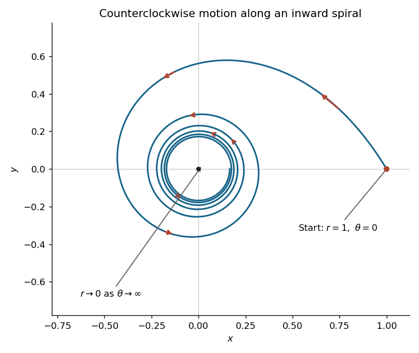
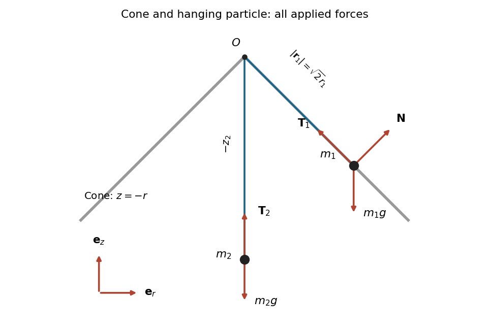
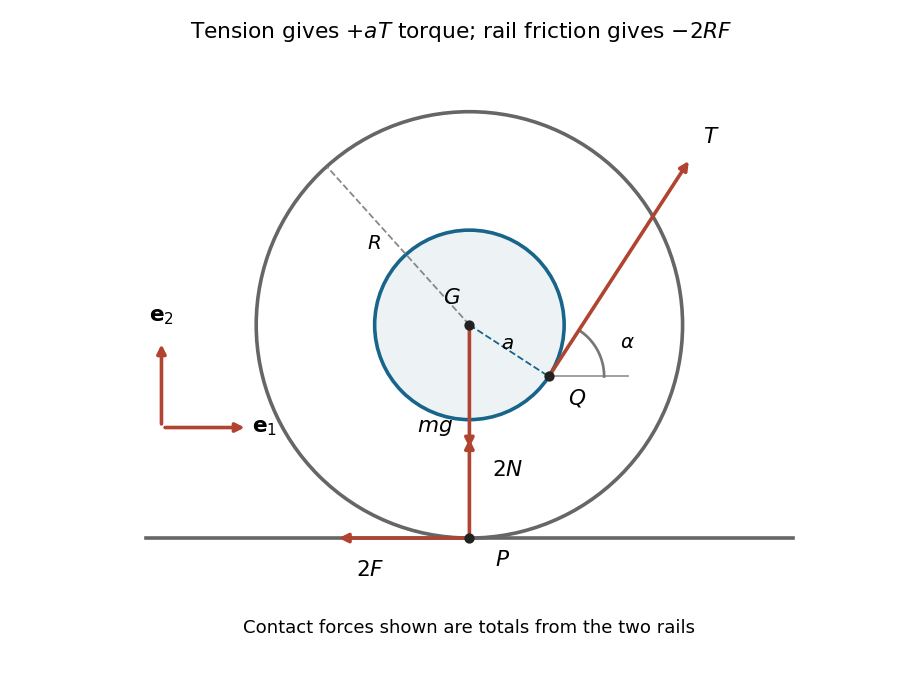

# Mathematics IV resit

↑ **Parent:** [Prelims](../prelims.md)

Source: [released examination PDF, bundle pages 195–202](https://www.whatdotheyknow.com/request/bsc_mathematics_prelims_and_part/response/2784209/attach/3/202409%20817%20annex.pdf#page=195).

**Table of contents**

- [1](#1)
  - [a](#1/a)
    - [i](#1/a/i)
      - [Solution](#1/a/i/solution)
    - [ii](#1/a/ii)
      - [Solution](#1/a/ii/solution)
  - [b](#1/b)
    - [Solution](#1/b/solution)
  - [c](#1/c)
    - [Solution](#1/c/solution)
- [2](#2)
  - [a](#2/a)
    - [Solution](#2/a/solution)
  - [b](#2/b)
    - [i](#2/b/i)
      - [Solution](#2/b/i/solution)
    - [ii](#2/b/ii)
      - [Solution](#2/b/ii/solution)
- [3](#3)
  - [a](#3/a)
    - [i](#3/a/i)
      - [Solution](#3/a/i/solution)
    - [ii](#3/a/ii)
      - [Solution](#3/a/ii/solution)
  - [b](#3/b)
    - [Solution](#3/b/solution)
  - [c](#3/c)
    - [Solution](#3/c/solution)
- [4](#4)
  - [a](#4/a)
    - [Solution](#4/a/solution)
  - [b](#4/b)
    - [Solution](#4/b/solution)
- [5](#5)
  - [a](#5/a)
    - [Solution](#5/a/solution)
  - [b](#5/b)
    - [Solution](#5/b/solution)
  - [c](#5/c)
    - [Solution](#5/c/solution)
  - [d](#5/d)
    - [Solution](#5/d/solution)
- [6](#6)
  - [a](#6/a)
    - [Solution](#6/a/solution)
  - [b](#6/b)
    - [Solution](#6/b/solution)
  - [c](#6/c)
    - [Solution](#6/c/solution)
- [7](#7)
  - [a](#7/a)
    - [Solution](#7/a/solution)
  - [b](#7/b)
    - [i](#7/b/i)
      - [Solution](#7/b/i/solution)
    - [ii](#7/b/ii)
      - [Solution](#7/b/ii/solution)
  - [c](#7/c)
    - [Solution](#7/c/solution)

## 1

↑ **Parent:** [Mathematics IV resit](mathematics-iv-resit.md)

<h3 id="1/a">a</h3>

↑ **Parent:** [1](#1)

<h4 id="1/a/i">i</h4>

↑ **Parent:** [A](#1/a)

<h5 id="1/a/i/solution">Solution</h5>

↑ **Parent:** [I](#1/a/i)

Use the [vector triple product identity](../../../multivariable-calculus.md#vector-triple-product)

$$
\mathbf a\times(\mathbf b\times\mathbf c)=\mathbf b(\mathbf a\cdot\mathbf c)-\mathbf c(\mathbf a\cdot\mathbf b).
$$

Since $\mathbf n$ is a [unit vector](../../../vector-space.md#unit-vector), put

$$
\mathbf w=\mathbf n\times(\mathbf v\times\mathbf n)=\mathbf v-(\mathbf v\cdot\mathbf n)\mathbf n,\qquad \mathbf q=\mathbf n\times\mathbf v.
$$

Thus $\mathbf w$ is the component of $\mathbf v$ in the [orthogonal complement](../../../hilbert-space.md#orthogonal-complement) of $\mathbf n$, and $\mathbf n\cdot\mathbf w=0$. A [cross product](../../../vector-space.md#cross-product) is [orthogonal](../../../inner-product.md#orthogonal-vectors) to both its factors, so $\mathbf n\cdot\mathbf q=0$ and $\mathbf v\cdot\mathbf q=0$. Consequently

$$
\mathbf q\cdot\mathbf w=\mathbf q\cdot\mathbf v-(\mathbf v\cdot\mathbf n)(\mathbf q\cdot\mathbf n)=0.
$$

**All three pairs are [orthogonal](../../../inner-product.md#orthogonal-vectors).** This remains true when $\mathbf v$ is parallel to $\mathbf n$: then $\mathbf q$ and $\mathbf w$ are [zero vectors](../../../vector-space.md#zero-vector). Pairwise [orthogonality](../../../inner-product.md#orthogonal-vectors) does not assert [linear independence](../../../vector-space.md#linear-independence) in this case.

<h4 id="1/a/ii">ii</h4>

↑ **Parent:** [A](#1/a)

<h5 id="1/a/ii/solution">Solution</h5>

↑ **Parent:** [Ii](#1/a/ii)

Use the convention $[\mathbf a,\mathbf b,\mathbf c]=\mathbf a\cdot(\mathbf b\times\mathbf c)$ for the [scalar triple product](../../../multilinear-algebra.md#scalar-triple-product). With $\mathbf q,\mathbf w$ as above, $\mathbf q=\mathbf n\times\mathbf w$. The [vector triple product identity](../../../multivariable-calculus.md#vector-triple-product) gives

$$
\mathbf q\times\mathbf w=-\mathbf w\times(\mathbf n\times\mathbf w)=-\mathbf n|\mathbf w|^2+\mathbf w(\mathbf w\cdot\mathbf n)=-\mathbf n|\mathbf w|^2.
$$

The [Lagrange identity for the cross product](../../../multivariable-calculus.md#lagrange-identity-for-the-cross-product), $|\mathbf a\times\mathbf b|^2=|\mathbf a|^2|\mathbf b|^2-(\mathbf a\cdot\mathbf b)^2$, also gives

$$
|\mathbf q|^2=|\mathbf v|^2-(\mathbf n\cdot\mathbf v)^2=|\mathbf w|^2.
$$

Taking the [dot product](../../../inner-product.md#dot-product) with the [unit vector](../../../vector-space.md#unit-vector) $\mathbf n$ proves

$$
\boxed{[\mathbf n,\mathbf n\times\mathbf v,\mathbf n\times(\mathbf v\times\mathbf n)]=-|\mathbf n\times\mathbf v|^2.}
$$

<h3 id="1/b">b</h3>

↑ **Parent:** [1](#1)

<h4 id="1/b/solution">Solution</h4>

↑ **Parent:** [B](#1/b)

Decompose $\mathbf v$ by [orthogonal projection](../../../hilbert-space.md#orthogonal-projection) onto the [straight line](../../../euclidean-geometry.md#straight-line) spanned by $\mathbf n$ and its [orthogonal complement](../../../hilbert-space.md#orthogonal-complement):

$$
\mathbf v=(\mathbf v\cdot\mathbf n)\mathbf n+\mathbf w,\qquad \mathbf w=\mathbf n\times(\mathbf v\times\mathbf n).
$$

The first term is fixed by the [rotation](../../../riemannian-geometry.md#rotation-mathematics). If $\mathbf w\ne0$, the [vectors](../../../vector-space.md#vector) $\mathbf w/|\mathbf w|$ and $(\mathbf n\times\mathbf w)/|\mathbf w|$ form an [orthonormal basis](../../../inner-product.md#orthonormal-basis) of the perpendicular [plane](../../../geometry-and-topology.md#plane), oriented in the positive sense about $\mathbf n$. A [planar rotation](../../../linear-algebra.md#planar-rotation) through $\theta$ therefore sends

$$
\mathbf w\longmapsto\cos\theta\,\mathbf w+\sin\theta\,(\mathbf n\times\mathbf w).
$$

Here $\mathbf n\times\mathbf w=\mathbf n\times\mathbf v$. Adding the fixed parallel component proves the [Rodrigues rotation formula](../../../mathematics.md#rodrigues-rotation-formula) in the required form:

$$
\boxed{R(\mathbf v)=(\mathbf v\cdot\mathbf n)\mathbf n+\sin\theta(\mathbf n\times\mathbf v)+\cos\theta\bigl(\mathbf n\times(\mathbf v\times\mathbf n)\bigr).}
$$

When $\mathbf w=0$, both perpendicular terms vanish, so the same formula fixes $\mathbf v$ as required. Positive [angles](../../../geometry-and-topology.md#angle) use the right-hand convention about $\mathbf n$.

<h3 id="1/c">c</h3>

↑ **Parent:** [1](#1)

<h4 id="1/c/solution">Solution</h4>

↑ **Parent:** [C](#1/c)

The [straight line](../../../euclidean-geometry.md#straight-line) $2x=y=z$ has [direction vector](../../../euclidean-geometry.md#direction-vector) $(1,2,2)$, so take the [unit vector](../../../vector-space.md#unit-vector) $\mathbf n=(1,2,2)^T/3$. A [half-turn](../../../riemannian-geometry.md#half-turn) has $\cos\pi=-1$ and $\sin\pi=0$. The preceding [rotation](../../../riemannian-geometry.md#rotation-mathematics) formula becomes

$$
R(\mathbf v)=2(\mathbf v\cdot\mathbf n)\mathbf n-\mathbf v.
$$

Thus the [rotation matrix](../../../linear-algebra.md#rotation-matrix) in the [standard basis](../../../vector-space.md#standard-basis) is

$$
\boxed{2\mathbf n\mathbf n^T-I=\frac19\begin{pmatrix}-7&4&4\\4&-1&8\\4&8&-1\end{pmatrix}.}
$$

It fixes $(1,2,2)^T$ and negates every [vector](../../../vector-space.md#vector) in its [orthogonal complement](../../../hilbert-space.md#orthogonal-complement), which also checks the [half-turn](../../../riemannian-geometry.md#half-turn) geometrically.

## 2

↑ **Parent:** [Mathematics IV resit](mathematics-iv-resit.md)

<h3 id="2/a">a</h3>

↑ **Parent:** [2](#2)

<h4 id="2/a/solution">Solution</h4>

↑ **Parent:** [A](#2/a)

First find the fixed [axis of rotation](../../../riemannian-geometry.md#axis-of-rotation) by solving $(M-I)\mathbf n=0$. After removing a nonzero common factor, the [linear equations](../../../linear-algebra.md#linear-equation) are

$$
-2n_1+n_2-3n_3=0,\qquad -3n_1-2n_2-n_3=0,\qquad n_1+3n_2-2n_3=0.
$$

They give $n_2=n_3=-n_1$. Choose the following [unit vectors](../../../vector-space.md#unit-vector):

$$
\mathbf p_1=\frac1{\sqrt3}(1,-1,-1)^T,\quad \mathbf p_2=\frac1{\sqrt2}(1,1,0)^T,\quad \mathbf p_3=\mathbf p_1\times\mathbf p_2=\frac1{\sqrt6}(1,-1,2)^T.
$$

Their [dot products](../../../inner-product.md#dot-product) show that they form an [orthonormal basis](../../../inner-product.md#orthonormal-basis); hence $P=(\mathbf p_1\ \mathbf p_2\ \mathbf p_3)$ is an [orthogonal matrix](../../../linear-algebra.md#orthogonal-matrix). Since $M$ is an [orthogonal matrix](../../../linear-algebra.md#orthogonal-matrix) fixing $\mathbf p_1$, it preserves the [orthogonal complement](../../../hilbert-space.md#orthogonal-complement) of $\mathbf p_1$. Its restriction there has [determinant](../../../multilinear-algebra.md#determinant) $1$, so it is a [planar rotation](../../../linear-algebra.md#planar-rotation).

The [trace](../../../linear-algebra.md#matrix-trace) gives $1+2\cos\theta=\operatorname{tr}M=9/7$, so $\cos\theta=1/7$. To determine the sign of the [sine](../../../geometry-and-topology.md#sine), rather than just its magnitude, calculate

$$
M\mathbf p_2=\frac1{7\sqrt2}(5,-3,8)^T,\qquad \mathbf p_3^TM\mathbf p_2=\frac{24}{7\sqrt{12}}=\frac{4\sqrt3}{7}>0.
$$

Thus a suitable [angle](../../../geometry-and-topology.md#angle) and [change of basis](../../../linear-algebra.md#change-of-basis) are

$$
\boxed{\theta=\arccos(1/7),\qquad P=\begin{pmatrix}1/\sqrt3&1/\sqrt2&1/\sqrt6\\-1/\sqrt3&1/\sqrt2&-1/\sqrt6\\-1/\sqrt3&0&2/\sqrt6\end{pmatrix}.}
$$

In fact direct [matrix multiplication](../../../vector-space.md#matrix-multiplication) gives

$$
P^TMP=\begin{pmatrix}1&0&0\\0&1/7&-4\sqrt3/7\\0&4\sqrt3/7&1/7\end{pmatrix}=\operatorname{diag}(1,R_\theta).
$$

<h3 id="2/b">b</h3>

↑ **Parent:** [2](#2)

<h4 id="2/b/i">i</h4>

↑ **Parent:** [B](#2/b)

<h5 id="2/b/i/solution">Solution</h5>

↑ **Parent:** [I](#2/b/i)

Write $T_{\theta,\mathbf b}(\mathbf v)=R_\theta\mathbf v+\mathbf b$. The [sine addition formula](../../../geometry-and-topology.md#sine-addition-formula) and [cosine addition formula](../../../geometry-and-topology.md#cosine-addition-formula) give $R_\theta R_\psi=R_{\theta+\psi}$. Therefore [function composition](../../../function.md#function-composition) satisfies

$$
T_{\theta,\mathbf b}\circ T_{\psi,\mathbf c}=T_{\theta+\psi,\,R_\theta\mathbf c+\mathbf b}.
$$

The resulting [angle](../../../geometry-and-topology.md#angle) is real and the new [translation](../../../geometry-and-topology.md#translation-geometry) [vector](../../../vector-space.md#vector) lies in $\mathbb R^2$, so $G$ is closed under [function composition](../../../function.md#function-composition). [Associativity](../../../algebraic-operation.md#associative-property) holds because, for any [functions](../../../function.md) $S,T,U$ and any $\mathbf v$, both $(S\circ T)\circ U$ and $S\circ(T\circ U)$ take $\mathbf v$ to $S(T(U(\mathbf v)))$.

The [identity element](../../../algebraic-operation.md#identity-element) is $T_{0,\mathbf0}$, since $R_0=I$. Every element has the two-sided [inverse element](../../../algebraic-operation.md#inverse-element)

$$
\boxed{T_{\theta,\mathbf b}^{-1}=T_{-\theta,\,-R_{-\theta}\mathbf b}.}
$$

Indeed $R_\theta R_{-\theta}=R_{-\theta}R_\theta=I$, and substituting into the composition formula makes the [translation](../../../geometry-and-topology.md#translation-geometry) [vector](../../../vector-space.md#vector) zero in either order. These verify all the [group axioms](../../../group.md#group-axioms). Thus **$G$ is a [group](../../../group.md) under [function composition](../../../function.md#function-composition)**, the [special Euclidean group](../../../euclidean-geometry.md#special-euclidean-group) in two dimensions.

<h4 id="2/b/ii">ii</h4>

↑ **Parent:** [B](#2/b)

<h5 id="2/b/ii/solution">Solution</h5>

↑ **Parent:** [Ii](#2/b/ii)

A possible center $\mathbf c$ must be a [fixed point](../../../function.md#fixed-point), so $(I-R_\theta)\mathbf c=\mathbf b$. Let $c=\cos\theta$ and $s=\sin\theta$. The [determinant](../../../multilinear-algebra.md#determinant) is

$$
\det(I-R_\theta)=(1-c)^2+s^2=2(1-c)=4\sin^2(\theta/2)>0
$$

when $\theta$ is not an [integer multiple](../../../divisibility.md#integer-multiple) of $2\pi$. The unique center is therefore

$$
\boxed{\mathbf c=(I-R_\theta)^{-1}\mathbf b=\frac1{2(1-\cos\theta)}\begin{pmatrix}1-\cos\theta&-\sin\theta\\\sin\theta&1-\cos\theta\end{pmatrix}\mathbf b.}
$$

The [fixed point](../../../function.md#fixed-point) equation implies $\mathbf b=\mathbf c-R_\theta\mathbf c$, whence

$$
T(\mathbf v)=\mathbf c+R_\theta(\mathbf v-\mathbf c).
$$

Relative to $\mathbf c$, this is precisely a [planar rotation](../../../linear-algebra.md#planar-rotation) through $\theta$. This also explains the excluded case: when $\theta\in2\pi\mathbb Z$, $T$ is a [translation](../../../geometry-and-topology.md#translation-geometry), with no [fixed point](../../../function.md#fixed-point) unless $\mathbf b=0$.

## 3

↑ **Parent:** [Mathematics IV resit](mathematics-iv-resit.md)

<h3 id="3/a">a</h3>

↑ **Parent:** [3](#3)

<h4 id="3/a/i">i</h4>

↑ **Parent:** [A](#3/a)

<h5 id="3/a/i/solution">Solution</h5>

↑ **Parent:** [I](#3/a/i)

The [eccentricity](../../../euclidean-geometry.md#eccentricity-of-a-conic) of the [ellipse](../../../euclidean-geometry.md#ellipse) is

$$
\boxed{e=\sqrt{1-\frac{b^2}{a^2}}.}
$$

<h4 id="3/a/ii">ii</h4>

↑ **Parent:** [A](#3/a)

<h5 id="3/a/ii/solution">Solution</h5>

↑ **Parent:** [Ii](#3/a/ii)

The enclosed [area](../../../differential-geometry.md#surface-area) of the [ellipse](../../../euclidean-geometry.md#ellipse) is

$$
\boxed{A=\pi ab.}
$$

<h3 id="3/b">b</h3>

↑ **Parent:** [3](#3)

<h4 id="3/b/solution">Solution</h4>

↑ **Parent:** [B](#3/b)

The [quadratic form](../../../quadratic-form.md) is

$$
5x^2+6xy+5y^2=\begin{pmatrix}x&y\end{pmatrix}\begin{pmatrix}5&3\\3&5\end{pmatrix}\begin{pmatrix}x\\y\end{pmatrix}.
$$

The [symmetric matrix](../../../linear-algebra.md#symmetric-matrix) has [eigenvalues](../../../linear-operator-theory.md#eigenvalue) $2,8$, with respective [orthogonal](../../../inner-product.md#orthogonal-vectors) [eigenvectors](../../../linear-operator-theory.md#eigenvector) $(1,-1)^T,(1,1)^T$. Normalize them to obtain the [orthonormal basis](../../../inner-product.md#orthonormal-basis)

$$
\boxed{\mathbf e_1=\frac{\mathbf i-\mathbf j}{\sqrt2},\qquad \mathbf e_2=\frac{\mathbf i+\mathbf j}{\sqrt2}.}
$$

The given [change of basis](../../../linear-algebra.md#change-of-basis) means

$$
x=\frac{X+Y}{\sqrt2},\qquad y=\frac{-X+Y}{\sqrt2}.
$$

Substitution, or [orthogonal diagonalization of a real symmetric matrix](../../../linear-algebra.md#orthogonal-diagonalization-of-a-real-symmetric-matrix), gives

$$
2X^2+8Y^2=16,\qquad \boxed{\frac{X^2}{8}+\frac{Y^2}{2}=1.}
$$

Thus the [semi-major and semi-minor axes](../../../euclidean-geometry.md#semi-major-and-semi-minor-axes) have lengths $2\sqrt2$ and $\sqrt2$. The [eccentricity](../../../euclidean-geometry.md#eccentricity-of-a-conic) and enclosed [area](../../../differential-geometry.md#surface-area) are

$$
\boxed{e=\frac{\sqrt3}{2},\qquad A=4\pi.}
$$

The [orthogonal](../../../inner-product.md#orthogonal-vectors) [change of basis](../../../linear-algebra.md#change-of-basis) preserves [area](../../../differential-geometry.md#surface-area), so this is also the [area](../../../differential-geometry.md#surface-area) in the original [Cartesian coordinates](../../../linear-algebra.md#cartesian-coordinate-system).

<h3 id="3/c">c</h3>

↑ **Parent:** [3](#3)

<h4 id="3/c/solution">Solution</h4>

↑ **Parent:** [C](#3/c)

Use the [parametric curve](../../../topology.md#parametric-curve)

$$
X=2\sqrt2\cos t,\quad Y=\sqrt2\sin t,\qquad x(t)=2\cos t+\sin t,\quad y(t)=-2\cos t+\sin t,\quad 0\leq t\leq2\pi.
$$

Here $|y(t)|\leq\sqrt5<3$, so the [ellipse](../../../euclidean-geometry.md#ellipse) stays strictly above the [axis of rotation](../../../riemannian-geometry.md#axis-of-rotation) $y=-3$. Rotating in three dimensions gives a [surface of revolution](../../../differential-geometry.md#surface-of-revolution) with [parametrization](../../../geometry-and-topology.md#parametric-equation)

$$
\mathbf s(t,\varphi)=\bigl(x(t),-3+(y(t)+3)\cos\varphi,(y(t)+3)\sin\varphi\bigr),\qquad 0\leq\varphi\leq2\pi.
$$

The two parameter [tangent vectors](../../../tangent-vector.md) are [orthogonal](../../../inner-product.md#orthogonal-vectors), with [Euclidean norms](../../../normed-vector-space.md#euclidean-norm) $\sqrt{x'(t)^2+y'(t)^2}$ and $y(t)+3$. Hence the [area element of a surface](../../../differential-geometry.md#area-element-of-a-surface) is

$$
|\mathbf s_t\times\mathbf s_\varphi|=(y(t)+3)\sqrt{x'(t)^2+y'(t)^2}.
$$

The generating [ellipse](../../../euclidean-geometry.md#ellipse) is simple and has positive distance from the [axis of rotation](../../../riemannian-geometry.md#axis-of-rotation); its [rotation](../../../riemannian-geometry.md#rotation-mathematics) sweeps the [surface](../../../topological-surface.md) once, apart from the identified parameter endpoints. Also

$$
x'(t)^2+y'(t)^2=(-2\sin t+\cos t)^2+(2\sin t+\cos t)^2=8\sin^2t+2\cos^2t.
$$

Writing $w(t)=\sqrt{8\sin^2t+2\cos^2t}$, the [surface area](../../../differential-geometry.md#surface-area) is therefore $2\pi\int_0^{2\pi}(3+y(t))w(t)\,dt$. Since $y(t+\pi)=-y(t)$ and $w(t+\pi)=w(t)$,

$$
\int_0^{2\pi}y(t)w(t)\,dt=\int_0^\pi\bigl(y(t)w(t)+y(t+\pi)w(t+\pi)\bigr)\,dt=0.
$$

Consequently

$$
\boxed{\operatorname{Area}(S)=6\pi\int_0^{2\pi}\sqrt{8\sin^2t+2\cos^2t}\,dt.}
$$

The cancellation is an instance of the [surface area of revolution of a centrally symmetric curve](../../../differential-geometry.md#surface-area-of-revolution-of-a-centrally-symmetric-curve): the [surface area](../../../differential-geometry.md#surface-area) is the generating curve’s [arc length](../../../riemannian-geometry.md#arc-length) times the distance $6\pi$ traveled by its center.

## 4

↑ **Parent:** [Mathematics IV resit](mathematics-iv-resit.md)

<h3 id="4/a">a</h3>

↑ **Parent:** [4](#4)

<h4 id="4/a/solution">Solution</h4>

↑ **Parent:** [A](#4/a)

For [polar coordinates](../../../multivariable-calculus.md#polar-coordinates), the rotating [unit vectors](../../../vector-space.md#unit-vector) satisfy $\dot{\mathbf e}_r=\dot\theta\mathbf e_\theta$ and $\dot{\mathbf e}_\theta=-\dot\theta\mathbf e_r$. Applying the [product rule](../../../calculus.md#product-rule) twice to $\mathbf r=r\mathbf e_r$ gives the [velocity](../../../classical-mechanics.md#velocity) and [acceleration](../../../classical-mechanics.md#acceleration)

$$
\dot{\mathbf r}=\dot r\mathbf e_r+r\dot\theta\mathbf e_\theta,\qquad \ddot{\mathbf r}=(\ddot r-r\dot\theta^2)\mathbf e_r+(r\ddot\theta+2\dot r\dot\theta)\mathbf e_\theta.
$$

[Newton's second law](../../../force.md#newton-s-second-law) for a [central force](../../../mathematical-physics.md#central-force) now gives

$$
m(\ddot r-r\dot\theta^2)=F(r),\qquad m(r\ddot\theta+2\dot r\dot\theta)=0.
$$

Multiplying the azimuthal [force](../../../force.md) equation by $r/m$ yields

$$
\frac{d}{dt}(r^2\dot\theta)=0,\qquad \boxed{r^2\dot\theta=h.}
$$

This is conservation of [specific angular momentum](../../../celestial-mechanics.md#specific-angular-momentum). Here $F(r)$ is the signed radial component of the [force](../../../force.md); a negative value points inward.

When $h\ne0$, $\theta$ is a valid local parameter along the [trajectory](../../../classical-mechanics.md#trajectory). Put $u=1/r$ and let primes denote [derivatives](../../../calculus.md#derivative) with respect to $\theta$. The [chain rule](../../../calculus.md#chain-rule) yields

$$
\dot\theta=hu^2,\qquad \dot r=-\frac{u'}{u^2}\dot\theta=-hu',\qquad \ddot r=-h^2u^2u'',\qquad r\dot\theta^2=h^2u^3.
$$

Substituting into the radial [Newton's second law](../../../force.md#newton-s-second-law) equation and dividing by $-mh^2u^2$ proves the [Binet equation](../../../celestial-mechanics.md#binet-equation):

$$
\boxed{u''+u=-\frac{F(1/u)}{mh^2u^2}.}
$$

<h3 id="4/b">b</h3>

↑ **Parent:** [4](#4)

<h4 id="4/b/solution">Solution</h4>

↑ **Parent:** [B](#4/b)

Here $mh^2=b$, so the [Binet equation](../../../celestial-mechanics.md#binet-equation) reduces to

$$
u''+u=-\frac{(b/2)u^2e^{-u}-bu^3}{bu^2}=u-\frac12e^{-u},\qquad u''=-\frac12e^{-u}.
$$

The [initial conditions](../../../differential-equation.md#initial-condition) become

$$
u(0)=\frac1a,\qquad u'(0)=-\frac1{a^2}\frac{dr}{d\theta}(0)=e^{-1/(2a)}>0.
$$

Multiply the [differential equation](../../../differential-equation.md) by $2u'$ and use the [chain rule](../../../calculus.md#chain-rule):

$$
\frac{d}{d\theta}(u'^2)=-e^{-u}u'=\frac{d}{d\theta}(e^{-u}),\qquad u'^2-e^{-u}=C.
$$

The [initial conditions](../../../differential-equation.md#initial-condition) give $C=0$. Since $e^{-u}>0$, $u'$ cannot change sign at a finite value of $u$. Thus $u'=e^{-u/2}$ on the physical branch. [Separation of variables](../../../partial-differential-equation.md#separation-of-variables) gives

$$
\frac{d}{d\theta}(e^{u/2})=\frac12,\qquad e^{u/2}=e^{1/(2a)}+\frac\theta2.
$$

Therefore

$$
\boxed{r(\theta)=\frac1{2\log\left(e^{1/(2a)}+\theta/2\right)},\qquad \theta>2\left(1-e^{1/(2a)}\right).}
$$

The [natural logarithm](../../../calculus.md#natural-logarithm) must be positive because $r>0$. For the forward [trajectory](../../../classical-mechanics.md#trajectory), $\theta\geq0$ and $h=\sqrt{b/m}>0$, so $\dot\theta=h/r^2>0$: the particle travels counterclockwise while $r$ strictly decreases.

For $a=1$, it starts at $(x,y)=(1,0)$, with [tangent vector](../../../tangent-vector.md) proportional to $(-e^{-1/2},1)$. Its successive crossings of the positive $x$ [coordinate axis](../../../linear-algebra.md#coordinate-axis) have radii

$$
r(2\pi k)=\frac1{2\log(\sqrt e+\pi k)},\qquad k=0,1,2,\ldots.
$$

It makes infinitely many inward turns, approaching the origin as $\theta\to\infty$. There is no finite-time arrival at the origin: $dt/d\theta=r^2/h$ behaves as $1/(4h\log^2\theta)$, whose [improper integral](../../../real-analysis.md#improper-integral) diverges. If extended backwards, it comes from infinity as $\theta\downarrow2(1-\sqrt e)$.

**[Figure 1](#4/b/image-forward-central-force-trajectory-for-a-1-with-arrows-showing-counterclockwise-inward-motion). Forward central-force trajectory for a=1, with arrows showing counterclockwise inward motion**.

## 5

↑ **Parent:** [Mathematics IV resit](mathematics-iv-resit.md)

<h3 id="5/a">a</h3>

↑ **Parent:** [5](#5)

<h4 id="5/a/solution">Solution</h4>

↑ **Parent:** [A](#5/a)

The [free-body diagram](../../../force.md#free-body-diagram) shows a meridional section of the [right circular cone](../../../euclidean-geometry.md#right-circular-cone). On the first particle, [gravity](../../../physics.md#gravity) acts vertically downwards, [tension](../../../force.md#tension) points along the [straight line](../../../euclidean-geometry.md#straight-line) to the apex, and the [normal reaction](../../../force.md#normal-force) is perpendicular to the [surface](../../../topological-surface.md). The [smooth mechanical constraint](../../../classical-mechanics.md#smooth-mechanical-constraint) supplies no tangential [friction](../../../newtonian-mechanics.md#friction). The second particle has only its downward [gravitational weight](../../../force.md#weight-physics) and the upward [tension](../../../force.md#tension).

**[Figure 2](#5/a/image-meridional-section-of-the-inverted-cone-and-the-forces-on-both-particles-the-reaction-is-normal-to-the-cone). Meridional section of the inverted cone and the forces on both particles; the reaction is normal to the cone**.

Adding the [forces](../../../force.md) on each particle and applying [Newton's second law](../../../force.md#newton-s-second-law) gives

$$
\boxed{m_1\ddot{\mathbf r}_1=-m_1g\mathbf e_z+\mathbf N+\mathbf T_1,\qquad m_2\ddot{\mathbf r}_2=-m_2g\mathbf e_z+\mathbf T_2.}
$$

At $z_1=-r_1$, a [normal vector](../../../differential-geometry.md#normal-vector) is $\mathbf e_r+\mathbf e_z$. Its sign depends on the supporting face of the [cone](../../../euclidean-geometry.md#cone-geometry); either sign has zero [dot product](../../../inner-product.md#dot-product) with every permitted [velocity](../../../classical-mechanics.md#velocity). The diagram chooses the reaction towards the upper side of the [surface](../../../topological-surface.md).

<h3 id="5/b">b</h3>

↑ **Parent:** [5](#5)

<h4 id="5/b/solution">Solution</h4>

↑ **Parent:** [B](#5/b)

The [massless inextensible string](../../../force.md#massless-inextensible-string) has a common [tension](../../../force.md#tension) magnitude $T$. Since $\mathbf r_1=r_1(\mathbf e_r-\mathbf e_z)$, the [unit vector](../../../vector-space.md#unit-vector) from the first particle towards the apex is $(-\mathbf e_r+\mathbf e_z)/\sqrt2$. The second particle lies below the apex, so

$$
\boxed{\mathbf T_1=\frac{T}{\sqrt2}(-\mathbf e_r+\mathbf e_z),\qquad \mathbf T_2=T\mathbf e_z.}
$$

The [string length constraint](../../../classical-mechanics.md#string-length-constraint) is

$$
l=\sqrt2r_1-z_2=-\sqrt2z_1-z_2,\qquad \dot r_1=-\dot z_1,\qquad \dot z_2=-\sqrt2\dot z_1.
$$

The [velocity](../../../classical-mechanics.md#velocity) of the first particle in [cylindrical coordinates](../../../multivariable-calculus.md#cylindrical-coordinate-system) is $\dot r_1\mathbf e_r+r_1\dot\theta\mathbf e_\theta+\dot z_1\mathbf e_z$. Therefore the [powers](../../../energy.md#power) delivered by the two [tension](../../../force.md#tension) [forces](../../../force.md) are

$$
\mathbf T_1\cdot\dot{\mathbf r}_1=\frac T{\sqrt2}(-\dot r_1+\dot z_1)=\sqrt2T\dot z_1,\qquad \mathbf T_2\cdot\dot{\mathbf r}_2=T\dot z_2=-\sqrt2T\dot z_1.
$$

Thus

$$
\boxed{\mathbf T_1\cdot\dot{\mathbf r}_1=-\mathbf T_2\cdot\dot{\mathbf r}_2.}
$$

The [tension](../../../force.md#tension) can transfer [energy](../../../energy.md) between the particles, but its total [power](../../../energy.md#power) on the pair is zero.

<h3 id="5/c">c</h3>

↑ **Parent:** [5](#5)

<h4 id="5/c/solution">Solution</h4>

↑ **Parent:** [C](#5/c)

All [forces](../../../force.md) on the first particle lie in the [plane](../../../geometry-and-topology.md#plane) spanned by $\mathbf e_r$ and $\mathbf e_z$: this holds for [gravity](../../../physics.md#gravity), [tension](../../../force.md#tension), and the [normal reaction](../../../force.md#normal-force). Hence the azimuthal component of [Newton's second law](../../../force.md#newton-s-second-law) vanishes:

$$
m_1(r_1\ddot\theta+2\dot r_1\dot\theta)=0.
$$

Using the [product rule](../../../calculus.md#product-rule) gives

$$
\boxed{\dot h=\frac{d}{dt}(r_1^2\dot\theta)=r_1(r_1\ddot\theta+2\dot r_1\dot\theta)=0.}
$$

Strictly, $h$ is the axial [specific angular momentum](../../../celestial-mechanics.md#specific-angular-momentum); the actual axial [angular momentum](../../../momentum.md#angular-momentum) is $m_1h$, which is conserved as well.

Differentiate the stated total [energy](../../../energy.md) using the [chain rule](../../../calculus.md#chain-rule) and then substitute the two [Newton's second law](../../../force.md#newton-s-second-law) equations:

$$
\begin{aligned}
\dot E&=m_1\dot{\mathbf r}_1\cdot\ddot{\mathbf r}_1+m_1g\dot z_1+m_2\dot{\mathbf r}_2\cdot\ddot{\mathbf r}_2+m_2g\dot z_2\\
&=\mathbf N\cdot\dot{\mathbf r}_1+\mathbf T_1\cdot\dot{\mathbf r}_1+\mathbf T_2\cdot\dot{\mathbf r}_2.
\end{aligned}
$$

The [gravitational potential energy](../../../energy.md#gravitational-energy) terms have canceled the [power](../../../energy.md#power) of [gravity](../../../physics.md#gravity). Also $\mathbf N$ is proportional to $\mathbf e_r+\mathbf e_z$, whose [dot product](../../../inner-product.md#dot-product) with $\dot{\mathbf r}_1$ is $\dot r_1+\dot z_1=0$. Thus the stationary [smooth mechanical constraint](../../../classical-mechanics.md#smooth-mechanical-constraint) does no [work](../../../energy.md#work). The remaining [tension](../../../force.md#tension) [powers](../../../energy.md#power) cancel by part (b), proving **$\dot E=0$ and conservation of total [energy](../../../energy.md)** while the [massless inextensible string](../../../force.md#massless-inextensible-string) remains taut and contact is maintained.

<h3 id="5/d">d</h3>

↑ **Parent:** [5](#5)

<h4 id="5/d/solution">Solution</h4>

↑ **Parent:** [D](#5/d)

Initially $r_1=a$ and $z_2=\sqrt2a-l$, so the total [gravitational potential energy](../../../energy.md#gravitational-energy) is

$$
V_0=-m_1ga+m_2g(\sqrt2a-l).
$$

If the given [velocity](../../../classical-mechanics.md#velocity) is understood as a full tangential [vector](../../../vector-space.md#vector) $\mathbf v$, put $v_z=\mathbf v\cdot\mathbf e_z$. The [string length constraint](../../../classical-mechanics.md#string-length-constraint) gives $\dot z_2(0)=-\sqrt2v_z$, and hence

$$
\boxed{E=\frac12m_1|\mathbf v|^2+m_2v_z^2-m_1ga+m_2g(\sqrt2a-l).}
$$

This formula accounts for both particles' [kinetic energies](../../../energy.md#kinetic-energy), including that of the hanging particle.

If $v$ denotes only the initial [speed](../../../classical-mechanics.md#speed), the printed wording does not specify its direction within the [tangent plane](../../../tangent-vector.md#tangent-plane). To make that dependence explicit, let $\beta$ be the [angle](../../../geometry-and-topology.md#angle) from the downward generator of the [cone](../../../euclidean-geometry.md#cone-geometry) towards the azimuthal [unit vector](../../../vector-space.md#unit-vector), so

$$
\mathbf v=v\cos\beta\,\frac{\mathbf e_r-\mathbf e_z}{\sqrt2}+v\sin\beta\,\mathbf e_\theta.
$$

Then $v_z=-v\cos\beta/\sqrt2$, and

$$
\boxed{E=\frac12(m_1+m_2\cos^2\beta)v^2-m_1ga+m_2g(\sqrt2a-l).}
$$

For a launch along a generator, $\beta=0$ or $\pi$, this reduces to $E=\tfrac12(m_1+m_2)v^2-m_1ga+m_2g(\sqrt2a-l)$. For a horizontal azimuthal launch, $\beta=\pi/2$, it instead gives $E=\tfrac12m_1v^2-m_1ga+m_2g(\sqrt2a-l)$. **A scalar [speed](../../../classical-mechanics.md#speed) alone does not determine a unique [energy](../../../energy.md) here.** Both directions are tangent to the [surface](../../../topological-surface.md); “along the surface” does not distinguish them. The assumed configuration also requires $l>\sqrt2a$ so the second particle hangs below the apex.

## 6

↑ **Parent:** [Mathematics IV resit](mathematics-iv-resit.md)

<h3 id="6/a">a</h3>

↑ **Parent:** [6](#6)

<h4 id="6/a/solution">Solution</h4>

↑ **Parent:** [A](#6/a)

The solid [cylinder](../../../geometry-and-topology.md#cylinder-geometry) has constant [mass density](../../../fluid-mechanics.md#density) $\rho=m/(\pi a^2l)$. A thin cylindrical shell of radius $s$ and thickness $ds$ has [mass](../../../classical-mechanics.md#mass) $dm=2\pi\rho ls\,ds$. Its contribution to the axial [moment of inertia](../../../rigid-body-dynamics.md#moment-of-inertia) is $s^2dm$. Therefore

$$
\mathcal I_{33}=\int_0^a s^2(2\pi\rho ls)\,ds=2\pi\rho l\frac{a^4}{4}=\boxed{\frac12ma^2.}
$$

The attached wheels are massless, so they add no [moment of inertia](../../../rigid-body-dynamics.md#moment-of-inertia). This is the [moment of inertia of a uniform solid cylinder](../../../rigid-body-dynamics.md#moment-of-inertia-of-a-uniform-solid-cylinder) about its central longitudinal [axis of rotation](../../../riemannian-geometry.md#axis-of-rotation).

<h3 id="6/b">b</h3>

↑ **Parent:** [6](#6)

<h4 id="6/b/solution">Solution</h4>

↑ **Parent:** [B](#6/b)

Apply the general [linear momentum](../../../momentum.md) equation $d\mathbf p/dt=\sum\mathbf F$ to the whole [rigid body](../../../rigid-body-dynamics.md). Its center of mass has [acceleration](../../../classical-mechanics.md#acceleration) $\ddot x\mathbf e_1$, and each rail contributes its own [static friction](../../../force.md#static-friction) and [normal force](../../../force.md#normal-force). Hence

$$
m\ddot x\mathbf e_1=(T\cos\alpha-2F)\mathbf e_1+(T\sin\alpha+2N-mg)\mathbf e_2,
$$

so

$$
\boxed{m\ddot x=T\cos\alpha-2F,\qquad N=\frac{mg-T\sin\alpha}{2}.}
$$

Here $N$ is the [normal force](../../../force.md#normal-force) at each rail, not the combined support.

Take [torques](../../../momentum.md#torque) about the center of mass, with positive [angular velocity](../../../rigid-body-dynamics.md#angular-velocity) along $\mathbf e_3$. The thread leaves the lower side shown in the source diagram: its contact [position vector](../../../classical-mechanics.md#position-vector) relative to the center is

$$
\mathbf q=a\sin\alpha\,\mathbf e_1-a\cos\alpha\,\mathbf e_2.
$$

Thus $\mathbf q\times\mathbf T=aT\mathbf e_3$. Each contact point has relative [position vector](../../../classical-mechanics.md#position-vector) $-R\mathbf e_2$, so each [friction](../../../newtonian-mechanics.md#friction) [torque](../../../momentum.md#torque) is $-RF\mathbf e_3$. The [gravitational weight](../../../force.md#weight-physics) acts through the center of mass and the [normal forces](../../../force.md#normal-force) have zero [torque](../../../momentum.md#torque) about it. The [angular momentum](../../../momentum.md#angular-momentum) equation becomes

$$
\boxed{\mathcal I_{33}\ddot\phi=aT-2RF.}
$$

The condition of [rolling without slipping](../../../rigid-body-dynamics.md#rolling-without-slipping) makes the contact point instantaneously stationary:

$$
\mathbf v_P=\dot x\mathbf e_1+\dot\phi\mathbf e_3\times(-R\mathbf e_2)=(\dot x+R\dot\phi)\mathbf e_1=0.
$$

Integrating and using $x(0)=\phi(0)=0$ gives $x=-R\phi$. Thus rightward [translation](../../../geometry-and-topology.md#translation-geometry) corresponds to clockwise [rotation](../../../riemannian-geometry.md#rotation-mathematics). Eliminating $F$ from the two dynamical equations with $\ddot x=-R\ddot\phi$ yields

$$
(\mathcal I_{33}+mR^2)\ddot\phi=aT-RT\cos\alpha,
$$

and therefore

$$
\boxed{\ddot\phi=-\frac{T(R\cos\alpha-a)}{mR^2+\mathcal I_{33}}.}
$$

**[Figure 3](#6/b/image-cylinder-side-view-showing-the-tension-moment-arm-and-the-combined-forces-from-both-rails). Cylinder side view, showing the tension moment arm and the combined forces from both rails**.

<h3 id="6/c">c</h3>

↑ **Parent:** [6](#6)

<h4 id="6/c/solution">Solution</h4>

↑ **Parent:** [C](#6/c)

Put $D=mR^2+\mathcal I_{33}=m(R^2+a^2/2)$. The [angular acceleration](../../../rigid-body-dynamics.md#angular-acceleration) is constant. The initial rest conditions and $x(0)=\phi(0)=0$ give

$$
\boxed{\phi(t)=-\frac{T(R\cos\alpha-a)}{2D}t^2,\qquad x(t)=\frac{TR(R\cos\alpha-a)}{2D}t^2.}
$$

For the upward rightward pull in the diagram, $0\leq\alpha\leq\pi/2$, the sign of $x(t)$ is the sign of $R\cos\alpha-a$. Consequently **it rolls towards the horizontal pull when $0\leq\alpha<\arccos(a/R)$**. At $\alpha=\arccos(a/R)$ it remains at rest, with balanced [forces](../../../force.md) and [torques](../../../momentum.md#torque). For $\arccos(a/R)<\alpha\leq\pi/2$, it rolls to the left. In particular **a horizontal pull, $\alpha=0$, makes it roll to the right**, since $R>a$. If other pulling [angles](../../../geometry-and-topology.md#angle) are allowed, the general condition for motion in the same horizontal direction as the pull is $\cos\alpha(R\cos\alpha-a)>0$.

The required [static friction](../../../force.md#static-friction) at each rail follows from the translational equation:

$$
\boxed{F_{\mathrm{req}}=\frac{T(\mathcal I_{33}\cos\alpha+maR)}{2D}.}
$$

For $0\leq\alpha\leq\pi/2$ it is positive, agreeing with the leftward [force](../../../force.md) convention. The assumed [rolling without slipping](../../../rigid-body-dynamics.md#rolling-without-slipping) is physically possible only if the rails can supply this [force](../../../force.md) while maintaining contact. With [coefficient of static friction](../../../force.md#coefficient-of-static-friction) $\mu_s$, the necessary contact inequalities are

$$
N=\frac{mg-T\sin\alpha}{2}\geq0,\qquad |F_{\mathrm{req}}|\leq\mu_sN.
$$

For the usual pulling range, these become

$$
\boxed{T\sin\alpha<mg,\qquad T(\mathcal I_{33}\cos\alpha+maR)\leq\mu_sD(mg-T\sin\alpha).}
$$

If either fails, the proposed motion requires lift-off or more [static friction](../../../force.md#static-friction) than the rails provide. Equality $T\sin\alpha=mg$ is also incompatible here: it gives $N=0$ but a nonzero required [friction](../../../newtonian-mechanics.md#friction). The question supplies no [coefficient of static friction](../../../force.md#coefficient-of-static-friction), so it determines the required [friction](../../../newtonian-mechanics.md#friction) exactly but gives no numerical slip threshold. If $F$ is regarded as a prescribed [force](../../../force.md) rather than an available contact response, it must equal $F_{\mathrm{req}}$ for the [rolling constraint](../../../rigid-body-dynamics.md#rolling-constraint) to hold.

## 7

↑ **Parent:** [Mathematics IV resit](mathematics-iv-resit.md)

<h3 id="7/a">a</h3>

↑ **Parent:** [7](#7)

<h4 id="7/a/solution">Solution</h4>

↑ **Parent:** [A](#7/a)

Let $d$ be any positive [integer](../../../integer.md). If $d$ divides $a$ and $b$, it divides the [integer linear combination](../../../vector-space.md#integer-linear-combination) $a-qb=r$. Conversely, if $d$ divides $b$ and $r$, it divides $qb+r=a$. Thus $(a,b)$ and $(b,r)$ have exactly the same positive common [divisors](../../../divisibility.md#divisor). Their greatest elements coincide:

$$
\boxed{\gcd(a,b)=\gcd(b,r).}
$$

This [greatest common divisor](../../../divisibility.md#greatest-common-divisor) invariance is the step behind the [Euclidean algorithm](../../../number-theory.md#euclidean-algorithm); it does not require $r<b$, although that additional bound ensures the algorithm terminates. If the convention $0\in\mathbb N$ permits $r=0$, the same argument works and $\gcd(b,0)=b$ for $b>0$.

<h3 id="7/b">b</h3>

↑ **Parent:** [7](#7)

<h4 id="7/b/i">i</h4>

↑ **Parent:** [B](#7/b)

<h5 id="7/b/i/solution">Solution</h5>

↑ **Parent:** [I](#7/b/i)

The successive [division with remainder](../../../integer.md#euclidean-division) steps of the [Euclidean algorithm](../../../number-theory.md#euclidean-algorithm) are

$$
\begin{aligned}
657&=2\cdot306+45,\\
306&=6\cdot45+36,\\
45&=1\cdot36+9,\\
36&=4\cdot9+0.
\end{aligned}
$$

Each step preserves the [greatest common divisor](../../../divisibility.md#greatest-common-divisor) by part (a). The final nonzero [remainder](../../../integer.md#remainder) is $9$, so

$$
\boxed{\gcd(306,657)=9.}
$$

<h4 id="7/b/ii">ii</h4>

↑ **Parent:** [B](#7/b)

<h5 id="7/b/ii/solution">Solution</h5>

↑ **Parent:** [Ii](#7/b/ii)

Back-substitute in the [Euclidean algorithm](../../../number-theory.md#euclidean-algorithm) to obtain an [integer linear combination](../../../vector-space.md#integer-linear-combination):

$$
\begin{aligned}
9&=45-36=45-(306-6\cdot45)\\
&=7\cdot45-306=7(657-2\cdot306)-306\\
&=7\cdot657-15\cdot306.
\end{aligned}
$$

Multiplying by $3$ gives the particular solution $(x_0,y_0)=(-45,21)$ of the [linear Diophantine equation](../../../number-theory.md#linear-diophantine-equation). Subtracting it from any other solution and dividing by $9$ gives

$$
34(x+45)+73(y-21)=0.
$$

The [integers](../../../integer.md) $34$ and $73$ are [coprime](../../../divisibility.md#coprime-integers), so $73$ divides $x+45$. Writing $x+45=73t$ forces $y-21=-34t$. Conversely these expressions satisfy the original equation for every [integer](../../../integer.md) $t$. Thus [all solutions of a linear Diophantine equation](../../../number-theory.md#all-solutions-of-a-linear-diophantine-equation) here are

$$
\boxed{(x,y)=(-45+73t,\ 21-34t),\qquad t\in\mathbb Z.}
$$

<h3 id="7/c">c</h3>

↑ **Parent:** [7](#7)

<h4 id="7/c/solution">Solution</h4>

↑ **Parent:** [C](#7/c)

Rearrange the [polynomial](../../../polynomial.md) equation as a [fixed point](../../../function.md#fixed-point) equation:

$$
\boxed{g(x)=\frac{1-x^5}{7},\qquad [a,b]=[0,1/7].}
$$

First establish existence and uniqueness of the target [root of a polynomial](../../../polynomial.md#root-of-a-polynomial). Since $f$ is a [continuous function](../../../calculus.md#continuous-function), $f(0)=-1<0$ and $f(1/7)=1/7^5>0$, the [intermediate value theorem](../../../calculus.md#intermediate-value-theorem) gives a [root of a polynomial](../../../polynomial.md#root-of-a-polynomial) $\xi\in(0,1/7)$. Moreover $f'(x)=5x^4+7>0$ for all real $x$, so $f$ is [strictly increasing](../../../calculus.md#strictly-increasing-function) and this is its only real [root of a polynomial](../../../polynomial.md#root-of-a-polynomial).

For $x\in[0,1/7]$,

$$
0<\frac{1-7^{-5}}7\leq g(x)\leq\frac17,
$$

so $g$ maps the [closed interval](../../../real-analysis.md#closed-real-interval) into itself. Also

$$
|g'(x)|=\frac{5x^4}{7}\leq\frac5{7^5}=q<1.
$$

The [mean value theorem](../../../calculus.md#mean-value-theorem) therefore gives $|g(x)-g(y)|\leq q|x-y|$ on the [closed interval](../../../real-analysis.md#closed-real-interval): $g$ is a [contraction mapping](../../../analysis.md#contraction-mapping). For any starting value $x_0\in[0,1/7]$, all iterates remain in that [closed interval](../../../real-analysis.md#closed-real-interval), and since $g(\xi)=\xi$,

$$
|x_k-\xi|=|g(x_{k-1})-g(\xi)|\leq q|x_{k-1}-\xi|\leq q^k|x_0-\xi|\longrightarrow0.
$$

Thus **the [fixed-point iteration](../../../numerical-analysis.md#fixed-point-iteration) converges to the unique real [root of a polynomial](../../../polynomial.md#root-of-a-polynomial) from every $x_0\in[0,1/7]$**. This explicit error estimate proves the needed convergence directly.

## ↑ Ancestors (9)

1. [Prelims](../prelims.md)
2. [2021](../../2021.md)
3. [Past exam of the mathematics course of the University of Oxford](../../../past-exam-of-the-mathematics-course-of-the-university-of-oxford.md)
4. [Mathematics course of the University of Oxford](../../../university-of-oxford.md#mathematics-course-of-the-university-of-oxford)
5. [Undergraduate course of the University of Oxford](../../../university-of-oxford.md#undergraduate-course-of-the-university-of-oxford)
6. [Course of the University of Oxford](../../../university-of-oxford.md#course-of-the-university-of-oxford)
7. [University of Oxford](../../../university-of-oxford.md)
8. [List of universities](../../../README.md#list-of-universities)
9. [Codex Wiki](../../../README.md)
