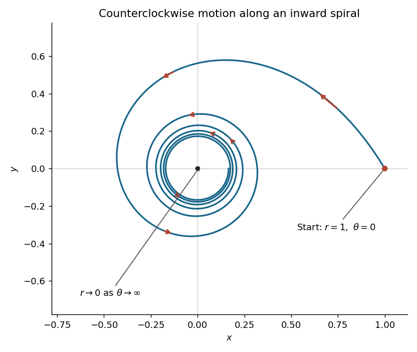

<h1 id="4/b/solution">Solution</h1>

↑ **Parent:** [B](../b.md)

Here $mh^2=b$, so the [Binet equation](../../../../../../binet-equation.md) reduces to

$$
u''+u=-\frac{(b/2)u^2e^{-u}-bu^3}{bu^2}=u-\frac12e^{-u},\qquad u''=-\frac12e^{-u}.
$$

The [initial conditions](../../../../../../initial-condition.md) become

$$
u(0)=\frac1a,\qquad u'(0)=-\frac1{a^2}\frac{dr}{d\theta}(0)=e^{-1/(2a)}>0.
$$

Multiply the [differential equation](../../../../../../differential-equation-split.md) by $2u'$ and use the [chain rule](../../../../../../chain-rule.md):

$$
\frac{d}{d\theta}(u'^2)=-e^{-u}u'=\frac{d}{d\theta}(e^{-u}),\qquad u'^2-e^{-u}=C.
$$

The [initial conditions](../../../../../../initial-condition.md) give $C=0$. Since $e^{-u}>0$, $u'$ cannot change sign at a finite value of $u$. Thus $u'=e^{-u/2}$ on the physical branch. [Separation of variables](../../../../../../separation-of-variables.md) gives

$$
\frac{d}{d\theta}(e^{u/2})=\frac12,\qquad e^{u/2}=e^{1/(2a)}+\frac\theta2.
$$

Therefore

$$
\boxed{r(\theta)=\frac1{2\log\left(e^{1/(2a)}+\theta/2\right)},\qquad \theta>2\left(1-e^{1/(2a)}\right).}
$$

The [natural logarithm](../../../../../../natural-logarithm.md) must be positive because $r>0$. For the forward [trajectory](../../../../../../trajectory.md), $\theta\geq0$ and $h=\sqrt{b/m}>0$, so $\dot\theta=h/r^2>0$: the particle travels counterclockwise while $r$ strictly decreases.

For $a=1$, it starts at $(x,y)=(1,0)$, with [tangent vector](../../../../../../tangent-vector-split.md) proportional to $(-e^{-1/2},1)$. Its successive crossings of the positive $x$ [coordinate axis](../../../../../../coordinate-axis.md) have radii

$$
r(2\pi k)=\frac1{2\log(\sqrt e+\pi k)},\qquad k=0,1,2,\ldots.
$$

It makes infinitely many inward turns, approaching the origin as $\theta\to\infty$. There is no finite-time arrival at the origin: $dt/d\theta=r^2/h$ behaves as $1/(4h\log^2\theta)$, whose [improper integral](../../../../../../improper-integral.md) diverges. If extended backwards, it comes from infinity as $\theta\downarrow2(1-\sqrt e)$.

**[Figure 1](#4/b/image-forward-central-force-trajectory-for-a-1-with-arrows-showing-counterclockwise-inward-motion). Forward central-force trajectory for a=1, with arrows showing counterclockwise inward motion**.

## ↑ Ancestors (12)

1. [B](../b.md)
2. [4](../../4.md)
3. [Mathematics IV resit](../../../mathematics-iv-resit-split.md)
4. [Prelims](../../../split.md)
5. [2021](../../../../split.md)
6. [Past exam of the mathematics course of the University of Oxford](../../../../../split.md)
7. [Mathematics course of the University of Oxford](../../../../../../mathematics-course-of-the-university-of-oxford.md)
8. [Undergraduate course of the University of Oxford](../../../../../../undergraduate-course-of-the-university-of-oxford.md)
9. [Course of the University of Oxford](../../../../../../course-of-the-university-of-oxford.md)
10. [University of Oxford](../../../../../../university-of-oxford-split.md)
11. [List of universities](../../../../../../list-of-universities.md)
12. [Codex Wiki](../../../../../../split.md)
