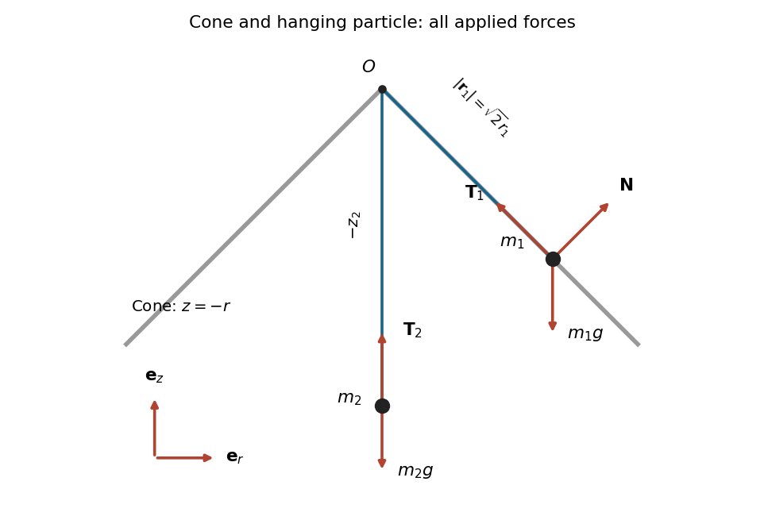

<h1 id="5/a/solution">Solution</h1>

↑ **Parent:** [A](../a.md)

The [free-body diagram](../../../../../../free-body-diagram.md) shows a meridional section of the [right circular cone](../../../../../../right-circular-cone.md). On the first particle, [gravity](../../../../../../gravity.md) acts vertically downwards, [tension](../../../../../../tension.md) points along the [straight line](../../../../../../straight-line.md) to the apex, and the [normal reaction](../../../../../../normal-force.md) is perpendicular to the [surface](../../../../../../topological-surface-split.md). The [smooth mechanical constraint](../../../../../../smooth-mechanical-constraint.md) supplies no tangential [friction](../../../../../../friction.md). The second particle has only its downward [gravitational weight](../../../../../../weight-physics.md) and the upward [tension](../../../../../../tension.md).

**[Figure 2](#5/a/image-meridional-section-of-the-inverted-cone-and-the-forces-on-both-particles-the-reaction-is-normal-to-the-cone). Meridional section of the inverted cone and the forces on both particles; the reaction is normal to the cone**.

Adding the [forces](../../../../../../force-split.md) on each particle and applying [Newton's second law](../../../../../../newton-s-second-law.md) gives

$$
\boxed{m_1\ddot{\mathbf r}_1=-m_1g\mathbf e_z+\mathbf N+\mathbf T_1,\qquad m_2\ddot{\mathbf r}_2=-m_2g\mathbf e_z+\mathbf T_2.}
$$

At $z_1=-r_1$, a [normal vector](../../../../../../normal-vector.md) is $\mathbf e_r+\mathbf e_z$. Its sign depends on the supporting face of the [cone](../../../../../../cone-geometry.md); either sign has zero [dot product](../../../../../../dot-product.md) with every permitted [velocity](../../../../../../velocity.md). The diagram chooses the reaction towards the upper side of the [surface](../../../../../../topological-surface-split.md).

## ↑ Ancestors (12)

1. [A](../a.md)
2. [5](../../5.md)
3. [Mathematics IV resit](../../../mathematics-iv-resit-split.md)
4. [Prelims](../../../split.md)
5. [2021](../../../../split.md)
6. [Past exam of the mathematics course of the University of Oxford](../../../../../split.md)
7. [Mathematics course of the University of Oxford](../../../../../../mathematics-course-of-the-university-of-oxford.md)
8. [Undergraduate course of the University of Oxford](../../../../../../undergraduate-course-of-the-university-of-oxford.md)
9. [Course of the University of Oxford](../../../../../../course-of-the-university-of-oxford.md)
10. [University of Oxford](../../../../../../university-of-oxford-split.md)
11. [List of universities](../../../../../../list-of-universities.md)
12. [Codex Wiki](../../../../../../split.md)
