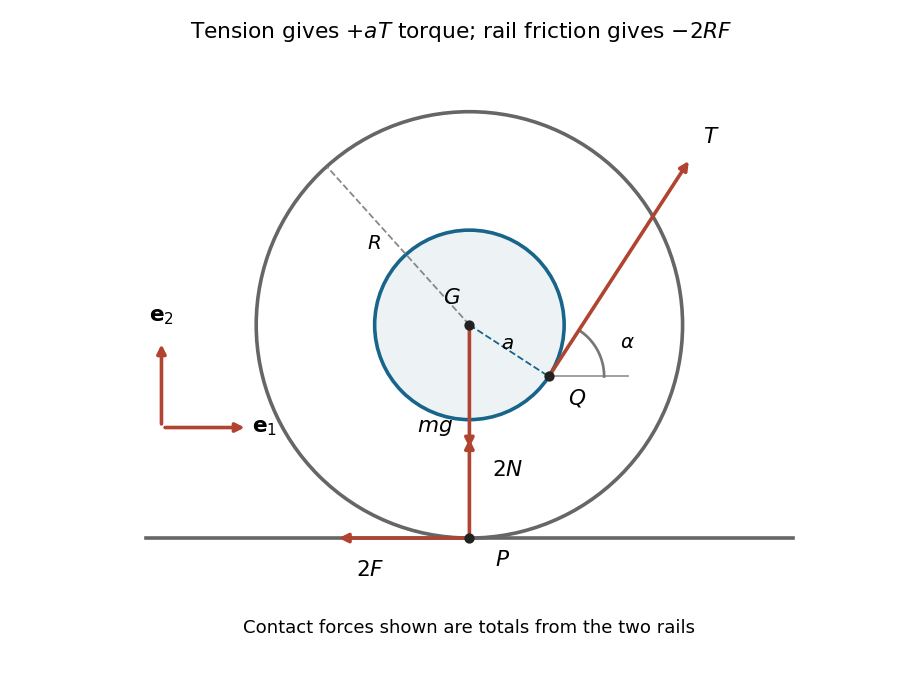

<h1 id="6/b/solution">Solution</h1>

↑ **Parent:** [B](../b.md)

Apply the general [linear momentum](../../../../../../momentum-split.md) equation $d\mathbf p/dt=\sum\mathbf F$ to the whole [rigid body](../../../../../../rigid-body-dynamics-split.md). Its center of mass has [acceleration](../../../../../../acceleration.md) $\ddot x\mathbf e_1$, and each rail contributes its own [static friction](../../../../../../static-friction.md) and [normal force](../../../../../../normal-force.md). Hence

$$
m\ddot x\mathbf e_1=(T\cos\alpha-2F)\mathbf e_1+(T\sin\alpha+2N-mg)\mathbf e_2,
$$

so

$$
\boxed{m\ddot x=T\cos\alpha-2F,\qquad N=\frac{mg-T\sin\alpha}{2}.}
$$

Here $N$ is the [normal force](../../../../../../normal-force.md) at each rail, not the combined support.

Take [torques](../../../../../../torque.md) about the center of mass, with positive [angular velocity](../../../../../../angular-velocity.md) along $\mathbf e_3$. The thread leaves the lower side shown in the source diagram: its contact [position vector](../../../../../../position-vector.md) relative to the center is

$$
\mathbf q=a\sin\alpha\,\mathbf e_1-a\cos\alpha\,\mathbf e_2.
$$

Thus $\mathbf q\times\mathbf T=aT\mathbf e_3$. Each contact point has relative [position vector](../../../../../../position-vector.md) $-R\mathbf e_2$, so each [friction](../../../../../../friction.md) [torque](../../../../../../torque.md) is $-RF\mathbf e_3$. The [gravitational weight](../../../../../../weight-physics.md) acts through the center of mass and the [normal forces](../../../../../../normal-force.md) have zero [torque](../../../../../../torque.md) about it. The [angular momentum](../../../../../../angular-momentum.md) equation becomes

$$
\boxed{\mathcal I_{33}\ddot\phi=aT-2RF.}
$$

The condition of [rolling without slipping](../../../../../../rolling-without-slipping.md) makes the contact point instantaneously stationary:

$$
\mathbf v_P=\dot x\mathbf e_1+\dot\phi\mathbf e_3\times(-R\mathbf e_2)=(\dot x+R\dot\phi)\mathbf e_1=0.
$$

Integrating and using $x(0)=\phi(0)=0$ gives $x=-R\phi$. Thus rightward [translation](../../../../../../translation-geometry.md) corresponds to clockwise [rotation](../../../../../../rotation-mathematics.md). Eliminating $F$ from the two dynamical equations with $\ddot x=-R\ddot\phi$ yields

$$
(\mathcal I_{33}+mR^2)\ddot\phi=aT-RT\cos\alpha,
$$

and therefore

$$
\boxed{\ddot\phi=-\frac{T(R\cos\alpha-a)}{mR^2+\mathcal I_{33}}.}
$$

**[Figure 3](#6/b/image-cylinder-side-view-showing-the-tension-moment-arm-and-the-combined-forces-from-both-rails). Cylinder side view, showing the tension moment arm and the combined forces from both rails**.

## ↑ Ancestors (12)

1. [B](../b.md)
2. [6](../../6.md)
3. [Mathematics IV resit](../../../mathematics-iv-resit-split.md)
4. [Prelims](../../../split.md)
5. [2021](../../../../split.md)
6. [Past exam of the mathematics course of the University of Oxford](../../../../../split.md)
7. [Mathematics course of the University of Oxford](../../../../../../mathematics-course-of-the-university-of-oxford.md)
8. [Undergraduate course of the University of Oxford](../../../../../../undergraduate-course-of-the-university-of-oxford.md)
9. [Course of the University of Oxford](../../../../../../course-of-the-university-of-oxford.md)
10. [University of Oxford](../../../../../../university-of-oxford-split.md)
11. [List of universities](../../../../../../list-of-universities.md)
12. [Codex Wiki](../../../../../../split.md)
