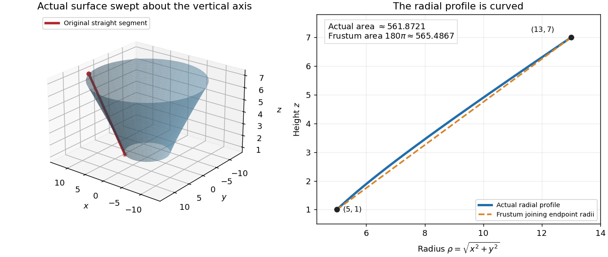

# Mathematics IV

↑ **Parent:** [Prelims](../prelims.md)

Source: [released examination PDF, bundle pages 203–209](https://www.whatdotheyknow.com/request/bsc_mathematics_prelims_and_part/response/2784209/attach/3/202409%20817%20annex.pdf#page=203).

**Table of contents**

- [1](#1)
  - [a](#1/a)
    - [i](#1/a/i)
      - [Solution](#1/a/i/solution)
    - [ii](#1/a/ii)
      - [Solution](#1/a/ii/solution)
    - [iii](#1/a/iii)
      - [Solution](#1/a/iii/solution)
  - [b](#1/b)
    - [Solution](#1/b/solution)
  - [c](#1/c)
    - [Solution](#1/c/solution)
- [2](#2)
  - [a](#2/a)
    - [i](#2/a/i)
      - [Solution](#2/a/i/solution)
    - [ii](#2/a/ii)
      - [Solution](#2/a/ii/solution)
  - [b](#2/b)
    - [Solution](#2/b/solution)
  - [c](#2/c)
    - [Solution](#2/c/solution)
- [3](#3)
  - [a](#3/a)
    - [Solution](#3/a/solution)
  - [b](#3/b)
    - [i](#3/b/i)
      - [Solution](#3/b/i/solution)
    - [ii](#3/b/ii)
      - [Solution](#3/b/ii/solution)
    - [iii](#3/b/iii)
      - [Solution](#3/b/iii/solution)
  - [c](#3/c)
    - [i](#3/c/i)
      - [Solution](#3/c/i/solution)
    - [ii](#3/c/ii)
      - [Solution](#3/c/ii/solution)
- [4](#4)
  - [a](#4/a)
    - [Solution](#4/a/solution)
  - [b](#4/b)
    - [i](#4/b/i)
      - [Solution](#4/b/i/solution)
    - [ii](#4/b/ii)
      - [Solution](#4/b/ii/solution)
- [5](#5)
  - [a](#5/a)
    - [Solution](#5/a/solution)
  - [b](#5/b)
    - [Solution](#5/b/solution)
  - [c](#5/c)
    - [Solution](#5/c/solution)
- [6](#6)
  - [a](#6/a)
    - [Solution](#6/a/solution)
  - [b](#6/b)
    - [Solution](#6/b/solution)
  - [c](#6/c)
    - [Solution](#6/c/solution)
- [7](#7)
  - [a](#7/a)
    - [Solution](#7/a/solution)
  - [b](#7/b)
    - [Solution](#7/b/solution)
  - [c](#7/c)
    - [Solution](#7/c/solution)

## 1

↑ **Parent:** [Mathematics IV](mathematics-iv.md)

<h3 id="1/a">a</h3>

↑ **Parent:** [1](#1)

<h4 id="1/a/i">i</h4>

↑ **Parent:** [a](#1/a)

<h5 id="1/a/i/solution">Solution</h5>

↑ **Parent:** [i](#1/a/i)

Write $\mathbf u=\mathbf b-\mathbf a$. Since the [triangle](../../../euclidean-geometry.md#triangle) is nondegenerate, $\mathbf u\ne0$. Every [point](../../../geometry-and-topology.md#point-geometry) on the [line](../../../euclidean-geometry.md#straight-line) $AB$ has a unique [position vector](../../../classical-mechanics.md#position-vector) $\mathbf p=\mathbf a+t\mathbf u$. The condition that $CP$ is [orthogonal](../../../inner-product.md#orthogonal-vectors) to $AB$ is the [dot product](../../../inner-product.md#dot-product) [equation](../../../algebra.md#equation)

$$
(\mathbf c-\mathbf a-t\mathbf u)\cdot\mathbf u=0.
$$

Its [coefficient](../../../vector-space.md#coefficient) of $t$ is $-\|\mathbf u\|^2\ne0$, so it has exactly one solution. The [foot of a perpendicular](../../../hilbert-space.md#foot-of-a-perpendicular) is therefore

$$
\boxed{\mathbf p=\mathbf a+\frac{(\mathbf c-\mathbf a)\cdot(\mathbf b-\mathbf a)}{\|\mathbf b-\mathbf a\|^2}(\mathbf b-\mathbf a).}
$$

This is the [orthogonal projection](../../../hilbert-space.md#orthogonal-projection) of $C$ onto the [line](../../../euclidean-geometry.md#straight-line) $AB$, expressed using the [Euclidean norm](../../../normed-vector-space.md#euclidean-norm).

<h4 id="1/a/ii">ii</h4>

↑ **Parent:** [a](#1/a)

<h5 id="1/a/ii/solution">Solution</h5>

↑ **Parent:** [ii](#1/a/ii)

With $t$ as in [i](#1/a/i), the [foot of a perpendicular](../../../hilbert-space.md#foot-of-a-perpendicular) lies strictly between the endpoints precisely when $0<t<1$. Since the [denominator](../../../number-theory.md#denominator) is positive, this gives

$$
\boxed{0<(\mathbf c-\mathbf a)\cdot(\mathbf b-\mathbf a)<\|\mathbf b-\mathbf a\|^2.}
$$

Equivalently, both [dot products](../../../inner-product.md#dot-product)

$$
(\mathbf c-\mathbf a)\cdot(\mathbf b-\mathbf a)>0,\qquad
(\mathbf c-\mathbf b)\cdot(\mathbf a-\mathbf b)>0
$$

are positive: the [angles](../../../geometry-and-topology.md#angle) of the [triangle](../../../euclidean-geometry.md#triangle) at $A$ and $B$ are both less than $\pi/2$. If “between” includes the endpoints, replace both strict [inequalities](../../../arithmetic.md#inequality-mathematics) by non-strict ones; equality gives $P=A$ or $P=B$.

<h4 id="1/a/iii">iii</h4>

↑ **Parent:** [a](#1/a)

<h5 id="1/a/iii/solution">Solution</h5>

↑ **Parent:** [iii](#1/a/iii)

The [altitude of a triangle](../../../euclidean-geometry.md#altitude-of-a-triangle) through $A$ has [equation](../../../algebra.md#equation) $(\mathbf a-\mathbf d)\cdot(\mathbf b-\mathbf c)=0$, and the [altitude of a triangle](../../../euclidean-geometry.md#altitude-of-a-triangle) through $B$ has [equation](../../../algebra.md#equation) $(\mathbf b-\mathbf d)\cdot(\mathbf a-\mathbf c)=0$. Their [normal vectors](../../../differential-geometry.md#normal-vector) $\mathbf b-\mathbf c$ and $\mathbf a-\mathbf c$ are [linearly independent](../../../vector-space.md#linear-independence) because the [triangle](../../../euclidean-geometry.md#triangle) is nondegenerate. Consequently these two [lines](../../../euclidean-geometry.md#straight-line) meet in exactly one [point](../../../geometry-and-topology.md#point-geometry) $D$.

Substitute its [position vector](../../../classical-mechanics.md#position-vector) $\mathbf d$ in the supplied identity. Its first term vanishes by the first [altitude of a triangle](../../../euclidean-geometry.md#altitude-of-a-triangle) [equation](../../../algebra.md#equation), and its second term vanishes by the second [altitude of a triangle](../../../euclidean-geometry.md#altitude-of-a-triangle) [equation](../../../algebra.md#equation). Hence

$$
(\mathbf a-\mathbf b)\cdot(\mathbf c-\mathbf d)=0.
$$

This is exactly the condition that $D$ lies on the [altitude of a triangle](../../../euclidean-geometry.md#altitude-of-a-triangle) through $C$. **The three [lines](../../../euclidean-geometry.md#straight-line) therefore meet in a unique [point](../../../geometry-and-topology.md#point-geometry), the [orthocenter](../../../euclidean-geometry.md#orthocenter).** This argument includes [right triangles](../../../euclidean-geometry.md#right-triangle) and [triangles](../../../euclidean-geometry.md#triangle) whose [orthocenter](../../../euclidean-geometry.md#orthocenter) lies outside them.

<h3 id="1/b">b</h3>

↑ **Parent:** [1](#1)

<h4 id="1/b/solution">Solution</h4>

↑ **Parent:** [b](#1/b)

Let $A=(Y+Z)/2$, $B=(Z+X)/2$, and $C=(X+Y)/2$, interpreting these expressions as [position vectors](../../../classical-mechanics.md#position-vector). The resulting [medial triangle](../../../euclidean-geometry.md#medial-triangle) is nondegenerate: for example,

$$
\mathbf b-\mathbf c=\tfrac12(\mathbf z-\mathbf y).
$$

Thus $BC$ is parallel to $YZ$, and the same calculation holds cyclically. The [altitude of a triangle](../../../euclidean-geometry.md#altitude-of-a-triangle) through $A$ is consequently the [line](../../../euclidean-geometry.md#straight-line) through the [midpoint](../../../convex-set.md#midpoint) of $YZ$ that is [orthogonal](../../../inner-product.md#orthogonal-vectors) to $YZ$, namely its [perpendicular bisector](../../../euclidean-geometry.md#perpendicular-bisector). Each remaining [altitude of a triangle](../../../euclidean-geometry.md#altitude-of-a-triangle) similarly gives one of the other two [perpendicular bisectors](../../../euclidean-geometry.md#perpendicular-bisector).

By [iii](#1/a/iii), the [medial triangle](../../../euclidean-geometry.md#medial-triangle) has a unique [orthocenter](../../../euclidean-geometry.md#orthocenter), so **the three [perpendicular bisectors](../../../euclidean-geometry.md#perpendicular-bisector) meet in one [point](../../../geometry-and-topology.md#point-geometry)**. Every [point](../../../geometry-and-topology.md#point-geometry) on the [perpendicular bisector](../../../euclidean-geometry.md#perpendicular-bisector) of $YZ$ is equally far from $Y$ and $Z$: expanding the squares of the two [Euclidean distances](../../../topological-analysis.md#euclidean-distance) gives $2\mathbf q\cdot(\mathbf z-\mathbf y)=\|\mathbf z\|^2-\|\mathbf y\|^2$. Applying this to the three sides shows that the common [point](../../../geometry-and-topology.md#point-geometry) is equally far from $X,Y,Z$. It is the [circumcenter](../../../euclidean-geometry.md#circumcenter).

<h3 id="1/c">c</h3>

↑ **Parent:** [1](#1)

<h4 id="1/c/solution">Solution</h4>

↑ **Parent:** [c](#1/c)

Write $z=x+iy$, with $y\ne0$ because the [triangle](../../../euclidean-geometry.md#triangle) is nondegenerate. Let $w=u+iv$ be its [circumcenter](../../../euclidean-geometry.md#circumcenter). Equality of the [complex modulus](../../../complex-analysis.md#complex-modulus) values $|w|=|w-1|$ gives $u=1/2$. Equality of $|w|=|w-z|$, after expanding the squares, gives

$$
2\operatorname{Re}(w\bar z)=|z|^2,\qquad x+2vy=x^2+y^2.
$$

Thus the [real part](../../../complex-analysis.md#real-part) and [imaginary part](../../../complex-analysis.md#imaginary-part) determine

$$
w=\frac12+i\frac{x^2+y^2-x}{2y}.
$$

Using the [complex conjugate](../../../complex-analysis.md#complex-conjugate) $\bar z=x-iy$, we also have

$$
\frac{z(1-\bar z)}{z-\bar z}
=\frac{x-x^2-y^2+iy}{2iy}
=\frac12+i\frac{x^2+y^2-x}{2y}.
$$

Therefore

$$
\boxed{w=\frac{z(1-\bar z)}{z-\bar z}.}
$$

The nonzero [denominator](../../../number-theory.md#denominator) is exactly the nondegeneracy condition. If $z$ is real, the three distinct collinear [points](../../../geometry-and-topology.md#point-geometry) do not have a finite [circumcenter](../../../euclidean-geometry.md#circumcenter).

## 2

↑ **Parent:** [Mathematics IV](mathematics-iv.md)

<h3 id="2/a">a</h3>

↑ **Parent:** [2](#2)

<h4 id="2/a/i">i</h4>

↑ **Parent:** [a](#2/a)

<h5 id="2/a/i/solution">Solution</h5>

↑ **Parent:** [i](#2/a/i)

The [area of an ellipse](../../../euclidean-geometry.md#area-of-an-ellipse) with positive semiaxes $a,b$ is

$$
\boxed{\pi ab.}
$$

<h4 id="2/a/ii">ii</h4>

↑ **Parent:** [a](#2/a)

<h5 id="2/a/ii/solution">Solution</h5>

↑ **Parent:** [ii](#2/a/ii)

Represent the [quadratic form](../../../quadratic-form.md) by the [symmetric matrix](../../../linear-algebra.md#symmetric-matrix)

$$
M=\begin{pmatrix}\alpha&\beta/2\\\beta/2&\gamma\end{pmatrix},\qquad
\mathbf x^TM\mathbf x=1.
$$

The [spectral theorem for real symmetric matrices](../../../linear-algebra.md#spectral-theorem-for-real-symmetric-matrices) gives an [orthogonal matrix](../../../linear-algebra.md#orthogonal-matrix) $Q$ and real [eigenvalues](../../../linear-operator-theory.md#eigenvalue) $\lambda_1,\lambda_2$ such that $Q^TMQ=\operatorname{diag}(\lambda_1,\lambda_2)$. In the [orthogonal change of coordinates](../../../linear-algebra.md#orthogonal-change-of-coordinates) $\mathbf x=Q\mathbf u$, the [equation](../../../algebra.md#equation) becomes $\lambda_1u_1^2+\lambda_2u_2^2=1$.

If both [eigenvalues](../../../linear-operator-theory.md#eigenvalue) are positive, this is an [ellipse](../../../euclidean-geometry.md#ellipse) with semiaxes $\lambda_1^{-1/2}$ and $\lambda_2^{-1/2}$. Conversely, a zero [eigenvalue](../../../linear-operator-theory.md#eigenvalue) makes the set either empty or unbounded along that [coordinate](../../../vector-space.md#coordinate-linear-algebra), while two negative [eigenvalues](../../../linear-operator-theory.md#eigenvalue) give the empty set. Opposite signs give an unbounded [hyperbola](../../../euclidean-geometry.md#hyperbola). A negative [eigenvalue](../../../linear-operator-theory.md#eigenvalue) together with a zero one also gives the empty set. None of those cases is an [ellipse](../../../euclidean-geometry.md#ellipse). Therefore the exact condition is that $M$ be a [symmetric positive-definite matrix](../../../linear-algebra.md#symmetric-positive-definite-matrix).

The sum and product of its [eigenvalues](../../../linear-operator-theory.md#eigenvalue) are its [matrix trace](../../../linear-algebra.md#matrix-trace) and [determinant](../../../multilinear-algebra.md#determinant):

$$
\lambda_1+\lambda_2=\alpha+\gamma,\qquad
\lambda_1\lambda_2=\alpha\gamma-\frac{\beta^2}{4}.
$$

Two real numbers are both positive precisely when their sum and product are positive. Thus

$$
\boxed{\alpha+\gamma>0,\qquad 4\alpha\gamma>\beta^2.}
$$

An [orthogonal transformation](../../../linear-algebra.md#orthogonal-transformation) preserves [area](../../../differential-geometry.md#surface-area). Using [i](#2/a/i) gives the [quadratic-form ellipse area](../../../euclidean-geometry.md#quadratic-form-ellipse-area)

$$
\boxed{\mathcal A=\frac{\pi}{\sqrt{\det M}}=\frac{2\pi}{\sqrt{4\alpha\gamma-\beta^2}}.}
$$

<h3 id="2/b">b</h3>

↑ **Parent:** [2](#2)

<h4 id="2/b/solution">Solution</h4>

↑ **Parent:** [b](#2/b)

Eliminate $z$ using the [plane](../../../geometry-and-topology.md#plane) [equation](../../../algebra.md#equation). The [orthogonal projection](../../../hilbert-space.md#orthogonal-projection) consists exactly of the [points](../../../geometry-and-topology.md#point-geometry) satisfying

$$
x^2+xy+y^2+x+y=1,
$$

since each such $(x,y)$ lifts uniquely to $(x,y,1-x-y)$ on the intersection. Translating to the [center of an ellipse](../../../euclidean-geometry.md#center-of-an-ellipse) with $X=x+1/3$ and $Y=y+1/3$ gives

$$
X^2+XY+Y^2=\frac43.
$$

The [symmetric matrix](../../../linear-algebra.md#symmetric-matrix) of this [quadratic form](../../../quadratic-form.md) is $M=\left(\begin{smallmatrix}1&1/2\\1/2&1\end{smallmatrix}\right)$, whose [eigenvalues](../../../linear-operator-theory.md#eigenvalue) are $3/2$ and $1/2$. Thus it is a [symmetric positive-definite matrix](../../../linear-algebra.md#symmetric-positive-definite-matrix), and the projected curve is an [ellipse](../../../euclidean-geometry.md#ellipse). The [quadratic-form ellipse area](../../../euclidean-geometry.md#quadratic-form-ellipse-area), with the right-hand side scaled by $4/3$, is

$$
\boxed{\mathcal A(C')=\frac{(4/3)\pi}{\sqrt{3/4}}=\frac{8\pi}{3\sqrt3}.}
$$

For example, the [orthogonal change of coordinates](../../../linear-algebra.md#orthogonal-change-of-coordinates) $u=(X+Y)/\sqrt2$, $v=(X-Y)/\sqrt2$ gives semiaxes $2\sqrt2/3$ and $2\sqrt6/3$, with the same product.

<h3 id="2/c">c</h3>

↑ **Parent:** [2](#2)

<h4 id="2/c/solution">Solution</h4>

↑ **Parent:** [c](#2/c)

Let $D$ be the filled projected [ellipse](../../../euclidean-geometry.md#ellipse). The part of the [plane](../../../geometry-and-topology.md#plane) bounded by $C$ is the [parametrized surface](../../../multivariable-calculus.md#parametrized-surface)

$$
\mathbf R(x,y)=(x,y,1-x-y),\qquad (x,y)\in D.
$$

Its [tangent vectors](../../../tangent-vector.md) satisfy

$$
\mathbf R_x=(1,0,-1),\qquad \mathbf R_y=(0,1,-1),\qquad
\|\mathbf R_x\times\mathbf R_y\|=\|(1,1,1)\|=\sqrt3.
$$

The [surface area](../../../differential-geometry.md#surface-area) is therefore

$$
\boxed{\mathcal A(C)=\iint_D\sqrt3\,dx\,dy=\sqrt3\frac{8\pi}{3\sqrt3}=\frac{8\pi}{3}.}
$$

This also illustrates the [orthogonal projection area formula](../../../differential-geometry.md#orthogonal-projection-area-formula): the [unit normal](../../../differential-geometry.md#unit-normal) to the [plane](../../../geometry-and-topology.md#plane) has vertical component $1/\sqrt3$, so projection multiplies [area](../../../differential-geometry.md#surface-area) by $1/\sqrt3$.

## 3

↑ **Parent:** [Mathematics IV](mathematics-iv.md)

<h3 id="3/a">a</h3>

↑ **Parent:** [3](#3)

<h4 id="3/a/solution">Solution</h4>

↑ **Parent:** [a](#3/a)

For a regular [parametrized surface](../../../multivariable-calculus.md#parametrized-surface) that covers its image once, up to sets of zero [area](../../../differential-geometry.md#surface-area), its [surface area](../../../differential-geometry.md#surface-area) is

$$
\boxed{\operatorname{Area}(S)=\iint_U\left\|\frac{\partial\mathbf r}{\partial u}\times\frac{\partial\mathbf r}{\partial v}\right\|\,du\,dv.}
$$

The integrand is the [area element of a surface](../../../differential-geometry.md#area-element-of-a-surface), the [area](../../../differential-geometry.md#surface-area) of the small [parallelogram](../../../euclidean-geometry.md#parallelogram) spanned by the two [tangent vectors](../../../tangent-vector.md). A [parametrization](../../../geometry-and-topology.md#parametric-equation) that covers a region more than once counts that multiplicity; the geometric [surface area](../../../differential-geometry.md#surface-area) requires a single covering or a division into nonoverlapping patches.

<h3 id="3/b">b</h3>

↑ **Parent:** [3](#3)

<h4 id="3/b/i">i</h4>

↑ **Parent:** [b](#3/b)

<h5 id="3/b/i/solution">Solution</h5>

↑ **Parent:** [i](#3/b/i)

Interpolate the [radius](../../../topology.md#radius) and height by

$$
\rho(t)=a+(c-a)t,\qquad z(t)=b+(d-b)t,\qquad 0\leq t\leq1.
$$

A [parametrized surface](../../../multivariable-calculus.md#parametrized-surface) for the [conical frustum](../../../differential-geometry.md#conical-frustum) is

$$
\boxed{\mathbf R(t,\theta)=\bigl(\rho(t)\cos\theta,\rho(t)\sin\theta,b+(d-b)t\bigr),\quad 0\leq t\leq1,\quad0\leq\theta<2\pi.}
$$

The strict positivity of $a,c$ gives $\rho(t)>0$. Since $d>b$, the height identifies $t$ uniquely; the [angle](../../../geometry-and-topology.md#angle) then identifies a [point](../../../geometry-and-topology.md#point-geometry) of each [circle](../../../topology.md#circle) uniquely modulo $2\pi$. Hence this covers the lateral [surface of revolution](../../../differential-geometry.md#surface-of-revolution) once. If $a=c$, it is the lateral surface of a [circular cylinder](../../../differential-geometry.md#circular-cylinder).

<h4 id="3/b/ii">ii</h4>

↑ **Parent:** [b](#3/b)

<h5 id="3/b/ii/solution">Solution</h5>

↑ **Parent:** [ii](#3/b/ii)

For the [parametrized surface](../../../multivariable-calculus.md#parametrized-surface) in [i](#3/b/i),

$$
\begin{aligned}
\mathbf R_t&=((c-a)\cos\theta,(c-a)\sin\theta,d-b),\\
\mathbf R_\theta&=(-\rho\sin\theta,\rho\cos\theta,0).
\end{aligned}
$$

These [tangent vectors](../../../tangent-vector.md) are [orthogonal](../../../inner-product.md#orthogonal-vectors), and their [Euclidean norms](../../../normed-vector-space.md#euclidean-norm) are $\sqrt{(c-a)^2+(d-b)^2}$ and $\rho$, respectively. Their [cross product](../../../vector-space.md#cross-product) therefore has [Euclidean norm](../../../normed-vector-space.md#euclidean-norm) $\rho\sqrt{(c-a)^2+(d-b)^2}$. Integration gives

$$
\begin{aligned}
\operatorname{Area}(\Sigma_1)
&=2\pi\sqrt{(c-a)^2+(d-b)^2}\int_0^1(a+(c-a)t)\,dt\\
&=\boxed{\pi(a+c)\sqrt{(a-c)^2+(b-d)^2}.}
\end{aligned}
$$

This is the lateral [surface area](../../../differential-geometry.md#surface-area) of a [conical frustum](../../../differential-geometry.md#conical-frustum), with no end disks included.

<h4 id="3/b/iii">iii</h4>

↑ **Parent:** [b](#3/b)

<h5 id="3/b/iii/solution">Solution</h5>

↑ **Parent:** [iii](#3/b/iii)

The endpoint [radii](../../../topology.md#radius) are $5$ and $13$, but **substituting those two numbers in the finite [conical frustum](../../../differential-geometry.md#conical-frustum) formula is invalid**. A rotation about the $z$-axis preserves the horizontal [angle](../../../geometry-and-topology.md#angle) between the endpoint [position vectors](../../../classical-mechanics.md#position-vector); here $(3,4)$ and $(12,5)$ are not parallel. The [radius](../../../topology.md#radius) along the generating segment is not linear in height.

Parametrize the actual segment by

$$
(x,y,z)=(3+9t,4+t,1+6t),\qquad0\leq t\leq1.
$$

Its rotated [circle](../../../topology.md#circle) at height $1+6t$ has [radius](../../../topology.md#radius)

$$
\rho(t)=\sqrt{(3+9t)^2+(4+t)^2}=\sqrt{25+62t+82t^2},\qquad
\rho'(t)=\frac{31+82t}{\rho(t)}.
$$

Thus the rotated image is the [surface of revolution](../../../differential-geometry.md#surface-of-revolution) $\mathbf R(t,\theta)=(\rho(t)\cos\theta,\rho(t)\sin\theta,1+6t)$. Applying the [conical frustum](../../../differential-geometry.md#conical-frustum) formula to infinitesimal pieces of this radial profile, or directly using the [cross product](../../../vector-space.md#cross-product) as in [ii](#3/b/ii), gives the [surface area of a surface of revolution](../../../differential-geometry.md#surface-area-of-a-surface-of-revolution)

$$
\begin{aligned}
\mathcal A
&=2\pi\int_0^1\rho(t)\sqrt{\rho'(t)^2+36}\,dt\\
&=2\pi\int_0^1\sqrt{9676t^2+7316t+1861}\,dt.
\end{aligned}
$$

To evaluate it explicitly, put $u=82t+31$. Then $9676t^2+7316t+1861=(59u^2+19602)/41$. Define

$$
G(u)=u\sqrt{59u^2+19602}+\frac{19602}{\sqrt{59}}\log\bigl(\sqrt{59}\,u+\sqrt{59u^2+19602}\bigr).
$$

The [chain rule](../../../calculus.md#chain-rule) gives $G'(u)=2\sqrt{59u^2+19602}$, so the answer is

$$
\boxed{\mathcal A=\frac{\pi}{82\sqrt{41}}\bigl(G(113)-G(31)\bigr)\simeq561.8721076764.}
$$

The positive [logarithm](../../../calculus.md#logarithm) arguments make this a real-valued expression. Rotating the segment's endpoints independently into one vertical [plane](../../../geometry-and-topology.md#plane) before joining them would instead create a different surface, with [surface area](../../../differential-geometry.md#surface-area) $180\pi\simeq565.4867$.

**[Figure 1](#3/b/iii/image-the-rotated-segment-has-a-curved-radial-profile-although-its-three-dimensional-generator-is-straight). The rotated segment has a curved radial profile, although its three-dimensional generator is straight.**

<h3 id="3/c">c</h3>

↑ **Parent:** [3](#3)

<h4 id="3/c/i">i</h4>

↑ **Parent:** [c](#3/c)

<h5 id="3/c/i/solution">Solution</h5>

↑ **Parent:** [i](#3/c/i)

Let $\mathbf r(u,v)$ parametrize $S$. Then $A\mathbf r$ parametrizes its image, with [tangent vectors](../../../tangent-vector.md) $A\mathbf r_u$ and $A\mathbf r_v$. An [orthogonal matrix](../../../linear-algebra.md#orthogonal-matrix) preserves [dot products](../../../inner-product.md#dot-product), so the [Lagrange identity for the cross product](../../../multivariable-calculus.md#lagrange-identity-for-the-cross-product) gives, for any $\mathbf p,\mathbf q$,

$$
\begin{aligned}
\|A\mathbf p\times A\mathbf q\|^2
&=\|A\mathbf p\|^2\|A\mathbf q\|^2-(A\mathbf p\cdot A\mathbf q)^2\\
&=\|\mathbf p\|^2\|\mathbf q\|^2-(\mathbf p\cdot\mathbf q)^2
=\|\mathbf p\times\mathbf q\|^2.
\end{aligned}
$$

The [area element of a surface](../../../differential-geometry.md#area-element-of-a-surface) is therefore the same pointwise before and after applying $A$. Integrating proves

$$
\boxed{\operatorname{Area}(A S)=\operatorname{Area}(S).}
$$

This includes [orthogonal transformations](../../../linear-algebra.md#orthogonal-transformation) with [determinant](../../../multilinear-algebra.md#determinant) $-1$: reversal of [orientation](../../../algebraic-topology.md#orientation-of-a-simplex) does not affect the [Euclidean norm](../../../normed-vector-space.md#euclidean-norm) in the [surface area](../../../differential-geometry.md#surface-area) formula.

<h4 id="3/c/ii">ii</h4>

↑ **Parent:** [c](#3/c)

<h5 id="3/c/ii/solution">Solution</h5>

↑ **Parent:** [ii](#3/c/ii)

Let $B=A^TA$. It is a [symmetric matrix](../../../linear-algebra.md#symmetric-matrix), and $\mathbf v^TB\mathbf v=\|A\mathbf v\|^2\geq0$. By the [spectral theorem for real symmetric matrices](../../../linear-algebra.md#spectral-theorem-for-real-symmetric-matrices), choose an [orthonormal basis](../../../inner-product.md#orthonormal-basis) $\mathbf v_1,\mathbf v_2,\mathbf v_3$ of [eigenvectors](../../../linear-operator-theory.md#eigenvector) of $B$, with nonnegative [eigenvalues](../../../linear-operator-theory.md#eigenvalue) $\lambda_1,\lambda_2,\lambda_3$.

For each $i\ne j$, take the unit [parallelogram](../../../euclidean-geometry.md#parallelogram) parametrized by $s\mathbf v_i+t\mathbf v_j$, $0\leq s,t\leq1$. Its [surface area](../../../differential-geometry.md#surface-area) is $1$. Moreover,

$$
A\mathbf v_i\cdot A\mathbf v_j=\mathbf v_i^TB\mathbf v_j=0,\qquad
\|A\mathbf v_i\|^2=\lambda_i.
$$

The image [parallelogram](../../../euclidean-geometry.md#parallelogram) consequently has [area](../../../differential-geometry.md#surface-area) $\sqrt{\lambda_i\lambda_j}$. By the assumption this equals $1$ for all three pairs, giving

$$
\lambda_1\lambda_2=\lambda_1\lambda_3=\lambda_2\lambda_3=1.
$$

No [eigenvalue](../../../linear-operator-theory.md#eigenvalue) can be zero. Dividing the [equations](../../../algebra.md#equation) and using positivity yields $\lambda_1=\lambda_2=\lambda_3=1$. Hence

$$
\boxed{A^TA=I,\quad\text{so }A\text{ is orthogonal}.}
$$

Thus testing all surfaces is stronger than necessary: the three unit [parallelograms](../../../euclidean-geometry.md#parallelogram) in these principal directions already determine the result. This is the three-dimensional [characterization of linear surface-area isometries](../../../linear-algebra.md#characterization-of-linear-surface-area-isometries).

## 4

↑ **Parent:** [Mathematics IV](mathematics-iv.md)

<h3 id="4/a">a</h3>

↑ **Parent:** [4](#4)

<h4 id="4/a/solution">Solution</h4>

↑ **Parent:** [a](#4/a)

Write $q=|\dot{\mathbf r}|=\sqrt{\dot r^2+r^2\dot\theta^2}$. Differentiating the [angular momentum](../../../momentum.md#angular-momentum) and applying [Newton's second law](../../../force.md#newton-s-second-law) gives

$$
\begin{aligned}
\dot{\mathbf L}
&=m\dot{\mathbf r}\times\dot{\mathbf r}+m\mathbf r\times\ddot{\mathbf r}
=\mathbf r\times\mathbf F\\
&=\mathbf r\times(-\alpha q\dot{\mathbf r})
=-\frac\alpha m q\mathbf L.
\end{aligned}
$$

The [central force](../../../mathematical-physics.md#central-force) contributes no [torque](../../../momentum.md#torque), because it is parallel to $\mathbf r$. The [angular momentum](../../../momentum.md#angular-momentum) direction is fixed whenever it is nonzero; the motion is consequently planar. In the [plane](../../../geometry-and-topology.md#plane)'s [polar coordinates](../../../multivariable-calculus.md#polar-coordinates), $\mathbf L=mh\mathbf e_z$, so

$$
\boxed{\dot h=-\frac\alpha m\sqrt{\dot r^2+r^2\dot\theta^2}\,r^2\dot\theta.}
$$

For the [mechanical energy](../../../energy.md#mechanical-energy), use the [chain rule](../../../calculus.md#chain-rule), [Newton's second law](../../../force.md#newton-s-second-law), and $V'(r)=-F_c(r)$:

$$
\begin{aligned}
\dot E
&=m\dot{\mathbf r}\cdot\ddot{\mathbf r}+V'(r)\dot r\\
&=F_c(r)\dot r-\alpha q|\dot{\mathbf r}|^2+V'(r)\dot r
=-\alpha q^3.
\end{aligned}
$$

Thus

$$
\boxed{\dot E=-\alpha(\dot r^2+r^2\dot\theta^2)^{3/2}.}
$$

For a trajectory on a time interval, both $h$ and $E$ are each a [constant of motion](../../../hamiltonian-mechanics.md#conserved-quantity) precisely when $\alpha=0$ or the [velocity](../../../classical-mechanics.md#velocity) vanishes throughout that interval. Under the stated strictly attractive [central force](../../../mathematical-physics.md#central-force) at a regular [point](../../../geometry-and-topology.md#point-geometry) $r>0$, a permanently stationary trajectory is impossible by [Newton's second law](../../../force.md#newton-s-second-law). **For the stated attractive motion, both are conserved if and only if $\alpha=0$.** An isolated instant of zero [speed](../../../classical-mechanics.md#speed) only makes the [derivatives](../../../calculus.md#derivative) vanish at that instant. A radial trajectory has $h=0$ even with [quadratic drag](../../../fluid-mechanics.md#quadratic-drag), but its [mechanical energy](../../../energy.md#mechanical-energy) still decreases whenever it moves.

<h3 id="4/b">b</h3>

↑ **Parent:** [4](#4)

<h4 id="4/b/i">i</h4>

↑ **Parent:** [b](#4/b)

<h5 id="4/b/i/solution">Solution</h5>

↑ **Parent:** [i](#4/b/i)

With $\alpha=0$, [a](#4/a) gives constant $h$, and the [polar coordinates](../../../multivariable-calculus.md#polar-coordinates) [basis](../../../vector-space.md#basis) satisfies $\dot{\mathbf e}_r=\dot\theta\mathbf e_\theta$, $\mathbf e_r\times\mathbf e_z=-\mathbf e_\theta$. Also $\ddot{\mathbf r}=(F_c/m)\mathbf e_r$. Differentiating the proposed [Laplace-Runge-Lenz vector](../../../classical-mechanics.md#laplace-runge-lenz-vector) therefore gives

$$
\begin{aligned}
\dot{\mathbf A}
&=m^2h\ddot{\mathbf r}\times\mathbf e_z-mk\dot{\mathbf e}_r\\
&=-mhF_c(r)\mathbf e_\theta-mk\dot\theta\mathbf e_\theta\\
&=-mh\left(F_c(r)+\frac{k}{r^2}\right)\mathbf e_\theta.
\end{aligned}
$$

For this to vanish for arbitrary $h$, including nonzero $h$, the [central force](../../../mathematical-physics.md#central-force) must satisfy

$$
\boxed{F_c(r)=-\frac{k}{r^2},\qquad V(r)=-\frac{k}{r}+\text{constant}.}
$$

Attraction requires $k>0$. The condition “for any value of $h$” matters: with $h=0$ alone, the [Laplace-Runge-Lenz vector](../../../classical-mechanics.md#laplace-runge-lenz-vector) is constant on each radial ray for any [central force](../../../mathematical-physics.md#central-force), so that special case would not determine the force law.

<h4 id="4/b/ii">ii</h4>

↑ **Parent:** [b](#4/b)

<h5 id="4/b/ii/solution">Solution</h5>

↑ **Parent:** [ii](#4/b/ii)

Assume $h\ne0$. The [velocity in polar coordinates](../../../classical-mechanics.md#velocity-in-polar-coordinates) is $\dot{\mathbf r}=\dot r\mathbf e_r+r\dot\theta\mathbf e_\theta$. Hence

$$
(\dot{\mathbf r}\times\mathbf e_z)\cdot\mathbf r=r^2\dot\theta=h.
$$

Taking the [dot product](../../../inner-product.md#dot-product) of the conserved [Laplace-Runge-Lenz vector](../../../classical-mechanics.md#laplace-runge-lenz-vector) with $\mathbf r$ gives

$$
Ar\cos\gamma=m^2h^2-mkr.
$$

Consequently the [polar equation of a conic](../../../euclidean-geometry.md#polar-equation-of-a-conic) is

$$
\boxed{r(\gamma)=\frac{m^2h^2}{mk+A\cos\gamma}=\frac{mh^2/k}{1+(A/(mk))\cos\gamma}.}
$$

Only [angles](../../../geometry-and-topology.md#angle) for which the [denominator](../../../number-theory.md#denominator) is positive describe the physical trajectory. Its [eccentricity](../../../euclidean-geometry.md#eccentricity-of-a-conic) is $A/(mk)$, giving an [ellipse](../../../euclidean-geometry.md#ellipse), [parabola](../../../euclidean-geometry.md#parabola), or [hyperbola](../../../euclidean-geometry.md#hyperbola) when this ratio is respectively less than, equal to, or greater than $1$.

If $A=0$, the [angle](../../../geometry-and-topology.md#angle) $\gamma$ is undefined, but the same [dot product](../../../inner-product.md#dot-product) identity gives the [circular orbit](../../../classical-mechanics.md#circular-orbit) $\boxed{r=mh^2/k}$. If $h=0$, the trajectory is radial and the displayed division degenerates; for $k>0$, $\mathbf A=-mk\mathbf e_r$ and $\gamma=\pi$ on a fixed ray, so the identity does not determine $r$ as a function of a varying [angle](../../../geometry-and-topology.md#angle).

## 5

↑ **Parent:** [Mathematics IV](mathematics-iv.md)

<h3 id="5/a">a</h3>

↑ **Parent:** [5](#5)

<h4 id="5/a/solution">Solution</h4>

↑ **Parent:** [a](#5/a)

On the [surface of revolution](../../../differential-geometry.md#surface-of-revolution), a [normal vector](../../../differential-geometry.md#normal-vector) is proportional to $-H'(r)\mathbf e_r+\mathbf e_z$. Thus the [normal force](../../../force.md#normal-force) and [gravity](../../../physics.md#gravity) have no $\mathbf e_\theta$ component. The $\mathbf e_\theta$ component of [Newton's second law](../../../force.md#newton-s-second-law), using the given [linear drag](../../../fluid-mechanics.md#linear-drag) force, is

$$
m(r\ddot\theta+2\dot r\dot\theta)=-\alpha r\dot\theta.
$$

Multiplication by $r$ therefore gives

$$
\boxed{\dot h=-\frac\alpha m h,\qquad h(t)=h_0e^{-\alpha t/m},\qquad\dot\theta(t)=\frac{h_0e^{-\alpha t/m}}{r(t)^2}.}
$$

**The printed target [equation](../../../algebra.md#equation) omits the factor $1/m$.** The matching original PDF, page 5, gives both $\mathbf F_D=-\alpha\dot{\mathbf r}$ and $\dot h=-\alpha h$, so this is a source inconsistency. If its $\alpha$ in the target [equation](../../../algebra.md#equation) is intended to mean the drag [coefficient](../../../vector-space.md#coefficient) per unit [mass](../../../classical-mechanics.md#mass), put $\lambda=\alpha/m$ and write $\dot h=-\lambda h$. Equivalently, if the intended force was $\mathbf F_D=-m\alpha\dot{\mathbf r}$, the requested convention gives

$$
\boxed{h(t)=h_0e^{-\alpha t},\qquad\dot\theta(t)=h_0e^{-\alpha t}/r(t)^2.}
$$

These formulas determine $\dot\theta$ once $r(t)$ is known; they do not assume a constant [radius](../../../topology.md#radius).

<h3 id="5/b">b</h3>

↑ **Parent:** [5](#5)

<h4 id="5/b/solution">Solution</h4>

↑ **Parent:** [b](#5/b)

For a smooth surface the [friction](../../../newtonian-mechanics.md#friction) force vanishes. The $\mathbf e_\theta$ component of [Newton's second law](../../../force.md#newton-s-second-law) then gives $r^2\dot\theta=h$, constant. Along the [constraint](../../../classical-mechanics.md#constraint-mechanics) $z=H(r)$, the [chain rule](../../../calculus.md#chain-rule) gives

$$
\dot z=H'\dot r,\qquad\ddot z=H'\ddot r+H''\dot r^2.
$$

The [acceleration in cylindrical coordinates](../../../multivariable-calculus.md#acceleration-in-cylindrical-coordinates) is

$$
\ddot{\mathbf r}=(\ddot r-r\dot\theta^2)\mathbf e_r+(r\ddot\theta+2\dot r\dot\theta)\mathbf e_\theta+\ddot z\mathbf e_z.
$$

Take the [dot product](../../../inner-product.md#dot-product) of [Newton's second law](../../../force.md#newton-s-second-law) with the [tangent vector](../../../tangent-vector.md) $\mathbf e_r+H'\mathbf e_z$. The [normal force](../../../force.md#normal-force) disappears, while the [gravity](../../../physics.md#gravity) term is $-mgH'$. Dividing by $m$ gives

$$
\ddot r-r\dot\theta^2+H'(H'\ddot r+H''\dot r^2)=-gH'.
$$

Using $\dot\theta=h/r^2$ yields

$$
\boxed{[1+(H')^2]\ddot r+H'H''\dot r^2-\frac{h^2}{r^3}=-gH'.}
$$

<h3 id="5/c">c</h3>

↑ **Parent:** [5](#5)

<h4 id="5/c/solution">Solution</h4>

↑ **Parent:** [c](#5/c)

Initially $\dot r=0$ also gives $\dot z=H'(b)\dot r=0$. Thus the initial [velocity](../../../classical-mechanics.md#velocity) is azimuthal, with $|h|=bv$. By [conservation of energy](../../../mathematical-physics.md#conservation-of-energy), the supplied [mechanical energy](../../../energy.md#mechanical-energy) divided by $m/2$ gives

$$
[1+(H'(r))^2]\dot r^2+\frac{b^2v^2}{r^2}+2gH(r)=v^2+2gH(b).
$$

The first term is nonnegative. Consequently

$$
\boxed{2gH(r)+\frac{b^2v^2}{r^2}\leq2gH(b)+v^2.}
$$

For a positive launch [speed](../../../classical-mechanics.md#speed) $v>0$, introduce twice the [radial effective potential on a surface of revolution](../../../mathematical-physics.md#radial-effective-potential-on-a-surface-of-revolution) per unit [mass](../../../classical-mechanics.md#mass),

$$
S(r)=2gH(r)+\frac{b^2v^2}{r^2},\qquad B=S(b)=2gH(b)+v^2.
$$

It satisfies

$$
S''(r)=2gH''(r)+\frac{6b^2v^2}{r^4}>0,
$$

so it is a [strictly convex function](../../../real-analysis.md#strictly-convex-function). Also $S(r)\to\infty$ as $r\to\infty$. To justify the other endpoint carefully, [convexity](../../../real-analysis.md#convex-function) gives $H(r)\geq H(b)+H'(b)(r-b)$ for $0<r<b$. This supplies a finite lower bound near $0$, and the positive $r^{-2}$ term consequently forces $S(r)\to\infty$ there.

Thus $S$ has a unique [minimum](../../../set.md#minimum-of-a-subset-of-a-total-order) at some $r_m>0$. Its [derivative](../../../calculus.md#derivative) is strictly increasing and zero there, so $S$ decreases to $r_m$ and increases afterwards. Its [sublevel set](../../../calculus.md#sublevel-set) $S(r)\leq B$ is a single interval $[b_1,b_2]$, with $0<b_1\leq b\leq b_2<\infty$. If $B>S(r_m)$, the two boundary [equations](../../../algebra.md#equation) $S(b_i)=B$ have distinct solutions; if $B=S(r_m)$, both boundaries are $r_m$. The [conservation of energy](../../../mathematical-physics.md#conservation-of-energy) identity therefore proves

$$
\boxed{b_1\leq r(t)\leq b_2.}
$$

The two [radii](../../../topology.md#radius) coincide exactly when $b=r_m$, equivalently $S'(b)=0$. This gives

$$
\boxed{b_1=b_2=b\quad\Longleftrightarrow\quad v^2=gbH'(b).}
$$

The [equation](../../../algebra.md#equation) in [b](#5/b) then has the constant solution $r=b$, with $\dot\theta=\pm v/b$: this is a [circular orbit](../../../classical-mechanics.md#circular-orbit).

**A positive inner bound requires $v>0$.** If zero launch [speed](../../../classical-mechanics.md#speed) is allowed, $h=0$ and the displayed [inequality](../../../arithmetic.md#inequality-mathematics) only gives $r\leq b$ because $H$ is strictly increasing; one may take the limiting inner bound $b_1=0$. For example, $H(r)=r^2$ satisfies all the stated hypotheses but permits inward motion from rest all the way towards the excluded axis. The two-positive-turning-radii argument therefore uses the natural interpretation of “launched with [speed](../../../classical-mechanics.md#speed) $v$” as $v>0$.

## 6

↑ **Parent:** [Mathematics IV](mathematics-iv.md)

<h3 id="6/a">a</h3>

↑ **Parent:** [6](#6)

<h4 id="6/a/solution">Solution</h4>

↑ **Parent:** [a](#6/a)

All time [derivatives](../../../calculus.md#derivative) in this part are taken relative to the [rotating reference frame](../../../mathematical-physics.md#rotating-reference-frame), so its [basis](../../../vector-space.md#basis) is held fixed during [differentiation](../../../calculus.md#differentiation). Put $f(\phi)=p(\phi)\sin\phi$ and $q(\phi)=p(\phi)\cos\phi$. The [chain rule](../../../calculus.md#chain-rule) and [product rule](../../../calculus.md#product-rule) give

$$
\boxed{\ddot{\mathbf r}=\ddot\phi(f'\mathbf e_1-q'\mathbf e_3)+\dot\phi^2(f''\mathbf e_1-q''\mathbf e_3).}
$$

Explicitly,

$$
\begin{aligned}
f'&=p'\sin\phi+p\cos\phi,&
f''&=p''\sin\phi+2p'\cos\phi-p\sin\phi,\\
q'&=p'\cos\phi-p\sin\phi,&
q''&=p''\cos\phi-2p'\sin\phi-p\cos\phi.
\end{aligned}
$$

The separate [Coriolis force](../../../mathematical-physics.md#coriolis-force) and [centrifugal force](../../../mathematical-physics.md#centrifugal-force) terms in the stated [equation](../../../algebra.md#equation) account for the motion of the [basis](../../../vector-space.md#basis) relative to an inertial observer.

<h3 id="6/b">b</h3>

↑ **Parent:** [6](#6)

<h4 id="6/b/solution">Solution</h4>

↑ **Parent:** [b](#6/b)

Continue with $f=p\sin\phi$ and $q=p\cos\phi$. The [tangent vector](../../../tangent-vector.md) to the hoop is $\mathbf r_\phi=f'\mathbf e_1-q'\mathbf e_3$. Smooth contact means that the hoop's [normal force](../../../force.md#normal-force) has zero [dot product](../../../inner-product.md#dot-product) with this [tangent vector](../../../tangent-vector.md). The remaining applied force is $-mg\mathbf e_3$, whose [dot product](../../../inner-product.md#dot-product) with $\mathbf r_\phi$ is $mgq'$.

Since $\boldsymbol\omega=\omega\mathbf e_3$, the [Coriolis force](../../../mathematical-physics.md#coriolis-force) is perpendicular to the hoop's [plane](../../../geometry-and-topology.md#plane) and hence to $\mathbf r_\phi$. Also

$$
\boldsymbol\omega\times(\boldsymbol\omega\times\mathbf r)=-\omega^2f\mathbf e_1.
$$

Take the [dot product](../../../inner-product.md#dot-product) of the rotating-frame [Newton's second law](../../../force.md#newton-s-second-law) with $\mathbf r_\phi$, substitute [a](#6/a), and divide by $m$:

$$
(f'^2+q'^2)\ddot\phi+(f'f''+q'q'')\dot\phi^2-\omega^2ff'=gq'.
$$

Define

$$
K=f'^2+q'^2,\qquad J=-\frac12\omega^2f^2-gq.
$$

Then $K'/2=f'f''+q'q''$ and $J'=-\omega^2ff'-gq'$, so

$$
\boxed{K(\phi)\ddot\phi+\tfrac12K'(\phi)\dot\phi^2+J'(\phi)=0.}
$$

Expanding the squares makes the cancellation of the mixed terms explicit:

$$
\boxed{K(\phi)=(p'\sin\phi+p\cos\phi)^2+(p'\cos\phi-p\sin\phi)^2=(p')^2+p^2>0.}
$$

The strict [inequality](../../../arithmetic.md#inequality-mathematics) follows from $p>0$. Here $J$ is the [rotating-frame effective potential](../../../mathematical-physics.md#rotating-frame-effective-potential) per unit [mass](../../../classical-mechanics.md#mass). Multiplication of the [equation](../../../algebra.md#equation) by $\dot\phi$ gives the useful first [integral](../../../integral.md) $\tfrac12K(\phi)\dot\phi^2+J(\phi)=\text{constant}$.

<h3 id="6/c">c</h3>

↑ **Parent:** [6](#6)

<h4 id="6/c/solution">Solution</h4>

↑ **Parent:** [c](#6/c)

An [equilibrium point](../../../dynamical-systems.md#equilibrium-point-of-a-dynamical-system) has $\dot\phi=0$ and $\boxed{J'(\phi_0)=0}$. Since $K(\phi_0)>0$, the linearized displacement $\psi=\phi-\phi_0$ satisfies

$$
K(\phi_0)\ddot\psi+J''(\phi_0)\psi=0.
$$

Thus $J''(\phi_0)>0$ gives a [stable equilibrium](../../../dynamical-systems.md#stable-equilibrium), while $J''(\phi_0)<0$ gives an unstable [equilibrium point](../../../dynamical-systems.md#equilibrium-point-of-a-dynamical-system). More generally, a [strict local minimum](../../../analysis.md#strict-local-minimum) of $J$ is sufficient for stability by the conserved first [integral](../../../integral.md) in [b](#6/b). **When $J''(\phi_0)=0$, the second-[derivative](../../../calculus.md#derivative) test alone is inconclusive**, and the local shape of $J$ must be examined.

For the specified [ellipse](../../../euclidean-geometry.md#ellipse), put $D=1+e\cos\phi>0$. Direct [differentiation](../../../calculus.md#differentiation) gives

$$
f'=\frac{\cos\phi+e}{D^2},\qquad q'=-\frac{\sin\phi}{D^2}.
$$

Consequently, with $\eta=g/\omega^2$ and $\omega\ne0$,

$$
J'(\phi)=\frac{\omega^2\sin\phi}{D^3}\left[\eta(1+e\cos\phi)-(\cos\phi+e)\right].
$$

Two [equilibria](../../../dynamical-systems.md#equilibrium-point-of-a-dynamical-system) always occur at $\boxed{\phi=0,\pi\pmod{2\pi}}$. Any further [equilibria](../../../dynamical-systems.md#equilibrium-point-of-a-dynamical-system) must satisfy

$$
\boxed{\cos\phi=\frac{\eta-e}{1-e\eta}.}
$$

To decide exactly when this is possible, view the [equation](../../../algebra.md#equation) as $\eta=(c+e)/(1+ec)$ with $c=\cos\phi$. Its [derivative](../../../calculus.md#derivative) $(1-e^2)/(1+ec)^2$ is positive on $[-1,1]$, and it takes endpoint values $-1$ and $1$. Since $g>0$ implies $\eta>0$, the complete list is:

- If $0<\eta<1$, there are **four distinct [equilibria](../../../dynamical-systems.md#equilibrium-point-of-a-dynamical-system) modulo $2\pi$**: $0$, $\pi$, and $\displaystyle\pm\arccos\frac{\eta-e}{1-e\eta}$. For $0<\eta<e$ the additional positive [angle](../../../geometry-and-topology.md#angle) lies in $(\pi/2,\pi)$; at $\eta=e$ the additional pair is $\pm\pi/2$; for $e<\eta<1$ it lies in $(0,\pi/2)$.
- If $\eta=1$, the additional pair merges with $\phi=0$, leaving **two distinct [equilibria](../../../dynamical-systems.md#equilibrium-point-of-a-dynamical-system)**, $0$ and $\pi$.
- If $\eta>1$, there are **only the two [equilibria](../../../dynamical-systems.md#equilibrium-point-of-a-dynamical-system)** $0$ and $\pi$. In particular, $\eta=1/e$ does not introduce a missing case: the undivided bracket is then the positive constant $1/e-e$, so there is no extra root.

These are positions of the bead at rest relative to the rotating hoop. No stability classification of the particular [ellipse](../../../euclidean-geometry.md#ellipse) is needed.

## 7

↑ **Parent:** [Mathematics IV](mathematics-iv.md)

<h3 id="7/a">a</h3>

↑ **Parent:** [7](#7)

<h4 id="7/a/solution">Solution</h4>

↑ **Parent:** [a](#7/a)

The [greatest common divisor](../../../divisibility.md#greatest-common-divisor) of $54$ and $21$ is $3$, which divides $906$. Divide the [linear Diophantine equation](../../../number-theory.md#linear-diophantine-equation) by $3$ to obtain

$$
18x+7y=302.
$$

Reducing modulo $7$ gives $4x\equiv1\pmod7$, so $x\equiv2\pmod7$. Substitution gives the complete family of [integer](../../../integer.md) solutions

$$
\boxed{x=2+7t,\qquad y=38-18t,\qquad t\in\mathbb Z.}
$$

Every such pair satisfies the [equation](../../../algebra.md#equation), and every solution must have this residue for $x$, so none are omitted. Positivity requires $2+7t>0$ and $38-18t>0$. For [integer](../../../integer.md) $t$ these are exactly $0\leq t\leq2$. Thus the pairs with both entries positive are

$$
\boxed{(x,y)=(2,38),\ (9,20),\ (16,2).}
$$

<h3 id="7/b">b</h3>

↑ **Parent:** [7](#7)

<h4 id="7/b/solution">Solution</h4>

↑ **Parent:** [b](#7/b)

To find a [critical point](../../../analysis.md#critical-point), apply [multivariable Newton iteration](../../../numerical-analysis.md#multivariable-newton-iteration) to the [gradient](../../../multivariable-calculus.md#gradient), rather than to the scalar value $F$. The [gradient](../../../multivariable-calculus.md#gradient) and [Hessian matrix](../../../multivariable-calculus.md#hessian-matrix) are

$$
\nabla F=\begin{pmatrix}2x+2y\\2x-2y+3y^2\end{pmatrix},\qquad
\nabla^2F=\begin{pmatrix}2&2\\2&-2+6y\end{pmatrix}.
$$

Write the correction as $\mathbf s_0=\mathbf x_1-\mathbf x_0$. At $\mathbf x_0=(-1,-1)$, [Newton's method in optimization](../../../mathematical-optimization.md#newton-s-method-in-optimization) requires

$$
\begin{pmatrix}2&2\\2&-8\end{pmatrix}\mathbf s_0=-\begin{pmatrix}-4\\3\end{pmatrix}=\begin{pmatrix}4\\-3\end{pmatrix}.
$$

Subtracting the second [equation](../../../algebra.md#equation) from the first gives $10s_y=7$, so $s_y=7/10$ and $s_x=13/10$. Hence

$$
\boxed{(x_1,y_1)=\left(\frac3{10},-\frac3{10}\right).}
$$

The [gradient](../../../multivariable-calculus.md#gradient) there is

$$
\nabla F(3/10,-3/10)=\begin{pmatrix}0\\147/100\end{pmatrix}\ne\mathbf0.
$$

**A [critical point](../../../analysis.md#critical-point) has not been found after one iteration.**

At the alternative starting [point](../../../geometry-and-topology.md#point-geometry) $(0,2/3)$, the [Hessian matrix](../../../multivariable-calculus.md#hessian-matrix) and [gradient](../../../multivariable-calculus.md#gradient) are

$$
\nabla^2F=\begin{pmatrix}2&2\\2&2\end{pmatrix},\qquad
\nabla F=\begin{pmatrix}4/3\\0\end{pmatrix}.
$$

The correction would need to satisfy $2s_x+2s_y=-4/3$ and $2s_x+2s_y=0$ simultaneously. This [linear system](../../../linear-algebra.md#system-of-linear-equations) is inconsistent. **The standard iteration cannot take even its first step**: the [Hessian matrix](../../../multivariable-calculus.md#hessian-matrix) is a [singular matrix](../../../linear-algebra.md#singular-matrix), and the required correction does not exist. This is a [Newton correction compatibility condition](../../../numerical-analysis.md#newton-correction-compatibility-condition) failure, not merely an ambiguity between several corrections.

<h3 id="7/c">c</h3>

↑ **Parent:** [7](#7)

<h4 id="7/c/solution">Solution</h4>

↑ **Parent:** [c](#7/c)

For [multivariable Newton iteration](../../../numerical-analysis.md#multivariable-newton-iteration), use the [Jacobian matrix](../../../multivariable-calculus.md#jacobian-matrix)

$$
D\mathbf f(x,y,z)=\begin{pmatrix}
y&x&-3\\
2x&2y&2z\\
\cos x&e^y&-4
\end{pmatrix}.
$$

At $\mathbf x_0=(1/2,-1/2,1/2)$, direct evaluation gives

$$
\mathbf f(\mathbf x_0)=\begin{pmatrix}-3/4\\-1/4\\\sin(1/2)+e^{-1/2}-2\end{pmatrix}.
$$

With $\mathbf s_0=\mathbf x_1-\mathbf x_0$, the required [linear system](../../../linear-algebra.md#system-of-linear-equations) is therefore

$$
\boxed{\begin{pmatrix}
-1/2&1/2&-3\\
1&-1&1\\
\cos(1/2)&e^{-1/2}&-4
\end{pmatrix}\begin{pmatrix}s_x\\s_y\\s_z\end{pmatrix}
=\begin{pmatrix}3/4\\1/4\\2-\sin(1/2)-e^{-1/2}\end{pmatrix}.}
$$

After solving this [linear system](../../../linear-algebra.md#system-of-linear-equations), form $\boxed{\mathbf x_1=\mathbf x_0+\mathbf s_0}$. To get the second iterate, evaluate both the [Jacobian matrix](../../../multivariable-calculus.md#jacobian-matrix) and the residual anew at $\mathbf x_1$, solve

$$
D\mathbf f(\mathbf x_1)\mathbf s_1=-\mathbf f(\mathbf x_1),
$$

and set $\boxed{\mathbf x_2=\mathbf x_1+\mathbf s_1}$. Reusing the initial [Jacobian matrix](../../../multivariable-calculus.md#jacobian-matrix) would define a different iteration. The requested [linear system](../../../linear-algebra.md#system-of-linear-equations) has deliberately been left unsolved.

## ↑ Ancestors (9)

1. [Prelims](../prelims.md)
2. [2021](../../2021.md)
3. [Past exam of the mathematics course of the University of Oxford](../../../past-exam-of-the-mathematics-course-of-the-university-of-oxford.md)
4. [Mathematics course of the University of Oxford](../../../university-of-oxford.md#mathematics-course-of-the-university-of-oxford)
5. [Undergraduate course of the University of Oxford](../../../university-of-oxford.md#undergraduate-course-of-the-university-of-oxford)
6. [Course of the University of Oxford](../../../university-of-oxford.md#course-of-the-university-of-oxford)
7. [University of Oxford](../../../university-of-oxford.md)
8. [List of universities](../../../README.md#list-of-universities)
9. [Codex Wiki](../../../README.md)
