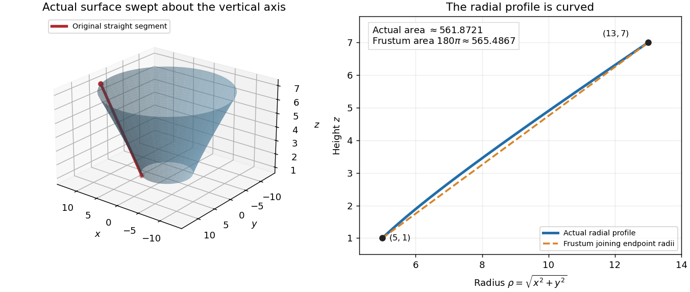

<h1 id="3/b/iii/solution">Solution</h1>

↑ **Parent:** [iii](../iii.md)

The endpoint [radii](../../../../../../../radius.md) are $5$ and $13$, but **substituting those two numbers in the finite [conical frustum](../../../../../../../conical-frustum.md) formula is invalid**. A rotation about the $z$-axis preserves the horizontal [angle](../../../../../../../angle.md) between the endpoint [position vectors](../../../../../../../position-vector.md); here $(3,4)$ and $(12,5)$ are not parallel. The [radius](../../../../../../../radius.md) along the generating segment is not linear in height.

Parametrize the actual segment by

$$
(x,y,z)=(3+9t,4+t,1+6t),\qquad0\leq t\leq1.
$$

Its rotated [circle](../../../../../../../circle.md) at height $1+6t$ has [radius](../../../../../../../radius.md)

$$
\rho(t)=\sqrt{(3+9t)^2+(4+t)^2}=\sqrt{25+62t+82t^2},\qquad
\rho'(t)=\frac{31+82t}{\rho(t)}.
$$

Thus the rotated image is the [surface of revolution](../../../../../../../surface-of-revolution.md) $\mathbf R(t,\theta)=(\rho(t)\cos\theta,\rho(t)\sin\theta,1+6t)$. Applying the [conical frustum](../../../../../../../conical-frustum.md) formula to infinitesimal pieces of this radial profile, or directly using the [cross product](../../../../../../../cross-product.md) as in [ii](../ii.md), gives the [surface area of a surface of revolution](../../../../../../../surface-area-of-a-surface-of-revolution.md)

$$
\begin{aligned}
\mathcal A
&=2\pi\int_0^1\rho(t)\sqrt{\rho'(t)^2+36}\,dt\\
&=2\pi\int_0^1\sqrt{9676t^2+7316t+1861}\,dt.
\end{aligned}
$$

To evaluate it explicitly, put $u=82t+31$. Then $9676t^2+7316t+1861=(59u^2+19602)/41$. Define

$$
G(u)=u\sqrt{59u^2+19602}+\frac{19602}{\sqrt{59}}\log\bigl(\sqrt{59}\,u+\sqrt{59u^2+19602}\bigr).
$$

The [chain rule](../../../../../../../chain-rule.md) gives $G'(u)=2\sqrt{59u^2+19602}$, so the answer is

$$
\boxed{\mathcal A=\frac{\pi}{82\sqrt{41}}\bigl(G(113)-G(31)\bigr)\simeq561.8721076764.}
$$

The positive [logarithm](../../../../../../../logarithm.md) arguments make this a real-valued expression. Rotating the segment's endpoints independently into one vertical [plane](../../../../../../../plane.md) before joining them would instead create a different surface, with [surface area](../../../../../../../surface-area.md) $180\pi\simeq565.4867$.

**[Figure 1](#3/b/iii/image-the-rotated-segment-has-a-curved-radial-profile-although-its-three-dimensional-generator-is-straight). The rotated segment has a curved radial profile, although its three-dimensional generator is straight.**

## ↑ Ancestors (13)

1. [iii](../iii.md)
2. [b](../../b.md)
3. [3](../../../3.md)
4. [Mathematics IV](../../../../mathematics-iv-split.md)
5. [Prelims](../../../../split.md)
6. [2021](../../../../../split.md)
7. [Past exam of the mathematics course of the University of Oxford](../../../../../../split.md)
8. [Mathematics course of the University of Oxford](../../../../../../../mathematics-course-of-the-university-of-oxford.md)
9. [Undergraduate course of the University of Oxford](../../../../../../../undergraduate-course-of-the-university-of-oxford.md)
10. [Course of the University of Oxford](../../../../../../../course-of-the-university-of-oxford.md)
11. [University of Oxford](../../../../../../../university-of-oxford-split.md)
12. [List of universities](../../../../../../../list-of-universities.md)
13. [Codex Wiki](../../../../../../../split.md)
