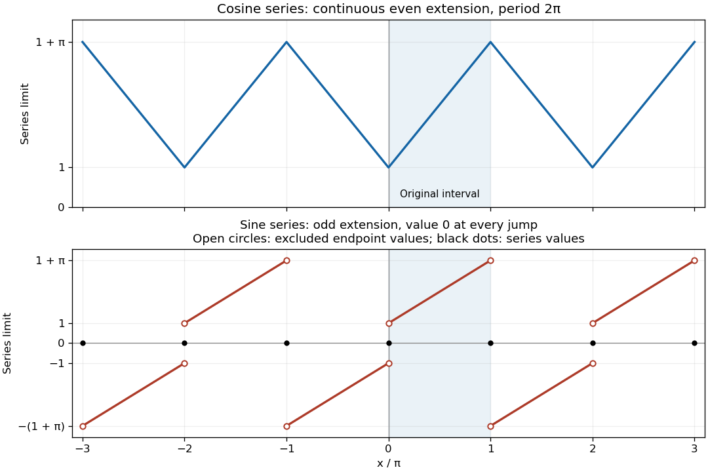

# Mathematics V resit

↑ **Parent:** [Prelims](../prelims.md)

Source: [released examination PDF, bundle pages 274–278](https://www.whatdotheyknow.com/request/bsc_mathematics_prelims_and_part/response/2784209/attach/3/202409%20817%20annex.pdf#page=274).

**Table of contents**

- [Question 1](#question-1)
  - [a](#question-1/a)
    - [i](#question-1/a/i)
      - [Solution](#question-1/a/i/solution)
    - [ii](#question-1/a/ii)
      - [Solution](#question-1/a/ii/solution)
  - [b](#question-1/b)
    - [Solution](#question-1/b/solution)
- [Question 2](#question-2)
  - [a](#question-2/a)
    - [i](#question-2/a/i)
      - [Solution](#question-2/a/i/solution)
    - [ii](#question-2/a/ii)
      - [Solution](#question-2/a/ii/solution)
  - [b](#question-2/b)
    - [Solution](#question-2/b/solution)
  - [c](#question-2/c)
    - [Solution](#question-2/c/solution)
- [Question 3](#question-3)
  - [a](#question-3/a)
    - [i](#question-3/a/i)
      - [Solution](#question-3/a/i/solution)
    - [ii](#question-3/a/ii)
      - [Solution](#question-3/a/ii/solution)
  - [b](#question-3/b)
    - [i](#question-3/b/i)
      - [Solution](#question-3/b/i/solution)
    - [ii](#question-3/b/ii)
      - [Solution](#question-3/b/ii/solution)
- [Question 4](#question-4)
  - [a](#question-4/a)
    - [i](#question-4/a/i)
      - [Solution](#question-4/a/i/solution)
    - [ii](#question-4/a/ii)
      - [Solution](#question-4/a/ii/solution)
  - [b](#question-4/b)
    - [i](#question-4/b/i)
      - [Solution](#question-4/b/i/solution)
    - [ii](#question-4/b/ii)
      - [Solution](#question-4/b/ii/solution)
  - [c](#question-4/c)
    - [Solution](#question-4/c/solution)
- [Question 5](#question-5)
  - [a](#question-5/a)
    - [Solution](#question-5/a/solution)
  - [b](#question-5/b)
    - [Solution](#question-5/b/solution)
- [Question 6](#question-6)
  - [a](#question-6/a)
    - [Solution](#question-6/a/solution)
  - [b](#question-6/b)
    - [Solution](#question-6/b/solution)

## Question 1

↑ **Parent:** [Mathematics V resit](mathematics-v-resit.md)

<h3 id="question-1/a">a</h3>

↑ **Parent:** [Question 1](#question-1)

<h4 id="question-1/a/i">i</h4>

↑ **Parent:** [a](#question-1/a)

<h5 id="question-1/a/i/solution">Solution</h5>

↑ **Parent:** [i](#question-1/a/i)

Use [polar coordinates](../../../multivariable-calculus.md#polar-coordinates) with $0\leq r\leq\sin^2\theta$ and $0\leq\theta\leq\pi$. The [Jacobian determinant](../../../multivariable-calculus.md#jacobian-determinant) gives $dA=r\,dr\,d\theta$, so the [area](../../../differential-geometry.md#surface-area) is

$$
A=\iint_R1\,dA
=\int_0^\pi\int_0^{\sin^2\theta}r\,dr\,d\theta
=\frac12\int_0^\pi\sin^4\theta\,d\theta.
$$

The [trigonometric identity](../../../geometry-and-topology.md#trigonometric-identity)

$$
\sin^4\theta=\frac{3-4\cos(2\theta)+\cos(4\theta)}8
$$

reduces the [integral](../../../integral.md) to its constant term: both [cosine](../../../geometry-and-topology.md#cosine) terms have zero [integral](../../../integral.md) over this interval. Therefore

$$
\boxed{\operatorname{Area}(R)=\frac{3\pi}{16}}.
$$

<h4 id="question-1/a/ii">ii</h4>

↑ **Parent:** [a](#question-1/a)

<h5 id="question-1/a/ii/solution">Solution</h5>

↑ **Parent:** [ii](#question-1/a/ii)

Write the [centroid](../../../euclidean-geometry.md#centroid) as $\overline{\mathbf r}=\overline x\,\mathbf i+\overline y\,\mathbf j$. The region has [reflection symmetry](../../../physics.md#reflection-symmetry) in the $y$-axis: replacing $\theta$ by $\pi-\theta$ changes $x$ to $-x$ and preserves $y$ and $dA$. Thus [symmetry in integration](../../../calculus.md#symmetry-in-integration) gives

$$
\iint_Rx\,dA=0,\qquad\overline x=0.
$$

For the other [first moment of area](../../../euclidean-geometry.md#first-moment-of-area), use $y=r\sin\theta$ in [polar coordinates](../../../multivariable-calculus.md#polar-coordinates):

$$
\iint_Ry\,dA
=\int_0^\pi\int_0^{\sin^2\theta}r^2\sin\theta\,dr\,d\theta
=\frac13\int_0^\pi\sin^7\theta\,d\theta
=\frac{32}{105}.
$$

Here the last [integral](../../../integral.md) has the value allowed in the paper. Dividing the [first moment of area](../../../euclidean-geometry.md#first-moment-of-area) by the [area](../../../differential-geometry.md#surface-area) found in [i](#question-1/a/i) gives

$$
\boxed{(\overline x,\overline y)=\left(0,\frac{512}{315\pi}\right)},
\qquad
\boxed{\overline{\mathbf r}=\frac{512}{315\pi}\,\mathbf j}.
$$

The positive vertical coordinate agrees with the fact that the entire region lies above the $x$-axis.

<h3 id="question-1/b">b</h3>

↑ **Parent:** [Question 1](#question-1)

<h4 id="question-1/b/solution">Solution</h4>

↑ **Parent:** [b](#question-1/b)

Express the [position vector](../../../classical-mechanics.md#position-vector) in the suggested [orthonormal basis](../../../inner-product.md#orthonormal-basis) as $\mathbf r=X\mathbf e_1+Y\mathbf e_2+Z\mathbf e_3$. Then

$$
x=\frac{-X+Z}{\sqrt2},\qquad
y=\frac{-X-Z}{\sqrt2},\qquad z=Y.
$$

This [orthogonal transformation](../../../linear-algebra.md#orthogonal-transformation) preserves $x^2+y^2+z^2=X^2+Y^2+Z^2$ and has [Jacobian determinant](../../../multivariable-calculus.md#jacobian-determinant) of absolute value one, so $dV=dX\,dY\,dZ$. The basis actually reverses [orientation](../../../algebraic-topology.md#orientation-of-a-simplex); the absolute value of the [Jacobian determinant](../../../multivariable-calculus.md#jacobian-determinant) is why no minus sign enters the [volume integral](../../../multivariable-calculus.md#volume-integral). Also $x-y=\sqrt2 Z$, so the [half-space](../../../geometry-and-topology.md#half-space) becomes $Z\geq1/2$.

At each fixed $Z\in[1/2,1]$, the section is the [disk](../../../topology.md#disk-mathematics) $X^2+Y^2\leq1-Z^2$, of [area](../../../differential-geometry.md#surface-area) $\pi(1-Z^2)$. Its [reflection symmetry](../../../physics.md#reflection-symmetry) in $X$ makes the [integral](../../../integral.md) of $X$ vanish. Hence the required [triple integral](../../../integral.md#triple-integral) is

$$
\begin{aligned}
I&=-\frac1{\sqrt2}\int_{1/2}^1
\iint_{X^2+Y^2\leq1-Z^2}(X+Z)\,dX\,dY\,dZ\\
&=-\frac\pi{\sqrt2}\int_{1/2}^1Z(1-Z^2)\,dZ
=-\frac\pi{\sqrt2}\left[\frac{Z^2}2-\frac{Z^4}4\right]_{1/2}^1
=\boxed{-\frac{9\pi}{64\sqrt2}}.
\end{aligned}
$$

The negative sign is also consistent with the cap lying in the direction $(1,-1,0)$, where its average $y$ coordinate is negative.

## Question 2

↑ **Parent:** [Mathematics V resit](mathematics-v-resit.md)

<h3 id="question-2/a">a</h3>

↑ **Parent:** [Question 2](#question-2)

<h4 id="question-2/a/i">i</h4>

↑ **Parent:** [a](#question-2/a)

<h5 id="question-2/a/i/solution">Solution</h5>

↑ **Parent:** [i](#question-2/a/i)

One sufficient version of the [divergence theorem](../../../multivariable-calculus.md#divergence-theorem) is the following. Let $R$ be a bounded region in $\mathbb R^3$ with a closed, piecewise [smooth surface](../../../differential-geometry.md#smooth-surface) as its boundary, and let $\mathbf F$ be a [continuously differentiable function](../../../multivariable-calculus.md#continuously-differentiable-function) with values in $\mathbb R^3$ on an open neighbourhood of the [closure](../../../topology.md#closure-topology) of $R$. With $\mathbf n$ the outward [unit normal vector](../../../differential-geometry.md#unit-normal),

$$
\boxed{\iiint_R\nabla\cdot\mathbf F\,dV
=\iint_{\partial R}\mathbf F\cdot\mathbf n\,dS}.
$$

The boundary [surface integral](../../../multivariable-calculus.md#surface-integral) is the total outward [flux integral](../../../multivariable-calculus.md#flux-integral). If the boundary has several components, each has the outward [orientation](../../../algebraic-topology.md#orientation-of-a-simplex) relative to the material of $R$; inner components therefore point into the holes. Edges and isolated vertices may be omitted when assigning the [unit normal vector](../../../differential-geometry.md#unit-normal), since they have zero [surface area](../../../differential-geometry.md#surface-area).

<h4 id="question-2/a/ii">ii</h4>

↑ **Parent:** [a](#question-2/a)

<h5 id="question-2/a/ii/solution">Solution</h5>

↑ **Parent:** [ii](#question-2/a/ii)

For each of the three constant Cartesian [unit vectors](../../../vector-space.md#unit-vector) $\mathbf e_j$, apply the [divergence theorem](../../../multivariable-calculus.md#divergence-theorem) to the [vector field](../../../multivariable-calculus.md#vector-field) $\phi\mathbf e_j$. Its [divergence](../../../multivariable-calculus.md#divergence) is $\partial_j\phi$, so

$$
\iiint_R\partial_j\phi\,dV
=\iint_{\partial R}\phi n_j\,dS
\qquad(j=1,2,3).
$$

These are precisely the three components of

$$
\boxed{\iiint_R\nabla\phi\,dV
=\iint_{\partial R}\phi\mathbf n\,dS
=\iint_{\partial R}\phi\,d\mathbf S}.
$$

Thus the [volume integral](../../../multivariable-calculus.md#volume-integral) of the [gradient](../../../multivariable-calculus.md#gradient) is the boundary [surface integral](../../../multivariable-calculus.md#surface-integral) weighted by the [vector surface element](../../../differential-geometry.md#vector-area-element) $d\mathbf S=\mathbf n\,dS$. The regularity needed here is that $\phi$ be continuously differentiable on a neighbourhood of the [closure](../../../topology.md#closure-topology) of $R$.

<h3 id="question-2/b">b</h3>

↑ **Parent:** [Question 2](#question-2)

<h4 id="question-2/b/solution">Solution</h4>

↑ **Parent:** [b](#question-2/b)

Use [cylindrical coordinates](../../../multivariable-calculus.md#cylindrical-coordinate-system) $(\rho,\theta,z)$. The [right circular cone](../../../euclidean-geometry.md#right-circular-cone) is described by $0\leq z\leq1$ and $0\leq\rho\leq a(1-z)$, and the [divergence](../../../multivariable-calculus.md#divergence) of $\mathbf F=(0,0,z^2)$ is $2z$. Direct [integration](../../../integral.md) gives

$$
\begin{aligned}
\iiint_R\nabla\cdot\mathbf F\,dV
&=\int_0^1\int_0^{2\pi}\int_0^{a(1-z)}2z\rho\,d\rho\,d\theta\,dz\\
&=2\pi a^2\int_0^1z(1-z)^2\,dz\\
&=2\pi a^2\left(\frac12-\frac23+\frac14\right)
=\boxed{\frac{\pi a^2}6}.
\end{aligned}
$$

To check the boundary [flux integral](../../../multivariable-calculus.md#flux-integral) independently, first consider the base $z=0$. Its outward [unit normal vector](../../../differential-geometry.md#unit-normal) is $-\mathbf k$, but $\mathbf F=\mathbf0$ there, so its [flux](../../../mathematical-physics.md#flux) is zero. Parametrize the lateral [surface](../../../topological-surface.md) by

$$
\mathbf s(\theta,z)=\bigl(a(1-z)\cos\theta,a(1-z)\sin\theta,z\bigr),
\qquad0\leq\theta\leq2\pi,\quad0\leq z\leq1.
$$

The [cross product](../../../vector-space.md#cross-product)

$$
\mathbf s_\theta\times\mathbf s_z
=\bigl(a(1-z)\cos\theta,a(1-z)\sin\theta,a^2(1-z)\bigr)
$$

points outward: its horizontal component points away from the axis of the [cone](../../../euclidean-geometry.md#cone-geometry). This gives the [vector surface element](../../../differential-geometry.md#vector-area-element) without separately normalizing it. Consequently the lateral [flux integral](../../../multivariable-calculus.md#flux-integral) is

$$
\int_0^1\int_0^{2\pi}
\mathbf F(\mathbf s)\cdot(\mathbf s_\theta\times\mathbf s_z)\,d\theta\,dz
=2\pi a^2\int_0^1z^2(1-z)\,dz
=2\pi a^2\left(\frac13-\frac14\right)
=\boxed{\frac{\pi a^2}6}.
$$

Adding the zero base contribution agrees with the [volume integral](../../../multivariable-calculus.md#volume-integral), verifying the [divergence theorem](../../../multivariable-calculus.md#divergence-theorem). The apex has zero [surface area](../../../differential-geometry.md#surface-area); the [vector field](../../../multivariable-calculus.md#vector-field) is smooth there, so no additional [flux](../../../mathematical-physics.md#flux) is hidden at that point.

<h3 id="question-2/c">c</h3>

↑ **Parent:** [Question 2](#question-2)

<h4 id="question-2/c/solution">Solution</h4>

↑ **Parent:** [c](#question-2/c)

The [curl](../../../multivariable-calculus.md#curl) is

$$
\nabla\times\mathbf F
=\bigl(\partial_yz^2-\partial_z0,\partial_z0-\partial_xz^2,\partial_x0-\partial_y0\bigr)
=\boxed{\mathbf0}.
$$

To establish that $\mathbf F$ is a [conservative vector field](../../../multivariable-calculus.md#conservative-vector-field), construct a [potential of a conservative vector field](../../../multivariable-calculus.md#potential-of-a-conservative-vector-field) directly:

$$
\boxed{\phi(x,y,z)=\frac{z^3}3+C},\qquad
\nabla\phi=(0,0,z^2)=\mathbf F.
$$

This [gradient](../../../multivariable-calculus.md#gradient) calculation is valid on all of $\mathbb R^3$, and hence also on the [cone](../../../euclidean-geometry.md#cone-geometry). The explicit [potential of a conservative vector field](../../../multivariable-calculus.md#potential-of-a-conservative-vector-field) supplies the required global justification.

## Question 3

↑ **Parent:** [Mathematics V resit](mathematics-v-resit.md)

<h3 id="question-3/a">a</h3>

↑ **Parent:** [Question 3](#question-3)

<h4 id="question-3/a/i">i</h4>

↑ **Parent:** [a](#question-3/a)

<h5 id="question-3/a/i/solution">Solution</h5>

↑ **Parent:** [i](#question-3/a/i)

Let $\Sigma$ be a compact, piecewise smooth [oriented surface](../../../differential-geometry.md#oriented-surface) with piecewise smooth boundary, and let $\mathbf F$ be continuously differentiable on an open neighbourhood of $\Sigma$. The [Stokes theorem](../../../multivariable-calculus.md#stokes-theorem) states

$$
\boxed{\oint_{\partial\Sigma}\mathbf F\cdot d\mathbf r
=\iint_\Sigma(\nabla\times\mathbf F)\cdot\mathbf n\,dS}.
$$

The [boundary orientation](../../../differential-geometry.md#boundary-orientation) must agree with the chosen [unit normal vector](../../../differential-geometry.md#unit-normal) by the [right-hand rule](../../../electromagnetism.md#right-hand-rule). For an upward [orientation](../../../algebraic-topology.md#orientation-of-a-simplex) on a horizontal [disk](../../../topology.md#disk-mathematics), its boundary is traversed counterclockwise when viewed from above. Reversing the [orientation](../../../algebraic-topology.md#orientation-of-a-simplex) reverses both the [line integral](../../../multivariable-calculus.md#line-integral) and the [surface integral](../../../multivariable-calculus.md#surface-integral).

<h4 id="question-3/a/ii">ii</h4>

↑ **Parent:** [a](#question-3/a)

<h5 id="question-3/a/ii/solution">Solution</h5>

↑ **Parent:** [ii](#question-3/a/ii)

Choose the outward [unit normal vector](../../../differential-geometry.md#unit-normal) on the upper [hemisphere](../../../euclidean-geometry.md#hemisphere). The [curl](../../../multivariable-calculus.md#curl) of $\mathbf F=(4y,x,2z)$ is

$$
\nabla\times\mathbf F=(0,0,1-4)=(0,0,-3).
$$

In [spherical polar coordinates](../../../multivariable-calculus.md#spherical-coordinate-system), put

$$
\mathbf s(\varphi,\theta)
=a(\sin\varphi\cos\theta,\sin\varphi\sin\theta,\cos\varphi),
\qquad0\leq\varphi\leq\frac\pi2,\quad0\leq\theta\leq2\pi.
$$

Here $n_z=\cos\varphi$ and $dS=a^2\sin\varphi\,d\varphi\,d\theta$. The [surface integral](../../../multivariable-calculus.md#surface-integral) is therefore

$$
\iint_\Sigma(\nabla\times\mathbf F)\cdot\mathbf n\,dS
=-3a^2\int_0^{2\pi}\int_0^{\pi/2}\cos\varphi\sin\varphi\,d\varphi\,d\theta
=\boxed{-3\pi a^2}.
$$

The compatible [boundary orientation](../../../differential-geometry.md#boundary-orientation) follows increasing $t$ in $\mathbf r(t)=(a\cos t,a\sin t,0)$, $0\leq t\leq2\pi$. On this [circle](../../../topology.md#circle),

$$
\mathbf F(\mathbf r(t))=(4a\sin t,a\cos t,0),\qquad
\mathbf r'(t)=(-a\sin t,a\cos t,0).
$$

Thus the [line integral](../../../multivariable-calculus.md#line-integral) is

$$
\oint_{\partial\Sigma}\mathbf F\cdot d\mathbf r
=a^2\int_0^{2\pi}(-4\sin^2t+\cos^2t)\,dt
=\boxed{-3\pi a^2},
$$

which agrees with the [surface integral](../../../multivariable-calculus.md#surface-integral) as required by the [Stokes theorem](../../../multivariable-calculus.md#stokes-theorem).

<h3 id="question-3/b">b</h3>

↑ **Parent:** [Question 3](#question-3)

<h4 id="question-3/b/i">i</h4>

↑ **Parent:** [b](#question-3/b)

<h5 id="question-3/b/i/solution">Solution</h5>

↑ **Parent:** [i](#question-3/b/i)

Use the outward [orientation](../../../algebraic-topology.md#orientation-of-a-simplex) on the unit [hemisphere](../../../euclidean-geometry.md#hemisphere) and counterclockwise [boundary orientation](../../../differential-geometry.md#boundary-orientation) on the unit [circle](../../../topology.md#circle). With $\mathbf r(t)=(\cos t,\sin t,0)$ and $f=x=\cos t$, the vector [line integral](../../../multivariable-calculus.md#line-integral) is

$$
\begin{aligned}
\oint_{\partial\Sigma}f\,d\mathbf r
&=\int_0^{2\pi}(-\cos t\sin t,\cos^2t,0)\,dt\\
&=\boxed{(0,\pi,0)}.
\end{aligned}
$$

For the [surface integral](../../../multivariable-calculus.md#surface-integral), $\nabla f=\mathbf i$ and the outward [unit normal vector](../../../differential-geometry.md#unit-normal) is $\mathbf n=(x,y,z)$, since the radius is one. The [cross product](../../../vector-space.md#cross-product) is

$$
\mathbf n\times\nabla f=(0,z,-y).
$$

The [integral](../../../integral.md) of $y$ is zero by [reflection symmetry](../../../physics.md#reflection-symmetry). Using the same [spherical polar coordinates](../../../multivariable-calculus.md#spherical-coordinate-system) as in [ii](#question-3/a/ii), with $a=1$, the other component is

$$
\iint_\Sigma z\,dS
=\int_0^{2\pi}\int_0^{\pi/2}\cos\varphi\sin\varphi\,d\varphi\,d\theta
=\pi.
$$

Hence

$$
\boxed{\iint_\Sigma(\mathbf n\times\nabla f)\,dS=(0,\pi,0)},
$$

verifying the [vector-valued Stokes identity](../../../multivariable-calculus.md#vector-valued-stokes-identity) directly, component by component. The wedge symbol in the paper denotes the [cross product](../../../vector-space.md#cross-product) here.

<h4 id="question-3/b/ii">ii</h4>

↑ **Parent:** [b](#question-3/b)

<h5 id="question-3/b/ii/solution">Solution</h5>

↑ **Parent:** [ii](#question-3/b/ii)

Choose the [scalar field](../../../classical-field-theory.md#scalar-field)

$$
f(x,y,z)=\frac{x^2+y^2+z^2}{2},\qquad\nabla f=\mathbf r.
$$

The allowed [vector-valued Stokes identity](../../../multivariable-calculus.md#vector-valued-stokes-identity) gives

$$
\oint_{\partial\Sigma}f\,d\mathbf r
=\iint_\Sigma\mathbf n\times\mathbf r\,dS
=-\iint_\Sigma\mathbf r\times d\mathbf S.
$$

Every boundary point lies on the unit [circle](../../../topology.md#circle) in the $xy$-plane, so $f=1/2$ throughout the boundary. Since the [line integral](../../../multivariable-calculus.md#line-integral) of $d\mathbf r$ around a closed [curve](../../../topology.md#curve) is the zero displacement,

$$
\boxed{\iint_\Sigma\mathbf r\times d\mathbf S
=-\frac12\oint_{\partial\Sigma}d\mathbf r=\mathbf0}.
$$

Only the boundary value of this [scalar field](../../../classical-field-theory.md#scalar-field) mattered: the interior of the [surface](../../../topological-surface.md) need not be part of a [sphere](../../../euclidean-geometry.md#sphere). Either consistent choice of [orientation](../../../algebraic-topology.md#orientation-of-a-simplex) gives the same zero answer.

## Question 4

↑ **Parent:** [Mathematics V resit](mathematics-v-resit.md)

<h3 id="question-4/a">a</h3>

↑ **Parent:** [Question 4](#question-4)

<h4 id="question-4/a/i">i</h4>

↑ **Parent:** [a](#question-4/a)

<h5 id="question-4/a/i/solution">Solution</h5>

↑ **Parent:** [i](#question-4/a/i)

The [Fourier cosine series](../../../fourier-series.md#fourier-cosine-series) and [Fourier sine series](../../../fourier-series.md#fourier-sine-series) use the respective forms

$$
C_f(x)=\frac{a_0}{2}+\sum_{n=1}^\infty a_n\cos(nx),\qquad
S_f(x)=\sum_{n=1}^\infty b_n\sin(nx).
$$

Their [Fourier coefficients](../../../fourier-series.md#fourier-coefficient), obtained from [Fourier orthogonality](../../../fourier-series.md#fourier-orthogonality), are

$$
\boxed{a_n=\frac2\pi\int_0^\pi f(t)\cos(nt)\,dt\quad(n\geq0)},
\qquad
\boxed{b_n=\frac2\pi\int_0^\pi f(t)\sin(nt)\,dt\quad(n\geq1)}.
$$

In particular the constant term is $a_0/2=\pi^{-1}\int_0^\pi f(t)\,dt$. The [Fourier cosine series](../../../fourier-series.md#fourier-cosine-series) is the [Fourier series](../../../fourier-series.md) of the [even extension](../../../fourier-series.md#even-extension) $f(|x|)$, made $2\pi$-periodic. The [Fourier sine series](../../../fourier-series.md#fourier-sine-series) is the [Fourier series](../../../fourier-series.md) of the [odd extension](../../../calculus.md#odd-extension), equal to $f(x)$ for $0<x<\pi$ and $-f(-x)$ for $-\pi<x<0$, again made $2\pi$-periodic.

<h4 id="question-4/a/ii">ii</h4>

↑ **Parent:** [a](#question-4/a)

<h5 id="question-4/a/ii/solution">Solution</h5>

↑ **Parent:** [ii](#question-4/a/ii)

The theorem on [pointwise convergence of a piecewise smooth Fourier series](../../../fourier-series.md#pointwise-convergence-of-a-piecewise-smooth-fourier-series) gives the average of the two one-sided values of the corresponding [periodic extension](../../../function.md#periodic-extension). Under the usual piecewise smooth interpretation of the paper's derivative assumption, the [even extension](../../../fourier-series.md#even-extension) is continuous at $0$ and at the joined endpoints $\pm\pi$. Thus

$$
\boxed{C_f(x)=f(x)\quad(0\leq x\leq\pi)}.
$$

For the [odd extension](../../../calculus.md#odd-extension), the values on either side of zero are $-f(0)$ and $f(0)$; those on either side of $\pi$ are $f(\pi)$ and $-f(\pi)$. Therefore

$$
\boxed{S_f(x)=
\begin{cases}
f(x),&0<x<\pi,\\
0,&x=0\text{ or }x=\pi.
\end{cases}}
$$

The endpoint values are also immediate because each [sine](../../../geometry-and-topology.md#sine) term vanishes there. If $f(0)$ or $f(\pi)$ is nonzero, the [Fourier sine series](../../../fourier-series.md#fourier-sine-series) does not reproduce that endpoint value. Merely assuming that the derivative is locally piecewise continuous in the open interval would be weaker than the usual piecewise smooth hypothesis; the convergence assertion uses the standard endpoint regularity implicit in that hypothesis.

<h3 id="question-4/b">b</h3>

↑ **Parent:** [Question 4](#question-4)

<h4 id="question-4/b/i">i</h4>

↑ **Parent:** [b](#question-4/b)

<h5 id="question-4/b/i/solution">Solution</h5>

↑ **Parent:** [i](#question-4/b/i)

For the [Fourier cosine series](../../../fourier-series.md#fourier-cosine-series), [integration by parts](../../../calculus.md#integration-by-parts) gives

$$
a_0=\frac2\pi\int_0^\pi(1+x)\,dx=2+\pi,
$$

and, for $n\geq1$,

$$
\begin{aligned}
a_n&=\frac2\pi\int_0^\pi(1+x)\cos(nx)\,dx\\
&=\frac2\pi\left[\frac{(1+x)\sin(nx)}n+\frac{\cos(nx)}{n^2}\right]_0^\pi
=\frac{2\bigl((-1)^n-1\bigr)}{\pi n^2}.
\end{aligned}
$$

Only odd [Fourier harmonics](../../../fourier-series.md#fourier-harmonic) remain, so

$$
\boxed{1+x=1+\frac\pi2-\frac4\pi
\sum_{m=0}^\infty\frac{\cos((2m+1)x)}{(2m+1)^2}
\quad(0\leq x\leq\pi)}.
$$

For the [Fourier sine series](../../../fourier-series.md#fourier-sine-series), another [integration by parts](../../../calculus.md#integration-by-parts) gives

$$
\begin{aligned}
b_n&=\frac2\pi\int_0^\pi(1+x)\sin(nx)\,dx\\
&=\frac2\pi\left[-\frac{(1+x)\cos(nx)}n+\frac{\sin(nx)}{n^2}\right]_0^\pi
=\frac{2\bigl[1-(1+\pi)(-1)^n\bigr]}{\pi n}.
\end{aligned}
$$

Consequently

$$
\boxed{1+x=\frac2\pi\sum_{n=1}^\infty
\frac{1-(1+\pi)(-1)^n}{n}\sin(nx)
\quad(0<x<\pi)}.
$$

At $x=0$ and $x=\pi$, the [Fourier sine series](../../../fourier-series.md#fourier-sine-series) instead has value zero.

To describe the requested graphs precisely, take $t\in[-\pi,\pi)$ congruent to $x$ modulo $2\pi$. The [Fourier cosine series](../../../fourier-series.md#fourier-cosine-series) converges to the continuous triangular [periodic extension](../../../function.md#periodic-extension)

$$
\boxed{F_c(x)=1+|t|}.
$$

Its minima occur at the even multiples of $\pi$, with value $1$, and its maxima at the odd multiples, with value $1+\pi$. The [Fourier sine series](../../../fourier-series.md#fourier-sine-series) converges to

$$
\boxed{F_s(x)=
\begin{cases}
1+t,&0<t<\pi,\\
t-1,&-\pi<t<0,\\
0,&x\in\pi\mathbb Z.
\end{cases}}
$$

The [jump discontinuities](../../../calculus.md#jump-discontinuity) at even multiples of $\pi$ go from $-1$ to $1$; those at odd multiples go from $1+\pi$ to $-(1+\pi)$. Each jump is assigned its midpoint, zero, by the [Fourier series](../../../fourier-series.md).

**[Figure 1](#question-4/b/i/image-limits-of-the-fourier-cosine-series-and-fourier-sine-series-of-1-plus-x-on-3-pi-3-pi). Limits of the Fourier cosine series and Fourier sine series of $1+x$ on $[-3\pi,3\pi]$**.

<h4 id="question-4/b/ii">ii</h4>

↑ **Parent:** [b](#question-4/b)

<h5 id="question-4/b/ii/solution">Solution</h5>

↑ **Parent:** [ii](#question-4/b/ii)

**The truncated [Fourier cosine series](../../../fourier-series.md#fourier-cosine-series) gives the better approximation on the closed interval**, in the senses of [uniform convergence](../../../sequence-and-series.md#uniform-convergence) and the asymptotic [L2 norm](../../../real-analysis.md#l2-norm) error. To make the comparison precise, let $C_N$ and $S_N$ retain the frequencies $1\leq n\leq N$, with the constant term also included in $C_N$.

The cosine [Fourier coefficients](../../../fourier-series.md#fourier-coefficient) are $O(n^{-2})$. In fact, [absolute convergence](../../../sequence-and-series.md#absolute-convergence) gives the uniform tail bound

$$
\sup_{0\leq x\leq\pi}|f(x)-C_N(x)|
\leq\frac4\pi\sum_{n>N}\frac1{n^2}
\leq\frac4{\pi N}\longrightarrow0.
$$

For the [Fourier sine series](../../../fourier-series.md#fourier-sine-series), every [Fourier partial sum](../../../fourier-series.md#fourier-partial-sum) satisfies $S_N(0)=S_N(\pi)=0$. Thus

$$
\boxed{\sup_{0\leq x\leq\pi}|f(x)-S_N(x)|\geq1+\pi},
$$

so there is no [uniform convergence](../../../sequence-and-series.md#uniform-convergence) to $f$ on the closed interval. Its [odd extension](../../../calculus.md#odd-extension) has [jump discontinuities](../../../calculus.md#jump-discontinuity), producing the [Gibbs phenomenon](../../../fourier-series.md#gibbs-phenomenon) near the endpoints; its [Fourier coefficients](../../../fourier-series.md#fourier-coefficient) decrease only like $1/n$.

The advantage persists in the [L2 norm](../../../real-analysis.md#l2-norm), which ignores individual endpoint values. By [Parseval's identity](../../../fourier-analysis.md#parseval-identity) and [Fourier orthogonality](../../../fourier-series.md#fourier-orthogonality),

$$
\|f-C_N\|_2^2=\frac\pi2\sum_{n>N}a_n^2=O(N^{-3}),\qquad
\|f-S_N\|_2^2=\frac\pi2\sum_{n>N}b_n^2=O(N^{-1}).
$$

The nonzero odd cosine coefficients and both parity classes of sine coefficients also give matching lower bounds of these orders by comparison with the corresponding [p-series](../../../sequence-and-series.md#p-series). Hence their [L2 norm](../../../real-analysis.md#l2-norm) errors decrease respectively like $N^{-3/2}$ and $N^{-1/2}$. This is a comparison of approximation quality in specified norms, not a claim that one finite sum has smaller error at every individual interior point.

<h3 id="question-4/c">c</h3>

↑ **Parent:** [Question 4](#question-4)

<h4 id="question-4/c/solution">Solution</h4>

↑ **Parent:** [c](#question-4/c)

Take $\boxed{f(x)=\sin x}$. This [function](../../../function.md) is not a [polynomial](../../../polynomial.md): it is nonzero and satisfies $f''=-f$, whereas a nonzero [polynomial](../../../polynomial.md) cannot satisfy that identity, since taking two [derivatives](../../../calculus.md#derivative) reduces its degree or gives zero.

By [Fourier orthogonality](../../../fourier-series.md#fourier-orthogonality), the [Fourier sine series](../../../fourier-series.md#fourier-sine-series) consists of the single term $\sin x$. Thus every truncation with $N\geq1$ is **exact**, including at the endpoints. In contrast, using the product-to-sum [trigonometric identity](../../../geometry-and-topology.md#trigonometric-identity) in its [Fourier cosine coefficients](../../../fourier-series.md#fourier-cosine-coefficient) gives

$$
a_0=\frac4\pi,\qquad
a_{2m}=-\frac4{\pi(4m^2-1)}\quad(m\geq1),\qquad
a_{2m-1}=0.
$$

For example, $\int_0^\pi\sin x\cos(2mx)\,dx=-2/(4m^2-1)$ follows by integrating the two resulting [sine](../../../geometry-and-topology.md#sine) terms. Therefore the [Fourier cosine series](../../../fourier-series.md#fourier-cosine-series) is

$$
\sin x=\frac2\pi-\frac4\pi\sum_{m=1}^\infty
\frac{\cos(2mx)}{4m^2-1}.
$$

Every finite cosine truncation omits infinitely many nonzero [Fourier coefficients](../../../fourier-series.md#fourier-coefficient), so [Parseval's identity](../../../fourier-analysis.md#parseval-identity) gives it strictly positive squared [L2 norm](../../../real-analysis.md#l2-norm) error. The one-term sine representation has zero error in both the [L2 norm](../../../real-analysis.md#l2-norm) and the [supremum norm](../../../normed-vector-space.md#supremum-norm), proving the requested advantage.

## Question 5

↑ **Parent:** [Mathematics V resit](mathematics-v-resit.md)

<h3 id="question-5/a">a</h3>

↑ **Parent:** [Question 5](#question-5)

<h4 id="question-5/a/solution">Solution</h4>

↑ **Parent:** [a](#question-5/a)

Treat the boundary data as $2\pi$-periodic in the angular variable. Denote the outer data by $g(\theta)$, and set $h(\theta)=f(a,\theta)$ for the inner data. Define their mean and nonconstant [Fourier coefficients](../../../fourier-series.md#fourier-coefficient) by

$$
\begin{aligned}
p_0&=\frac1{2\pi}\int_{-\pi}^{\pi}h(t)\,dt,\\
p_n&=\frac1\pi\int_{-\pi}^{\pi}h(t)\cos(nt)\,dt,\qquad
q_n=\frac1\pi\int_{-\pi}^{\pi}h(t)\sin(nt)\,dt\quad(n\geq1).
\end{aligned}
$$

The outer data have [reflection symmetry](../../../physics.md#reflection-symmetry), so all their sine [Fourier coefficients](../../../fourier-series.md#fourier-coefficient) vanish. Their mean is $1/2$, and their cosine [Fourier coefficients](../../../fourier-series.md#fourier-coefficient) are

$$
c_n=\frac1\pi\int_{-\pi/2}^{\pi/2}\cos(nt)\,dt
=\frac{2\sin(n\pi/2)}{\pi n}.
$$

The angular [Fourier harmonics](../../../fourier-series.md#fourier-harmonic) for a single-valued [harmonic function](../../../partial-differential-equation.md#harmonic-function) in an [annulus](../../../topology.md#annulus-mathematics) are $\cos(n\theta)$ and $\sin(n\theta)$, with [integer](../../../integer.md) $n\geq1$. Their radial factors are independent combinations of $r^n$ and $r^{-n}$; the zero angular mode has radial factor $A_0+B_0\log r$. For arbitrary inner data, the sine and cosine modes need independent radial coefficients: forcing them to share one radial factor, as in the product form supplied in the paper, would impose an extra restriction. For either sine or cosine mode, if its outer and inner coefficients are $v$ and $w$, the radial coefficients $\alpha,\beta$ obey

$$
\alpha+\beta=v,\qquad a^n\alpha+a^{-n}\beta=w.
$$

Solving this [linear system](../../../linear-algebra.md#system-of-linear-equations) gives

$$
\alpha=\frac{v-a^nw}{1-a^{2n}},\qquad
\beta=\frac{a^n(w-a^nv)}{1-a^{2n}}.
$$

It is convenient to collect the result into the [annular harmonic interpolation factors](../../../partial-differential-equation.md#annular-harmonic-interpolation-factor)

$$
H_n(r)=\frac{r^n-a^{2n}r^{-n}}{1-a^{2n}},\qquad
K_n(r)=\frac{a^n(r^{-n}-r^n)}{1-a^{2n}}.
$$

They satisfy $H_n(1)=1$, $H_n(a)=0$, $K_n(1)=0$ and $K_n(a)=1$. The zero mode satisfies $A_0=1/2$ and $B_0=(p_0-1/2)/\log a$. Therefore the required [separation of variables](../../../partial-differential-equation.md#separation-of-variables) solution is

$$
\boxed{
\begin{aligned}
u(r,\theta)={}&\frac12+\left(p_0-\frac12\right)\frac{\log r}{\log a}\\
&+\sum_{n=1}^{\infty}\left[
c_nH_n(r)\cos(n\theta)
+K_n(r)\bigl(p_n\cos(n\theta)+q_n\sin(n\theta)\bigr)
\right].
\end{aligned}}
$$

All dependence on $f(a,\theta)$ is given by the displayed [integrals](../../../integral.md). Substituting $r=a$ leaves its [Fourier series](../../../fourier-series.md), and substituting $r=1$ leaves

$$
\frac12+\frac2\pi\sum_{n=1}^{\infty}\frac{\sin(n\pi/2)}n\cos(n\theta),
$$

the [Fourier series](../../../fourier-series.md) of the specified outer step. The radial factors satisfy $r^2R''+rR'-n^2R=0$, so each nonconstant term satisfies [Laplace's equation](../../../partial-differential-equation.md#laplace-equation); $1$ and $\log r$ do also. For integrable boundary data the radial factors give exponential decay on every closed subannulus strictly inside $a<r<1$, justifying the necessary termwise [partial derivatives](../../../multivariable-calculus.md#partial-derivative) there.

There is a qualification at the two outer [jump discontinuities](../../../calculus.md#jump-discontinuity). By [pointwise convergence of a piecewise smooth Fourier series](../../../fourier-series.md#pointwise-convergence-of-a-piecewise-smooth-fourier-series), the outer series gives $1/2$ at $\theta=\pm\pi/2$, whereas the printed data assign $1$ at those two points. Thus **the displayed solution attains the outer data at their continuity points, and has radial limit $1/2$ at the jumps**. One may separately assign the boundary value $1$ at the two exceptional points without changing the interior [harmonic function](../../../partial-differential-equation.md#harmonic-function), but no continuous extension can match the discontinuous data there. For piecewise smooth inner data, the analogous [boundary trace](../../../boundary-value-problem.md#boundary-trace-of-a-function) agrees with $h$ at continuity points and with its midpoint at jumps. Some regularity of $h$ is necessary for a classical interpretation; the problem imposes none explicitly.

<h3 id="question-5/b">b</h3>

↑ **Parent:** [Question 5](#question-5)

<h4 id="question-5/b/solution">Solution</h4>

↑ **Parent:** [b](#question-5/b)

Put $u(r,\theta)=R(r)\Theta(\theta)$ in [Laplace's equation](../../../partial-differential-equation.md#laplace-equation) and multiply by $r^2/(R\Theta)$ on intervals where the factors are nonzero. [Separation of variables](../../../partial-differential-equation.md#separation-of-variables) gives

$$
\frac{r^2R''+rR'}R=-\frac{\Theta''}{\Theta}=\lambda,
$$

and hence

$$
\Theta''+\lambda\Theta=0,\qquad
r^2R''+rR'-\lambda R=0.
$$

The angular [Dirichlet boundary conditions](../../../differential-equation.md#dirichlet-boundary-condition) are $\Theta(0)=\Theta(\pi/2)=0$. Multiplication of the angular equation by $\Theta$, followed by [integration by parts](../../../calculus.md#integration-by-parts), gives

$$
\lambda\int_0^{\pi/2}\Theta^2\,d\theta
=\int_0^{\pi/2}(\Theta')^2\,d\theta.
$$

For a nonzero angular [eigenfunction](../../../linear-operator-theory.md#eigenfunction) this forces $\lambda>0$: equality would make $\Theta$ constant and then zero. Write $\lambda=\mu^2$. The first angular condition removes the [cosine](../../../geometry-and-topology.md#cosine) term, and the second requires $\sin(\mu\pi/2)=0$. Thus

$$
\mu=2n,\qquad \lambda_n=4n^2,\qquad
\Theta_n(\theta)=\sin(2n\theta),\qquad n=1,2,\ldots.
$$

The radial [Cauchy-Euler equation](../../../linear-ordinary-differential-equation.md#cauchy-euler-equation) has the two solutions $r^{2n}$ and $r^{-2n}$. By [superposition](../../../vector-space.md#superposition-principle), the general separated [series](../../../sequence-and-series.md#series-mathematics) is therefore

$$
\boxed{u(r,\theta)=\sum_{n=1}^{\infty}
\bigl(A_nr^{2n}+B_nr^{-2n}\bigr)\sin(2n\theta)}.
$$

The coefficients are arbitrary subject to convergence with enough [partial derivatives](../../../multivariable-calculus.md#partial-derivative) on compact subsets to give a [harmonic function](../../../partial-differential-equation.md#harmonic-function) and to the prescribed zero values on the two open radial edges. Completeness of the sine [eigenfunctions](../../../linear-operator-theory.md#eigenfunction) gives the usual series representation for solutions smooth up to those edges on closed radial subintervals. There is no constant or logarithmic zero mode because its angular factor would be linear in $\theta$ and would vanish at both ends only if it were zero.

**The negative powers must be retained:** the stated domain omits $r=0$, and no boundedness at that vertex is prescribed. For example, $r^{-2}\sin(2\theta)$ is a [harmonic function](../../../partial-differential-equation.md#harmonic-function) satisfying both edge conditions. An additional boundedness condition as $r\to0$ would remove all $B_n$; an additional value on the circular arc would then determine the remaining $A_n$. With only the conditions in the paper, neither restriction is available and the solution is not unique.

## Question 6

↑ **Parent:** [Mathematics V resit](mathematics-v-resit.md)

<h3 id="question-6/a">a</h3>

↑ **Parent:** [Question 6](#question-6)

<h4 id="question-6/a/solution">Solution</h4>

↑ **Parent:** [a](#question-6/a)

Let $u_1,u_2$ be two solutions with the same data, and write $w=u_1-u_2$ on the rectangle $\Omega=(0,\pi)\times(-1,1)$. By [linearity](../../../vector-space.md#linearity),

$$
\Delta w=0,\qquad
w(x,-1)=w(x,1)=0,\qquad
w_x(0,y)=w_x(\pi,y)=0.
$$

The [normal derivative](../../../differential-geometry.md#normal-derivative) is $-w_x$ on the left edge and $w_x$ on the right edge, so it vanishes on both. The [energy method](../../../numerical-analysis.md#energy-method) applies [Green's first identity](../../../partial-differential-equation.md#green-s-first-identity), which follows by integrating

$$
\nabla\cdot(w\nabla w)=|\nabla w|^2+w\Delta w.
$$

It gives

$$
\iint_\Omega|\nabla w|^2\,dA
=\int_{\partial\Omega}w\,\partial_nw\,ds
-\iint_\Omega w\Delta w\,dA=0.
$$

The boundary term vanishes on each horizontal edge because $w=0$, and on each vertical edge because $\partial_nw=0$. The interior term vanishes because $w$ is a [harmonic function](../../../partial-differential-equation.md#harmonic-function). Since the continuous integrand $|\nabla w|^2$ is nonnegative, a zero [integral](../../../integral.md) forces $\nabla w=\mathbf0$. The rectangle is [connected](../../../geometry-and-topology.md#connected-space), so $w$ is constant; its zero value on either horizontal edge makes that constant zero. Hence

$$
\boxed{u_1=u_2}.
$$

This proof assumes enough boundary regularity for [Green's first identity](../../../partial-differential-equation.md#green-s-first-identity). It also works in the finite [Dirichlet energy](../../../differential-geometry.md#dirichlet-energy) class using the weak identity with test function $w$, so it remains applicable when corner derivatives are not continuous. It proves uniqueness conditional on existence and does not impose a compatibility condition for arbitrary $f,g$.

<h3 id="question-6/b">b</h3>

↑ **Parent:** [Question 6](#question-6)

<h4 id="question-6/b/solution">Solution</h4>

↑ **Parent:** [b](#question-6/b)

Set $u=X(x)Y(y)$ in [Laplace's equation](../../../partial-differential-equation.md#laplace-equation). [Separation of variables](../../../partial-differential-equation.md#separation-of-variables) gives

$$
X''+\lambda X=0,\qquad Y''-\lambda Y=0,\qquad X'(0)=X'(\pi)=0.
$$

The [Sturm-Liouville problem](../../../sturm-liouville-theory.md#sturm-liouville-problem) in $x$ has the constant mode $X_0=1$ with $\lambda_0=0$, and the [eigenfunctions](../../../linear-operator-theory.md#eigenfunction) $X_n=\cos(nx)$ with $\lambda_n=n^2$, $n\geq1$. Indeed, [integration by parts](../../../calculus.md#integration-by-parts) makes $\lambda$ nonnegative; for $\lambda>0$ the first [Neumann boundary condition](../../../differential-equation.md#neumann-boundary-condition) removes the [sine](../../../geometry-and-topology.md#sine) term and the second requires $\sqrt\lambda$ to be an [integer](../../../integer.md). For $\lambda=0$, both derivative conditions make $X$ constant.

Expand the top data using a [Fourier cosine series](../../../fourier-series.md#fourier-cosine-series):

$$
g(x)=\pi^2-x^2=\frac{g_0}{2}+\sum_{n=1}^{\infty}g_n\cos(nx).
$$

The constant coefficient is

$$
g_0=\frac2\pi\int_0^\pi(\pi^2-x^2)\,dx=\frac{4\pi^2}{3}.
$$

For $n\geq1$, the constant part has zero [integral](../../../integral.md) against $\cos(nx)$, and two [integrations by parts](../../../calculus.md#integration-by-parts) give

$$
\begin{aligned}
g_n&=-\frac2\pi\int_0^\pi x^2\cos(nx)\,dx\\
&=-\frac2\pi\left[
\frac{x^2\sin(nx)}n+\frac{2x\cos(nx)}{n^2}-\frac{2\sin(nx)}{n^3}
\right]_0^\pi
=\frac{4(-1)^{n+1}}{n^2}.
\end{aligned}
$$

Since the bottom value is zero, a convenient factor depending on $y$ for the nonconstant modes is $\sinh(n(y+1))$, which vanishes at $y=-1$. Its value at $y=1$ is $\sinh(2n)$. The zero mode is linear in $y$, so matching both constant boundary values gives

$$
\boxed{u(x,y)=\frac{\pi^2}{3}(y+1)
+\sum_{n=1}^{\infty}\frac{4(-1)^{n+1}}{n^2}
\frac{\sinh(n(y+1))}{\sinh(2n)}\cos(nx)}.
$$

To obtain exactly the paper's form, use the [hyperbolic-function identity](../../../calculus.md#hyperbolic-function-identity)

$$
\frac{\sinh(n(y+1))}{\sinh(2n)}
=\frac{\sinh(ny)\cosh n+\cosh(ny)\sinh n}{2\sinh n\cosh n}
=\frac{\sinh(ny)+\tanh n\cosh(ny)}{2\sinh n}.
$$

Thus

$$
\boxed{u(x,y)=\frac{\pi^2}{3}(1+y)
+\sum_{n=1}^{\infty}\frac{2(-1)^{n+1}}{n^2\sinh n}
\bigl(\sinh(ny)+\tanh(n)\cosh(ny)\bigr)\cos(nx)}.
$$

Each product of [hyperbolic sine](../../../calculus.md#hyperbolic-sine) or [hyperbolic cosine](../../../calculus.md#hyperbolic-cosine) with $\cos(nx)$ has $u_{xx}+u_{yy}=0$. The zero mode is also a [harmonic function](../../../partial-differential-equation.md#harmonic-function). On $-1\leq y\leq1$, the factor $\sinh(n(y+1))/\sinh(2n)$ lies between zero and one. Since $\sum n^{-2}$ converges, the [Weierstrass M-test](../../../probability-and-statistics.md#weierstrass-m-test) gives [uniform convergence](../../../sequence-and-series.md#uniform-convergence) on the closed rectangle. The series therefore gives zero at the bottom and the continuous [Fourier cosine series](../../../fourier-series.md#fourier-cosine-series) of $\pi^2-x^2$ at the top, including its endpoints. On compact subsets with $y<1$, the factors decay exponentially with $n$, justifying termwise [partial derivatives](../../../multivariable-calculus.md#partial-derivative). In particular $u_x=0$ on both open vertical edges because every differentiated [cosine](../../../geometry-and-topology.md#cosine) factor vanishes there. The solution has finite [Dirichlet energy](../../../differential-geometry.md#dirichlet-energy): [Fourier orthogonality](../../../fourier-series.md#fourier-orthogonality) gives the $n$th nonconstant mode's energy as $(\pi/2)ng_n^2\coth(2n)=O(n^{-3})$, whose sum is finite. Here $\coth$ is the [hyperbolic cotangent](../../../calculus.md#hyperbolic-cotangent). Thus [a](#question-6/a) proves uniqueness in that class.

There is a [corner compatibility condition for mixed boundary data](../../../differential-equation.md#corner-compatibility-condition-for-mixed-boundary-data) in the printed wording. The top data have $g'(\pi)=-2\pi$, but the paper writes $u_x(\pi,y)=0$ even at $y=1$. **The series solves the interior equation and all the open-edge boundary conditions; the literal derivative condition at $(\pi,1)$ is incompatible with the top data.** A function differentiable in $x$ along the top edge would necessarily have $u_x(\pi,1)=g'(\pi)=-2\pi$. Hence it cannot simultaneously satisfy the printed zero derivative at that corner, and there is no solution with all those literal corner requirements. The standard interpretation of this [mixed boundary condition](../../../differential-equation.md#mixed-boundary-condition) imposes the [Neumann boundary condition](../../../differential-equation.md#neumann-boundary-condition) on the open sides and the [Dirichlet boundary condition](../../../differential-equation.md#dirichlet-boundary-condition) continuously on the horizontal edges. Differentiating the series term by term on the top edge would be invalid at this corner; the uniform convergence of the undifferentiated series does not license that operation.

## ↑ Ancestors (9)

1. [Prelims](../prelims.md)
2. [2021](../../2021.md)
3. [Past exam of the mathematics course of the University of Oxford](../../../past-exam-of-the-mathematics-course-of-the-university-of-oxford.md)
4. [Mathematics course of the University of Oxford](../../../university-of-oxford.md#mathematics-course-of-the-university-of-oxford)
5. [Undergraduate course of the University of Oxford](../../../university-of-oxford.md#undergraduate-course-of-the-university-of-oxford)
6. [Course of the University of Oxford](../../../university-of-oxford.md#course-of-the-university-of-oxford)
7. [University of Oxford](../../../university-of-oxford.md)
8. [List of universities](../../../README.md#list-of-universities)
9. [Codex Wiki](../../../README.md)
