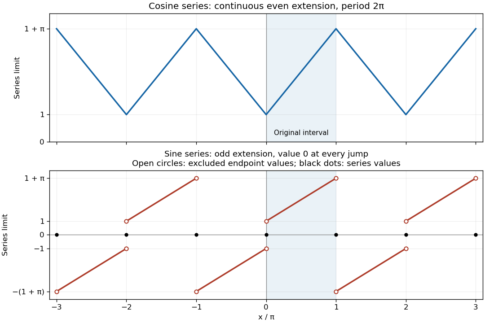

<h1 id="question-4/b/i/solution">Solution</h1>

↑ **Parent:** [i](../i.md)

For the [Fourier cosine series](../../../../../../../fourier-cosine-series.md), [integration by parts](../../../../../../../integration-by-parts.md) gives

$$
a_0=\frac2\pi\int_0^\pi(1+x)\,dx=2+\pi,
$$

and, for $n\geq1$,

$$
\begin{aligned}
a_n&=\frac2\pi\int_0^\pi(1+x)\cos(nx)\,dx\\
&=\frac2\pi\left[\frac{(1+x)\sin(nx)}n+\frac{\cos(nx)}{n^2}\right]_0^\pi
=\frac{2\bigl((-1)^n-1\bigr)}{\pi n^2}.
\end{aligned}
$$

Only odd [Fourier harmonics](../../../../../../../fourier-harmonic.md) remain, so

$$
\boxed{1+x=1+\frac\pi2-\frac4\pi
\sum_{m=0}^\infty\frac{\cos((2m+1)x)}{(2m+1)^2}
\quad(0\leq x\leq\pi)}.
$$

For the [Fourier sine series](../../../../../../../fourier-sine-series.md), another [integration by parts](../../../../../../../integration-by-parts.md) gives

$$
\begin{aligned}
b_n&=\frac2\pi\int_0^\pi(1+x)\sin(nx)\,dx\\
&=\frac2\pi\left[-\frac{(1+x)\cos(nx)}n+\frac{\sin(nx)}{n^2}\right]_0^\pi
=\frac{2\bigl[1-(1+\pi)(-1)^n\bigr]}{\pi n}.
\end{aligned}
$$

Consequently

$$
\boxed{1+x=\frac2\pi\sum_{n=1}^\infty
\frac{1-(1+\pi)(-1)^n}{n}\sin(nx)
\quad(0<x<\pi)}.
$$

At $x=0$ and $x=\pi$, the [Fourier sine series](../../../../../../../fourier-sine-series.md) instead has value zero.

To describe the requested graphs precisely, take $t\in[-\pi,\pi)$ congruent to $x$ modulo $2\pi$. The [Fourier cosine series](../../../../../../../fourier-cosine-series.md) converges to the continuous triangular [periodic extension](../../../../../../../periodic-extension.md)

$$
\boxed{F_c(x)=1+|t|}.
$$

Its minima occur at the even multiples of $\pi$, with value $1$, and its maxima at the odd multiples, with value $1+\pi$. The [Fourier sine series](../../../../../../../fourier-sine-series.md) converges to

$$
\boxed{F_s(x)=
\begin{cases}
1+t,&0<t<\pi,\\
t-1,&-\pi<t<0,\\
0,&x\in\pi\mathbb Z.
\end{cases}}
$$

The [jump discontinuities](../../../../../../../jump-discontinuity.md) at even multiples of $\pi$ go from $-1$ to $1$; those at odd multiples go from $1+\pi$ to $-(1+\pi)$. Each jump is assigned its midpoint, zero, by the [Fourier series](../../../../../../../fourier-series-split.md).

**[Figure 1](#question-4/b/i/image-limits-of-the-fourier-cosine-series-and-fourier-sine-series-of-1-plus-x-on-3-pi-3-pi). Limits of the Fourier cosine series and Fourier sine series of $1+x$ on $[-3\pi,3\pi]$**.

## ↑ Ancestors (13)

1. [i](../i.md)
2. [b](../../b.md)
3. [Question 4](../../../question-4.md)
4. [Mathematics V resit](../../../../mathematics-v-resit-split.md)
5. [Prelims](../../../../split.md)
6. [2021](../../../../../split.md)
7. [Past exam of the mathematics course of the University of Oxford](../../../../../../split.md)
8. [Mathematics course of the University of Oxford](../../../../../../../mathematics-course-of-the-university-of-oxford.md)
9. [Undergraduate course of the University of Oxford](../../../../../../../undergraduate-course-of-the-university-of-oxford.md)
10. [Course of the University of Oxford](../../../../../../../course-of-the-university-of-oxford.md)
11. [University of Oxford](../../../../../../../university-of-oxford-split.md)
12. [List of universities](../../../../../../../list-of-universities.md)
13. [Codex Wiki](../../../../../../../split.md)
