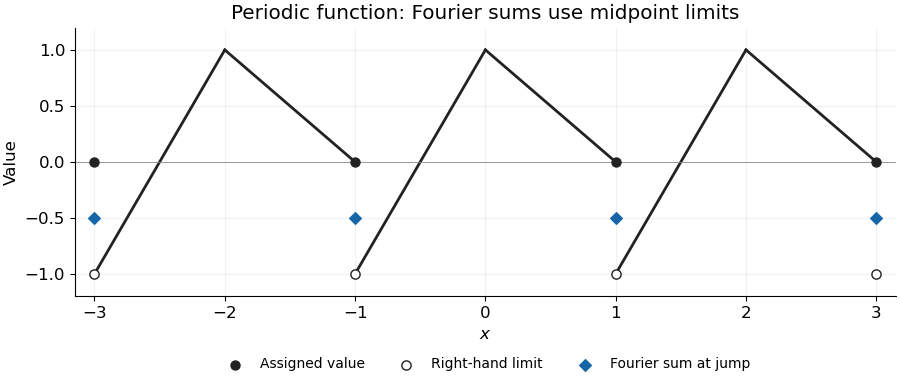
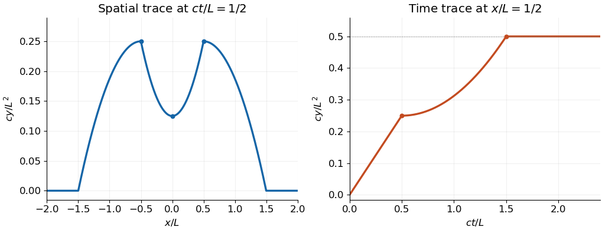

# Mathematics V

↑ **Parent:** [Prelims](../prelims.md)

Source: [released examination PDF, bundle pages 279–284](https://www.whatdotheyknow.com/request/bsc_mathematics_prelims_and_part/response/2784209/attach/3/202409%20817%20annex.pdf#page=279).

Solutions to all six questions and all optional parts. The surface-[volume](../../../geometry-and-topology.md#volume) formula in Question 2(b) requires an appropriate enclosing surface and orientation. The symmetry claim in Question 6(a), as printed, also needs the coefficient $b(x,t)$ to be even in $x$; a counterexample to the unrestricted claim is given.

**Table of contents**

- [1](#1)
  - [a](#1/a)
    - [Solution](#1/a/solution)
  - [b](#1/b)
    - [Solution](#1/b/solution)
  - [c](#1/c)
    - [Solution](#1/c/solution)
- [2](#2)
  - [a](#2/a)
    - [i](#2/a/i)
      - [Solution](#2/a/i/solution)
    - [ii](#2/a/ii)
      - [Solution](#2/a/ii/solution)
    - [iii](#2/a/iii)
      - [Solution](#2/a/iii/solution)
  - [b](#2/b)
    - [i](#2/b/i)
      - [Solution](#2/b/i/solution)
    - [ii](#2/b/ii)
      - [Solution](#2/b/ii/solution)
  - [c](#2/c)
    - [Solution](#2/c/solution)
- [3](#3)
  - [a](#3/a)
    - [i](#3/a/i)
      - [Solution](#3/a/i/solution)
    - [ii](#3/a/ii)
      - [Solution](#3/a/ii/solution)
  - [b](#3/b)
    - [Solution](#3/b/solution)
- [4](#4)
  - [a](#4/a)
    - [Solution](#4/a/solution)
  - [b](#4/b)
    - [Solution](#4/b/solution)
  - [c](#4/c)
    - [Solution](#4/c/solution)
- [5](#5)
  - [a](#5/a)
    - [Solution](#5/a/solution)
    - [i](#5/a/i)
      - [Solution](#5/a/i/solution)
    - [ii](#5/a/ii)
      - [Solution](#5/a/ii/solution)
  - [b](#5/b)
    - [i](#5/b/i)
      - [Solution](#5/b/i/solution)
    - [ii](#5/b/ii)
      - [Solution](#5/b/ii/solution)
- [6](#6)
  - [a](#6/a)
    - [Solution](#6/a/solution)
  - [b](#6/b)
    - [Solution](#6/b/solution)

## 1

↑ **Parent:** [Mathematics V](mathematics-v.md)

<h3 id="1/a">a</h3>

↑ **Parent:** [1](#1)

<h4 id="1/a/solution">Solution</h4>

↑ **Parent:** [A](#1/a)

Use the [change of variables](../../../multivariable-calculus.md#change-of-variables-formula) $u=x^2-y^2$, $v=xy$. Its [Jacobian determinant](../../../multivariable-calculus.md#jacobian-determinant) in the first quadrant is $2(x^2+y^2)>0$, and the inverse is uniquely determined by

$$
x^2=\frac{\sqrt{u^2+4v^2}+u}{2},\qquad
y^2=\frac{\sqrt{u^2+4v^2}-u}{2}.
$$

Both are positive for $v>0$, so the transformation is one-to-one on the region. It becomes the [rectangle](../../../euclidean-geometry.md#rectangle) $-2\leq u\leq4$, $1\leq v\leq3$. The [integrand](../../../integral.md#integrand) is $uv$, and $x^2+y^2=\sqrt{u^2+4v^2}$. Thus

$$
\begin{aligned}
\iint_A(x^3y-xy^3)\,dx\,dy
&=\int_1^3\int_{-2}^4\frac{uv}{2\sqrt{u^2+4v^2}}\,du\,dv\\
&=\int_1^3v\left(\sqrt{v^2+4}-\sqrt{v^2+1}\right)\,dv\\
&=\boxed{\frac{13\sqrt{13}-10\sqrt{10}-5\sqrt5+2\sqrt2}{3}.}
\end{aligned}
$$

<h3 id="1/b">b</h3>

↑ **Parent:** [1](#1)

<h4 id="1/b/solution">Solution</h4>

↑ **Parent:** [B](#1/b)

[Green's theorem](../../../multivariable-calculus.md#green-theorem) for a positively oriented simple closed planar curve states

$$
\oint_C(P\,dx+Q\,dy)=\iint_D(Q_x-P_y)\,dx\,dy.
$$

Here $Q_x-P_y=1-(-1)=2$. The [trapezium](../../../euclidean-geometry.md#trapezoid) has parallel sides of lengths two and one, separated by height one, so its [area](../../../differential-geometry.md#surface-area) is $3/2$. Therefore

$$
\boxed{\int_C\mathbf F\cdot d\mathbf r=2\cdot\frac32=3.}
$$

**Every congruent [trapezium](../../../euclidean-geometry.md#trapezoid) gives the same answer when its boundary is traversed anticlockwise**, since the scalar [curl](../../../multivariable-calculus.md#curl) is constant and [geometric congruence](../../../euclidean-geometry.md#congruence-geometry) preserves [area](../../../differential-geometry.md#surface-area). Reversing the traversal would instead reverse the sign.

<h3 id="1/c">c</h3>

↑ **Parent:** [1](#1)

<h4 id="1/c/solution">Solution</h4>

↑ **Parent:** [C](#1/c)

A [parametrization](../../../geometry-and-topology.md#parametric-equation) of the cylindrical patch is

$$
\mathbf r(x,\theta)=(x,2\cos\theta,2\sin\theta),\qquad
0<\theta<\pi/2,\quad0<x<2\cos\theta.
$$

The last range uses the planes $x=0$ and $x=y$. The [surface area element](../../../multivariable-calculus.md#surface-area-element) is $|\mathbf r_x\times\mathbf r_\theta|\,dx\,d\theta=2\,dx\,d\theta$. Hence

$$
\boxed{A=\int_0^{\pi/2}\int_0^{2\cos\theta}2\,dx\,d\theta=4.}
$$

Including or excluding the boundary curves does not change the [surface area](../../../differential-geometry.md#surface-area).

## 2

↑ **Parent:** [Mathematics V](mathematics-v.md)

<h3 id="2/a">a</h3>

↑ **Parent:** [2](#2)

<h4 id="2/a/i">i</h4>

↑ **Parent:** [A](#2/a)

<h5 id="2/a/i/solution">Solution</h5>

↑ **Parent:** [I](#2/a/i)

For a bounded region $R\subseteq\mathbb R^3$ with piecewise smooth boundary and a [continuously differentiable vector field](../../../multivariable-calculus.md#continuously-differentiable-vector-field) $\mathbf F$ on a neighborhood of its closure, the [divergence theorem](../../../multivariable-calculus.md#divergence-theorem) says

$$
\boxed{\iiint_R\nabla\cdot\mathbf F\,dV=\iint_{\partial R}\mathbf F\cdot\mathbf n\,dS,}
$$

where $\mathbf n$ is the outward [unit normal vector](../../../differential-geometry.md#unit-normal). The left side integrates [divergence](../../../multivariable-calculus.md#divergence) over the [volume](../../../geometry-and-topology.md#volume); the right side is the outward [flux](../../../mathematical-physics.md#flux).

<h4 id="2/a/ii">ii</h4>

↑ **Parent:** [A](#2/a)

<h5 id="2/a/ii/solution">Solution</h5>

↑ **Parent:** [Ii](#2/a/ii)

Apply the [divergence theorem](../../../multivariable-calculus.md#divergence-theorem) to $\mathbf F=u\nabla v-v\nabla u$. The [product rule](../../../calculus.md#product-rule) gives

$$
\nabla\cdot\mathbf F=u\nabla^2v-v\nabla^2u,
$$

because the two [gradient](../../../multivariable-calculus.md#gradient) [inner products](../../../inner-product.md) cancel. Also $\mathbf F\cdot\mathbf n=u\partial_nv-v\partial_nu$. Thus

$$
\boxed{\iiint_R(u\nabla^2v-v\nabla^2u)\,dV
=\iint_{\partial R}(u\partial_nv-v\partial_nu)\,dS.}
$$

This is [Green's second identity](../../../partial-differential-equation.md#green-second-identity), under the usual regularity assumptions permitting these derivatives and boundary [integrals](../../../integral.md).

<h4 id="2/a/iii">iii</h4>

↑ **Parent:** [A](#2/a)

<h5 id="2/a/iii/solution">Solution</h5>

↑ **Parent:** [Iii](#2/a/iii)

Take $v=|\mathbf x|^2$ in [Green's second identity](../../../partial-differential-equation.md#green-second-identity). Since $\nabla^2u=0$, $\nabla^2v=6$, $v=1$ on the unit [sphere](../../../euclidean-geometry.md#sphere), and $\partial_nv=2$ there,

$$
6\iiint_Bu\,dV=2\iint_{\partial B}u\,dS-\iint_{\partial B}\partial_nu\,dS.
$$

The final term vanishes by the [divergence theorem](../../../multivariable-calculus.md#divergence-theorem), because it equals $\iiint_B\nabla^2u\,dV=0$. Therefore

$$
\boxed{\iiint_Bu\,dV=\frac13\iint_{\partial B}u\,dS.}
$$

We assume sufficient boundary regularity for the stated boundary values and [integrals](../../../integral.md), or use the corresponding trace/[limit](../../../calculus.md#limit-of-a-function) formulation. This is the equality of [volume](../../../geometry-and-topology.md#volume) and surface averages for a [harmonic function](../../../partial-differential-equation.md#harmonic-function), since the [unit ball](../../../normed-vector-space.md#unit-ball) and [sphere](../../../euclidean-geometry.md#sphere) have [volume](../../../geometry-and-topology.md#volume) $4\pi/3$ and [area](../../../differential-geometry.md#surface-area) $4\pi$.

<h3 id="2/b">b</h3>

↑ **Parent:** [2](#2)

<h4 id="2/b/i">i</h4>

↑ **Parent:** [B](#2/b)

<h5 id="2/b/i/solution">Solution</h5>

↑ **Parent:** [I](#2/b/i)

Parametrize the [surface of revolution](../../../differential-geometry.md#surface-of-revolution) by

$$
\mathbf X(t,\theta)=(\cos t\cos\theta,\cos t\sin\theta,f(t)),\quad
-\pi/2\leq t\leq\pi/2,\quad0\leq\theta<2\pi.
$$

An oriented [vector surface area element](../../../multivariable-calculus.md#vector-surface-area-element) is

$$
\mathbf X_\theta\times\mathbf X_t
=(\cos t f'(t)\cos\theta,\cos t f'(t)\sin\theta,\sin t\cos t).
$$

Use the [vector field](../../../multivariable-calculus.md#vector-field) $\mathbf F=(x/2,y/2,0)$, whose [divergence](../../../multivariable-calculus.md#divergence) is one. If this [parametrization](../../../geometry-and-topology.md#parametric-equation) has the outward orientation on an enclosing surface, the [divergence theorem](../../../multivariable-calculus.md#divergence-theorem) gives

$$
\boxed{V=\pi\int_{-\pi/2}^{\pi/2}\cos^2t\,f'(t)\,dt
=\pi\int_{-\pi/2}^{\pi/2}f(t)\sin2t\,dt.}
$$

The second equality is [integration by parts](../../../calculus.md#integration-by-parts), using the endpoint values. For example this outward convention applies when the positive-$t$ branch lies above the negative-$t$ branch, $f(t)>f(-t)$ for $0<t<\pi/2$.

The stated $C^1$ regularity and endpoint conditions alone do not guarantee an embedded enclosing surface: branches can cross or coincide. Without an appropriate orientation assumption the [flux](../../../mathematical-physics.md#flux) formula is an algebraic signed [volume](../../../geometry-and-topology.md#volume). If “inside” is defined as the region between the two graph branches for each radius, its nonnegative geometric [volume](../../../geometry-and-topology.md#volume) is instead

$$
V=2\pi\int_0^{\pi/2}\sin t\cos t\,|f(t)-f(-t)|\,dt.
$$

This explicitly handles a reversal or change in the order of the two branches.

<h4 id="2/b/ii">ii</h4>

↑ **Parent:** [B](#2/b)

<h5 id="2/b/ii/solution">Solution</h5>

↑ **Parent:** [Ii](#2/b/ii)

For $f(t)=\sin2t$, the positive-$t$ branch is above the negative one, so the orientation in part [i](#2/b/i) is outward. Consequently

$$
\boxed{V=\pi\int_{-\pi/2}^{\pi/2}\sin^22t\,dt=\frac{\pi^2}{2}.}
$$

The [integral](../../../integral.md) follows from $\sin^22t=(1-\cos4t)/2$.

<h3 id="2/c">c</h3>

↑ **Parent:** [2](#2)

<h4 id="2/c/solution">Solution</h4>

↑ **Parent:** [C](#2/c)

If two solutions exist, their difference $w$ satisfies $\nabla^2w-w=0$ inside $B$ and $w=0$ on the boundary. Suppose $w$ has a positive value. [Continuity](../../../calculus.md#continuous-function) on the closed ball gives a positive [maximum](../../../set.md#maximum-of-a-subset-of-a-total-order) at an interior point, where the [Hessian matrix](../../../multivariable-calculus.md#hessian-matrix) is negative semidefinite and hence $\nabla^2w\leq0$. But the equation gives $\nabla^2w=w>0$, a contradiction. A negative [minimum](../../../set.md#minimum-of-a-subset-of-a-total-order) similarly contradicts $\nabla^2w=w<0$.

Thus $\boxed{w=0}$, proving uniqueness by the [maximum principle for the modified Helmholtz equation](../../../partial-differential-equation.md#maximum-principle-for-the-modified-helmholtz-equation). Here a classical solution is understood to be $C^2$ inside and continuous up to the boundary; mere first differentiability would not define the displayed [Laplacian](../../../multivariable-calculus.md#laplacian) classically. With enough boundary regularity, the alternative [Green's first identity](../../../partial-differential-equation.md#green-s-first-identity) proof is $0=\int_Bw(\nabla^2w-w)=-\int_B(|\nabla w|^2+w^2)$.

## 3

↑ **Parent:** [Mathematics V](mathematics-v.md)

<h3 id="3/a">a</h3>

↑ **Parent:** [3](#3)

<h4 id="3/a/i">i</h4>

↑ **Parent:** [A](#3/a)

<h5 id="3/a/i/solution">Solution</h5>

↑ **Parent:** [I](#3/a/i)

The [curl](../../../multivariable-calculus.md#curl) is $\nabla\times\mathbf F=(x,y,-2z)$. For the upward orientation of the paraboloid, the [vector surface area element](../../../multivariable-calculus.md#vector-surface-area-element) is $(2x,2y,1)\,dx\,dy$. Therefore [Stokes theorem](../../../multivariable-calculus.md#stokes-theorem) gives

$$
\begin{aligned}
\oint_C\mathbf F\cdot d\mathbf r
&=\iint_{x,y\geq0,\ x^2+y^2\leq4}\{2x^2+2y^2-2(4-x^2-y^2)\}\,dx\,dy\\
&=\int_0^{\pi/2}\int_0^2(4r^2-8)r\,dr\,d\theta
=\boxed{0}.
\end{aligned}
$$

The upward normal gives the prescribed anticlockwise boundary orientation viewed from above.

<h4 id="3/a/ii">ii</h4>

↑ **Parent:** [A](#3/a)

<h5 id="3/a/ii/solution">Solution</h5>

↑ **Parent:** [Ii](#3/a/ii)

Take the boundary pieces in the order

$$
(2,0,0)\longrightarrow(0,2,0)\longrightarrow(0,0,4)\longrightarrow(2,0,0).
$$

On the circular arc $C_1$, use $(x,y,z)=(2\cos\theta,2\sin\theta,0)$ for $0\leq\theta\leq\pi/2$. Then $\mathbf F=(0,0,1)$ and $dz=0$, so its [line integral](../../../multivariable-calculus.md#line-integral) is zero.

On $C_2$, use $x=0$, $z=4-y^2$, with $y$ decreasing from two to zero. Since $dx=0$ and $F_y=0$, $\mathbf F\cdot d\mathbf r=dz$, giving four. On $C_3$, use $y=0$, $z=4-x^2$, with $x$ increasing from zero to two. Again $\mathbf F\cdot d\mathbf r=dz$, giving minus four. The total is $\boxed{0+4-4=0}$, agreeing with [Stokes theorem](../../../multivariable-calculus.md#stokes-theorem).

<h3 id="3/b">b</h3>

↑ **Parent:** [3](#3)

<h4 id="3/b/solution">Solution</h4>

↑ **Parent:** [B](#3/b)

Write $r=\sqrt{x^2+y^2}>0$, so $\mathbf F=(f(z)x/r,f(z)y/r,0)$. The Cartesian [curl](../../../multivariable-calculus.md#curl) is

$$
\nabla\times\mathbf F
=\left(-f'(z)\frac yr,\ f'(z)\frac xr,\
\partial_x\frac{f(z)y}r-\partial_y\frac{f(z)x}r\right).
$$

The last component is zero because both differentiated terms are $-f(z)xy/r^3$. Thus

$$
\boxed{\nabla\times\mathbf F=f'(z)(-\sin\theta,\cos\theta,0)=f'(z)\mathbf e_\theta.}
$$

The condition $r>0$ excludes the cylindrical-axis coordinate singularity.

## 4

↑ **Parent:** [Mathematics V](mathematics-v.md)

<h3 id="4/a">a</h3>

↑ **Parent:** [4](#4)

<h4 id="4/a/solution">Solution</h4>

↑ **Parent:** [A](#4/a)

The graph repeats every two units: it rises linearly from the right-hand [limit](../../../calculus.md#limit-of-a-function) $-1$ at an [odd integer](../../../integer.md#odd-integer) to value one at the next [even integer](../../../integer.md#even-number), then falls linearly to value zero at the next [odd integer](../../../integer.md#odd-integer). The defined value at each [odd integer](../../../integer.md#odd-integer) is zero, while its right-hand [limit](../../../calculus.md#limit-of-a-function) is minus one.

The [Dirichlet convergence theorem for Fourier series](../../../fourier-series.md#dirichlet-s-theorem-on-fourier-series) gives the midpoint of the two [one-sided limits](../../../calculus.md#one-sided-limit) at a jump. Hence, on the requested [interval](../../../real-analysis.md#interval-mathematics), the Fourier sum differs from $f$ precisely at

$$
\boxed{x\in\{-3,-1,1,3\},\qquad\text{Fourier sum}=-\frac12\ne f(x)=0.}
$$

At every other point it equals $f(x)$; in particular it equals one at the continuous corners with [even integer](../../../integer.md#even-number) coordinates.

**[Figure 1](#4/a/image-the-periodic-piecewise-linear-function-and-its-fourier-midpoint-values-at-jumps). The periodic piecewise linear function and its Fourier midpoint values at jumps**. Filled black circles are the assigned odd-integer values, hollow circles show the right-hand limits, and blue diamonds give the Fourier sum at each jump.

<h3 id="4/b">b</h3>

↑ **Parent:** [4](#4)

<h4 id="4/b/solution">Solution</h4>

↑ **Parent:** [B](#4/b)

For period two, write $f\sim a_0/2+\sum_{n\geq1}[a_n\cos(n\pi x)+b_n\sin(n\pi x)]$. Direct integration gives $a_0=1/2$. For $0<x<1$, $f(x)+f(-x)=2-3x$ and $f(x)-f(-x)=x$, so

$$
a_n=\int_0^1(2-3x)\cos(n\pi x)\,dx=\frac{3(1-(-1)^n)}{n^2\pi^2},\qquad
b_n=\int_0^1x\sin(n\pi x)\,dx=\frac{(-1)^{n+1}}{n\pi}.
$$

Thus the [Fourier series](../../../fourier-series.md) is

$$
\boxed{\frac14+\sum_{n=1}^\infty\left[
\frac{3(1-(-1)^n)}{n^2\pi^2}\cos(n\pi x)+\frac{(-1)^{n+1}}{n\pi}\sin(n\pi x)\right].}
$$

It converges to the values specified in part [a](#4/a). Changing the assigned values at the jumps would not change these [integral](../../../integral.md) coefficients.

<h3 id="4/c">c</h3>

↑ **Parent:** [4](#4)

<h4 id="4/c/solution">Solution</h4>

↑ **Parent:** [C](#4/c)

At $x=0$, the Fourier sum is $f(0)=1$, and only the odd cosine coefficients contribute. Therefore $1=1/4+(6/\pi^2)\sum_{k\geq0}(2k+1)^{-2}$, giving

$$
\boxed{\sum_{k=0}^\infty\frac1{(2k+1)^2}=\frac{\pi^2}{8}.}
$$

At $x=1/2$, the sum is $f(1/2)=1/2$. All nonzero cosine terms vanish, and the sine terms have alternating signs over odd indices. Thus $1/2=1/4+(1/\pi)\sum_{k\geq0}(-1)^k/(2k+1)$, so

$$
\boxed{\sum_{k=0}^\infty\frac{(-1)^k}{2k+1}=\frac\pi4.}
$$

This is the [Leibniz formula for π](../../../fourier-series.md#leibniz-formula-for-pi) obtained from the same [Fourier series](../../../fourier-series.md).

## 5

↑ **Parent:** [Mathematics V](mathematics-v.md)

<h3 id="5/a">a</h3>

↑ **Parent:** [5](#5)

<h4 id="5/a/solution">Solution</h4>

↑ **Parent:** [A](#5/a)

For $c>0$ and $L>0$, [D'Alembert's formula](../../../wave-equation.md#d-alembert-s-formula) for the [wave equation](../../../wave-equation.md) on the full [real line](../../../real-analysis.md#real-line) is

$$
y(x,t)=\frac{f(x-ct)+f(x+ct)}2+\frac1{2c}\int_{x-ct}^{x+ct}g(s)\,ds.
$$

For the specified initial data, define the cumulative initial-velocity [integral](../../../integral.md)

$$
A(s)=\begin{cases}
0,&s\leq-L,\\
(L^2-s^2)/2,&-L\leq s\leq0,\\
(L^2+s^2)/2,&0\leq s\leq L,\\
L^2,&s\geq L.
\end{cases}
$$

Then $\boxed{y(x,t)=[A(x+ct)-A(x-ct)]/(2c)}$. The [initial velocity](../../../differential-equation.md#initial-velocity) jumps at $\pm L$, so the resulting solution is interpreted piecewise classically, or as a weak wave-equation solution across the corresponding [characteristic curves](../../../transport-equation.md#characteristic-curve).

<h4 id="5/a/i">i</h4>

↑ **Parent:** [A](#5/a)

<h5 id="5/a/i/solution">Solution</h5>

↑ **Parent:** [I](#5/a/i)

At $ct=L/2$, the [interval](../../../real-analysis.md#interval-mathematics) of integration has half-width $L/2$. Evaluating the cumulative [integral](../../../integral.md) in part [a](#5/a) gives the [even function](../../../calculus.md#even-function)

$$
\boxed{y\!\left(x,\frac L{2c}\right)=\begin{cases}
\dfrac{x^2+L^2/4}{2c},&|x|\leq L/2,\\[4pt]
\dfrac{L^2-(|x|-L/2)^2}{4c},&L/2\leq|x|\leq3L/2,\\[4pt]
0,&|x|\geq3L/2.
\end{cases}}
$$

It has value $L^2/(8c)$ at zero and maxima $L^2/(4c)$ at $x=\pm L/2$, then falls to zero at the two wavefronts.

<h4 id="5/a/ii">ii</h4>

↑ **Parent:** [A](#5/a)

<h5 id="5/a/ii/solution">Solution</h5>

↑ **Parent:** [Ii](#5/a/ii)

At $x=L/2$, the integration [interval](../../../real-analysis.md#interval-mathematics) first moves through positive arguments, then crosses zero, and finally contains all of $[-L,L]$. The result is

$$
\boxed{y\!\left(\frac L2,t\right)=\begin{cases}
Lt/2,&0\leq ct\leq L/2,\\[4pt]
\dfrac{L^2+(ct-L/2)^2}{4c},&L/2\leq ct\leq3L/2,\\[4pt]
\dfrac{L^2}{2c},&ct\geq3L/2.
\end{cases}}
$$

The final plateau is the [integral](../../../integral.md) of the entire [initial velocity](../../../differential-equation.md#initial-velocity) profile divided by $2c$.

**[Figure 2](#5/a/ii/image-two-traces-of-the-d-alembert-solution-for-the-compactly-supported-initial-velocity). Two traces of the D'Alembert solution for the compactly supported initial velocity**. The spatial profile has two peaks at half the initial support radius. The time trace at that location eventually reaches a constant plateau. Axes use dimensionless variables; plotted curves use $L=c=1$.

<h3 id="5/b">b</h3>

↑ **Parent:** [5](#5)

<h4 id="5/b/i">i</h4>

↑ **Parent:** [B](#5/b)

<h5 id="5/b/i/solution">Solution</h5>

↑ **Parent:** [I](#5/b/i)

The [multivariable chain rule](../../../calculus.md#multivariable-chain-rule) gives $\partial_x=\partial_\xi+\partial_\eta$ and $\partial_t=\alpha\partial_\xi+\beta\partial_\eta$. Substitution into the [differential equation](../../../differential-equation.md) yields

$$
\boxed{(\alpha^2+2B\alpha+C)y_{\xi\xi}
+2\{\alpha\beta+B(\alpha+\beta)+C\}y_{\xi\eta}
+(\beta^2+2B\beta+C)y_{\eta\eta}=0.}
$$

The [coordinate transformation](../../../differential-geometry.md#smooth-transition-map) is invertible exactly when $\alpha\ne\beta$.

<h4 id="5/b/ii">ii</h4>

↑ **Parent:** [B](#5/b)

<h5 id="5/b/ii/solution">Solution</h5>

↑ **Parent:** [Ii](#5/b/ii)

Eliminate the two pure second derivatives by taking $\alpha,\beta$ to be the [roots](../../../semisimple-lie-algebra.md#root-of-a-root-system) of $z^2+2Bz+C=0$. They are distinct [real numbers](../../../arithmetic.md#real-number) exactly when

$$
\boxed{B^2>C,\qquad\alpha=-B+\sqrt{B^2-C},\quad\beta=-B-\sqrt{B^2-C}.}
$$

Thus the required [function](../../../function.md) is $H(B)=B^2$. The mixed coefficient becomes $4(C-B^2)\ne0$, so the transformed equation is $y_{\xi\eta}=0$. Integrating once in each coordinate gives

$$
\boxed{y(x,t)=F(x+\alpha t)+G(x+\beta t),}
$$

with arbitrary sufficiently smooth [functions](../../../function.md) $F,G$. This is the characteristic form of a strictly [hyperbolic partial differential equation](../../../partial-differential-equation.md#hyperbolic-partial-differential-equation).

## 6

↑ **Parent:** [Mathematics V](mathematics-v.md)

<h3 id="6/a">a</h3>

↑ **Parent:** [6](#6)

<h4 id="6/a/solution">Solution</h4>

↑ **Parent:** [A](#6/a)

For uniqueness, subtract two solutions and call their difference $w$. It has zero boundary and initial data, with $w_t=w_{xx}+aw_x+bw$. Its squared [L2 norm](../../../real-analysis.md#l2-norm) obeys the [energy estimate](../../../partial-differential-equation.md#energy-estimate)

$$
\frac12\frac d{dt}\int_{-1}^1w^2\,dx
=-\int_{-1}^1w_x^2\,dx+\frac a2[w^2]_{-1}^1+\int_{-1}^1bw^2\,dx\leq0.
$$

The boundary term vanishes and $b\leq0$. A nonnegative quantity starting at zero must stay zero, proving uniqueness in the usual classical or corresponding energy class.

The printed evenness claim for $a=0$ is **false for an arbitrary coefficient $b(x,t)\leq0$**. Take $T_0>0$ and $b(x,t)=-2-x$. The [strong maximum principle](../../../elliptic-boundary-value-problem.md#strong-maximum-principle-for-elliptic-operators) makes the solution positive in the interior for $t>0$. If it were even, $T_t$ and $T_{xx}$ would both be even. Subtracting the equation at $x$ and $-x$ would give $0=[b(x,t)-b(-x,t)]T(x,t)=-2xT(x,t)$, impossible for $x\ne0$.

With the additional assumption $b(-x,t)=b(x,t)$, the intended argument is valid. For $a=0$, [reflection](../../../linear-algebra.md#reflection-mathematics) $\widetilde T(x,t)=T(-x,t)$ solves the same equation with the same initial and boundary data. Uniqueness then proves $\boxed{T(-x,t)=T(x,t)}$. If $T_0\ne0$, initial and boundary values disagree at the two time-zero corners; the [initial condition](../../../differential-equation.md#initial-condition) is understood in the interior or in the [L2 norm](../../../real-analysis.md#l2-norm) [limit](../../../calculus.md#limit-of-a-function).

<h3 id="6/b">b</h3>

↑ **Parent:** [6](#6)

<h4 id="6/b/solution">Solution</h4>

↑ **Parent:** [B](#6/b)

With $x=2z-1$, the [chain rule](../../../calculus.md#chain-rule) gives $T_{xx}=V_{zz}/4$. Thus

$$
V_t=\frac14V_{zz},\quad0<z<1,\qquad V(0,t)=V(1,t)=0,\qquad V(z,0)=T_0.
$$

[Separation of variables](../../../partial-differential-equation.md#separation-of-variables) gives the [eigenfunctions](../../../linear-operator-theory.md#eigenfunction) $\sin(n\pi z)$ with time factors $e^{-n^2\pi^2t/4}$. The [Fourier sine coefficients](../../../fourier-series.md#fourier-sine-coefficient) of the initial constant are

$$
b_n=2\int_0^1T_0\sin(n\pi z)\,dz=\frac{2T_0(1-(-1)^n)}{n\pi}.
$$

Only odd modes survive, so

$$
\boxed{V(z,t)=\frac{4T_0}{\pi}\sum_{k=0}^\infty\frac{\sin((2k+1)\pi z)}{2k+1}e^{-(2k+1)^2\pi^2t/4}.}
$$

Returning to $x$, $\sin((2k+1)\pi(x+1)/2)=(-1)^k\cos((2k+1)\pi x/2)$, hence

$$
\boxed{T(x,t)=\frac{4T_0}{\pi}\sum_{k=0}^\infty\frac{(-1)^k}{2k+1}\cos\!\left(\frac{(2k+1)\pi x}{2}\right)e^{-(2k+1)^2\pi^2t/4}.}
$$

For every $t>0$ the exponential coefficients give [uniform convergence](../../../sequence-and-series.md#uniform-convergence) of the differentiated series on later-time compact sets, verifying the PDE and [boundary conditions](../../../differential-equation.md#boundary-condition). As $t\downarrow0$, the solution tends to $T_0$ at every interior point and in [L2 norm](../../../real-analysis.md#l2-norm), while remaining zero at the endpoints. The expression is visibly even in $x$, consistent with the corrected symmetry argument for $b=0$.

## ↑ Ancestors (9)

1. [Prelims](../prelims.md)
2. [2021](../../2021.md)
3. [Past exam of the mathematics course of the University of Oxford](../../../past-exam-of-the-mathematics-course-of-the-university-of-oxford.md)
4. [Mathematics course of the University of Oxford](../../../university-of-oxford.md#mathematics-course-of-the-university-of-oxford)
5. [Undergraduate course of the University of Oxford](../../../university-of-oxford.md#undergraduate-course-of-the-university-of-oxford)
6. [Course of the University of Oxford](../../../university-of-oxford.md#course-of-the-university-of-oxford)
7. [University of Oxford](../../../university-of-oxford.md)
8. [List of universities](../../../README.md#list-of-universities)
9. [Codex Wiki](../../../README.md)
