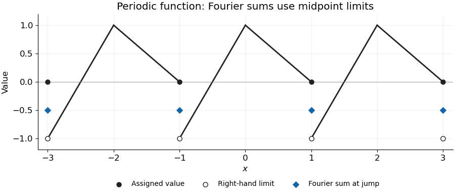

<h1 id="4/a/solution">Solution</h1>

↑ **Parent:** [A](../a.md)

The graph repeats every two units: it rises linearly from the right-hand [limit](../../../../../../limit-of-a-function.md) $-1$ at an [odd integer](../../../../../../odd-integer.md) to value one at the next [even integer](../../../../../../even-number.md), then falls linearly to value zero at the next [odd integer](../../../../../../odd-integer.md). The defined value at each [odd integer](../../../../../../odd-integer.md) is zero, while its right-hand [limit](../../../../../../limit-of-a-function.md) is minus one.

The [Dirichlet convergence theorem for Fourier series](../../../../../../dirichlet-s-theorem-on-fourier-series.md) gives the midpoint of the two [one-sided limits](../../../../../../one-sided-limit.md) at a jump. Hence, on the requested [interval](../../../../../../interval-mathematics.md), the Fourier sum differs from $f$ precisely at

$$
\boxed{x\in\{-3,-1,1,3\},\qquad\text{Fourier sum}=-\frac12\ne f(x)=0.}
$$

At every other point it equals $f(x)$; in particular it equals one at the continuous corners with [even integer](../../../../../../even-number.md) coordinates.

**[Figure 1](#4/a/image-the-periodic-piecewise-linear-function-and-its-fourier-midpoint-values-at-jumps). The periodic piecewise linear function and its Fourier midpoint values at jumps**. Filled black circles are the assigned odd-integer values, hollow circles show the right-hand limits, and blue diamonds give the Fourier sum at each jump.

## ↑ Ancestors (12)

1. [A](../a.md)
2. [4](../../4.md)
3. [Mathematics V](../../../mathematics-v-split.md)
4. [Prelims](../../../split.md)
5. [2021](../../../../split.md)
6. [Past exam of the mathematics course of the University of Oxford](../../../../../split.md)
7. [Mathematics course of the University of Oxford](../../../../../../mathematics-course-of-the-university-of-oxford.md)
8. [Undergraduate course of the University of Oxford](../../../../../../undergraduate-course-of-the-university-of-oxford.md)
9. [Course of the University of Oxford](../../../../../../course-of-the-university-of-oxford.md)
10. [University of Oxford](../../../../../../university-of-oxford-split.md)
11. [List of universities](../../../../../../list-of-universities.md)
12. [Codex Wiki](../../../../../../split.md)
