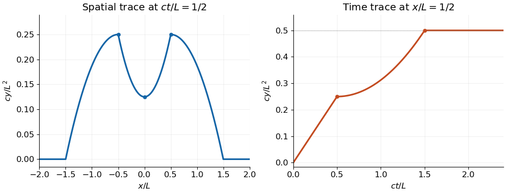

<h1 id="5/a/ii/solution">Solution</h1>

↑ **Parent:** [Ii](../ii.md)

At $x=L/2$, the integration [interval](../../../../../../../interval-mathematics.md) first moves through positive arguments, then crosses zero, and finally contains all of $[-L,L]$. The result is

$$
\boxed{y\!\left(\frac L2,t\right)=\begin{cases}
Lt/2,&0\leq ct\leq L/2,\\[4pt]
\dfrac{L^2+(ct-L/2)^2}{4c},&L/2\leq ct\leq3L/2,\\[4pt]
\dfrac{L^2}{2c},&ct\geq3L/2.
\end{cases}}
$$

The final plateau is the [integral](../../../../../../../integral-split.md) of the entire [initial velocity](../../../../../../../initial-velocity.md) profile divided by $2c$.

**[Figure 2](#5/a/ii/image-two-traces-of-the-d-alembert-solution-for-the-compactly-supported-initial-velocity). Two traces of the D'Alembert solution for the compactly supported initial velocity**. The spatial profile has two peaks at half the initial support radius. The time trace at that location eventually reaches a constant plateau. Axes use dimensionless variables; plotted curves use $L=c=1$.

## ↑ Ancestors (13)

1. [Ii](../ii.md)
2. [A](../../a.md)
3. [5](../../../5.md)
4. [Mathematics V](../../../../mathematics-v-split.md)
5. [Prelims](../../../../split.md)
6. [2021](../../../../../split.md)
7. [Past exam of the mathematics course of the University of Oxford](../../../../../../split.md)
8. [Mathematics course of the University of Oxford](../../../../../../../mathematics-course-of-the-university-of-oxford.md)
9. [Undergraduate course of the University of Oxford](../../../../../../../undergraduate-course-of-the-university-of-oxford.md)
10. [Course of the University of Oxford](../../../../../../../course-of-the-university-of-oxford.md)
11. [University of Oxford](../../../../../../../university-of-oxford-split.md)
12. [List of universities](../../../../../../../list-of-universities.md)
13. [Codex Wiki](../../../../../../../split.md)
