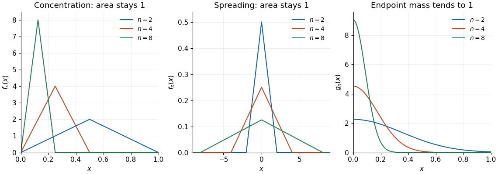

# Mathematics II

↑ **Parent:** [Prelims](../prelims.md)

Source: [released examination PDF, pages 185–190](https://www.whatdotheyknow.com/request/request_for_mathematics_examinat/response/3129786/attach/3/FOI%20202507%20740%20Data.pdf#page=185).

Solutions to all seven questions, including every optional question, of the examination sat on 20 June 2023.

**Table of contents**

- [1](#1)
  - [a](#1/a)
    - [Solution](#1/a/solution)
  - [b](#1/b)
    - [Solution](#1/b/solution)
  - [c](#1/c)
    - [i](#1/c/i)
      - [Solution](#1/c/i/solution)
    - [ii](#1/c/ii)
      - [Solution](#1/c/ii/solution)
- [2](#2)
  - [a](#2/a)
    - [Solution](#2/a/solution)
  - [b](#2/b)
    - [i](#2/b/i)
      - [Solution](#2/b/i/solution)
    - [ii](#2/b/ii)
      - [Solution](#2/b/ii/solution)
  - [c](#2/c)
    - [i](#2/c/i)
      - [Solution](#2/c/i/solution)
    - [ii](#2/c/ii)
      - [Solution](#2/c/ii/solution)
    - [iii](#2/c/iii)
      - [Solution](#2/c/iii/solution)
- [3](#3)
  - [a](#3/a)
    - [Solution](#3/a/solution)
  - [b](#3/b)
    - [i](#3/b/i)
      - [Solution](#3/b/i/solution)
    - [ii](#3/b/ii)
      - [Solution](#3/b/ii/solution)
    - [iii](#3/b/iii)
      - [Solution](#3/b/iii/solution)
- [4](#4)
  - [a](#4/a)
    - [i](#4/a/i)
      - [Solution](#4/a/i/solution)
    - [ii](#4/a/ii)
      - [Solution](#4/a/ii/solution)
    - [iii](#4/a/iii)
      - [Solution](#4/a/iii/solution)
  - [b](#4/b)
    - [i](#4/b/i)
      - [Solution](#4/b/i/solution)
    - [ii](#4/b/ii)
      - [Solution](#4/b/ii/solution)
- [5](#5)
  - [a](#5/a)
    - [i](#5/a/i)
      - [Solution](#5/a/i/solution)
    - [ii](#5/a/ii)
      - [Solution](#5/a/ii/solution)
    - [iii](#5/a/iii)
      - [Solution](#5/a/iii/solution)
  - [b](#5/b)
    - [i](#5/b/i)
      - [Solution](#5/b/i/solution)
    - [ii](#5/b/ii)
      - [Solution](#5/b/ii/solution)
- [6](#6)
  - [a](#6/a)
    - [i](#6/a/i)
      - [Solution](#6/a/i/solution)
    - [ii](#6/a/ii)
      - [Solution](#6/a/ii/solution)
    - [iii](#6/a/iii)
      - [Solution](#6/a/iii/solution)
  - [b](#6/b)
    - [i](#6/b/i)
      - [Solution](#6/b/i/solution)
    - [ii](#6/b/ii)
      - [Solution](#6/b/ii/solution)
    - [iii](#6/b/iii)
      - [Solution](#6/b/iii/solution)
- [7](#7)
  - [a](#7/a)
    - [Solution](#7/a/solution)
  - [b](#7/b)
    - [i](#7/b/i)
      - [Solution](#7/b/i/solution)
    - [ii](#7/b/ii)
      - [Solution](#7/b/ii/solution)
    - [iii](#7/b/iii)
      - [Solution](#7/b/iii/solution)
  - [c](#7/c)
    - [Solution](#7/c/solution)

## 1

↑ **Parent:** [Mathematics II](mathematics-ii.md)

<h3 id="1/a">a</h3>

↑ **Parent:** [1](#1)

<h4 id="1/a/solution">Solution</h4>

↑ **Parent:** [A](#1/a)

For a nonempty [set](../../../set.md) $A\subseteq\mathbb R$, a [supremum](../../../real-analysis.md#supremum) is a [real number](../../../arithmetic.md#real-number) $s$ such that $a\leq s$ for every $a\in A$, and every [upper bound](../../../set.md#upper-bound-in-a-partially-ordered-set) $u$ of $A$ satisfies $s\leq u$. Equivalently, $s$ is an [upper bound](../../../set.md#upper-bound-in-a-partially-ordered-set) and, for every $\varepsilon>0$, some $a\in A$ satisfies $a>s-\varepsilon$. By [completeness of the real numbers](../../../sequence-and-series.md#completeness-of-the-real-numbers), it exists whenever $A$ is nonempty and bounded above.

An increasing [monotone sequence](../../../sequence-and-series.md#monotone-sequence) satisfies $a_{n+1}\geq a_n$ for every $n$; a [bounded sequence](../../../sequence-and-series.md#bounded-sequence) satisfies $|a_n|\leq M$ for some finite $M$ and every $n$. Put $s=\sup\{a_n:n\geq1\}$. Given $\varepsilon>0$, the defining property of the [supremum](../../../real-analysis.md#supremum) supplies $N$ with $a_N>s-\varepsilon$. For every $n\geq N$, [monotonicity](../../../calculus.md#monotonic-function) gives

$$
s-\varepsilon<a_N\leq a_n\leq s.
$$

This is exactly the definition of [convergent sequence](../../../sequence-and-series.md#convergent-sequence), so the [bounded monotone sequence theorem](../../../sequence-and-series.md#bounded-monotone-sequence-theorem) gives $\boxed{a_n\to s}$.

<h3 id="1/b">b</h3>

↑ **Parent:** [1](#1)

<h4 id="1/b/solution">Solution</h4>

↑ **Parent:** [B](#1/b)

Choose $M$ with $|b_n|\leq M$. Every [tail of a sequence](../../../sequence-and-series.md#tail-of-a-sequence) is nonempty and bounded, so its [supremum](../../../real-analysis.md#supremum) $c_n$ exists and lies in $[-M,M]$. Removing one term cannot increase a [supremum](../../../real-analysis.md#supremum), hence $c_{n+1}\leq c_n$. The [bounded monotone sequence theorem](../../../sequence-and-series.md#bounded-monotone-sequence-theorem), applied to $-c_n$, proves

$$
c_n\longrightarrow L=\inf_n c_n=\limsup_{n\to\infty}b_n.
$$

Thus $L$ is the [limit superior](../../../sequence-and-series.md#limit-superior) of $(b_n)$.

For $\varepsilon>0$, eventually $c_n<L+\varepsilon$, and then $b_n\leq c_n<L+\varepsilon$. Only finitely many indices can satisfy $b_n\geq L+\varepsilon$. If only finitely many satisfied $b_n>L-\varepsilon$, some entire [tail of a sequence](../../../sequence-and-series.md#tail-of-a-sequence) would have $b_n\leq L-\varepsilon$. Its [supremum](../../../real-analysis.md#supremum) would also be at most $L-\varepsilon$, contradicting $c_n\geq L$.

Inductively choose $n_k>n_{k-1}$ so late that $c_{n_k}<L+1/k$ and $b_{n_k}>L-1/k$. There are infinitely many choices for the latter inequality, so both requirements can be met. Then $|b_{n_k}-L|<1/k$, proving $\boxed{b_{n_k}\to L}$. This constructs a [subsequence](../../../sequence-and-series.md#subsequence) attaining the [limit superior](../../../sequence-and-series.md#limit-superior).

<h3 id="1/c">c</h3>

↑ **Parent:** [1](#1)

<h4 id="1/c/i">i</h4>

↑ **Parent:** [C](#1/c)

<h5 id="1/c/i/solution">Solution</h5>

↑ **Parent:** [I](#1/c/i)

At [even integers](../../../integer.md#even-number) $n=2k$, the terms are $1+1/(2k)\to1$. At [odd integers](../../../integer.md#odd-integer) they are $-1-1/(2k-1)\to-1$. The largest eventual values therefore come from the subsequence at [even integers](../../../integer.md#even-number), and

$$
\boxed{\limsup_{n\to\infty}(-1)^n(1+1/n)=1.}
$$

Explicitly, every sufficiently late term is below $1+\varepsilon$, while infinitely many [even integers](../../../integer.md#even-number) give terms greater than $1-\varepsilon$.

<h4 id="1/c/ii">ii</h4>

↑ **Parent:** [C](#1/c)

<h5 id="1/c/ii/solution">Solution</h5>

↑ **Parent:** [Ii](#1/c/ii)

The [sine](../../../geometry-and-topology.md#sine) has values $1,0,-1,0$ on the four residue classes of $n$ modulo four. For $n=4k+1$, the [exponential function](../../../calculus.md#exponential-function) gives $b_n=e^{1-1/n}\to e$; the other residue classes tend to $1,e^{-1},1$. All terms satisfy $b_n\leq e$, and the first class approaches $e$. Hence

$$
\boxed{\limsup_{n\to\infty}e^{(1-1/n)\sin(n\pi/2)}=e.}
$$

## 2

↑ **Parent:** [Mathematics II](mathematics-ii.md)

<h3 id="2/a">a</h3>

↑ **Parent:** [2](#2)

<h4 id="2/a/solution">Solution</h4>

↑ **Parent:** [A](#2/a)

A [series](../../../sequence-and-series.md#series-mathematics) $\sum_{n=1}^\infty a_n$ converges when its [partial sums](../../../sequence-and-series.md#partial-sum) $s_N=\sum_{n=1}^N a_n$ have a finite [limit of a sequence](../../../sequence-and-series.md#limit-of-a-sequence).

The [comparison test](../../../sequence-and-series.md#direct-comparison-test) says that if $0\leq a_n\leq b_n$ eventually and $\sum b_n$ converges, then $\sum a_n$ converges. Indeed, the [partial sums](../../../sequence-and-series.md#partial-sum) of the nonnegative terms $a_n$ are increasing, and are bounded above by a fixed initial contribution plus the sum of the comparison [series](../../../sequence-and-series.md#series-mathematics). The [bounded monotone sequence theorem](../../../sequence-and-series.md#bounded-monotone-sequence-theorem) proves their convergence. Finite initial terms do not affect convergence. Applying this result to $|a_n|$ also proves [absolute convergence](../../../sequence-and-series.md#absolute-convergence) whenever $|a_n|\leq b_n$ eventually with $\sum b_n<\infty$.

<h3 id="2/b">b</h3>

↑ **Parent:** [2](#2)

<h4 id="2/b/i">i</h4>

↑ **Parent:** [B](#2/b)

<h5 id="2/b/i/solution">Solution</h5>

↑ **Parent:** [I](#2/b/i)

**The implication is true, with [absolute convergence](../../../sequence-and-series.md#absolute-convergence).** Since $n^{3/2}a_n\to0$, there is $N$ such that $|a_n|\leq n^{-3/2}$ for $n\geq N$. The [p-series](../../../sequence-and-series.md#p-series) $\sum n^{-3/2}$ converges because its exponent exceeds one. The [comparison test](../../../sequence-and-series.md#direct-comparison-test) proves $\sum|a_n|<\infty$, and [absolute convergence](../../../sequence-and-series.md#absolute-convergence) implies convergence of $\sum a_n$.

<h4 id="2/b/ii">ii</h4>

↑ **Parent:** [B](#2/b)

<h5 id="2/b/ii/solution">Solution</h5>

↑ **Parent:** [Ii](#2/b/ii)

**The implication is false.** Set

$$
a_n=\frac1{n\log(n+1)}.
$$

Then $na_n=1/\log(n+1)\to0$. For $n\geq2$, $\log(n+1)\leq\log(2n)\leq2\log n$, so $a_n\geq1/(2n\log n)$. The [integral test](../../../sequence-and-series.md#integral-test-for-convergence) gives

$$
\int_2^R\frac{dx}{x\log x}=\log\log R-\log\log2\longrightarrow\infty.
$$

Thus the [comparison test](../../../sequence-and-series.md#direct-comparison-test) shows that $\sum a_n$ diverges.

<h3 id="2/c">c</h3>

↑ **Parent:** [2](#2)

<h4 id="2/c/i">i</h4>

↑ **Parent:** [C](#2/c)

<h5 id="2/c/i/solution">Solution</h5>

↑ **Parent:** [I](#2/c/i)

The [binomial theorem](../../../binomial-coefficient.md#binomial-theorem) gives $\binom{2n}{n}\leq\sum_{k=0}^{2n}\binom{2n}{k}=4^n$. Therefore

$$
\left|\binom{2n}{n}3^{-2n}\sin n\right|\leq(4/9)^n.
$$

The [geometric series](../../../sequence-and-series.md#geometric-series) with ratio $4/9$ converges. By the [comparison test](../../../sequence-and-series.md#direct-comparison-test), the given [series](../../../sequence-and-series.md#series-mathematics) is **absolutely convergent**.

<h4 id="2/c/ii">ii</h4>

↑ **Parent:** [C](#2/c)

<h5 id="2/c/ii/solution">Solution</h5>

↑ **Parent:** [Ii](#2/c/ii)

For $t\geq0$, $|\sin t|\leq t$, so

$$
0\leq\frac{n\sin^2(1/n)}{(\log n)^2}\leq\frac1{n(\log n)^2}.
$$

The [integral test](../../../sequence-and-series.md#integral-test-for-convergence) applies to the decreasing positive comparison function, and

$$
\int_2^\infty\frac{dx}{x(\log x)^2}=\frac1{\log2}<\infty.
$$

The [comparison test](../../../sequence-and-series.md#direct-comparison-test) proves that the [series](../../../sequence-and-series.md#series-mathematics) **converges**; since all terms are nonnegative, this is also [absolute convergence](../../../sequence-and-series.md#absolute-convergence).

<h4 id="2/c/iii">iii</h4>

↑ **Parent:** [C](#2/c)

<h5 id="2/c/iii/solution">Solution</h5>

↑ **Parent:** [Iii](#2/c/iii)

Let $u(x)=(\log x)x^{-2/3}$. Its [derivative](../../../calculus.md#derivative) is

$$
u'(x)=x^{-5/3}\left(1-\frac23\log x\right),
$$

which is negative for $x>e^{3/2}$. Also $u(x)\to0$, since a positive power eventually dominates the [natural logarithm](../../../calculus.md#natural-logarithm). Thus the [alternating series test](../../../sequence-and-series.md#alternating-series-test) proves convergence of $\sum(-1)^n u(n)$.

For $n\geq3$, $u(n)\geq n^{-2/3}$, whose [p-series](../../../sequence-and-series.md#p-series) diverges. The [comparison test](../../../sequence-and-series.md#direct-comparison-test) therefore rules out [absolute convergence](../../../sequence-and-series.md#absolute-convergence). The answer is **conditional convergence**.

## 3

↑ **Parent:** [Mathematics II](mathematics-ii.md)

<h3 id="3/a">a</h3>

↑ **Parent:** [3](#3)

<h4 id="3/a/solution">Solution</h4>

↑ **Parent:** [A](#3/a)

For a [power series](../../../sequence-and-series.md#power-series) $\sum a_nz^n$, its [radius of convergence](../../../sequence-and-series.md#radius-of-convergence) $R\in[0,\infty]$ separates [absolute convergence](../../../sequence-and-series.md#absolute-convergence) for $|z|<R$ from divergence for $|z|>R$. One may define $R=\sup\{r\geq0:\sum|a_n|r^n<\infty\}$, allowing $R=\infty$.

To justify convergence inside the radius, choose $|z|<r<R$ with $\sum|a_n|r^n<\infty$. In particular $|a_n|r^n\leq M$ for some $M$, so

$$
|a_nz^n|\leq M(|z|/r)^n.
$$

The [comparison test](../../../sequence-and-series.md#direct-comparison-test) with a [geometric series](../../../sequence-and-series.md#geometric-series) proves [absolute convergence](../../../sequence-and-series.md#absolute-convergence). Conversely, convergence at a point of modulus $\rho$ makes $a_nz^n$ bounded there and gives [absolute convergence](../../../sequence-and-series.md#absolute-convergence) at all smaller moduli by the same estimate. Consequently a convergent point of modulus greater than $R$ would contradict the definition of $R$.

For $0<R<\infty$, the real [domain of convergence](../../../sequence-and-series.md#domain-of-convergence) is one of $(-R,R)$, $[-R,R)$, $(-R,R]$, or $[-R,R]$. At $R=1$ these are realized respectively by

$$
\sum z^n,\qquad \sum_{n=1}^\infty\frac{z^n}{n},\qquad \sum_{n=1}^\infty\frac{(-1)^nz^n}{n},\qquad \sum_{n=1}^\infty\frac{z^n}{n^2}.
$$

The endpoint assertions follow from the [harmonic series](../../../sequence-and-series.md#harmonic-series), [alternating series test](../../../sequence-and-series.md#alternating-series-test), and [p-series](../../../sequence-and-series.md#p-series). Replacing $z$ by $z/R$ realizes every finite positive radius. The degenerate domain $\{0\}$ occurs for $\sum n!z^n$, while the entire [real line](../../../real-analysis.md#real-line) occurs for $\sum z^n/n!$. Their radii are zero and infinity by the [ratio test](../../../sequence-and-series.md#ratio-test).

<h3 id="3/b">b</h3>

↑ **Parent:** [3](#3)

<h4 id="3/b/i">i</h4>

↑ **Parent:** [B](#3/b)

<h5 id="3/b/i/solution">Solution</h5>

↑ **Parent:** [I](#3/b/i)

The [Cauchy-Hadamard theorem](../../../sequence-and-series.md#cauchy-hadamard-theorem) states $R^{-1}=\limsup|a_n|^{1/n}$. At the [prime numbers](../../../prime-number.md) $n=p$, this root equals $p^{2/p}\to1$. There are infinitely many [prime numbers](../../../prime-number.md), so these indices form an unbounded [subsequence](../../../sequence-and-series.md#subsequence). For every other positive index the root is zero. The [limit superior](../../../sequence-and-series.md#limit-superior) is therefore one, and $\boxed{R=1}$.

<h4 id="3/b/ii">ii</h4>

↑ **Parent:** [B](#3/b)

<h5 id="3/b/ii/solution">Solution</h5>

↑ **Parent:** [Ii](#3/b/ii)

By [Stirling's approximation](../../../real-analysis.md#stirling-formula),

$$
(n!)^{1/n}\sim\frac ne(2\pi n)^{1/(2n)},\qquad
|a_n|^{1/n}=\frac{n^{1+1/n^2}}{(n!)^{1/n}}\longrightarrow e.
$$

Here $(2\pi n)^{1/(2n)}\to1$ and $n^{1/n^2}\to1$, as is seen by taking the [natural logarithm](../../../calculus.md#natural-logarithm). The [Cauchy-Hadamard theorem](../../../sequence-and-series.md#cauchy-hadamard-theorem) gives $\boxed{R=e^{-1}}$.

<h4 id="3/b/iii">iii</h4>

↑ **Parent:** [B](#3/b)

<h5 id="3/b/iii/solution">Solution</h5>

↑ **Parent:** [Iii](#3/b/iii)

At the nonzero indices $n=m!$ with $m\geq2$,

$$
|a_{m!}|^{1/(m!)}=10^{m/(m!)}\longrightarrow1,
$$

since $m/(m!)=1/(m-1)!\to0$. At all other sufficiently large indices the coefficient is zero. The initial coefficients do not affect the [limit superior](../../../sequence-and-series.md#limit-superior), which equals one. The [Cauchy-Hadamard theorem](../../../sequence-and-series.md#cauchy-hadamard-theorem) therefore gives $\boxed{R=1}$.

## 4

↑ **Parent:** [Mathematics II](mathematics-ii.md)

<h3 id="4/a">a</h3>

↑ **Parent:** [4](#4)

<h4 id="4/a/i">i</h4>

↑ **Parent:** [A](#4/a)

<h5 id="4/a/i/solution">Solution</h5>

↑ **Parent:** [I](#4/a/i)

A [limit point](../../../topology.md#limit-point) $p$ of $E\subseteq\mathbb R$ is a point such that, for every $\varepsilon>0$, the punctured [neighbourhood](../../../topology.md#neighbourhood-mathematics) $(p-\varepsilon,p+\varepsilon)\setminus\{p\}$ meets $E$. A [closed set](../../../topology.md#closed-set) contains all of its [limit points](../../../topology.md#limit-point).

Every nonempty [open interval](../../../topology.md#open-interval) contains a [rational number](../../../number-theory.md#rational-number); applying this to $(p,p+\varepsilon)$ shows that every $p\in\mathbb R$ is a [limit point](../../../topology.md#limit-point) of $\mathbb Q$. Thus **the [limit points](../../../topology.md#limit-point) of $\mathbb Q$ form $\mathbb R$, and $\mathbb Q$ is not closed**.

If $p\in\mathbb Z$, radius $1/2$ excludes all other [integers](../../../integer.md). If $p\notin\mathbb Z$, its distances to the two neighbouring [integers](../../../integer.md) have a positive minimum, and a smaller radius excludes every [integer](../../../integer.md). Thus **$\mathbb Z$ has no [limit points](../../../topology.md#limit-point) in $\mathbb R$ and is closed**.

<h4 id="4/a/ii">ii</h4>

↑ **Parent:** [A](#4/a)

<h5 id="4/a/ii/solution">Solution</h5>

↑ **Parent:** [Ii](#4/a/ii)

Suppose $E$ is a [closed set](../../../topology.md#closed-set) and $p\notin E$. Then $p$ is not a [limit point](../../../topology.md#limit-point) of $E$, so some punctured [neighbourhood](../../../topology.md#neighbourhood-mathematics) of $p$ misses $E$. As $p\notin E$, the entire [neighbourhood](../../../topology.md#neighbourhood-mathematics) misses $E$. Thus $\mathbb R\setminus E$ is an [open set](../../../topology.md#open-set).

Conversely, suppose every point $p\notin E$ has a [neighbourhood](../../../topology.md#neighbourhood-mathematics) disjoint from $E$. No such point can be a [limit point](../../../topology.md#limit-point) of $E$, so every [limit point](../../../topology.md#limit-point) lies in $E$. This proves the equivalence between containing all [limit points](../../../topology.md#limit-point) and having an complement that is an [open set](../../../topology.md#open-set).

<h4 id="4/a/iii">iii</h4>

↑ **Parent:** [A](#4/a)

<h5 id="4/a/iii/solution">Solution</h5>

↑ **Parent:** [Iii](#4/a/iii)

A point is in the [closure](../../../topology.md#closure-topology) $\overline E$ exactly when every [neighbourhood](../../../topology.md#neighbourhood-mathematics) meets $E$. This is equivalent to belonging to $E$ or being a [limit point](../../../topology.md#limit-point) of $E$.

If $p\notin\overline E$, choose $\varepsilon>0$ with $(p-\varepsilon,p+\varepsilon)\cap E=\varnothing$. Every $q$ with $|q-p|<\varepsilon/2$ has a smaller [neighbourhood](../../../topology.md#neighbourhood-mathematics) contained in this interval and disjoint from $E$. Thus $(p-\varepsilon/2,p+\varepsilon/2)$ misses $\overline E$, and the complement of $\overline E$ is [open](../../../topology.md#open-set). Hence $\overline E$ is [closed](../../../topology.md#closed-set).

Every [closed set](../../../topology.md#closed-set) $F$ containing $E$ contains all [limit points](../../../topology.md#limit-point) of $E$: a [limit point](../../../topology.md#limit-point) outside $F$ would have a [neighbourhood](../../../topology.md#neighbourhood-mathematics) missing $F$, and hence missing $E$. Therefore $\overline E\subseteq F$. Since $\overline E$ is itself one of these [closed sets](../../../topology.md#closed-set),

$$
\boxed{\overline E=\bigcap\{F:E\subseteq F,\ F\text{ closed in }\mathbb R\}.}
$$

<h3 id="4/b">b</h3>

↑ **Parent:** [4](#4)

<h4 id="4/b/i">i</h4>

↑ **Parent:** [B](#4/b)

<h5 id="4/b/i/solution">Solution</h5>

↑ **Parent:** [I](#4/b/i)

The [limit of a function](../../../calculus.md#limit-of-a-function) $f:E\to\mathbb R$ at a [limit point](../../../topology.md#limit-point) $p$ of $E$ is $\ell$ when

$$
\forall\varepsilon>0\ \exists\delta>0\ \forall x\in E:\quad
0<|x-p|<\delta\ \Longrightarrow\ |f(x)-\ell|<\varepsilon.
$$

The [function](../../../function.md) converges as $x\to p$ if such a finite $\ell$ exists. The puncture excludes any value assigned at $p$.

For $p\in E$, [continuity](../../../calculus.md#continuous-function) at $p$ means

$$
\forall\varepsilon>0\ \exists\delta>0\ \forall x\in E:\quad
|x-p|<\delta\ \Longrightarrow\ |f(x)-f(p)|<\varepsilon.
$$

When $p$ is also a [limit point](../../../topology.md#limit-point), this says that the [limit of a function](../../../calculus.md#limit-of-a-function) is $f(p)$. At an [isolated point](../../../topological-analysis.md#isolated-point) of $E$, every [function](../../../function.md) is [continuous](../../../calculus.md#continuous-function) relative to $E$, even though the punctured limit does not have a unique forced value.

<h4 id="4/b/ii">ii</h4>

↑ **Parent:** [B](#4/b)

<h5 id="4/b/ii/solution">Solution</h5>

↑ **Parent:** [Ii](#4/b/ii)

Take $y=f(p)$ with $p\in\overline E$. Given $\varepsilon>0$, [continuity](../../../calculus.md#continuous-function) gives $\delta>0$ such that $|x-p|<\delta$ implies $|f(x)-f(p)|<\varepsilon$. Since $p\in\overline E$, choose $x\in E$ with $|x-p|<\delta$. Thus every [neighbourhood](../../../topology.md#neighbourhood-mathematics) of $y$ meets $f(E)$, proving

$$
\boxed{f(\overline E)\subseteq\overline{f(E)}.}
$$

Equality need not hold. Let $f(x)=e^x$ and $E=\mathbb R$. The [exponential function](../../../calculus.md#exponential-function) is [continuous](../../../calculus.md#continuous-function), but

$$
f(\overline E)=(0,\infty)\ \varsubsetneq\ [0,\infty)=\overline{f(E)}.
$$

The additional point zero comes from arguments escaping to $-\infty$, not from a finite point of $\overline E$.

## 5

↑ **Parent:** [Mathematics II](mathematics-ii.md)

<h3 id="5/a">a</h3>

↑ **Parent:** [5](#5)

<h4 id="5/a/i">i</h4>

↑ **Parent:** [A](#5/a)

<h5 id="5/a/i/solution">Solution</h5>

↑ **Parent:** [I](#5/a/i)

The [sequence of functions](../../../sequence-and-series.md#sequence-of-functions) $(f_n)$ [converges uniformly](../../../sequence-and-series.md#uniform-convergence) to $f$ on $E$ if

$$
\forall\varepsilon>0\ \exists N\ \forall n\geq N\ \forall x\in E:\quad |f_n(x)-f(x)|<\varepsilon.
$$

The same $N$ must work for every $x$. Equivalently, the [supremum norm](../../../normed-vector-space.md#supremum-norm) of $f_n-f$ tends to zero. This is stronger than [pointwise convergence](../../../sequence-and-series.md#pointwise-convergence), where $N$ may depend on $x$.

<h4 id="5/a/ii">ii</h4>

↑ **Parent:** [A](#5/a)

<h5 id="5/a/ii/solution">Solution</h5>

↑ **Parent:** [Ii](#5/a/ii)

The [Uniform Cauchy criterion](../../../sequence-and-series.md#uniform-cauchy-criterion) says that $(f_n:E\to\mathbb R)$ [converges uniformly](../../../sequence-and-series.md#uniform-convergence) on $E$ if and only if

$$
\forall\varepsilon>0\ \exists N\ \forall m,n\geq N\ \forall x\in E:\quad |f_n(x)-f_m(x)|<\varepsilon.
$$

For necessity, use the [triangle inequality](../../../topological-analysis.md#triangle-inequality) through the [uniform limit](../../../sequence-and-series.md#uniform-limit). For sufficiency, the condition makes $(f_n(x))_n$ a [Cauchy sequence](../../../sequence-and-series.md#cauchy-sequence) for each $x$, so [completeness of the real numbers](../../../sequence-and-series.md#completeness-of-the-real-numbers) defines a [pointwise limit](../../../sequence-and-series.md#pointwise-limit) $f(x)$. Apply the condition with $\varepsilon/2$ and let $m\to\infty$ to obtain $|f_n(x)-f(x)|\leq\varepsilon/2<\varepsilon$ uniformly in $x$.

<h4 id="5/a/iii">iii</h4>

↑ **Parent:** [A](#5/a)

<h5 id="5/a/iii/solution">Solution</h5>

↑ **Parent:** [Iii](#5/a/iii)

Use [uniform convergence](../../../sequence-and-series.md#uniform-convergence) to choose $N$ with $|f_n(x)-f_N(x)|\leq1$ for all $n\geq N$ and $x\in E$; this follows, for example, from the [Uniform Cauchy criterion](../../../sequence-and-series.md#uniform-cauchy-criterion). Since each $f_j$ is a [bounded function](../../../function.md#bounded-function), put $M_j=\sup_E|f_j|<\infty$ for $1\leq j\leq N$. Then

$$
|f_n(x)|\leq M:=1+\max_{1\leq j\leq N}M_j
$$

for every $n$ and $x$. Thus $(f_n)$ is a [uniformly bounded family of functions](../../../topological-analysis.md#uniformly-bounded-family-of-functions). The finite initial segment is essential: [uniform convergence](../../../sequence-and-series.md#uniform-convergence) directly controls only a [tail of a sequence](../../../sequence-and-series.md#tail-of-a-sequence).

<h3 id="5/b">b</h3>

↑ **Parent:** [5](#5)

<h4 id="5/b/i">i</h4>

↑ **Parent:** [B](#5/b)

<h5 id="5/b/i/solution">Solution</h5>

↑ **Parent:** [I](#5/b/i)

Write $f_n\to f$ and $g_n\to g$ with [uniform convergence](../../../sequence-and-series.md#uniform-convergence). The [triangle inequality](../../../topological-analysis.md#triangle-inequality) gives

$$
\sup_E|(f_n+g_n)-(f+g)|\leq\sup_E|f_n-f|+\sup_E|g_n-g|\longrightarrow0.
$$

Hence $f_n+g_n\to f+g$ with [uniform convergence](../../../sequence-and-series.md#uniform-convergence).

If every $f_n,g_n$ is a [bounded function](../../../function.md#bounded-function), part [iii](#5/a/iii) gives constants $M_f,M_g$ bounding the two families. Their [pointwise limits](../../../sequence-and-series.md#pointwise-limit) satisfy $|f|\leq M_f$ and $|g|\leq M_g$. Consequently

$$
\begin{aligned}
\sup_E|f_ng_n-fg|
&\leq\sup_E\bigl(|f_n|\,|g_n-g|+|g|\,|f_n-f|\bigr)\\
&\leq M_f\sup_E|g_n-g|+M_g\sup_E|f_n-f|\longrightarrow0.
\end{aligned}
$$

Thus **both sums and products have [uniform convergence](../../../sequence-and-series.md#uniform-convergence) under the stated hypotheses**. The product estimate is the [uniform convergence product rule for bounded functions](../../../sequence-and-series.md#uniform-convergence-product-rule-for-bounded-functions).

<h4 id="5/b/ii">ii</h4>

↑ **Parent:** [B](#5/b)

<h5 id="5/b/ii/solution">Solution</h5>

↑ **Parent:** [Ii](#5/b/ii)

On $E=\mathbb R$, take $f_n(x)=x$ and $g_n(x)=1/n$. Then $f_n\to f(x)=x$ with [uniform convergence](../../../sequence-and-series.md#uniform-convergence), because there is no error, and $g_n\to0$ with [uniform convergence](../../../sequence-and-series.md#uniform-convergence), with error $1/n$. Their products $f_ng_n=x/n$ converge [pointwise](../../../sequence-and-series.md#pointwise-convergence) to zero, but for every $n$ the choice $x=n$ gives $|f_n(x)g_n(x)|=1$. Thus **the products do not converge uniformly**. Here the first family consists of unbounded [functions](../../../function.md), exactly the missing hypothesis in the preceding estimate.

## 6

↑ **Parent:** [Mathematics II](mathematics-ii.md)

<h3 id="6/a">a</h3>

↑ **Parent:** [6](#6)

<h4 id="6/a/i">i</h4>

↑ **Parent:** [A](#6/a)

<h5 id="6/a/i/solution">Solution</h5>

↑ **Parent:** [I](#6/a/i)

The [mean value theorem](../../../calculus.md#mean-value-theorem) states that if $f:[a,b]\to\mathbb R$ is [continuous](../../../calculus.md#continuous-function) on $[a,b]$ and [differentiable](../../../analysis.md#differentiable-function) on $(a,b)$, where $a<b$, there is $c\in(a,b)$ such that

$$
\boxed{f(b)-f(a)=f'(c)(b-a).}
$$

No [continuity](../../../calculus.md#continuous-function) assumption on the [derivative](../../../calculus.md#derivative) is needed.

<h4 id="6/a/ii">ii</h4>

↑ **Parent:** [A](#6/a)

<h5 id="6/a/ii/solution">Solution</h5>

↑ **Parent:** [Ii](#6/a/ii)

The [constancy theorem](../../../calculus.md#constancy-theorem) states that a [differentiable function](../../../analysis.md#differentiable-function) on an [interval](../../../real-analysis.md#interval-mathematics) whose [derivative](../../../calculus.md#derivative) vanishes everywhere is [constant](../../../mathematics.md#constant-mathematics). At any included endpoints, [continuity](../../../calculus.md#continuous-function) there is understood.

Indeed, take arbitrary $x<y$ in the [interval](../../../real-analysis.md#interval-mathematics). The [mean value theorem](../../../calculus.md#mean-value-theorem) applies on $[x,y]$ and gives $f(y)-f(x)=f'(c)(y-x)=0$. Every pair of values is equal, proving the assertion. The [interval](../../../real-analysis.md#interval-mathematics) hypothesis ensures that the whole segment $[x,y]$ lies in the [domain](../../../topology.md#domain-mathematical-analysis).

<h4 id="6/a/iii">iii</h4>

↑ **Parent:** [A](#6/a)

<h5 id="6/a/iii/solution">Solution</h5>

↑ **Parent:** [Iii](#6/a/iii)

The [derivative](../../../calculus.md#derivative) of $h(x)=f(x)-\sin x$ vanishes. By the [constancy theorem](../../../calculus.md#constancy-theorem) on the [interval](../../../real-analysis.md#interval-mathematics) $I$,

$$
\boxed{f(x)=\sin x+C\quad(x\in I).}
$$

**This need not hold on a disconnected [domain](../../../topology.md#domain-mathematical-analysis).** On $I=(-\infty,0)\cup(0,\infty)$, define $f(x)=\sin x$ for $x<0$ and $f(x)=\sin x+1$ for $x>0$. The [function](../../../function.md) is [differentiable](../../../analysis.md#differentiable-function) throughout $I$ with $f'(x)=\cos x$, but no single $C$ works on both components.

<h3 id="6/b">b</h3>

↑ **Parent:** [6](#6)

<h4 id="6/b/i">i</h4>

↑ **Parent:** [B](#6/b)

<h5 id="6/b/i/solution">Solution</h5>

↑ **Parent:** [I](#6/b/i)

Suppose distinct [fixed points](../../../function.md#fixed-point) $x<y$ existed. Then $h(t)=f(t)-t$ satisfies $h(x)=h(y)=0$. [Rolle's theorem](../../../calculus.md#rolle-theorem) supplies $c\in(x,y)$ with $h'(c)=0$, hence $f'(c)=1$, contrary to the hypothesis. Thus **there is at most one [fixed point](../../../function.md#fixed-point)**. The argument does not require $f'$ to be [continuous](../../../calculus.md#continuous-function).

<h4 id="6/b/ii">ii</h4>

↑ **Parent:** [B](#6/b)

<h5 id="6/b/ii/solution">Solution</h5>

↑ **Parent:** [Ii](#6/b/ii)

For every real $t$, $f(t)-t=1/(1+e^t)>0$, so **there is no [fixed point](../../../function.md#fixed-point)**. Direct [differentiation](../../../calculus.md#differentiation) gives

$$
f'(t)=1-\frac{e^t}{(1+e^t)^2}.
$$

Writing $u=e^t>0$, the inequality $(1+u)^2\geq4u$ shows

$$
\boxed{\frac34\leq f'(t)<1.}
$$

In particular $0<f'(t)<1$, but $f'(t)\to1$ as $t\to\pm\infty$. There is no common [contraction constant](../../../analysis.md#contraction-constant) smaller than one. Strict pointwise bounds on the [derivative](../../../calculus.md#derivative) therefore do not suffice for the [contraction mapping theorem](../../../analysis.md#contraction-mapping-theorem).

<h4 id="6/b/iii">iii</h4>

↑ **Parent:** [B](#6/b)

<h5 id="6/b/iii/solution">Solution</h5>

↑ **Parent:** [Iii](#6/b/iii)

By the [mean value theorem](../../../calculus.md#mean-value-theorem), $|f(x)-f(y)|\leq A|x-y|$ for all real $x,y$. Thus $f$ is a [contraction mapping](../../../analysis.md#contraction-mapping) on the [complete metric space](../../../topological-analysis.md#complete-metric-space) $\mathbb R$. Starting from arbitrary $x_1$, define $x_{n+1}=f(x_n)$. Induction gives $|x_{n+1}-x_n|\leq A^{n-1}|x_2-x_1|$. For $m>n$, the [triangle inequality](../../../topological-analysis.md#triangle-inequality) and a [geometric series](../../../sequence-and-series.md#geometric-series) yield

$$
|x_m-x_n|\leq\frac{A^{n-1}}{1-A}|x_2-x_1|\longrightarrow0.
$$

Hence $(x_n)$ is a [Cauchy sequence](../../../sequence-and-series.md#cauchy-sequence) and [completeness of the real numbers](../../../sequence-and-series.md#completeness-of-the-real-numbers) supplies a [limit](../../../calculus.md#limit-of-a-function) $x$. The [Lipschitz continuity](../../../real-analysis.md#lipschitz-continuity) of $f$ implies $f(x)=\lim f(x_n)=\lim x_{n+1}=x$. Thus the limit is a [fixed point](../../../function.md#fixed-point), independently of the initial value. If $y$ were another, $|x-y|\leq A|x-y|$ would force $x=y$. This proves the [contraction mapping theorem](../../../analysis.md#contraction-mapping-theorem) in this setting, with error estimate

$$
\boxed{|x-x_n|\leq\frac{A^{n-1}}{1-A}|x_2-x_1|.}
$$

## 7

↑ **Parent:** [Mathematics II](mathematics-ii.md)

<h3 id="7/a">a</h3>

↑ **Parent:** [7](#7)

<h4 id="7/a/solution">Solution</h4>

↑ **Parent:** [A](#7/a)

Assume, as required for the displayed integrals, that the $f_n$ are [Riemann integrable](../../../real-analysis.md#riemann-integrable-function) on $[a,b]$. Their [uniform limit](../../../sequence-and-series.md#uniform-limit) $f$ is also [Riemann integrable](../../../real-analysis.md#riemann-integrable-function): if $\sup|f-f_N|<\varepsilon$, the upper and lower [Darboux sums](../../../real-analysis.md#darboux-sum) for a [partition of an interval](../../../real-analysis.md#partition-of-an-interval) differ for $f$ by at most the corresponding difference for $f_N$ plus $2\varepsilon(b-a)$. Choosing $N$ and then a sufficiently fine [partition of an interval](../../../real-analysis.md#partition-of-an-interval) proves the [Riemann integrability criterion](../../../real-analysis.md#riemann-integrability-criterion) for $f$.

The integral estimate then gives

$$
\left|\int_a^b f_n(x)\,dx-\int_a^b f(x)\,dx\right|
\leq(b-a)\sup_{x\in[a,b]}|f_n(x)-f(x)|\longrightarrow0.
$$

This proves that [uniform convergence preserves integrals on a compact interval](../../../sequence-and-series.md#uniform-convergence-preserves-integrals-on-a-compact-interval). Some integrability hypothesis is necessary: [uniform convergence](../../../sequence-and-series.md#uniform-convergence) alone cannot make the integral of an arbitrary starting [function](../../../function.md) exist.

<h3 id="7/b">b</h3>

↑ **Parent:** [7](#7)

<h4 id="7/b/i">i</h4>

↑ **Parent:** [B](#7/b)

<h5 id="7/b/i/solution">Solution</h5>

↑ **Parent:** [I](#7/b/i)

Let $f_n$ be the [continuous](../../../calculus.md#continuous-function) triangular bump

$$
f_n(x)=\begin{cases}
 n^2x,&0\leq x\leq1/n,\\
 n(2-nx),&1/n\leq x\leq2/n,\\
 0,&2/n\leq x\leq1,
\end{cases}\qquad n\geq2,
$$

and set $f_1=0$. At $x=0$ every term is zero, and each fixed $x>0$ eventually lies outside the support, so $f_n\to0$ [pointwise](../../../sequence-and-series.md#pointwise-convergence). The triangle has base $2/n$ and height $n$, hence

$$
\boxed{\int_0^1 f_n(x)\,dx=1\quad(n\geq2),\qquad \int_0^1 0\,dx=0.}
$$

This [concentrating triangular bump](../../../sequence-and-series.md#concentrating-triangular-bump) shows that [pointwise convergence](../../../sequence-and-series.md#pointwise-convergence) does not preserve integrals, even for [continuous functions](../../../calculus.md#continuous-function) on a [compact interval](../../../real-analysis.md#compact-interval).

<h4 id="7/b/ii">ii</h4>

↑ **Parent:** [B](#7/b)

<h5 id="7/b/ii/solution">Solution</h5>

↑ **Parent:** [Ii](#7/b/ii)

Take $f_n(x)=x^n$ on $[0,1]$. Each [function](../../../function.md) is [continuous](../../../calculus.md#continuous-function), and the [pointwise limit](../../../sequence-and-series.md#pointwise-limit) is $f(x)=0$ for $0\leq x<1$, while $f(1)=1$. Nevertheless

$$
\boxed{\int_0^1 f_n(x)\,dx=\frac1{n+1}\longrightarrow0=\int_0^1 f(x)\,dx.}
$$

The limiting [function](../../../function.md) is [Riemann integrable](../../../real-analysis.md#riemann-integrable-function), since changing a value at one point does not change its [Riemann integral](../../../real-analysis.md#riemann-integral). There is no [uniform convergence](../../../sequence-and-series.md#uniform-convergence): for every $n$, $\sup_{[0,1]}|f_n-f|=1$, with the [supremum](../../../real-analysis.md#supremum) approached as $x\uparrow1$ from below. Equivalently, the [uniform limit theorem](../../../sequence-and-series.md#uniform-limit-theorem) would require the limit to be [continuous](../../../calculus.md#continuous-function).

<h4 id="7/b/iii">iii</h4>

↑ **Parent:** [B](#7/b)

<h5 id="7/b/iii/solution">Solution</h5>

↑ **Parent:** [Iii](#7/b/iii)

**No: the unbounded length of the [domain](../../../topology.md#domain-mathematical-analysis) matters.** Let $\phi(t)=\max\{1-|t|,0\}$ and define $f_n(x)=n^{-1}\phi(x/n)$ on $\mathbb R$. These are [continuous functions](../../../calculus.md#continuous-function) with [compact support](../../../function.md#compact-support), and $\sup_{\mathbb R}|f_n|=1/n\to0$, so the [sequence](../../../sequence-and-series.md#sequence) has [uniform convergence](../../../sequence-and-series.md#uniform-convergence) to zero. However, the [change of variables](../../../multivariable-calculus.md#change-of-variables-formula) $t=x/n$ gives

$$
\boxed{\int_{-\infty}^{\infty} f_n(x)\,dx=\int_{-1}^1(1-|t|)\,dt=1.}
$$

The integral of the limit is zero. The supports widen as the heights decrease; a uniform bound on the heights gives no bound on the total area over an infinite [interval](../../../real-analysis.md#interval-mathematics).

**[Figure 1](#7/b/iii/image-concentrating-bumps-spreading-bumps-and-a-one-sided-approximate-identity). Concentrating bumps, spreading bumps, and a one-sided approximate identity**. Left: the examples in part (b)(i) converge [pointwise](../../../sequence-and-series.md#pointwise-convergence) to zero while their integrals remain one. Middle: the examples in part (b)(iii) have [uniform convergence](../../../sequence-and-series.md#uniform-convergence) to zero but retain integral one by spreading across the [real line](../../../real-analysis.md#real-line). Right: the nonnegative functions in part (c) concentrate their mass at zero and recover the endpoint value of a [continuous function](../../../calculus.md#continuous-function).

<h3 id="7/c">c</h3>

↑ **Parent:** [7](#7)

<h4 id="7/c/solution">Solution</h4>

↑ **Parent:** [C](#7/c)

The functions $g_n$ are nonnegative. The [change of variables](../../../multivariable-calculus.md#change-of-variables-formula) $u=nx$ and the given [Gaussian integral](../../../integral.md#gaussian-integral) imply

$$
M_n:=\int_0^1g_n(x)\,dx=\frac2{\sqrt\pi}\int_0^n e^{-u^2}\,du\longrightarrow1,
\qquad 0\leq M_n\leq1.
$$

For every fixed $\delta>0$,

$$
\int_\delta^1g_n(x)\,dx\leq\frac2{\sqrt\pi}\int_{n\delta}^\infty e^{-u^2}\,du\longrightarrow0.
$$

Thus the mass concentrates at the endpoint zero. This is a [one-sided approximate identity](../../../fourier-analysis.md#one-sided-approximate-identity).

Because $f$ is [continuous](../../../calculus.md#continuous-function) on the [compact interval](../../../real-analysis.md#compact-interval) $[0,1]$, it is a [bounded function](../../../function.md#bounded-function); put $B=\sup_{[0,1]}|f|$. Given $\varepsilon>0$, choose $\delta\in(0,1)$ with $|f(x)-f(0)|<\varepsilon$ for $0\leq x<\delta$. Splitting the integral near and away from zero yields

$$
\begin{aligned}
\left|\int_0^1 f(x)g_n(x)\,dx-f(0)\right|
&\leq\int_0^1|f(x)-f(0)|g_n(x)\,dx+|f(0)|\,|M_n-1|\\
&\leq\varepsilon M_n+2B\int_\delta^1g_n(x)\,dx+|f(0)|\,|M_n-1|.
\end{aligned}
$$

Taking the [limit superior](../../../sequence-and-series.md#limit-superior) gives a bound of $\varepsilon$, and $\varepsilon$ was arbitrary. Consequently

$$
\boxed{\int_0^1 f(x)g_n(x)\,dx\longrightarrow f(0).}
$$

Only [continuity](../../../calculus.md#continuous-function) at zero and boundedness on $[0,1]$ were needed for this final estimate; the assumed [continuity](../../../calculus.md#continuous-function) everywhere also guarantees the ordinary integrals exist.

## ↑ Ancestors (9)

1. [Prelims](../prelims.md)
2. [2023](../../2023.md)
3. [Past exam of the mathematics course of the University of Oxford](../../../past-exam-of-the-mathematics-course-of-the-university-of-oxford.md)
4. [Mathematics course of the University of Oxford](../../../university-of-oxford.md#mathematics-course-of-the-university-of-oxford)
5. [Undergraduate course of the University of Oxford](../../../university-of-oxford.md#undergraduate-course-of-the-university-of-oxford)
6. [Course of the University of Oxford](../../../university-of-oxford.md#course-of-the-university-of-oxford)
7. [University of Oxford](../../../university-of-oxford.md)
8. [List of universities](../../../README.md#list-of-universities)
9. [Codex Wiki](../../../README.md)
