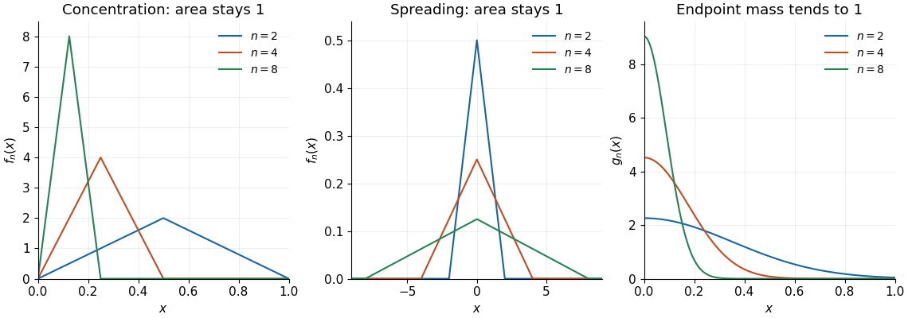

<h1 id="7/b/iii/solution">Solution</h1>

↑ **Parent:** [Iii](../iii.md)

**No: the unbounded length of the [domain](../../../../../../../domain-mathematical-analysis.md) matters.** Let $\phi(t)=\max\{1-|t|,0\}$ and define $f_n(x)=n^{-1}\phi(x/n)$ on $\mathbb R$. These are [continuous functions](../../../../../../../continuous-function.md) with [compact support](../../../../../../../compact-support.md), and $\sup_{\mathbb R}|f_n|=1/n\to0$, so the [sequence](../../../../../../../sequence.md) has [uniform convergence](../../../../../../../uniform-convergence.md) to zero. However, the [change of variables](../../../../../../../change-of-variables-formula.md) $t=x/n$ gives

$$
\boxed{\int_{-\infty}^{\infty} f_n(x)\,dx=\int_{-1}^1(1-|t|)\,dt=1.}
$$

The integral of the limit is zero. The supports widen as the heights decrease; a uniform bound on the heights gives no bound on the total area over an infinite [interval](../../../../../../../interval-mathematics.md).

**[Figure 1](#7/b/iii/image-concentrating-bumps-spreading-bumps-and-a-one-sided-approximate-identity). Concentrating bumps, spreading bumps, and a one-sided approximate identity**. Left: the examples in part (b)(i) converge [pointwise](../../../../../../../pointwise-convergence.md) to zero while their integrals remain one. Middle: the examples in part (b)(iii) have [uniform convergence](../../../../../../../uniform-convergence.md) to zero but retain integral one by spreading across the [real line](../../../../../../../real-line.md). Right: the nonnegative functions in part (c) concentrate their mass at zero and recover the endpoint value of a [continuous function](../../../../../../../continuous-function.md).

## ↑ Ancestors (13)

1. [Iii](../iii.md)
2. [B](../../b.md)
3. [7](../../../7.md)
4. [Mathematics II](../../../../mathematics-ii-split.md)
5. [Prelims](../../../../split.md)
6. [2023](../../../../../split.md)
7. [Past exam of the mathematics course of the University of Oxford](../../../../../../split.md)
8. [Mathematics course of the University of Oxford](../../../../../../../mathematics-course-of-the-university-of-oxford.md)
9. [Undergraduate course of the University of Oxford](../../../../../../../undergraduate-course-of-the-university-of-oxford.md)
10. [Course of the University of Oxford](../../../../../../../course-of-the-university-of-oxford.md)
11. [University of Oxford](../../../../../../../university-of-oxford-split.md)
12. [List of universities](../../../../../../../list-of-universities.md)
13. [Codex Wiki](../../../../../../../split.md)
