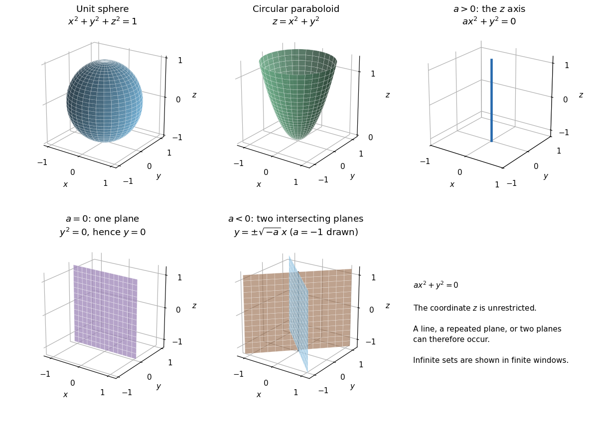
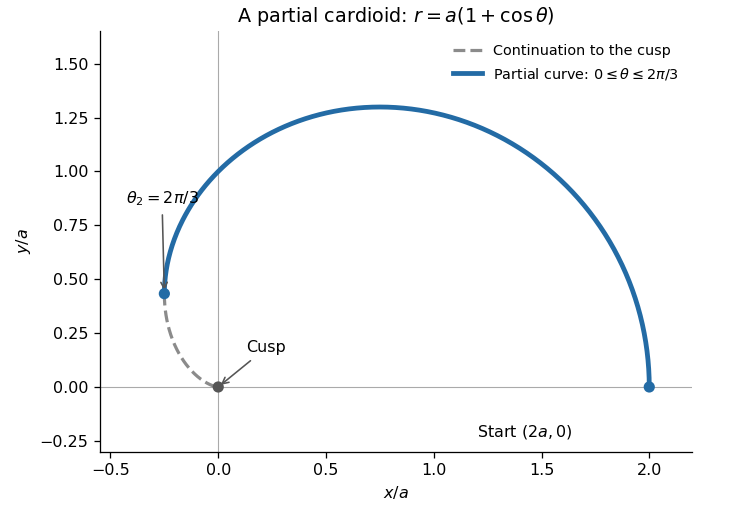
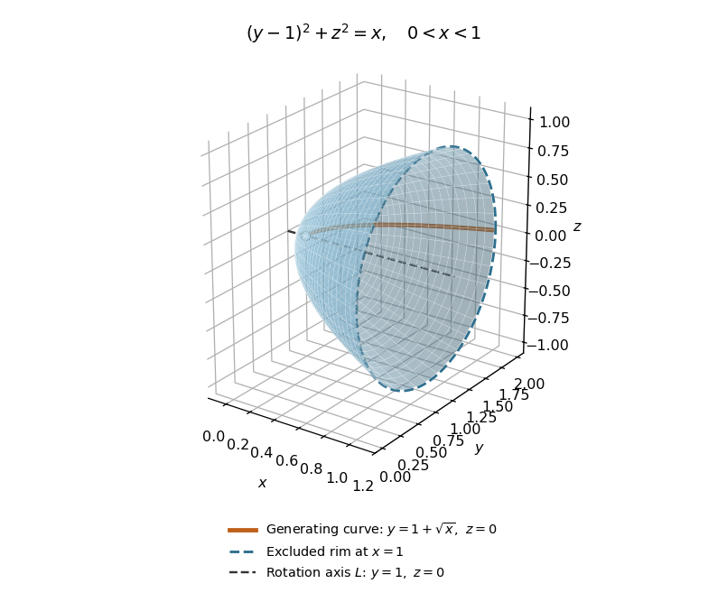

# Mathematics IV

↑ **Parent:** [Prelims](../prelims.md)

Source: [released examination PDF, pages 200–206](https://www.whatdotheyknow.com/request/request_for_mathematics_examinat/response/3129786/attach/3/FOI%20202507%20740%20Data.pdf#page=200).

Solutions to all seven questions, including every optional question, of the examination sat on 21 June 2023.

**Table of contents**

- [1](#1)
  - [a](#1/a)
    - [Solution](#1/a/solution)
  - [b](#1/b)
    - [Solution](#1/b/solution)
  - [c](#1/c)
    - [Solution](#1/c/solution)
  - [d](#1/d)
    - [i](#1/d/i)
      - [Solution](#1/d/i/solution)
    - [ii](#1/d/ii)
      - [Solution](#1/d/ii/solution)
    - [iii](#1/d/iii)
      - [Solution](#1/d/iii/solution)
    - [iv](#1/d/iv)
      - [Solution](#1/d/iv/solution)
    - [v](#1/d/v)
      - [Solution](#1/d/v/solution)
- [2](#2)
  - [a](#2/a)
    - [Solution](#2/a/solution)
  - [b](#2/b)
    - [Solution](#2/b/solution)
  - [c](#2/c)
    - [Solution](#2/c/solution)
- [3](#3)
  - [a](#3/a)
    - [i](#3/a/i)
      - [Solution](#3/a/i/solution)
    - [ii](#3/a/ii)
      - [Solution](#3/a/ii/solution)
    - [iii](#3/a/iii)
      - [Solution](#3/a/iii/solution)
  - [b](#3/b)
    - [i](#3/b/i)
      - [Solution](#3/b/i/solution)
    - [ii](#3/b/ii)
      - [Solution](#3/b/ii/solution)
    - [iii](#3/b/iii)
      - [Solution](#3/b/iii/solution)
- [4](#4)
  - [a](#4/a)
    - [Solution](#4/a/solution)
  - [b](#4/b)
    - [i](#4/b/i)
      - [Solution](#4/b/i/solution)
    - [ii](#4/b/ii)
      - [Solution](#4/b/ii/solution)
    - [iii](#4/b/iii)
      - [Solution](#4/b/iii/solution)
- [5](#5)
  - [a](#5/a)
    - [Solution](#5/a/solution)
  - [b](#5/b)
    - [Solution](#5/b/solution)
  - [c](#5/c)
    - [Solution](#5/c/solution)
- [6](#6)
  - [a](#6/a)
    - [Solution](#6/a/solution)
  - [b](#6/b)
    - [i](#6/b/i)
      - [Solution](#6/b/i/solution)
    - [ii](#6/b/ii)
      - [Solution](#6/b/ii/solution)
    - [iii](#6/b/iii)
      - [Solution](#6/b/iii/solution)
    - [iv](#6/b/iv)
      - [Solution](#6/b/iv/solution)
- [7](#7)
  - [a](#7/a)
    - [i](#7/a/i)
      - [Solution](#7/a/i/solution)
    - [ii](#7/a/ii)
      - [Solution](#7/a/ii/solution)
  - [b](#7/b)
    - [Solution](#7/b/solution)
  - [c](#7/c)
    - [i](#7/c/i)
      - [Solution](#7/c/i/solution)
    - [ii](#7/c/ii)
      - [Solution](#7/c/ii/solution)

## 1

↑ **Parent:** [Mathematics IV](mathematics-iv.md)

<h3 id="1/a">a</h3>

↑ **Parent:** [1](#1)

<h4 id="1/a/solution">Solution</h4>

↑ **Parent:** [A](#1/a)

Write $\times$ for the paper's $\wedge$. In a right-handed [Cartesian coordinate system](../../../linear-algebra.md#cartesian-coordinate-system), the [cross product](../../../vector-space.md#cross-product) is

$$
\boxed{\mathbf a\times\mathbf b=(a_2b_3-a_3b_2,\ a_3b_1-a_1b_3,\ a_1b_2-a_2b_1).}
$$

It is perpendicular to both [vectors](../../../vector-space.md#vector), has [norm](../../../normed-vector-space.md#norm) $|\mathbf a||\mathbf b|\sin\phi$, where $\phi$ is their [angle](../../../geometry-and-topology.md#angle), and has direction given by the [right-hand rule](../../../electromagnetism.md#right-hand-rule) when nonzero. Its [norm](../../../normed-vector-space.md#norm) is the [area](../../../differential-geometry.md#surface-area) of the [parallelogram](../../../euclidean-geometry.md#parallelogram) spanned by the two [vectors](../../../vector-space.md#vector).

If $\mathbf b\times\mathbf c\ne0$, use that [parallelogram](../../../euclidean-geometry.md#parallelogram) as the base of the [parallelepiped](../../../euclidean-geometry.md#parallelepiped). Its perpendicular height is $|\mathbf a\cdot\mathbf n|$, where $\mathbf n=(\mathbf b\times\mathbf c)/|\mathbf b\times\mathbf c|$. Thus its [volume](../../../geometry-and-topology.md#volume) is

$$
\boxed{\mathcal V=|\mathbf b\times\mathbf c|\,|\mathbf a\cdot\mathbf n|=|\mathbf a\cdot(\mathbf b\times\mathbf c)|.}
$$

If $\mathbf b\times\mathbf c=0$, both the [volume](../../../geometry-and-topology.md#volume) and this [scalar triple product](../../../multilinear-algebra.md#scalar-triple-product) vanish. If the [cross product](../../../vector-space.md#cross-product) is nonzero, the [scalar triple product](../../../multilinear-algebra.md#scalar-triple-product) vanishes exactly when $\mathbf a$ lies in the [plane](../../../geometry-and-topology.md#plane) spanned by $\mathbf b,\mathbf c$. If it is zero, $\mathbf b,\mathbf c$ are [linearly dependent](../../../vector-space.md#linear-dependence), and adjoining $\mathbf a$ still spans at most a [plane](../../../geometry-and-topology.md#plane). Consequently **the three [vectors](../../../vector-space.md#vector) are coplanar if and only if $\mathbf a\cdot(\mathbf b\times\mathbf c)=0$**, including cases involving a zero [vector](../../../vector-space.md#vector).

<h3 id="1/b">b</h3>

↑ **Parent:** [1](#1)

<h4 id="1/b/solution">Solution</h4>

↑ **Parent:** [B](#1/b)

Expand the first component using the definition of the [cross product](../../../vector-space.md#cross-product):

$$
\begin{aligned}
[\mathbf a\times(\mathbf b\times\mathbf c)]_1
&=a_2(b_1c_2-b_2c_1)-a_3(b_3c_1-b_1c_3)\\
&=b_1(a_2c_2+a_3c_3)-c_1(a_2b_2+a_3b_3)\\
&=b_1(\mathbf a\cdot\mathbf c)-c_1(\mathbf a\cdot\mathbf b).
\end{aligned}
$$

The added $a_1b_1c_1$ terms cancel in the last step. Cyclically permuting the component indices gives the other two components, proving the [vector triple product identity](../../../multivariable-calculus.md#vector-triple-product)

$$
\boxed{\mathbf a\times(\mathbf b\times\mathbf c)=\mathbf b(\mathbf a\cdot\mathbf c)-\mathbf c(\mathbf a\cdot\mathbf b).}
$$

<h3 id="1/c">c</h3>

↑ **Parent:** [1](#1)

<h4 id="1/c/solution">Solution</h4>

↑ **Parent:** [C](#1/c)

Put $V=\mathbf a\cdot(\mathbf b\times\mathbf c)$. The [vector triple product identity](../../../multivariable-calculus.md#vector-triple-product) gives

$$
(\mathbf b\times\mathbf c)\times(\mathbf c\times\mathbf a)
=\mathbf c[(\mathbf b\times\mathbf c)\cdot\mathbf a]-\mathbf a[(\mathbf b\times\mathbf c)\cdot\mathbf c]
=V\mathbf c.
$$

Taking its [dot product](../../../inner-product.md#dot-product) with $\mathbf a\times\mathbf b$ and using cyclic invariance of the [scalar triple product](../../../multilinear-algebra.md#scalar-triple-product) yields

$$
\boxed{(\mathbf a\times\mathbf b)\cdot[(\mathbf b\times\mathbf c)\times(\mathbf c\times\mathbf a)]=V^2.}
$$

There was no division by $V$, so this also proves the identity for coplanar [vectors](../../../vector-space.md#vector).

<h3 id="1/d">d</h3>

↑ **Parent:** [1](#1)

<h4 id="1/d/i">i</h4>

↑ **Parent:** [D](#1/d)

<h5 id="1/d/i/solution">Solution</h5>

↑ **Parent:** [I](#1/d/i)

Let $V=\mathbf a\cdot(\mathbf b\times\mathbf c)\ne0$. The [scalar triple product](../../../multilinear-algebra.md#scalar-triple-product) is invariant under a cyclic permutation, so the definitions of the [reciprocal basis](../../../multilinear-algebra.md#reciprocal-basis) give

$$
\boxed{\mathbf a'\cdot\mathbf a=\frac VV=1,\qquad\mathbf b'\cdot\mathbf b=\frac VV=1,\qquad\mathbf c'\cdot\mathbf c=\frac VV=1.}
$$

<h4 id="1/d/ii">ii</h4>

↑ **Parent:** [D](#1/d)

<h5 id="1/d/ii/solution">Solution</h5>

↑ **Parent:** [Ii](#1/d/ii)

The [cross product](../../../vector-space.md#cross-product) $\mathbf b\times\mathbf c$ is perpendicular to both factors. Thus

$$
\boxed{\mathbf a'\cdot\mathbf b=\frac{(\mathbf b\times\mathbf c)\cdot\mathbf b}{V}=0,\qquad\mathbf a'\cdot\mathbf c=\frac{(\mathbf b\times\mathbf c)\cdot\mathbf c}{V}=0.}
$$

Cyclic permutations give all the off-diagonal [dot products](../../../inner-product.md#dot-product) between the original [basis](../../../vector-space.md#basis) and its [reciprocal basis](../../../multilinear-algebra.md#reciprocal-basis).

<h4 id="1/d/iii">iii</h4>

↑ **Parent:** [D](#1/d)

<h5 id="1/d/iii/solution">Solution</h5>

↑ **Parent:** [Iii](#1/d/iii)

Apply the [squared scalar triple product from cyclic cross products](../../../multilinear-algebra.md#squared-scalar-triple-product-from-cyclic-cross-products) proved in [c](#1/c):

$$
\mathbf a'\cdot(\mathbf b'\times\mathbf c')
=\frac{(\mathbf b\times\mathbf c)\cdot[(\mathbf c\times\mathbf a)\times(\mathbf a\times\mathbf b)]}{V^3}
=\frac{V^2}{V^3}.
$$

Hence the [reciprocal basis](../../../multilinear-algebra.md#reciprocal-basis) has [scalar triple product](../../../multilinear-algebra.md#scalar-triple-product) $\boxed{\mathbf a'\cdot(\mathbf b'\times\mathbf c')=1/V}$, with its sign retained.

<h4 id="1/d/iv">iv</h4>

↑ **Parent:** [D](#1/d)

<h5 id="1/d/iv/solution">Solution</h5>

↑ **Parent:** [Iv](#1/d/iv)

Since $V\ne0$, [iii](#1/d/iii) gives $\mathbf a'\cdot(\mathbf b'\times\mathbf c')=1/V\ne0$. The criterion in [a](#1/a) therefore proves that **$\mathbf a',\mathbf b',\mathbf c'$ are non-coplanar**. In particular they form a [basis](../../../vector-space.md#basis) of $\mathbb R^3$.

<h4 id="1/d/v">v</h4>

↑ **Parent:** [D](#1/d)

<h5 id="1/d/v/solution">Solution</h5>

↑ **Parent:** [V](#1/d/v)

The [vector triple product identity](../../../multivariable-calculus.md#vector-triple-product) gives

$$
\mathbf b'\times\mathbf c'
=\frac{(\mathbf c\times\mathbf a)\times(\mathbf a\times\mathbf b)}{V^2}
=\frac{V\mathbf a}{V^2}=\frac{\mathbf a}{V}.
$$

Eliminate $V$ with [iii](#1/d/iii) to obtain the [reciprocal basis involution](../../../multilinear-algebra.md#reciprocal-basis-involution):

$$
\boxed{\mathbf a=\frac{\mathbf b'\times\mathbf c'}{\mathbf a'\cdot(\mathbf b'\times\mathbf c')}.}
$$

This formula actually holds without the unit-length assumptions. Under those assumptions it also says $|\mathbf b'\times\mathbf c'|=1/|V|$; normalizing this [cross product](../../../vector-space.md#cross-product) alone would lose the sign of $V$ and could return $-\mathbf a$.

## 2

↑ **Parent:** [Mathematics IV](mathematics-iv.md)

<h3 id="2/a">a</h3>

↑ **Parent:** [2](#2)

<h4 id="2/a/solution">Solution</h4>

↑ **Parent:** [A](#2/a)

The [quadric surface](../../../euclidean-geometry.md#quadric-surface) $x^2+y^2+z^2=1$ is the unit [sphere](../../../euclidean-geometry.md#sphere) centered at the origin. Each section $z=c$, for $|c|<1$, is a [circle](../../../topology.md#circle) of [radius](../../../topology.md#radius) $\sqrt{1-c^2}$.

The [quadric surface](../../../euclidean-geometry.md#quadric-surface) $z=x^2+y^2$ is a circular [elliptic paraboloid](../../../euclidean-geometry.md#elliptic-paraboloid), opening in the positive $z$ direction with vertex at the origin. Its horizontal sections $z=c>0$ are [circles](../../../topology.md#circle) of [radius](../../../topology.md#radius) $\sqrt c$, and its vertical sections through the $z$ axis are [parabolas](../../../euclidean-geometry.md#parabola).

For $ax^2+y^2=0$, $z$ is unrestricted. If $a>0$, both nonnegative terms must vanish, so the locus is **the $z$ axis**, a [straight line](../../../euclidean-geometry.md#straight-line). If $a=0$, it is **the [plane](../../../geometry-and-topology.md#plane) $y=0$**, represented by the repeated factor $y^2$. If $a<0$, factorization gives

$$
(y-\sqrt{-a}\,x)(y+\sqrt{-a}\,x)=0,
$$

so the locus is **two distinct [planes](../../../geometry-and-topology.md#plane), $y=\pm\sqrt{-a}\,x$, meeting along the $z$ axis**. These are degenerate [quadrics](../../../euclidean-geometry.md#quadric-surface), not ordinary curved cylinders.

**[Figure 1](#2/a/image-the-sphere-elliptic-paraboloid-and-three-degenerate-quadric-cases-in-question-2-a). The sphere, elliptic paraboloid, and three degenerate quadric cases in Question 2(a)**

<h3 id="2/b">b</h3>

↑ **Parent:** [2](#2)

<h4 id="2/b/solution">Solution</h4>

↑ **Parent:** [B](#2/b)

Choose the rotated [Cartesian coordinates](../../../linear-algebra.md#cartesian-coordinate-system)

$$
X=\frac{x+y}{\sqrt2},\qquad Y=\frac{y-x}{\sqrt2},\qquad Z=z.
$$

Their inverse is $x=(X-Y)/\sqrt2$, $y=(X+Y)/\sqrt2$. Consequently $x^2+y^2=X^2+Y^2$ and $xy=(X^2-Y^2)/2$, giving the [canonical form of a quadric](../../../euclidean-geometry.md#canonical-form-of-a-quadric)

$$
\boxed{\left(1+\frac a2\right)X^2+\left(1-\frac a2\right)Y^2+Z^2=1.}
$$

The [orthogonal diagonalization](../../../linear-algebra.md#orthogonal-diagonalization-of-a-real-symmetric-matrix) identifies the [eigenvalues](../../../linear-operator-theory.md#eigenvalue) $1+a/2,1-a/2,1$ of the [symmetric matrix](../../../linear-algebra.md#symmetric-matrix) of the [quadratic form](../../../quadratic-form.md).

For $|a|<2$, all three coefficients are positive: the surface is an [ellipsoid](../../../euclidean-geometry.md#ellipsoid) with semiaxes $(1+a/2)^{-1/2},(1-a/2)^{-1/2},1$. At $a=0$ it is a [sphere](../../../euclidean-geometry.md#sphere).

For $a=2$, the equation is $2X^2+Z^2=1$, an [elliptic cylinder](../../../euclidean-geometry.md#elliptic-cylinder) parallel to the $Y$ axis. For $a=-2$, it is $2Y^2+Z^2=1$, an [elliptic cylinder](../../../euclidean-geometry.md#elliptic-cylinder) parallel to the $X$ axis. The absent coordinate is unrestricted; its disappearance does not turn the [surface](../../../topological-surface.md) into an [ellipse](../../../euclidean-geometry.md#ellipse).

For $a>2$, the negative coefficient is that of $Y^2$: this is a [one-sheet hyperboloid](../../../differential-geometry.md#one-sheet-hyperboloid) with axis $Y$. For $a<-2$, the negative coefficient is that of $X^2$: it is a [one-sheet hyperboloid](../../../differential-geometry.md#one-sheet-hyperboloid) with axis $X$. This gives the [signature transition from an ellipsoid to an elliptic cylinder and a one-sheet hyperboloid](../../../euclidean-geometry.md#signature-transition-from-an-ellipsoid-to-an-elliptic-cylinder-and-a-one-sheet-hyperboloid), including both transition values.

<h3 id="2/c">c</h3>

↑ **Parent:** [2](#2)

<h4 id="2/c/solution">Solution</h4>

↑ **Parent:** [C](#2/c)

Write $N=(n_1,n_2,n_3)$. Restriction to the [plane](../../../geometry-and-topology.md#plane) $z=0$ gives

$$
M_{11}x^2+(M_{12}+M_{21})xy+M_{22}y^2+n_1x+n_2y+k=0.
$$

This is an equation of [degree](../../../polynomial.md#degree-of-a-polynomial) at most two in two [Cartesian coordinates](../../../linear-algebra.md#cartesian-coordinate-system), the general algebraic form of a [conic](../../../euclidean-geometry.md#conic-section), with possible [degenerate conics](../../../euclidean-geometry.md#degenerate-conic) and an [empty set](../../../set.md#empty-set) of real points. No [determinant](../../../multilinear-algebra.md#determinant) hypothesis is needed for this substitution.

For an arbitrary [plane](../../../geometry-and-topology.md#plane), choose a point $\mathbf x_0$ and an [orthonormal basis](../../../inner-product.md#orthonormal-basis) $\mathbf e,\mathbf f$ of its direction [linear subspace](../../../vector-space.md#vector-subspace). Put $B=(\mathbf e\ \mathbf f)$ and $\mathbf x=\mathbf x_0+B\boldsymbol\xi$, where $\boldsymbol\xi=(s,t)^T$. With $S=(M+M^T)/2$, the [symmetric part of a matrix](../../../linear-algebra.md#symmetric-part-of-a-matrix), the restricted equation is

$$
\boxed{\boldsymbol\xi^TB^TSB\boldsymbol\xi+(2\mathbf x_0^TSB+NB)\boldsymbol\xi+\mathbf x_0^TS\mathbf x_0+N\mathbf x_0+k=0.}
$$

This proves the plane-section result whenever “[conic](../../../euclidean-geometry.md#conic-section)” allows the appropriate degeneracies. A [rigid motion](../../../euclidean-geometry.md#rigid-transformation) taking the chosen [plane](../../../geometry-and-topology.md#plane) to $z=0$ gives the same argument.

**The source's assumption $\det M\ne0$ does not guarantee a nondegenerate [conic](../../../euclidean-geometry.md#conic-section).** Even with $M=I$ and $f=x^2+y^2+z^2-1$, the section $z=1$ is a single [point](../../../geometry-and-topology.md#point-geometry), and $z=2$ has no real points. With the nonsingular [symmetric matrix](../../../linear-algebra.md#symmetric-matrix) giving $f=2xz+y^2$, the section $z=0$ is the repeated [straight line](../../../euclidean-geometry.md#straight-line) $y=0$.

There is a further literal omission: the source does not assume $M$ is symmetric. For

$$
M=\begin{pmatrix}0&1&1\\-1&0&1\\1&-1&0\end{pmatrix},\qquad N=0,\qquad k=0,
$$

one has $\det M=2$ but $f=2xz$. Thus the section $z=0$ is the entire [plane](../../../geometry-and-topology.md#plane), rather than a [conic](../../../euclidean-geometry.md#conic-section). Only $S$ controls the [quadratic form](../../../quadratic-form.md); invertibility of an arbitrary $M$ cannot remove this exception. If the intended hypothesis is that $M$ is symmetric and nonsingular, the quadratic restriction to a [plane](../../../geometry-and-topology.md#plane) cannot vanish identically: otherwise $B^TMB=0$, so $M$ would map a two-dimensional [linear subspace](../../../vector-space.md#vector-subspace) injectively into its one-dimensional [orthogonal complement](../../../hilbert-space.md#orthogonal-complement), which is impossible. Degenerate and empty sections still remain possible.

## 3

↑ **Parent:** [Mathematics IV](mathematics-iv.md)

<h3 id="3/a">a</h3>

↑ **Parent:** [3](#3)

<h4 id="3/a/i">i</h4>

↑ **Parent:** [A](#3/a)

<h5 id="3/a/i/solution">Solution</h5>

↑ **Parent:** [I](#3/a/i)

For a piecewise [continuously differentiable](../../../multivariable-calculus.md#continuously-differentiable-function) [parametric curve](../../../topology.md#parametric-curve), the [arc length](../../../riemannian-geometry.md#arc-length) is the integral of [speed](../../../classical-mechanics.md#speed):

$$
\boxed{s=\int_a^b\sqrt{[x'(t)]^2+[y'(t)]^2}\,dt.}
$$

The [Pythagorean theorem](../../../euclidean-geometry.md#pythagorean-theorem) gives the length of an infinitesimal displacement as $\sqrt{dx^2+dy^2}$. Integration counts traversal length, including repeated portions if the [parametrization](../../../geometry-and-topology.md#parametric-equation) retraces them. Piecewise continuous [derivatives](../../../calculus.md#derivative), or suitable [absolute continuity](../../../sobolev-space.md#absolutely-continuous-function), justify the formula; mere differentiability as stated in the source is not by itself the usual sufficient regularity hypothesis.

<h4 id="3/a/ii">ii</h4>

↑ **Parent:** [A](#3/a)

<h5 id="3/a/ii/solution">Solution</h5>

↑ **Parent:** [Ii](#3/a/ii)

In [polar coordinates](../../../multivariable-calculus.md#polar-coordinates), $x=r(\theta)\cos\theta$ and $y=r(\theta)\sin\theta$. The [product rule](../../../calculus.md#product-rule) gives

$$
x'=r'\cos\theta-r\sin\theta,\qquad y'=r'\sin\theta+r\cos\theta.
$$

Squaring and adding cancels the mixed terms and gives $(x')^2+(y')^2=(r')^2+r^2$. Hence the [arc length](../../../riemannian-geometry.md#arc-length) is

$$
\boxed{s=\int_{\theta_1}^{\theta_2}\sqrt{r(\theta)^2+\left(\frac{dr}{d\theta}\right)^2}\,d\theta.}
$$

<h4 id="3/a/iii">iii</h4>

↑ **Parent:** [A](#3/a)

<h5 id="3/a/iii/solution">Solution</h5>

↑ **Parent:** [Iii](#3/a/iii)

For the [cardioid](../../../multivariable-calculus.md#cardioid), $r'=-a\sin\theta$. The expression under the [square root](../../../algebra.md#square-root) simplifies to

$$
r^2+(r')^2=a^2(2+2\cos\theta)=4a^2\cos^2(\theta/2).
$$

Since $0\leq\theta\leq\theta_2\leq\pi$, the [cosine](../../../geometry-and-topology.md#cosine) is nonnegative. Therefore

$$
\boxed{s(\theta_2)=\int_0^{\theta_2}2a\cos(\theta/2)\,d\theta=4a\sin(\theta_2/2).}
$$

The upper half of the [cardioid](../../../multivariable-calculus.md#cardioid) starts at $(2a,0)$, passes through $(0,a)$, bends to negative $x$, and ends at the cusp $(0,0)$ when $\theta_2=\pi$. Its full upper-half [arc length](../../../riemannian-geometry.md#arc-length) is $4a$; reflecting gives $8a$ for the full [cardioid](../../../multivariable-calculus.md#cardioid).

The [fundamental theorem of calculus](../../../calculus.md#fundamental-theorem-of-calculus) gives

$$
\frac{ds}{d\theta_2}=2a\cos(\theta_2/2).
$$

This decreases from $2a$ to zero, so **the [arc length](../../../riemannian-geometry.md#arc-length) increases fastest at $\theta_2=0$**, interpreted as the right-hand rate at the initial endpoint. If only positive endpoints are allowed, the rate has supremum $2a$ as $\theta_2\downarrow0$, rather than an attained interior maximum.

**[Figure 2](#3/a/iii/image-a-partial-cardioid-with-theta-2-2-pi-3-and-the-continuation-to-its-cusp). A partial cardioid with $\theta_2=2\pi/3$, and the continuation to its cusp**.

<h3 id="3/b">b</h3>

↑ **Parent:** [3](#3)

<h4 id="3/b/i">i</h4>

↑ **Parent:** [B](#3/b)

<h5 id="3/b/i/solution">Solution</h5>

↑ **Parent:** [I](#3/b/i)

Parametrize the [function graph](../../../function.md#graph-of-a-function) by $\mathbf R(x,y)=(x,y,f(x,y))$. Its two tangent [vectors](../../../vector-space.md#vector) are $\mathbf R_x=(1,0,f_x)$ and $\mathbf R_y=(0,1,f_y)$. A small parameter [rectangle](../../../euclidean-geometry.md#rectangle) maps, to first order, to a tangent [parallelogram](../../../euclidean-geometry.md#parallelogram) with [area](../../../differential-geometry.md#surface-area) $|\mathbf R_x\times\mathbf R_y|\,dx\,dy$. Since

$$
\mathbf R_x\times\mathbf R_y=(-f_x,-f_y,1),
$$

the [surface area of a graph](../../../multivariable-calculus.md#surface-area-of-a-graph) is

$$
\boxed{A=\iint_S\sqrt{1+f_x^2+f_y^2}\,dx\,dy.}
$$

For example, $f\in C^1$ ensures a [regular surface](../../../differential-geometry.md#smooth-surface) chart; more general domains can be handled by the corresponding convergent [improper integral](../../../real-analysis.md#improper-integral).

<h4 id="3/b/ii">ii</h4>

↑ **Parent:** [B](#3/b)

<h5 id="3/b/ii/solution">Solution</h5>

↑ **Parent:** [Ii](#3/b/ii)

A [parametrization](../../../geometry-and-topology.md#parametric-equation) of the [surface of revolution](../../../differential-geometry.md#surface-of-revolution) is

$$
\mathbf R(x,\phi)=(x,f(x)\cos\phi,f(x)\sin\phi),\qquad a<x<b,\quad0\leq\phi<2\pi.
$$

Its tangent [vectors](../../../vector-space.md#vector) are orthogonal, with [norms](../../../normed-vector-space.md#norm) $\sqrt{1+f'(x)^2}$ and $|f(x)|$. Thus

$$
\boxed{A=2\pi\int_a^b|f(x)|\sqrt{1+f'(x)^2}\,dx.}
$$

The [absolute value](../../../real-analysis.md#absolute-value) is necessary if the [function graph](../../../function.md#graph-of-a-function) passes below the axis. The formula gives the curved [surface area](../../../differential-geometry.md#surface-area); it adds no end discs. Zeros of $f$ can be treated by splitting the integral into regular portions and taking limits.

<h4 id="3/b/iii">iii</h4>

↑ **Parent:** [B](#3/b)

<h5 id="3/b/iii/solution">Solution</h5>

↑ **Parent:** [Iii](#3/b/iii)

The rotation axis is $L=\{(x,1,0):x\in\mathbb R\}$. The distance of the generating [function graph](../../../function.md#graph-of-a-function) from this axis is $\sqrt x$, so a [parametrization](../../../geometry-and-topology.md#parametric-equation) is

$$
\mathbf R(x,\phi)=(x,1+\sqrt x\cos\phi,\sqrt x\sin\phi),\qquad0<x<1.
$$

The [surface of revolution](../../../differential-geometry.md#surface-of-revolution) therefore has equation $(y-1)^2+z^2=x$: it is a circular [elliptic paraboloid](../../../euclidean-geometry.md#elliptic-paraboloid) opening along the positive $x$ direction, with its vertex and its rim at $x=1$ excluded. Translating the axis does not change the [surface area](../../../differential-geometry.md#surface-area) formula, so

$$
\begin{aligned}
A&=2\pi\int_0^1\sqrt x\sqrt{1+\frac1{4x}}\,dx
=\pi\int_0^1\sqrt{4x+1}\,dx\\
&=\boxed{\frac\pi6(5\sqrt5-1).}
\end{aligned}
$$

The cancellation makes the [improper integral](../../../real-analysis.md#improper-integral) finite at the vertex. Neither the missing vertex nor the missing boundary [circle](../../../topology.md#circle) changes the [surface area](../../../differential-geometry.md#surface-area), and no cap is included.

**[Figure 3](#3/b/iii/image-the-elliptic-paraboloid-obtained-by-rotating-y-1-plus-sqrt-x-around-l). The elliptic paraboloid obtained by rotating $y=1+\sqrt x$ around $L$**.

## 4

↑ **Parent:** [Mathematics IV](mathematics-iv.md)

<h3 id="4/a">a</h3>

↑ **Parent:** [4](#4)

<h4 id="4/a/solution">Solution</h4>

↑ **Parent:** [A](#4/a)

Divide [Newton's second law](../../../force.md#newton-s-second-law) by the [mass](../../../classical-mechanics.md#mass) and resolve along the radial and transverse unit [vectors](../../../vector-space.md#vector) in [polar coordinates](../../../multivariable-calculus.md#polar-coordinates). A [central force](../../../mathematical-physics.md#central-force) has no transverse component, so

$$
\ddot r-r\dot\theta^2=-F(r),\qquad2\dot r\dot\theta+r\ddot\theta=0.
$$

Multiplication of the second equation by $r$ shows that $d(r^2\dot\theta)/dt=0$. Thus

$$
\boxed{\ddot r-r\dot\theta^2=-F(r),\qquad r^2\dot\theta=h,}
$$

where $h$ is the signed [specific angular momentum](../../../celestial-mechanics.md#specific-angular-momentum) perpendicular to the [orbital plane](../../../celestial-mechanics.md#orbital-plane).

If $h\ne0$ and $r>0$, the [polar angle](../../../multivariable-calculus.md#polar-angle) is locally a valid independent variable. For $u=1/r$, use primes for [derivatives](../../../calculus.md#derivative) with respect to $\theta$. The [chain rule](../../../calculus.md#chain-rule) gives

$$
\dot\theta=hu^2,\qquad\dot r=-hu',\qquad\ddot r=-h^2u^2u'',\qquad r\dot\theta^2=h^2u^3.
$$

Substitution into the radial equation gives the [Binet equation](../../../celestial-mechanics.md#binet-equation)

$$
\boxed{u''+u=\frac{F(1/u)}{h^2u^2}.}
$$

If $h=0$, the [orbit](../../../dynamical-systems.md#orbit-dynamical-system) is radial and division by $h$ is unavailable; the first radial equation still applies with $\dot\theta=0$ away from the origin.

<h3 id="4/b">b</h3>

↑ **Parent:** [4](#4)

<h4 id="4/b/i">i</h4>

↑ **Parent:** [B](#4/b)

<h5 id="4/b/i/solution">Solution</h5>

↑ **Parent:** [I](#4/b/i)

The initial transverse [velocity](../../../classical-mechanics.md#velocity) gives $h=a(L/a)=L$. From $\dot r=-hu'$, the [initial conditions](../../../differential-equation.md#initial-condition) are $u(0)=1/a$ and $u'(0)=1/a$. Define

$$
\nu=\sqrt{1+L^{-2}}>1.
$$

The [Binet equation](../../../celestial-mechanics.md#binet-equation) becomes the constant-coefficient [linear ordinary differential equation](../../../linear-ordinary-differential-equation.md)

$$
u''+\nu^2u=\frac1{aL^2}.
$$

Its [particular solution](../../../linear-ordinary-differential-equation.md#particular-solution) is $(\nu^2-1)/(a\nu^2)$. Applying the two [initial conditions](../../../differential-equation.md#initial-condition) to the [complementary solution](../../../linear-ordinary-differential-equation.md#homogeneous-solution) gives

$$
\boxed{\frac1r=\frac{\nu^2-1+\cos(\nu\theta)+\nu\sin(\nu\theta)}{a\nu^2}.}
$$

The physical branch is the connected range containing $\theta=0$ on which the right-hand side is positive. A zero corresponds to escape to infinite [radius](../../../topology.md#radius), rather than continuation to negative $r$.

The source calls $F$ an inward force magnitude, but here $F(r)=(r-a)/(ar^3)$ changes sign at $r=a$. The stated [initial condition](../../../differential-equation.md#initial-condition) has inward radial [velocity](../../../classical-mechanics.md#velocity), so the particle immediately enters $r<a$, where the [force](../../../force.md) is outward. The consistent interpretation is that $F$ is the **signed inward radial component** of the [force](../../../force.md) per unit [mass](../../../classical-mechanics.md#mass).

<h4 id="4/b/ii">ii</h4>

↑ **Parent:** [B](#4/b)

<h5 id="4/b/ii/solution">Solution</h5>

↑ **Parent:** [Ii](#4/b/ii)

The oscillatory numerator $\cos(\nu\theta)+\nu\sin(\nu\theta)$ has [amplitude](../../../wave.md#wave-amplitude) $\sqrt{1+\nu^2}$. Therefore the reciprocal [radius](../../../topology.md#radius) stays bounded away from zero exactly when

$$
\nu^2-1>\sqrt{1+\nu^2}
\quad\Longleftrightarrow\quad\nu^2>3
\quad\Longleftrightarrow\quad L^2<\frac12.
$$

In this case the radial bounds are

$$
\frac{a\nu^2}{\nu^2-1+\sqrt{1+\nu^2}}
\leq r\leq
\frac{a\nu^2}{\nu^2-1-\sqrt{1+\nu^2}}.
$$

For completeness, the [potential energy](../../../energy.md#potential-energy) per unit [mass](../../../classical-mechanics.md#mass) is $\Phi=-1/(ar)+1/(2r^2)$, and [conservation of mechanical energy](../../../energy.md#conservation-of-mechanical-energy) gives

$$
\frac12\dot r^2+U(r)=\mathcal E,\qquad
U(r)=\frac{1+L^2}{2r^2}-\frac1{ar},\qquad
\mathcal E=\frac{L^2-1/2}{a^2}.
$$

This [effective potential](../../../mathematical-physics.md#effective-potential) diverges positively at zero, has one minimum at $r=a(1+L^2)$, and tends to zero from below at infinity. Since the initial radial [velocity](../../../classical-mechanics.md#velocity) is negative, the particle first reaches an inner [turning point](../../../energy.md#turning-point). If $L^2\geq1/2$, the subsequent outward motion has no finite outer [turning point](../../../energy.md#turning-point) and escapes. At equality the escape [speed](../../../classical-mechanics.md#speed) tends to zero, but the [radius](../../../topology.md#radius) is still unbounded; infinity is approached only as time tends to infinity. Hence

$$
\boxed{\text{The path is bounded exactly for }0<L<1/\sqrt2.}
$$

The minimum of $U$ permits a [circular orbit](../../../classical-mechanics.md#circular-orbit) for other initial data, but the nonzero initial radial [velocity](../../../classical-mechanics.md#velocity) here excludes that exceptional solution.

<h4 id="4/b/iii">iii</h4>

↑ **Parent:** [B](#4/b)

<h5 id="4/b/iii/solution">Solution</h5>

↑ **Parent:** [Iii](#4/b/iii)

With $L=1/\sqrt{n^2-1}$, one has $\nu=n$. Since $n\geq3>\sqrt3$, [ii](#4/b/ii) proves boundedness. Write the positive [rational number](../../../number-theory.md#rational-number) $n=p/q$ in lowest terms. The [radius](../../../topology.md#radius) and its angular [derivative](../../../calculus.md#derivative) repeat after $\Delta\theta=2\pi/n$. After $p$ such radial oscillations,

$$
p\Delta\theta=2\pi q,
$$

so both the [position](../../../classical-mechanics.md#position) and the radial and transverse [velocities](../../../classical-mechanics.md#velocity) return to their initial values. The elapsed time is

$$
T=\frac1L\int_0^{2\pi q}r(\theta)^2\,d\theta,
$$

which is finite and positive because $r$ is bounded above and below by positive constants. Thus **the motion is periodic**. The [orbit](../../../dynamical-systems.md#orbit-dynamical-system) is a closed, generally self-intersecting [rosette orbit](../../../mathematical-physics.md#rosette-orbit), with $p$ radial oscillations during $q$ complete revolutions; for integral $n$ it has $n$ evenly spaced lobes around the origin. It never reaches the origin and is not a [circular orbit](../../../classical-mechanics.md#circular-orbit).

## 5

↑ **Parent:** [Mathematics IV](mathematics-iv.md)

<h3 id="5/a">a</h3>

↑ **Parent:** [5](#5)

<h4 id="5/a/solution">Solution</h4>

↑ **Parent:** [A](#5/a)

Let $\mathbf N$ be the [normal reaction](../../../force.md#normal-force) of the stationary smooth [surface of revolution](../../../differential-geometry.md#surface-of-revolution). Its normal lies in the span of $\mathbf e_r,\mathbf e_z$, so it has no $\mathbf e_\theta$ component. The transverse component of [Newton's second law](../../../force.md#newton-s-second-law), $m\ddot{\mathbf r}=\mathbf N-mg\mathbf e_z$, is therefore

$$
2\dot r\dot\theta+r\ddot\theta=0,
$$

which gives $\boxed{h=r^2\dot\theta=\text{constant}}$.

The [velocity](../../../classical-mechanics.md#velocity) is tangent to the stationary [surface](../../../topological-surface.md), so $\mathbf N\cdot\dot{\mathbf r}=0$. Take the [dot product](../../../inner-product.md#dot-product) of [Newton's second law](../../../force.md#newton-s-second-law) with $\dot{\mathbf r}$:

$$
\frac d{dt}\left(\frac12m|\dot{\mathbf r}|^2\right)=-mg\dot z.
$$

Using $z=f(r)$ proves [conservation of mechanical energy](../../../energy.md#conservation-of-mechanical-energy) per unit [mass](../../../classical-mechanics.md#mass):

$$
\boxed{E=\frac12|\dot{\mathbf r}|^2+gf(r)=\text{constant}.}
$$

The ideal [constraint](../../../classical-mechanics.md#constraint-mechanics) does no [work](../../../energy.md#work). These equations describe motion while the particle remains constrained to the [surface](../../../topological-surface.md).

<h3 id="5/b">b</h3>

↑ **Parent:** [5](#5)

<h4 id="5/b/solution">Solution</h4>

↑ **Parent:** [B](#5/b)

Take $a>0$ and the intended horizontal launch around a parallel of the [surface of revolution](../../../differential-geometry.md#surface-of-revolution): $\dot r(0)=\dot z(0)=0$, $a\dot\theta(0)=v$. Then $h=av$ and $E=v^2/2+gf(a)$. Since $\dot z=f'(r)\dot r$, the conserved [energy](../../../energy.md) becomes

$$
\frac12[1+f'(r)^2]\dot r^2+U(r)=E,\qquad
U(r)=\frac{a^2v^2}{2r^2}+gf(r).
$$

Here $U$ is the [radial effective potential on a surface of revolution](../../../mathematical-physics.md#radial-effective-potential-on-a-surface-of-revolution). Rearrangement gives

$$
\boxed{D(r):=\frac{v^2}{2g}(r^2-a^2)+r^2[f(a)-f(r)]
=\frac{r^2}{2g}[1+f'(r)^2]\dot r^2\geq0.}
$$

For a nonconstant bounded radial motion with $v>0$, there must be another finite radial bound $b\ne a$ satisfying $D(b)=0$, equivalently

$$
\boxed{\frac{v^2}{g}=\frac{2b^2[f(b)-f(a)]}{b^2-a^2}.}
$$

The interval between the radial bounds must be dynamically accessible: $D\geq0$ inside, and a simple endpoint must have a forbidden region $D<0$ beyond it. Equivalently the motion must lie in a bounded part of $\{r>0:U(r)\leq E\}$ separated from escape by a potential barrier. When $f$ stays finite near zero and $v>0$, the [centrifugal barrier](../../../mathematical-physics.md#centrifugal-barrier) already excludes $r=0$; an outer barrier is the additional requirement. An arbitrary second algebraic root on a disconnected allowed branch would not establish boundedness.

The initial radial [acceleration](../../../classical-mechanics.md#acceleration), obtained by projecting [Newton's second law](../../../force.md#newton-s-second-law) along $\mathbf e_r+f'(a)\mathbf e_z$, is

$$
\ddot r(0)=\frac{v^2/a-gf'(a)}{1+f'(a)^2}.
$$

Thus $v^2/g>af'(a)$ starts the particle outward, and $v^2/g<af'(a)$ starts it inward. Equality gives the exact [circular orbit](../../../classical-mechanics.md#circular-orbit) $r=a$ and needs no second distinct radial bound. A double root at a different radius can instead be approached asymptotically: this [separatrix](../../../dynamical-systems.md#separatrix) is bounded, although the radial motion is not periodic. If $v=0$, the [centrifugal barrier](../../../mathematical-physics.md#centrifugal-barrier) disappears and the particle may pass through the axis, still with bounded $r$.

The source leaves a direction ambiguity at points where $f'(a)=0$: every horizontal tangent direction is then possible, so “projected horizontally” alone does not imply $h=av$. The displayed inequality uses the azimuthal launch specified above; at $f'(a)\ne0$ that direction is forced by horizontality and tangency.

<h3 id="5/c">c</h3>

↑ **Parent:** [5](#5)

<h4 id="5/c/solution">Solution</h4>

↑ **Parent:** [C](#5/c)

Use the [dimensionless variables](../../../mathematics.md#dimensionless-variable)

$$
A=\frac{a^2}{4R^2},\qquad x=\frac{r^2}{4R^2},\qquad\beta=\frac{v}{\sqrt{2gR}}.
$$

The stated $R>a/2$ gives $0<A<1$. Since $f(r)=4Rx(1-x)$, the inequality from [b](#5/b) factorizes as

$$
\boxed{D(r)=4R^3(x-A)\left[4x^2-4(1-A)x+\beta^2\right]\geq0.}
$$

The two additional possible [turning points](../../../energy.md#turning-point) are

$$
x_\pm=\frac{1-A\pm\sqrt{(1-A)^2-\beta^2}}2.
$$

They are real exactly when $\beta+A\leq1$. This exposes the intended critical value

$$
\boxed{\left(\frac{v}{\sqrt{2gR}}+\frac{a^2}{4R^2}\right)_{\rm crit}=1,}
$$

but the ordering of the initial radius $A$ relative to these roots must also be checked.

First suppose $0<A<1/3$. Then $A<(1-A)/2$. If $\beta<1-A$, the allowed branch starting at $A$ is trapped either between $x_-$ and $A$ or between $A$ and $x_-$, according to its initial direction. At the coincident-root value $\beta^2=4A(1-2A)$ it is exactly a [circular orbit](../../../classical-mechanics.md#circular-orbit). For $\beta=0$, the inner radial bound is the axis rather than a nonzero [turning point](../../../energy.md#turning-point).

At $\beta=1-A$, the additional roots coalesce at $x_*=(1-A)/2>A$. The particle starts outward and approaches $x_*$, or

$$
r_*=R\sqrt{2(1-A)},
$$

without reaching it in finite time. Indeed $D$ is proportional to $(x-A)(x-x_*)^2$ and the radial [energy](../../../energy.md) equation gives $dt/dx$ proportional to $1/|x-x_*|$ near $x_*$. Its integral diverges. This is a bounded [separatrix](../../../dynamical-systems.md#separatrix) approaching an unstable [circular orbit](../../../classical-mechanics.md#circular-orbit). For $\beta>1-A$, there is no outer root and the particle escapes. Thus **for $0<A<1/3$, boundedness holds exactly when $\beta+A\leq1$**, with the equality case included. At $A=1/3$, the same inequality characterizes boundedness, but equality is the exact [circular orbit](../../../classical-mechanics.md#circular-orbit) at the starting radius.

**The source's weaker assumption $A<1$ is insufficient to make this single threshold a general criterion.** For $1/3<A<1/2$, the initial radius lies beyond the coalescing-root position. The transition is instead the unstable [circular orbit](../../../classical-mechanics.md#circular-orbit) at

$$
\beta_{\rm circ}=2\sqrt{A(1-2A)}<1-A.
$$

Below this [speed](../../../classical-mechanics.md#speed) the initial radial [acceleration](../../../classical-mechanics.md#acceleration) is inward and the particle remains in the inner allowed interval. At equality it stays exactly circular; above it the initial [acceleration](../../../classical-mechanics.md#acceleration) is outward and the accessible branch extends to infinity, even if $\beta+A<1$. For $A>1/2$, the [surface](../../../topological-surface.md) slopes downward outward and every such launch escapes. At $A=1/2$, only $\beta=0$ remains at rest on the summit circle.

Consequently the complete classification for the intended azimuthal launch, including zero launch [speed](../../../classical-mechanics.md#speed) and exact equilibria, is

$$
\boxed{\begin{array}{ll}
0<A\leq1/3:&\text{bounded iff }0\leq\beta\leq1-A,\\
1/3<A\leq1/2:&\text{bounded iff }0\leq\beta\leq2\sqrt{A(1-2A)},\\
1/2<A<1:&\text{unbounded for every }\beta\geq0.
\end{array}}
$$

For a concrete counterexample to the unqualified proposed criterion, take $A=3/4$ and $\beta=1/10$. Then $\beta+A=17/20<1$, but $f'(a)<0$ and the outward motion has no accessible outer barrier. This satisfies the printed radius assumption and escapes. A sufficient additional radius restriction for the intended threshold is $a\leq2R/\sqrt3$, with the equality and [circular orbit](../../../classical-mechanics.md#circular-orbit) qualifications above.

## 6

↑ **Parent:** [Mathematics IV](mathematics-iv.md)

<h3 id="6/a">a</h3>

↑ **Parent:** [6](#6)

<h4 id="6/a/solution">Solution</h4>

↑ **Parent:** [A](#6/a)

The uniform rod has [linear mass density](../../../fluid-mechanics.md#linear-mass-density) $m/\ell$. Integrating squared distance from the pivot gives its [moment of inertia](../../../rigid-body-dynamics.md#moment-of-inertia) about the axis perpendicular to the plane of motion:

$$
\boxed{I_O=\int_0^\ell s^2\frac m\ell\,ds=\frac13m\ell^2.}
$$

Measure $\theta$ from the downward vertical. The [center of mass](../../../classical-mechanics.md#center-of-mass) is at distance $\ell/2$ from the pivot, so [gravity](../../../physics.md#gravity) produces the restoring [torque](../../../momentum.md#torque) $-mg(\ell/2)\sin\theta$. The fixed-axis [rotational equation of motion](../../../rigid-body-dynamics.md#rotational-equation-of-motion) is $I_O\ddot\theta=\tau_O$. Therefore the [physical pendulum](../../../mathematical-physics.md#physical-pendulum) obeys

$$
\boxed{\ddot\theta=-\frac{3g}{2\ell}\sin\theta.}
$$

The pivot [force](../../../force.md) has zero [torque](../../../momentum.md#torque) about the pivot.

<h3 id="6/b">b</h3>

↑ **Parent:** [6](#6)

<h4 id="6/b/i">i</h4>

↑ **Parent:** [B](#6/b)

<h5 id="6/b/i/solution">Solution</h5>

↑ **Parent:** [I](#6/b/i)

The disc is rigidly attached, so its rotation axis is perpendicular to its face. Its [moment of inertia](../../../rigid-body-dynamics.md#moment-of-inertia) about its center is $Ma^2/2$: with [surface mass density](../../../fluid-mechanics.md#projected-surface-mass-density) $M/(\pi a^2)$, an annulus of [radius](../../../topology.md#radius) $s$ contributes $s^2[M/(\pi a^2)]2\pi s\,ds$, whose integral is $Ma^2/2$. The [parallel axis theorem](../../../rigid-body-dynamics.md#parallel-axis-theorem) adds $Md^2$ at the pivot. Adding the rod's [moment of inertia](../../../rigid-body-dynamics.md#moment-of-inertia) gives

$$
\boxed{I_O=\frac13m\ell^2+M\left(d^2+\frac{a^2}{2}\right)
=m\ell^2\left[\frac13+\mu\left(\delta^2+\frac{\alpha^2}{2}\right)\right].}
$$

<h4 id="6/b/ii">ii</h4>

↑ **Parent:** [B](#6/b)

<h5 id="6/b/ii/solution">Solution</h5>

↑ **Parent:** [Ii](#6/b/ii)

The rod and disc contribute restoring [torques](../../../momentum.md#torque) $-mg(\ell/2)\sin\theta$ and $-Mgd\sin\theta$, respectively. Using [i](#6/b/i) in the [rotational equation of motion](../../../rigid-body-dynamics.md#rotational-equation-of-motion) gives

$$
\boxed{\ddot\theta=-\frac g\ell\,
\frac{\frac12+\mu\delta}{\frac13+\mu(\delta^2+\alpha^2/2)}\sin\theta.}
$$

Only the disc's [center of mass](../../../classical-mechanics.md#center-of-mass) enters its gravitational [torque](../../../momentum.md#torque); its finite [radius](../../../topology.md#radius) enters its [moment of inertia](../../../rigid-body-dynamics.md#moment-of-inertia). The formula is also regular at $M=m$, although the source happens to exclude that value.

<h4 id="6/b/iii">iii</h4>

↑ **Parent:** [B](#6/b)

<h5 id="6/b/iii/solution">Solution</h5>

↑ **Parent:** [Iii](#6/b/iii)

The [small-angle approximation](../../../geometry-and-topology.md#small-angle-approximation) $\sin\theta=\theta+O(\theta^3)$ reduces [ii](#6/b/ii) to $\ddot\theta+\omega^2\theta=0$, where

$$
\boxed{\omega=\sqrt{\frac g\ell\,
\frac{\frac12+\mu\delta}{\frac13+\mu(\delta^2+\alpha^2/2)}}.}
$$

The coefficient is positive, so the solution is [simple harmonic motion](../../../classical-mechanics.md#simple-harmonic-motion), $\theta(t)=C\cos\omega t+D\sin\omega t$. Here $\omega$ is the [angular frequency](../../../lagrangian-mechanics.md#angular-frequency); the ordinary [frequency](../../../wave.md#frequency) and [period](../../../mathematics.md#period-of-a-function) are

$$
\boxed{f=\frac\omega{2\pi},\qquad T=\frac{2\pi}{\omega}.}
$$

<h4 id="6/b/iv">iv</h4>

↑ **Parent:** [B](#6/b)

<h5 id="6/b/iv/solution">Solution</h5>

↑ **Parent:** [Iv](#6/b/iv)

For a fixed attachment ratio $\delta>0$, making the disc much heavier than the rod gives

$$
\omega^2\longrightarrow\frac g\ell\frac{\delta}{\delta^2+\alpha^2/2}
=\frac{gd}{d^2+a^2/2}.
$$

If the disc is also small relative to the attachment distance, $\alpha/\delta=a/d\to0$, its [moment of inertia](../../../rigid-body-dynamics.md#moment-of-inertia) about its own center is negligible compared with $Md^2$. Thus

$$
\boxed{\omega^2\longrightarrow\frac gd,\qquad T\longrightarrow2\pi\sqrt{\frac dg}.}
$$

This is a [simple pendulum](../../../simple-pendulum.md) with a [point mass](../../../classical-mechanics.md#point-mass) at the disc's center and effective length $d$; it is length $\ell$ only if $d=\ell$. Even before the [small-angle approximation](../../../geometry-and-topology.md#small-angle-approximation), its equation tends to $\ddot\theta=-(g/d)\sin\theta$.

If $\delta$ is allowed to tend to zero together with the other parameters, the bare conditions $\alpha\ll1$ and $\mu\gg1$ do not alone justify that reduction. The needed dominance conditions are $\mu\delta\gg1$, $\mu\delta^2\gg1$, and $\alpha/\delta\ll1$, so that the rod contributes negligible gravitational [torque](../../../momentum.md#torque) and [moment of inertia](../../../rigid-body-dynamics.md#moment-of-inertia), and the disc behaves as a [point mass](../../../classical-mechanics.md#point-mass). They follow automatically in the combined limit with fixed $\delta>0$.

## 7

↑ **Parent:** [Mathematics IV](mathematics-iv.md)

<h3 id="7/a">a</h3>

↑ **Parent:** [7](#7)

<h4 id="7/a/i">i</h4>

↑ **Parent:** [A](#7/a)

<h5 id="7/a/i/solution">Solution</h5>

↑ **Parent:** [I](#7/a/i)

The [Euclidean algorithm](../../../number-theory.md#euclidean-algorithm) gives

$$
\begin{aligned}
497&=259+238,\\
259&=238+21,\\
238&=11\cdot21+7,\\
21&=3\cdot7.
\end{aligned}
$$

The last nonzero remainder is the [greatest common divisor](../../../divisibility.md#greatest-common-divisor), so $\boxed{\gcd(259,497)=7}$.

<h4 id="7/a/ii">ii</h4>

↑ **Parent:** [A](#7/a)

<h5 id="7/a/ii/solution">Solution</h5>

↑ **Parent:** [Ii](#7/a/ii)

Back-substitution in the [Euclidean algorithm](../../../number-theory.md#euclidean-algorithm) gives the [Bezout identity](../../../algebra.md#bezout-s-identity)

$$
7=238-11\cdot21=12\cdot238-11\cdot259=12\cdot497-23\cdot259.
$$

Multiplying by five produces a particular solution $(x,y)=(-115,60)$. Since $259/7=37$ and $497/7=71$ are [coprime integers](../../../divisibility.md#coprime-integers), all solutions of the [linear Diophantine equation](../../../number-theory.md#linear-diophantine-equation) are

$$
(x,y)=(-115+71t,\ 60-37t),\qquad t\in\mathbb Z.
$$

Replacing $t$ by $t+2$ gives the smaller equivalent starting solution

$$
\boxed{(x,y)=(27+71t,\ -14-37t),\qquad t\in\mathbb Z.}
$$

Indeed $259\cdot27-497\cdot14=35$. Conversely, subtracting this solution from any other gives $37(x-27)=-71(y+14)$. [Coprimality](../../../divisibility.md#coprime-integers) forces $71$ to divide $x-27$, and then $y+14$ is the corresponding multiple of $-37$. This proves completeness of the family.

<h3 id="7/b">b</h3>

↑ **Parent:** [7](#7)

<h4 id="7/b/solution">Solution</h4>

↑ **Parent:** [B](#7/b)

Define the relative reciprocal error $\varepsilon_k=1-px_k$. The iteration has the exact identity

$$
px_{k+1}=3px_k-3(px_k)^2+(px_k)^3=1-(1-px_k)^3,
$$

so

$$
\boxed{\varepsilon_{k+1}=\varepsilon_k^3,\qquad\varepsilon_k=\varepsilon_0^{3^k}.}
$$

Consequently $|1-px_0|<1$ guarantees $x_k\to1/p$. For real $p,x_0$, this condition is $0<px_0<2$. A starting guess can be found without division by choosing $x_0$ with the sign of $p$ and repeatedly halving its magnitude until $0<px_0<2$.

For the absolute signed error $e_k=x_k-1/p$, the same identity gives

$$
\boxed{e_{k+1}=p^2e_k^3.}
$$

Thus the method has [cubic convergence](../../../numerical-analysis.md#cubic-convergence), of [order of convergence](../../../numerical-analysis.md#order-of-convergence) three, with asymptotic error constant $p^2>0$ for a nonexact convergent start. Convergence requires a suitable guess: $px_0=0$ and $px_0=2$ correspond to $\varepsilon_0=1$ and $\varepsilon_0=-1$, respectively, so both are fixed failures. For $|1-px_0|>1$ the error magnitude grows without bound. The exact initial value $px_0=1$ is already the answer.

<h3 id="7/c">c</h3>

↑ **Parent:** [7](#7)

<h4 id="7/c/i">i</h4>

↑ **Parent:** [C](#7/c)

<h5 id="7/c/i/solution">Solution</h5>

↑ **Parent:** [I](#7/c/i)

For a twice [continuously differentiable function](../../../multivariable-calculus.md#continuously-differentiable-function) $F$, its [gradient](../../../multivariable-calculus.md#gradient) and [Hessian matrix](../../../multivariable-calculus.md#hessian-matrix) are

$$
\nabla F(x,y)=\begin{pmatrix}F_x\\F_y\end{pmatrix},\qquad
H_F(x,y)=\begin{pmatrix}F_{xx}&F_{xy}\\F_{yx}&F_{yy}\end{pmatrix}.
$$

A [critical point](../../../analysis.md#critical-point) solves $\nabla F=0$. The [Jacobian matrix](../../../multivariable-calculus.md#jacobian-matrix) of this vector equation is $H_F$, so the [multivariable Newton iteration](../../../numerical-analysis.md#multivariable-newton-iteration) is

$$
\boxed{H_F(\mathbf x_k)\mathbf s_k=-\nabla F(\mathbf x_k),\qquad\mathbf x_{k+1}=\mathbf x_k+\mathbf s_k.}
$$

Equivalently $\mathbf x_{k+1}=\mathbf x_k-H_F(\mathbf x_k)^{-1}\nabla F(\mathbf x_k)$ when the [Hessian matrix](../../../multivariable-calculus.md#hessian-matrix) is invertible. Solving the [linear system](../../../linear-algebra.md#system-of-linear-equations) is the direct computational form. A [critical point](../../../analysis.md#critical-point) found in this way need not be a [local minimum](../../../analysis.md#local-minimum); its type requires a separate check.

<h4 id="7/c/ii">ii</h4>

↑ **Parent:** [C](#7/c)

<h5 id="7/c/ii/solution">Solution</h5>

↑ **Parent:** [Ii](#7/c/ii)

The [gradient](../../../multivariable-calculus.md#gradient) and constant [Hessian matrix](../../../multivariable-calculus.md#hessian-matrix) are

$$
\nabla F=\begin{pmatrix}6x-4y+4\\4y-4x-4\end{pmatrix},\qquad
H_F=\begin{pmatrix}6&-4\\-4&4\end{pmatrix},\qquad
H_F^{-1}=\frac18\begin{pmatrix}4&4\\4&6\end{pmatrix}.
$$

At $\mathbf x_0=(1,0)^T$, $\nabla F=(10,-8)^T$ and $H_F^{-1}\nabla F=(1,-1)^T$. Hence one [multivariable Newton iteration](../../../numerical-analysis.md#multivariable-newton-iteration) gives

$$
\boxed{\mathbf x_1=(1,0)^T-(1,-1)^T=(0,1)^T.}
$$

At this point the [gradient](../../../multivariable-calculus.md#gradient) vanishes, so every subsequent iterate is $(0,1)$. The one-step result follows because the [gradient](../../../multivariable-calculus.md#gradient) of a quadratic [polynomial](../../../polynomial.md) is affine and its linearization is exact. Since the leading principal minors of $H_F$ are $6>0$ and $8>0$, it is a [positive-definite matrix](../../../quadratic-form.md#positive-definite-matrix). Alternatively,

$$
F(x,y)=x^2+2(y-x-1)^2-1
$$

directly proves that **$(0,1)$ is the unique [global minimum](../../../analysis.md#global-minimum), with value $-1$**.

## ↑ Ancestors (9)

1. [Prelims](../prelims.md)
2. [2023](../../2023.md)
3. [Past exam of the mathematics course of the University of Oxford](../../../past-exam-of-the-mathematics-course-of-the-university-of-oxford.md)
4. [Mathematics course of the University of Oxford](../../../university-of-oxford.md#mathematics-course-of-the-university-of-oxford)
5. [Undergraduate course of the University of Oxford](../../../university-of-oxford.md#undergraduate-course-of-the-university-of-oxford)
6. [Course of the University of Oxford](../../../university-of-oxford.md#course-of-the-university-of-oxford)
7. [University of Oxford](../../../university-of-oxford.md)
8. [List of universities](../../../README.md#list-of-universities)
9. [Codex Wiki](../../../README.md)
