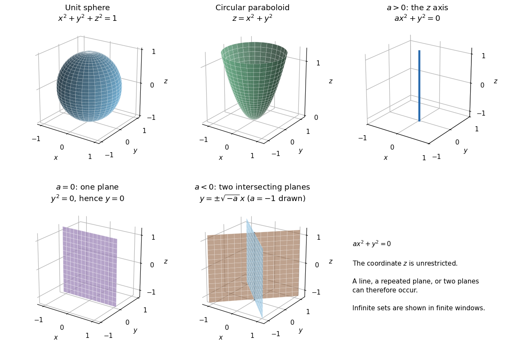

<h1 id="2/a/solution">Solution</h1>

↑ **Parent:** [A](../a.md)

The [quadric surface](../../../../../../quadric-surface.md) $x^2+y^2+z^2=1$ is the unit [sphere](../../../../../../sphere.md) centered at the origin. Each section $z=c$, for $|c|<1$, is a [circle](../../../../../../circle.md) of [radius](../../../../../../radius.md) $\sqrt{1-c^2}$.

The [quadric surface](../../../../../../quadric-surface.md) $z=x^2+y^2$ is a circular [elliptic paraboloid](../../../../../../elliptic-paraboloid.md), opening in the positive $z$ direction with vertex at the origin. Its horizontal sections $z=c>0$ are [circles](../../../../../../circle.md) of [radius](../../../../../../radius.md) $\sqrt c$, and its vertical sections through the $z$ axis are [parabolas](../../../../../../parabola.md).

For $ax^2+y^2=0$, $z$ is unrestricted. If $a>0$, both nonnegative terms must vanish, so the locus is **the $z$ axis**, a [straight line](../../../../../../straight-line.md). If $a=0$, it is **the [plane](../../../../../../plane.md) $y=0$**, represented by the repeated factor $y^2$. If $a<0$, factorization gives

$$
(y-\sqrt{-a}\,x)(y+\sqrt{-a}\,x)=0,
$$

so the locus is **two distinct [planes](../../../../../../plane.md), $y=\pm\sqrt{-a}\,x$, meeting along the $z$ axis**. These are degenerate [quadrics](../../../../../../quadric-surface.md), not ordinary curved cylinders.

**[Figure 1](#2/a/image-the-sphere-elliptic-paraboloid-and-three-degenerate-quadric-cases-in-question-2-a). The sphere, elliptic paraboloid, and three degenerate quadric cases in Question 2(a)**

## ↑ Ancestors (12)

1. [A](../a.md)
2. [2](../../2.md)
3. [Mathematics IV](../../../mathematics-iv-split.md)
4. [Prelims](../../../split.md)
5. [2023](../../../../split.md)
6. [Past exam of the mathematics course of the University of Oxford](../../../../../split.md)
7. [Mathematics course of the University of Oxford](../../../../../../mathematics-course-of-the-university-of-oxford.md)
8. [Undergraduate course of the University of Oxford](../../../../../../undergraduate-course-of-the-university-of-oxford.md)
9. [Course of the University of Oxford](../../../../../../course-of-the-university-of-oxford.md)
10. [University of Oxford](../../../../../../university-of-oxford-split.md)
11. [List of universities](../../../../../../list-of-universities.md)
12. [Codex Wiki](../../../../../../split.md)
