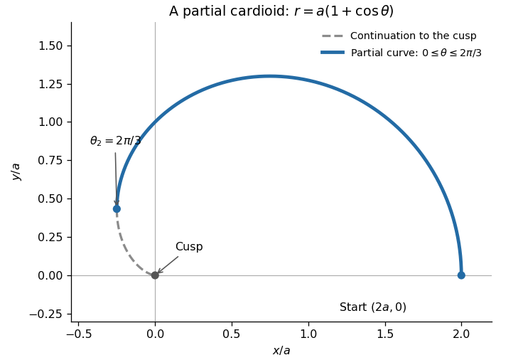

<h1 id="3/a/iii/solution">Solution</h1>

↑ **Parent:** [Iii](../iii.md)

For the [cardioid](../../../../../../../cardioid.md), $r'=-a\sin\theta$. The expression under the [square root](../../../../../../../square-root.md) simplifies to

$$
r^2+(r')^2=a^2(2+2\cos\theta)=4a^2\cos^2(\theta/2).
$$

Since $0\leq\theta\leq\theta_2\leq\pi$, the [cosine](../../../../../../../cosine.md) is nonnegative. Therefore

$$
\boxed{s(\theta_2)=\int_0^{\theta_2}2a\cos(\theta/2)\,d\theta=4a\sin(\theta_2/2).}
$$

The upper half of the [cardioid](../../../../../../../cardioid.md) starts at $(2a,0)$, passes through $(0,a)$, bends to negative $x$, and ends at the cusp $(0,0)$ when $\theta_2=\pi$. Its full upper-half [arc length](../../../../../../../arc-length.md) is $4a$; reflecting gives $8a$ for the full [cardioid](../../../../../../../cardioid.md).

The [fundamental theorem of calculus](../../../../../../../fundamental-theorem-of-calculus.md) gives

$$
\frac{ds}{d\theta_2}=2a\cos(\theta_2/2).
$$

This decreases from $2a$ to zero, so **the [arc length](../../../../../../../arc-length.md) increases fastest at $\theta_2=0$**, interpreted as the right-hand rate at the initial endpoint. If only positive endpoints are allowed, the rate has supremum $2a$ as $\theta_2\downarrow0$, rather than an attained interior maximum.

**[Figure 2](#3/a/iii/image-a-partial-cardioid-with-theta-2-2-pi-3-and-the-continuation-to-its-cusp). A partial cardioid with $\theta_2=2\pi/3$, and the continuation to its cusp**.

## ↑ Ancestors (13)

1. [Iii](../iii.md)
2. [A](../../a.md)
3. [3](../../../3.md)
4. [Mathematics IV](../../../../mathematics-iv-split.md)
5. [Prelims](../../../../split.md)
6. [2023](../../../../../split.md)
7. [Past exam of the mathematics course of the University of Oxford](../../../../../../split.md)
8. [Mathematics course of the University of Oxford](../../../../../../../mathematics-course-of-the-university-of-oxford.md)
9. [Undergraduate course of the University of Oxford](../../../../../../../undergraduate-course-of-the-university-of-oxford.md)
10. [Course of the University of Oxford](../../../../../../../course-of-the-university-of-oxford.md)
11. [University of Oxford](../../../../../../../university-of-oxford-split.md)
12. [List of universities](../../../../../../../list-of-universities.md)
13. [Codex Wiki](../../../../../../../split.md)
