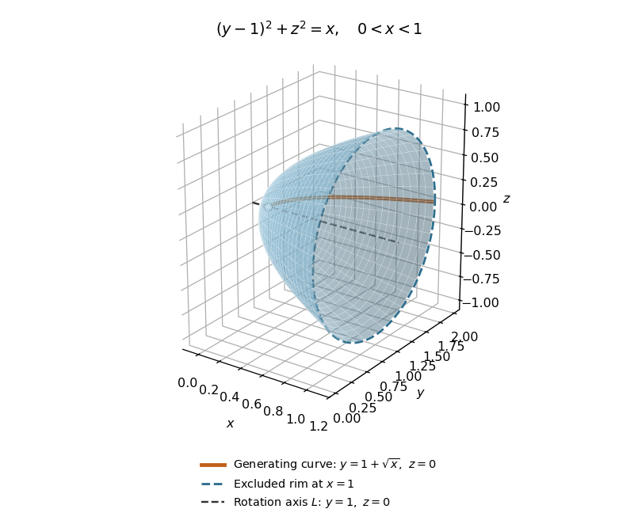

<h1 id="3/b/iii/solution">Solution</h1>

↑ **Parent:** [Iii](../iii.md)

The rotation axis is $L=\{(x,1,0):x\in\mathbb R\}$. The distance of the generating [function graph](../../../../../../../graph-of-a-function.md) from this axis is $\sqrt x$, so a [parametrization](../../../../../../../parametric-equation.md) is

$$
\mathbf R(x,\phi)=(x,1+\sqrt x\cos\phi,\sqrt x\sin\phi),\qquad0<x<1.
$$

The [surface of revolution](../../../../../../../surface-of-revolution.md) therefore has equation $(y-1)^2+z^2=x$: it is a circular [elliptic paraboloid](../../../../../../../elliptic-paraboloid.md) opening along the positive $x$ direction, with its vertex and its rim at $x=1$ excluded. Translating the axis does not change the [surface area](../../../../../../../surface-area.md) formula, so

$$
\begin{aligned}
A&=2\pi\int_0^1\sqrt x\sqrt{1+\frac1{4x}}\,dx
=\pi\int_0^1\sqrt{4x+1}\,dx\\
&=\boxed{\frac\pi6(5\sqrt5-1).}
\end{aligned}
$$

The cancellation makes the [improper integral](../../../../../../../improper-integral.md) finite at the vertex. Neither the missing vertex nor the missing boundary [circle](../../../../../../../circle.md) changes the [surface area](../../../../../../../surface-area.md), and no cap is included.

**[Figure 3](#3/b/iii/image-the-elliptic-paraboloid-obtained-by-rotating-y-1-plus-sqrt-x-around-l). The elliptic paraboloid obtained by rotating $y=1+\sqrt x$ around $L$**.

## ↑ Ancestors (13)

1. [Iii](../iii.md)
2. [B](../../b.md)
3. [3](../../../3.md)
4. [Mathematics IV](../../../../mathematics-iv-split.md)
5. [Prelims](../../../../split.md)
6. [2023](../../../../../split.md)
7. [Past exam of the mathematics course of the University of Oxford](../../../../../../split.md)
8. [Mathematics course of the University of Oxford](../../../../../../../mathematics-course-of-the-university-of-oxford.md)
9. [Undergraduate course of the University of Oxford](../../../../../../../undergraduate-course-of-the-university-of-oxford.md)
10. [Course of the University of Oxford](../../../../../../../course-of-the-university-of-oxford.md)
11. [University of Oxford](../../../../../../../university-of-oxford-split.md)
12. [List of universities](../../../../../../../list-of-universities.md)
13. [Codex Wiki](../../../../../../../split.md)
