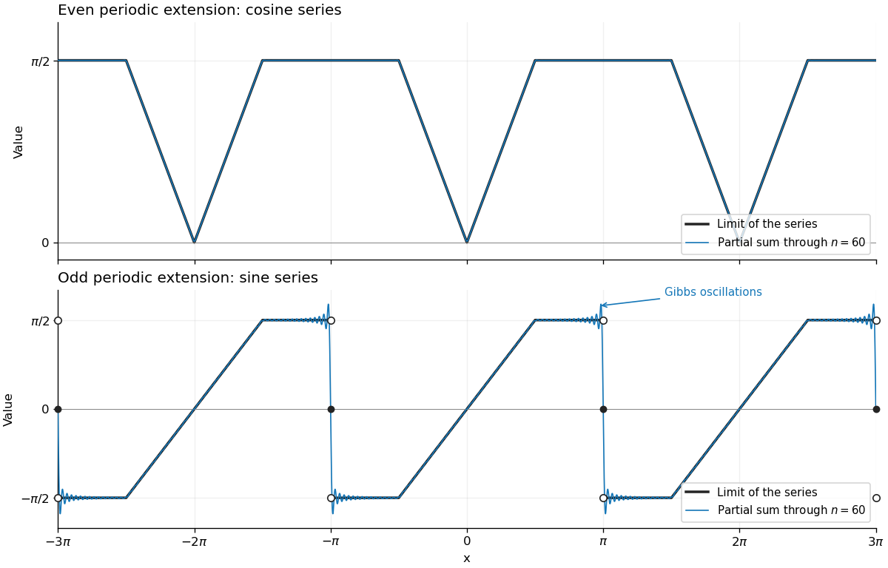
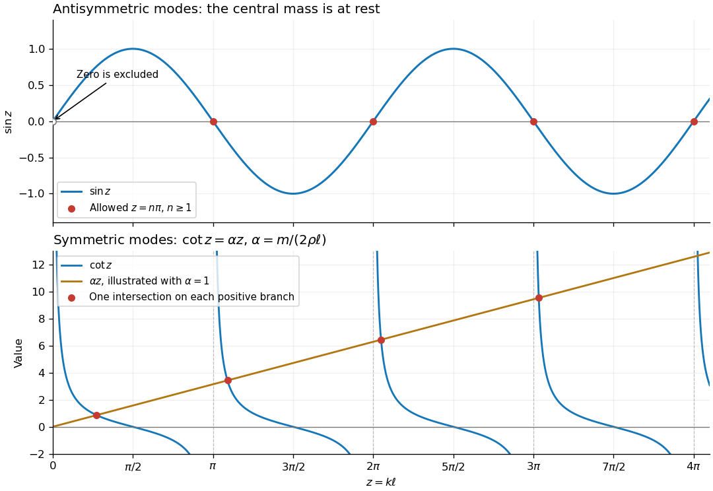

# Mathematics V

↑ **Parent:** [Prelims](../prelims.md)

Source: [released examination PDF, pages 207–211](https://www.whatdotheyknow.com/request/request_for_mathematics_examinat/response/3129786/attach/3/FOI%20202507%20740%20Data.pdf#page=207).

Solutions to all six questions of the examination sat on 23 June 2023, including every optional question and part.

**Table of contents**

- [1](#1)
  - [a](#1/a)
    - [i](#1/a/i)
      - [Solution](#1/a/i/solution)
    - [ii](#1/a/ii)
      - [Solution](#1/a/ii/solution)
  - [b](#1/b)
    - [i](#1/b/i)
      - [Solution](#1/b/i/solution)
    - [ii](#1/b/ii)
      - [Solution](#1/b/ii/solution)
- [2](#2)
  - [a](#2/a)
    - [i](#2/a/i)
      - [Solution](#2/a/i/solution)
    - [ii](#2/a/ii)
      - [Solution](#2/a/ii/solution)
  - [b](#2/b)
    - [i](#2/b/i)
      - [Solution](#2/b/i/solution)
    - [ii](#2/b/ii)
      - [Solution](#2/b/ii/solution)
    - [iii](#2/b/iii)
      - [Solution](#2/b/iii/solution)
  - [c](#2/c)
    - [Solution](#2/c/solution)
- [3](#3)
  - [a](#3/a)
    - [Solution](#3/a/solution)
  - [b](#3/b)
    - [Solution](#3/b/solution)
  - [c](#3/c)
    - [Solution](#3/c/solution)
- [4](#4)
  - [a](#4/a)
    - [i](#4/a/i)
      - [Solution](#4/a/i/solution)
    - [ii](#4/a/ii)
      - [Solution](#4/a/ii/solution)
  - [b](#4/b)
    - [i](#4/b/i)
      - [Solution](#4/b/i/solution)
    - [ii](#4/b/ii)
      - [Solution](#4/b/ii/solution)
    - [iii](#4/b/iii)
      - [Solution](#4/b/iii/solution)
- [5](#5)
  - [a](#5/a)
    - [Solution](#5/a/solution)
  - [b](#5/b)
    - [i](#5/b/i)
      - [Solution](#5/b/i/solution)
    - [ii](#5/b/ii)
      - [Solution](#5/b/ii/solution)
    - [iii](#5/b/iii)
      - [Solution](#5/b/iii/solution)
  - [c](#5/c)
    - [Solution](#5/c/solution)
- [6](#6)
  - [a](#6/a)
    - [Solution](#6/a/solution)
  - [b](#6/b)
    - [Solution](#6/b/solution)
  - [c](#6/c)
    - [Solution](#6/c/solution)

## 1

↑ **Parent:** [Mathematics V](mathematics-v.md)

<h3 id="1/a">a</h3>

↑ **Parent:** [1](#1)

<h4 id="1/a/i">i</h4>

↑ **Parent:** [A](#1/a)

<h5 id="1/a/i/solution">Solution</h5>

↑ **Parent:** [I](#1/a/i)

Let $D$ be a bounded planar region with a piecewise smooth, simple closed boundary $C$, oriented counterclockwise, and let $P,Q$ have continuous first [partial derivatives](../../../multivariable-calculus.md#partial-derivative) on an open neighbourhood of its closure. [Green's theorem](../../../multivariable-calculus.md#green-theorem) states that

$$
\boxed{\oint_C(P\,dx+Q\,dy)=\iint_D\left(\frac{\partial Q}{\partial x}-\frac{\partial P}{\partial y}\right)dx\,dy.}
$$

For a region with holes, orient every boundary component with $D$ on its left: the outer component is counterclockwise and the inner components are clockwise.

Choose $P=-y/2$ and $Q=x/2$. Their indicated [partial derivatives](../../../multivariable-calculus.md#partial-derivative) differ by one, so the [area](../../../differential-geometry.md#surface-area) is

$$
\boxed{|D|=\iint_D1\,dx\,dy=\frac12\oint_C(x\,dy-y\,dx).}
$$

This is [signed area as a boundary integral](../../../multivariable-calculus.md#signed-area-as-a-boundary-integral); reversing the direction of $C$ changes the sign of the integral.

<h4 id="1/a/ii">ii</h4>

↑ **Parent:** [A](#1/a)

<h5 id="1/a/ii/solution">Solution</h5>

↑ **Parent:** [Ii](#1/a/ii)

In [polar coordinates](../../../multivariable-calculus.md#polar-coordinates), put $x=r\cos\theta$ and $y=r\sin\theta$. Differentiating along the curve gives

$$
x\,dy-y\,dx=r^2\,d\theta.
$$

The [cardioid](../../../multivariable-calculus.md#cardioid) has $r\geq0$ and is traversed once counterclockwise as $\theta$ increases from $0$ to $2\pi$. Its cusp at $\theta=\pi$ causes no difficulty: split the [line integral](../../../multivariable-calculus.md#line-integral) there, or exclude a small arc and take its limit. Thus [signed area as a boundary integral](../../../multivariable-calculus.md#signed-area-as-a-boundary-integral) gives

$$
\begin{aligned}
|D|&=\frac12\int_0^{2\pi}(1+\cos\theta)^2\,d\theta\\
&=\frac12\int_0^{2\pi}\left(\frac32+2\cos\theta+\frac12\cos2\theta\right)d\theta
=\boxed{\frac{3\pi}{2}}.
\end{aligned}
$$

<h3 id="1/b">b</h3>

↑ **Parent:** [1](#1)

<h4 id="1/b/i">i</h4>

↑ **Parent:** [B](#1/b)

<h5 id="1/b/i/solution">Solution</h5>

↑ **Parent:** [I](#1/b/i)

For an oriented piecewise smooth [parametric curve](../../../topology.md#parametric-curve) $\mathbf r:[a,b]\to\mathbb R^3$ and a continuous [vector field](../../../multivariable-calculus.md#vector-field) $\mathbf F$ along it, the vector-field [line integral](../../../multivariable-calculus.md#line-integral) is

$$
\boxed{\int_C\mathbf F\cdot d\mathbf r=\int_a^b\mathbf F(\mathbf r(t))\cdot\mathbf r'(t)\,dt.}
$$

For a piecewise smooth curve, sum these integrals over its smooth pieces. The [dot product](../../../inner-product.md#dot-product) selects the component of the [vector field](../../../multivariable-calculus.md#vector-field) in the direction of motion.

If $\mathbf F=\nabla\phi$ for a [smooth function](../../../analysis.md#smooth-function) $\phi$, the [multivariable chain rule](../../../calculus.md#multivariable-chain-rule) gives

$$
\mathbf F(\mathbf r(t))\cdot\mathbf r'(t)=\frac{d}{dt}\phi(\mathbf r(t)).
$$

The [fundamental theorem of calculus](../../../calculus.md#fundamental-theorem-of-calculus), with cancellation at intermediate endpoints, therefore proves the [fundamental theorem for line integrals](../../../multivariable-calculus.md#fundamental-theorem-for-line-integrals):

$$
\int_C\nabla\phi\cdot d\mathbf r=\phi(\mathbf r(b))-\phi(\mathbf r(a)).
$$

On a closed curve $\mathbf r(a)=\mathbf r(b)$, so $\boxed{\oint_C\nabla\phi\cdot d\mathbf r=0}$.

<h4 id="1/b/ii">ii</h4>

↑ **Parent:** [B](#1/b)

<h5 id="1/b/ii/solution">Solution</h5>

↑ **Parent:** [Ii](#1/b/ii)

The displayed [vector field](../../../multivariable-calculus.md#vector-field) is defined on the punctured plane $U=\mathbb R^2\setminus\{(0,0)\}$; it is undefined at the origin. Take the counterclockwise unit [circle](../../../topology.md#circle) $\mathbf r(t)=(\cos t,\sin t)$, $0\leq t\leq2\pi$. Along it,

$$
\mathbf F(\mathbf r(t))=(-\sin t,\cos t)=\mathbf r'(t),\qquad
\boxed{\oint_C\mathbf F\cdot d\mathbf r=\int_0^{2\pi}1\,dt=2\pi.}
$$

By the [fundamental theorem for line integrals](../../../multivariable-calculus.md#fundamental-theorem-for-line-integrals), it has no single-valued [potential of a conservative vector field](../../../multivariable-calculus.md#potential-of-a-conservative-vector-field) on $U$. In particular it cannot be the restriction of the [gradient](../../../multivariable-calculus.md#gradient) of a [smooth function](../../../analysis.md#smooth-function) on all of $\mathbb R^2$.

For $(x,y)\ne(0,0)$, direct differentiation gives

$$
\frac{\partial Q}{\partial x}
=\frac{x^2+y^2-2x^2}{(x^2+y^2)^2}
=\frac{y^2-x^2}{(x^2+y^2)^2}
=\frac{\partial P}{\partial y}.
$$

There is no contradiction with [Green's theorem](../../../multivariable-calculus.md#green-theorem): $\mathbf F$ is not defined, let alone continuously differentiable, throughout the disk enclosed by $C$. On an annulus the theorem does apply; the counterclockwise outer integral is $2\pi$, and the clockwise inner integral is $-2\pi$, so their sum is zero. The hole prevents this [curl-free vector field](../../../multivariable-calculus.md#irrotational-vector-field) from being a [conservative vector field](../../../multivariable-calculus.md#conservative-vector-field) on its entire domain.

## 2

↑ **Parent:** [Mathematics V](mathematics-v.md)

<h3 id="2/a">a</h3>

↑ **Parent:** [2](#2)

<h4 id="2/a/i">i</h4>

↑ **Parent:** [A](#2/a)

<h5 id="2/a/i/solution">Solution</h5>

↑ **Parent:** [I](#2/a/i)

For a continuous [vector field](../../../multivariable-calculus.md#vector-field) along an oriented piecewise continuously differentiable [parametric curve](../../../topology.md#parametric-curve) $\gamma:[a,b]\to\mathbb R^3$, define its [line integral](../../../multivariable-calculus.md#line-integral) by

$$
\boxed{\int_C\mathbf F\cdot d\mathbf r=\int_a^b\mathbf F(\gamma(t))\cdot\gamma'(t)\,dt,}
$$

adding the integrals over the smooth pieces when necessary. The value refers to the specified traversal: going around a curve twice counts twice.

<h4 id="2/a/ii">ii</h4>

↑ **Parent:** [A](#2/a)

<h5 id="2/a/ii/solution">Solution</h5>

↑ **Parent:** [Ii](#2/a/ii)

An orientation-preserving [reparametrization](../../../differential-geometry.md#reparametrization) has the form $\widetilde\gamma(s)=\gamma(h(s))$, where $h:[\alpha,\beta]\to[a,b]$ is an increasing, piecewise smooth change of parameter with $h(\alpha)=a$, $h(\beta)=b$. For regular parametrizations one may take $h$ and its inverse continuously differentiable on each piece. The [chain rule](../../../calculus.md#chain-rule) gives $\widetilde\gamma'(s)=\gamma'(h(s))h'(s)$. The [change of variables](../../../multivariable-calculus.md#change-of-variables-formula) $t=h(s)$ therefore yields

$$
\begin{aligned}
\int_\alpha^\beta\mathbf F(\widetilde\gamma(s))\cdot\widetilde\gamma'(s)\,ds
&=\int_\alpha^\beta\mathbf F(\gamma(h(s)))\cdot\gamma'(h(s))h'(s)\,ds\\
&=\int_a^b\mathbf F(\gamma(t))\cdot\gamma'(t)\,dt.
\end{aligned}
$$

This proves [reparametrization invariance of a vector line integral](../../../multivariable-calculus.md#reparametrization-invariance-of-a-vector-line-integral). If $h$ is decreasing, the endpoints in the final integral are reversed and the sign changes. Thus the same direction and the same multiplicity of traversal are essential.

<h3 id="2/b">b</h3>

↑ **Parent:** [2](#2)

<h4 id="2/b/i">i</h4>

↑ **Parent:** [B](#2/b)

<h5 id="2/b/i/solution">Solution</h5>

↑ **Parent:** [I](#2/b/i)

For the [parametric curve](../../../topology.md#parametric-curve) $\mathbf r(t)=(t,t^2,t^3)$, $0\leq t\leq1$, the [vector field](../../../multivariable-calculus.md#vector-field) and the tangent vector are

$$
\mathbf F(\mathbf r(t))=(9t^2,-14t^5,20t^7),\qquad
\mathbf r'(t)=(1,2t,3t^2).
$$

Consequently the [line integral](../../../multivariable-calculus.md#line-integral) is

$$
\boxed{\int_C\mathbf F\cdot d\mathbf r
=\int_0^1(9t^2-28t^6+60t^9)\,dt
=3-4+6=5.}
$$

<h4 id="2/b/ii">ii</h4>

↑ **Parent:** [B](#2/b)

<h5 id="2/b/ii/solution">Solution</h5>

↑ **Parent:** [Ii](#2/b/ii)

Compute the [line integral](../../../multivariable-calculus.md#line-integral) on each straight segment. On the first, $y=z=0$ and only $dx$ contributes; on the second, $x=1,z=0$ and only $dy$ contributes; on the third, $x=y=1$ and only $dz$ contributes. Therefore

$$
\begin{aligned}
\int_C\mathbf F\cdot d\mathbf r
&=\int_0^1 3x^2\,dx+\int_0^1 0\,dy+\int_0^1 20z^2\,dz\\
&=1+0+\frac{20}{3}=\boxed{\frac{23}{3}}.
\end{aligned}
$$

Although $F_x=9$ on the second segment, that term does no [work](../../../energy.md#work) there because $dx=0$.

<h4 id="2/b/iii">iii</h4>

↑ **Parent:** [B](#2/b)

<h5 id="2/b/iii/solution">Solution</h5>

↑ **Parent:** [Iii](#2/b/iii)

Parametrize the straight segment by $\mathbf r(t)=(t,t,t)$, $0\leq t\leq1$. Then the [line integral](../../../multivariable-calculus.md#line-integral) is

$$
\begin{aligned}
\int_C\mathbf F\cdot d\mathbf r
&=\int_0^1\bigl(3t^2+6t-14t^2+20t^3\bigr)\,dt\\
&=3-\frac{11}{3}+5=\boxed{\frac{13}{3}}.
\end{aligned}
$$

The three different answers are possible because this [vector field](../../../multivariable-calculus.md#vector-field) is not a [conservative vector field](../../../multivariable-calculus.md#conservative-vector-field); for example $\partial_yF_x=6$ whereas $\partial_xF_y=0$.

<h3 id="2/c">c</h3>

↑ **Parent:** [2](#2)

<h4 id="2/c/solution">Solution</h4>

↑ **Parent:** [C](#2/c)

Take counterclockwise traversal as viewed from $z>0$. In the plane $z=0$, the [work](../../../energy.md#work) is the planar [line integral](../../../multivariable-calculus.md#line-integral) of $P=2x-y$ and $Q=x+y$. [Green's theorem](../../../multivariable-calculus.md#green-theorem) gives

$$
\boxed{W=\oint_C(P\,dx+Q\,dy)
=\iint_{x^2+y^2\leq9}(1-(-1))\,dx\,dy
=2\pi(3^2)=18\pi.}
$$

The $z$ component contributes nothing because $dz=0$. The question specifies one circuit without specifying its direction: clockwise traversal gives $\boxed{-18\pi}$.

## 3

↑ **Parent:** [Mathematics V](mathematics-v.md)

<h3 id="3/a">a</h3>

↑ **Parent:** [3](#3)

<h4 id="3/a/solution">Solution</h4>

↑ **Parent:** [A](#3/a)

Let $\Sigma$ be a piecewise smooth oriented [surface](../../../topological-surface.md), and let $\mathbf F$ be continuously differentiable on an open neighbourhood of it. [Stokes theorem](../../../multivariable-calculus.md#stokes-theorem) states that

$$
\boxed{\oint_{\partial\Sigma}\mathbf F\cdot d\mathbf r
=\iint_\Sigma(\nabla\times\mathbf F)\cdot\mathbf n\,dS.}
$$

The [boundary orientation](../../../differential-geometry.md#boundary-orientation) is induced by the chosen [unit normal vector](../../../differential-geometry.md#unit-normal) through the [right-hand rule](../../../electromagnetism.md#right-hand-rule). Smoothness on a neighbourhood makes the spatial [partial derivatives](../../../multivariable-calculus.md#partial-derivative) in the [curl](../../../multivariable-calculus.md#curl) well defined.

Choose the outward [orientation of a surface](../../../differential-geometry.md#orientation-of-a-surface) on the lower half of the [ellipsoid](../../../euclidean-geometry.md#ellipsoid). At its lowest point the normal points down, so its boundary ellipse is traversed clockwise when viewed from above. Use

$$
\mathbf r(t)=(2\cos t,-3\sin t,0),\qquad0\leq t\leq2\pi.
$$

The [line integral](../../../multivariable-calculus.md#line-integral) is

$$
\begin{aligned}
\oint_{\partial\Sigma}\mathbf F\cdot d\mathbf r
&=\int_0^{2\pi}\bigl[(-6\sin t)(-2\sin t)+(6\cos t)(-3\cos t)\bigr]dt\\
&=12\pi-18\pi=\boxed{-6\pi}.
\end{aligned}
$$

For an independent [surface integral](../../../multivariable-calculus.md#surface-integral) calculation, first compute $\nabla\times\mathbf F=(2y,-2x,1)$. Parametrize the lower half by

$$
\mathbf R(u,v)=(2\sin u\cos v,3\sin u\sin v,-3\sqrt3\cos u),
\quad0\leq u\leq\frac\pi2,\quad0\leq v\leq2\pi.
$$

The outward vector [area element](../../../differential-geometry.md#area-element-of-a-surface) is

$$
\mathbf n\,dS=(\mathbf R_v\times\mathbf R_u)\,du\,dv
=\bigl(9\sqrt3\sin^2u\cos v,6\sqrt3\sin^2u\sin v,-6\sin u\cos u\bigr)\,du\,dv.
$$

Thus

$$
\begin{aligned}
\iint_\Sigma(\nabla\times\mathbf F)\cdot\mathbf n\,dS
&=\int_0^{\pi/2}\int_0^{2\pi}
\bigl(30\sqrt3\sin^3u\sin v\cos v-6\sin u\cos u\bigr)\,dv\,du\\
&=-12\pi\int_0^{\pi/2}\sin u\cos u\,du
=\boxed{-6\pi}.
\end{aligned}
$$

The two sides agree. Choosing the inward [unit normal vector](../../../differential-geometry.md#unit-normal) and its corresponding counterclockwise [boundary orientation](../../../differential-geometry.md#boundary-orientation) changes both answers to $6\pi$.

<h3 id="3/b">b</h3>

↑ **Parent:** [3](#3)

<h4 id="3/b/solution">Solution</h4>

↑ **Parent:** [B](#3/b)

The sufficiency claim requires a domain qualification. For a continuously differentiable [vector field](../../../multivariable-calculus.md#vector-field) on all of $\mathbb R^3$, or more generally on a [simply connected](../../../algebraic-topology.md#simply-connected-space) open domain, the equivalence is valid. On an arbitrary domain, vanishing [curl](../../../multivariable-calculus.md#curl) is necessary but may fail to be sufficient.

**Necessity.** Suppose every closed-curve [line integral](../../../multivariable-calculus.md#line-integral) vanishes. Fix a point $p$ in the open domain and a [unit vector](../../../vector-space.md#unit-vector) $a$. A sufficiently small planar disk $D_\varepsilon$ of radius $\varepsilon$, centred at $p$ and normal to $a$, lies in the domain. [Stokes theorem](../../../multivariable-calculus.md#stokes-theorem) gives

$$
0=\oint_{\partial D_\varepsilon}\mathbf F\cdot d\mathbf r
=\iint_{D_\varepsilon}(\nabla\times\mathbf F)\cdot a\,dS.
$$

Divide by $\pi\varepsilon^2$ and let $\varepsilon\downarrow0$. By [continuity](../../../calculus.md#continuous-function), the average tends to $(\nabla\times\mathbf F)(p)\cdot a$. Taking the three coordinate directions proves $\boxed{\nabla\times\mathbf F=0}$ everywhere.

**Sufficiency on $\mathbb R^3$.** A direct proof constructs a [potential of a conservative vector field](../../../multivariable-calculus.md#potential-of-a-conservative-vector-field). Put

$$
\phi(x)=\int_0^1\mathbf F(tx)\cdot x\,dt.
$$

Write $F_j$ for the components of $\mathbf F$. Vanishing [curl](../../../multivariable-calculus.md#curl) says $\partial_iF_j=\partial_jF_i$. Differentiation under the integral, followed by the [chain rule](../../../calculus.md#chain-rule), gives

$$
\begin{aligned}
\partial_i\phi(x)
&=\int_0^1\left[F_i(tx)+t\sum_{j=1}^3x_j\partial_iF_j(tx)\right]dt\\
&=\int_0^1\left[F_i(tx)+t\frac d{dt}F_i(tx)\right]dt
=\bigl[tF_i(tx)\bigr]_0^1=F_i(x).
\end{aligned}
$$

This is the [radial integral potential for a curl-free field](../../../multivariable-calculus.md#radial-integral-potential-for-a-curl-free-field). The [fundamental theorem for line integrals](../../../multivariable-calculus.md#fundamental-theorem-for-line-integrals) now gives zero on every closed curve. On a [simply connected](../../../algebraic-topology.md#simply-connected-space) open domain the analogous argument uses path integrals: every loop can be contracted within the domain, and applying [Stokes theorem](../../../multivariable-calculus.md#stokes-theorem) to a piecewise smooth contraction makes its [circulation](../../../vorticity.md#circulation-physics) zero. Equivalently, whenever a particular loop bounds an oriented spanning surface entirely in the domain, [Stokes theorem](../../../multivariable-calculus.md#stokes-theorem) immediately gives zero for that loop.

**Why the domain matters.** On $U=\mathbb R^3\setminus\{(0,0,z):z\in\mathbb R\}$, the [smooth](../../../analysis.md#smooth-function) [vector field](../../../multivariable-calculus.md#vector-field)

$$
\mathbf F=\left(-\frac y{x^2+y^2},\frac x{x^2+y^2},0\right)
$$

has zero [curl](../../../multivariable-calculus.md#curl), but its [line integral](../../../multivariable-calculus.md#line-integral) around the unit [circle](../../../topology.md#circle) in $z=0$ is $2\pi$, as in [ii](#1/b/ii). No spanning surface for this loop can lie entirely in $U$. The literal claim without a condition on the domain therefore has this counterexample.

<h3 id="3/c">c</h3>

↑ **Parent:** [3](#3)

<h4 id="3/c/solution">Solution</h4>

↑ **Parent:** [C](#3/c)

Let $a$ be an arbitrary constant [vector](../../../vector-space.md#vector). By the cyclic identity for the [scalar triple product](../../../multilinear-algebra.md#scalar-triple-product),

$$
a\cdot\oint_{\partial\Sigma}d\mathbf r\times\mathbf F
=\oint_{\partial\Sigma}(\mathbf F\times a)\cdot d\mathbf r.
$$

Apply [Stokes theorem](../../../multivariable-calculus.md#stokes-theorem) to $\mathbf F\times a$. Since $a$ is constant, the [curl](../../../multivariable-calculus.md#curl) product identity gives

$$
\nabla\times(\mathbf F\times a)
=(a\cdot\nabla)\mathbf F-a(\nabla\cdot\mathbf F).
$$

Consequently

$$
\begin{aligned}
a\cdot\oint_{\partial\Sigma}d\mathbf r\times\mathbf F
&=\iint_\Sigma\left[\mathbf n\cdot(a\cdot\nabla)\mathbf F
-(\mathbf n\cdot a)(\nabla\cdot\mathbf F)\right]dS\\
&=a\cdot\iint_\Sigma(\mathbf n\times\nabla)\times\mathbf F\,dS.
\end{aligned}
$$

For precision, the operator in the last line has components

$$
\bigl[(\mathbf n\times\nabla)\times\mathbf F\bigr]_i
=\sum_{j=1}^3n_j\partial_iF_j-n_i\sum_{j=1}^3\partial_jF_j.
$$

The [partial derivatives](../../../multivariable-calculus.md#partial-derivative) act on $\mathbf F$, with $\mathbf n$ multiplying their values; they do not differentiate $\mathbf n$. Since the [dot products](../../../inner-product.md#dot-product) agree for every constant $a$, the [cross-product form of Stokes theorem](../../../multivariable-calculus.md#cross-product-form-of-stokes-theorem) follows:

$$
\boxed{\oint_{\partial\Sigma}d\mathbf r\times\mathbf F
=\iint_\Sigma(\mathbf n\times\nabla)\times\mathbf F\,dS.}
$$

Here $\wedge$ in the paper denotes the [cross product](../../../vector-space.md#cross-product), and the printed surface integral has its [area element](../../../differential-geometry.md#area-element-of-a-surface) $dS$ understood.

## 4

↑ **Parent:** [Mathematics V](mathematics-v.md)

<h3 id="4/a">a</h3>

↑ **Parent:** [4](#4)

<h4 id="4/a/i">i</h4>

↑ **Parent:** [A](#4/a)

<h5 id="4/a/i/solution">Solution</h5>

↑ **Parent:** [I](#4/a/i)

For the [Fourier cosine series](../../../fourier-series.md#fourier-cosine-series), first take the [even extension](../../../fourier-series.md#even-extension) $F_e(x)=f(|x|)$ on $[-\pi,\pi]$, and then its $2\pi$-[periodic extension](../../../function.md#periodic-extension). Evenness eliminates the [sine](../../../geometry-and-topology.md#sine) terms. With the constant term written as $a_0/2$, the [Fourier coefficients](../../../fourier-series.md#fourier-coefficient) and [series](../../../sequence-and-series.md#series-mathematics) are

$$
\boxed{a_n=\frac2\pi\int_0^\pi f(x)\cos(nx)\,dx\quad(n=0,1,2,\ldots),\qquad
\frac{a_0}{2}+\sum_{n=1}^\infty a_n\cos(nx).}
$$

For the [Fourier sine series](../../../fourier-series.md#fourier-sine-series), take the [odd extension](../../../calculus.md#odd-extension) $F_o(x)=f(x)$ for $0<x<\pi$ and $F_o(x)=-f(-x)$ for $-\pi<x<0$, and extend with period $2\pi$. Values assigned at isolated endpoints do not change the [Fourier coefficients](../../../fourier-series.md#fourier-coefficient). Oddness eliminates the constant and [cosine](../../../geometry-and-topology.md#cosine) terms, leaving

$$
\boxed{b_n=\frac2\pi\int_0^\pi f(x)\sin(nx)\,dx\quad(n\geq1),\qquad
\sum_{n=1}^\infty b_n\sin(nx).}
$$

Both formulas follow by [orthogonality](../../../inner-product.md#orthogonal-vectors) on $[-\pi,\pi]$ and the parity of the extensions.

<h4 id="4/a/ii">ii</h4>

↑ **Parent:** [A](#4/a)

<h5 id="4/a/ii/solution">Solution</h5>

↑ **Parent:** [Ii](#4/a/ii)

Using the usual piecewise smooth interpretation of the derivative hypothesis, [Dirichlet's theorem on Fourier series](../../../fourier-series.md#dirichlet-s-theorem-on-fourier-series) gives the average of the two one-sided limits of the appropriate [periodic extension](../../../function.md#periodic-extension). The [even extension](../../../fourier-series.md#even-extension) is continuous at $0$ and at the identified endpoints $\pm\pi$, so the [Fourier cosine series](../../../fourier-series.md#fourier-cosine-series) converges to

$$
\boxed{f(x)\quad\text{for every }0\leq x\leq\pi.}
$$

For the [odd extension](../../../calculus.md#odd-extension), the one-sided limits at zero are $-f(0)$ and $f(0)$, while at $\pi$ the periodic one-sided limits are $f(\pi)$ and $-f(\pi)$. Hence the [Fourier sine series](../../../fourier-series.md#fourier-sine-series) converges to

$$
\boxed{\begin{cases}f(x),&0<x<\pi,\\0,&x=0\text{ or }x=\pi.\end{cases}}
$$

At an endpoint this equals $f$ precisely when $f$ is zero there. One can also see the zero endpoint values directly: every [partial sum](../../../sequence-and-series.md#partial-sum) consists of [sines](../../../geometry-and-topology.md#sine) that vanish at both endpoints.

<h3 id="4/b">b</h3>

↑ **Parent:** [4](#4)

<h4 id="4/b/i">i</h4>

↑ **Parent:** [B](#4/b)

<h5 id="4/b/i/solution">Solution</h5>

↑ **Parent:** [I](#4/b/i)

Put $a=\pi/2$. The constant [Fourier coefficient](../../../fourier-series.md#fourier-coefficient) is

$$
a_0=\frac2\pi\left(\int_0^a x\,dx+\int_a^\pi a\,dx\right)=\frac{3\pi}{4}.
$$

For $n\geq1$, [integration by parts](../../../calculus.md#integration-by-parts) gives

$$
\begin{aligned}
\int_0^a x\cos(nx)\,dx
&=\frac{a\sin(na)}n+\frac{\cos(na)-1}{n^2},\\
\int_a^\pi a\cos(nx)\,dx&=-\frac{a\sin(na)}n.
\end{aligned}
$$

The $n^{-1}$ terms cancel. Thus

$$
a_n=\frac{2}{\pi n^2}\left(\cos\frac{n\pi}{2}-1\right),\qquad
\boxed{f(x)=\frac{3\pi}{8}+\frac2\pi\sum_{n=1}^\infty
\frac{\cos(n\pi/2)-1}{n^2}\cos(nx)\quad(0\leq x\leq\pi).}
$$

This [Fourier cosine series](../../../fourier-series.md#fourier-cosine-series) has $a_n=0$ when $n$ is divisible by four, $a_n=-4/(\pi n^2)$ when $n\equiv2\pmod4$, and $a_n=-2/(\pi n^2)$ when $n$ is odd.

Similarly,

$$
\begin{aligned}
\int_0^a x\sin(nx)\,dx&=-\frac{a\cos(na)}n+\frac{\sin(na)}{n^2},\\
\int_a^\pi a\sin(nx)\,dx&=\frac{a\cos(na)}n-\frac{a(-1)^n}n.
\end{aligned}
$$

Therefore

$$
b_n=\frac{2\sin(n\pi/2)}{\pi n^2}-\frac{(-1)^n}{n},\qquad
\boxed{f(x)=\sum_{n=1}^\infty\left(\frac{(-1)^{n+1}}n+
\frac{2\sin(n\pi/2)}{\pi n^2}\right)\sin(nx)\quad(0<x<\pi).}
$$

The [Fourier sine series](../../../fourier-series.md#fourier-sine-series) also equals $f(0)=0$ at zero, but has value zero at $\pi$, where $f(\pi)=\pi/2$.

<h4 id="4/b/ii">ii</h4>

↑ **Parent:** [B](#4/b)

<h5 id="4/b/ii/solution">Solution</h5>

↑ **Parent:** [Ii](#4/b/ii)

The [Fourier cosine series](../../../fourier-series.md#fourier-cosine-series) converges to the continuous even $2\pi$-[periodic extension](../../../function.md#periodic-extension). If $r\in[-\pi,\pi]$ represents $x$ modulo $2\pi$, its value is

$$
F_e(x)=\min(|r|,\pi/2).
$$

It has value zero at $x=2j\pi$, rises linearly with distance from these points until height $\pi/2$, and then stays flat until the next descending ramp. Thus the sketch on $[-3\pi,3\pi]$ has minima at $-2\pi,0,2\pi$, and plateaux centred at the odd multiples of $\pi$. Its large [partial sums](../../../sequence-and-series.md#partial-sum) round the corners and closely follow the whole graph.

The [Fourier sine series](../../../fourier-series.md#fourier-sine-series) converges, away from the odd multiples of $\pi$, to the odd $2\pi$-[periodic extension](../../../function.md#periodic-extension)

$$
F_o(x)=\operatorname{sgn}(r)\min(|r|,\pi/2)\quad(-\pi<r<\pi).
$$

At every odd multiple of $\pi$ its value is zero, the midpoint of the jump from $\pi/2$ to $-\pi/2$. At even multiples of $\pi$ it passes continuously through zero. Thus on every interval $((2j-1)\pi,(2j+1)\pi)$ it has a negative plateau, a rising linear segment through $2j\pi$, and a positive plateau. The jump size is $\pi$.

**[Figure 1](#4/b/ii/image-periodic-limits-and-60-term-fourier-partial-sums). Periodic limits and 60-term Fourier partial sums**.

The blue curves are the [partial sums](../../../sequence-and-series.md#partial-sum) through $n=60$. The open endpoint circles and filled zero dots in the lower panel distinguish the one-sided limits from the value of the [Fourier sine series](../../../fourier-series.md#fourier-sine-series) at each jump. Near these jumps the [partial sums](../../../sequence-and-series.md#partial-sum) exhibit the [Gibbs phenomenon](../../../fourier-series.md#gibbs-phenomenon): the oscillations become concentrated in narrower regions as the number of terms grows, while their limiting overshoot remains about $0.08949$ times the jump, here about $0.281$.

<h4 id="4/b/iii">iii</h4>

↑ **Parent:** [B](#4/b)

<h5 id="4/b/iii/solution">Solution</h5>

↑ **Parent:** [Iii](#4/b/iii)

The truncated [Fourier cosine series](../../../fourier-series.md#fourier-cosine-series) gives the better approximation over the whole closed interval. Its [Fourier coefficients](../../../fourier-series.md#fourier-coefficient) obey $|a_n|\leq4/(\pi n^2)$, so [absolute convergence](../../../sequence-and-series.md#absolute-convergence) and the tail bound

$$
\boxed{\sup_{0\leq x\leq\pi}|f(x)-C_N(x)|
\leq\frac4\pi\sum_{n>N}\frac1{n^2}
\leq\frac4{\pi N}}
$$

give [uniform convergence](../../../sequence-and-series.md#uniform-convergence). The even [periodic extension](../../../function.md#periodic-extension) is continuous; its slope changes only cause corners.

By contrast $b_n=(-1)^{n+1}/n+O(n^{-2})$. The odd [periodic extension](../../../function.md#periodic-extension) has a jump at $\pi$, giving slower coefficient decay and the [Gibbs phenomenon](../../../fourier-series.md#gibbs-phenomenon) near that endpoint. Every truncated [Fourier sine series](../../../fourier-series.md#fourier-sine-series) satisfies $S_N(\pi)=0$, so

$$
\boxed{|f(\pi)-S_N(\pi)|=\pi/2\quad\text{for every }N.}
$$

It therefore cannot converge uniformly to $f$ on $[0,\pi]$, although it converges at every point of $[0,\pi)$. This comparison concerns approximation across the interval; it does not assert that the cosine truncation has smaller error at every individual interior point for every $N$.

## 5

↑ **Parent:** [Mathematics V](mathematics-v.md)

<h3 id="5/a">a</h3>

↑ **Parent:** [5](#5)

<h4 id="5/a/solution">Solution</h4>

↑ **Parent:** [A](#5/a)

Take a bar of constant cross-sectional [area](../../../differential-geometry.md#surface-area) $A$, thermally insulated along its sides, with no internal heat production. [Fourier's law](../../../heat.md#fourier-s-law) says that the [heat flux](../../../heat.md#heat-flux-density) in the positive $x$ direction is

$$
q(x,t)=-k(x)T_x(x,t).
$$

The [thermal conductivity](../../../heat.md#thermal-conductivity) $k(x)$ is positive. On a small slice $[x,x+\Delta x]$, [conservation of energy](../../../mathematical-physics.md#conservation-of-energy) gives

$$
A\int_x^{x+\Delta x}\rho c_pT_t(s,t)\,ds
=A\bigl[q(x,t)-q(x+\Delta x,t)\bigr].
$$

Here $\rho c_p$ is the volumetric [heat capacity](../../../heat.md#heat-capacity), the product of [mass density](../../../fluid-mechanics.md#density) and [specific heat capacity](../../../heat.md#specific-heat-capacity). Divide by $A\Delta x$, take $\Delta x\to0$, and use $\rho c_p=1$. The resulting [heat equation](../../../diffusion-equation.md#heat-equation) is

$$
\boxed{T_t=-q_x=\frac{\partial}{\partial x}\bigl(k(x)T_x\bigr).}
$$

For differentiable $k$, this is $T_t=kT_{xx}+k'T_x$; retaining the divergence form also expresses [conservation of energy](../../../mathematical-physics.md#conservation-of-energy) correctly across an interface where $k$ jumps.

<h3 id="5/b">b</h3>

↑ **Parent:** [5](#5)

<h4 id="5/b/i">i</h4>

↑ **Parent:** [B](#5/b)

<h5 id="5/b/i/solution">Solution</h5>

↑ **Parent:** [I](#5/b/i)

Inward [heat flux](../../../heat.md#heat-flux-density) at the left end points in the positive $x$ direction, so the [boundary conditions](../../../differential-equation.md#boundary-condition) are

$$
-kT_x(0,t)=Q,\qquad T(2\ell,t)=0.
$$

For uniform [thermal conductivity](../../../heat.md#thermal-conductivity), the steady [heat equation](../../../diffusion-equation.md#heat-equation) gives $T_s''=0$. The [heat flux](../../../heat.md#heat-flux-density) is constant and equal to $Q$, so $T_s'=-Q/k$. Imposing the right-end temperature gives

$$
\boxed{T_s(x)=\frac Qk(2\ell-x).}
$$

<h4 id="5/b/ii">ii</h4>

↑ **Parent:** [B](#5/b)

<h5 id="5/b/ii/solution">Solution</h5>

↑ **Parent:** [Ii](#5/b/ii)

Write $T=T_s+T_u$. The transient satisfies the [heat equation](../../../diffusion-equation.md#heat-equation) and homogeneous mixed [boundary conditions](../../../differential-equation.md#boundary-condition)

$$
(T_u)_t=k(T_u)_{xx},\qquad
(T_u)_x(0,t)=0,\qquad T_u(2\ell,t)=0,\qquad
T_u(x,0)=-\frac Qk(2\ell-x).
$$

The left condition is a [Neumann boundary condition](../../../differential-equation.md#neumann-boundary-condition) and the right one a [Dirichlet boundary condition](../../../differential-equation.md#dirichlet-boundary-condition). [Separation of variables](../../../partial-differential-equation.md#separation-of-variables), $T_u=X(x)G(t)$, gives

$$
\frac{G'}{kG}=\frac{X''}{X}=-\mu^2,\qquad
X''+\mu^2X=0,\qquad G=e^{-k\mu^2t}.
$$

The condition $X'(0)=0$ removes the [sine](../../../geometry-and-topology.md#sine) term. The condition $X(2\ell)=0$ then selects

$$
\mu_n=\frac{(2n+1)\pi}{4\ell},\qquad
X_n(x)=\cos(\mu_nx),\qquad n=0,1,2,\ldots.
$$

There is no nonzero mode with $\mu=0$, because a linear $X$ satisfying both conditions is zero. There is no growing mode either: [integration by parts](../../../calculus.md#integration-by-parts) gives $\int_0^{2\ell}(X')^2dx=\mu^2\int_0^{2\ell}X^2dx$, so every nonzero mode has $\mu^2>0$.

These [Sturm-Liouville eigenfunctions](../../../sturm-liouville-theory.md#sturm-liouville-eigenfunction) have [orthogonality](../../../inner-product.md#orthogonal-vectors) and squared [norm](../../../normed-vector-space.md#norm)

$$
\int_0^{2\ell}\cos(\mu_nx)\cos(\mu_jx)\,dx=\ell\,\delta_{nj}.
$$

Expand the initial transient in this half-integer [Fourier cosine series](../../../fourier-series.md#fourier-cosine-series). Its coefficients are

$$
\begin{aligned}
A_n&=-\frac Q{k\ell}\int_0^{2\ell}(2\ell-x)\cos(\mu_nx)\,dx\\
&=-\frac Q{k\ell}\frac{1-\cos(2\ell\mu_n)}{\mu_n^2}
=-\frac{16Q\ell}{k\pi^2(2n+1)^2}.
\end{aligned}
$$

The integration formula follows by [integration by parts](../../../calculus.md#integration-by-parts); the cosine at the endpoint is zero. Thus the [half-integer cosine expansion of a linear profile](../../../fourier-series.md#half-integer-cosine-expansion-of-a-linear-profile) gives

$$
\boxed{T(x,t)=\frac Qk(2\ell-x)
-\frac{16Q\ell}{k\pi^2}\sum_{n=0}^\infty
\frac{\cos\!\left(\frac{(2n+1)\pi x}{4\ell}\right)}{(2n+1)^2}
\exp\!\left(-\frac{(2n+1)^2\pi^2kt}{16\ell^2}\right).}
$$

At $t=0$ the [Fourier series](../../../fourier-series.md) reproduces $-T_s$ everywhere, including the endpoints; its $n^{-2}$ coefficient decay gives [uniform convergence](../../../sequence-and-series.md#uniform-convergence). For every $t>0$ the exponential factors allow termwise differentiation and verify the [heat equation](../../../diffusion-equation.md#heat-equation) and both [boundary conditions](../../../differential-equation.md#boundary-condition). The sudden switch-on of nonzero [heat flux](../../../heat.md#heat-flux-density) is incompatible with the spatial derivative of the constant initial temperature at the corner $(0,0)$. Accordingly, the positive-time boundary derivative must not be inferred by differentiating the initial [Fourier series](../../../fourier-series.md) term by term at that corner.

<h4 id="5/b/iii">iii</h4>

↑ **Parent:** [B](#5/b)

<h5 id="5/b/iii/solution">Solution</h5>

↑ **Parent:** [Iii](#5/b/iii)

For the stated inward heating, take $Q\geq0$ and put $\tau=\pi^2kt/(16\ell^2)$. Since $|\cos(\mu_nx)|\leq1$, the transient from [ii](#5/b/ii) satisfies

$$
|T(x,t)-T_s(x)|\leq\frac{16Q\ell}{k\pi^2}
\sum_{n=0}^\infty\frac{e^{-(2n+1)^2\tau}}{(2n+1)^2}.
$$

Equality holds at $x=0$, where every cosine is one and all coefficients have the same sign. Thus the maximum is attained at the heated end, and its exact value and late-time form are

$$
\begin{aligned}
\max_{0\leq x\leq2\ell}|T(x,t)-T_s(x)|
&=\frac{16Q\ell}{k\pi^2}e^{-\tau}
\left(1+\frac19e^{-8\tau}+O(e^{-24\tau})\right)\\
&\sim\boxed{\frac{16}{\pi^2}\frac{Q\ell}{k}
\exp\!\left(-\frac{\pi^2}{16}\frac{kt}{\ell^2}\right)}.
\end{aligned}
$$

This is dominance of the slowest-decaying [eigenfunction](../../../linear-operator-theory.md#eigenfunction) when $kt\gg\ell^2$. More explicitly, the omitted relative correction is nonnegative and bounded by $(\pi^2/8-1)e^{-8\tau}$, using $\sum_{n\geq0}(2n+1)^{-2}=\pi^2/8$. For a signed imposed [heat flux](../../../heat.md#heat-flux-density), the maximum-deviation formula uses $|Q|$.

<h3 id="5/c">c</h3>

↑ **Parent:** [5](#5)

<h4 id="5/c/solution">Solution</h4>

↑ **Parent:** [C](#5/c)

In a steady state the [heat equation](../../../diffusion-equation.md#heat-equation) says $(kT_s')'=0$, so the positive-$x$ [heat flux](../../../heat.md#heat-flux-density) $q=-kT_s'$ is the same constant $Q$ in both materials. Assume perfect thermal contact: temperature is continuous at $x=\ell$, and [conservation of energy](../../../mathematical-physics.md#conservation-of-energy) requires continuous [heat flux](../../../heat.md#heat-flux-density) there. Integrating from the right endpoint gives

$$
\boxed{T_s(x)=\begin{cases}
\displaystyle\frac{Q\ell}{k_2}+\frac Q{k_1}(\ell-x),&0\leq x\leq\ell,\\[6pt]
\displaystyle\frac Q{k_2}(2\ell-x),&\ell\leq x\leq2\ell.
\end{cases}}
$$

The two formulas agree at the interface. Their slopes differ, but $-k_1T_s'(\ell^-)=-k_2T_s'(\ell^+)=Q$. The total temperature drop is $Q\ell(1/k_1+1/k_2)$, the sum of the two layers' contributions in [steady heat conduction through layers](../../../heat.md#steady-heat-conduction-through-layers).

## 6

↑ **Parent:** [Mathematics V](mathematics-v.md)

<h3 id="6/a">a</h3>

↑ **Parent:** [6](#6)

<h4 id="6/a/solution">Solution</h4>

↑ **Parent:** [A](#6/a)

Use the ideal transverse-motion model of the question: constant [tension](../../../force.md#tension), small slopes, no bending stiffness, and no transverse body-force term. On a short segment away from $x=0$, the vertical components of the endpoint tensions are, to first order in $y_x$, $Ty_x(x+\Delta x,t)$ and $-Ty_x(x,t)$. Its mass is $\rho\Delta x$, since $\rho$ is [linear mass density](../../../fluid-mechanics.md#linear-mass-density). [Newton's second law](../../../force.md#newton-s-second-law) gives

$$
\rho\Delta x\,y_{tt}=T\bigl[y_x(x+\Delta x,t)-y_x(x,t)\bigr].
$$

Dividing by $\Delta x$ and taking its limit proves the [wave equation on a string](../../../wave-equation.md#wave-equation-on-a-string) on each side of the mass:

$$
\boxed{y_{tt}=c^2y_{xx},\qquad c^2=\frac T\rho,\qquad -\ell<x<0\text{ or }0<x<\ell.}
$$

The string on the right pulls the [point mass](../../../classical-mechanics.md#point-mass) with vertical component $Ty_x(0^+,t)$, while the string on the left contributes $-Ty_x(0^-,t)$. Hence

$$
\boxed{m\ddot Y(t)=T\bigl[y_x(0^+,t)-y_x(0^-,t)\bigr].}
$$

The fixed supports and attachment impose the [boundary conditions](../../../differential-equation.md#boundary-condition)

$$
\boxed{y(-\ell,t)=y(\ell,t)=0,\qquad y(0^-,t)=y(0^+,t)=Y(t).}
$$

Together with the mass equation, these are the endpoint and matching conditions. The slope can jump at $x=0$: the jump supplies the mass's vertical [acceleration](../../../classical-mechanics.md#acceleration). Requiring the slope to be continuous would incorrectly remove its dynamics.

<h3 id="6/b">b</h3>

↑ **Parent:** [6](#6)

<h4 id="6/b/solution">Solution</h4>

↑ **Parent:** [B](#6/b)

Use [separation of variables](../../../partial-differential-equation.md#separation-of-variables) to seek a [normal mode](../../../wave-equation.md#normal-mode) $y(x,t)=X(x)\cos(\omega t+\delta)$, with [angular frequency](../../../lagrangian-mechanics.md#angular-frequency) $\omega>0$ and [wavenumber](../../../wave-equation.md#wavenumber) $k=\omega/c$. The endpoint [boundary conditions](../../../differential-equation.md#boundary-condition) are built into

$$
X(x)=\begin{cases}
A\sin(k(x+\ell)),&-\ell\leq x\leq0,\\
B\sin(k(\ell-x)),&0\leq x\leq\ell.
\end{cases}
$$

Let $z=k\ell$ and denote the mass's displacement amplitude by $X_0$. Continuity and the mass equation become

$$
A\sin z=B\sin z=X_0,\qquad
Tk(A+B)\cos z=m\omega^2X_0.
$$

The two possibilities must be separated before dividing by $\sin z$.

**Antisymmetric modes.** If $\sin z=0$, then $z=n\pi$, $n=1,2,\ldots$, and $X_0=0$. The force equation gives $A+B=0$, since $\cos z\ne0$. Thus $X(-x)=-X(x)$ and the mass stays at rest. These allowed [angular frequencies](../../../lagrangian-mechanics.md#angular-frequency) satisfy

$$
\boxed{\sin(k\ell)=0,\qquad k\ell=n\pi\ (n\geq1),\qquad\omega_n^{\mathrm{odd}}=\frac{cn\pi}{\ell}.}
$$

The restoring forces on the mass cancel even though the string vibrates.

**Symmetric modes.** If $\sin z\ne0$, continuity forces $A=B$. Cancelling the nonzero amplitude in the mass equation and using $\omega^2=(T/\rho)k^2$ gives

$$
2Tk\cos z=m\frac T\rho k^2\sin z,
\qquad
\boxed{\cot(k\ell)=\frac{mk}{2\rho}.}
$$

These modes have $X(-x)=X(x)$ and move the mass. In dimensionless form their equation is $\cot z=\alpha z$, where $\alpha=m/(2\rho\ell)>0$. This is the spectral splitting for a [string with a central point mass](../../../wave-equation.md#string-with-a-central-point-mass).

**[Figure 2](#6/b/image-antisymmetric-zeros-and-symmetric-frequency-intersections). Antisymmetric zeros and symmetric frequency intersections**.

For the antisymmetric family, the graph of $\sin z$ crosses zero at every positive multiple of $\pi$. For the symmetric family, on each interval $(n\pi,n\pi+\pi/2)$, $n=0,1,\ldots$, the graph of $\cot z$ decreases continuously from $+\infty$ to zero while $\alpha z$ increases. By the [intermediate value theorem](../../../calculus.md#intermediate-value-theorem) and strict [monotonicity](../../../calculus.md#monotonic-function), there is exactly one intersection in each interval. On the remaining half-intervals $\cot z<0<\alpha z$, so there are no further positive roots. This proves graphically and analytically that both families contain infinitely many [normal modes](../../../wave-equation.md#normal-mode). The figure uses $\alpha=1$ for illustration.

The algebraic case $k=0$ is not a mode: a zero-frequency profile would be linear on each half, continuous and zero at the endpoints; the zero-acceleration mass equation also makes its slopes agree, forcing the entire profile to be zero. More generally, [integration by parts](../../../calculus.md#integration-by-parts) on the two halves and the matching condition give

$$
\omega^2\left(\rho\int_{-\ell}^{\ell}X^2\,dx+mX_0^2\right)
=T\int_{-\ell}^{\ell}(X')^2\,dx>0
$$

for a nonzero real mode. Thus no nonzero static or exponentially growing mode has been omitted.

<h3 id="6/c">c</h3>

↑ **Parent:** [6](#6)

<h4 id="6/c/solution">Solution</h4>

↑ **Parent:** [C](#6/c)

The lowest positive root belongs to the symmetric family and lies in $(0,\pi/2)$; all antisymmetric roots are at least $\pi$. Let $\alpha=m/(2\rho\ell)\gg1$. The equation $\cot z=\alpha z$ forces its first root to tend to zero: for any fixed $\varepsilon>0$, the right side eventually exceeds $\cot\varepsilon$ at $z=\varepsilon$, so the decreasing-minus-increasing difference has its zero below $\varepsilon$.

The [Taylor series](../../../calculus.md#taylor-series) $\cot z=z^{-1}-z/3+O(z^3)$ then gives

$$
1=\left(\alpha+\frac13\right)z^2+O(z^4),\qquad
z\sim\alpha^{-1/2}=\sqrt{\frac{2\rho\ell}{m}}.
$$

Since $\omega=cz/\ell$ and $c=\sqrt{T/\rho}$, the lowest [angular frequency](../../../lagrangian-mechanics.md#angular-frequency) is

$$
\boxed{\omega\sim\frac1\ell\sqrt{\frac T\rho}\sqrt{\frac{2\rho\ell}{m}}
=\sqrt{\frac{2T}{m\ell}}=\omega_0.}
$$

Physically, at such a low [frequency](../../../wave.md#frequency) each half-string is nearly straight. If the mass moves up by $Y$, the two slopes are approximately $Y/\ell$ and $-Y/\ell$, so the restoring [force](../../../force.md) is $-2TY/\ell$. The resulting [harmonic oscillator equation](../../../classical-mechanics.md#simple-harmonic-motion), $m\ddot Y+(2T/\ell)Y=0$, has exactly the leading [angular frequency](../../../lagrangian-mechanics.md#angular-frequency) above. The next correction from the same expansion is $\omega/\omega_0=1-\rho\ell/(3m)+O((\rho\ell/m)^2)$.

## ↑ Ancestors (9)

1. [Prelims](../prelims.md)
2. [2023](../../2023.md)
3. [Past exam of the mathematics course of the University of Oxford](../../../past-exam-of-the-mathematics-course-of-the-university-of-oxford.md)
4. [Mathematics course of the University of Oxford](../../../university-of-oxford.md#mathematics-course-of-the-university-of-oxford)
5. [Undergraduate course of the University of Oxford](../../../university-of-oxford.md#undergraduate-course-of-the-university-of-oxford)
6. [Course of the University of Oxford](../../../university-of-oxford.md#course-of-the-university-of-oxford)
7. [University of Oxford](../../../university-of-oxford.md)
8. [List of universities](../../../README.md#list-of-universities)
9. [Codex Wiki](../../../README.md)
