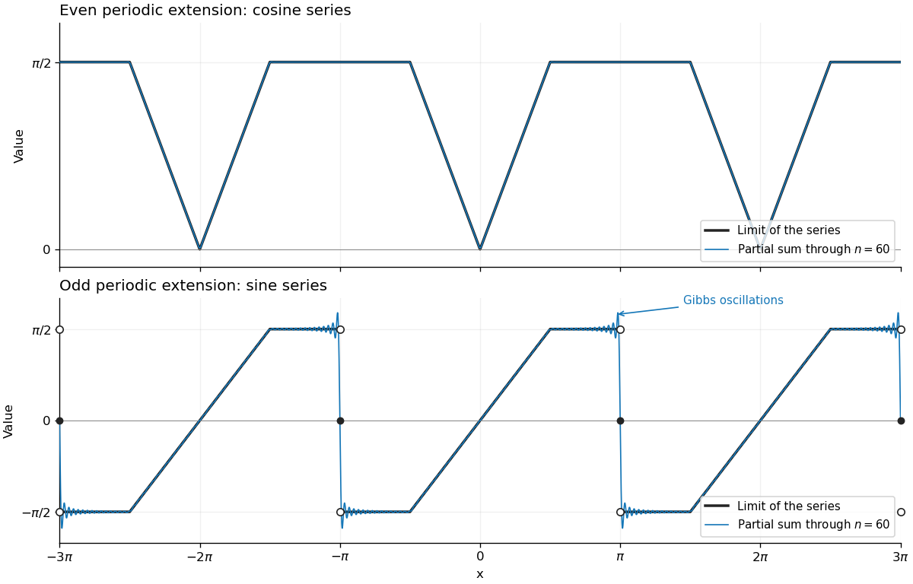

<h1 id="4/b/ii/solution">Solution</h1>

↑ **Parent:** [Ii](../ii.md)

The [Fourier cosine series](../../../../../../../fourier-cosine-series.md) converges to the continuous even $2\pi$-[periodic extension](../../../../../../../periodic-extension.md). If $r\in[-\pi,\pi]$ represents $x$ modulo $2\pi$, its value is

$$
F_e(x)=\min(|r|,\pi/2).
$$

It has value zero at $x=2j\pi$, rises linearly with distance from these points until height $\pi/2$, and then stays flat until the next descending ramp. Thus the sketch on $[-3\pi,3\pi]$ has minima at $-2\pi,0,2\pi$, and plateaux centred at the odd multiples of $\pi$. Its large [partial sums](../../../../../../../partial-sum.md) round the corners and closely follow the whole graph.

The [Fourier sine series](../../../../../../../fourier-sine-series.md) converges, away from the odd multiples of $\pi$, to the odd $2\pi$-[periodic extension](../../../../../../../periodic-extension.md)

$$
F_o(x)=\operatorname{sgn}(r)\min(|r|,\pi/2)\quad(-\pi<r<\pi).
$$

At every odd multiple of $\pi$ its value is zero, the midpoint of the jump from $\pi/2$ to $-\pi/2$. At even multiples of $\pi$ it passes continuously through zero. Thus on every interval $((2j-1)\pi,(2j+1)\pi)$ it has a negative plateau, a rising linear segment through $2j\pi$, and a positive plateau. The jump size is $\pi$.

**[Figure 1](#4/b/ii/image-periodic-limits-and-60-term-fourier-partial-sums). Periodic limits and 60-term Fourier partial sums**.

The blue curves are the [partial sums](../../../../../../../partial-sum.md) through $n=60$. The open endpoint circles and filled zero dots in the lower panel distinguish the one-sided limits from the value of the [Fourier sine series](../../../../../../../fourier-sine-series.md) at each jump. Near these jumps the [partial sums](../../../../../../../partial-sum.md) exhibit the [Gibbs phenomenon](../../../../../../../gibbs-phenomenon.md): the oscillations become concentrated in narrower regions as the number of terms grows, while their limiting overshoot remains about $0.08949$ times the jump, here about $0.281$.

## ↑ Ancestors (13)

1. [Ii](../ii.md)
2. [B](../../b.md)
3. [4](../../../4.md)
4. [Mathematics V](../../../../mathematics-v-split.md)
5. [Prelims](../../../../split.md)
6. [2023](../../../../../split.md)
7. [Past exam of the mathematics course of the University of Oxford](../../../../../../split.md)
8. [Mathematics course of the University of Oxford](../../../../../../../mathematics-course-of-the-university-of-oxford.md)
9. [Undergraduate course of the University of Oxford](../../../../../../../undergraduate-course-of-the-university-of-oxford.md)
10. [Course of the University of Oxford](../../../../../../../course-of-the-university-of-oxford.md)
11. [University of Oxford](../../../../../../../university-of-oxford-split.md)
12. [List of universities](../../../../../../../list-of-universities.md)
13. [Codex Wiki](../../../../../../../split.md)
