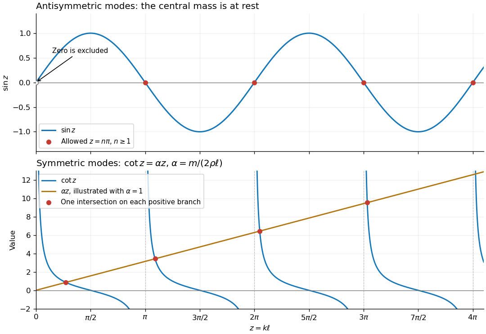

<h1 id="6/b/solution">Solution</h1>

↑ **Parent:** [B](../b.md)

Use [separation of variables](../../../../../../separation-of-variables.md) to seek a [normal mode](../../../../../../normal-mode.md) $y(x,t)=X(x)\cos(\omega t+\delta)$, with [angular frequency](../../../../../../angular-frequency.md) $\omega>0$ and [wavenumber](../../../../../../wavenumber.md) $k=\omega/c$. The endpoint [boundary conditions](../../../../../../boundary-condition.md) are built into

$$
X(x)=\begin{cases}
A\sin(k(x+\ell)),&-\ell\leq x\leq0,\\
B\sin(k(\ell-x)),&0\leq x\leq\ell.
\end{cases}
$$

Let $z=k\ell$ and denote the mass's displacement amplitude by $X_0$. Continuity and the mass equation become

$$
A\sin z=B\sin z=X_0,\qquad
Tk(A+B)\cos z=m\omega^2X_0.
$$

The two possibilities must be separated before dividing by $\sin z$.

**Antisymmetric modes.** If $\sin z=0$, then $z=n\pi$, $n=1,2,\ldots$, and $X_0=0$. The force equation gives $A+B=0$, since $\cos z\ne0$. Thus $X(-x)=-X(x)$ and the mass stays at rest. These allowed [angular frequencies](../../../../../../angular-frequency.md) satisfy

$$
\boxed{\sin(k\ell)=0,\qquad k\ell=n\pi\ (n\geq1),\qquad\omega_n^{\mathrm{odd}}=\frac{cn\pi}{\ell}.}
$$

The restoring forces on the mass cancel even though the string vibrates.

**Symmetric modes.** If $\sin z\ne0$, continuity forces $A=B$. Cancelling the nonzero amplitude in the mass equation and using $\omega^2=(T/\rho)k^2$ gives

$$
2Tk\cos z=m\frac T\rho k^2\sin z,
\qquad
\boxed{\cot(k\ell)=\frac{mk}{2\rho}.}
$$

These modes have $X(-x)=X(x)$ and move the mass. In dimensionless form their equation is $\cot z=\alpha z$, where $\alpha=m/(2\rho\ell)>0$. This is the spectral splitting for a [string with a central point mass](../../../../../../string-with-a-central-point-mass.md).

**[Figure 2](#6/b/image-antisymmetric-zeros-and-symmetric-frequency-intersections). Antisymmetric zeros and symmetric frequency intersections**.

For the antisymmetric family, the graph of $\sin z$ crosses zero at every positive multiple of $\pi$. For the symmetric family, on each interval $(n\pi,n\pi+\pi/2)$, $n=0,1,\ldots$, the graph of $\cot z$ decreases continuously from $+\infty$ to zero while $\alpha z$ increases. By the [intermediate value theorem](../../../../../../intermediate-value-theorem.md) and strict [monotonicity](../../../../../../monotonic-function.md), there is exactly one intersection in each interval. On the remaining half-intervals $\cot z<0<\alpha z$, so there are no further positive roots. This proves graphically and analytically that both families contain infinitely many [normal modes](../../../../../../normal-mode.md). The figure uses $\alpha=1$ for illustration.

The algebraic case $k=0$ is not a mode: a zero-frequency profile would be linear on each half, continuous and zero at the endpoints; the zero-acceleration mass equation also makes its slopes agree, forcing the entire profile to be zero. More generally, [integration by parts](../../../../../../integration-by-parts.md) on the two halves and the matching condition give

$$
\omega^2\left(\rho\int_{-\ell}^{\ell}X^2\,dx+mX_0^2\right)
=T\int_{-\ell}^{\ell}(X')^2\,dx>0
$$

for a nonzero real mode. Thus no nonzero static or exponentially growing mode has been omitted.

## ↑ Ancestors (12)

1. [B](../b.md)
2. [6](../../6.md)
3. [Mathematics V](../../../mathematics-v-split.md)
4. [Prelims](../../../split.md)
5. [2023](../../../../split.md)
6. [Past exam of the mathematics course of the University of Oxford](../../../../../split.md)
7. [Mathematics course of the University of Oxford](../../../../../../mathematics-course-of-the-university-of-oxford.md)
8. [Undergraduate course of the University of Oxford](../../../../../../undergraduate-course-of-the-university-of-oxford.md)
9. [Course of the University of Oxford](../../../../../../course-of-the-university-of-oxford.md)
10. [University of Oxford](../../../../../../university-of-oxford-split.md)
11. [List of universities](../../../../../../list-of-universities.md)
12. [Codex Wiki](../../../../../../split.md)
