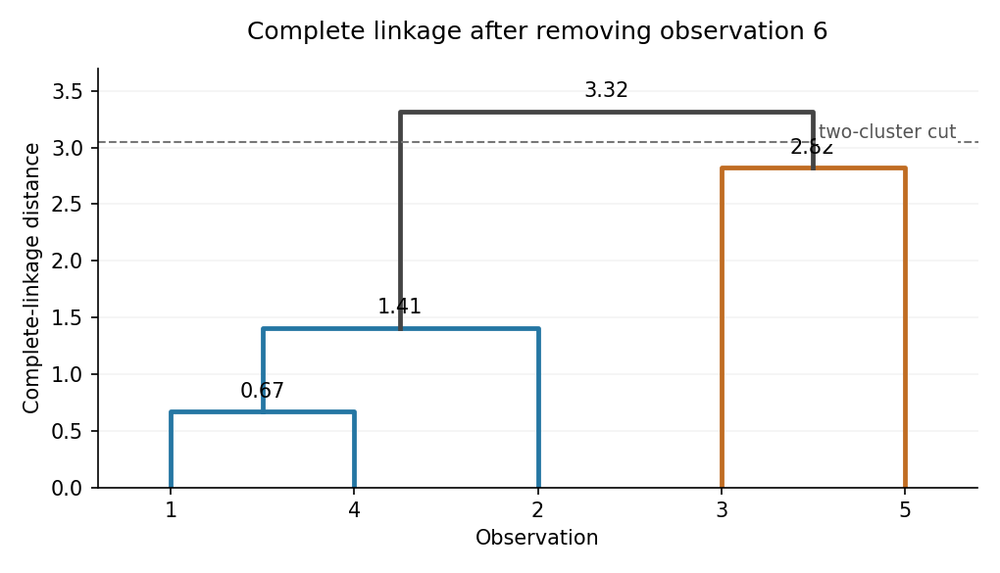

# Mathematics III resit

↑ **Parent:** [Prelims](../prelims.md)

Source: [released examination PDF, bundle pages 126–133](https://www.whatdotheyknow.com/request/bsc_mathematics_prelims_and_part/response/2784209/attach/3/202409%20817%20annex.pdf#page=126).

The cover gives a Long Vacation sitting on Thursday 9 September, with no printed year. It is retained as undated.

Solutions cover all nine questions and every subpart. The digit example in Question 4(c) is inconsistent with its definitions; Question 5(a)(ii) is solved with the printed $u_2=0$. Questions 7–9 are included despite the absent Section C heading in the source.

**Table of contents**

- [1](#1)
  - [a](#1/a)
    - [Solution](#1/a/solution)
  - [b](#1/b)
    - [Solution](#1/b/solution)
  - [c](#1/c)
    - [Solution](#1/c/solution)
- [2](#2)
  - [a](#2/a)
    - [Solution](#2/a/solution)
  - [b](#2/b)
    - [i](#2/b/i)
      - [Solution](#2/b/i/solution)
    - [ii](#2/b/ii)
      - [Solution](#2/b/ii/solution)
  - [c](#2/c)
    - [Solution](#2/c/solution)
- [3](#3)
  - [a](#3/a)
    - [Solution](#3/a/solution)
  - [b](#3/b)
    - [i](#3/b/i)
      - [Solution](#3/b/i/solution)
    - [ii](#3/b/ii)
      - [Solution](#3/b/ii/solution)
  - [c](#3/c)
    - [Solution](#3/c/solution)
- [4](#4)
  - [a](#4/a)
    - [Solution](#4/a/solution)
  - [b](#4/b)
    - [i](#4/b/i)
      - [Solution](#4/b/i/solution)
    - [ii](#4/b/ii)
      - [Solution](#4/b/ii/solution)
    - [iii](#4/b/iii)
      - [Solution](#4/b/iii/solution)
    - [iv](#4/b/iv)
      - [Solution](#4/b/iv/solution)
  - [c](#4/c)
    - [i](#4/c/i)
      - [Solution](#4/c/i/solution)
    - [ii](#4/c/ii)
      - [Solution](#4/c/ii/solution)
    - [iii](#4/c/iii)
      - [Solution](#4/c/iii/solution)
- [5](#5)
  - [a](#5/a)
    - [i](#5/a/i)
      - [Solution](#5/a/i/solution)
    - [ii](#5/a/ii)
      - [Solution](#5/a/ii/solution)
  - [b](#5/b)
    - [Solution](#5/b/solution)
  - [c](#5/c)
    - [i](#5/c/i)
      - [Solution](#5/c/i/solution)
    - [ii](#5/c/ii)
      - [Solution](#5/c/ii/solution)
    - [iii](#5/c/iii)
      - [Solution](#5/c/iii/solution)
- [6](#6)
  - [a](#6/a)
    - [i](#6/a/i)
      - [Solution](#6/a/i/solution)
    - [ii](#6/a/ii)
      - [Solution](#6/a/ii/solution)
    - [iii](#6/a/iii)
      - [Solution](#6/a/iii/solution)
  - [b](#6/b)
    - [Solution](#6/b/solution)
  - [c](#6/c)
    - [i](#6/c/i)
      - [Solution](#6/c/i/solution)
    - [ii](#6/c/ii)
      - [Solution](#6/c/ii/solution)
    - [iii](#6/c/iii)
      - [Solution](#6/c/iii/solution)
- [7](#7)
  - [a](#7/a)
    - [Solution](#7/a/solution)
  - [b](#7/b)
    - [i](#7/b/i)
      - [Solution](#7/b/i/solution)
    - [ii](#7/b/ii)
      - [Solution](#7/b/ii/solution)
    - [iii](#7/b/iii)
      - [Solution](#7/b/iii/solution)
    - [iv](#7/b/iv)
      - [Solution](#7/b/iv/solution)
  - [c](#7/c)
    - [i](#7/c/i)
      - [Solution](#7/c/i/solution)
    - [ii](#7/c/ii)
      - [Solution](#7/c/ii/solution)
    - [iii](#7/c/iii)
      - [Solution](#7/c/iii/solution)
    - [iv](#7/c/iv)
      - [Solution](#7/c/iv/solution)
- [8](#8)
  - [a](#8/a)
    - [Solution](#8/a/solution)
  - [b](#8/b)
    - [i](#8/b/i)
      - [Solution](#8/b/i/solution)
    - [ii](#8/b/ii)
      - [Solution](#8/b/ii/solution)
  - [c](#8/c)
    - [i](#8/c/i)
      - [Solution](#8/c/i/solution)
    - [ii](#8/c/ii)
      - [Solution](#8/c/ii/solution)
- [9](#9)
  - [a](#9/a)
    - [i](#9/a/i)
      - [Solution](#9/a/i/solution)
    - [ii](#9/a/ii)
      - [Solution](#9/a/ii/solution)
  - [b](#9/b)
    - [i](#9/b/i)
      - [Solution](#9/b/i/solution)
    - [ii](#9/b/ii)
      - [Solution](#9/b/ii/solution)
    - [iii](#9/b/iii)
      - [Solution](#9/b/iii/solution)
    - [iv](#9/b/iv)
      - [Solution](#9/b/iv/solution)
    - [v](#9/b/v)
      - [Solution](#9/b/v/solution)

## 1

↑ **Parent:** [Mathematics III resit](mathematics-iii-resit.md)

<h3 id="1/a">a</h3>

↑ **Parent:** [1](#1)

<h4 id="1/a/solution">Solution</h4>

↑ **Parent:** [A](#1/a)

Divide by $x>1$. The [product rule](../../../calculus.md#product-rule) turns the [linear ordinary differential equation](../../../linear-ordinary-differential-equation.md) into

$$
(\ln x\,y)'=\frac{\ln x}{x}.
$$

Equivalently, $\ln x$ is an [integrating factor](../../../linear-ordinary-differential-equation.md#integrating-factor) after division by $x\ln x$. An [antiderivative](../../../integral.md#antiderivative) gives $\ln x\,y=\tfrac12(\ln x)^2+C$. The [initial condition](../../../differential-equation.md#initial-condition) at $e$ gives $C=-1/2$, hence

$$
\boxed{y(x)=\frac12\left(\ln x-\frac1{\ln x}\right),\qquad x>1.}
$$

Its [derivative](../../../calculus.md#derivative) is $y'=[1+(\ln x)^{-2}]/(2x)$, so substitution gives $x\ln x\,y'+y=\ln x$, and $y(e)=0$. Every [solution of a differential equation](../../../differential-equation.md#solution-of-a-differential-equation) has the integrated form above, and the [initial condition](../../../differential-equation.md#initial-condition) fixes its only constant. This agrees with the [uniqueness theorem for ordinary differential equations](../../../analysis.md#uniqueness-theorem-for-ordinary-differential-equations) on the stated [interval](../../../real-analysis.md#interval-mathematics).

<h3 id="1/b">b</h3>

↑ **Parent:** [1](#1)

<h4 id="1/b/solution">Solution</h4>

↑ **Parent:** [B](#1/b)

The [product rule](../../../calculus.md#product-rule) gives $y'=x^nz'+nx^{n-1}z$ and $y''=x^nz''+2nx^{n-1}z'+n(n-1)x^{n-2}z$. On an [interval](../../../real-analysis.md#interval-mathematics) avoiding $x=0$, substitution and division by $x^{n+2}$ give

$$
z''+\left(2+\frac{2n+4}{x}\right)z'
+\left(2+\frac{2n+4}{x}+\frac{n^2+3n+2}{x^2}\right)z=0.
$$

For a [constant-coefficient differential equation](../../../linear-ordinary-differential-equation.md#constant-coefficient-differential-equation), the coefficient of $z'$ forces $2n+4=0$. At $n=-2$, the remaining coefficient $n^2+3n+2$ also vanishes. Thus

$$
\boxed{n=-2,\qquad z''+2z'+2z=0.}
$$

The [characteristic equation of a constant-coefficient differential equation](../../../linear-ordinary-differential-equation.md#characteristic-equation-of-a-constant-coefficient-differential-equation) is $r^2+2r+2=0$, with [complex conjugate](../../../complex-analysis.md#complex-conjugate) [roots of a polynomial](../../../polynomial.md#root-of-a-polynomial) $-1\pm i$. Its real solutions $e^{-x}\cos x$ and $e^{-x}\sin x$ are [linearly independent](../../../vector-space.md#linear-independence). Therefore the [general solution](../../../linear-ordinary-differential-equation.md#general-solution) is

$$
\boxed{y(x)=\frac{e^{-x}}{x^2}(A\cos x+B\sin x),\qquad x\ne0.}
$$

The constants can be chosen independently on the two sides of the singular point. The [power substitution reducing a differential equation to constant coefficients](../../../linear-ordinary-differential-equation.md#power-substitution-reducing-a-differential-equation-to-constant-coefficients) here is invertible wherever $x\ne0$.

<h3 id="1/c">c</h3>

↑ **Parent:** [1](#1)

<h4 id="1/c/solution">Solution</h4>

↑ **Parent:** [C](#1/c)

Use the [change of variables](../../../multivariable-calculus.md#change-of-variables-formula) $u=x+y$. Then $u'=1+y'=1+\cos u=2\cos^2(u/2)$, a [separable differential equation](../../../differential-equation.md#separable-differential-equation). Where $u$ is not an odd multiple of $\pi$, [separation of variables](../../../partial-differential-equation.md#separation-of-variables) gives

$$
\int\frac{du}{1+\cos u}=\int dx,
\qquad
\boxed{\tan\frac{x+y}{2}=x+C.}
$$

Indeed the [derivative](../../../calculus.md#derivative) of $\tan(u/2)$ with respect to $u$ is $1/(1+\cos u)$. The nonconstant branches can also be written $y=2\arctan(x+C)+2k\pi-x$, $k\in\mathbb Z$. Dividing by $1+\cos u$ excluded its zeros: the missing [equilibrium solutions](../../../differential-equation.md#equilibrium-solution-of-an-ordinary-differential-equation) for $u$ give the additional [solutions of a differential equation](../../../differential-equation.md#solution-of-a-differential-equation)

$$
\boxed{y=(2k+1)\pi-x,\qquad k\in\mathbb Z.}
$$

They satisfy $y'=-1=\cos(x+y)$ directly. The transformed right side is continuously differentiable, so the [uniqueness theorem for ordinary differential equations](../../../analysis.md#uniqueness-theorem-for-ordinary-differential-equations) prevents a nonconstant branch from crossing an [equilibrium solution](../../../differential-equation.md#equilibrium-solution-of-an-ordinary-differential-equation) at finite $x$.

## 2

↑ **Parent:** [Mathematics III resit](mathematics-iii-resit.md)

<h3 id="2/a">a</h3>

↑ **Parent:** [2](#2)

<h4 id="2/a/solution">Solution</h4>

↑ **Parent:** [A](#2/a)

Put $h(s)=\sin x(s)-\cos y(s)$. The [chain rule](../../../calculus.md#chain-rule) gives

$$
h'=x'\cos x+y'\sin y,\qquad
f'=-h'\sin h=-(x'\cos x+y'\sin y)g.
$$

Apply the [product rule](../../../calculus.md#product-rule) and the [chain rule](../../../calculus.md#chain-rule) once more: $g'=h'\cos h=h'f$, and

$$
h''=x''\cos x-(x')^2\sin x+y''\sin y+(y')^2\cos y.
$$

Consequently $f''=-(h')^2f-h''g$, so the requested coefficients are

$$
\boxed{\begin{aligned}
a&=-(x'\cos x+y'\sin y)^2,\\
b&=-x''\cos x+(x')^2\sin x-y''\sin y-(y')^2\cos y.
\end{aligned}}
$$

This is the [second derivative chain rule](../../../calculus.md#second-derivative-chain-rule) along the [parametric curve](../../../topology.md#parametric-curve) $(x(s),y(s))$.

<h3 id="2/b">b</h3>

↑ **Parent:** [2](#2)

<h4 id="2/b/i">i</h4>

↑ **Parent:** [B](#2/b)

<h5 id="2/b/i/solution">Solution</h5>

↑ **Parent:** [I](#2/b/i)

The [Jacobian determinant](../../../multivariable-calculus.md#jacobian-determinant) is

$$
\boxed{\frac{\partial(u,v)}{\partial(x,y)}
=\det\begin{pmatrix}-y/x^2&1/x\\1&1\end{pmatrix}
=-\frac{x+y}{x^2}.}
$$

The [change of variables](../../../multivariable-calculus.md#change-of-variables-formula) is defined only for $x\ne0$. On the interior of the integration region, $x>0$ and $y>0$, so this [Jacobian determinant](../../../multivariable-calculus.md#jacobian-determinant) is negative and nonzero.

<h4 id="2/b/ii">ii</h4>

↑ **Parent:** [B](#2/b)

<h5 id="2/b/ii/solution">Solution</h5>

↑ **Parent:** [Ii](#2/b/ii)

The inverse [change of variables](../../../multivariable-calculus.md#change-of-variables-formula) is $x=v/(1+u)$, $y=uv/(1+u)$. Thus the triangular region becomes

$$
0\le u\le1,\qquad 0\le v\le1+u.
$$

The upper limit depends on $u$: the new region is not a [rectangle](../../../euclidean-geometry.md#rectangle). The absolute inverse [Jacobian determinant](../../../multivariable-calculus.md#jacobian-determinant) is $x^2/(x+y)$, so the [change of variables formula](../../../multivariable-calculus.md#change-of-variables-formula) cancels the rational factor in the [integrand](../../../integral.md#integrand):

$$
\begin{aligned}
I&=\int_0^1\int_0^{1+u}e^v\,dv\,du
=\int_0^1(e^{1+u}-1)\,du\\
&=\boxed{e^2-e-1.}
\end{aligned}
$$

Although the original [integrand](../../../integral.md#integrand) is undefined at the vertex $x=y=0$, its nonnegative [improper integral](../../../real-analysis.md#improper-integral) exists. One can apply the [change of variables formula](../../../multivariable-calculus.md#change-of-variables-formula) on $x\ge\varepsilon$ and let $\varepsilon\downarrow0$ by the [monotone convergence theorem](../../../measure-theory.md#monotone-convergence-theorem); the transformed [integrand](../../../integral.md#integrand) has the finite [integral](../../../integral.md) just computed.

<h3 id="2/c">c</h3>

↑ **Parent:** [2](#2)

<h4 id="2/c/solution">Solution</h4>

↑ **Parent:** [C](#2/c)

For the graph of a differentiable function, the [arc length](../../../riemannian-geometry.md#arc-length) is $L=\int\sqrt{1+(y')^2}\,dx$. Since $y'=2x$,

$$
L=\int_0^1\sqrt{1+4x^2}\,dx.
$$

Use the [hyperbolic substitution](../../../multivariable-calculus.md#hyperbolic-substitution) $2x=\sinh t$: then $dx=\tfrac12\cosh t\,dt$ and $\sqrt{1+4x^2}=\cosh t$. The [hyperbolic functions](../../../calculus.md#hyperbolic-function) $\cosh^2t=(1+\cosh2t)/2$ yields

$$
L=\left[\frac{x}{2}\sqrt{1+4x^2}+\frac14\operatorname{arsinh}(2x)\right]_0^1
=\boxed{\frac{\sqrt5}{2}+\frac14\ln(2+\sqrt5).}
$$

Here $\operatorname{arsinh}t=\ln(t+\sqrt{1+t^2})$ is the [inverse hyperbolic sine](../../../calculus.md#inverse-hyperbolic-sine).

## 3

↑ **Parent:** [Mathematics III resit](mathematics-iii-resit.md)

<h3 id="3/a">a</h3>

↑ **Parent:** [3](#3)

<h4 id="3/a/solution">Solution</h4>

↑ **Parent:** [A](#3/a)

The middle component suggests a [scalar potential](../../../classical-field-theory.md#scalar-potential) with $-\phi_y=2y\cosh^2(xz)$, so $\phi=-y^2\cosh^2(xz)+h(x,z)$. The [chain rule](../../../calculus.md#chain-rule) and $2\sinh t\cosh t=\sinh(2t)$ give

$$
-\phi_x=y^2z\sinh(2xz)-h_x,\qquad
-\phi_z=y^2x\sinh(2xz)-h_z.
$$

Matching the other two components requires $h_x=h_z=0$. Therefore

$$
\boxed{\phi(x,y,z)=-y^2\cosh^2(xz)+C.}
$$

Its negative [gradient](../../../multivariable-calculus.md#gradient) is the given [vector field](../../../multivariable-calculus.md#vector-field) in all three components; the additive constant has no effect on that [gradient](../../../multivariable-calculus.md#gradient).

<h3 id="3/b">b</h3>

↑ **Parent:** [3](#3)

<h4 id="3/b/i">i</h4>

↑ **Parent:** [B](#3/b)

<h5 id="3/b/i/solution">Solution</h5>

↑ **Parent:** [I](#3/b/i)

A [parametrization](../../../geometry-and-topology.md#parametric-equation) of the straight [line segment](../../../convex-set.md#line-segment) is $\mathbf r(t)=(t,t,t)$, $0\le t\le1$. Then $\mathbf F(\mathbf r(t))=(t,t^2,t)$ and $\mathbf r'(t)=(1,1,1)$. By the [line integral](../../../multivariable-calculus.md#line-integral) formula,

$$
\boxed{\int_C\mathbf F\cdot d\mathbf r
=\int_0^1(2t+t^2)\,dt=\frac43.}
$$

<h4 id="3/b/ii">ii</h4>

↑ **Parent:** [B](#3/b)

<h5 id="3/b/ii/solution">Solution</h5>

↑ **Parent:** [Ii](#3/b/ii)

Evaluate the [line integral](../../../multivariable-calculus.md#line-integral) separately on the three oriented [line segments](../../../convex-set.md#line-segment). Their [parametrizations](../../../geometry-and-topology.md#parametric-equation) and contributions are

$$
\begin{array}{c|c|c}
\mathbf r(t),\ 0\le t\le1&\mathbf F(\mathbf r(t))\cdot\mathbf r'(t)&\text{contribution}\\\hline
(t,0,0)&0&0\\
(1,t,0)&0&0\\
(1,1,t)&t&1/2
\end{array}
$$

Thus

$$
\boxed{\int_C\mathbf F\cdot d\mathbf r=\frac12.}
$$

The different value in [i](#3/b/i) demonstrates [path dependence](../../../multivariable-calculus.md#path-dependence). The [vector field](../../../multivariable-calculus.md#vector-field) in this part is different from the [conservative vector field](../../../multivariable-calculus.md#conservative-vector-field) in part (a).

<h3 id="3/c">c</h3>

↑ **Parent:** [3](#3)

<h4 id="3/c/solution">Solution</h4>

↑ **Parent:** [C](#3/c)

Write $A=a^2>0$ and $E=e^{-(x^2+y^2)/A}>0$. The [partial derivatives](../../../multivariable-calculus.md#partial-derivative) factor as

$$
f_x=2xE\left(1-\frac{x^2-2y^2}{A}\right),\qquad
f_y=-2yE\left(2+\frac{x^2-2y^2}{A}\right).
$$

A [critical point](../../../analysis.md#critical-point) has both [partial derivatives](../../../multivariable-calculus.md#partial-derivative) zero. If $x,y\ne0$, this would require $x^2-2y^2=A$ and $x^2-2y^2=-2A$, which is impossible. On the axes the remaining conditions give

$$
\boxed{(0,0),\quad(\pm|a|,0),\quad(0,\pm|a|).}
$$

At either [critical point](../../../analysis.md#critical-point) with $x\ne0$, the [Hessian matrix](../../../multivariable-calculus.md#hessian-matrix) is

$$
H_f=\begin{pmatrix}-4/e&0\\0&-6/e\end{pmatrix}.
$$

It is [negative definite](../../../quadratic-form.md#negative-definite-matrix), so the [second-derivative test](../../../multivariable-calculus.md#second-derivative-test) shows that **both $(\pm|a|,0)$ are strict [local maxima](../../../analysis.md#local-maximum)**, of value $a^2/e$. They also attain the [global maximum](../../../function.md#global-maximum): $f\le x^2e^{-x^2/A}\le A/e$. For completeness, the [Hessian matrix](../../../multivariable-calculus.md#hessian-matrix) at $(0,\pm|a|)$ is $\operatorname{diag}(6/e,8/e)$, giving strict [local minima](../../../analysis.md#local-minimum), while at the origin it is $\operatorname{diag}(2,-4)$, giving a [saddle point](../../../analysis.md#saddle-point).

## 4

↑ **Parent:** [Mathematics III resit](mathematics-iii-resit.md)

<h3 id="4/a">a</h3>

↑ **Parent:** [4](#4)

<h4 id="4/a/solution">Solution</h4>

↑ **Parent:** [A](#4/a)

A [discrete random variable](../../../random-variable.md#discrete-random-variable) on a [probability space](../../../probability-space.md) $(\Omega,\mathcal F,\mathbb P)$ is a real-valued [measurable function](../../../measure-theory.md#measurable-function) $X:\Omega\to\mathbb R$ whose [probability distribution](../../../probability-distribution.md) is concentrated on some finite or countable set $S$:

$$
\boxed{\mathbb P(X\in S)=1,\qquad S\text{ countable}.}
$$

[Measurability](../../../measure-theory.md#measurability) means $\{\omega:X(\omega)\le t\}\in\mathcal F$ for every real $t$. Its [probability mass function](../../../probability-distribution.md#probability-mass-function) is $p_X(x)=\mathbb P(X=x)$, and $\sum_{x\in S}p_X(x)=1$. Requiring a countable image everywhere, rather than outside a [null set](../../../measure-theory.md#null-set), is an equivalent convention after harmless modification on a [null set](../../../measure-theory.md#null-set).

<h3 id="4/b">b</h3>

↑ **Parent:** [4](#4)

<h4 id="4/b/i">i</h4>

↑ **Parent:** [B](#4/b)

<h5 id="4/b/i/solution">Solution</h5>

↑ **Parent:** [I](#4/b/i)

Use the ordered outcomes of the two rolls as the [sample space](../../../probability-space.md#sample-space):

$$
\boxed{\Omega=\{1,\ldots,6\}^2,\quad\mathcal F=2^\Omega,\quad
\mathbb P(E)=\frac{|E|}{36}\quad(E\subseteq\Omega).}
$$

Thus each elementary outcome has [probability](../../../probability-theory.md#probability) $1/36$. This is the usual [probability space](../../../probability-space.md) for two independent fair dice.

<h4 id="4/b/ii">ii</h4>

↑ **Parent:** [B](#4/b)

<h5 id="4/b/ii/solution">Solution</h5>

↑ **Parent:** [Ii](#4/b/ii)

For an outcome $\omega=(i,j)$, the two [random variables](../../../random-variable.md) are the coordinate maps

$$
\boxed{X(i,j)=i,\qquad Y(i,j)=j.}
$$

Their [marginal probability mass functions](../../../probability-distribution.md#marginal-probability-mass-function) are $p_X(i)=p_Y(j)=1/6$ on $\{1,\ldots,6\}$, and their [joint probability mass function](../../../random-variable.md#joint-probability-mass-function) satisfies

$$
p_{X,Y}(i,j)=\frac1{36}=p_X(i)p_Y(j).
$$

Off that support, the same factorization holds with zeros. Hence **$X$ and $Y$ are [independent random variables](../../../random-variable.md#independent-random-variables)**, by the [joint probability mass function](../../../random-variable.md#joint-probability-mass-function) criterion for [independence](../../../random-variable.md#independent-random-variables).

<h4 id="4/b/iii">iii</h4>

↑ **Parent:** [B](#4/b)

<h5 id="4/b/iii/solution">Solution</h5>

↑ **Parent:** [Iii](#4/b/iii)

There are three even faces, so $\mathbb P(A)=1/2$. The sum is even precisely when both faces have the same [parity](../../../quantum-mechanics.md#parity), giving $9+9=18$ outcomes and $\mathbb P(B)=1/2$. Both $A$ and $B$ occur precisely when both faces are even, giving nine outcomes. Therefore

$$
\boxed{\mathbb P(A\cap B)=\frac9{36}=\frac14
=\mathbb P(A)\mathbb P(B).}
$$

Thus $A$ and $B$ are [independent events](../../../probability-theory.md#independent-events).

<h4 id="4/b/iv">iv</h4>

↑ **Parent:** [B](#4/b)

<h5 id="4/b/iv/solution">Solution</h5>

↑ **Parent:** [Iv](#4/b/iv)

**No: [pairwise independence](../../../probability-theory.md#pairwise-independent-events) does not imply that the three are [independent events](../../../probability-theory.md#independent-events).** Take $C=\{Y\text{ is even}\}$. Then $\mathbb P(C)=1/2$, and $\mathbb P(A\cap C)=9/36=1/4$ by [independence](../../../random-variable.md#independent-random-variables) of the two rolls. Also $B\cap C$ is precisely the event that both faces are even, so $\mathbb P(B\cap C)=1/4$. Thus all three pairs of [events](../../../probability-space.md#event) are [independent](../../../random-variable.md#independent-random-variables).

But $A\cap B\cap C$ also consists of the nine even-even outcomes, so

$$
\boxed{\mathbb P(A\cap B\cap C)=\frac14\ne\frac18
=\mathbb P(A)\mathbb P(B)\mathbb P(C).}
$$

This violates the triple-intersection requirement for [independent events](../../../probability-theory.md#independent-events).

<h3 id="4/c">c</h3>

↑ **Parent:** [4](#4)

<h4 id="4/c/i">i</h4>

↑ **Parent:** [C](#4/c)

<h5 id="4/c/i/solution">Solution</h5>

↑ **Parent:** [I](#4/c/i)

**The printed numerical example reverses the digits and contradicts both definitions.** With the stated last-digit definition, $[Z]=17$ gives $X=7$, $Y=1$. Use those definitions throughout.

Put $q=e^{-\lambda}\in(0,1)$ and $N=\lfloor Z\rfloor$. The [exponential distribution](../../../continuous-probability-distribution.md#exponential-distribution) gives

$$
\mathbb P(N=n)=\mathbb P(n\le Z<n+1)=(1-q)q^n,\qquad n\ge0.
$$

The [Euclidean division](../../../integer.md#euclidean-division) $N=10Y+X$ has unique remainder $X\in\{0,\ldots,9\}$ and quotient $Y\in\{0,1,\ldots\}$. Thus the [joint probability mass function](../../../random-variable.md#joint-probability-mass-function) is

$$
\boxed{p_{X,Y}(x,y)=(1-q)q^{x+10y},\quad
x=0,\ldots,9,\ y=0,1,\ldots,}
$$

and zero otherwise. This is [decimal digit decomposition of a geometric random variable](../../../discrete-probability-distribution.md#decimal-digit-decomposition-of-a-geometric-random-variable). Following the erroneous example instead would require different definitions and would not answer the stated question.

<h4 id="4/c/ii">ii</h4>

↑ **Parent:** [C](#4/c)

<h5 id="4/c/ii/solution">Solution</h5>

↑ **Parent:** [Ii](#4/c/ii)

Summing the [joint probability mass function](../../../random-variable.md#joint-probability-mass-function) over $y$ with the [geometric series](../../../sequence-and-series.md#geometric-series) gives the [marginal probability mass function](../../../probability-distribution.md#marginal-probability-mass-function)

$$
p_X(x)=\frac{(1-q)q^x}{1-q^{10}},\qquad x=0,\ldots,9.
$$

Divide the [joint probability mass function](../../../random-variable.md#joint-probability-mass-function) by this positive [marginal probability mass function](../../../probability-distribution.md#marginal-probability-mass-function) to obtain the [conditional distribution](../../../probability-theory.md#conditional-distribution):

$$
\boxed{\mathbb P(Y=y\mid X=x)=(1-q^{10})q^{10y},\qquad y\ge0,\quad0\le x\le9.}
$$

It is the [geometric distribution](../../../discrete-probability-distribution.md#geometric-distribution) counting failures before the first success, with success [probability](../../../probability-theory.md#probability) $1-q^{10}$. For the other nonnegative integers $x\ge10$, $\mathbb P(X=x)=0$; the elementary [conditional probability](../../../probability-theory.md#conditional-probability) given $X=x$ is undefined and supplies no additional case.

<h4 id="4/c/iii">iii</h4>

↑ **Parent:** [C](#4/c)

<h5 id="4/c/iii/solution">Solution</h5>

↑ **Parent:** [Iii](#4/c/iii)

Summing over the last digit yields the [marginal probability mass function](../../../probability-distribution.md#marginal-probability-mass-function)

$$
p_Y(y)=(1-q)q^{10y}\sum_{x=0}^9q^x=(1-q^{10})q^{10y},\qquad y\ge0.
$$

Together with the other [marginal probability mass function](../../../probability-distribution.md#marginal-probability-mass-function), this gives

$$
\boxed{p_{X,Y}(x,y)=p_X(x)p_Y(y).}
$$

The factorization holds on the whole support and with zeros elsewhere, proving that **$X$ and $Y$ are [independent](../../../random-variable.md#independent-random-variables)**. The [conditional distribution](../../../probability-theory.md#conditional-distribution) in [ii](#4/c/ii) likewise does not depend on the permissible value $x$.

## 5

↑ **Parent:** [Mathematics III resit](mathematics-iii-resit.md)

<h3 id="5/a">a</h3>

↑ **Parent:** [5](#5)

<h4 id="5/a/i">i</h4>

↑ **Parent:** [A](#5/a)

<h5 id="5/a/i/solution">Solution</h5>

↑ **Parent:** [I](#5/a/i)

For the homogeneous [linear recurrence relation](../../../algebra.md#linear-recurrence-relation), try $u_n=r^n$. Its [characteristic equation of a linear recurrence](../../../algebra.md#characteristic-equation-of-a-linear-recurrence) is

$$
r^2+3r-4=(r-1)(r+4)=0.
$$

The distinct [roots of a polynomial](../../../polynomial.md#root-of-a-polynomial) $1,-4$ give the complementary terms $A+B(-4)^n$. A constant cannot absorb the forcing because $1$ is already a [root of a polynomial](../../../polynomial.md#root-of-a-polynomial) of the characteristic equation; try a [particular solution](../../../linear-ordinary-differential-equation.md#particular-solution) $cn$. Substitution gives $c=-4c+1$, hence $c=1/5$. The [general solution](../../../linear-ordinary-differential-equation.md#general-solution) is $u_n=A+B(-4)^n+n/5$.

The [initial conditions](../../../differential-equation.md#initial-condition) give $A+B=0$ and $A-4B=4/5$. Hence $A=4/25$, $B=-4/25$, and

$$
\boxed{u_n=\frac n5+\frac4{25}\bigl(1-(-4)^n\bigr),\qquad n\ge0.}
$$

<h4 id="5/a/ii">ii</h4>

↑ **Parent:** [A](#5/a)

<h5 id="5/a/ii/solution">Solution</h5>

↑ **Parent:** [Ii](#5/a/ii)

The homogeneous [characteristic equation of a linear recurrence](../../../algebra.md#characteristic-equation-of-a-linear-recurrence) is

$$
r^2+2r+1=(r+1)^2=0.
$$

The [repeated characteristic root of a linear recurrence](../../../algebra.md#repeated-characteristic-root-of-a-linear-recurrence) $-1$ supplies the independent terms $(-1)^n$ and $n(-1)^n$. A constant [particular solution](../../../linear-ordinary-differential-equation.md#particular-solution) is $1/2$, since $1/2=-2(1/2)-1/2+2$. Thus $u_n=1/2+(A+Bn)(-1)^n$.

**The scan prints $u_2=0$, not $u_1=0$. These [initial conditions](../../../differential-equation.md#initial-condition) are consistent.** They give $A=1/2$ from $u_0=1$, then $0=1/2+A+2B$, so $B=-1/2$. Therefore

$$
\boxed{u_n=\frac12+\frac{1-n}{2}(-1)^n.}
$$

In particular $u_1=1/2$ and $u_2=0$. Direct substitution verifies the [recurrence relation](../../../sequence-and-series.md#recurrence-relation). This is an example of [nonconsecutive initial values for a linear recurrence](../../../algebra.md#nonconsecutive-initial-values-for-a-linear-recurrence); replacing the printed subscript by 1 would change the answer.

<h3 id="5/b">b</h3>

↑ **Parent:** [5](#5)

<h4 id="5/b/solution">Solution</h4>

↑ **Parent:** [B](#5/b)

For [random variables](../../../random-variable.md) with finite [second moments](../../../expected-value.md#second-moment), their [covariance](../../../variance.md#covariance) is

$$
\boxed{\operatorname{Cov}(X,Y)=\mathbb E[(X-\mathbb EX)(Y-\mathbb EY)].}
$$

The [Cauchy-Schwarz inequality](../../../probability-and-statistics.md#cauchy-schwarz-inequality) ensures the product is [integrable](../../../measure-theory.md#integrability). Expand and use [linearity of expectation](../../../expected-value.md#linearity-of-expectation):

$$
\begin{aligned}
\operatorname{Cov}(X,Y)
&=\mathbb E[XY]-\mathbb E[X]\mathbb E[Y]
-\mathbb E[X]\mathbb E[Y]+\mathbb E[X]\mathbb E[Y]\\
&=\boxed{\mathbb E[XY]-\mathbb E[X]\mathbb E[Y].}
\end{aligned}
$$

The same identity holds whenever the quantities involved exist with sufficient [integrability](../../../measure-theory.md#integrability).

<h3 id="5/c">c</h3>

↑ **Parent:** [5](#5)

<h4 id="5/c/i">i</h4>

↑ **Parent:** [C](#5/c)

<h5 id="5/c/i/solution">Solution</h5>

↑ **Parent:** [I](#5/c/i)

An [expected value](../../../expected-value.md) of a signed [random variable](../../../random-variable.md) is finite precisely when its absolute value is [integrable](../../../measure-theory.md#integrability). With the [standard normal distribution](../../../probability-distribution.md#standard-normal-distribution) [probability density function](../../../continuous-probability-distribution.md#probability-density-function),

$$
\mathbb E|Ze^{\alpha Z^2}|
=\frac2{\sqrt{2\pi}}\int_0^\infty z\exp\bigl[-(1/2-\alpha)z^2\bigr]\,dz.
$$

For $\alpha<1/2$, this [integral](../../../integral.md) equals $1/[\sqrt{2\pi}(1/2-\alpha)]<\infty$. For $\alpha\ge1/2$, its [integrand](../../../integral.md#integrand) does not decay sufficiently and the [integral](../../../integral.md) diverges. Therefore

$$
\boxed{\mathbb E[Ze^{\alpha Z^2}]\text{ exists exactly for }\alpha<\frac12,
\quad\text{and then equals }0.}
$$

The value is zero by the [odd function](../../../calculus.md#odd-function) and the [symmetric distribution](../../../probability-distribution.md#symmetric-distribution). For the other $\alpha$, both positive and negative parts have infinite [integrals](../../../integral.md); formal cancellation would give only a [Cauchy principal value](../../../complex-analysis.md#cauchy-principal-value), not an [expected value](../../../expected-value.md). This distinction is the [integrability threshold for exponential powers of a Gaussian](../../../expected-value.md#integrability-threshold-for-exponential-powers-of-a-gaussian).

<h4 id="5/c/ii">ii</h4>

↑ **Parent:** [C](#5/c)

<h5 id="5/c/ii/solution">Solution</h5>

↑ **Parent:** [Ii](#5/c/ii)

Absolute [integrability](../../../measure-theory.md#integrability) now requires

$$
\mathbb E|Ze^{\alpha Z^4}|
=\frac2{\sqrt{2\pi}}\int_0^\infty z e^{\alpha z^4-z^2/2}\,dz<\infty.
$$

For $\alpha\le0$, the [integrand](../../../integral.md#integrand) is bounded by $ze^{-z^2/2}$, whose [integral](../../../integral.md) is finite. For $\alpha>0$, once $z^2\ge1/\alpha$, the exponent is at least $\alpha z^4/2$, so the [integral](../../../integral.md) diverges. Hence

$$
\boxed{\mathbb E[Ze^{\alpha Z^4}]\text{ exists exactly for }\alpha\le0,
\quad\text{and then equals }0.}
$$

Again the zero follows from the [odd function](../../../calculus.md#odd-function) and [symmetry](../../../physics.md#symmetry-physics); outside the [integrable](../../../measure-theory.md#integrability) range both signed parts diverge, so the [expected value](../../../expected-value.md) is undefined.

<h4 id="5/c/iii">iii</h4>

↑ **Parent:** [C](#5/c)

<h5 id="5/c/iii/solution">Solution</h5>

↑ **Parent:** [Iii](#5/c/iii)

Let $A=\{|Z|>2\}$ and $B=\{Z>0\}$. The [standard normal distribution](../../../probability-distribution.md#standard-normal-distribution) is symmetric and assigns no [probability mass](../../../probability-distribution.md#probability-mass) to zero. Thus $\mathbb P(B)=1/2$, and its equal two-sided tails give

$$
\mathbb P(A)=2\mathbb P(Z>2),\qquad
\mathbb P(A\cap B)=\mathbb P(Z>2).
$$

Therefore

$$
\boxed{\mathbb P(A\cap B)=\mathbb P(A)\mathbb P(B),}
$$

so **the two [events](../../../probability-space.md#event) are [independent](../../../random-variable.md#independent-random-variables)**. The permitted approximation gives $\mathbb P(A)\approx0.05$ and $\mathbb P(A\cap B)\approx0.025$, but [independence](../../../random-variable.md#independent-random-variables) is exact.

## 6

↑ **Parent:** [Mathematics III resit](mathematics-iii-resit.md)

<h3 id="6/a">a</h3>

↑ **Parent:** [6](#6)

<h4 id="6/a/i">i</h4>

↑ **Parent:** [A](#6/a)

<h5 id="6/a/i/solution">Solution</h5>

↑ **Parent:** [I](#6/a/i)

A [joint probability density function](../../../continuous-probability-distribution.md#joint-probability-density) integrates to one. Here

$$
1=C\int_0^1\int_0^1u(1+2v)\,dv\,du
=C\left(\frac12\right)(2),
$$

so

$$
\boxed{C=1.}
$$

This value also makes the [probability density function](../../../continuous-probability-distribution.md#probability-density-function) nonnegative everywhere.

<h4 id="6/a/ii">ii</h4>

↑ **Parent:** [A](#6/a)

<h5 id="6/a/ii/solution">Solution</h5>

↑ **Parent:** [Ii](#6/a/ii)

Obtain each [marginal density](../../../probability-distribution.md#marginal-density) by integrating the [joint probability density function](../../../continuous-probability-distribution.md#joint-probability-density) over the other variable:

$$
\boxed{f_U(u)=\int_0^1u(1+2v)\,dv=2u,\quad0\le u\le1,}
$$

$$
\boxed{f_V(v)=\int_0^1u(1+2v)\,du=\frac12+v,\quad0\le v\le1.}
$$

Each [marginal density](../../../probability-distribution.md#marginal-density) is zero off its displayed [interval](../../../real-analysis.md#interval-mathematics) and has total [integral](../../../integral.md) one.

<h4 id="6/a/iii">iii</h4>

↑ **Parent:** [A](#6/a)

<h5 id="6/a/iii/solution">Solution</h5>

↑ **Parent:** [Iii](#6/a/iii)

On the product support $[0,1]^2$, the [joint probability density function](../../../continuous-probability-distribution.md#joint-probability-density) factors as

$$
\boxed{f_{U,V}(u,v)=u(1+2v)=(2u)(1/2+v)=f_U(u)f_V(v).}
$$

The equality also holds outside the support with both sides zero. The [probability density function](../../../continuous-probability-distribution.md#probability-density-function) factorization criterion proves that **$U$ and $V$ are [independent random variables](../../../random-variable.md#independent-random-variables)**.

<h3 id="6/b">b</h3>

↑ **Parent:** [6](#6)

<h4 id="6/b/solution">Solution</h4>

↑ **Parent:** [B](#6/b)

For each nonnegative integer $z$, the [events](../../../probability-space.md#event) $\{X=z-y,Y=y\}$, $0\le y\le z$, are pairwise disjoint and their union is $\{X+Y=z\}$. By [countable additivity](../../../measure.md#countable-additivity) and then [independence](../../../random-variable.md#independent-random-variables),

$$
\begin{aligned}
p_Z(z)&=\sum_{y=0}^z\mathbb P(X=z-y,Y=y)\\
&=\boxed{\sum_{y=0}^zp_Y(y)p_X(z-y).}
\end{aligned}
$$

This is the [discrete convolution](../../../fourier-analysis.md#discrete-convolution) of the two [probability mass functions](../../../probability-distribution.md#probability-mass-function). If the convention for natural numbers excludes zero, set both [probability mass functions](../../../probability-distribution.md#probability-mass-function) equal to zero there; the formula remains valid. Also $p_Z(z)=0$ for negative $z$.

<h3 id="6/c">c</h3>

↑ **Parent:** [6](#6)

<h4 id="6/c/i">i</h4>

↑ **Parent:** [C](#6/c)

<h5 id="6/c/i/solution">Solution</h5>

↑ **Parent:** [I](#6/c/i)

Let $R$ denote the red die. Conditional on $R=r$, each white roll succeeds independently with [probability](../../../probability-theory.md#probability) $p_r=(7-r)/6$. Consequently $T\mid R=r$ has the [geometric distribution](../../../discrete-probability-distribution.md#geometric-distribution) on $\{1,2,\ldots\}$ and [expected value](../../../expected-value.md) $1/p_r=6/(7-r)$. The [law of total expectation](../../../measure-theory.md#law-of-total-expectation) gives

$$
\boxed{\mathbb E T=\frac16\sum_{r=1}^6\frac6{7-r}
=\sum_{k=1}^6\frac1k=\frac{49}{20}.}
$$

This is $2.45$ rolls; the averaging must be over conditional [expected values](../../../expected-value.md), not over success [probabilities](../../../probability-theory.md#probability) before taking a reciprocal.

<h4 id="6/c/ii">ii</h4>

↑ **Parent:** [C](#6/c)

<h5 id="6/c/ii/solution">Solution</h5>

↑ **Parent:** [Ii](#6/c/ii)

By the [law of total probability](../../../probability-space.md#law-of-total-probability),

$$
\mathbb P(T=1)=\frac16\sum_{r=1}^6\frac{7-r}{6}=\frac7{12}.
$$

[Bayes' theorem](../../../probability-theory.md#bayes-theorem) therefore gives the [conditional probability mass function](../../../probability-theory.md#conditional-probability-mass-function)

$$
\boxed{\mathbb P(R=r\mid T=1)
=\frac{(1/6)(7-r)/6}{7/12}=\frac{7-r}{21},\quad r=1,\ldots,6.}
$$

The six [probabilities](../../../probability-theory.md#probability) sum to one. A small red outcome is more likely after an immediate success because more white faces can meet its threshold.

<h4 id="6/c/iii">iii</h4>

↑ **Parent:** [C](#6/c)

<h5 id="6/c/iii/solution">Solution</h5>

↑ **Parent:** [Iii](#6/c/iii)

For a [geometric distribution](../../../discrete-probability-distribution.md#geometric-distribution) on positive integers, the [probability generating function](../../../probability-distribution.md#probability-generating-function) is $p s/[1-(1-p)s]$. Conditional averaging over the red die yields

$$
\boxed{G_T(s)=\frac16\sum_{r=1}^6\frac{(7-r)s}{6-(r-1)s}
=\frac16\sum_{k=1}^6\frac{ks}{6-(6-k)s}.}
$$

As a [power series](../../../sequence-and-series.md#power-series), its exact domain of absolute convergence is

$$
\boxed{|s|<\frac65.}
$$

Indeed the slowest decaying component has failure [probability](../../../probability-theory.md#probability) $5/6$, so $\mathbb P(T=t)\ge(1/36)(5/6)^{t-1}$. At $|s|=6/5$, the terms of the [power series](../../../sequence-and-series.md#power-series) fail to tend to zero; outside that disk they grow. All six component series converge inside it. In particular, the [probability generating function](../../../probability-distribution.md#probability-generating-function) is defined on the usual real [interval](../../../real-analysis.md#interval-mathematics) $0\le s\le1$, with $G_T(1)=1$. The rational expression beyond the convergence disk is only an algebraic continuation, not the defining [expected value](../../../expected-value.md).

## 7

↑ **Parent:** [Mathematics III resit](mathematics-iii-resit.md)

<h3 id="7/a">a</h3>

↑ **Parent:** [7](#7)

<h4 id="7/a/solution">Solution</h4>

↑ **Parent:** [A](#7/a)

The [least-squares estimators](../../../normal-linear-model.md#ordinary-least-squares-estimators) choose the intercept and slope to minimize the sum of squared [regression residuals](../../../probability-and-statistics.md#regression-residual):

$$
\boxed{(\widehat\alpha,\widehat\beta)\in
\operatorname*{arg\,min}_{a,b\in\mathbb R}\sum_{i=1}^n(Y_i-a-bx_i)^2.}
$$

After observation, replace $Y_i$ by $y_i$ to obtain the numerical [estimates](../../../statistical-inference.md#statistical-estimate). Their definition does not require a [normal distribution](../../../probability-distribution.md#normal-distribution) for the errors. A unique slope requires some variation in the fixed predictors; under $\sum_i x_i=0$, this is $S_{xx}=\sum_i x_i^2>0$, assumed below. If all $x_i=0$, the slope is unidentifiable.

<h3 id="7/b">b</h3>

↑ **Parent:** [7](#7)

<h4 id="7/b/i">i</h4>

↑ **Parent:** [B](#7/b)

<h5 id="7/b/i/solution">Solution</h5>

↑ **Parent:** [I](#7/b/i)

Differentiate the [ordinary least squares](../../../normal-linear-model.md#ordinary-least-squares) objective in [a](#7/a). Its [normal equations for linear least squares](../../../linear-regression.md#normal-equations-for-linear-least-squares) are

$$
\sum_i(Y_i-\widehat\alpha-\widehat\beta x_i)=0,\qquad
\sum_i x_i(Y_i-\widehat\alpha-\widehat\beta x_i)=0.
$$

Using $\sum_i x_i=0$ and $S_{xx}=\sum_i x_i^2>0$ gives

$$
\boxed{\widehat\alpha=\overline Y,\qquad
\widehat\beta=\frac{\sum_i x_iY_i}{S_{xx}}.}
$$

The [Hessian matrix](../../../multivariable-calculus.md#hessian-matrix) of the objective in $(a,b)$ is $2\operatorname{diag}(n,S_{xx})$, which is [positive-definite](../../../bilinear-form.md#positive-definite-bilinear-form), so this is its unique [global minimum](../../../analysis.md#global-minimum). For the observed [estimates](../../../statistical-inference.md#statistical-estimate), replace $Y_i$ by $y_i$.

<h4 id="7/b/ii">ii</h4>

↑ **Parent:** [B](#7/b)

<h5 id="7/b/ii/solution">Solution</h5>

↑ **Parent:** [Ii](#7/b/ii)

The centered design gives $\widehat\beta=\beta+S_{xx}^{-1}\sum_i x_i\epsilon_i$. By [independence](../../../random-variable.md#independent-random-variables) of the errors, their off-diagonal [covariances](../../../variance.md#covariance) vanish. Thus [variance additivity for independent random variables](../../../variance.md#variance-additivity-for-independent-random-variables) gives

$$
\boxed{\operatorname{Var}(\widehat\beta)
=\frac{\sum_i x_i^2\sigma^2}{S_{xx}^2}
=\frac{\sigma^2}{S_{xx}}.}
$$

A larger spread of predictor values decreases the slope [variance](../../../variance.md) for fixed error [variance](../../../variance.md).

<h4 id="7/b/iii">iii</h4>

↑ **Parent:** [B](#7/b)

<h5 id="7/b/iii/solution">Solution</h5>

↑ **Parent:** [Iii](#7/b/iii)

Here $\widehat\alpha=\alpha+n^{-1}\sum_i\epsilon_i$. By [linearity of covariance](../../../variance.md#linearity-of-covariance) and [independence](../../../random-variable.md#independent-random-variables),

$$
\boxed{\operatorname{Cov}(\widehat\alpha,\widehat\beta)
=\frac1{nS_{xx}}\sum_{i,j}x_j\operatorname{Cov}(\epsilon_i,\epsilon_j)
=\frac{\sigma^2}{nS_{xx}}\sum_i x_i=0.}
$$

Thus the two [estimators](../../../statistical-modelling.md#estimator) are [uncorrelated random variables](../../../variance.md#uncorrelated-random-variables).

<h4 id="7/b/iv">iv</h4>

↑ **Parent:** [B](#7/b)

<h5 id="7/b/iv/solution">Solution</h5>

↑ **Parent:** [Iv](#7/b/iv)

**They need not be [independent](../../../random-variable.md#independent-random-variables).** For a counterexample take $n=2$, $x_1=-1$, $x_2=1$, and independent errors taking $-1,1$ with equal [probability](../../../probability-theory.md#probability). Then

$$
\widehat\alpha-\alpha=\frac{\epsilon_1+\epsilon_2}{2},\qquad
\widehat\beta-\beta=\frac{\epsilon_2-\epsilon_1}{2}.
$$

Each centered [estimator](../../../statistical-modelling.md#estimator) is zero with [probability](../../../probability-theory.md#probability) $1/2$, but they are never both zero. Their zero [events](../../../probability-space.md#event) therefore violate [independence](../../../random-variable.md#independent-random-variables).

A sufficient additional assumption is that the errors have a common [normal distribution](../../../probability-distribution.md#normal-distribution). The two [estimators](../../../statistical-modelling.md#estimator) are then [Jointly Gaussian](../../../probability-and-statistics.md#multivariate-normal-distribution), being linear combinations of the independent [Gaussian random variables](../../../probability-distribution.md#gaussian-random-variable). Their zero [covariance](../../../variance.md#covariance), established in [iii](#7/b/iii), implies [independence of uncorrelated jointly normal variables](../../../probability-and-statistics.md#independence-of-uncorrelated-jointly-normal-variables). Normal errors are a sufficient condition here, not a claim that no other error [probability distribution](../../../probability-distribution.md) could ever work.

<h3 id="7/c">c</h3>

↑ **Parent:** [7](#7)

<h4 id="7/c/i">i</h4>

↑ **Parent:** [C](#7/c)

<h5 id="7/c/i/solution">Solution</h5>

↑ **Parent:** [I](#7/c/i)

For the [random vector](../../../random-variable.md#random-vector) $\boldsymbol\epsilon=(\epsilon_1,\ldots,\epsilon_n)^\top$, its [covariance matrix](../../../variance.md#covariance-matrix) is

$$
\boxed{\Sigma=\mathbb E[(\boldsymbol\epsilon-\mathbb E\boldsymbol\epsilon)
(\boldsymbol\epsilon-\mathbb E\boldsymbol\epsilon)^\top],\qquad
\Sigma_{ij}=\operatorname{Cov}(\epsilon_i,\epsilon_j).}
$$

Its diagonal entries are [variances](../../../variance.md), and its off-diagonal entries measure pairwise [covariance](../../../variance.md#covariance). Finite [second moments](../../../expected-value.md#second-moment) make every entry well defined.

<h4 id="7/c/ii">ii</h4>

↑ **Parent:** [C](#7/c)

<h5 id="7/c/ii/solution">Solution</h5>

↑ **Parent:** [Ii](#7/c/ii)

[Independence](../../../random-variable.md#independent-random-variables) of the centered [standard normal random variables](../../../probability-distribution.md#standard-normal-random-variable) gives $\mathbb E\epsilon_i=0$ for every $i$. Also

$$
\mathbb E\epsilon_1^2=1,\qquad
\mathbb E\epsilon_i^2=\mathbb E\eta_i^2\,\mathbb E\eta_{i-1}^2=1\quad(i\ge2).
$$

For nonadjacent indices, the underlying sets of $\eta$ variables are disjoint, so the errors are [independent](../../../random-variable.md#independent-random-variables) and have zero [covariance](../../../variance.md#covariance). For adjacent indices with $i\ge2$,

$$
\mathbb E[\epsilon_i\epsilon_{i+1}]
=\mathbb E[\eta_{i-1}\eta_i^2\eta_{i+1}]
=\mathbb E\eta_{i-1}\,\mathbb E\eta_i^2\,\mathbb E\eta_{i+1}=0.
$$

The first adjacent pair separately gives $\mathbb E[\epsilon_1\epsilon_2]=\mathbb E[\eta_1^2\eta_2]=0$. Hence

$$
\boxed{\Sigma=I_n.}
$$

These [adjacent products of independent Gaussian variables](../../../variance.md#adjacent-products-of-independent-gaussian-variables) are [uncorrelated random variables](../../../variance.md#uncorrelated-random-variables) even though adjacent errors share a factor and are dependent.

<h4 id="7/c/iii">iii</h4>

↑ **Parent:** [C](#7/c)

<h5 id="7/c/iii/solution">Solution</h5>

↑ **Parent:** [Iii](#7/c/iii)

The [least-squares estimators](../../../normal-linear-model.md#ordinary-least-squares-estimators) depend only on the observed responses and design, so the formulas in [i](#7/b/i) still hold. Their [variances](../../../variance.md) and [covariance](../../../variance.md#covariance) need only the error [covariance matrix](../../../variance.md#covariance-matrix), now $I_n$. Therefore

$$
\boxed{\operatorname{Var}(\widehat\beta)=\frac1{S_{xx}},\qquad
\operatorname{Cov}(\widehat\alpha,\widehat\beta)=0.}
$$

For example the first formula follows from $\operatorname{Var}(\sum_i x_i\epsilon_i)=\sum_i x_i^2$, and the second from $\sum_i x_i=0$. The formulas remain the same as before with $\sigma^2=1$; this calculation does not establish [independence](../../../random-variable.md#independent-random-variables) or a [normal distribution](../../../probability-distribution.md#normal-distribution) for the [estimators](../../../statistical-modelling.md#estimator).

<h4 id="7/c/iv">iv</h4>

↑ **Parent:** [C](#7/c)

<h5 id="7/c/iv/solution">Solution</h5>

↑ **Parent:** [Iv](#7/c/iv)

Compute fitted responses $\widehat y_i=\widehat\alpha+\widehat\beta x_i$ and [regression residuals](../../../probability-and-statistics.md#regression-residual) $e_i=y_i-\widehat y_i$. A conventional [residual plot](../../../probability-and-statistics.md#residual-plot) shows $e_i$ against $\widehat y_i$ or $x_i$; plotting against observation order additionally looks for runs. One checks for curvature, changing spread and other structure rather than random scatter around zero.

**An ordinary [residual plot](../../../probability-and-statistics.md#residual-plot) need not reveal this failure of [independence](../../../random-variable.md#independent-random-variables).** The errors have constant [mean](../../../expected-value.md) zero, constant [variance](../../../variance.md) one and zero pairwise [covariances](../../../variance.md#covariance), so the usual trend and changing-[variance](../../../variance.md) clues need not appear. A visually patternless [residual plot](../../../probability-and-statistics.md#residual-plot) cannot validate [independence](../../../random-variable.md#independent-random-variables); fitted [regression residuals](../../../probability-and-statistics.md#regression-residual) themselves also share the fitted coefficients even when the true errors are [independent](../../../random-variable.md#independent-random-variables).

There is detectable dependence in the magnitudes. The [Gaussian fourth moment](../../../probability-distribution.md#gaussian-fourth-moment) is $\mathbb E\eta_i^4=3$, giving for every adjacent pair

$$
\boxed{\operatorname{Cov}(\epsilon_i^2,\epsilon_{i+1}^2)=3-1=2.}
$$

For $i=1$, the product is $\eta_1^4\eta_2^2$; for $i\ge2$, it is $\eta_{i-1}^2\eta_i^4\eta_{i+1}^2$, with the same [expected value](../../../expected-value.md) 3. Large magnitudes tend to occur together. A lagged plot of squared [regression residuals](../../../probability-and-statistics.md#regression-residual) or a test directed at dependence in their squares is more informative. Thus recognition is possible with suitable diagnostics, but is not guaranteed by the standard [residual plot](../../../probability-and-statistics.md#residual-plot) requested here.

## 8

↑ **Parent:** [Mathematics III resit](mathematics-iii-resit.md)

<h3 id="8/a">a</h3>

↑ **Parent:** [8](#8)

<h4 id="8/a/solution">Solution</h4>

↑ **Parent:** [A](#8/a)

For observations $\mathbf x_i\in\mathbb R^p$, [K-means clustering](../../../statistical-learning.md#k-means-clustering) seeks nonempty [clusters in cluster analysis](../../../statistical-learning.md#cluster-in-cluster-analysis) $C_1,\ldots,C_K$ and [centroids](../../../euclidean-geometry.md#centroid) $\mathbf m_k$ minimizing

$$
\boxed{W=\sum_{k=1}^K\sum_{i\in C_k}\|\mathbf x_i-\mathbf m_k\|^2,\qquad
\mathbf m_k=\frac1{|C_k|}\sum_{i\in C_k}\mathbf x_i.}
$$

At fixed [centroids](../../../euclidean-geometry.md#centroid), assigning each point to a nearest [centroid](../../../euclidean-geometry.md#centroid) minimizes its squared [Euclidean distance](../../../topological-analysis.md#euclidean-distance). At fixed assignments, the [centroid sum-of-squares identity](../../../statistical-learning.md#centroid-sum-of-squares-identity) shows that the [sample mean](../../../variance.md#sample-mean) uniquely minimizes each group's contribution. These alternating steps cannot increase $W$.

For [finite termination of K-means clustering](../../../statistical-learning.md#finite-termination-of-k-means-clustering), more than a lower bound on $W$ is needed. Keep an assignment unchanged when nearest [centroids](../../../euclidean-geometry.md#centroid) tie, and stop when assignments no longer change. Every change then strictly decreases $W$. After updating the [centroids](../../../euclidean-geometry.md#centroid), $W$ is determined by the [partition of a set](../../../set.md#partition-of-a-set) of $n$ indices; there are only finitely many choices for that [partition of a set](../../../set.md#partition-of-a-set), so no strictly improving [partition of a set](../../../set.md#partition-of-a-set) can recur. Empty [clusters in cluster analysis](../../../statistical-learning.md#cluster-in-cluster-analysis) require a convention, such as moving a point from a nonsingleton [cluster in cluster analysis](../../../statistical-learning.md#cluster-in-cluster-analysis) to become its own [centroid](../../../euclidean-geometry.md#centroid), which cannot increase $W$. With such a consistent convention the algorithm terminates, although it may reach only a [local minimum](../../../analysis.md#local-minimum).

<h3 id="8/b">b</h3>

↑ **Parent:** [8](#8)

<h4 id="8/b/i">i</h4>

↑ **Parent:** [B](#8/b)

<h5 id="8/b/i/solution">Solution</h5>

↑ **Parent:** [I](#8/b/i)

Every [Euclidean distance](../../../topological-analysis.md#euclidean-distance) obeys the [triangle inequality](../../../topological-analysis.md#triangle-inequality). The three recorded entries $d_{14}=0.67$, $d_{16}=2.88$ and $d_{46}=4.37$ violate it:

$$
\boxed{d_{46}=4.37>0.67+2.88=3.55=d_{41}+d_{16}.}
$$

**At least one of $0.67,\ 2.88,\ 4.37$ must be incorrect.** Two are in the final row as required. The gap is far larger than any possible rounding of entries to two decimal places.

<h4 id="8/b/ii">ii</h4>

↑ **Parent:** [B](#8/b)

<h5 id="8/b/ii/solution">Solution</h5>

↑ **Parent:** [Ii](#8/b/ii)

[Complete-linkage clustering](../../../statistical-learning.md#complete-linkage-clustering) defines the dissimilarity between [clusters in cluster analysis](../../../statistical-learning.md#cluster-in-cluster-analysis) $A,B$ as $d_{\rm CL}(A,B)=\max_{i\in A,j\in B}d_{ij}$. Remove point 6 and first merge 1 with 4 at height $0.67$. The distances from $\{1,4\}$ to 2, 3, 5 are respectively

$$
\max(1.41,1.19)=1.41,\quad
\max(2.68,2.19)=2.68,\quad
\max(3.01,3.32)=3.32.
$$

The next merge therefore attaches 2 at $1.41$. Now the distances from $\{1,2,4\}$ to 3 and 5 are $2.95$ and $3.32$, whereas $d_{35}=2.82$. Merge 3 and 5 at $2.82$. The final distance between the two remaining [clusters in cluster analysis](../../../statistical-learning.md#cluster-in-cluster-analysis) is the largest cross-entry, $3.32$. Thus the [dendrogram](../../../statistical-learning.md#dendrogram) has merges

$$
\boxed{(1,4):0.67,\quad(\{1,4\},2):1.41,\quad(3,5):2.82,\quad
(\{1,2,4\},\{3,5\}):3.32.}
$$

**[Figure 1](#8/b/ii/image-complete-linkage-dendrogram-after-removing-observation-6). Complete-linkage dendrogram after removing observation 6**.

Cutting strictly between heights $2.82$ and $3.32$ gives the two [clusters in cluster analysis](../../../statistical-learning.md#cluster-in-cluster-analysis)

$$
\boxed{\{1,2,4\}\quad\text{and}\quad\{3,5\}.}
$$

The figure is an original drawing of these computed merges.

<h3 id="8/c">c</h3>

↑ **Parent:** [8](#8)

<h4 id="8/c/i">i</h4>

↑ **Parent:** [C](#8/c)

<h5 id="8/c/i/solution">Solution</h5>

↑ **Parent:** [I](#8/c/i)

With two distinct [centroids](../../../euclidean-geometry.md#centroid), [K-means clustering](../../../statistical-learning.md#k-means-clustering) assigns points on opposite sides of their [nearest-centroid decision hyperplane](../../../statistical-learning.md#nearest-centroid-decision-hyperplane), which in two dimensions is a straight [line](../../../euclidean-geometry.md#straight-line). This constraint explains the typical outcomes in the three source plots; exact assignments depend on initialization and the realized points.

**Dataset A:** one [cluster in cluster analysis](../../../statistical-learning.md#cluster-in-cluster-analysis) contains most of the horizontal cloud and the bottom of the vertical cloud; the other contains the upper part of the vertical cloud. The two visually elongated groups are poorly matched to squared [Euclidean distance](../../../topological-analysis.md#euclidean-distance) from their [centroids](../../../euclidean-geometry.md#centroid). Points at the lower end of the vertical group can be closer to the horizontal group's [centroid](../../../euclidean-geometry.md#centroid), so the two original shapes need not be recovered intact.

**Dataset B:** a roughly straight cut divides the ring and generally the central cloud between the two [clusters in cluster analysis](../../../statistical-learning.md#cluster-in-cluster-analysis). A [Voronoi cell](../../../euclidean-geometry.md#voronoi-cell) for either [centroid](../../../euclidean-geometry.md#centroid) is a [half-plane](../../../geometry-and-topology.md#half-plane); it cannot select a surrounding ring while excluding its center. The cut's direction can vary because the geometry is approximately rotationally symmetric.

**Dataset C:** the two dense lower clouds typically receive different [centroids](../../../euclidean-geometry.md#centroid). The much smaller upper cloud is absorbed into one or divided between both [clusters in cluster analysis](../../../statistical-learning.md#cluster-in-cluster-analysis), according to the nearly vertical separating [line](../../../euclidean-geometry.md#straight-line). With $K=2$, the objective usually benefits more from separating the two large clouds than from spending one [centroid](../../../euclidean-geometry.md#centroid) on the sparse third group. These are typical qualitative outcomes, rather than guarantees about every initialization.

<h4 id="8/c/ii">ii</h4>

↑ **Parent:** [C](#8/c)

<h5 id="8/c/ii/solution">Solution</h5>

↑ **Parent:** [Ii](#8/c/ii)

**It is [single-linkage clustering](../../../statistical-learning.md#single-linkage-clustering).** Its intercluster distance is the smallest cross-pair [Euclidean distance](../../../topological-analysis.md#euclidean-distance). Successive nearby points can join around the ring and within the dense central cloud before any edge crosses the gap between them. Equivalently, at a threshold below the between-group gap but above the lengths needed to connect each group, the [single-linkage clustering](../../../statistical-learning.md#single-linkage-clustering) components are precisely the central group and the ring.

[Complete-linkage clustering](../../../statistical-learning.md#complete-linkage-clustering) uses the largest cross-pair [Euclidean distance](../../../topological-analysis.md#euclidean-distance). Opposite points on the ring are far apart, so an intact ring has a large [diameter](../../../topological-analysis.md#diameter). That rule favors compact pieces and can attach a ring segment to the center before all ring segments join. The visible gap and short links within each group explain why [single-linkage clustering](../../../statistical-learning.md#single-linkage-clustering) recovers the two intended [clusters in cluster analysis](../../../statistical-learning.md#cluster-in-cluster-analysis) in this example; it is not a universal guarantee for arbitrary noisy rings.

## 9

↑ **Parent:** [Mathematics III resit](mathematics-iii-resit.md)

<h3 id="9/a">a</h3>

↑ **Parent:** [9](#9)

<h4 id="9/a/i">i</h4>

↑ **Parent:** [A](#9/a)

<h5 id="9/a/i/solution">Solution</h5>

↑ **Parent:** [I](#9/a/i)

The independent uniform choices from the student list describe [sampling with replacement](../../../statistical-inference.md#sampling-with-replacement). Under the stated independent [normal distribution](../../../probability-distribution.md#normal-distribution) model for the heights, the population [variance](../../../variance.md) is unknown and the given $8.5$ cm is the [sample standard deviation](../../../statistical-inference.md#sample-standard-deviation) $s$. The exact [pivotal quantity](../../../probability-and-statistics.md#pivotal-quantity) is

$$
\frac{\overline X-\mu}{S/\sqrt{100}}\sim t_{99}.
$$

Thus the exact 95% [Student t confidence interval](../../../statistical-inference.md#student-t-confidence-interval) is

$$
\boxed{171.7\pm t_{99,0.975}\frac{8.5}{10}\ \mathrm{cm}
\ \approx\ [170.01,173.39]\ \mathrm{cm},}
$$

using $t_{99,0.975}\approx1.9842$. The supplied approximation $\Phi(2)=0.975$ instead gives a [normal approximation](../../../convergence-of-random-variables.md#normal-approximation) for large [sample size](../../../probability-and-statistics.md#sample-size)

$$
\boxed{171.7\pm2(0.85)=[170.0,173.4]\ \mathrm{cm}.}
$$

This latter [confidence interval](../../../statistical-inference.md#confidence-interval) is approximate even under [normality](../../../probability-distribution.md#normality-statistics) because it substitutes the [sample standard deviation](../../../statistical-inference.md#sample-standard-deviation) for the unknown population value. There is no [finite population correction](../../../discrete-probability-distribution.md#finite-population-correction) under the specified independent selections. Interpreting the finite student list literally as a discrete population makes [normality](../../../probability-distribution.md#normality-statistics) an idealized model; it does not justify changing the stated sampling design.

<h4 id="9/a/ii">ii</h4>

↑ **Parent:** [A](#9/a)

<h5 id="9/a/ii/solution">Solution</h5>

↑ **Parent:** [Ii](#9/a/ii)

At [sample size](../../../probability-and-statistics.md#sample-size) 100, keep essentially the same numerical [confidence interval](../../../statistical-inference.md#confidence-interval), but treat its calibration as approximate. For independent heights with finite, nonzero [variance](../../../variance.md), the [central limit theorem](../../../convergence-of-random-variables.md#central-limit-theorem) makes the [sample mean](../../../variance.md#sample-mean) approximately [normally distributed](../../../probability-distribution.md#normal-distribution), and the [sample variance](../../../statistical-inference.md#sample-variance) consistently estimates the population [variance](../../../variance.md). Hence the [studentized sample mean](../../../variance.md#studentized-sample-mean) is approximately standard normal even without a [normal distribution](../../../probability-distribution.md#normal-distribution) for individual heights.

Using the permitted cutoff 2 gives

$$
\boxed{\mu\approx\overline x\pm2\frac{s}{\sqrt n}
=[170.0,173.4]\ \mathrm{cm}\quad\text{at approximately 95\% confidence}.}
$$

A [Student t-distribution](../../../continuous-probability-distribution.md#student-s-t-distribution) cutoff gives a similar approximation for large [sample size](../../../probability-and-statistics.md#sample-size), but its justification at fixed [sample size](../../../probability-and-statistics.md#sample-size) is no longer exact. Extreme skewness or influential [outliers](../../../statistical-modelling.md#outlier) could make 100 observations insufficient for accurate [coverage probability](../../../statistical-inference.md#coverage-probability); abandoning [normality](../../../probability-distribution.md#normality-statistics) alone supplies no specific numerical correction. The [sampling with replacement](../../../statistical-inference.md#sampling-with-replacement) assumption still precludes a [finite population correction](../../../discrete-probability-distribution.md#finite-population-correction).

<h3 id="9/b">b</h3>

↑ **Parent:** [9](#9)

<h4 id="9/b/i">i</h4>

↑ **Parent:** [B](#9/b)

<h5 id="9/b/i/solution">Solution</h5>

↑ **Parent:** [I](#9/b/i)

For this rate parametrization of the [Laplace distribution](../../../continuous-probability-distribution.md#laplace-distribution), $\mu$ is its [mean](../../../expected-value.md) and [median](../../../probability-distribution.md#median). By [symmetry](../../../physics.md#symmetry-physics), $\mathbb E(X-\mu)=0$, while $|X-\mu|$ has [exponential distribution](../../../continuous-probability-distribution.md#exponential-distribution) with rate $\lambda$, so

$$
\operatorname{Var}(X)=\mathbb E|X-\mu|^2
=\int_0^\infty r^2\lambda e^{-\lambda r}\,dr=\frac2{\lambda^2}.
$$

The [integral](../../../integral.md) follows by two applications of [integration by parts](../../../calculus.md#integration-by-parts). The [central limit theorem](../../../convergence-of-random-variables.md#central-limit-theorem) therefore gives

$$
\frac{\sqrt n(\overline X-\mu)}{\sqrt2/\lambda}
\ \xrightarrow{d}\ N(0,1).
$$

With known $\lambda$ and the supplied cutoff 2, an approximate 95% [confidence interval](../../../statistical-inference.md#confidence-interval) is

$$
\boxed{\left[\overline x-\frac{2\sqrt2}{\lambda\sqrt n},\ 
\overline x+\frac{2\sqrt2}{\lambda\sqrt n}\right].}
$$

This [known-rate Laplace location confidence interval](../../../continuous-probability-distribution.md#known-rate-laplace-location-confidence-interval) uses the [sample mean](../../../variance.md#sample-mean); the later [maximum-likelihood estimator](../../../maximum-likelihood-estimation.md#maximum-likelihood-estimator) of location need not be used to construct this valid asymptotic [confidence interval](../../../statistical-inference.md#confidence-interval).

<h4 id="9/b/ii">ii</h4>

↑ **Parent:** [B](#9/b)

<h5 id="9/b/ii/solution">Solution</h5>

↑ **Parent:** [Ii](#9/b/ii)

By [independence](../../../random-variable.md#independent-random-variables), the [likelihood function](../../../maximum-likelihood-estimation.md#likelihood-function) is the product of the individual [probability density functions](../../../continuous-probability-distribution.md#probability-density-function):

$$
\boxed{L(\mu,\lambda;x_1,\ldots,x_n)
=\left(\frac\lambda2\right)^n
\exp\!\left[-\lambda\sum_{i=1}^n|x_i-\mu|\right],\quad
\mu\in\mathbb R,\ \lambda>0.}
$$

Writing $A(\mu)=\sum_i|x_i-\mu|$, the [log-likelihood function](../../../maximum-likelihood-estimation.md#log-likelihood) is $\ell=n\ln\lambda-n\ln2-\lambda A(\mu)$. Here $\lambda$ is a rate, the reciprocal of the scale in the usual [Laplace distribution](../../../continuous-probability-distribution.md#laplace-distribution) notation.

<h4 id="9/b/iii">iii</h4>

↑ **Parent:** [B](#9/b)

<h5 id="9/b/iii/solution">Solution</h5>

↑ **Parent:** [Iii](#9/b/iii)

The joint [maximum-likelihood estimators](../../../maximum-likelihood-estimation.md#maximum-likelihood-estimator) are functions of the observations selecting a maximizing parameter pair:

$$
\boxed{(\widehat\mu,\widehat\lambda)\in
\operatorname*{arg\,max}_{\mu\in\mathbb R,\lambda>0}
L(\mu,\lambda;X_1,\ldots,X_n).}
$$

The [estimates](../../../statistical-inference.md#statistical-estimate) after observation maximize the same [likelihood function](../../../maximum-likelihood-estimation.md#likelihood-function) with $X_i=x_i$. Maximization may be nonunique, as for an even [sample size](../../../probability-and-statistics.md#sample-size), or may fail to yield a finite admissible pair, as in the one-observation case below. The definition does not turn a boundary supremum into an attained [maximum](../../../set.md#maximum-of-a-subset-of-a-total-order).

<h4 id="9/b/iv">iv</h4>

↑ **Parent:** [B](#9/b)

<h5 id="9/b/iv/solution">Solution</h5>

↑ **Parent:** [Iv](#9/b/iv)

For each fixed $\lambda>0$, maximizing the [likelihood function](../../../maximum-likelihood-estimation.md#likelihood-function) over $\mu$ is equivalent to minimizing $A(\mu)=\sum_i|x_i-\mu|$. Order the distinct observations as $x_{(1)}<\cdots<x_{(n)}$ and write $n=2m+1$. Between successive [order statistics](../../../probability-theory.md#order-statistic), with exactly $k$ observations to the left,

$$
A'(\mu)=k-(n-k)=2k-n.
$$

Thus $A$ decreases up to $x_{(m+1)}$ and increases after it. Its unique [minimum](../../../set.md#minimum-of-a-subset-of-a-total-order) is at the [sample median](../../../probability-distribution.md#sample-median):

$$
\boxed{\widehat\mu=x_{(m+1)}.}
$$

At a fixed $\mu$ with $A(\mu)>0$, the [log-likelihood function](../../../maximum-likelihood-estimation.md#log-likelihood) has [derivative](../../../calculus.md#derivative) $n/\lambda-A(\mu)$ and second [derivative](../../../calculus.md#derivative) $-n/\lambda^2<0$, so its unique maximizing rate is $n/A(\mu)$. The maximized [likelihood function](../../../maximum-likelihood-estimation.md#likelihood-function) is $(n/[2eA(\mu)])^n$, which increases when $A(\mu)$ decreases. Hence the joint [maximum-likelihood estimates](../../../maximum-likelihood-estimation.md#maximum-likelihood-estimator) are

$$
\boxed{\widehat\mu=x_{(m+1)},\qquad
\widehat\lambda=\frac{n}{\sum_i|x_i-x_{(m+1)}|}.}
$$

This is [Laplace location and scale maximum likelihood](../../../continuous-probability-distribution.md#laplace-location-and-scale-maximum-likelihood), expressed with the reciprocal scale.

**A finite rate [maximum-likelihood estimate](../../../maximum-likelihood-estimation.md#maximum-likelihood-estimator) requires a positive total absolute deviation.** For distinct observations and odd $n\ge3$, that condition holds. For $n=1$, however, $\mu=x_1$ gives $A(\mu)=0$ and $L=\lambda/2\to\infty$ as $\lambda\to\infty$. There is no finite joint [maximum-likelihood estimate](../../../maximum-likelihood-estimation.md#maximum-likelihood-estimator) in the stated parameter space; the formula with zero denominator is not an admissible estimate.

<h4 id="9/b/v">v</h4>

↑ **Parent:** [B](#9/b)

<h5 id="9/b/v/solution">Solution</h5>

↑ **Parent:** [V](#9/b/v)

Let $n=2m\ge2$. Between the two middle [order statistics](../../../probability-theory.md#order-statistic), $k=m$ and the slope $A'(\mu)=2m-n$ is zero. To the left $A$ decreases and to the right it increases. Consequently all joint [maximum-likelihood estimates](../../../maximum-likelihood-estimation.md#maximum-likelihood-estimator) are

$$
\boxed{\widehat\mu\in[x_{(m)},x_{(m+1)}],\qquad
\widehat\lambda=\frac{n}{A_{\min}},}
$$

where the constant minimum is

$$
\boxed{A_{\min}=\sum_{i=m+1}^{2m}x_{(i)}-\sum_{i=1}^mx_{(i)}>0.}
$$

The strict positivity follows from distinct observations. Thus the location [maximum-likelihood estimate](../../../maximum-likelihood-estimation.md#maximum-likelihood-estimator) is not unique, while the rate [maximum-likelihood estimate](../../../maximum-likelihood-estimation.md#maximum-likelihood-estimator) is unique and the same for every location in the displayed [interval](../../../real-analysis.md#interval-mathematics). Choosing the arithmetic midpoint of the two middle values is the usual [sample median](../../../probability-distribution.md#sample-median) convention and gives one member of this entire maximizing family.

## ↑ Ancestors (9)

1. [Prelims](../prelims.md)
2. [Undated](../../undated.md)
3. [Past exam of the mathematics course of the University of Oxford](../../../past-exam-of-the-mathematics-course-of-the-university-of-oxford.md)
4. [Mathematics course of the University of Oxford](../../../university-of-oxford.md#mathematics-course-of-the-university-of-oxford)
5. [Undergraduate course of the University of Oxford](../../../university-of-oxford.md#undergraduate-course-of-the-university-of-oxford)
6. [Course of the University of Oxford](../../../university-of-oxford.md#course-of-the-university-of-oxford)
7. [University of Oxford](../../../university-of-oxford.md)
8. [List of universities](../../../README.md#list-of-universities)
9. [Codex Wiki](../../../README.md)
