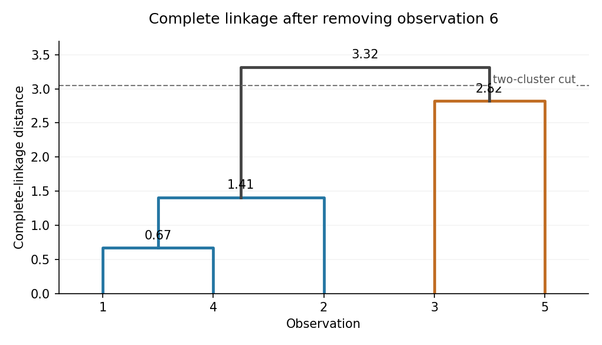

<h1 id="8/b/ii/solution">Solution</h1>

↑ **Parent:** [Ii](../ii.md)

[Complete-linkage clustering](../../../../../../../complete-linkage-clustering.md) defines the dissimilarity between [clusters in cluster analysis](../../../../../../../cluster-in-cluster-analysis.md) $A,B$ as $d_{\rm CL}(A,B)=\max_{i\in A,j\in B}d_{ij}$. Remove point 6 and first merge 1 with 4 at height $0.67$. The distances from $\{1,4\}$ to 2, 3, 5 are respectively

$$
\max(1.41,1.19)=1.41,\quad
\max(2.68,2.19)=2.68,\quad
\max(3.01,3.32)=3.32.
$$

The next merge therefore attaches 2 at $1.41$. Now the distances from $\{1,2,4\}$ to 3 and 5 are $2.95$ and $3.32$, whereas $d_{35}=2.82$. Merge 3 and 5 at $2.82$. The final distance between the two remaining [clusters in cluster analysis](../../../../../../../cluster-in-cluster-analysis.md) is the largest cross-entry, $3.32$. Thus the [dendrogram](../../../../../../../dendrogram.md) has merges

$$
\boxed{(1,4):0.67,\quad(\{1,4\},2):1.41,\quad(3,5):2.82,\quad
(\{1,2,4\},\{3,5\}):3.32.}
$$

**[Figure 1](#8/b/ii/image-complete-linkage-dendrogram-after-removing-observation-6). Complete-linkage dendrogram after removing observation 6**.

Cutting strictly between heights $2.82$ and $3.32$ gives the two [clusters in cluster analysis](../../../../../../../cluster-in-cluster-analysis.md)

$$
\boxed{\{1,2,4\}\quad\text{and}\quad\{3,5\}.}
$$

The figure is an original drawing of these computed merges.

## ↑ Ancestors (13)

1. [Ii](../ii.md)
2. [B](../../b.md)
3. [8](../../../8.md)
4. [Mathematics III resit](../../../../mathematics-iii-resit-split.md)
5. [Prelims](../../../../split.md)
6. [Undated](../../../../../split.md)
7. [Past exam of the mathematics course of the University of Oxford](../../../../../../split.md)
8. [Mathematics course of the University of Oxford](../../../../../../../mathematics-course-of-the-university-of-oxford.md)
9. [Undergraduate course of the University of Oxford](../../../../../../../undergraduate-course-of-the-university-of-oxford.md)
10. [Course of the University of Oxford](../../../../../../../course-of-the-university-of-oxford.md)
11. [University of Oxford](../../../../../../../university-of-oxford-split.md)
12. [List of universities](../../../../../../../list-of-universities.md)
13. [Codex Wiki](../../../../../../../split.md)
