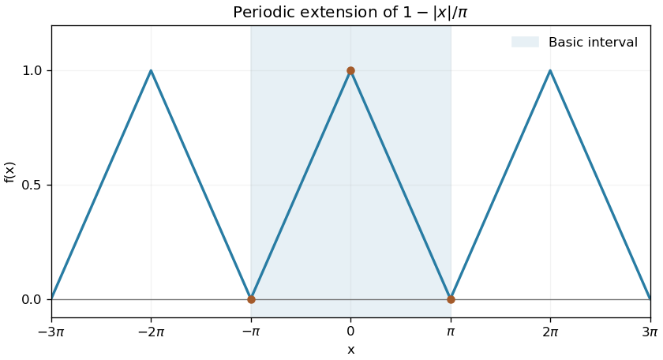

<h1 id="2/solution">Solution</h1>

↑ **Parent:** [2](../2.md)

On the basic interval the graph is the pair of straight segments joining $(-\pi,0)$, $(0,1)$ and $(\pi,0)$. Its [periodic extension](../../../../periodic-extension.md) is an [even](../../../../even-function.md) [triangular wave](../../../../triangular-wave.md).

**[Figure 1](#2/image-the-even-triangular-wave-and-its-periodic-extension). The even triangular wave and its periodic extension**. Original plot marking the basic interval and the repeated linear pieces.

The [Fourier coefficients](../../../../fourier-coefficient.md) satisfy $b_n=0$ by evenness, and

$$
a_0=\frac2\pi\int_0^\pi(1-x/\pi)dx=1,\qquad a_n=\frac2\pi\int_0^\pi(1-x/\pi)\cos(nx)dx=\frac{2[1-(-1)^n]}{\pi^2n^2}.
$$

For the second formula, [integration by parts](../../../../integration-by-parts.md) gives $\int_0^\pi x\cos(nx)dx=[(-1)^n-1]/n^2$. Only odd indices survive, giving this rescaled [Fourier cosine series of a triangular wave](../../../../fourier-cosine-series-of-a-triangular-wave.md):

$$
\boxed{f(x)=\frac12+\frac4{\pi^2}\sum_{m=0}^\infty\frac{\cos[(2m+1)x]}{(2m+1)^2}.}
$$

The [pointwise convergence of a piecewise smooth Fourier series](../../../../pointwise-convergence-of-a-piecewise-smooth-fourier-series.md) applies throughout the interval, including the continuous joined endpoints. The coefficients also imply [uniform convergence](../../../../uniform-convergence.md) by the [Weierstrass M-test](../../../../weierstrass-m-test.md). At $x=0$, the value is one, so

$$
\boxed{\sum_{m=0}^\infty\frac1{(2m+1)^2}=\frac{\pi^2}8.}
$$

## ↑ Ancestors (12)

1. [2](../2.md)
2. [Paper 1](../../paper-1-split.md)
3. [2001](../../split.md)
4. [Past exam of the mathematics course of the year 1 of the natural sciences course of the University of Cambridge](../../../split.md)
5. [Mathematics course of the year 1 of the natural sciences course of the University of Cambridge](../../../../mathematics-course-of-the-year-1-of-the-natural-sciences-course-of-the-university-of-cambridge.md)
6. [Year 1 of the natural sciences course of the University of Cambridge](../../../../year-1-of-the-natural-sciences-course-of-the-university-of-cambridge.md)
7. [Year of the natural sciences course of the University of Cambridge](../../../../year-of-the-natural-sciences-course-of-the-university-of-cambridge.md)
8. [Natural sciences course of the University of Cambridge](../../../../natural-sciences-course-of-the-university-of-cambridge.md)
9. [Course of the University of Cambridge](../../../../course-of-the-university-of-cambridge.md)
10. [University of Cambridge](../../../../university-of-cambridge-split.md)
11. [List of universities](../../../../list-of-universities.md)
12. [Codex Wiki](../../../../split.md)
