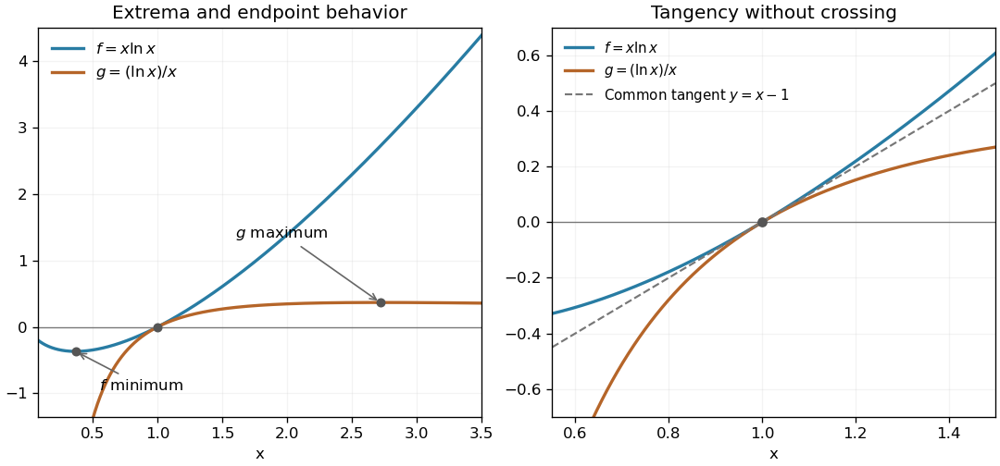

<h1 id="5/a/solution">Solution</h1>

↑ **Parent:** [A](../a.md)

For $f=x\ln x$, the [derivatives](../../../../../derivative.md) are $f'=1+\ln x$ and $f''=1/x>0$. Its unique [stationary point](../../../../../stationary-point.md) is the global [minimum](../../../../../minimum-of-a-subset-of-a-total-order.md) $(e^{-1},-e^{-1})$. For $g=\ln x/x$, $g'=(1-\ln x)/x^2$ changes from positive to negative at $x=e$, giving the global [maximum](../../../../../maximum-of-a-subset-of-a-total-order.md) $(e,e^{-1})$. Their endpoint [limits](../../../../../limit-of-a-function.md) are

$$
\boxed{\begin{array}{c|cc}&x\to0^+&x\to\infty\\\hline f(x)&0\text{ from below}&+\infty\\g(x)&-\infty&0\text{ from above}\end{array}}
$$

An intersection requires $(x^2-1)\ln x=0$, and on $x>0$ both factors vanish only at $x=1$. There $f=g=0$ and $f'=g'=1$, proving a common [tangent line](../../../../../tangent-line.md) $y=x-1$. In fact,

$$
f-g=\frac{(x^2-1)\ln x}{x}>0\quad(x>0,\ x\ne1),
$$

because the two numerator factors always have the same sign. Thus the curves touch at $(1,0)$ without exchanging their order.

**[Figure 2](#5/a/image-two-logarithmic-curves-touching-at-their-unique-intersection). Two logarithmic curves touching at their unique intersection**. Original common-axis plot marking the extrema and the shared tangent at $(1,0)$. The curve $x\ln x$ lies above $\ln x/x$ everywhere else on the positive axis.

## ↑ Ancestors (13)

1. [A](../a.md)
2. [5](../../5.md)
3. [Paper 1](../../../paper-1-split.md)
4. [2001](../../../split.md)
5. [Past exam of the mathematics course of the year 1 of the natural sciences course of the University of Cambridge](../../../../split.md)
6. [Mathematics course of the year 1 of the natural sciences course of the University of Cambridge](../../../../../mathematics-course-of-the-year-1-of-the-natural-sciences-course-of-the-university-of-cambridge.md)
7. [Year 1 of the natural sciences course of the University of Cambridge](../../../../../year-1-of-the-natural-sciences-course-of-the-university-of-cambridge.md)
8. [Year of the natural sciences course of the University of Cambridge](../../../../../year-of-the-natural-sciences-course-of-the-university-of-cambridge.md)
9. [Natural sciences course of the University of Cambridge](../../../../../natural-sciences-course-of-the-university-of-cambridge.md)
10. [Course of the University of Cambridge](../../../../../course-of-the-university-of-cambridge.md)
11. [University of Cambridge](../../../../../university-of-cambridge-split.md)
12. [List of universities](../../../../../list-of-universities.md)
13. [Codex Wiki](../../../../../split.md)
