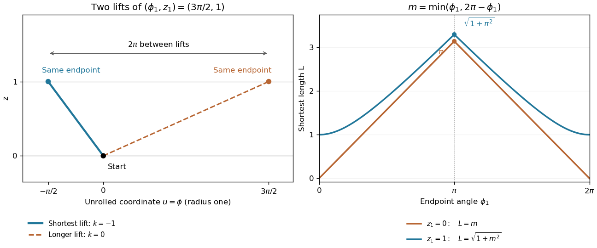

<h1 id="3/c/solution">Solution</h1>

↑ **Parent:** [C](../c.md)

For $R=1$ and $z_1=0$, the [shortest path on a circular cylinder](../../../../../shortest-path-on-a-circular-cylinder.md) has [length](../../../../../length.md)

$$
\boxed{L_0(\phi_1)=\begin{cases}\phi_1,&0\leq\phi_1\leq\pi,\\2\pi-\phi_1,&\pi\leq\phi_1\leq2\pi.\end{cases}}
$$

Its graph is triangular, with endpoint values zero and maximum $\pi$ at $\phi_1=\pi$. In particular, increasing the angle to a full turn brings the endpoint back to the starting point.

For $R=1$ and $z_1=1$, the corresponding [length](../../../../../length.md) is

$$
\boxed{L_1(\phi_1)=\sqrt{1+\min(\phi_1,2\pi-\phi_1)^2}.}
$$

This graph has endpoint values one, a maximum $\sqrt{1+\pi^2}$ at $\pi$, and symmetry about $\pi$. Each half is smooth, with horizontal slope at the outer endpoint; at $\pi$ the two halves meet at a corner, because the minimizing winding direction changes.

**[Figure 1](#3/c/image-unrolling-a-cylinder-and-choosing-the-shorter-angular-route). Unrolling a cylinder and choosing the shorter angular route**. Original diagram. Left: two lifts of an endpoint at angular position $3\pi/2$ and height one; the negative angular increment $-\pi/2$ gives the shorter segment. Right: both requested shortest-length graphs for unit radius, with height differences zero and one.

## ↑ Ancestors (13)

1. [C](../c.md)
2. [3](../../3.md)
3. [Paper 2](../../../paper-2-split.md)
4. [2001](../../../split.md)
5. [Past exam of the mathematics course of the year 1 of the natural sciences course of the University of Cambridge](../../../../split.md)
6. [Mathematics course of the year 1 of the natural sciences course of the University of Cambridge](../../../../../mathematics-course-of-the-year-1-of-the-natural-sciences-course-of-the-university-of-cambridge.md)
7. [Year 1 of the natural sciences course of the University of Cambridge](../../../../../year-1-of-the-natural-sciences-course-of-the-university-of-cambridge.md)
8. [Year of the natural sciences course of the University of Cambridge](../../../../../year-of-the-natural-sciences-course-of-the-university-of-cambridge.md)
9. [Natural sciences course of the University of Cambridge](../../../../../natural-sciences-course-of-the-university-of-cambridge.md)
10. [Course of the University of Cambridge](../../../../../course-of-the-university-of-cambridge.md)
11. [University of Cambridge](../../../../../university-of-cambridge-split.md)
12. [List of universities](../../../../../list-of-universities.md)
13. [Codex Wiki](../../../../../split.md)
