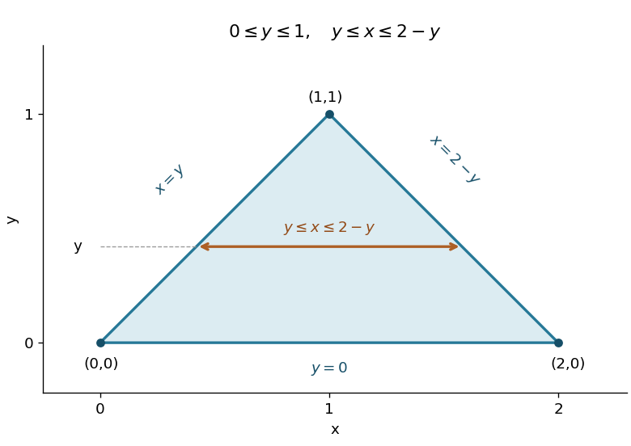

<h1 id="8/a/solution">Solution</h1>

↑ **Parent:** [A](../a.md)

The [region of integration](../../../../../domain-of-integration.md) is $0\leq y\leq1$, $y\leq x\leq2-y$. It is the closed [triangle](../../../../../triangle.md) with vertices $(0,0)$, $(2,0)$, and $(1,1)$, bounded by $y=0$, $x=y$, and $x=2-y$. Each horizontal slice runs from the rising left edge to the falling right edge.

**[Figure 2](#8/a/image-triangular-integration-region-and-a-horizontal-integration-slice). Triangular integration region and a horizontal integration slice**. Original diagram of the region $0\leq y\leq1$, $y\leq x\leq2-y$, with its three vertices, boundary equations, and an example slice at fixed $y$.

Integrate with respect to $x$ first:

$$
\begin{aligned}
I&=\int_0^1\left[\frac23x^3+yx\right]_{x=y}^{x=2-y}\,dy\\
&=\int_0^1\left[\frac{16}3-6y+2y^2-\frac43y^3\right]dy\\
&=\frac{16}3-3+\frac23-\frac13=\boxed{\frac83}.
\end{aligned}
$$

The [triangle](../../../../../triangle.md) has area one, but the nonconstant integrand makes the [double integral](../../../../../double-integral.md) a weighted area.

## ↑ Ancestors (13)

1. [A](../a.md)
2. [8](../../8.md)
3. [Paper 2](../../../paper-2-split.md)
4. [2001](../../../split.md)
5. [Past exam of the mathematics course of the year 1 of the natural sciences course of the University of Cambridge](../../../../split.md)
6. [Mathematics course of the year 1 of the natural sciences course of the University of Cambridge](../../../../../mathematics-course-of-the-year-1-of-the-natural-sciences-course-of-the-university-of-cambridge.md)
7. [Year 1 of the natural sciences course of the University of Cambridge](../../../../../year-1-of-the-natural-sciences-course-of-the-university-of-cambridge.md)
8. [Year of the natural sciences course of the University of Cambridge](../../../../../year-of-the-natural-sciences-course-of-the-university-of-cambridge.md)
9. [Natural sciences course of the University of Cambridge](../../../../../natural-sciences-course-of-the-university-of-cambridge.md)
10. [Course of the University of Cambridge](../../../../../course-of-the-university-of-cambridge.md)
11. [University of Cambridge](../../../../../university-of-cambridge-split.md)
12. [List of universities](../../../../../list-of-universities.md)
13. [Codex Wiki](../../../../../split.md)
