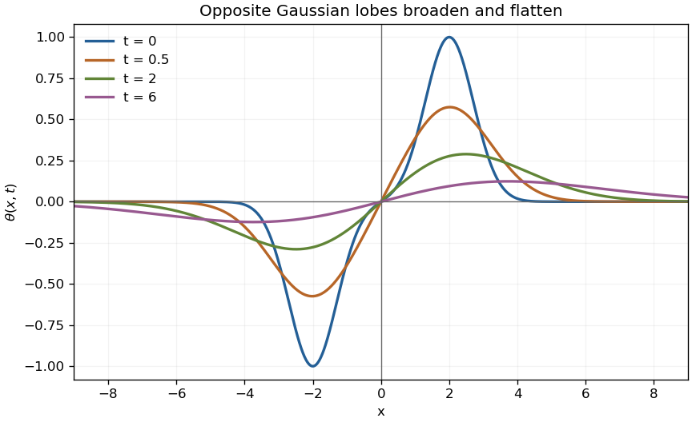

# Paper 1

↑ **Parent:** [2002](../2002.md)

[https://www.maths.cam.ac.uk/undergradnst/files/2002/PaperNST_IA_1.pdf](https://www.maths.cam.ac.uk/undergradnst/files/2002/PaperNST_IA_1.pdf)

**Table of contents**

- [1](#1)
  - [a](#1/a)
    - [Solution](#1/a/solution)
  - [b](#1/b)
    - [i](#1/b/i)
      - [Solution](#1/b/i/solution)
    - [ii](#1/b/ii)
      - [Solution](#1/b/ii/solution)
    - [iii](#1/b/iii)
      - [Solution](#1/b/iii/solution)
- [2](#2)
  - [Solution](#2/solution)
- [3](#3)
  - [a](#3/a)
    - [Solution](#3/a/solution)
  - [b](#3/b)
    - [i](#3/b/i)
      - [Solution](#3/b/i/solution)
    - [ii](#3/b/ii)
      - [Solution](#3/b/ii/solution)
- [4](#4)
  - [Solution](#4/solution)
- [5](#5)
  - [a](#5/a)
    - [Solution](#5/a/solution)
  - [b](#5/b)
    - [Solution](#5/b/solution)
- [6](#6)
  - [a](#6/a)
    - [Solution](#6/a/solution)
  - [b](#6/b)
    - [Solution](#6/b/solution)
- [7](#7)
  - [a](#7/a)
    - [i](#7/a/i)
      - [Solution](#7/a/i/solution)
    - [ii](#7/a/ii)
      - [Solution](#7/a/ii/solution)
  - [b](#7/b)
    - [Solution](#7/b/solution)
- [8](#8)
  - [a](#8/a)
    - [Solution](#8/a/solution)
  - [b](#8/b)
    - [Solution](#8/b/solution)
  - [c](#8/c)
    - [Solution](#8/c/solution)
- [9](#9)
  - [Solution](#9/solution)
  - [i](#9/i)
    - [Solution](#9/i/solution)
  - [ii](#9/ii)
    - [Solution](#9/ii/solution)
- [10](#10)
  - [Solution](#10/solution)
- [11](#11)
  - [a](#11/a)
    - [Solution](#11/a/solution)
  - [b](#11/b)
    - [Solution](#11/b/solution)
  - [c](#11/c)
    - [Solution](#11/c/solution)
- [12](#12)
  - [Solution](#12/solution)
  - [i](#12/i)
    - [Solution](#12/i/solution)
  - [ii](#12/ii)
    - [Solution](#12/ii/solution)
  - [iii](#12/iii)
    - [Solution](#12/iii/solution)

## 1

↑ **Parent:** [Paper 1](paper-1.md)

<h3 id="1/a">a</h3>

↑ **Parent:** [1](#1)

<h4 id="1/a/solution">Solution</h4>

↑ **Parent:** [A](#1/a)

Write $\mathbf r=\mu\mathbf n+\mathbf v$. Since $\mathbf n$ is a [unit vector](../../vector-space.md#unit-vector), the equation becomes $\mathbf v\cdot\mathbf n=0$. Thus $\mathbf v$ ranges over the two-dimensional [orthogonal complement](../../hilbert-space.md#orthogonal-complement) of $\mathbf n$: the locus is an [affine hyperplane](../../vector-space.md#affine-hyperplane) through $\mu\mathbf n$, with [unit normal](../../differential-geometry.md#unit-normal) $\mathbf n$. Conversely, every such vector satisfies the equation. Its perpendicular distance from the origin is $\boxed{|\mu|}$; $\mu$ is the signed distance in the chosen normal direction.

<h3 id="1/b">b</h3>

↑ **Parent:** [1](#1)

<h4 id="1/b/i">i</h4>

↑ **Parent:** [B](#1/b)

<h5 id="1/b/i/solution">Solution</h5>

↑ **Parent:** [I](#1/b/i)

The [normal vector](../../differential-geometry.md#normal-vector) must be parallel to $\mathbf b$, and the plane must contain $\mathbf a$. Therefore one choice is

$$
\boxed{\mathbf n=\frac{\mathbf b}{|\mathbf b|},\qquad \mu=\frac{\mathbf a\cdot\mathbf b}{|\mathbf b|}.}
$$

The nonzero [scalar triple product](../../multilinear-algebra.md#scalar-triple-product) ensures $\mathbf b\ne0$. Replacing both $\mathbf n$ and $\mu$ by their negatives describes the same [affine hyperplane](../../vector-space.md#affine-hyperplane).

<h4 id="1/b/ii">ii</h4>

↑ **Parent:** [B](#1/b)

<h5 id="1/b/ii/solution">Solution</h5>

↑ **Parent:** [Ii](#1/b/ii)

Two directions in the plane are $\mathbf b-\mathbf a$ and $\mathbf c-\mathbf a$. Their [cross product](../../vector-space.md#cross-product) $\mathbf N=(\mathbf b-\mathbf a)\times(\mathbf c-\mathbf a)$ is a [normal vector](../../differential-geometry.md#normal-vector). Moreover,

$$
\mathbf a\cdot\mathbf N=\mathbf a\cdot(\mathbf b\times\mathbf c)=D\ne0,
$$

so $\mathbf N$ cannot vanish. The required [unit normal](../../differential-geometry.md#unit-normal) and offset are

$$
\boxed{\mathbf n=\frac{(\mathbf b-\mathbf a)\times(\mathbf c-\mathbf a)}{|(\mathbf b-\mathbf a)\times(\mathbf c-\mathbf a)|},\qquad \mu=\frac D{|(\mathbf b-\mathbf a)\times(\mathbf c-\mathbf a)|}.}
$$

Taking [dot products](../../inner-product.md#dot-product) with $\mathbf a,\mathbf b,\mathbf c$ gives the same offset for all three points.

<h4 id="1/b/iii">iii</h4>

↑ **Parent:** [B](#1/b)

<h5 id="1/b/iii/solution">Solution</h5>

↑ **Parent:** [Iii](#1/b/iii)

This plane contains the direction $\mathbf b-\mathbf a$ and is parallel to $\mathbf c$. Put $\mathbf N=(\mathbf b-\mathbf a)\times\mathbf c$. Its [scalar triple product](../../multilinear-algebra.md#scalar-triple-product) with $\mathbf a$ is again $D\ne0$, proving $\mathbf N\ne0$. Hence

$$
\boxed{\mathbf n=\frac{(\mathbf b-\mathbf a)\times\mathbf c}{|(\mathbf b-\mathbf a)\times\mathbf c|},\qquad \mu=\frac D{|(\mathbf b-\mathbf a)\times\mathbf c|}.}
$$

The [dot product](../../inner-product.md#dot-product) with $\mathbf c$ vanishes, while the [dot products](../../inner-product.md#dot-product) with $\mathbf a$ and $\mathbf b$ equal $\mu$ after normalization. These verify both incidence and parallelism.

## 2

↑ **Parent:** [Paper 1](paper-1.md)

<h3 id="2/solution">Solution</h3>

↑ **Parent:** [2](#2)

The periodically extended $x^2$ is [even](../../calculus.md#even-function), so every sine coefficient is zero. With the convention $f=a_0/2+\sum_{n\geq1}(a_n\cos nx+b_n\sin nx)$, the [Fourier coefficients](../../fourier-series.md#fourier-coefficient) are

$$
a_0=\frac2\pi\int_0^\pi x^2dx=\frac{2\pi^2}3,\qquad a_n=\frac2\pi\int_0^\pi x^2\cos nx\,dx=\frac{4(-1)^n}{n^2}.
$$

For the second integral, two applications of [integration by parts](../../calculus.md#integration-by-parts) give $\int_0^\pi x^2\cos nx\,dx=2\pi(-1)^n/n^2$. Consequently

$$
\boxed{x^2=\frac{\pi^2}3+4\sum_{n=1}^\infty\frac{(-1)^n\cos nx}{n^2},\qquad -\pi\leq x\leq\pi.}
$$

The periodic extension is continuous even at the joined endpoints, where both one-sided values equal $\pi^2$. The [pointwise convergence of a piecewise smooth Fourier series](../../fourier-series.md#pointwise-convergence-of-a-piecewise-smooth-fourier-series) therefore gives the displayed values throughout the interval; the coefficient bound also gives [uniform convergence](../../sequence-and-series.md#uniform-convergence) by the [Weierstrass M-test](../../probability-and-statistics.md#weierstrass-m-test). Setting $x=\pi$ and then $x=0$ yields

$$
\boxed{\sum_{n=1}^\infty\frac1{n^2}=\frac{\pi^2}6,\qquad \sum_{n=1}^\infty\frac{(-1)^{n+1}}{n^2}=\frac{\pi^2}{12}.}
$$

## 3

↑ **Parent:** [Paper 1](paper-1.md)

<h3 id="3/a">a</h3>

↑ **Parent:** [3](#3)

<h4 id="3/a/solution">Solution</h4>

↑ **Parent:** [A](#3/a)

At an interior [local extremum](../../mathematical-optimization.md#local-extremum) of a [differentiable function](../../analysis.md#differentiable-function), $f'(x)=0$. The [second-derivative test](../../multivariable-calculus.md#second-derivative-test) classifies a [stationary point](../../calculus-of-variations.md#stationary-point): a positive [second derivative](../../calculus.md#second-derivative) gives a strict [local minimum](../../analysis.md#local-minimum), and a negative [second derivative](../../calculus.md#second-derivative) gives a strict [local maximum](../../analysis.md#local-maximum). A zero [second derivative](../../calculus.md#second-derivative) is inconclusive: $x^4$, $-x^4$, and $x^3$ at zero illustrate a minimum, a maximum, and neither.

Here

$$
f'(x)=3x^2-10x+3=(3x-1)(x-3),\qquad f''(x)=6x-10.
$$

Thus $f''(1/3)=-8$ and $f''(3)=8$. Substitution into $f$ gives

$$
\boxed{(1/3,-14/27)\text{ is a local maximum},\qquad (3,-10)\text{ is a local minimum}.}
$$

<h3 id="3/b">b</h3>

↑ **Parent:** [3](#3)

<h4 id="3/b/i">i</h4>

↑ **Parent:** [B](#3/b)

<h5 id="3/b/i/solution">Solution</h5>

↑ **Parent:** [I](#3/b/i)

Use [implicit differentiation](../../multivariable-calculus.md#implicit-differentiation) on $F(x,y)=xy^3-yx^3-6=0$. Along the curve,

$$
y'=-\frac{F_x}{F_y}=-\frac{y^3-3yx^2}{3xy^2-x^3}.
$$

At $(1,2)$, $F_x=2$ and $F_y=11\ne0$, so the slope is $-2/11$. The [tangent line](../../calculus.md#tangent-line) is

$$
\boxed{y-2=-\frac2{11}(x-1),\quad\text{equivalently }2x+11y=24.}
$$

<h4 id="3/b/ii">ii</h4>

↑ **Parent:** [B](#3/b)

<h5 id="3/b/ii/solution">Solution</h5>

↑ **Parent:** [Ii](#3/b/ii)

For $F(x,y)=e^{xy}+y\ln x-x^2$, the real domain has $x>0$. Its [partial derivatives](../../multivariable-calculus.md#partial-derivative) are $F_x=ye^{xy}+y/x-2x$ and $F_y=xe^{xy}+\ln x$. At $(1,0)$ they equal $-2$ and $1$, respectively. Thus [implicit differentiation](../../multivariable-calculus.md#implicit-differentiation) gives $y'=2$, and the [tangent line](../../calculus.md#tangent-line) is

$$
\boxed{y=2(x-1).}
$$

## 4

↑ **Parent:** [Paper 1](paper-1.md)

<h3 id="4/solution">Solution</h3>

↑ **Parent:** [4](#4)

For two independent smooth constraints $g=h=0$, the tangent direction is orthogonal to both [gradients](../../multivariable-calculus.md#gradient). At a constrained [stationary point](../../calculus-of-variations.md#stationary-point), the [gradient](../../multivariable-calculus.md#gradient) of the objective is also orthogonal to that direction, hence lies in their span: $\nabla f=\lambda\nabla g+\mu\nabla h$. This is the two-constraint [Lagrange multiplier](../../mathematical-optimization.md#lagrange-multiplier) condition. Alternatively, [distance extrema on a central plane section of an ellipsoid](../../euclidean-geometry.md#distance-extrema-on-a-central-plane-section-of-an-ellipsoid) follow from a two-dimensional [eigenvalue](../../linear-operator-theory.md#eigenvalue) problem.

Minimizing distance is equivalent to minimizing $f=x^2+y^2+z^2$. Put $g=x-y+z$ and $h=x^2+(y^2+z^2)/4-1$. The [Lagrange multiplier](../../mathematical-optimization.md#lagrange-multiplier) equations are

$$
2(1-\mu)x=\lambda,\qquad (2-\mu/2)y=-\lambda,\qquad (2-\mu/2)z=\lambda.
$$

Adding the latter two gives $(2-\mu/2)(y+z)=0$. If $\mu=4$, those equations give $\lambda=x=0$; the constraints then give $y=z=\pm\sqrt2$ and $f=4$. Otherwise $z=-y$ and $x=2y$. The ellipsoidal constraint gives $y=\pm\sqrt2/3$, and hence

$$
(x,y,z)=\pm\frac{\sqrt2}3(2,1,-1),\qquad f=\frac43.
$$

The intersection is [compact](../../topology.md#compact-space). The two constraint [gradients](../../multivariable-calculus.md#gradient) are independent there: if $\nabla h=t\nabla g$, then $(x,y,z)=(t/2,-2t,2t)$, and $g=0$ forces $t=0$, contradicting $h=0$. Thus every global extremum is among these candidates. Taking square roots gives

$$
\boxed{d_{\min}=\frac2{\sqrt3},\qquad d_{\max}=2.}
$$

## 5

↑ **Parent:** [Paper 1](paper-1.md)

<h3 id="5/a">a</h3>

↑ **Parent:** [5](#5)

<h4 id="5/a/solution">Solution</h4>

↑ **Parent:** [A](#5/a)

Let $I=\int_0^\infty e^{-x^2}dx$. Positivity allows the squared integral to be written as a first-quadrant [double integral](../../integral.md#double-integral). In [polar coordinates](../../multivariable-calculus.md#polar-coordinates) the [Jacobian determinant](../../multivariable-calculus.md#jacobian-determinant) is $r$, so

$$
I^2=\int_0^{\pi/2}\int_0^\infty e^{-r^2}r\,dr\,d\theta=\frac\pi4,\qquad \boxed{I=\frac{\sqrt\pi}2.}
$$

Using [integration by parts](../../calculus.md#integration-by-parts), with the boundary term $xe^{-x^2}$ vanishing at both endpoints,

$$
\boxed{\int_0^\infty x^2e^{-x^2}dx=\frac12\int_0^\infty e^{-x^2}dx=\frac{\sqrt\pi}4.}
$$

The substitution $u=x^2$ also gives the two [antiderivatives](../../integral.md#antiderivative)

$$
\boxed{\int xe^{-x^2}dx=-\frac12e^{-x^2}+C,\qquad \int x^3e^{-x^2}dx=-\frac12(x^2+1)e^{-x^2}+C.}
$$

These values also follow from the [Gaussian moment recurrence](../../integral.md#gaussian-moment-recurrence) and can be checked by [differentiation](../../calculus.md#differentiation).

<h3 id="5/b">b</h3>

↑ **Parent:** [5](#5)

<h4 id="5/b/solution">Solution</h4>

↑ **Parent:** [B](#5/b)

The upper boundary follows $y=x$ until its intersection with $y=1/x$ at $(1,1)$, then follows the [hyperbola](../../euclidean-geometry.md#hyperbola) to $(2,1/2)$. The lower boundary is $y=0$. Therefore the two vertical-slice descriptions are $0\leq x\leq1$, $0\leq y\leq x$, and $1\leq x\leq2$, $0\leq y\leq1/x$.

**[Figure 1](#5/b/image-the-integration-region-below-a-line-and-a-hyperbola). The integration region below a line and a hyperbola**. Original shaded region with all four boundary pieces shown. Vertical slices change their upper endpoint at $(1,1)$.

Integrating with respect to $y$ first reduces the [double integral](../../integral.md#double-integral) to

$$
I=\int_0^1x^3e^{-x^2}dx+\int_1^2xe^{-x^2}dx=\left[-\frac12(x^2+1)e^{-x^2}\right]_0^1+\left[-\frac12e^{-x^2}\right]_1^2.
$$

Using the [antiderivatives](../../integral.md#antiderivative) from part (a),

$$
\boxed{I=\frac{1-e^{-1}-e^{-4}}2.}
$$

## 6

↑ **Parent:** [Paper 1](paper-1.md)

<h3 id="6/a">a</h3>

↑ **Parent:** [6](#6)

<h4 id="6/a/solution">Solution</h4>

↑ **Parent:** [A](#6/a)

Direct [matrix multiplication](../../vector-space.md#matrix-multiplication) gives

$$
A^2=\begin{pmatrix}13&12\\12&13\end{pmatrix},\qquad \operatorname{tr}A=6,\qquad\det A=5.
$$

Consequently $\boxed{A^2-6A+5I=0}$, the [Cayley-Hamilton theorem](../../cayley-hamilton-theorem.md) for its [characteristic polynomial](../../linear-operator-theory.md#characteristic-polynomial) $t^2-6t+5$. Rearranging gives $A(6I-A)=5I$, so

$$
\boxed{A^{-1}=\frac{6I-A}5=\frac15\begin{pmatrix}3&-2\\-2&3\end{pmatrix}.}
$$

<h3 id="6/b">b</h3>

↑ **Parent:** [6](#6)

<h4 id="6/b/solution">Solution</h4>

↑ **Parent:** [B](#6/b)

For $\mathbf u=(1,1)^T$ and $\mathbf v=(1,-1)^T$, the [outer products](../../vector-space.md#outer-product) are

$$
\mathbf u\mathbf u^T=\begin{pmatrix}1&1\\1&1\end{pmatrix},\qquad \mathbf v\mathbf v^T=\begin{pmatrix}1&-1\\-1&1\end{pmatrix}.
$$

Their [inner product](../../inner-product.md) is zero and both squared [norms](../../normed-vector-space.md#norm) are two. Thus $P_u=\mathbf u\mathbf u^T/2$ and $P_v=\mathbf v\mathbf v^T/2$ are orthogonal [spectral projectors](../../hilbert-space.md#spectral-projector), with $P_u+P_v=I$. Since $A\mathbf u=5\mathbf u$ and $A\mathbf v=\mathbf v$, the [eigenvalues](../../linear-operator-theory.md#eigenvalue) are $\lambda=5$, $\mu=1$, and

$$
\boxed{A=\frac52\mathbf u\mathbf u^T+\frac12\mathbf v\mathbf v^T,\qquad A^{-1}=\frac1{10}\mathbf u\mathbf u^T+\frac12\mathbf v\mathbf v^T.}
$$

Multiplying these decompositions uses $P_uP_v=0$ and $P_u^2=P_u$, $P_v^2=P_v$, giving the [identity matrix](../../vector-space.md#identity-matrix).

## 7

↑ **Parent:** [Paper 1](paper-1.md)

<h3 id="7/a">a</h3>

↑ **Parent:** [7](#7)

<h4 id="7/a/i">i</h4>

↑ **Parent:** [A](#7/a)

<h5 id="7/a/i/solution">Solution</h5>

↑ **Parent:** [I](#7/a/i)

On an interval avoiding $x=\pm1$, [separation of variables](../../partial-differential-equation.md#separation-of-variables) gives, for $y\ne-1$,

$$
\ln|y+1|=\int\frac{dx}{x^2-1}=\frac12\ln\left|\frac{x-1}{x+1}\right|+C_0.
$$

Absorb the sign into the integration constant and include the [equilibrium solution](../../differential-equation.md#equilibrium-solution-of-an-ordinary-differential-equation) $y=-1$ by allowing $C=0$. The complete real family is

$$
\boxed{y=-1+C\sqrt{\left|\frac{x-1}{x+1}\right|},\qquad C\in\mathbb R.}
$$

Each solution is considered on a connected interval in $\mathbb R\setminus\{-1,1\}$, where the original equation is defined.

<h4 id="7/a/ii">ii</h4>

↑ **Parent:** [A](#7/a)

<h5 id="7/a/ii/solution">Solution</h5>

↑ **Parent:** [Ii](#7/a/ii)

Divide by $\cos x$ on an interval where it is nonzero. For the resulting [first-order linear differential equation](../../linear-ordinary-differential-equation.md#first-order-linear-differential-equation), use the [integrating factor](../../linear-ordinary-differential-equation.md#integrating-factor) $M=\sec x+\tan x$, since $M'=\sec x\,M$. The right-hand side after division is also $M'$, so

$$
(My)'=MM',\qquad My=\frac12M^2+C.
$$

The identity $(\sec x+\tan x)(\sec x-\tan x)=1$ shows $M$ never vanishes on the interval, giving

$$
\boxed{y=\frac12(\sec x+\tan x)+C(\sec x-\tan x).}
$$

An [integrating factor](../../linear-ordinary-differential-equation.md#integrating-factor) may have either fixed sign; if obtained by integrating $\sec x$, the real [logarithm](../../calculus.md#logarithm) is $\ln|\sec x+\tan x|$.

<h3 id="7/b">b</h3>

↑ **Parent:** [7](#7)

<h4 id="7/b/solution">Solution</h4>

↑ **Parent:** [B](#7/b)

The [Bernoulli differential equation](../../differential-equation.md#bernoulli-differential-equation) becomes linear after $z=1/y$: multiplying by $-y^{-2}$ gives $z'-2z=-x^2$. A quadratic [particular solution](../../linear-ordinary-differential-equation.md#particular-solution) is $z_p=x^2/2+x/2+1/4$, while the [homogeneous solution](../../linear-ordinary-differential-equation.md#homogeneous-solution) is $Ce^{2x}$. The [initial condition](../../differential-equation.md#initial-condition) gives $z(0)=1$ and $C=3/4$. Hence

$$
\boxed{y(x)=\frac4{3e^{2x}+2x^2+2x+1}.}
$$

The denominator is positive for all real $x$, since $2x^2+2x+1=2(x+1/2)^2+1/2$. Thus this [initial value problem](../../differential-equation.md#initial-value-problem) has the displayed solution on the entire real line. The separate solution $y=0$ does not satisfy its [initial condition](../../differential-equation.md#initial-condition).

## 8

↑ **Parent:** [Paper 1](paper-1.md)

<h3 id="8/a">a</h3>

↑ **Parent:** [8](#8)

<h4 id="8/a/solution">Solution</h4>

↑ **Parent:** [A](#8/a)

Let $N=\mathbf a\mathbf b^T$. The orthogonality condition gives $N^2=\mathbf a(\mathbf b^T\mathbf a)\mathbf b^T=0$: this is the nilpotent part of a [transvection](../../vector-space.md#transvection) when both vectors are nonzero. In two dimensions,

$$
\operatorname{tr}L=2+a_1b_1+a_2b_2=\boxed2.
$$

Expanding its [determinant](../../multilinear-algebra.md#determinant), the fourth-degree terms cancel:

$$
\det L=(1+a_1b_1)(1+a_2b_2)-a_1b_2a_2b_1=1+\mathbf a\cdot\mathbf b=\boxed1.
$$

These formulas also cover either vector being zero.

<h3 id="8/b">b</h3>

↑ **Parent:** [8](#8)

<h4 id="8/b/solution">Solution</h4>

↑ **Parent:** [B](#8/b)

Since $M^T=I-\mathbf a\mathbf b^T=I-N$, nilpotence already gives $(I+N)(I-N)=I$. Explicitly, in [index notation](../../multilinear-algebra.md#index-notation),

$$
(LM^T)_{ij}=\sum_k(\delta_{ik}+a_ib_k)(\delta_{jk}-b_ja_k)=\delta_{ij}-b_ja_i+a_ib_j-a_ib_j\sum_ka_kb_k=\delta_{ij}.
$$

Thus $\boxed{LM^T=I}$, or equivalently $M^T=L^{-1}$. Here $\delta_{ij}$ is the [Kronecker delta](../../multilinear-algebra.md#kronecker-delta).

<h3 id="8/c">c</h3>

↑ **Parent:** [8](#8)

<h4 id="8/c/solution">Solution</h4>

↑ **Parent:** [C](#8/c)

For the specified coordinate vectors,

$$
L=\begin{pmatrix}1&1\\0&1\end{pmatrix},\qquad M=\begin{pmatrix}1&0\\-1&1\end{pmatrix}.
$$

Choose the [orthogonal matrix](../../linear-algebra.md#orthogonal-matrix) representing a quarter-turn,

$$
\boxed{S=\begin{pmatrix}0&-1\\1&0\end{pmatrix}.}
$$

Then $S^TS=I$ and direct [matrix multiplication](../../vector-space.md#matrix-multiplication) gives $S^TLS=\begin{pmatrix}1&0\\-1&1\end{pmatrix}=M$. Thus these two [shear mappings](../../vector-space.md#shear-mapping) are orthogonally similar.

## 9

↑ **Parent:** [Paper 1](paper-1.md)

<h3 id="9/solution">Solution</h3>

↑ **Parent:** [9](#9)

In Cartesian components, $\mathbf F=(z-y,x,-x)$, so

$$
\boxed{\nabla\times\mathbf F=(0,2,2)\ne0.}
$$

It cannot be a [conservative vector field](../../multivariable-calculus.md#conservative-vector-field). For the second field, put $\Phi(\mathbf r)=-(1+|\mathbf r|^2)^{-1/2}$. Its [gradient](../../multivariable-calculus.md#gradient) is $\nabla\Phi=\mathbf r/(1+|\mathbf r|^2)^{3/2}=\mathbf G$. This smooth global scalar function proves $\mathbf G$ is [conservative](../../multivariable-calculus.md#conservative-vector-field), with $\boxed{\nabla\times\mathbf G=0}$. The following path integrals exhibit the different behavior directly.

<h3 id="9/i">i</h3>

↑ **Parent:** [9](#9)

<h4 id="9/i/solution">Solution</h4>

↑ **Parent:** [I](#9/i)

Parametrize the segment by $\mathbf r(t)=(1-t,t,0)$, $0\leq t\leq1$. Its tangent is $(-1,1,0)$ and $\mathbf F=(-t,1-t,t-1)$, so $\mathbf F\cdot\mathbf r'=1$. Hence its [line integral](../../multivariable-calculus.md#line-integral) is

$$
\boxed{\int\mathbf F\cdot d\mathbf r=1.}
$$

For the other [line integral](../../multivariable-calculus.md#line-integral), $|\mathbf r|^2=(1-t)^2+t^2$ and $\mathbf r\cdot\mathbf r'=2t-1$. Thus

$$
\int\mathbf G\cdot d\mathbf r=\int_0^1\frac{2t-1}{[1+(1-t)^2+t^2]^{3/2}}dt=\left[-\frac1{\sqrt{1+(1-t)^2+t^2}}\right]_0^1=\boxed0.
$$

This also equals the change in $\Phi$, by the [fundamental theorem for line integrals](../../multivariable-calculus.md#fundamental-theorem-for-line-integrals).

<h3 id="9/ii">ii</h3>

↑ **Parent:** [9](#9)

<h4 id="9/ii/solution">Solution</h4>

↑ **Parent:** [Ii](#9/ii)

On each of the two radial legs, $\mathbf F=\mathbf a\times\mathbf r$ is perpendicular to the tangent. Each contribution is zero, giving $\boxed{\int\mathbf F\cdot d\mathbf r=0}$. This differs from the straight-path answer, confirming path dependence.

For $\mathbf G$, use $\mathbf r=(s,0,0)$ with $s$ decreasing from one to zero, followed by $\mathbf r=(0,s,0)$ with $s$ increasing from zero to one. The two contributions are

$$
\int_1^0\frac{s\,ds}{(1+s^2)^{3/2}}=-1+\frac1{\sqrt2},\qquad \int_0^1\frac{s\,ds}{(1+s^2)^{3/2}}=1-\frac1{\sqrt2}.
$$

They cancel: $\boxed{\int\mathbf G\cdot d\mathbf r=0}$. This agreement is a consequence of the [conservative vector field](../../multivariable-calculus.md#conservative-vector-field) property already proved, rather than evidence sufficient by itself to establish it.

## 10

↑ **Parent:** [Paper 1](paper-1.md)

<h3 id="10/solution">Solution</h3>

↑ **Parent:** [10](#10)

Put $\tau=t+b$ and $q=x+a$. For $\theta=f(t)e^{-q^2/(4\tau)}$, [partial differentiation](../../multivariable-calculus.md#partial-derivative) gives

$$
\theta_t=\left(f'+\frac{q^2f}{4\tau^2}\right)e^{-q^2/(4\tau)},\qquad \theta_{xx}=\left(-\frac f{2\tau}+\frac{q^2f}{4\tau^2}\right)e^{-q^2/(4\tau)}.
$$

The [heat equation](../../diffusion-equation.md#heat-equation) therefore requires $f'=-f/(2\tau)$, giving $f=C/\sqrt{|t+b|}$ on an interval not containing $-b$. A decaying spatial [Gaussian function](../../calculus.md#gaussian-function) uses $t+b>0$, so $f=C/\sqrt{t+b}$ there.

The initial profile is a difference of two translated [Gaussian functions](../../calculus.md#gaussian-function). Set $b=1/4$, $a=-2$ and $a=2$, with respective constants $C=1/2$ and $C=-1/2$. The [superposition principle](../../vector-space.md#superposition-principle) gives

$$
\boxed{\theta(x,t)=\frac{e^{-(x-2)^2/(1+4t)}-e^{-(x+2)^2/(1+4t)}}{\sqrt{1+4t}},\qquad t\geq0.}
$$

This is an [odd pair of Gaussian profiles under diffusion](../../diffusion-equation.md#odd-pair-of-gaussian-profiles-under-diffusion), obtained from [Gaussian initial data for the heat equation](../../diffusion-equation.md#gaussian-initial-data-for-the-heat-equation). It is [odd](../../calculus.md#odd-function) in $x$, vanishes at zero, is positive for $x>0$ and negative for $x<0$. The two lobes broaden and decrease in height, and $\theta(x,t)\to0$ at every fixed $x$ as $t\to\infty$. Their extrema move; they do not remain exactly at $\pm2$.

**[Figure 2](#10/image-diffusion-of-two-gaussian-profiles-with-opposite-signs). Diffusion of two Gaussian profiles with opposite signs**. Original plots at several times show the odd symmetry, decreasing amplitudes and widening lobes.

## 11

↑ **Parent:** [Paper 1](paper-1.md)

<h3 id="11/a">a</h3>

↑ **Parent:** [11](#11)

<h4 id="11/a/solution">Solution</h4>

↑ **Parent:** [A](#11/a)

[Complex conjugation](../../complex-analysis.md#complex-conjugation) reverses the [argument](../../complex-analysis.md#argument-complex-analysis), reciprocation also inverts the [modulus](../../complex-analysis.md#modulus), and multiplication by $-1$ adds $\pi$ to the [argument](../../complex-analysis.md#argument-complex-analysis). With all arguments chosen in $[0,2\pi)$ and $0<\phi<\pi/2$,

$$
\boxed{z^*=2e^{i(2\pi-\phi)},\qquad z^{-1}=\frac12e^{i(2\pi-\phi)},\qquad -z=2e^{i(\pi+\phi)}.}
$$

Thus $z$ is in the first quadrant, $z^*$ and $z^{-1}$ lie on the same fourth-quadrant ray at radii two and one-half, and $-z$ is diametrically opposite $z$.

**[Figure 3](#11/a/image-conjugation-reciprocation-and-negation-on-the-argand-plane). Conjugation, reciprocation and negation on the Argand plane**. Original diagram using $\phi=\pi/6$ to illustrate the general locations and moduli of the four points.

<h3 id="11/b">b</h3>

↑ **Parent:** [11](#11)

<h4 id="11/b/solution">Solution</h4>

↑ **Parent:** [B](#11/b)

[Euler's formula](../../complex-analysis.md#euler-s-formula) and its version with $-\theta$ give

$$
\cos\theta=\frac{e^{i\theta}+e^{-i\theta}}2,\qquad \sin\theta=\frac{e^{i\theta}-e^{-i\theta}}{2i}.
$$

Squaring $e^{i\theta}=\cos\theta+i\sin\theta$ and comparing real and imaginary parts with $e^{2i\theta}$ yields the [double-angle formulas](../../geometry-and-topology.md#double-angle-formula)

$$
\boxed{\cos2\theta=\cos^2\theta-\sin^2\theta=2\cos^2\theta-1=1-2\sin^2\theta,\qquad \sin2\theta=2\sin\theta\cos\theta.}
$$

<h3 id="11/c">c</h3>

↑ **Parent:** [11](#11)

<h4 id="11/c/solution">Solution</h4>

↑ **Parent:** [C](#11/c)

Factor $e^{i\phi/2}$ from the numerator and denominator:

$$
w=\frac{e^{i\phi}-1}{e^{i\phi}+1}=\frac{2ie^{i\phi/2}\sin(\phi/2)}{2e^{i\phi/2}\cos(\phi/2)}=i\tan\frac\phi2.
$$

For $0<\phi<\pi$, the tangent ranges over all positive real values. Thus $\boxed{\operatorname{Re}w=0,\quad\operatorname{Im}w>0}$. Using the principal [complex logarithm](../../analysis.md#complex-logarithm),

$$
\boxed{\log w=\ln\tan(\phi/2)+\frac{i\pi}2.}
$$

The real part ranges over the entire real line, while the imaginary part is fixed: the locus is the horizontal line $\operatorname{Im}\log w=\pi/2$. Any other fixed [logarithm branch](../../analysis.md#branch-of-the-complex-logarithm) gives the parallel line $\operatorname{Im}\log w=\pi/2+2\pi k$ for one integer $k$; allowing every branch gives the union of those lines.

## 12

↑ **Parent:** [Paper 1](paper-1.md)

<h3 id="12/solution">Solution</h3>

↑ **Parent:** [12](#12)

For $k>0$, the two ordinary differential equations have solutions

$$
\boxed{h(x)=A\cosh kx+B\sinh kx,\qquad g(x)=C\cos kx+D\sin kx.}
$$

Their products $h(x)g(y)$ and $g(x)h(y)$ solve [Laplace's equation](../../partial-differential-equation.md#laplace-equation), since the two second derivatives contribute opposite $k^2$ terms. For $k=0$, both factors are linear functions. This is [separation of variables](../../partial-differential-equation.md#separation-of-variables) with positive, negative and zero separation constants.

<h3 id="12/i">i</h3>

↑ **Parent:** [12](#12)

<h4 id="12/i/solution">Solution</h4>

↑ **Parent:** [I](#12/i)

The zero value at $x=0$ removes the even factor in $x$, and the zero value at $y=0$ removes the even factor in $y$. Up to multiplicative constants, the nonzero separated modes are

$$
\boxed{\sinh(kx)\sin(ky),\qquad \sin(kx)\sinh(ky),\quad k>0.}
$$

The zero-separation case also supplies $\boxed{xy}$. Each is a [harmonic function](../../partial-differential-equation.md#harmonic-function) and vanishes on both axes.

<h3 id="12/ii">ii</h3>

↑ **Parent:** [12](#12)

<h4 id="12/ii/solution">Solution</h4>

↑ **Parent:** [Ii](#12/ii)

For the first family, vanishing at $y=\pi$ requires $\sin(k\pi)=0$, so $k=n$ is a positive integer. The second family would require $\sinh(k\pi)=0$, impossible for real $k>0$; the mode $xy$ also fails unless its coefficient is zero. Conveniently normalized surviving modes are

$$
\boxed{f_n(x,y)=\frac{\sinh(nx)}{\sinh(n\pi)}\sin(ny),\qquad n=1,2,\ldots.}
$$

At $x=\pi$, these become the [Fourier sine series](../../fourier-series.md#fourier-sine-series) basis functions $\sin(ny)$.

<h3 id="12/iii">iii</h3>

↑ **Parent:** [12](#12)

<h4 id="12/iii/solution">Solution</h4>

↑ **Parent:** [Iii](#12/iii)

Expand the constant right-edge value in a [Fourier sine series](../../fourier-series.md#fourier-sine-series). Its coefficients are

$$
b_n=\frac2\pi\int_0^\pi\sin(ny)dy=\frac{2[1-(-1)^n]}{n\pi}.
$$

The [superposition principle](../../vector-space.md#superposition-principle) combines the normalized modes, giving

$$
\boxed{f(x,y)=\frac4\pi\sum_{m=0}^\infty\frac{\sinh[(2m+1)x]}{(2m+1)\sinh[(2m+1)\pi]}\sin[(2m+1)y].}
$$

This is a [harmonic function in a rectangle with one constant boundary value](../../partial-differential-equation.md#harmonic-function-in-a-rectangle-with-one-constant-boundary-value), with the coordinate roles interchanged. The series and its derivatives converge uniformly on compact subsets of $0<x<\pi$, so it satisfies [Laplace's equation](../../partial-differential-equation.md#laplace-equation) there. It vanishes on the other three edges and approaches one at every interior point of the right edge. At the two right corners the one-sided prescribed values disagree; no continuous extension can satisfy both. The stated open-edge condition avoids that incompatibility, and isolated corner assignments do not change the bounded interior [Dirichlet problem](../../analysis.md#dirichlet-problem).

## ↑ Ancestors (10)

1. [2002](../2002.md)
2. [Past exam of the mathematics course of the year 1 of the natural sciences course of the University of Cambridge](../../past-exam-of-the-mathematics-course-of-the-year-1-of-the-natural-sciences-course-of-the-university-of-cambridge.md)
3. [Mathematics course of the year 1 of the natural sciences course of the University of Cambridge](../../university-of-cambridge.md#mathematics-course-of-the-year-1-of-the-natural-sciences-course-of-the-university-of-cambridge)
4. [Year 1 of the natural sciences course of the University of Cambridge](../../university-of-cambridge.md#year-1-of-the-natural-sciences-course-of-the-university-of-cambridge)
5. [Year of the natural sciences course of the University of Cambridge](../../university-of-cambridge.md#year-of-the-natural-sciences-course-of-the-university-of-cambridge)
6. [Natural sciences course of the University of Cambridge](../../university-of-cambridge.md#natural-sciences-course-of-the-university-of-cambridge)
7. [Course of the University of Cambridge](../../university-of-cambridge.md#course-of-the-university-of-cambridge)
8. [University of Cambridge](../../university-of-cambridge.md)
9. [List of universities](../../README.md#list-of-universities)
10. [Codex Wiki](../../README.md)
