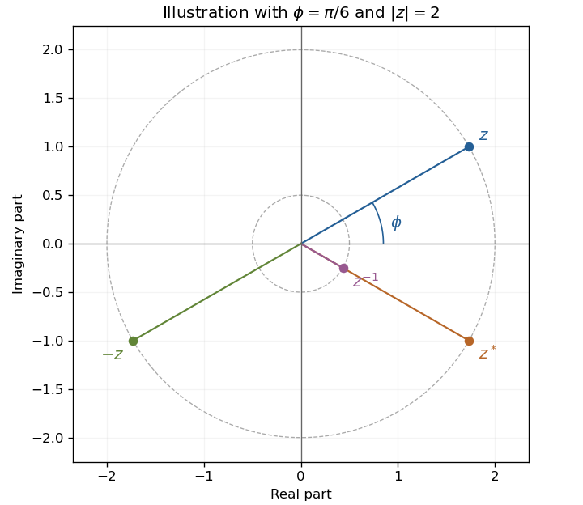

<h1 id="11/a/solution">Solution</h1>

↑ **Parent:** [A](../a.md)

[Complex conjugation](../../../../../complex-conjugation.md) reverses the [argument](../../../../../argument-complex-analysis.md), reciprocation also inverts the [modulus](../../../../../modulus.md), and multiplication by $-1$ adds $\pi$ to the [argument](../../../../../argument-complex-analysis.md). With all arguments chosen in $[0,2\pi)$ and $0<\phi<\pi/2$,

$$
\boxed{z^*=2e^{i(2\pi-\phi)},\qquad z^{-1}=\frac12e^{i(2\pi-\phi)},\qquad -z=2e^{i(\pi+\phi)}.}
$$

Thus $z$ is in the first quadrant, $z^*$ and $z^{-1}$ lie on the same fourth-quadrant ray at radii two and one-half, and $-z$ is diametrically opposite $z$.

**[Figure 3](#11/a/image-conjugation-reciprocation-and-negation-on-the-argand-plane). Conjugation, reciprocation and negation on the Argand plane**. Original diagram using $\phi=\pi/6$ to illustrate the general locations and moduli of the four points.

## ↑ Ancestors (13)

1. [A](../a.md)
2. [11](../../11.md)
3. [Paper 1](../../../paper-1-split.md)
4. [2002](../../../split.md)
5. [Past exam of the mathematics course of the year 1 of the natural sciences course of the University of Cambridge](../../../../split.md)
6. [Mathematics course of the year 1 of the natural sciences course of the University of Cambridge](../../../../../mathematics-course-of-the-year-1-of-the-natural-sciences-course-of-the-university-of-cambridge.md)
7. [Year 1 of the natural sciences course of the University of Cambridge](../../../../../year-1-of-the-natural-sciences-course-of-the-university-of-cambridge.md)
8. [Year of the natural sciences course of the University of Cambridge](../../../../../year-of-the-natural-sciences-course-of-the-university-of-cambridge.md)
9. [Natural sciences course of the University of Cambridge](../../../../../natural-sciences-course-of-the-university-of-cambridge.md)
10. [Course of the University of Cambridge](../../../../../course-of-the-university-of-cambridge.md)
11. [University of Cambridge](../../../../../university-of-cambridge-split.md)
12. [List of universities](../../../../../list-of-universities.md)
13. [Codex Wiki](../../../../../split.md)
