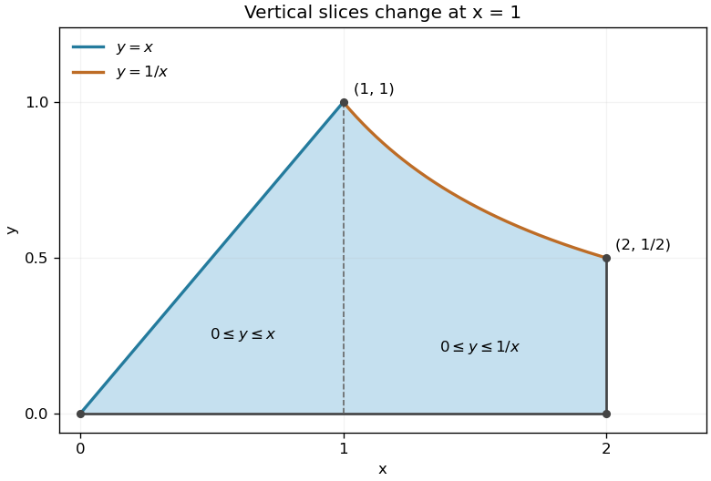

<h1 id="5/b/solution">Solution</h1>

↑ **Parent:** [B](../b.md)

The upper boundary follows $y=x$ until its intersection with $y=1/x$ at $(1,1)$, then follows the [hyperbola](../../../../../hyperbola.md) to $(2,1/2)$. The lower boundary is $y=0$. Therefore the two vertical-slice descriptions are $0\leq x\leq1$, $0\leq y\leq x$, and $1\leq x\leq2$, $0\leq y\leq1/x$.

**[Figure 1](#5/b/image-the-integration-region-below-a-line-and-a-hyperbola). The integration region below a line and a hyperbola**. Original shaded region with all four boundary pieces shown. Vertical slices change their upper endpoint at $(1,1)$.

Integrating with respect to $y$ first reduces the [double integral](../../../../../double-integral.md) to

$$
I=\int_0^1x^3e^{-x^2}dx+\int_1^2xe^{-x^2}dx=\left[-\frac12(x^2+1)e^{-x^2}\right]_0^1+\left[-\frac12e^{-x^2}\right]_1^2.
$$

Using the [antiderivatives](../../../../../antiderivative.md) from part (a),

$$
\boxed{I=\frac{1-e^{-1}-e^{-4}}2.}
$$

## ↑ Ancestors (13)

1. [B](../b.md)
2. [5](../../5.md)
3. [Paper 1](../../../paper-1-split.md)
4. [2002](../../../split.md)
5. [Past exam of the mathematics course of the year 1 of the natural sciences course of the University of Cambridge](../../../../split.md)
6. [Mathematics course of the year 1 of the natural sciences course of the University of Cambridge](../../../../../mathematics-course-of-the-year-1-of-the-natural-sciences-course-of-the-university-of-cambridge.md)
7. [Year 1 of the natural sciences course of the University of Cambridge](../../../../../year-1-of-the-natural-sciences-course-of-the-university-of-cambridge.md)
8. [Year of the natural sciences course of the University of Cambridge](../../../../../year-of-the-natural-sciences-course-of-the-university-of-cambridge.md)
9. [Natural sciences course of the University of Cambridge](../../../../../natural-sciences-course-of-the-university-of-cambridge.md)
10. [Course of the University of Cambridge](../../../../../course-of-the-university-of-cambridge.md)
11. [University of Cambridge](../../../../../university-of-cambridge-split.md)
12. [List of universities](../../../../../list-of-universities.md)
13. [Codex Wiki](../../../../../split.md)
