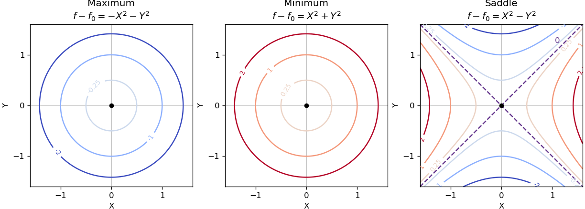

<h1 id="12/a/solution">Solution</h1>

↑ **Parent:** [A](../a.md)

Near a nondegenerate [stationary point](../../../../../stationary-point.md), the quadratic part of the [Taylor expansion](../../../../../taylor-expansion.md) determines the local [contour plot](../../../../../contour-plot.md). For a strict [local maximum](../../../../../local-maximum.md), the model $f=f_0-X^2-Y^2$ gives nested closed [level sets](../../../../../level-set.md), with values decreasing as one moves outward. For a strict [local minimum](../../../../../local-minimum.md), the model $f=f_0+X^2+Y^2$ gives the same nested shape with values increasing outward. Unequal nonzero quadratic coefficients stretch the [circles](../../../../../circle.md) into [ellipses](../../../../../ellipse.md) after a rotation to the [Hessian matrix](../../../../../hessian-matrix.md)'s [eigenvectors](../../../../../eigenvector.md).

For a nondegenerate [saddle point of a scalar function](../../../../../saddle-point-of-a-scalar-function.md), the model $f=f_0+X^2-Y^2$ gives [hyperbolas](../../../../../hyperbola.md). Levels above $f_0$ open along the positive-curvature direction; levels below $f_0$ open along the negative-curvature direction. The critical [level set](../../../../../level-set.md) is the two crossing lines $Y=\pm X$. Degenerate [stationary points](../../../../../stationary-point.md) can have different local geometry, so these are the standard nondegenerate sketches.

**[Figure 1](#12/a/image-local-contours-at-a-maximum-a-minimum-and-a-saddle-point). Local contours at a maximum, a minimum, and a saddle point**. Original quadratic-model sketches with contour values labelled relative to the central value zero. Maxima and minima have closed contours with opposite value ordering; the saddle has crossing zero contours and hyperbolic nearby levels.

## ↑ Ancestors (13)

1. [A](../a.md)
2. [12](../../12.md)
3. [Paper 2](../../../paper-2-split.md)
4. [2002](../../../split.md)
5. [Past exam of the mathematics course of the year 1 of the natural sciences course of the University of Cambridge](../../../../split.md)
6. [Mathematics course of the year 1 of the natural sciences course of the University of Cambridge](../../../../../mathematics-course-of-the-year-1-of-the-natural-sciences-course-of-the-university-of-cambridge.md)
7. [Year 1 of the natural sciences course of the University of Cambridge](../../../../../year-1-of-the-natural-sciences-course-of-the-university-of-cambridge.md)
8. [Year of the natural sciences course of the University of Cambridge](../../../../../year-of-the-natural-sciences-course-of-the-university-of-cambridge.md)
9. [Natural sciences course of the University of Cambridge](../../../../../natural-sciences-course-of-the-university-of-cambridge.md)
10. [Course of the University of Cambridge](../../../../../course-of-the-university-of-cambridge.md)
11. [University of Cambridge](../../../../../university-of-cambridge-split.md)
12. [List of universities](../../../../../list-of-universities.md)
13. [Codex Wiki](../../../../../split.md)
