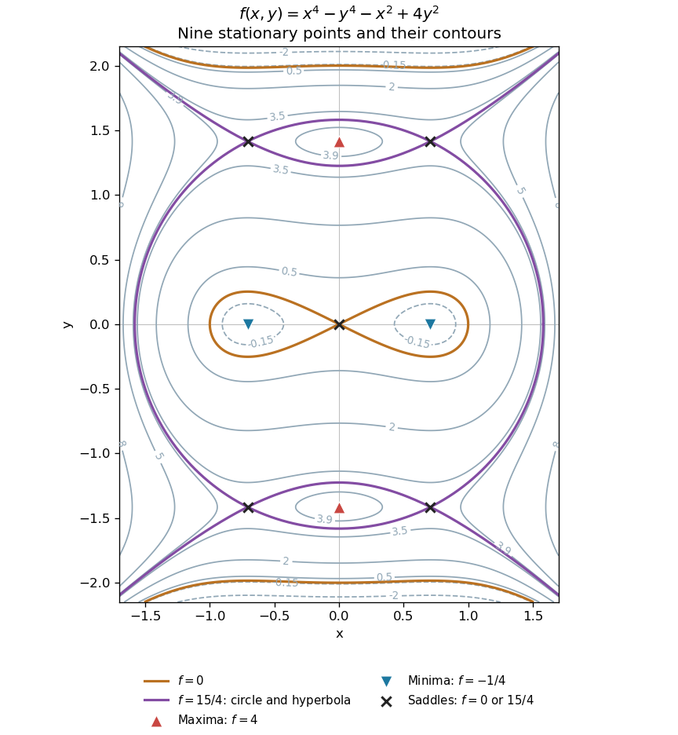

<h1 id="12/b/solution">Solution</h1>

↑ **Parent:** [B](../b.md)

Set both first [partial derivatives](../../../../../partial-derivative.md) equal to zero:

$$
f_x=4x^3-2x=2x(2x^2-1)=0,\qquad f_y=-4y^3+8y=-4y(y^2-2)=0.
$$

Thus $x=0,\pm1/\sqrt2$ and $y=0,\pm\sqrt2$, independently, giving exactly nine [stationary points](../../../../../stationary-point.md). The [Hessian matrix](../../../../../hessian-matrix.md) is diagonal everywhere:

$$
H_f=\begin{pmatrix}12x^2-2&0\\0&8-12y^2\end{pmatrix}.
$$

Its diagonal entries are its [eigenvalues](../../../../../eigenvalue.md), so the [second-derivative test](../../../../../second-derivative-test.md) immediately classifies the points:

- At $(0,\pm\sqrt2)$, the [Hessian matrix](../../../../../hessian-matrix.md) has [eigenvalues](../../../../../eigenvalue.md) $-2,-16$. These two points are strict [local maxima](../../../../../local-maximum.md), each with $f=4$.
- At $(\pm1/\sqrt2,0)$, the [Hessian matrix](../../../../../hessian-matrix.md) has [eigenvalues](../../../../../eigenvalue.md) $4,8$. These two points are strict [local minima](../../../../../local-minimum.md), each with $f=-1/4$.
- At $(0,0)$, the [Hessian matrix](../../../../../hessian-matrix.md) has [eigenvalues](../../../../../eigenvalue.md) $-2,8$, so it is a [saddle point of a scalar function](../../../../../saddle-point-of-a-scalar-function.md) with $f=0$.
- At $(\pm1/\sqrt2,\pm\sqrt2)$, with all four sign combinations, the [Hessian matrix](../../../../../hessian-matrix.md) has [eigenvalues](../../../../../eigenvalue.md) $4,-16$. These four points are [saddle points of a scalar function](../../../../../saddle-point-of-a-scalar-function.md), each with $f=15/4$.

In particular,

$$
\boxed{\text{2 local maxima, 2 local minima, and 5 saddle points.}}
$$

All nine [stationary points](../../../../../stationary-point.md) are nondegenerate, so no higher-order test is needed. Neither type of [local extremum](../../../../../local-extremum.md) is global: $f(x,0)=x^4-x^2\to+\infty$ as $|x|\to\infty$, whereas $f(0,y)=-y^4+4y^2\to-\infty$ as $|y|\to\infty$.

To organize the [contour plot](../../../../../contour-plot.md), complete the squares:

$$
f(x,y)=\frac{15}{4}+\left(x^2-\frac12\right)^2-(y^2-2)^2.
$$

The [level set](../../../../../level-set.md) through all four outer [saddle points of a scalar function](../../../../../saddle-point-of-a-scalar-function.md) factors exactly:

$$
f-\frac{15}{4}=\left(x^2-y^2+\frac32\right)\left(x^2+y^2-\frac52\right).
$$

It is therefore the union of the [circle](../../../../../circle.md) $x^2+y^2=5/2$ and the [hyperbola](../../../../../hyperbola.md) $y^2-x^2=3/2$, which cross at those four [saddle points of a scalar function](../../../../../saddle-point-of-a-scalar-function.md). Near the origin, $f=-x^2+4y^2+O((x^2+y^2)^2)$, so the zero [contours](../../../../../complex-integration-contour.md) have tangents $y=\pm x/2$. These two exact structural features, together with the nested [contours](../../../../../complex-integration-contour.md) around the four [local extrema](../../../../../local-extremum.md), determine the requested sketch. They are an example of a [separable quartic landscape with nine stationary points](../../../../../separable-quartic-landscape-with-nine-stationary-points.md).

**[Figure 2](#12/b/image-all-nine-stationary-points-and-contours-of-the-separable-quartic). All nine stationary points and contours of the separable quartic**. Original contour plot of $x^4-y^4-x^2+4y^2$. The two maxima, two minima and five saddles are marked. The exact level $15/4$ is highlighted as a circle and a hyperbola intersecting at the four outer saddles; the zero contour crosses at the origin.

## ↑ Ancestors (13)

1. [B](../b.md)
2. [12](../../12.md)
3. [Paper 2](../../../paper-2-split.md)
4. [2002](../../../split.md)
5. [Past exam of the mathematics course of the year 1 of the natural sciences course of the University of Cambridge](../../../../split.md)
6. [Mathematics course of the year 1 of the natural sciences course of the University of Cambridge](../../../../../mathematics-course-of-the-year-1-of-the-natural-sciences-course-of-the-university-of-cambridge.md)
7. [Year 1 of the natural sciences course of the University of Cambridge](../../../../../year-1-of-the-natural-sciences-course-of-the-university-of-cambridge.md)
8. [Year of the natural sciences course of the University of Cambridge](../../../../../year-of-the-natural-sciences-course-of-the-university-of-cambridge.md)
9. [Natural sciences course of the University of Cambridge](../../../../../natural-sciences-course-of-the-university-of-cambridge.md)
10. [Course of the University of Cambridge](../../../../../course-of-the-university-of-cambridge.md)
11. [University of Cambridge](../../../../../university-of-cambridge-split.md)
12. [List of universities](../../../../../list-of-universities.md)
13. [Codex Wiki](../../../../../split.md)
