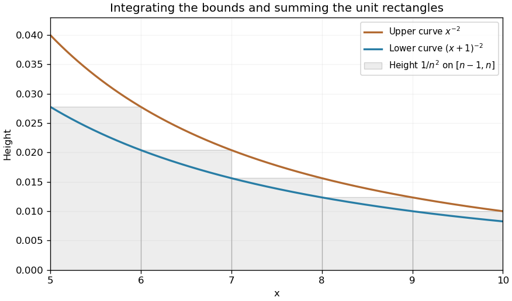

# Paper 1

↑ **Parent:** [2003](../2003.md)

[https://www.maths.cam.ac.uk/undergradnst/files/2003/PaperNST_IA_1.pdf](https://www.maths.cam.ac.uk/undergradnst/files/2003/PaperNST_IA_1.pdf)

**Table of contents**

- [1](#1)
  - [a](#1/a)
    - [Solution](#1/a/solution)
  - [b](#1/b)
    - [Solution](#1/b/solution)
  - [c](#1/c)
    - [Solution](#1/c/solution)
  - [Solution](#1/solution)
- [2](#2)
  - [a](#2/a)
    - [i](#2/a/i)
      - [Solution](#2/a/i/solution)
    - [ii](#2/a/ii)
      - [Solution](#2/a/ii/solution)
  - [b](#2/b)
    - [i](#2/b/i)
      - [Solution](#2/b/i/solution)
    - [ii](#2/b/ii)
      - [Solution](#2/b/ii/solution)
- [3](#3)
  - [a](#3/a)
    - [Solution](#3/a/solution)
  - [b](#3/b)
    - [Solution](#3/b/solution)
  - [c](#3/c)
    - [Solution](#3/c/solution)
- [4](#4)
  - [Solution](#4/solution)
  - [i](#4/i)
    - [Solution](#4/i/solution)
  - [ii](#4/ii)
    - [Solution](#4/ii/solution)
- [5](#5)
  - [a](#5/a)
    - [i](#5/a/i)
      - [Solution](#5/a/i/solution)
    - [ii](#5/a/ii)
      - [Solution](#5/a/ii/solution)
  - [b](#5/b)
    - [i](#5/b/i)
      - [Solution](#5/b/i/solution)
    - [ii](#5/b/ii)
      - [Solution](#5/b/ii/solution)
    - [iii](#5/b/iii)
      - [Solution](#5/b/iii/solution)
  - [c](#5/c)
    - [i](#5/c/i)
      - [Solution](#5/c/i/solution)
    - [ii](#5/c/ii)
      - [Solution](#5/c/ii/solution)
    - [iii](#5/c/iii)
      - [Solution](#5/c/iii/solution)
    - [iv](#5/c/iv)
      - [Solution](#5/c/iv/solution)
    - [v](#5/c/v)
      - [Solution](#5/c/v/solution)
- [6](#6)
  - [Solution](#6/solution)
- [7](#7)
  - [i](#7/i)
    - [Solution](#7/i/solution)
  - [ii](#7/ii)
    - [Solution](#7/ii/solution)
  - [iii](#7/iii)
    - [Solution](#7/iii/solution)
- [8](#8)
  - [a](#8/a)
    - [i](#8/a/i)
      - [Solution](#8/a/i/solution)
    - [ii](#8/a/ii)
      - [Solution](#8/a/ii/solution)
    - [iii](#8/a/iii)
      - [Solution](#8/a/iii/solution)
  - [b](#8/b)
    - [Solution](#8/b/solution)
- [9](#9)
  - [a](#9/a)
    - [Solution](#9/a/solution)
  - [b](#9/b)
    - [Solution](#9/b/solution)
  - [c](#9/c)
    - [Solution](#9/c/solution)
- [10](#10)
  - [a](#10/a)
    - [i](#10/a/i)
      - [Solution](#10/a/i/solution)
    - [ii](#10/a/ii)
      - [Solution](#10/a/ii/solution)
  - [b](#10/b)
    - [Solution](#10/b/solution)
- [11](#11)
  - [a](#11/a)
    - [i](#11/a/i)
      - [Solution](#11/a/i/solution)
    - [ii](#11/a/ii)
      - [Solution](#11/a/ii/solution)
  - [b](#11/b)
    - [Solution](#11/b/solution)
- [12](#12)
  - [Solution](#12/solution)

## 1

↑ **Parent:** [Paper 1](paper-1.md)

<h3 id="1/a">a</h3>

↑ **Parent:** [1](#1)

<h4 id="1/a/solution">Solution</h4>

↑ **Parent:** [A](#1/a)

Put $D=\mathbf a\cdot(\mathbf b\times\mathbf c)\ne0$. The [scalar triple product](../../multilinear-algebra.md#scalar-triple-product) is unchanged by cyclic permutation, so

$$
\mathbf A\cdot\mathbf a=\frac{\mathbf a\cdot(\mathbf b\times\mathbf c)}D=1,\quad\mathbf B\cdot\mathbf b=\frac{\mathbf b\cdot(\mathbf c\times\mathbf a)}D=1,\quad\mathbf C\cdot\mathbf c=\frac{\mathbf c\cdot(\mathbf a\times\mathbf b)}D=1.
$$

These are the diagonal pairings of a [reciprocal basis](../../multilinear-algebra.md#reciprocal-basis).

<h3 id="1/b">b</h3>

↑ **Parent:** [1](#1)

<h4 id="1/b/solution">Solution</h4>

↑ **Parent:** [B](#1/b)

The [cross product](../../vector-space.md#cross-product) $\mathbf b\times\mathbf c$ is [orthogonal](../../inner-product.md#orthogonal-vectors) to both factors. Division by the nonzero [scalar](../../vector-space.md#scalar) $D$ preserves that perpendicularity, giving $\boxed{\mathbf A\cdot\mathbf b=\mathbf A\cdot\mathbf c=0}$. Cyclic permutation gives the other off-diagonal pairings needed for the [reciprocal basis](../../multilinear-algebra.md#reciprocal-basis).

<h3 id="1/c">c</h3>

↑ **Parent:** [1](#1)

<h4 id="1/c/solution">Solution</h4>

↑ **Parent:** [C](#1/c)

Suppose $r\mathbf A+s\mathbf B+t\mathbf C=0$. Take its [dot product](../../inner-product.md#dot-product) successively with $\mathbf a,\mathbf b,\mathbf c$. The reciprocal pairings give $r=s=t=0$. Thus $\mathbf A,\mathbf B,\mathbf C$ are [linearly independent](../../vector-space.md#linear-independence) and therefore noncoplanar in three dimensions.

<h3 id="1/solution">Solution</h3>

↑ **Parent:** [1](#1)

For the numerical [vectors](../../vector-space.md#vector), $\mathbf b\times\mathbf c=(-2,1,-2)$ and $D=(-1,1,0)\cdot(-2,1,-2)=3\ne0$, proving noncoplanarity. The [reciprocal basis](../../multilinear-algebra.md#reciprocal-basis) is

$$
\boxed{\mathbf A=\frac{(-2,1,-2)}3,\qquad\mathbf B=\frac{(1,1,1)}3,\qquad\mathbf C=\frac{(1,1,-2)}3.}
$$

Reciprocal [dot products](../../inner-product.md#dot-product) extract the coefficients of any [vector](../../vector-space.md#vector) in the original [basis](../../vector-space.md#basis). Here $\mathbf A\cdot\mathbf d=-1/3$, $\mathbf B\cdot\mathbf d=2/3$, and $\mathbf C\cdot\mathbf d=5/3$, so

$$
\boxed{\mathbf d=-\frac13\mathbf a+\frac23\mathbf b+\frac53\mathbf c.}
$$

Substitution in Cartesian components recovers $(2,1,-1)$.

## 2

↑ **Parent:** [Paper 1](paper-1.md)

<h3 id="2/a">a</h3>

↑ **Parent:** [2](#2)

<h4 id="2/a/i">i</h4>

↑ **Parent:** [A](#2/a)

<h5 id="2/a/i/solution">Solution</h5>

↑ **Parent:** [I](#2/a/i)

Write $R(x)=(x^2+3)(2x^2-1)/(3x^4-x^3-1)$. This [rational function](../../isolated-singularity.md#rational-function) is [continuous](../../calculus.md#continuous-function) at both finite points because its denominator is nonzero there. Substitution gives the first two [limits](../../calculus.md#limit-of-a-function); at infinity divide numerator and denominator by $x^4$ and use their leading coefficients. Therefore

$$
\boxed{\lim_{x\to0}R(x)=3,\qquad\lim_{x\to1}R(x)=4,\qquad\lim_{x\to\infty}R(x)=\frac23.}
$$

<h4 id="2/a/ii">ii</h4>

↑ **Parent:** [A](#2/a)

<h5 id="2/a/ii/solution">Solution</h5>

↑ **Parent:** [Ii](#2/a/ii)

For fixed real $a$, the base is positive for all sufficiently large positive $x$. Take its [logarithm](../../calculus.md#logarithm) and use the [Taylor expansion](../../calculus.md#taylor-expansion) $\ln(1-u)=-u+O(u^2)$:

$$
\ln\left[\left(1-\frac ax\right)^x\right]=x\ln\left(1-\frac ax\right)=-a+O(x^{-1}).
$$

[Continuity](../../calculus.md#continuous-function) of the [exponential function](../../calculus.md#exponential-function) then gives $\boxed{\lim_{x\to\infty}(1-a/x)^x=e^{-a}}$. This includes $a=0$.

<h3 id="2/b">b</h3>

↑ **Parent:** [2](#2)

<h4 id="2/b/i">i</h4>

↑ **Parent:** [B](#2/b)

<h5 id="2/b/i/solution">Solution</h5>

↑ **Parent:** [I](#2/b/i)

The numerator and denominator both vanish at zero. The [fundamental theorem of calculus](../../calculus.md#fundamental-theorem-of-calculus) differentiates the numerator, while the denominator [derivative](../../calculus.md#derivative) is nonzero near zero. [L'Hôpital's rule](../../calculus.md#l-hopital-s-rule) therefore gives

$$
\boxed{\lim_{x\to0}\frac{\int_0^xe^{-y^2}dy}{3x-x^3}=\lim_{x\to0}\frac{e^{-x^2}}{3-3x^2}=\frac13.}
$$

<h4 id="2/b/ii">ii</h4>

↑ **Parent:** [B](#2/b)

<h5 id="2/b/ii/solution">Solution</h5>

↑ **Parent:** [Ii](#2/b/ii)

Both numerator and denominator have a double zero at one. Applying [L'Hôpital's rule](../../calculus.md#l-hopital-s-rule) twice gives

$$
\boxed{\lim_{x\to1}\frac{1-\sin(\pi x/2)}{x^3-3x+2}=\lim_{x\to1}\frac{-(\pi/2)\cos(\pi x/2)}{3x^2-3}=\lim_{x\to1}\frac{(\pi^2/4)\sin(\pi x/2)}{6x}=\frac{\pi^2}{24}.}
$$

Alternatively $x^3-3x+2=(x-1)^2(x+2)$ and $1-\sin(\pi x/2)\sim\pi^2(x-1)^2/8$, giving the same result from a [Taylor expansion](../../calculus.md#taylor-expansion).

## 3

↑ **Parent:** [Paper 1](paper-1.md)

<h3 id="3/a">a</h3>

↑ **Parent:** [3](#3)

<h4 id="3/a/solution">Solution</h4>

↑ **Parent:** [A](#3/a)

For $f(x)=x^3e^{-3x^2/2}/3$, the [product rule](../../calculus.md#product-rule) gives $f'(x)=x^2(1-x^2)e^{-3x^2/2}$, so the [stationary points](../../calculus-of-variations.md#stationary-point) occur at $x=-1,0,1$. Its sign is negative for $|x|>1$ and positive for $0<|x|<1$. Consequently

$$
\boxed{\left(-1,-\frac{e^{-3/2}}3\right)\text{ is a minimum},\qquad\left(1,\frac{e^{-3/2}}3\right)\text{ is a maximum}.}
$$

They are also the global [extrema](../../mathematical-optimization.md#maximum-and-minimum), since the function tends to zero at both infinities and is a [monotone function](../../calculus.md#monotonic-function) on the intervals just identified. At zero the [derivative](../../calculus.md#derivative) does not change sign. Since $f(x)=x^3/3+O(x^5)$, **$(0,0)$ is a stationary [inflection point](../../topology.md#inflection-point)**, not an [extremum](../../mathematical-optimization.md#maximum-and-minimum).

<h3 id="3/b">b</h3>

↑ **Parent:** [3](#3)

<h4 id="3/b/solution">Solution</h4>

↑ **Parent:** [B](#3/b)

The function is [odd](../../calculus.md#odd-function), with a horizontal [tangent line](../../calculus.md#tangent-line) at the origin and tails approaching zero from below on the negative side and above on the positive side. It decreases to its negative [minimum](../../set.md#minimum-of-a-subset-of-a-total-order) at $x=-1$, rises through the stationary [inflection point](../../topology.md#inflection-point) at zero to its positive [maximum](../../set.md#maximum-of-a-subset-of-a-total-order) at $x=1$, then decreases toward zero.

**[Figure 1](#3/b/image-an-odd-cubic-gaussian-profile-with-two-extrema-and-a-stationary-inflection). An odd cubic Gaussian profile with two extrema and a stationary inflection**. Original function plot with the three stationary points marked. The near-zero cubic behavior explains the flat crossing without an extremum.

<h3 id="3/c">c</h3>

↑ **Parent:** [3](#3)

<h4 id="3/c/solution">Solution</h4>

↑ **Parent:** [C](#3/c)

The Gaussian decay makes the [integral](../../integral.md) [absolutely convergent](../../sequence-and-series.md#absolute-convergence), so [odd](../../calculus.md#odd-function) symmetry gives $\boxed{\int_{-\infty}^{\infty}f(x)dx=0}$. On the positive half-line substitute $u=3x^2/2$, so $x^3dx=2u\,du/9$. Thus

$$
\boxed{\int_0^\infty f(x)dx=\frac2{27}\int_0^\infty ue^{-u}du=\frac2{27}.}
$$

The last [integral](../../integral.md) is $\Gamma(2)=1$, an instance of the [odd Gaussian moments on a half-line](../../integral.md#odd-gaussian-moments-on-a-half-line).

## 4

↑ **Parent:** [Paper 1](paper-1.md)

<h3 id="4/solution">Solution</h3>

↑ **Parent:** [4](#4)

Use [integration by parts](../../calculus.md#integration-by-parts) with $u=\ln(1+x^2)$ and $dv=(1+3x^2)dx$, giving $v=x+x^3=x(1+x^2)$. The remaining [integrand](../../integral.md#integrand) simplifies because $du=2x\,dx/(1+x^2)$:

$$
\boxed{\int(1+3x^2)\ln(1+x^2)dx=x(1+x^2)\ln(1+x^2)-\int2x^2dx=x(1+x^2)\ln(1+x^2)-\frac23x^3+C.}
$$

The real formula is valid for every [real number](../../arithmetic.md#real-number) $x$.

<h3 id="4/i">i</h3>

↑ **Parent:** [4](#4)

<h4 id="4/i/solution">Solution</h4>

↑ **Parent:** [I](#4/i)

Put $u=\ln x$, so $du=dx/x$. The [integral](../../integral.md) becomes $\int du/u$, giving

$$
\boxed{\int\frac{dx}{x\ln x}=\ln|\ln x|+C.}
$$

For the real [logarithm](../../calculus.md#logarithm), choose an interval in $0<x<1$ or $x>1$; the original [integrand](../../integral.md#integrand) is singular at one and undefined for nonpositive $x$.

<h3 id="4/ii">ii</h3>

↑ **Parent:** [4](#4)

<h4 id="4/ii/solution">Solution</h4>

↑ **Parent:** [Ii](#4/ii)

Put $u=\cos x$, $du=-\sin x\,dx$, and use $\sin^2x=1-u^2$. Then

$$
\int\frac{\sin^3x}{\cos^4x}dx=-\int\frac{1-u^2}{u^4}du=\frac1{3u^3}-\frac1u+C.
$$

Therefore

$$
\boxed{\int\frac{\sin^3x}{\cos^4x}dx=\frac1{3\cos^3x}-\frac1{\cos x}+C.}
$$

This holds on intervals where $\cos x\ne0$.

## 5

↑ **Parent:** [Paper 1](paper-1.md)

<h3 id="5/a">a</h3>

↑ **Parent:** [5](#5)

<h4 id="5/a/i">i</h4>

↑ **Parent:** [A](#5/a)

<h5 id="5/a/i/solution">Solution</h5>

↑ **Parent:** [I](#5/a/i)

Direct [matrix multiplication](../../vector-space.md#matrix-multiplication) gives $MN=\begin{pmatrix}5&18\\7&25\end{pmatrix}$. The three [determinants](../../multilinear-algebra.md#determinant) are $\det M=8-9=-1$, $\det N=4-3=1$, and $\det(MN)=125-126=-1$. Hence $\boxed{\det(MN)=(-1)(1)=\det M\det N}$, as required.

<h4 id="5/a/ii">ii</h4>

↑ **Parent:** [A](#5/a)

<h5 id="5/a/ii/solution">Solution</h5>

↑ **Parent:** [Ii](#5/a/ii)

The two-by-two [matrix inverse](../../matrix-inverse.md) formula gives

$$
M^{-1}=\begin{pmatrix}-4&3\\3&-2\end{pmatrix},\quad N^{-1}=\begin{pmatrix}4&-3\\-1&1\end{pmatrix},\quad(MN)^{-1}=\begin{pmatrix}-25&18\\7&-5\end{pmatrix}.
$$

Multiplication in the reversed order gives

$$
\boxed{N^{-1}M^{-1}=\begin{pmatrix}-25&18\\7&-5\end{pmatrix}=(MN)^{-1}.}
$$

The order reversal is needed because applying the inverse undoes the original two [linear maps](../../vector-space.md#linear-map) in reverse sequence.

<h3 id="5/b">b</h3>

↑ **Parent:** [5](#5)

<h4 id="5/b/i">i</h4>

↑ **Parent:** [B](#5/b)

<h5 id="5/b/i/solution">Solution</h5>

↑ **Parent:** [I](#5/b/i)

Take $A=B=I_2$, which are [invertible matrices](../../linear-algebra.md#invertible-matrix). Then $\det(A+B)=\det(2I_2)=4$, whereas $\det A+\det B=2$. This proves that the [determinant is not additive](../../multilinear-algebra.md#determinant-is-not-additive). Being a [multilinear map](../../multilinear-algebra.md#multilinear-map) of separate columns does not imply additivity in the entire [matrix](../../vector-space.md#matrix).

<h4 id="5/b/ii">ii</h4>

↑ **Parent:** [B](#5/b)

<h5 id="5/b/ii/solution">Solution</h5>

↑ **Parent:** [Ii](#5/b/ii)

Again take $A=B=I_2$. Their sum is also invertible, but $(A+B)^{-1}=I_2/2$, while $A^{-1}+B^{-1}=2I_2$. Thus [matrix inversion is not additive](../../matrix-inverse.md#matrix-inversion-is-not-additive), [even](../../calculus.md#even-function) when every inverse in the proposed identity exists.

<h4 id="5/b/iii">iii</h4>

↑ **Parent:** [B](#5/b)

<h5 id="5/b/iii/solution">Solution</h5>

↑ **Parent:** [Iii](#5/b/iii)

Use $A=M$ and $B=N$ from part (a). The proposed unreversed product is

$$
A^{-1}B^{-1}=\begin{pmatrix}-19&15\\14&-11\end{pmatrix},
$$

which differs from the actual inverse $\begin{pmatrix}-25&18\\7&-5\end{pmatrix}$. Both original [matrices](../../vector-space.md#matrix) are [invertible matrices](../../linear-algebra.md#invertible-matrix), so this is a valid counterexample. The universally valid order is $\boxed{(AB)^{-1}=B^{-1}A^{-1}}$.

<h3 id="5/c">c</h3>

↑ **Parent:** [5](#5)

<h4 id="5/c/i">i</h4>

↑ **Parent:** [C](#5/c)

<h5 id="5/c/i/solution">Solution</h5>

↑ **Parent:** [I](#5/c/i)

The product of a $3\times n$ [matrix](../../vector-space.md#matrix) with another $3\times n$ [matrix](../../vector-space.md#matrix) requires its inner dimensions $n$ and three to match. Thus $\boxed{n=3}$ is necessary and sufficient for $M^2$ to be defined.

<h4 id="5/c/ii">ii</h4>

↑ **Parent:** [C](#5/c)

<h5 id="5/c/ii/solution">Solution</h5>

↑ **Parent:** [Ii](#5/c/ii)

The [transpose](../../vector-space.md#transpose) has shape $n\times3$. Multiplying two copies requires $3=n$, so $\boxed{n=3}$.

<h4 id="5/c/iii">iii</h4>

↑ **Parent:** [C](#5/c)

<h5 id="5/c/iii/solution">Solution</h5>

↑ **Parent:** [Iii](#5/c/iii)

The shapes in $MM^T$ are $(3\times n)(n\times3)$, whose inner dimensions always match. Hence **every [positive integer](../../integer.md#positive-integer) $n$ is allowed**, and the resulting [matrix](../../vector-space.md#matrix) is $3\times3$.

<h4 id="5/c/iv">iv</h4>

↑ **Parent:** [C](#5/c)

<h5 id="5/c/iv/solution">Solution</h5>

↑ **Parent:** [Iv](#5/c/iv)

[Matrix addition](../../vector-space.md#matrix-addition) requires equal shapes. The shapes $3\times n$ and $n\times3$ agree exactly when $\boxed{n=3}$.

<h4 id="5/c/v">v</h4>

↑ **Parent:** [C](#5/c)

<h5 id="5/c/v/solution">Solution</h5>

↑ **Parent:** [V](#5/c/v)

A two-sided [matrix inverse](../../matrix-inverse.md) requires a [square matrix](../../vector-space.md#square-matrix), so $\boxed{n=3}$ is necessary. It exists only if that [square matrix](../../vector-space.md#square-matrix) is also an [invertible matrix](../../linear-algebra.md#invertible-matrix), equivalently $\det M\ne0$; choosing the dimension alone does not ensure invertibility.

## 6

↑ **Parent:** [Paper 1](paper-1.md)

<h3 id="6/solution">Solution</h3>

↑ **Parent:** [6](#6)

For a nonzero separated solution $U=X(x)T(t)$, [separation of variables](../../partial-differential-equation.md#separation-of-variables) gives $X''/X=T'/T=-\lambda$. The zero [Dirichlet boundary conditions](../../differential-equation.md#dirichlet-boundary-condition) [force](../../force.md) $X=\sin nx$, $\lambda=n^2$, with [integers](../../integer.md) $n\geq1$; the time factors are $e^{-n^2t}$. Expanding the initial profile in this [Fourier sine series](../../fourier-series.md#fourier-sine-series) requires only the two already displayed spatial modes. Thus

$$
\boxed{U(x,t)=3e^{-t}\sin x-e^{-9t}\sin3x.}
$$

Both terms individually solve the [heat equation](../../diffusion-equation.md#heat-equation), vanish at the endpoints and give the required initial profile at $t=0$. The initial function is also $4\sin^3x\geq0$ on the bar; the later solution stays nonnegative and tends to zero as [heat](../../heat.md) leaves through the fixed-temperature ends.

## 7

↑ **Parent:** [Paper 1](paper-1.md)

<h3 id="7/i">i</h3>

↑ **Parent:** [7](#7)

<h4 id="7/i/solution">Solution</h4>

↑ **Parent:** [I](#7/i)

Parametrize the line by $\mathbf r(t)=(t,t,t)$, $0\leq t\leq1$. Its [tangent vector](../../tangent-vector.md) is $(1,1,1)$. On this line the three [force](../../force.md) components sum to $\mu t+(1-\lambda)t+(\lambda-1-\mu)t=0$. Therefore the [line integral](../../multivariable-calculus.md#line-integral) is $\boxed{\int\mathbf F\cdot d\mathbf r=0}$ for every parameter choice.

<h3 id="7/ii">ii</h3>

↑ **Parent:** [7](#7)

<h4 id="7/ii/solution">Solution</h4>

↑ **Parent:** [Ii](#7/ii)

On the specified [curve](../../topology.md#curve) $\mathbf r(t)=(t,t,t^2)$, the [tangent vector](../../tangent-vector.md) is $(1,1,2t)$ and

$$
\mathbf F(\mathbf r(t))=(\mu t^2,\ t-\lambda t^2,\ t^2+(\lambda-2-\mu)t).
$$

Their [dot product](../../inner-product.md#dot-product) is $t+(\lambda-\mu-4)t^2+2t^3$. Hence

$$
\boxed{\int\mathbf F\cdot d\mathbf r=\int_0^1[t+(\lambda-\mu-4)t^2+2t^3]dt=\frac{\lambda-\mu-1}{3}.}
$$

<h3 id="7/iii">iii</h3>

↑ **Parent:** [7](#7)

<h4 id="7/iii/solution">Solution</h4>

↑ **Parent:** [Iii](#7/iii)

The field is smooth on the [simply connected](../../algebraic-topology.md#simply-connected-space) domain $\mathbb R^3$. Its [curl](../../multivariable-calculus.md#curl) is $\nabla\times\mathbf F=(2\lambda-2,2\mu,0)$, so a necessary and sufficient condition for a [conservative vector field](../../multivariable-calculus.md#conservative-vector-field) is

$$
\boxed{\lambda=1,\qquad\mu=0.}
$$

At those values it is explicitly the [gradient](../../multivariable-calculus.md#gradient) of $\Phi=xy-x^2/2-yz+z^2/2$. Equality of the two previous path [integrals](../../integral.md) would impose only $\lambda-\mu=1$, which is weaker: [coinciding path integrals need not imply a conservative field](../../multivariable-calculus.md#coinciding-path-integrals-need-not-imply-a-conservative-field). For example $\lambda=2,\mu=1$ makes those two [integrals](../../integral.md) equal but leaves nonzero curl.

## 8

↑ **Parent:** [Paper 1](paper-1.md)

<h3 id="8/a">a</h3>

↑ **Parent:** [8](#8)

<h4 id="8/a/i">i</h4>

↑ **Parent:** [A](#8/a)

<h5 id="8/a/i/solution">Solution</h5>

↑ **Parent:** [I](#8/a/i)

Multiply the [Taylor series](../../calculus.md#taylor-series) $\cos x=1-x^2/2+O(x^4)$ by $(1-x)^{-1}=1+x+x^2+O(x^3)$. Counting the constant as the first nonzero term gives

$$
\boxed{\frac{\cos x}{1-x}=1+x+\frac{x^2}{2}+O(x^3).}
$$

<h4 id="8/a/ii">ii</h4>

↑ **Parent:** [A](#8/a)

<h5 id="8/a/ii/solution">Solution</h5>

↑ **Parent:** [Ii](#8/a/ii)

The identity $\sin^3x=(3\sin x-\sin3x)/4$ makes the lower-order cancellation explicit. Expand the two sines through degree seven:

$$
\boxed{\sin^3x=x^3-\frac{x^5}{2}+\frac{13x^7}{120}+O(x^9).}
$$

These are the first three nonzero terms; there is no linear term.

<h4 id="8/a/iii">iii</h4>

↑ **Parent:** [A](#8/a)

<h5 id="8/a/iii/solution">Solution</h5>

↑ **Parent:** [Iii](#8/a/iii)

For $F(x)=e^{e^x}$, the [chain rule](../../calculus.md#chain-rule) gives $F'=e^xe^{e^x}$ and $F''=(e^x+e^{2x})e^{e^x}$. Thus $F(0)=e$, $F'(0)=e$ and $F''(0)=2e$, yielding

$$
\boxed{e^{e^x}=e+ex+ex^2+O(x^3).}
$$

<h3 id="8/b">b</h3>

↑ **Parent:** [8](#8)

<h4 id="8/b/solution">Solution</h4>

↑ **Parent:** [B](#8/b)

Write $1/f(x)=b_0+b_1x+b_2x^2+O(x^3)$ and multiply by $a_0+a_1x+a_2x^2+O(x^3)$. The product equals one, so its coefficients give $a_0b_0=1$, $a_0b_1+a_1b_0=0$ and $a_0b_2+a_1b_1+a_2b_0=0$. Since $a_0=f(0)\ne0$,

$$
\boxed{\frac1{f(x)}=\frac1{a_0}-\frac{a_1}{a_0^2}x+\frac{a_1^2-a_0a_2}{a_0^3}x^2+O(x^3).}
$$

This is the initial part of the general [reciprocal of a power series](../../sequence-and-series.md#reciprocal-of-a-power-series) recurrence.

## 9

↑ **Parent:** [Paper 1](paper-1.md)

<h3 id="9/a">a</h3>

↑ **Parent:** [9](#9)

<h4 id="9/a/solution">Solution</h4>

↑ **Parent:** [A](#9/a)

The [exponential function](../../calculus.md#exponential-function) definitions of the [hyperbolic functions](../../calculus.md#hyperbolic-function) and [Euler's formula](../../complex-analysis.md#euler-s-formula) give

$$
\sinh(ix)=\frac{e^{ix}-e^{-ix}}2=i\sin x,\qquad\cosh(ix)=\frac{e^{ix}+e^{-ix}}2=\cos x.
$$

Dividing these identities wherever $\cos x\ne0$ gives $\boxed{\tanh(ix)=i\tan x}$. The two undivided identities hold for every [complex number](../../complex-analysis.md#complex-number) $x$; the quotient identity excludes its poles.

<h3 id="9/b">b</h3>

↑ **Parent:** [9](#9)

<h4 id="9/b/solution">Solution</h4>

↑ **Parent:** [B](#9/b)

Adding and subtracting the [exponential function](../../calculus.md#exponential-function) [power series](../../sequence-and-series.md#power-series) cancels the appropriate [odd](../../calculus.md#odd-function) or [even](../../calculus.md#even-function) terms:

$$
\boxed{\sinh x=\sum_{n=0}^\infty\frac{x^{2n+1}}{(2n+1)!}=x+\frac{x^3}{3!}+\cdots,\qquad\cosh x=\sum_{n=0}^\infty\frac{x^{2n}}{(2n)!}=1+\frac{x^2}{2!}+\cdots.}
$$

Both series converge absolutely for every [complex number](../../complex-analysis.md#complex-number) $x$, as follows from the [ratio test](../../sequence-and-series.md#ratio-test).

<h3 id="9/c">c</h3>

↑ **Parent:** [9](#9)

<h4 id="9/c/solution">Solution</h4>

↑ **Parent:** [C](#9/c)

Two applications of [integration by parts](../../calculus.md#integration-by-parts) give $I=\cosh x\sin x-\int\sinh x\sin x\,dx$ and $\int\sinh x\sin x\,dx=-\sinh x\cos x+I$. Thus an [antiderivative](../../integral.md#antiderivative) is $[\cosh x\sin x+\sinh x\cos x]/2$. Evaluating its endpoints gives

$$
\boxed{\int_0^{\pi/2}\cosh x\cos x\,dx=\frac12\cosh\frac\pi2.}
$$

## 10

↑ **Parent:** [Paper 1](paper-1.md)

<h3 id="10/a">a</h3>

↑ **Parent:** [10](#10)

<h4 id="10/a/i">i</h4>

↑ **Parent:** [A](#10/a)

<h5 id="10/a/i/solution">Solution</h5>

↑ **Parent:** [I](#10/a/i)

For $n\geq6$ and $n-1<x<n$, monotonicity gives $(x+1)^{-2}<n^{-2}<x^{-2}$. Integrating over each unit interval and summing proves the [integral test](../../sequence-and-series.md#integral-test-for-convergence) tail bounds

$$
\boxed{\int_5^\infty\frac{dx}{(x+1)^2}=\frac16<\sum_{n=6}^\infty\frac1{n^2}<\int_5^\infty\frac{dx}{x^2}=\frac15.}
$$

The inequalities remain strict because the very first rectangle already has a strictly positive difference from either bounding [integral](../../integral.md).

**[Figure 2](#10/a/i/image-unit-rectangles-between-two-shifted-reciprocal-square-curves). Unit rectangles between two shifted reciprocal-square curves**. Original comparison for the first five intervals of the infinite tail. Each rectangle has height $1/n^2$ on $[n-1,n]$, above $(x+1)^{-2}$ and below $x^{-2}$.

<h4 id="10/a/ii">ii</h4>

↑ **Parent:** [A](#10/a)

<h5 id="10/a/ii/solution">Solution</h5>

↑ **Parent:** [Ii](#10/a/ii)

Add the supplied five-term [partial sum](../../sequence-and-series.md#partial-sum) to each side of the tail inequality. Since $1/6=600/3600$ and $1/5=720/3600$,

$$
\boxed{\frac{5869}{3600}<\sum_{n=1}^\infty\frac1{n^2}<\frac{5989}{3600}.}
$$

Numerically this is approximately $1.63028<\sum n^{-2}<1.66361$.

<h3 id="10/b">b</h3>

↑ **Parent:** [10](#10)

<h4 id="10/b/solution">Solution</h4>

↑ **Parent:** [B](#10/b)

Apply the [integral bounds for a finite harmonic sum](../../analytic-number-theory.md#integral-bounds-for-a-finite-harmonic-sum) to the omitted terms from thirteen through one hundred:

$$
\ln\frac{101}{13}<\sum_{n=13}^{100}\frac1n<\ln\frac{100}{12}.
$$

Adding the given $H_{12}=86021/27720$ gives $5.15338\ldots<H_{100}<5.22348\ldots$. Both bounds lie between $5.15$ and $5.25$, so every value they permit rounds to the same two [significant figures](../../numerical-analysis.md#significant-figures):

$$
\boxed{H_{100}=\sum_{n=1}^{100}\frac1n\simeq5.2\quad\text{to two significant figures}.}
$$

The rounding follows from the bounds, without computing all the intervening terms.

## 11

↑ **Parent:** [Paper 1](paper-1.md)

<h3 id="11/a">a</h3>

↑ **Parent:** [11](#11)

<h4 id="11/a/i">i</h4>

↑ **Parent:** [A](#11/a)

<h5 id="11/a/i/solution">Solution</h5>

↑ **Parent:** [I](#11/a/i)

For a nonzero solution, [separation of variables](../../partial-differential-equation.md#separation-of-variables) gives $dy/y=k\,dx/(1+x^2)$, so $\ln|y|=k\arctan x+C$. Restoring the zero solution by allowing an arbitrary real multiplicative constant gives

$$
\boxed{y(x)=Ce^{k\arctan x},\qquad C\in\mathbb R.}
$$

It is valid for all [real numbers](../../arithmetic.md#real-number) $x$, including the constant solutions when $k=0$.

<h4 id="11/a/ii">ii</h4>

↑ **Parent:** [A](#11/a)

<h5 id="11/a/ii/solution">Solution</h5>

↑ **Parent:** [Ii](#11/a/ii)

Use [integrating factor](../../linear-ordinary-differential-equation.md#integrating-factor) $e^{-x^3/3}$ for this [first-order linear differential equation](../../linear-ordinary-differential-equation.md#first-order-linear-differential-equation). Then $(ye^{-x^3/3})'=x^2e^{-x^3/3}=-(e^{-x^3/3})'$. Integrating gives

$$
\boxed{y(x)=Ce^{x^3/3}-1.}
$$

This includes the constant particular solution $y=-1$ when $C=0$.

<h3 id="11/b">b</h3>

↑ **Parent:** [11](#11)

<h4 id="11/b/solution">Solution</h4>

↑ **Parent:** [B](#11/b)

Use the [slope substitution for equations involving x y'-y](../../differential-equation.md#slope-substitution-for-equations-involving-x-y-y): put $v=y/x$ on the positive interval containing the initial point. Then $xy'-y=x^2v'$, so $x^2v'=\cot v$. Near $v(1)=\pi/4$, separating variables gives $\tan v\,dv=dx/x^2$. Integration yields $\ln|\cos v|=1/x+C$. The initial value fixes the sign and constant, giving

$$
\cos\frac yx=\frac1{\sqrt2}e^{1/x-1}.
$$

Choose the [inverse cosine](../../geometry-and-topology.md#arccosine) branch that agrees with $v(1)=\pi/4$. The solution is

$$
\boxed{y(x)=x\arccos\left(\frac{e^{1/x-1}}{\sqrt2}\right),\qquad x>\frac1{1+\tfrac12\ln2}.}
$$

On this interval the argument lies strictly between zero and one and the original cotangent is defined. At the finite lower endpoint, $v\to0$ and the cotangent becomes singular, so that endpoint is excluded from the maximal interval of the [initial value problem](../../differential-equation.md#initial-value-problem). The slope substitution here is valid without classifying the original equation as homogeneous in the usual $y'=F(y/x)$ sense.

## 12

↑ **Parent:** [Paper 1](paper-1.md)

<h3 id="12/solution">Solution</h3>

↑ **Parent:** [12](#12)

The region lies in the first quadrant, inside the unit [circle](../../topology.md#circle) and above the positive branch of $xy=1/4$. In [polar coordinates](../../multivariable-calculus.md#polar-coordinates), $xy=(r^2/2)\sin2\theta$, so its radial bounds are $(2\sin2\theta)^{-1/2}\leq r\leq1$. Such an interval exists when $\sin2\theta\geq1/2$, hence

$$
\boxed{\frac\pi{12}\leq\theta\leq\frac{5\pi}{12},\qquad\frac1{\sqrt{2\sin2\theta}}\leq r\leq1.}
$$

At the intersections with the [circle](../../topology.md#circle), $r=1$ and $\sin2\theta=1/2$, giving exactly the two stated polar angles. Their Cartesian coordinates are $(\cos(\pi/12),\sin(\pi/12))$ and the swapped pair.

**[Figure 3](#12/image-the-first-quadrant-region-between-a-hyperbola-and-the-unit-circle-arc). The first-quadrant region between a hyperbola and the unit-circle arc**. Original shaded integration region. The dashed rays pass through the two intersections, at polar angles $\pi/12$ and $5\pi/12$.

The [Jacobian determinant](../../multivariable-calculus.md#jacobian-determinant) contributes $dx\,dy=r\,dr\,d\theta$, while $xy(x^2+y^2)=r^4\sin2\theta/2$. Thus the [double integral](../../integral.md#double-integral) is

$$
I=\int_{\pi/12}^{5\pi/12}\int_{(2\sin2\theta)^{-1/2}}^1\frac{r^5}{2}\sin2\theta\,dr\,d\theta=\int_{\pi/12}^{5\pi/12}\left(\frac{\sin2\theta}{12}-\frac{\csc^2(2\theta)}{96}\right)d\theta.
$$

Its [antiderivative](../../integral.md#antiderivative) is $-\cos2\theta/24+\cot2\theta/192$. Evaluating the bounds gives

$$
\boxed{I=\frac{\sqrt3}{24}-\frac{\sqrt3}{96}=\frac{\sqrt3}{32}.}
$$

## ↑ Ancestors (10)

1. [2003](../2003.md)
2. [Past exam of the mathematics course of the year 1 of the natural sciences course of the University of Cambridge](../../past-exam-of-the-mathematics-course-of-the-year-1-of-the-natural-sciences-course-of-the-university-of-cambridge.md)
3. [Mathematics course of the year 1 of the natural sciences course of the University of Cambridge](../../university-of-cambridge.md#mathematics-course-of-the-year-1-of-the-natural-sciences-course-of-the-university-of-cambridge)
4. [Year 1 of the natural sciences course of the University of Cambridge](../../university-of-cambridge.md#year-1-of-the-natural-sciences-course-of-the-university-of-cambridge)
5. [Year of the natural sciences course of the University of Cambridge](../../university-of-cambridge.md#year-of-the-natural-sciences-course-of-the-university-of-cambridge)
6. [Natural sciences course of the University of Cambridge](../../university-of-cambridge.md#natural-sciences-course-of-the-university-of-cambridge)
7. [Course of the University of Cambridge](../../university-of-cambridge.md#course-of-the-university-of-cambridge)
8. [University of Cambridge](../../university-of-cambridge.md)
9. [List of universities](../../README.md#list-of-universities)
10. [Codex Wiki](../../README.md)
