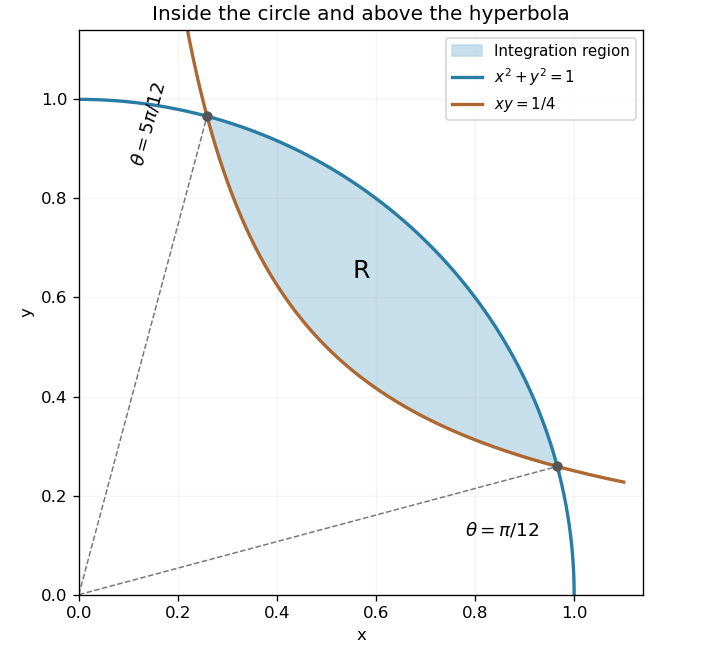

<h1 id="12/solution">Solution</h1>

↑ **Parent:** [12](../12.md)

The region lies in the first quadrant, inside the unit [circle](../../../../circle.md) and above the positive branch of $xy=1/4$. In [polar coordinates](../../../../polar-coordinates.md), $xy=(r^2/2)\sin2\theta$, so its radial bounds are $(2\sin2\theta)^{-1/2}\leq r\leq1$. Such an interval exists when $\sin2\theta\geq1/2$, hence

$$
\boxed{\frac\pi{12}\leq\theta\leq\frac{5\pi}{12},\qquad\frac1{\sqrt{2\sin2\theta}}\leq r\leq1.}
$$

At the intersections with the [circle](../../../../circle.md), $r=1$ and $\sin2\theta=1/2$, giving exactly the two stated polar angles. Their Cartesian coordinates are $(\cos(\pi/12),\sin(\pi/12))$ and the swapped pair.

**[Figure 3](#12/image-the-first-quadrant-region-between-a-hyperbola-and-the-unit-circle-arc). The first-quadrant region between a hyperbola and the unit-circle arc**. Original shaded integration region. The dashed rays pass through the two intersections, at polar angles $\pi/12$ and $5\pi/12$.

The [Jacobian determinant](../../../../jacobian-determinant.md) contributes $dx\,dy=r\,dr\,d\theta$, while $xy(x^2+y^2)=r^4\sin2\theta/2$. Thus the [double integral](../../../../double-integral.md) is

$$
I=\int_{\pi/12}^{5\pi/12}\int_{(2\sin2\theta)^{-1/2}}^1\frac{r^5}{2}\sin2\theta\,dr\,d\theta=\int_{\pi/12}^{5\pi/12}\left(\frac{\sin2\theta}{12}-\frac{\csc^2(2\theta)}{96}\right)d\theta.
$$

Its [antiderivative](../../../../antiderivative.md) is $-\cos2\theta/24+\cot2\theta/192$. Evaluating the bounds gives

$$
\boxed{I=\frac{\sqrt3}{24}-\frac{\sqrt3}{96}=\frac{\sqrt3}{32}.}
$$

## ↑ Ancestors (12)

1. [12](../12.md)
2. [Paper 1](../../paper-1-split.md)
3. [2003](../../split.md)
4. [Past exam of the mathematics course of the year 1 of the natural sciences course of the University of Cambridge](../../../split.md)
5. [Mathematics course of the year 1 of the natural sciences course of the University of Cambridge](../../../../mathematics-course-of-the-year-1-of-the-natural-sciences-course-of-the-university-of-cambridge.md)
6. [Year 1 of the natural sciences course of the University of Cambridge](../../../../year-1-of-the-natural-sciences-course-of-the-university-of-cambridge.md)
7. [Year of the natural sciences course of the University of Cambridge](../../../../year-of-the-natural-sciences-course-of-the-university-of-cambridge.md)
8. [Natural sciences course of the University of Cambridge](../../../../natural-sciences-course-of-the-university-of-cambridge.md)
9. [Course of the University of Cambridge](../../../../course-of-the-university-of-cambridge.md)
10. [University of Cambridge](../../../../university-of-cambridge-split.md)
11. [List of universities](../../../../list-of-universities.md)
12. [Codex Wiki](../../../../split.md)
